# Creatures

Every creature Shattered Lands defines, each with its figure as the game draws it standing, and
whether [cahulaks](FEATURES.md#cahulaks) can tangle it (with the rule on: a hit that does damage
tangles a man-sized or smaller creature that fails a save against petrification, and it loses
its next turn). The game keeps no size for its creatures, so who is too big is the mod's call,
from AD&D's sizes: half-giants, the Large and bigger, those with nothing a rope could hold, and a
few the mod keeps from being tangled (the spiders among them). The people the party meets in
towns are here too: any of them can be fought.

Made with `python -m dsloader.doccreatures GAME_FOLDER`, from the game's own data.

## People

| | Creature | Race | Cahulaks can tangle it |
|---|---|---|---|
| 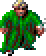 | Announcer | human | yes |
| 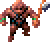 | Arant | human | yes |
| 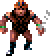 | Arant's Guard | human | yes |
|  | Arena Guard | human | yes |
|  | Armor Merchant | human | yes |
|  | Army Commander | mul | yes |
| 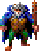 | Balkazar | human | yes |
|  | Balkazar's Image | human | yes |
|  | Bowyer | human | yes |
|  | Caravan Guard | elf | yes |
| 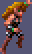 | Caravan Master | elf | yes |
|  | Castle Guard | human | yes |
| 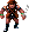 | Chaero | human | yes |
| 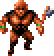 | Chahl | mul | yes |
| 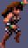 | Chaya | human | yes |
| 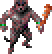 | Chief Daughter | human | yes |
|  | Churrr | human | yes |
|  | Council Member | human | yes |
|  | Dag Prisoner | human | yes |
| 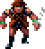 | Dagger | human | yes |
| 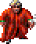 | Dagolar | human | yes |
|  | Dagolar Guard | human | yes |
|  | Dakaren | human | yes |
| 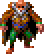 | Defiler | human | yes |
| 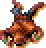 | Delirious Man | human | yes |
|  | Demothi | human | yes |
|  | Dinos | human | yes |
|  | Drajian Guard | human | yes |
|  | Druid | human | yes |
| 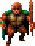 | Druid of Waters | mul | yes |
| 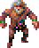 | Egrus | human | yes |
|  | Elite Guard | human | yes |
|  | Elven Leader | elf | yes |
| 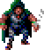 | Father Garyn | human | yes |
| 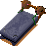 | Gilal | human | yes |
|  | Gladiator | human | yes |
| 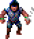 | Guard | human | yes |
| 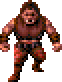 | Guard | half-giant | no: too big (a half-giant) |
| 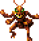 | Guardian | thri-kreen | yes |
| 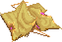 | Hermit | human | yes |
|  | Hototo | human | yes |
|  | Jake | human | yes |
|  | Jark | elf | yes |
| 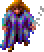 | Jasmine | human | yes |
| 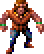 | Kalinin | human | yes |
| 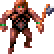 | Karas | human | yes |
|  | Kasha | human | yes |
|  | Katura | human | yes |
| 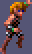 | Kel | elf | yes |
|  | Keldar | human | yes |
|  | Krikor | dwarf | yes |
|  | Kurzak | human | yes |
|  | Larissa | elf | yes |
|  | Lazy guard | human | yes |
|  | Legcrusher | half-giant | no: too big (a half-giant) |
| 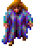 | Linara | human | yes |
|  | Low Warren Thug | human | yes |
|  | Loweman | human | yes |
|  | Lt. Kwerin | human | yes |
|  | Maris | human | yes |
|  | Mayor of Gedron | human | yes |
| 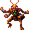 | Mehtar | thri-kreen | yes |
| 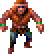 | Melkor | human | yes |
|  | Merzol | human | yes |
|  | Messenger | human | yes |
| 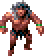 | Mikquetzl | human | yes |
|  | Mirlon | human | yes |
|  | Mow | human | yes |
|  | Nnamdi | human | yes |
|  | Notaku | human | yes |
| 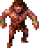 | Old One Eye | human | yes |
|  | Prisoner | human | yes |
| 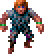 | Psionicist | human | yes |
|  | Ranger | human | yes |
| 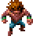 | Renegade | halfling | yes |
|  | Rogue Shaman | human | yes |
| 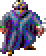 | Sage | human | yes |
| 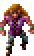 | Saria | elf | yes |
| 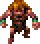 | Saria | halfling | yes |
|  | Scar | human | yes |
|  | Scar's henchman | human | yes |
|  | Semyon | human | yes |
|  | Seref | elf | yes |
|  | Serf | human | yes |
|  | Skull Guardian | human | yes |
|  | Slave | human | yes |
|  | Slave Hunter | human | yes |
|  | Slaver Guard | human | yes |
| 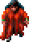 | Tara | human | yes |
|  | Tari | human | yes |
|  | Templar | human | yes |
| 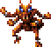 | Thrikreen | thri-kreen | yes |
| 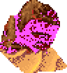 | Tied-up Prisoner | human | yes |
|  | Tobrian | elf | yes |
| 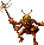 | Tohr-kreen | thri-kreen | yes |
|  | Toonuu | human | yes |
| 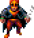 | Troop Leader | human | yes |
| 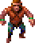 | Trustee | human | yes |
|  | Uskuye | human | yes |
|  | Uzoma | human | yes |
|  | Village Hero | human | yes |
|  | Villager | human | yes |
| 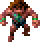 | Visionary | halfling | yes |
| 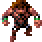 | Visitor | human | yes |
|  | Visitor | dwarf | yes |
|  | Warren Chief | human | yes |
| 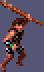 | Warrior | human | yes |
|  | Weapon Merchant | human | yes |
| 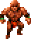 | Wild Mul | mul | yes |
| 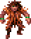 | Wind Druid | human | yes |
| 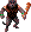 | Worshipper | human | yes |
|  | Wyrmias | human | yes |
| 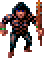 | Wyvern Master | human | yes |
|  | Zeefram | human | yes |

## Monsters

| | Creature | Race | Cahulaks can tangle it |
|---|---|---|---|
|  | Air Elemental | elemental | no: nothing to tangle |
| 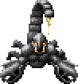 | Alita | monster | no: can't be tangled |
| 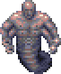 | Animated Statue | monster | no: too big |
|  | Aposs | undead | yes |
|  | Babau | monster | yes |
|  | Black Mastyrial | monster | no: too big |
|  | Blind One | monster | yes |
|  | Blue Slaad | monster | no: too big |
|  | Bulette | monster | no: too big |
|  | Cheee-smak-tunk! | monster | no: can't be tangled |
|  | Churr-te-tunk! | monster | no: can't be tangled |
|  | Click-tunk! | monster | no: can't be tangled |
|  | Convert | undead | yes |
|  | Cragg | undead | yes |
|  | Daggoran | monster | no: can't be tangled |
|  | Dagolar Slime | monster | no: nothing to tangle |
|  | Dark Spider | monster | no: can't be tangled |
|  | Djinn | monster | no: too big |
|  | Drummer | monster | yes |
|  | Dune Reaper | monster | no: too big |
|  | Dust Devil | monster | no: nothing to tangle |
|  | Earth Elemental | monster | no: nothing to tangle |
|  | Evard's Tentacle | monster | no: nothing to tangle |
|  | Fire Eel | monster | no: too big |
|  | Fire Elemental | monster | no: nothing to tangle |
|  | First Folk | monster | yes |
|  | Guard | monster | yes |
|  | Insect Swarm | monster | no: nothing to tangle |
|  | Laussa | monster | yes |
|  | Lesser Air Eleme | monster | no: nothing to tangle |
|  | Lesser Water Ele | monster | no: nothing to tangle |
|  | Lsr Earth Elem | monster | no: nothing to tangle |
|  | Lsr Fire Elem | monster | no: nothing to tangle |
|  | Magera | monster | no: can't be tangled |
|  | Mastyrial | monster | no: too big |
|  | Mountain Stalker | monster | no: too big |
|  | Otyugh | monster | no: too big |
|  | Outcast | monster | yes |
|  | Psurlon | monster | yes |
|  | Psurlon Adept | monster | yes |
|  | Rampager | monster | no: too big |
|  | Red Slaad | monster | no: too big |
|  | Sand Howler | monster | no: can't be tangled |
|  | Screamer Beetle | monster | no: can't be tangled |
|  | Shadow | undead | no: nothing to tangle |
|  | Shadow Guard | undead | yes |
|  | Shadow King | undead | yes |
|  | Shadow Prince | undead | yes |
|  | Shadow Worker | undead | yes |
|  | Shaman Follower | monster | yes |
|  | Silt Horror | monster | no: too big |
|  | Silt Runner | monster | yes |
|  | Skull Elder | undead | yes |
|  | Slave | monster | yes |
|  | Slave Leaders | monster | yes |
|  | Slig | monster | yes |
|  | Spider Mage | monster | no: can't be tangled |
|  | Ssovan | monster | yes |
|  | Ssurran | monster | yes |
|  | Strine | monster | no: can't be tangled |
|  | Styr | monster | no: too big |
|  | Tanelyv | undead | yes |
|  | Tara's Follower | undead | yes |
|  | Tribesman | monster | yes |
|  | Tristram | undead | yes |
|  | Tynan | undead | yes |
|  | Tyrian Slime | monster | no: nothing to tangle |
|  | Undermt Folk | monster | yes |
|  | Vrock | monster | no: too big |
|  | Wagon Guard | monster | yes |
|  | Water Elemental | monster | no: nothing to tangle |
|  | Worker | monster | yes |
|  | Wyvern | monster | no: too big |
|  | Xorn | monster | no: can't be tangled |
|  | Zombie | undead | yes |
