# Creatures

*Part of Obsidian Edition's documentation. **Spoilers:** this page names every creature in both games,
those met late in the story too.*

Every creature [Shattered Lands](#shattered-lands) and [Wake of the Ravager](#wake-of-the-ravager) define,
each game's in its own tables, with its figure as the game draws it standing, its size, and whether
[cahulaks](FEATURES.md#cahulaks) can tangle it (a hit that does damage tangles a man-sized or smaller
creature that fails a save against petrification, and it loses its next turn). The people the party meets
in towns are here too: any of them can be fought. The mod's own people (Shattered Lands' slave pens' and
arena's, and the champions) are on [their own page](PEOPLE.md).

**Size** is AD&D's (T tiny, S small, M man-sized, L large, H huge, G gargantuan), which neither game
keeps: the mod gives people theirs by race (a half-giant large, a halfling small) and the rest by name,
from AD&D's and Dark Sun's monster books; a **?** marks the mod's guess, for the games' own creatures no
book describes. [Creature size](FEATURES.md#creature-size) goes by it: a large one (or bigger) takes AD&D's
large weapon dice and isn't held or charmed by Hold Person or Charm Person (nor, in Shattered Lands, by
Charm Person or Mammal on a person).

## Shattered Lands

Who is too big for the cahulaks is the mod's call: half-giants and anything large or bigger can't be
tangled (nor anyone Enlarged, while the spell lasts), nor anything with nothing a rope could hold, nor
two the mod keeps from being tangled by name (the Sand Howler and the Strine). Names are the game's own,
cut short as the game has them ("Lsr Fire Elem"). A name the game gives more than one kind of creature
says, in brackets, where each is met.

### People in Shattered Lands

| Figure | Creature | Race | Size | Cahulaks can tangle it |
|---|---|---|---|---|
| 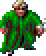 | Announcer | human | M | yes |
|  | Arant | human | M | yes |
|  | Arant's Guard | human | M | yes |
|  | Arena Guard | human | M | yes |
| 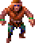 | Armor Merchant | human | M | yes |
|  | Army Commander | mul | M | yes |
|  | Balkazar | human | M | yes |
|  | Balkazar's Image | human | M | yes |
|  | Bowyer | human | M | yes |
|  | Caravan Guard | elf | M | yes |
| 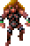 | Caravan Master | elf | M | yes |
| 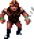 | Castle Guard | human | M | yes |
|  | Chaero | human | M | yes |
|  | Chahl | mul | M | yes |
|  | Chaya | human | M | yes |
|  | Chief Daughter | human | M | yes |
|  | Churrr | human | M | yes |
|  | Council Member | human | M | yes |
|  | Dag Prisoner | human | M | yes |
|  | Dagger | human | M | yes |
| 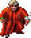 | Dagolar | human | M | yes |
|  | Dagolar Guard | human | M | yes |
|  | Dakaren | human | M | yes |
|  | Defiler | human | M | yes |
| 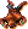 | Delirious Man | human | M | yes |
|  | Demothi | human | M | yes |
|  | Dinos | human | M | yes |
|  | Drajian Guard | human | M | yes |
| 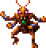 | Druid | human | M | yes |
| 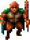 | Druid of Waters | mul | M | yes |
|  | Egrus | human | M | yes |
|  | Elite Guard | human | M | yes |
|  | Elven Leader | elf | M | yes |
|  | Father Garyn | human | M | yes |
|  | Gilal | human | M | yes |
|  | Gladiator | human | M | yes |
|  | Guard (the towns' and camps' guards) | human | M | yes |
|  | Guard (the slave pens' half-giants) | half-giant | L | no: too big (a half-giant) |
|  | Guardian | thri-kreen | M ? | yes |
| 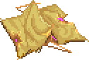 | Hermit | human | M | yes |
|  | Hototo | human | M | yes |
| 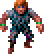 | Jake | human | M | yes |
| 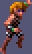 | Jark | elf | M | yes |
| 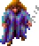 | Jasmine | human | M | yes |
| 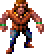 | Kalinin | human | M | yes |
|  | Karas | human | M | yes |
|  | Kasha | human | M | yes |
|  | Katura | human | M | yes |
|  | Kel | elf | M | yes |
| 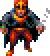 | Keldar | human | M | yes |
| 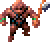 | Krikor | dwarf | M | yes |
|  | Kurzak | human | M | yes |
|  | Larissa | elf | M | yes |
|  | Lazy guard | human | M | yes |
| 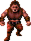 | Legcrusher | half-giant | L | no: too big (a half-giant) |
|  | Linara | human | M | yes |
| 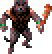 | Low Warren Thug | human | M | yes |
|  | Loweman | human | M | yes |
|  | Lt. Kwerin | human | M | yes |
| 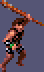 | Maris | human | M | yes |
|  | Mayor of Gedron | human | M | yes |
|  | Mehtar | thri-kreen | M ? | yes |
|  | Melkor | human | M | yes |
|  | Merzol | human | M | yes |
|  | Messenger | human | M | yes |
| 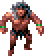 | Mikquetzl | human | M | yes |
|  | Mirlon | human | M | yes |
|  | Mow | human | M | yes |
|  | Nnamdi | human | M | yes |
|  | Notaku | human | M | yes |
|  | Old One Eye | human | M | yes |
|  | Prisoner | human | M | yes |
|  | Psionicist | human | M | yes |
|  | Ranger | human | M | yes |
| 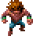 | Renegade | halfling | S | yes |
|  | Rogue Shaman | human | M | yes |
| 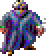 | Sage | human | M | yes |
|  | Saria | elf | M | yes |
|  | Saria | halfling | S | yes |
|  | Scar | human | M | yes |
|  | Scar's henchman | human | M | yes |
|  | Semyon | human | M | yes |
|  | Seref | elf | M | yes |
|  | Serf | human | M | yes |
| 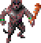 | Skull Guardian | human | M | yes |
| 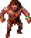 | Slave (the elven slavers' captives, and others) | human | M | yes |
|  | Slave Hunter | human | M | yes |
|  | Slaver Guard | human | M | yes |
| 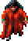 | Tara | human | M | yes |
|  | Tari | human | M | yes |
|  | Templar | human | M | yes |
|  | Thrikreen | thri-kreen | M ? | yes |
| 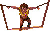 | Tied-up Prisoner | human | M | yes |
|  | Tobrian | elf | M | yes |
|  | Tohr-kreen | thri-kreen | M ? | yes |
|  | Toonuu | human | M | yes |
|  | Troop Leader | human | M | yes |
|  | Trustee | human | M | yes |
|  | Uskuye | human | M | yes |
|  | Uzoma | human | M | yes |
|  | Village Hero | human | M | yes |
|  | Villager | human | M | yes |
| 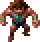 | Visionary | halfling | S | yes |
| 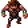 | Visitor | human | M | yes |
|  | Visitor | dwarf | M | yes |
|  | Warren Chief | human | M | yes |
|  | Warrior | human | M | yes |
|  | Weapon Merchant | human | M | yes |
| 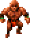 | Wild Mul | mul | M | yes |
|  | Wind Druid | human | M | yes |
|  | Worshipper | human | M | yes |
|  | Wyrmias | human | M | yes |
| 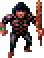 | Wyvern Master | human | M | yes |
| 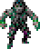 | Zeefram | human | M | yes |

### Monsters in Shattered Lands

| Figure | Creature | Size | Cahulaks can tangle it |
|---|---|---|---|
|  | Air Elemental | L | no: nothing to tangle |
| 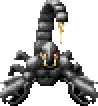 | Alita | L ? | no: too big |
| 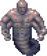 | Animated Statue | L ? | no: too big |
|  | Aposs | M | yes |
|  | Babau | M | yes |
|  | Black Mastyrial | L | no: too big |
|  | Blind One | L | no: too big |
| 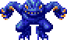 | Blue Slaad | L | no: too big |
| 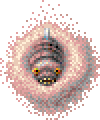 | Bulette | L | no: too big |
|  | Cheee-smak-tunk! | L ? | no: too big |
|  | Churr-te-tunk! | L ? | no: too big |
|  | Click-tunk! | L ? | no: too big |
|  | Convert | M | yes |
| 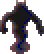 | Cragg | M | no: nothing to tangle |
|  | Daggoran | L ? | no: too big |
| 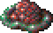 | Dagolar Slime | M | no: nothing to tangle |
|  | Dark Spider | L | no: too big |
| 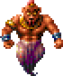 | Djinn | L | no: too big |
|  | Drummer | L | no: too big |
|  | Dune Reaper | H | no: too big |
|  | Dust Devil | M ? | no: nothing to tangle |
|  | Earth Elemental | L | no: nothing to tangle |
|  | Evard's Tentacle | L ? | no: nothing to tangle |
|  | Fire Eel | L ? | no: too big |
|  | Fire Elemental | L | no: nothing to tangle |
|  | First Folk | S ? | yes |
|  | Guard (a magera, at the Silt Sea Summoning) | L | no: too big |
| 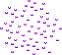 | Insect Swarm | L ? | no: nothing to tangle |
|  | Laussa | M ? | yes |
| 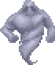 | Lesser Air Eleme | M ? | no: nothing to tangle |
|  | Lesser Water Ele | M ? | no: nothing to tangle |
|  | Lsr Earth Elem | M ? | no: nothing to tangle |
| 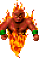 | Lsr Fire Elem | M ? | no: nothing to tangle |
|  | Magera | L | no: too big |
|  | Mastyrial | L | no: too big |
| 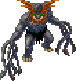 | Mountain Stalker | L ? | no: too big |
| 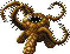 | Otyugh | L | no: too big |
|  | Outcast | M | yes |
|  | Psurlon | L | no: too big |
|  | Psurlon Adept | L | no: too big |
| 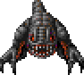 | Rampager | L ? | no: too big |
| 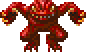 | Red Slaad | L | no: too big |
|  | Sand Howler | M ? | no: can't be tangled |
|  | Screamer Beetle | L ? | no: too big |
|  | Shadow | M | no: nothing to tangle |
|  | Shadow Guard | M | no: nothing to tangle |
|  | Shadow King | M | no: nothing to tangle |
|  | Shadow Prince | M | no: nothing to tangle |
|  | Shadow Worker | M | no: nothing to tangle |
|  | Shaman Follower | M | yes |
|  | Silt Horror | G | no: too big |
|  | Silt Runner | S | yes |
|  | Skull Elder | M | yes |
| 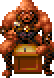 | Slave (a magera, in the Wyrm Belly) | L | no: too big |
|  | Slave Leaders | L | no: too big |
|  | Slig | M | yes |
|  | Spider Mage | L ? | no: too big |
|  | Ssovan | M | yes |
|  | Ssurran | M | yes |
|  | Strine | M ? | no: can't be tangled |
|  | Styr | L ? | no: too big |
|  | Tanelyv | M | no: nothing to tangle |
|  | Tara's Follower | M | yes |
|  | Tribesman | M | yes |
|  | Tristram | M | no: nothing to tangle |
|  | Tynan | M | no: nothing to tangle |
|  | Tyrian Slime | M | no: nothing to tangle |
|  | Undermt Folk | S ? | yes |
|  | Vrock | L | no: too big |
|  | Wagon Guard | L | no: too big |
|  | Water Elemental | L | no: nothing to tangle |
|  | Worker (a magera, in the Wyrm Belly) | L | no: too big |
| 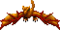 | Wyvern | L ? | no: too big |
| 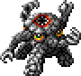 | Xorn | L | no: too big |
|  | Zombie | M | yes |

## Wake of the Ravager

Every creature [the sequel](RAVAGER.md) defines (its OBJEX.GFF), each with its figure as the mod draws it
standing: the **Drawn** column says *redrawn* for the ones [redrawn in Shattered Lands'
style](RAVAGER.md#the-mod-in-the-sequel) (the Loader puts them in each start) and *the game's* for the
rest. The sequel's own party (Terrannus, Thy'rokh, Gerakis, Ar'Anda) is left out; a creature the sequel
gives no figure says *none*. A name in two rows is two kinds of creature, each with its own figure, and a
name met in both games is a different creature in each (its own figure and numbers), so it is in each
game's tables. Names are the sequel's own, cut short as it has them ("Grt Air Elem").

**Size** goes by the sequel's own table, as Shattered Lands' does: people by race, the monsters the mod has
looked up by name. A name the table doesn't have is taken as man-sized and marked **?**. The cahulaks in the
sequel go by size alone: a half-giant or anything large or bigger can't be tangled (nor anyone Enlarged),
but the shapeless (a shadow, a dust devil) and Shattered Lands' creatures kept from being tangled by name have
no counterpart yet ([a gap](RAVAGER.md#not-in-the-sequel-yet)).

### People in Wake of the Ravager

| Figure | Creature | Race | Size | Cahulaks can tangle it | Drawn |
|---|---|---|---|---|---|
|  | Acar | human | M | yes | redrawn |
|  | Armorer | human | M | yes | the game's |
| 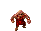 | Arslan | dwarf | M | yes | redrawn |
| 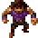 | Ash | halfling | S | yes | redrawn |
|  | Axestopper | halfling | S | yes | redrawn |
|  | Bit o'Tarrasque | human | M | yes | the game's |
| 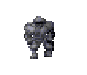 | Black Knight | human | M | yes | redrawn |
|  | Blick | human | M | yes | redrawn |
|  | Boric | human | M | yes | redrawn |
|  | Brainsniffer | human | M | yes | redrawn |
|  | Branch | halfling | S | yes | redrawn |
|  | Butler | human | M | yes | redrawn |
|  | Caravan Master | human | M | yes | redrawn |
|  | Chander | human | M | yes | redrawn |
|  | Citizen | human | M | yes | redrawn |
|  | Cleave | halfling | S | yes | redrawn |
|  | Dariya | halfling | S | yes | redrawn |
|  | Deathraker | mul | M | yes | redrawn |
|  | Defiler | human | M | yes | redrawn |
|  | Dhukkar | human | M | yes | redrawn |
|  | Dmitri | halfling | S | yes | redrawn |
|  | Dodger | halfling | S | yes | redrawn |
|  | Donno | halfling | S | yes | redrawn |
|  | Draxan | human | M | yes | redrawn |
|  | Draxan | half-giant | L | no: too big (a half-giant) | redrawn |
|  | Draxan | mul | M | yes | redrawn |
|  | Dream | human | M | yes | redrawn |
|  | Drisha | elf | M | yes | redrawn |
|  | El | human | M | yes | redrawn |
|  | Fayina | human | M | yes | redrawn |
|  | Fermin | human | M | yes | redrawn |
|  | FHalfelf | half-elf | M | yes | redrawn |
|  | Fighter | human | M | yes | redrawn |
|  | Firegazer | halfling | S | yes | redrawn |
| none | Fleeing Dwarf | dwarf | M | yes | none |
| none | Fleeing Human | human | M | yes | none |
|  | Glade | halfling | S | yes | redrawn |
|  | Gladiator | mul | M | yes | redrawn |
|  | Granger | human | M | yes | redrawn |
|  | Greshard | halfling | S | yes | redrawn |
|  | Guard | human | M | yes | redrawn |
|  | Guard | dwarf | M | yes | redrawn |
|  | Guard | mul | M | yes | redrawn |
|  | Halfling | halfling | S | yes | redrawn |
|  | Halik | mul | M | yes | redrawn |
|  | Halla | halfling | S | yes | redrawn |
|  | Irma | halfling | S | yes | redrawn |
| none | Jhathar | human | M | yes | none |
|  | Jumah | human | M | yes | redrawn |
| none | Jumper | halfling | S | yes | none |
|  | Kalaobuta | human | M | yes | redrawn |
|  | Kitchen slave | human | M | yes | redrawn |
|  | Kovar | human | M | yes | redrawn |
|  | Kranix | human | M | yes | redrawn |
|  | Ladel | dwarf | M | yes | redrawn |
|  | Leader | human | M | yes | redrawn |
|  | Leaftop | halfling | S | yes | redrawn |
|  | Magnolia | halfling | S | yes | redrawn |
|  | Matthias | human | M | yes | redrawn |
|  | Melody | half-giant | L | no: too big (a half-giant) | redrawn |
|  | Mercenary | human | M | yes | redrawn |
|  | Merchant | human | M | yes | redrawn |
|  | Miner | human | M | yes | redrawn |
|  | Miner | dwarf | M | yes | redrawn |
|  | Miner | mul | M | yes | redrawn |
|  | Mug | dwarf | M | yes | redrawn |
|  | Nnamdi | human | M | yes | redrawn |
|  | Notaku | elf | M | yes | redrawn |
|  | Pedestrian | human | M | yes | redrawn |
|  | Preserver | elf | M | yes | redrawn |
|  | Prisoner | human | M | yes | redrawn |
| none | Prisoner | halfling | S | yes | none |
|  | Raenika | human | M | yes | redrawn |
|  | Receptionist | human | M | yes | redrawn |
|  | Romila | human | M | yes | redrawn |
|  | Runner | halfling | S | yes | redrawn |
|  | Rybochka | human | M | yes | redrawn |
|  | Salesperson | human | M | yes | the game's |
|  | Silvain | elf | M | yes | redrawn |
|  | Slave | human | M | yes | redrawn |
|  | Slave | dwarf | M | yes | redrawn |
|  | Slave | mul | M | yes | redrawn |
|  | Snaggle | halfling | S | yes | redrawn |
|  | Soothsurg | halfling | S | yes | redrawn |
|  | Strongrip | halfling | S | yes | redrawn |
|  | Sureshot | halfling | S | yes | redrawn |
|  | Surrakina | human | M | yes | redrawn |
|  | Switchman | mul | M | yes | redrawn |
|  | Templar | human | M | yes | redrawn |
|  | Thesisa | human | M | yes | redrawn |
|  | Thief | human | M | yes | redrawn |
|  | Thug | human | M | yes | redrawn |
|  | Tyrian Soldier | mul | M | yes | redrawn |
|  | Ulbin | halfling | S | yes | redrawn |
|  | VA Guard | human | M | yes | redrawn |
|  | VA Member | human | M | yes | redrawn |
|  | VA Member | elf | M | yes | redrawn |
|  | Victim | human | M | yes | redrawn |
|  | Villager | halfling | S | yes | redrawn |
|  | Warrior | human | M | yes | redrawn |
|  | Warrior | halfling | S | yes | redrawn |
|  | Warrior | mul | M | yes | redrawn |
|  | Weaponer | human | M | yes | the game's |
|  | White Knight | human | M | yes | redrawn |
|  | Winchester | dwarf | M | yes | redrawn |
|  | Wren | elf | M | yes | redrawn |
|  | Zeegrat | human | M | yes | redrawn |
|  | Zombie | human | M | yes | redrawn |
|  | Zombie | halfling | S | yes | redrawn |
|  | Zombie | mul | M | yes | redrawn |
|  | Zorani | human | M | yes | redrawn |

### Monsters in Wake of the Ravager

| Figure | Creature | Size | Cahulaks can tangle it | Drawn |
|---|---|---|---|---|
|  | Air Drake | G ? | no: too big | redrawn |
|  | Air Elemental | L | no: too big | redrawn |
|  | Alhena | M ? | yes | redrawn |
|  | Aravinda | M ? | yes | redrawn |
|  | Asim Drac | M ? | yes | redrawn |
|  | Aurumvorax | S | yes | redrawn |
|  | Beasthead Giant | H ? | no: too big | redrawn |
|  | Brotel | M ? | yes | redrawn |
| none | Danya | M ? | yes | none |
|  | Davin | M ? | yes | redrawn |
|  | Dust devil | M ? | yes | the game's |
|  | Earth Drake | G ? | no: too big | redrawn |
|  | Earth Elemental | L | no: too big | redrawn |
|  | Elovan | M ? | yes | redrawn |
|  | Farmer | M ? | yes | redrawn |
|  | Female Hlfgnt | L | no: too big | redrawn |
|  | Fire Drake | G ? | no: too big | redrawn |
|  | Fire Elemental | L | no: too big | redrawn |
|  | Fori | M ? | yes | redrawn |
|  | Galinix | M ? | yes | redrawn |
|  | Garzak | M ? | yes | the game's |
|  | Giant Skeleton | L | no: too big | redrawn |
|  | Giant Snake | L ? | no: too big | redrawn |
|  | Gilad | M ? | yes | redrawn |
|  | Gr. Fire Elem | H ? | no: too big | redrawn |
|  | Great Feyr | L ? | no: too big | redrawn |
|  | Greater Feyr | L ? | no: too big | redrawn |
|  | Grt Air Elem | H ? | no: too big | redrawn |
|  | Grt Earth Elem | H ? | no: too big | redrawn |
|  | Grt Fire Elem | H ? | no: too big | redrawn |
|  | Grtr Water Elem | H ? | no: too big | redrawn |
|  | Guard | M ? | yes | redrawn |
|  | Guard | M ? | yes | redrawn |
|  | Helmine | M ? | yes | redrawn |
|  | Int. Devourer | T | yes | redrawn |
|  | Int.Devourer | T | yes | redrawn |
|  | Jakath | M ? | yes | redrawn |
|  | Jann | M ? | yes | redrawn |
|  | Jerrid | M ? | yes | redrawn |
|  | Jestris | M ? | yes | redrawn |
|  | Kartang | M ? | yes | redrawn |
|  | Kartang | M ? | yes | redrawn |
|  | Kell | M ? | yes | redrawn |
|  | Kiril | M ? | yes | redrawn |
|  | Lord Warrior | M ? | yes | redrawn |
|  | Magma Golem | L | no: too big | redrawn |
|  | Masina | M ? | yes | redrawn |
|  | Melantha | M ? | yes | redrawn |
|  | Mind Flayer | M | yes | redrawn |
|  | Mindflayer | M | yes | redrawn |
|  | Mordenk's Sword | M ? | yes | the game's |
|  | Nortemus | M ? | yes | redrawn |
|  | Obsidian Golem | L | no: too big | redrawn |
|  | Prim. Marakian | M ? | yes | redrawn |
|  | Prosser | M ? | yes | redrawn |
|  | Psurlon | L | no: too big | the game's |
|  | Ptar | M ? | yes | redrawn |
|  | Ptar's Friend | M ? | yes | redrawn |
|  | Revenant | M | yes | redrawn |
|  | Rhone | M ? | yes | redrawn |
|  | Scout | M ? | yes | redrawn |
|  | Senturnis | M ? | yes | redrawn |
|  | Shadow | M | yes | redrawn |
|  | Shambling Mound | L | no: too big | redrawn |
|  | Silvan | M ? | yes | redrawn |
|  | SkeletonWarrior | M | yes | redrawn |
|  | Snappersaw | M ? | yes | redrawn |
|  | Solurnis | M ? | yes | redrawn |
|  | Soulshard | M ? | yes | redrawn |
|  | Speaker | M ? | yes | redrawn |
|  | Sundew | M ? | yes | redrawn |
|  | Talo | M ? | yes | redrawn |
|  | Tantris | M ? | yes | redrawn |
| none | Tarrasque | G | no: too big | redrawn (its fight's figure; none on the map) |
|  | Traxiss | M ? | yes | redrawn |
|  | Treasure Guard | M ? | yes | redrawn |
|  | Umber Hulk | L | no: too big | redrawn |
|  | VA Member | M ? | yes | redrawn |
|  | Velden | M ? | yes | redrawn |
|  | Verini | M ? | yes | redrawn |
|  | Verini Child | M ? | yes | redrawn |
|  | Water Elemental | L | no: too big | redrawn |
|  | Winter | M ? | yes | redrawn |
|  | Xarax | M ? | yes | redrawn |
|  | Yerath | M ? | yes | redrawn |
|  | Yuan-ti | M | yes | redrawn |
|  | Zydeko | M ? | yes | redrawn |
