# Creatures

*Part of Obsidian Edition's documentation. **Spoilers:** this page names every creature in the game,
those met late in the story too.*

Every creature Shattered Lands defines, each with its figure as the game draws it standing, and
whether [cahulaks](FEATURES.md#cahulaks) can tangle it (with the rule on: a hit that does damage
tangles a man-sized or smaller creature that fails a save against petrification, and it loses
its next turn). The game keeps no size for its creatures, so who is too big is the mod's call,
from AD&D's sizes: half-giants and anything large or bigger can't be tangled (nor anyone Enlarged,
while the spell lasts), nor anything with
nothing a rope could hold, nor two the mod keeps from being tangled by name (the Sand Howler and
the Strine). The people the party meets in towns are here too: any of them can be fought. Names
are the game's own, cut short as the game has them ("Lsr Fire Elem").

**Size** is AD&D's (T tiny, S small, M man-sized, L large, H huge, G gargantuan), which the game
doesn't keep either: people by race (a half-giant large, a halfling small), the
rest by name, from AD&D's and Dark Sun's monster books; a **?** marks the mod's guess, for the
game's own creatures no book describes. [Creature size](FEATURES.md#creature-size) goes by it: a
large one (or bigger) takes AD&D's large weapon dice and isn't held or charmed by Hold Person,
Charm Person, or Charm Person or Mammal (on a person). A name the game gives more than one kind of
creature says, in brackets, where each is met.

## People

| Figure | Creature | Race | Size | Cahulaks can tangle it |
|---|---|---|---|---|
|  | Announcer | human | M | yes |
|  | Arant | human | M | yes |
|  | Arant's Guard | human | M | yes |
|  | Arena Guard | human | M | yes |
|  | Armor Merchant | human | M | yes |
| 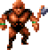 | Army Commander | mul | M | yes |
|  | Balkazar | human | M | yes |
| 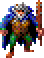 | Balkazar's Image | human | M | yes |
|  | Bowyer | human | M | yes |
|  | Caravan Guard | elf | M | yes |
|  | Caravan Master | elf | M | yes |
|  | Castle Guard | human | M | yes |
| 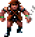 | Chaero | human | M | yes |
|  | Chahl | mul | M | yes |
| 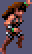 | Chaya | human | M | yes |
|  | Chief Daughter | human | M | yes |
|  | Churrr | human | M | yes |
|  | Council Member | human | M | yes |
|  | Dag Prisoner | human | M | yes |
| 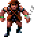 | Dagger | human | M | yes |
|  | Dagolar | human | M | yes |
| 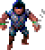 | Dagolar Guard | human | M | yes |
|  | Dakaren | human | M | yes |
| 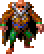 | Defiler | human | M | yes |
|  | Delirious Man | human | M | yes |
|  | Demothi | human | M | yes |
|  | Dinos | human | M | yes |
|  | Drajian Guard | human | M | yes |
|  | Druid | human | M | yes |
|  | Druid of Waters | mul | M | yes |
| 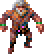 | Egrus | human | M | yes |
|  | Elite Guard | human | M | yes |
|  | Elven Leader | elf | M | yes |
| 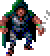 | Father Garyn | human | M | yes |
| 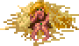 | Gilal | human | M | yes |
|  | Gladiator | human | M | yes |
|  | Guard (the towns' and camps' guards) | human | M | yes |
|  | Guard (the slave pens' half-giants) | half-giant | L | no: too big (a half-giant) |
| 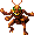 | Guardian | thri-kreen | M ? | yes |
|  | Hermit | human | M | yes |
|  | Hototo | human | M | yes |
|  | Jake | human | M | yes |
|  | Jark | elf | M | yes |
|  | Jasmine | human | M | yes |
|  | Kalinin | human | M | yes |
|  | Karas | human | M | yes |
|  | Kasha | human | M | yes |
|  | Katura | human | M | yes |
|  | Kel | elf | M | yes |
|  | Keldar | human | M | yes |
|  | Krikor | dwarf | M | yes |
|  | Kurzak | human | M | yes |
|  | Larissa | elf | M | yes |
|  | Lazy guard | human | M | yes |
|  | Legcrusher | half-giant | L | no: too big (a half-giant) |
| 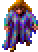 | Linara | human | M | yes |
|  | Low Warren Thug | human | M | yes |
|  | Loweman | human | M | yes |
|  | Lt. Kwerin | human | M | yes |
|  | Maris | human | M | yes |
|  | Mayor of Gedron | human | M | yes |
|  | Mehtar | thri-kreen | M ? | yes |
|  | Melkor | human | M | yes |
|  | Merzol | human | M | yes |
|  | Messenger | human | M | yes |
|  | Mikquetzl | human | M | yes |
|  | Mirlon | human | M | yes |
|  | Mow | human | M | yes |
|  | Nnamdi | human | M | yes |
|  | Notaku | human | M | yes |
|  | Old One Eye | human | M | yes |
| 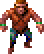 | Prisoner | human | M | yes |
|  | Psionicist | human | M | yes |
|  | Ranger | human | M | yes |
|  | Renegade | halfling | S | yes |
|  | Rogue Shaman | human | M | yes |
|  | Sage | human | M | yes |
| 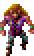 | Saria | elf | M | yes |
| 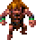 | Saria | halfling | S | yes |
|  | Scar | human | M | yes |
| 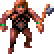 | Scar's henchman | human | M | yes |
|  | Semyon | human | M | yes |
|  | Seref | elf | M | yes |
|  | Serf | human | M | yes |
|  | Skull Guardian | human | M | yes |
|  | Slave (the elven slavers' captives, and others) | human | M | yes |
|  | Slave Hunter | human | M | yes |
|  | Slaver Guard | human | M | yes |
|  | Tara | human | M | yes |
|  | Tari | human | M | yes |
|  | Templar | human | M | yes |
| 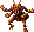 | Thrikreen | thri-kreen | M ? | yes |
|  | Tied-up Prisoner | human | M | yes |
|  | Tobrian | elf | M | yes |
| 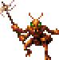 | Tohr-kreen | thri-kreen | M ? | yes |
|  | Toonuu | human | M | yes |
|  | Troop Leader | human | M | yes |
|  | Trustee | human | M | yes |
|  | Uskuye | human | M | yes |
|  | Uzoma | human | M | yes |
|  | Village Hero | human | M | yes |
|  | Villager | human | M | yes |
|  | Visionary | halfling | S | yes |
|  | Visitor | human | M | yes |
|  | Visitor | dwarf | M | yes |
|  | Warren Chief | human | M | yes |
|  | Warrior | human | M | yes |
|  | Weapon Merchant | human | M | yes |
|  | Wild Mul | mul | M | yes |
| 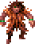 | Wind Druid | human | M | yes |
|  | Worshipper | human | M | yes |
|  | Wyrmias | human | M | yes |
|  | Wyvern Master | human | M | yes |
|  | Zeefram | human | M | yes |

## Monsters

| Figure | Creature | Size | Cahulaks can tangle it |
|---|---|---|---|
|  | Air Elemental | L | no: nothing to tangle |
|  | Alita | L ? | no: too big |
|  | Animated Statue | L ? | no: too big |
|  | Aposs | M | yes |
| 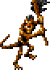 | Babau | M | yes |
| 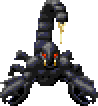 | Black Mastyrial | L | no: too big |
|  | Blind One | L | no: too big |
|  | Blue Slaad | L | no: too big |
|  | Bulette | L | no: too big |
|  | Cheee-smak-tunk! | L ? | no: too big |
| 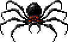 | Churr-te-tunk! | L ? | no: too big |
|  | Click-tunk! | L ? | no: too big |
|  | Convert | M | yes |
|  | Cragg | M | no: nothing to tangle |
| 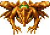 | Daggoran | L ? | no: too big |
|  | Dagolar Slime | M | no: nothing to tangle |
|  | Dark Spider | L | no: too big |
|  | Djinn | L | no: too big |
| 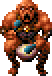 | Drummer | L | no: too big |
| 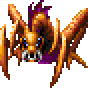 | Dune Reaper | H | no: too big |
| 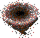 | Dust Devil | M ? | no: nothing to tangle |
| 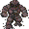 | Earth Elemental | L | no: nothing to tangle |
|  | Evard's Tentacle | L ? | no: nothing to tangle |
| 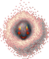 | Fire Eel | L ? | no: too big |
|  | Fire Elemental | L | no: nothing to tangle |
|  | First Folk | S ? | yes |
|  | Guard (a magera, at the Silt Sea Summoning) | L | no: too big |
|  | Insect Swarm | L ? | no: nothing to tangle |
|  | Laussa | M ? | yes |
|  | Lesser Air Eleme | M ? | no: nothing to tangle |
| 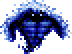 | Lesser Water Ele | M ? | no: nothing to tangle |
|  | Lsr Earth Elem | M ? | no: nothing to tangle |
|  | Lsr Fire Elem | M ? | no: nothing to tangle |
|  | Magera | L | no: too big |
|  | Mastyrial | L | no: too big |
|  | Mountain Stalker | L ? | no: too big |
|  | Otyugh | L | no: too big |
| 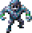 | Outcast | M | yes |
| 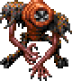 | Psurlon | L | no: too big |
|  | Psurlon Adept | L | no: too big |
|  | Rampager | L ? | no: too big |
|  | Red Slaad | L | no: too big |
| 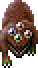 | Sand Howler | M ? | no: can't be tangled |
| 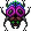 | Screamer Beetle | L ? | no: too big |
|  | Shadow | M | no: nothing to tangle |
|  | Shadow Guard | M | no: nothing to tangle |
|  | Shadow King | M | no: nothing to tangle |
|  | Shadow Prince | M | no: nothing to tangle |
|  | Shadow Worker | M | no: nothing to tangle |
|  | Shaman Follower | M | yes |
| 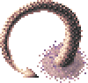 | Silt Horror | G | no: too big |
| 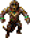 | Silt Runner | S | yes |
| 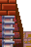 | Skull Elder | M | yes |
|  | Slave (a magera, in the Wyrm Belly) | L | no: too big |
|  | Slave Leaders | L | no: too big |
| 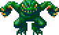 | Slig | M | yes |
|  | Spider Mage | L ? | no: too big |
|  | Ssovan | M | yes |
|  | Ssurran | M | yes |
| 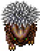 | Strine | M ? | no: can't be tangled |
| 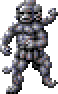 | Styr | L ? | no: too big |
|  | Tanelyv | M | no: nothing to tangle |
|  | Tara's Follower | M | yes |
| 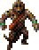 | Tribesman | M | yes |
|  | Tristram | M | no: nothing to tangle |
|  | Tynan | M | no: nothing to tangle |
|  | Tyrian Slime | M | no: nothing to tangle |
|  | Undermt Folk | S ? | yes |
| 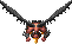 | Vrock | L | no: too big |
|  | Wagon Guard | L | no: too big |
|  | Water Elemental | L | no: nothing to tangle |
| 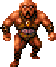 | Worker (a magera, in the Wyrm Belly) | L | no: too big |
|  | Wyvern | L ? | no: too big |
|  | Xorn | L | no: too big |
|  | Zombie | M | yes |
