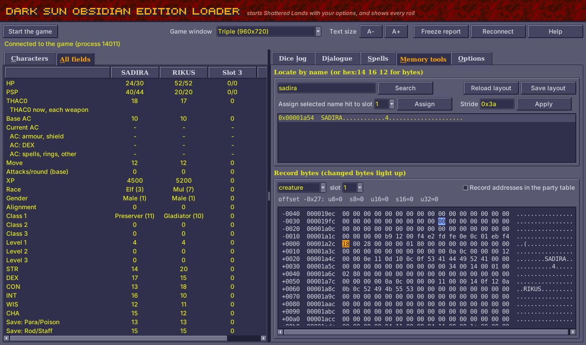

# Development: internals

*Part of the [development notes](DEVELOPMENT.md). How the dice log works and labels the game's
rolls; DSCLOG's header; its room and the game's memory; the crash, freeze and item-watch reports;
reading and writing the game's memory through the item gate; and what's known of the save, the
game's records and the Loader's game flags. The words used here are in [the
glossary](DEVELOPMENT.md#glossary).*

## Contents

- [How the dice log works](#how-the-dice-log-works)
  - [Labelling rolls](#labelling-rolls)
- [DSCLOG's header](#dsclogs-header)
- [Room and memory](#room-and-memory)
  - [Where DOSBox's memory is](#where-dosboxs-memory-is)
  - [The limits](#the-limits)
  - [DSCLOG's segment](#dsclogs-segment)
  - [The far block](#the-far-block)
  - [DSCLOG2's segment, tail and install](#dsclog2s-segment-tail-and-install)
  - [Upper memory moved down](#upper-memory-moved-down)
  - [EMS off](#ems-off)
  - [The game's overlay buffer](#the-games-overlay-buffer)
  - [The game's blocks kept for good](#the-games-blocks-kept-for-good)
  - [Low memory in play](#low-memory-in-play)
- [Crash, freeze and item-watch reports](#crash-freeze-and-item-watch-reports)
  - [The crash report](#the-crash-report)
  - [The freeze report](#the-freeze-report)
  - [The item watch](#the-item-watch)
- [Reading and writing memory](#reading-and-writing-memory)
  - [The item gate](#the-item-gate)
  - [Mapping memory](#mapping-memory)
  - [Command-line mapping tools](#command-line-mapping-tools)
  - [Practising without the game](#practising-without-the-game)
- [What's known of the save and records](#whats-known-of-the-save-and-records)
  - [The Loader's game flags](#the-loaders-game-flags)

## How the dice log works

Every roll in the game goes through one function, Borland C++'s `rand()`.

1. When you start the game with the dice log, the Loader writes
   `dos\DSUNLOG.EXE`: a copy of the game's `DSUN.EXE` with a few hundred
   small changes, listed in `PATCHES` in `dsloader/gamepatch.py`. Most replace a few
   bytes of the game's code with an `INT` (60h to 65h, and 80h to FFh; all of
   them are taken, so later sites share one, a site number after the `INT`, as
   in [Scores and hit points as rolled](DEVELOPMENT-RULES.md#scores-and-hit-points-as-rolled)) that
   DSCLOG answers: `rand()`, the saving throw, AC, the dialogue window and
   message boxes for the dice log; the inventory, View Character, USE and
   Effects screens and the Look box for what the Loader adds to them; and the
   places each rule change, new item and screen addition needs. The sections
   under [How each part works](DEVELOPMENT.md#how-each-part-works) name the patches each part
   uses. One, at the start of a monster's turn, is in overlay code the game
   moves or unloads to load the dialogue window's, so DSCLOG puts its way
   back in a stack frame the game's overlay manager fixes up (a stale address
   used to restart a fight, or stop the game with "Stack overflow!").

   A few patches change the game outright:
   - 29 saved characters rather than 19, DELETE deleting the one chosen and a
     New character counting as Okay ([more characters](FEATURES.md#more-characters));
   - Enter loading only a save that is there ([more saves](FEATURES.md#more-saves));
   - a script buffer of 11,776 bytes rather than 10,000 (for [Dinos and the
     Trustee](PEOPLE.md#what-dinos-and-the-trustee-say-about-them));
   - data files looked for in the current folder rather than next to the program.

   DSCLOG also hooks:
   - DOS's `INT 21h`, to open the Loader's copies of `SEGOBJEX.GFF`,
     `RESOURCE.GFF`, `GPLDATA.GFF` and some regions' files (its table `copies`: each name once,
     the copy's `D:\` path made in `COPY_PATH` as the file is opened) (for the [new
     items](FEATURES.md#new-items), [Kalzith](FEATURES.md#kalzith),
     [Semyon](FEATURES.md#semyon) and [no manual
     check](FEATURES.md#no-manual-check)), and to keep what the game last wrote
     to the screen for a crash report ([the crash report](#the-crash-report));
   - the mouse driver's `INT 33h` (for [scrolling the
     map](FEATURES.md#scrolling-the-map));
   - the keyboard's `INT 16h` (for Tab and Enter).

   DOSBox runs it from the game folder, so it uses your saves as usual.
2. `dos\DSCLOG.EXE` (source in `dos\dsclog.asm`) is a tiny DOS program loaded
   into upper memory before the game, so the game loses no memory. It answers
   those interrupts. Its `rand()` returns exactly the numbers the original
   would and also records each call, what code called it, and that code's
   arguments (dice count and sides, THAC0, AC...) in a ring buffer. Others
   record the final saving throw total, the AC the game uses, and the text
   of dialogues and messages (in a second buffer); the rest draw the in-game
   additions and make the new items and the rule changes count.
3. The Loader finds the buffer in DOSBox's memory and reads it every 20 ms
   from the command line (`dicelog`, `play`) and every 50 ms in its window.
   It works out what each roll was for from the code that asked for it, and
   reads the rest (names, weapons, spells, effects) from the game's own data.
   Some rolls come faster than that: the creation screen's die rolls a whole
   character several times while it tumbles, so DSCLOG keeps each
   ability's last four 4d4 itself (`RL_TRIES`, the header's +282, counted at
   +280), and the dice log checks each ability against the one the screen
   shows.
4. To keep bursts of unimportant randomness from crowding out the rolls that
   matter, DSCLOG only records calls from code it knows how to label,
   unless **Show unlabelled rolls** is ticked.
5. Each pass is a list of steps, each on its own (`DiceLog._step`): one that
   fails doesn't stop those after it. The game busy with its item lists
   (`ItemsBusy`) waits for a later pass; DOSBox gone (`ProcessError`) is
   passed on; anything else is said once, keyed by its kind and where it was
   raised (`dicelog.error_key`, not its text, which may carry an address), in
   the dice log, the window and `play` mode alike. A write the Loader stops is
   told in the log once ([Reading and writing memory](#reading-and-writing-memory)).
   What the Loader saves as it goes (picked
   pockets, learned speakers' names) is kept for the next pass if
   settings.json can't be written (`DiceLog.save_learned`).
   For timed effects, `effect_changes` also compares absolute expiration times
   from the event queue. If the owner, caster, spell and handle stay the same,
   a different deadline produces a replacement line. The log keeps the last
   known deadline while the effect is active and the timer is absent.
   When a `dicelog` connection ends, the command waits for the stats worker
   before closing the process handle. A game restart inside the same DOSBox
   reuses the connection and worker.

Because the replacement produces identical numbers, the game plays exactly as
it would without it, apart from what you choose on the Options tab (picking
pockets, the [rule changes](FEATURES.md#rule-changes)), the Loader's other
additions ([the features page](FEATURES.md) lists them) and [the game's bugs
fixed](GAME-BUGS.md).

Limitations:
- Only the GOG release (`DSUN.EXE` of 611,408 bytes) is supported. With
  another version the Loader starts the game without the dice log and says
  why.
- Outside combat, the thief skill, trap and ability checks, the character
  creation rolls and searching junk, hay and wardrobes are labelled; other
  rolls there (for example treasure or random encounters) show up only with
  **Show unlabelled rolls**, as raw numbers.
- A save-file load from the main menu is recognised, so the spells already
  active in it aren't reported as new. A save of the same party loaded in the
  middle of play is seen only when its clock is earlier than the game's was; a
  later one's effects may be listed as if just cast.
- Dialogue speakers are portrait numbers until the log learns their names or you
  name them (see [the Dialogue tab](README.md#the-dialogue-tab)): the game
  doesn't keep a name with the dialogue. A learned name is the creature the
  conversation was started on, so a scene in which one face speaks for someone
  else would get that someone's name.
- Weapon breaking is read from the game's code, and the check's rolls are
  logged; the game's own "is broken !" message is logged either way (a break
  itself is [unverified](DEVELOPMENT.md#unverified)).

### Labelling rolls

The log labels a roll by the code that asked for it. Outside fights, the scripts' random command is one routine for every script, so DSCLOG records where the running script is, and the Loader tells the rolls apart by that place.

#### Searching junk, hay and wardrobes

([In How the game
works](HOW-THE-GAME-WORKS.md#searching-junk-hay-and-wardrobes).)

How: the scripts' random command has a routine of its own in the game; the
patched game has DSCLOG look in there (`INT D3h`), which records the roll, its
range, where the running script is (which tells the three searches and their
damage rolls apart) and the three counts (`dsloader/searches.py`): a haystack search in the slave pens logs
`0-10 = 7, an old, soiled loincloth (the party's 2nd find of 6 in hay)`, as
the game's own message says. Verified in play (before the playtest logs).

#### The Bowyer's archery target

([In How the game works](HOW-THE-GAME-WORKS.md#the-bowyers-archery-target).)

Shooting at the target in Teaquetzl runs script 178, whose rules are [in How the game
works](HOW-THE-GAME-WORKS.md#the-bowyers-archery-target). With a bow in hand, the script counts
objects 1017, 1039 and 30007 (the bow, the Bow +2 and Phrain's Bow) into variables 1 to 3, added
up at 40Dh (the Loader's copy counts Dunesong too: [New items](DEVELOPMENT-CONTENT.md#new-items)).
Its distance command (80h) gives the archer's distance from the target (object 1314) in squares,
as the game's distance routine (DSUN.EXE DD8Ch) counts them: the least n, from its estimate, with
n * n + n at least dx * dx + dy * dy (map squares, the map things' 16ths of a square at DS:669Dh
shifted by 4). The centre's reward needs the Bowyer (object 283) within 25, and is given once
(flag 642). `dsloader/bowyer.py` writes the shot's line from the random command
`PROBE_SCRIPT_RAND` records (position 57Fh, script 178's alone), the archer the one whose turn it
is, the distances worked out the same way from where they stand.

#### Ability checks in the scripts' conditions

([In the dice log's page](DICE-LOG.md#checks-thief-skills-and-searches).)

Some scripts test an ability without the ability check command: a condition
compares the random command with a field of the character acting (fields 23 to
28, STR to CHA), as Chahl's `random(19) <= CHA` when asked about his scars
(script 181), the chains a strong character breaks (76) or a secret door an
intelligent one spots (69, `INT - 10`). `dsloader/scriptchecks.py` finds every
such condition in the Loader's copy of GPLDATA.GFF (15 of them; 14 in the game's own) by the position
DSCLOG records past its random command (as the searches are told apart; a
position two scripts share is left out), and the dice log evaluates the
condition with the roll and the score of whoever's turn it is (outside a fight
the leader, the character acting): `Daaki CHA check: 0-19 = 15, always made
(CHA 20) -> success`. Which way the condition goes is the one the ability
favours (the score 25 with the lowest roll). Verified in play with Chahl (before the playtest
logs).

The [thief skill checks and trap triggers](HOW-THE-GAME-WORKS.md#where-the-game-rolls-thief-skills)
(13 skill checks, 50 trap triggers in 16 scripts) are all there are: every
script in the game's GPLDATA.GFF decodes with `dsloader/gpl.py`, and
`gpl.checks` finds them in every one (`python -m dsloader checks` lists them,
with the 3 ability checks the ability check command makes).

## DSCLOG's header

The fields the Loader and DSCLOG share are DSCLOG's header, from `hdr:` in
`dos/dsclog.asm`: the signature (`HDR_SIG`, `DSCLOGvf`), then one field a line, each commented
with its offset (`+1830`, `+1867` ...) and what it holds. That source is the layout's one home.
The Loader finds the header by its signature in DOSBox's memory (16-aligned) and names each field
it uses `TSR_*`, in the module that uses it (`dicelog.py`, `kits.py`, `ghost.py`, `freeze.py`,
`cahulaks.py` ...). New fields go at the end, so the offsets of the rest never move (the latest:
the small figures' `SMALL_PICS` +1893, after the creation figure's `FIG_DUE` +1892 and the squares in reach's `SQUARES_ON` +1890, after quick save's `QS_KEYS` +1878, `QS_SEQ`
+1882, `SAVE_REQ` +1886 and `SAVE_OFF` +1888, which follow `A20_LOST`, +1876; the next is +1901); a
change that both sides must make together takes the signature up (`DSCLOGvf` with the small
figures, `ve` with the squares in reach, `vd` with quick save, 2026-11-18: `vc` and `vd` were also the signatures of these two on
their own branch, where their fields began at +1868, the offsets `SOLD_ITEMS` and `A20_LOST` have
here, so a Loader or a kit tool built there finds no helper of this one's). `test_header_offsets`
builds DSCLOG with a symbol map and checks every field is at the offset its comment gives, every
`TSR_*` constant of the Loader's is a field's offset, and the constants of the fields from +1860
on each the field of its own name (`FIELDS_BY_NAME`: two branches' fields at the same offsets
would pass the first two).

Initiative tie-break entries carry the caller's combatant number at +186, the
fight identifier at +188 and the round number at +190. The round-start probe
advances these counters and uses the game's first-round flag to start a new
fight. The record size and header are compatible with earlier helpers, which
leave +190 zero and use the Loader's existing tie-break inference.

## Room and memory

DSCLOG has to load into upper memory, or the game loses about 61 KB of conventional
memory (570 KB free rather than 632 KB, measured with a larger build of DSCLOG). It keeps its code and data in one
64 KB segment, all reached through CS, and its big buffers apart, in its far
block. With the map open the game needs 60,000 bytes in one piece each time it
opens the view ("Out of memory in OEOpenGraph" when it can't), so every block
DSCLOG takes out of the game's 640 KB counts.

### Where DOSBox's memory is

DOSBox 0.74, GOG's; its source comes with the game,
`DOSBOX/dosbox-0.74-2.1.tar.gz`. This table and [the limits](#the-limits) are
the one place for the sizes; the sections after them name the symbols only.

| Memory | Size | What uses it |
|---|---|---|
| Conventional (0-9FFFh) | 640 KB | DOS and the shell 8 KB; the game the rest: 97 KB free with the map open (the unmodded game's 57 KB) |
| C000h-C7FFh | 32 KB | the video BIOS (ROM) |
| C800h-C9FFh | 8 KB | DOSBox's own tables (`DOS_PRIVATE_SEGMENT`, handed out from C800h up: to C8C0h with the game running) |
| CA00h-EFFFh | 152 KB | upper memory, with `UMBPLUS.COM` (else D000h-EFFFh, 128 KB): DSCLOG 68.9 KB (70,560 bytes with its PSP and its tail, (10h + `KEPT_PARAS` 112Ah) paragraphs), the game's overlay buffer 32.2 KB, the game's music buffer 11.7 KB, the see-through figures' tables 13.8 KB, and the rest free. Measured with `playtest/memaudit.py` in the slave pens with the map open (`pens-after-arena`, this build): 25,712 bytes free in one piece, between the overlay buffer and the see-through tables, 144 bytes below DSCLOG (above DOSBox's tables) and nothing between DSCLOG and the overlay buffer ([log](https://github.com/daaki85/darksun-obsidian-edition/blob/main/playtest/logs/2026-11-19-merge-2.19-update.md)); before quick save and the squares, 26,256 throughout a fight, a shop and a spell's picture ([log](https://github.com/daaki85/darksun-obsidian-edition/blob/main/playtest/logs/2026-11-19-final-audit-memory.md)) |
| F000h-FFFFh | 64 KB | the BIOS (ROM) |
| 1 MB-1 MB+64 KB | 64 KB | the HMA (A20 on): DSCLOG's [far block](#the-far-block), 65,484 bytes, 36 free |
| above | 31 MB (`memsize=32`) | XMS: the game's memory layer (VMEM) |

**Under DOSBox-X** ([the default engine](DEVELOPMENT-SCREENS.md#the-engine-gogs-dosbox-or-dosbox-x);
2026.10.01, with the Loader's configuration for it) the same things are in nearly the same places,
and DSCLOG is unchanged. Measured with `playtest/memaudit.py` in the slave pens with the map open,
beside 0.74 ([the experiment's log](https://github.com/daaki85/darksun-obsidian-edition/blob/main/playtest/logs/2026-11-18-dosbox-x.md),
and again on the engine as built, 2026-11-19):

| | DOSBox 0.74 | DOSBox-X |
|---|---|---|
| The game's load segment | 01A2h | 0224h (0824h with DOSBox-X's own defaults: `minimum mcb free`, `kernel allocation in umb`) |
| Free after the game, map open | 99,008 bytes | 96,928 bytes |
| DOSBox's own tables | C800h-C9FFh | C800h-CBFFh (DOS's structures are kept there too) |
| Upper memory | CA00h-EFFFh, 152 KB, with `UMBPLUS.COM` | CC00h-EFFFh, 144 KB (`UMBPLUS.COM` changes nothing: the chain isn't 0.74's) |
| DSCLOG | at the block's start, CA00h | from CC4Bh; 1,168 bytes free below it |
| The game's overlay buffer | after DSCLOG | DD84h |
| The see-through tables, the music buffer | E99Bh, ED11h | the same |
| Free upper memory in one piece | about 26 KB | 16,496 bytes |
| The far block | the HMA (`FAR_SEG` FFFFh) | the HMA, given `[config] dos=umb` (DOSBox-X's default puts DOS there) |
| The guest's RAM, for the Loader | a block in DOSBox's process | a file (`memory file=`), offset = guest address |

So DSCLOG's needs (`UMB_NEED`, sized for D00Ah-F000h) fit with about 10 KB less to spare than on
0.74 with `UMBPLUS.COM`, and the game has 2 KB less conventional memory.

### The limits

Each fails the build when passed (a negative `times`). For the committed `dos/DSCLOG.EXE`, 69,248
bytes: the 32-byte header, the segment's image of 64,576 and the tail's 4,640 (`TAIL_BYTES`). The
always-on switches' off paths, taken out on 2026-11-19 (#115), freed 1,168 bytes of the segment ([the
switches always on](DEVELOPMENT-RULES.md#the-switches-always-on)); the backstab fix's `REAR_FRESH`
(#116) took 48 back; F10 left alone for a pinned member (`F10_PIN`, 2026-11-20) 32 and two
paragraphs of upper memory. Quick save and the squares in reach together took 176 bytes of the segment
and 384 of the tail: their header fields, `QS_KEY`, `TAIL_CALL`, the stubs of `SAVE_TICK` and
`TINT_PASS` and `RING_PX`'s table word in the segment; `SAVE_TEXT` (112 bytes) and the two
routines' code (`SAVE_FAR`, `TINT_FAR`: [code in the tail](#dsclogs-segment)) in the tail; the
squares' map (`SQ_MAP`, 130 bytes) in DSCLOG's PSP, which costs nothing. (They were made to fit
before the off paths went, when 48 bytes and one paragraph were left. With the room back, both
are kept: they are tested and cost nothing, and moving the routines into the segment would only
spend its room again.) Ravager's six weapon kinds (#149) took nearly all that was left (32 bytes
of upper memory, 2026-11-23); the sixth memory pass (2026-11-23) gave back 1,104 bytes of
upper memory (69 paragraphs) and 688 of the segment: `GAME_FAR`, `FRAME_UP` and `FRAME_DOWN`,
`OVR_FRAME` (below) and the extra item types packed (`XTYPE`, 368 bytes of the tail). The Ravager
weapons' follow-ups (#154) took 2 paragraphs; their metal and magic ones (2026-11-25: three item
types, eleven tall icons for the item box, eight more region files opened from the copies) 10 more.
The seventh memory pass (2026-11-25) gave back 81 paragraphs (1,296 bytes) of upper memory and 240
bytes of the segment: the Loader's item types and names, and the mends to the game's own types, went
into the Loader's copy of GPLDATA (`dsloader/itemtables.py`), so DSCLOG lost `EXTRA_TYPES`,
`EXTRA_NAMES`, the two size probes and the copying (the fill probes only note the tables now), and
`PROBE_RACE_PANEL` drops its words with `FRAME_UP`.

| Limit | Used | Room | Spare |
|---|---|---|---|
| [DSCLOG's segment](#dsclogs-segment): `kept_end` (`resident_end` 64,208 + `AFTER_INSTALL` 992) | 65,200 bytes | 65,536 | 336 bytes |
| [the far block](#the-far-block): `FAR_END` (its buffers from `FAR_RING`, 10h: 65,484 bytes) | 65,500 | 65,536 | 36 bytes |
| upper memory as DSCLOG loads, its tail and stack too, with the overlay buffer: `UMB_NEED` (the header's +372; `test_fits_upper_memory` checks it too) | 6,490 paragraphs | 8,182 (`UMB_ROOM`: D00Ah to F000h, upper memory without `UMBPLUS.COM`) | 1,692 |
| upper memory once installed: `UMB_KEPT` (DSCLOG, the overlay buffer, the music buffer and the see-through figures' tables, with their MCBs) | 8,112 paragraphs | 8,182 (`UMB_ROOM`) | 70 (1,120 bytes): the limit for new code and data, the segment's and the tail's alike |
| DSCLOG's PSP from 5Ch (the FCBs and the command line, of no use once it stays resident): `SQ_MAP` | 130 bytes | 164 (5Ch to FFh) | 34 bytes |
| the Loader's item names and types: `NAMES_EXTRA` and `TYPES_EXTRA` (`names.EXTRA` and `len(npcitems.TYPES)`, the chunks of the Loader's copy of GPLDATA, `itemtables.py`; `test_names` and `test_header_offsets` check they agree) | 56 names, 44 types | the same | 0: a new one raises both sides' count; it costs no resident memory (the game's tables are as long as the chunks) |

To check them after a change, build a scratch copy with `[map all FILE]` as its
first line (`nasm -f bin -I dos/ -o /tmp/x.exe COPY`, from `obsidian-edition/`)
and read the symbols in the map. What each change took is in the
[CHANGELOG](https://github.com/daaki85/darksun-obsidian-edition/blob/main/CHANGELOG.md) (before 2.12.0, its
[archive](https://github.com/daaki85/darksun-obsidian-edition/blob/main/CHANGELOG-archive.md)); the memory
passes' steps, each verified in the game, are in the logs of [2026-11-08](https://github.com/daaki85/darksun-obsidian-edition/blob/main/playtest/logs/2026-11-08-memory-pass.md),
[2026-11-09](https://github.com/daaki85/darksun-obsidian-edition/blob/main/playtest/logs/2026-11-09-memory-pass-2.md),
[2026-11-10](https://github.com/daaki85/darksun-obsidian-edition/blob/main/playtest/logs/2026-11-10-memory-pass-3-and-new-cahulaks.md),
[2026-11-16](https://github.com/daaki85/darksun-obsidian-edition/blob/main/playtest/logs/2026-11-16-memory-pass-4.md)
[the fifth, also 2026-11-16](https://github.com/daaki85/darksun-obsidian-edition/blob/main/playtest/logs/2026-11-16-memory-pass-5.md)
[the sixth, 2026-11-23](https://github.com/daaki85/darksun-obsidian-edition/blob/main/playtest/logs/2026-11-23-memory-pass-6.md)
and [the seventh, 2026-11-25](https://github.com/daaki85/darksun-obsidian-edition/blob/main/playtest/logs/2026-11-25-memory-pass-7.md).

### DSCLOG's segment

What DSCLOG reaches through CS is what stays (to `resident_end`), with the
buffers laid over the install code after it (`AFTER_INSTALL`), together
`kept_end`. This is the limit for new code. The image (`image_len`) is as long.
Buffers that start as zeros, that only the game's own calls fill and that
nothing needs while installing are laid over the install code (declared with
`resb` after the image: the Look box's `look_text`, the USE screen's `u_line`
and `slots_text`, `box_text`, `ns_scratch`, `shadow_tab`, `ef_text`; 992 bytes):
`KEEP` zeroes them before its first DOS call and keeps memory to the tail's end
(`KeepTests`). The segment holds whichever is longer, the install code or
`AFTER_INSTALL`; the install code is the shorter (955 bytes: the vectors set
from a table, `ALL_VECTORS`, each vector's byte and its handler's offset), so
the image is made up to `AFTER_INSTALL`'s size with zeros (37 bytes at
present). SEG_MOVE's two tables of the game's (`seg_space`, `area_space`) and
the tables only one routine reads (the AD&D XP, slot, thief and DEX tables,
the kits' names, the files with copies: `COPIES`) are in the tail, read through `tail_seg`.
Moving a zeroed buffer into `AFTER_INSTALL` frees nothing: it lengthens what it
leaves. The ways to free the segment:

- **the tail** (`TAIL_SEG`, the header's +1834): the paragraphs after the
  image, in the EXE (`section tail`, its labels offsets from its own start),
  loaded with it and kept with it by `KEEP` (`KEPT_PARAS`), outside the
  segment. It costs upper memory as the segment did (the same block), but none
  of the segment's room and none of the HMA's; data that starts with values
  (the item types, the names) stays there as loaded, with no copy. Its segment
  is the image's + `TAIL_PARAS` (+1836, set by the install at +1834); DSCLOG
  reaches it through a segment register set to `[cs:tail_seg]` around
  each use, and a buffer the Loader keeps there has its offset in its header
  field (the Loader reads it at `tail_seg` x 16: LBL_SLOTS, +1838; TICKS, +356;
  LARGE_BITS, +1842; SAVE_TEXT, +1888, the file and the name
  of a quick save, which the game's save routine is handed as far pointers). It is real-mode memory, so the game can be handed a far
  pointer into it (the HMA is less safe for that);
- **code in the tail** (`TAIL_CALL`): a routine that is long, called from one place and not
  called often can run from the tail: its stub in the segment tests whether there is anything
  to do and calls `TAIL_CALL` with the routine's offset in AX, which sets GS to DSCLOG's segment
  and jumps to it far; there the segment's variables are `gs:` (as long as `cs:`), the tail's own
  tables `cs:`, a routine of the segment's is reached through a far entry there
  (`RING_POINTS_FAR`), and the routine ends with `RETF`. A routine that calls the game keeps GS
  on the stack over the call (the game's code and DSCLOG's handlers under it may change it).
  It frees the segment of the routine's length less about 20 bytes, and costs upper memory as
  the tail's tables do. `SAVE_FAR` (quick save's `SAVE_TICK`) and `TINT_FAR` (the squares in
  reach's `TINT_PASS`) are there, after the tables; the tail is padded to a whole paragraph
  (`KEPT_PARAS` counts whole ones);
- **DSCLOG's PSP** (the 100h bytes before the header, kept with it): from 5Ch to FFh it holds
  what DOS gave the program as it started (two FCBs and the command line), which nothing reads
  after DSCLOG stays resident, and `KEEP`'s stack while it installs. A buffer of the Loader's
  that needs no starting value can lie there for nothing (`SQ_MAP`, the squares in reach's map,
  at 5Ch: the Loader writes it at the header's address less 100h; `test_squares_drawing` checks
  the two agree); 34 bytes are left;
- **the far block** (the HMA, [below](#the-far-block)): FS, ES or DS set to
  `FAR_SEG` around a buffer's use; the drawing passes keep FS on it for their
  whole run, so a table they read costs nothing to move there (`cs:` becomes
  `fs:`);
- **code written once**: shared by many handlers (`OVR_BACK`, the way back
  through the overlay manager's frame; `SHEET_CLASSES`; `ES_THINGS`, the things' segment in ES;
  `SHEET_OF_AX`, a sheet by its number; `GAME_FAR`, a far call into the game in 8 bytes (the
  macro: `push cs / call far_game` and two words, DS's distance to the segment and the offset; use
  it rather than a far pointer of the routine's own, unless the pointer is set elsewhere);
  `FRAME_UP` and `FRAME_DOWN`, an interrupt's frame a word up (an "add sp,2" the INT stands for,
  `BOX_POP4/6/10`) or down (room for a word the game's code after the INT pops); `OVR_FRAME`, a
  handler's frame the overlay manager can fix up, after its PUSHAD and PUSH ES; `CREATURE_SHEET` / `CREATURE_SHEET_AX`, a creature's
  sheet; `NS_FLAGS_IRET`, a site's way back with AX's flags in its frame; `FINE_ITEM`, the Fine
  Bow's name look-up: use them rather than writing the instructions out again; the sites after
  `VEC_CR_SPELLS`'s INT through one table of a word a site, `SITE_TAB`), and
  tables packed (the rings' outlines a quarter each, mirrored by
  `RING_POINTS`; the AD&D XP table as words of 50 XP);
- **the Loader's files**: text the game reads from RESOURCE.GFF belongs in the
  Loader's copy of it, not in DSCLOG (`spelltexts.py`: the descriptions
  moved there freed 1.6 KB), item types and names in its copy of GPLDATA
  (`itemtables.py`: 1.3 KB, the seventh memory pass), and data read from the player's game (the
  pointer's picture, `POINTER.BIN`).

The install's 256-byte stack is past the image and the tail, in its own
segment: `SS` in the EXE's header is the paragraph after the tail; DSCLOG
asks DOS for both, `LOAD_EXTRA`.

### The far block

`FAR_SEG` (the header's +142) holds, at fixed offsets from `FAR_RING` (10h) to
`FAR_END` (its size in [the limits](#the-limits)): the dice log's ring (`NENT`
63 entries of `ESIZE` 192 bytes; an entry's +184 is its kind, +186 the spell table's segment for
a save, +188 the attack's target's state, and `dsclog.asm`'s comment on the entry has the rest), the panel's picture, the shadows' cache
(`FAR_SC`), the text buffer, the shadows' spans and each thing's place as last
seen (for the dust), the frames steady pace holds back, the last text written
to the screen (`DOS_WRITE`, for `DOS_QUIT`'s crash report), the dust's table,
the palette as last read (`FAR_DAC`), the rings' tables (`FAR_RING_TAB`,
`FAR_RED`), how far each thing has walked (`FAR_WALKED`), each colour's lighter
one for the dust and the squares in reach (`FAR_LIGHT`), the puffs (`FAR_PUFFS`), the shadows' colours
(`FAR_DARK`), the per-fight tables over every combatant (`FAR_TU`, Turn
Undead's tries; `FAR_SWEPT`, Whirlwind's sweep; `FAR_DJ`, the Djinn's first
turn) and the Loader's bit for each combatant the cahulaks can't tangle
(`FAR_BIG`, the header's +1840), all cleared by `FAR_INIT`. Buffers the Loader
finds through the header keep their field, its value an offset in the far
block, which the Loader reads at `far_seg` x 16 (DAC +238, RING_TAB +246, RED
+248, LIGHT +236). `FAR_INIT` (install code) puts it in the **HMA**
(FFFFh:0010h, A20 on): XMS gives it (function 01h), or, where XMS says there is
none (DOSBox 0.74's answer, 90h: its XMS blocks start at 1 MB + 64 KB,
`XMS_START`), it is used if all zero; A20 is turned on with XMS function 03h
and checked (FFFFh:0010h no longer 0000h:0000h), and checked again on each pass of the map's main
loop (`A20_CHECK`, from `PROBE_SCROLL`): with A20 off every write to the far block would land on
the interrupt vectors and DOS, so, found off, it is turned on again (XMS's 03h) and counted
(`A20_LOST`, the header's +1876, which the dice log reports once: `heapcheck.a20_line`); if it
won't come on, the far block's segments are made the BIOS's ROM's (F000h, whose writes go nowhere)
and `A20_LOST` gets 8000h. The game never calls XMS's A20
or HMA functions (its XMS calls are 08h-0Dh), and no file DOSBox runs is
EXEPACKed (the unpacker fails with A20 on below 64 KB). Without the HMA the
block is a memory block of its own (upper memory, else conventional),
`FAR_SEG` a paragraph below it so that its offsets are the same. The header
gives the Loader each buffer's segment and offset: the ring's `ring_seg` (+268)
and `ring_off` (+16), the text buffer's `tbuf_seg` (+138) and `tbuf_off`
(+128), the panel's `panel_seg` (+328) and `panel_off` (+140). DSCLOG
reaches the internal ones through FS, pushed and set around each use (the game
never sees it changed). The text buffer (`TSIZE`) is 2 KB; the Loader reads its
size from the header and drains it at each read ([step 3
above](#how-the-dice-log-works)); at most 251 bytes came in between two reads
in the opening show, the busiest stretch measured. The most entries put in the
ring in 2 seconds, measured, is 43 (the opening show), 16 in a fight.

### The helpers' shared routines

A routine DSCLOG and DSCLOG2 have the same, line for line, is written once, in
`dos/shared_routines.inc` (included by both after `save_bands.inc`): a macro, `SHARED_name`, that each
helper expands where the routine belongs (its section and place unchanged), with the routine's
heading kept there. Change it there and both helpers get it; a routine that must differ comes out of
the file into each helper. `tests/test_shared_routines.py` fails on a routine written the same in
both sources but not shared, and on a shared one a helper no longer expands. (65 routines, 1,238
lines, 2026-11-27: the code audit's S5; both programs built to the same bytes.)

### DSCLOG2's segment, tail and install

Wake of the Ravager's helper (`dos/dsclog2.asm`) is built as three parts, each a section of its own
whose labels start at 0, laid end to end in the EXE (`THE IMAGE'S PARTS` at the file's end):

| Part | Where (paragraphs into the image) | Reached through | Kept |
|---|---|---|---|
| the segment (`section image`): the header and all the code, to `IMAGE_END` | 0 | CS (every handler) | yes |
| the tail (`section tail`): tables and buffers read by a few routines | `TAIL_PARAS` (the header's +1836) | FS, set by `TAIL_FS` (CS + `TAIL_PARAS`) around each use; the Loader by `tail_seg` (+1834, set as it loads) | yes |
| the install (`section install`): `INSTALL`, `FAR_INIT`, `UMB_ALLOC`, `ALL_VECTORS`, the messages, their variables | `INSTALL_PARAS` (the EXE header's CS; IP its `install`) | CS (its own); DS is the segment there | no: DOS keeps the PSP and the paragraphs before it (31h's DX, `KEPT_PARAS`) |

Only the segment has to fit 64 KB: a label past FFFFh wraps (nasm says "word data exceeds bounds")
and the helper hooks garbage. `tests/test_dsclog2_room.py` fails the build first: any nasm warning,
the segment within 2 KB (`MARGIN`) of 64 KB, a part not where its paragraphs say, and a tail or
install label named after `cs:` in the segment's code (or a segment label in the install's), so a port
written before a table moved fails there, not in the game. The tail and the install each have 64 KB
of their own.

**Upper memory** (the audit's R3, measured 2026-11-27): with UMBPLUS.COM, as the Loader starts the sequel,
upper memory is one block, CA00h-EFFFh, and the game puts nothing there; the helper's block sits at CA0Ah
(4,151 paragraphs with its PSP), the see-through figures' at the top (352), 83,392 bytes free between. The
build fails (`UMB_NEED`, `UMB_KEPT` at the file's end) if the helper as loaded, or as kept with the
see-through block, outgrows the block without UMBPLUS.COM (D00Ah on, 8,182 paragraphs: DSCLOG's
`UMB_ROOM`).

The tail holds (2026-11-27, claude/dsclog2-segment-room) the item names past 256 (`ITEM_NAMES`,
+196), the USE screen's lines (`SLOTS_TEXT`, +148, and `U_LINE`), the Look box's whole description
(`LOOK_FULL`, +158; `SHOW_TAIL` tells `SHOW_WINDOW` its segment), the labels' slots (`LBL_SLOTS`,
+1838), `LARGE_BITS` and `LARGE_DICE`, `SAVE_TEXT` (+1914), the sites' table (`SITE_TABLE`), the new
spells' compares (`NS_CMP_TABLE`; the entry found is copied to `NS_ENTRY`), the AD&D slots and XP
(`RAV_SLOTS`, `RAV_XP`) and the creation screen's spell list (`CR_DEFS`). The Loader finds each by
its header word as an offset at `tail_seg` x 16 (`RavDiceLog._tail_at`; the quick save's and the
labels' already did). A buffer handed to the game as a far pointer takes the tail's segment with it
(`NAME_PUSH`, `SAVE_TICK`, `USE_DRAW`). Moving them freed 8,309 bytes of the segment (`resident_end` 59,925 to
51,616 on obsidian-edition, 13,920 of the 64 KB free; with #218-#223 joined, 65,311, past the room
with the install, to 56,902, 8,624 free; with every open pull request joined on 2026-11-27, 57,440,
8,096 free); the upper memory taken is the same (the parts are one
block: the tail's 8,512 bytes, its tables first, `section tail`, then its buffers, `section tailz`),
and the install's 800 bytes never were kept.

**To make room for a port**: put a table or buffer that only a few routines read in the tail (a
`section tail` / `section image` pair around it, in place, so the lines round it are untouched) and
read it through FS (`push fs` / `call tail_fs` / `[fs:...]` / `pop fs`, or once for a whole routine,
setting FS again after a call into the game). Data handed to the game, or read with `cs lodsb`
from many places (the kits' names, the weapon kinds' names), stays in the segment. The far block
can't take more: it is the HMA's, 768 bytes free (`FAR_TOP` FD00h).

### Upper memory moved down

DOSBox makes its upper memory block at D000h, but
C800h-CFFFh is RAM too, and DOSBox's tables use only its first 192 paragraphs
(at most a few more later: a program asking for more than 20 file handles,
INT 21h AH=67h, takes some each time; the game does once, at DSUN.EXE 54F3h).
`UMBPLUS.COM`, run by the Loader's config just before `lh d:\dsclog.exe`,
moves the block's start to CA00h: the system MCB at 9FFFh (owner 8, "SC") is
cut to end there and a free block's MCB goes at CA00h, reaching F000h as
before. It does so only if the chain is exactly DOSBox 0.74's (9FFFh 'M' to
D000h, D000h 'Z' free to F000h) and CA00h-CFFFh is all zero and keeps what is
written to it; otherwise it changes nothing and DSCLOG loads at D00Ah. 320
paragraphs stay between DOSBox's tables and the block (the tables measured at
C8C0h throughout a save in the arena, walking and fighting). DOSBox hands its
tables out up to D000h without knowing of the block, so the room is wide: up
to 2.18.0 the block started at C900h, 64 paragraphs from them, which a CD
mount, a program asking for many file handles or the game run twice in one
DOSBox might have crossed. DSCLOG still has to fit D000h-EFFFh (`UMB_ROOM`),
so it works where the block can't be moved, and with the block moved it has
1,536 paragraphs (24 KB) more than that.

### EMS off

With GOG's settings there is one upper memory block of 63 KB,
EMS's 64 KB page frame taking the rest, and DSCLOG doesn't fit it (it loads
in the 640 KB and the game won't start). The Loader's config turns EMS off
(`launch.DOS_LINES`: the game's memory layer uses XMS instead), which leaves
upper memory for DSCLOG and the game's buffers.

### The game's overlay buffer

The game's overlay buffer is 32,992 bytes (twice the largest overlay, the
code the overlay manager loads as needed). The game asks farmalloc for it at
startup (load+3653h:0D5Ch) and keeps it for good, so in the heap it was the
largest block the 640 KB never got back. The patch `overlay_umb` makes that
call `INT VEC_OVR_BUF` (`PROBE_OVR_BUF`), which hands over a block `KEEP`
reserved: `KEEP` (resident code) first cuts DSCLOG's own block down to what
stays (function 4Ah, its `ES` the PSP from `SS`: the word `psp` is install data,
zeroed by then, and a call naming segment 0 fails, leaving the install's 16 stack
paragraphs between DSCLOG and the buffer), then
takes the buffer's block in the memory the install code had, so the
room is in one piece: DSCLOG, the buffer and what is left free. The
header's `ovr_given` (+368) is the buffer's segment once the game has it.
Without the room the probe calls the game's farmalloc, as the call was. If the
buffer still ends up in the heap (another DOSBox, less upper memory), the
Loader says so in the dice log once, and crash reports say where it is
(`heapcheck.py`).

### The game's blocks kept for good

Of the game's far heap (Borland's,
farmalloc at load:1231h, farfree 1127h, farrealloc 138Eh), 134 KB is taken
before the main menu and kept in place through loading a save, walking, an
area change and a fight, logged by a research build of DSCLOG with those
three functions hooked: the music buffer (12,001 bytes: an XMIDI file), the
sound effects' (24,001: a Creative Voice File), both asked for by the sound
driver's set-up in an overlay; tables of 10,724, 4,963 and 11,778 bytes; the
font and other resources loaded as the menu comes up. Nearly every request goes
through the game's wrapper at 34FA4h (farmalloc of the size + 1, a guard byte
77h at the block's end, which its farfree wrapper at 34F3Ch checks), and its
callers are mostly overlays (running in upper memory, so not to be patched by
address). So `PROBE_HEAP` (INT CBh in place of each function's "push bp / mov
bp,sp") takes them by size: `farmalloc(12001)` is given `POOL_SEG`, a block
`KEEP` took in upper memory, with a heap block's first word (its paragraphs,
which the wrapper reads for the guard byte); farfree of it marks it free for
the next such request; farrealloc of it keeps it if the size fits, else moves
the contents to a block of the heap. Nothing else changes. The music buffer was
chosen as it fits in `UMB_ROOM` beside the rest (752 paragraphs with its MCB;
`UMB_KEPT` counts it):
the sound effects' 1,502 wouldn't, and the sound driver may play them by DMA,
which can't cross a 64 KB page. Measured with a save in the arena: the buffer
in upper memory holding the XMIDI file, walking, the arena's area change and a
fight as usual.

### Low memory in play

While the game runs, the Loader reads its memory every
few seconds (`heapcheck.Watch`): with the map's view open (DS:1F82h set),
below 24 KB spare (DOS's after the game and the heap's free blocks) the dice
log says to save and restart soon, once until it has been back above 32 KB.
Enough spare but no free piece (the heap's or DOS's) of 60,000 bytes and 4 KB
more is a line of its own (`split_line`: the view can open again only in the
place it gives back as it closes), once until a piece has been 8 KB more than
the map's block again. Nothing can be given back to the game from outside:
every block is its own.

How the ring, the text buffer and the rest shrank or moved to get here is in
the [CHANGELOG](https://github.com/daaki85/darksun-obsidian-edition/blob/main/CHANGELOG.md) (with a
note at #88 on how its older entries count DSCLOG's sizes).

## Crash, freeze and item-watch reports

The Loader's three reports for a bug: what the game said as it crashed, where it was as it froze,
and the party's items that went missing. The player's side is the README's [Crash, freeze and item
reports](README.md#crash-freeze-and-item-reports).

### The crash report

GAMEEND.COM only reads what is left on the screen, and the game's own fatal
errors (its memory manager's "ABEND: VM...Heap() returned error N", its script
engine's "Mel Fatal Error #: N Trap #: N") are printed while the screen is in
graphics, then cleared as the game puts it back in text mode on its way out.
So DSCLOG keeps the last 256 bytes the game writes to handles 1 and 2 (INT 21h
AH=40h: `DOS_WRITE`). At the first non-zero exit (AH=4Ch: `DOS_QUIT`), it writes
them to `D:\GAMEMSG.BIN`, with the code, the load segment and 256 bytes of the
stack. `launch.game_message` turns that into the crash report's lines: the
text, then the stack's likely far returns as places in DSUN.EXE.

A game that ends as usual has GAMEEND.COM write an empty `D:\GAMEOK.TXT`. The
Loader removes it (with `GAMEEND.TXT` and `GAMEMSG.BIN`) as it starts DOSBox:
DOSBox closing with no error noted and no `GAMEOK.TXT` means the game was cut
off while it ran (`launch.CUT_OFF`), and that is a crash report too.

With DOSBox-X as the engine the same files are written (the autoexec is the same), the report's
first line names DOSBox-X (`launch.closed_line`; on Linux a DOSBox killed or crashed has a
negative exit code, told as "ended by signal N"), and in place of GOG's DOSBox's `stdout.txt` and
`stderr.txt` the report has the end of `dosbox-x/dosbox-x.log`, what DOSBox-X printed
(`launch.dosbox_output`).

### The freeze report

The game's timer handler (IRQ 0, DSUN.EXE 3925Ch, the game's own from its
start; its timers run from it, 120 strikes a second) begins with `INT VEC_TICK`
(`PROBE_TICK`). Every 32nd strike (about 4 a second) DSCLOG notes what the
timer interrupted: CS:IP, flags, SS:SP before the interrupt, BP, DS and ES, in
`TICKS` (16 records of 16 bytes, the last 4 seconds; in the tail, the header's
+356 its offset there, +358 the records taken). The Loader's
**Freeze report** (`freeze.py`) reads them newest first, names each place
(DSCLOG's, the BIOS's, or the game's segment and DSUN.EXE offset, which overlaid
code doesn't keep), shows the code there now and the newest stack, counts the
notes and the map's main loop for a second, and zips that with the memory below
1 MB + 64 KB. The handler itself loops forever on `INT 3` if the word at its
CS:1B2h is no longer "Test" (its check for memory written over), so notes all
at 33A5:04D9h to 04DBh (load-segment relative) point there.

In Wake of the Ravager DSCLOG2 does the same at the sequel's timer handler (3DA2Ch, site `VEC_TICK`, the
same header fields; there the timer strikes about 1,000 times a second, so the notes are the last half
second). The report knows DSCLOG2 by its header's signature (`DSCLOGR1`) and reads the sequel's DS
(`ravager.DGROUP`), its program's header (5200h) and its memory block (`DSUNLOG2`).

### The item watch

The item watch (`itemwatch.py`) reads the party's item lists once a second, and has to see past
the game's renumbering of them at each change of area ([the item gate](#the-item-gate)). Over half the party's items gone
at once (and at least `MOST_GONE`) is a bulk change: it waits until the new
numbers hold still at two looks, then matches old items with new by owner, slot
and what the item is (`_same`: its picture, type, name and plus), falling back
to owner and item. At least `BULK_MATCH` (half) matched is a change of area, and
an item with no match is reported; fewer, or no settling within `BULK_WAIT` (30
s), is a game loaded, and the watch starts afresh. An item gone whose record
still holds its type and name is outside the party (dropped, in a container) and
not reported, unless the record's first word went to 0 (`freed`): the game's
free (1A0A:0A3Ah) zeroes only that word and the free-list link at +4, so a
destroyed item keeps its type and name.

Every place the game deletes an item goes through A0:1CD6h. Its ten callers:

| Caller (DSUN.EXE) | When | The watch |
|---|---|---|
| 58D61h, the "use up one" routine, from 58C8Fh | an arrow shot (the last of a stack) | arrows are ordinary (62) |
| 58D61h, from 7AAEBh | Detonate's blast on a worn piece | reported |
| 7AA5Ah, 7ABC4h (from 79186h) | acid and corroding touch on a weapon or armour | reported |
| 73F36h, from 72206h | a wand's last charge (+0Eh down to 0) | wands are ordinary (70-73) |
| 73F36h, from 8B2B0h | an item used up from the USE screen | fruit, scrolls are ordinary |
| 6B143h (by 6B0CDh, 6B121h) | script TAKE (5Ch) to no one; and the effects (7872Fh, 79186h) taking the items spells make | quest types and spell items ordinary; anything else reported |
| 6A894h (by 6A720h) | script DROP (2Fh): the item becomes a thing on the map | reported, unless the whole party's drop (a bulk change) |
| 671C8h | a new character's starting gear that won't fit | (before the watch has seen it) |
| 67401h (40 bytes on) | a new character's worn items cleared | (before the watch has seen it) |
| 67401h (675B4h), from creation and DUAL (86C80h) | a piece the new class can't use, pack full: the item held on the pointer is deleted unless the inventory is open (read from the code: [unverified](DEVELOPMENT.md#unverified)) | reported |
| 7C7ACh, in the effects overlay | none found (no call reaches it) | — |

## Reading and writing memory

DOSBox keeps the emulated PC's RAM in one block of its own process memory. The
tool finds that block by looking for the BIOS date string DOSBox writes at
guest address `0xFFFF5` ("01/01/92"), and checks it against the interrupt
table at guest address 0. After that, reading the game's memory is a plain
`ReadProcessMemory` at `block + guest address`. Dark Sun is a 16-bit real-mode
program, so a `segment:offset` address is simply `segment × 16 + offset` in
guest memory. If detection fails on an unusual DOSBox build, you can pass the
block's host address with `--host-base`. `guestmem.py` finds the block, `process.py` reads and
writes the process's memory (and pauses it, for [the item gate](#the-item-gate)), and
`GuestMemory` puts the two together.

**A game in DOSBox-X is read through a file instead** ([the engine](DEVELOPMENT-SCREENS.md#the-engine-gogs-dosbox-or-dosbox-x)).
DOSBox-X 2025.01.01 and later can keep the emulated PC's RAM in a file (`[dosbox] memory
file=PATH`), which it maps shared: the file is the guest's memory, guest address 0 at offset 0.
`process.FileMemory` is that file behind `ProcessMemory`'s interface (one region, base 0), so
`guestmem.locate` finds it by the same BIOS date and interrupt table and everything above it is
unchanged. No access to DOSBox-X's process is needed: on Linux no root and no
`kernel.yama.ptrace_scope` setting.

- **Linux and macOS: `pread` and `pwrite` on the file, not a mapping.** DOSBox-X cuts the file
  to nothing and makes it again each time it starts (`ftruncate`), and a mapping read at that
  moment would kill the Loader (SIGBUS); a `pread` then comes back short, which `FileMemory`
  raises as a `ProcessError`, as a read of a closed process is. The kernel keeps one copy of a
  file's pages for a mapping and for `read`/`write`, so both sides see each other's bytes at
  once. Windows has no `pread` and makes no such promise: there `FileMemory` maps the file
  (untested; [the engine's section](DEVELOPMENT-SCREENS.md#the-engine-gogs-dosbox-or-dosbox-x)
  has why).
- **A file reads on after DOSBox-X has gone**, unchanged for ever, and what the game left in
  memory as it quit is not the game any more. So `FileMemory` is given DOSBox-X's pid and asks
  after it at every read and write (a signal that sends nothing; and every tenth of a second,
  `ALIVE_EVERY`, the fuller `process.process_running`, which also knows a process that has ended
  but not been collected by its parent): once it has gone, the read is a `ProcessError`, as a
  read of a closed process's memory is. The window does not wait for a read: when the DOSBox-X it
  started closes it lets go of the file at once (`Viewer._dosbox_closed`). Before both, a game
  ended by its own QUIT left the Loader connected for 16 seconds, and a quests reading taken
  from the leftover memory was kept (`Journal/quests.json`).
- **The item gate holds the game still by its pid**: `SIGSTOP` and `SIGCONT`
  (`process.stop_process`, waiting until every thread has stopped, as for 0.74); on Windows
  `NtSuspendProcess` on a handle opened for that alone. A signal needs no access to memory, and
  the file takes the Loader's writes while DOSBox-X stands still.
- **Data written is acted on at once; code that has already run may not be**, on a dynamic
  core: the bytes in memory are the new ones and DOSBox goes on running its translation of the
  old. That is as true of 0.74 through process memory (`playtest/codepatch.py`: the helper's
  code and the game's both ran on unchanged there), so nothing the Loader does depends on it;
  the Loader's writes are data (the game's records, DSCLOG's header and tables).
- The playtest kit can name a file outright: `DSLOADER_MEMORY_FILE` (and `DSLOADER_MEMORY_PID`)
  in the environment make every command use it.

The Loader never writes over the start of memory (`guestmem.LOW_MEMORY`, below
600h: the interrupt vectors, the BIOS's and DOS's data) or the first 40h bytes
of the game's data segment (`game.NULL_AREA`), which its C runtime checks at
exit ("Null pointer assignment"). Such a write could only come from a pointer
the game has left empty for a moment (`0:offset`). `GuestMemory.write` refuses
it, notes it in `GuestMemory.refused` (the last 200, for a crash report) and raises
`WriteRefused`, so that a change of two writes or more isn't left half made: the dice
log's step drops it whole (`_step`) and tells it once. A write the Loader works out
from a table's far pointer (the character sheets', the creatures', the known spells')
takes the pointer through `game.table_pointer`, which raises `TableGone` while it reads
null (an area loading), the step then tried again in a later pass: a null pointer plus
a sheet index of 22 or more passes the 600h guard. Each pass, and each write of the
stats thread, first looks that the game and DSCLOG it attached to are still there
(`DiceLog._same_game`): after a restart inside the same DOSBox nothing is written
through the old data segment or header before the window's own check attaches again.

### The item gate

The game rebuilds its item lists as an area loads (and at START GAME): it writes
the area it leaves out, reads the next one in, and gives the party's items new
records, every one a new number (seen: 70 items of 70 renumbered at each change
between the pens and the arena). Its free lists of item records and of things
(`DS:4D76h`, `DS:4D72h`, the count in use at `DS:4C48h`) move as it does. A
change of the Loader's made across that, from numbers read before it, would land
on records that aren't what they were: a free record the game hands out too, or
a list linked through an item that is now another's. An item cut out of its list
that way is gone without a trace.

So every write of the Loader's to the item lists goes through one gate
(`itemgate.py`). `GuestMemory.write` asks `ItemGate.covers` whether a write
touches them: the free lists' heads, the item table (400 records of 21 bytes
from the far pointer at `DS:165Dh`), the things table with the few past its
520 (`THINGS_PAST`: the pointer's thing, 523), or a creature's list heads
(`CREATURE_ITEM_LISTS`), both where the tables are now and where they were at
the pass's start: a write the Loader worked out from the old place is held up
like any other. A table pointer that has gone null (an area loading) is covered
from 0 to the table's reach (20D0h for the items, 7400h for 512 creatures),
past the 600h the low-memory guard (`guestmem.LOW_MEMORY`) keeps, so a write
through it never lands in DOS's own memory, and the gate refuses while one is
null. Each pass of the dice log (`DiceLog.lines`)
begins the gate first, noting the heads, the region (`DS:117Ch`) and the item
and creature tables' pointers. The pass's first such write waits until
`itemgate.WAIT` (60 ms) has gone by since then, pauses DOSBox
(`ProcessMemory.suspend`: SIGSTOP on Linux, waiting until each thread shows
stopped, about 1.5 ms; `NtSuspendProcess` on Windows), and reads the same
things again. All as they were: the writes go ahead with the game held still,
until the block ends (`itemgate.release`: each step of the pass is one, `_step`
lets the game go after it) or the pass does. Anything changed:
`ItemsBusy` (a `ValueError`), none of the pass's item writes are made, and the
next pass tries again. A process that can't be paused gets the same look with
the writes right after it. A write outside a pass (a tool's) has the lists
looked at over the wait first, without pausing. The Loader lets the game go if
it exits mid-pass (`atexit`).

The gate's look sees the free lists' heads, the area and the tables' places, not an item the game
moves between two lists in its wait (an inventory drag, a GIVE): a link read before the wait would
then be written over the move, one list run into another (the code audit of 2026-11-18 found it
in a simulation). So every change to the lists is worked out from what is read with the gate held:
`ring.held` holds it, then reads the lists, and the helpers that write them (`ring.unlink`,
`pickpocket.party_list`, `_take`, `_link`, `npcitems.add_to`, `buyback.to_pack`) read again that
way whatever the caller passes in (`_take` checks that the item ahead of the one it takes out is
still ahead of it, else nothing is written). A step that runs every pass (the spell arrows'
strays, Semyon's Thornwall) first looks without the gate, and holds it only with something to do.

Whatever can't be done twice takes the gate before it starts (`itemgate.hold`),
so a refusal leaves nothing half done: Pick Pockets before its d100 (the request
stays unanswered until a later pass), a defiler's scroll before its roll (the
defiler isn't marked rolled for), Kalzith's loot before `LOOTED`, and the arena
ring before the search counts as answered. An item moved (`pickpocket.place`)
has its new list found or made before it leaves its old one: with the game's
things all in use nothing moves. The Loader leaves the game a reserve
(`ring.RESERVE`, 20): no new list once fewer than 20 of the 200 dynamic things
are free (`Items.spare_things`, from `DS:4C48h`), and no new item record once
fewer than 20 are on its free list (`Items.spare_items`), so the game's own
people, dressed in each area, and its scripts' items always find one. The
Loader's own writes inside a pass (once the gate has looked) don't count as the
game's changes: the gate notes the heads again as it lets the game go
(`release`), so the pass's later steps go ahead. A sold item's place in the buyback
queue moves on only once it is kept, and the game's own party's steps are marked
done only once made.

### Mapping memory

For Shattered Lands the party is found automatically. The steps below are for
mapping new fields, or for other layouts:

1. Type a party member's name under **Locate by name** and press **Search**.
2. Select the hit that is the character's record and press **Assign**. In the
   hit list, the record shows its name followed by dots, since binary data
   follows the name. A copy in a text buffer is followed by more text. Slots
   2–4 follow automatically if the party's records sit next to each other in
   memory, as they do in save files. Otherwise assign each slot by name.
3. The **character sheet** (XP, classes, levels, saves) is found automatically:
   it carries the same ability scores and entity ID as the creature record.
4. **Save layout** (beside **Search**) stores the addresses. They may change
   when you load a save or restart the game. If a slot starts showing garbage,
   locate it again.

The **Record bytes** panel shows the raw record. Bytes that change light up
orange, and clicking a byte decodes it as u8/s8/u16/s16/u32. Use it to map
fields that aren't known yet. Watch a byte change as you take damage, spend
PSP, or equip armour, then add it to `layouts/shattered_lands.json` and press
**Reload layout**.

### Command-line mapping tools

```
python -m dsloader find-text Daaki               # hex dump around each hit
python -m dsloader dump 0x1a2c 128               # hex dump an address
python -m dsloader search u8 23 --near 0x1a2c    # Cheat-Engine-style value search
python -m dsloader next 17                       # ...narrow after the value changes
python -m dsloader next decreased                # also: changed, unchanged, increased
```

### Practising without the game

`tests/make_fake_party.py` writes `FAKEPTY.COM`, a tiny DOS
program holding two made-up characters in the same record shapes as the game.
The first character loses 1 HP every second. Run it in DOSBox and try the
Loader (search for `SADIRA`).

```
python tests/make_fake_party.py
dosbox FAKEPTY.COM
```



## What's known of the save and records

A save file (`SAVEnn.SAV`) is an SSI **GFF** archive. Two of its chunks hold
the party:

- **`SAVE` chunk 5, creature table.** 58-byte records (`0x3a`) for everyone in
  the current region, party first.
- **`SAVE` chunk 6, character sheets.** 71-byte records (`0x47`).

The game keeps the same records in memory, with the party's sheets one after
another. Old copies of a record can linger elsewhere in memory, so the Loader
prefers the sheet at the party's stride position. Offsets are relative to the
start of each record. The evidence comes from five save files covering three
parties, plus the in-game View Character screens.

| Record | Offset | Type | Field | Constant | Evidence |
|---|---|---|---|---|---|
| creature | `+0x00` | s16 | Current HP |  | ≤ max HP everywhere; wounded characters lower |
| creature | `+0x02` | s16 | Current PSP | `game.CREATURE_PSP` | ≤ max PSP everywhere |
| creature | `+0x06` | u16 | Entity ID (`0x80nn` for the party) |  | same value in the sheet at `+0x10` |
| creature | `+0x1a` | s8 | Base AC, before armour and DEX |  | 10 for humanoids, 5 for the thri-kreen; the AC the game shows is worked out from this |
| creature | `+0x1b` | u8 | Movement |  | 12, 15 for the thri-kreen; each round of a fight gives Move × 10 movement points |
| creature | `+0x1f` | u8 | THAC0 | `game.CREATURE_THAC0` | matches the AD&D warrior table at levels 3, 4, 7 and 8 |
| creature | `+0x22` | u8 ×6 | STR DEX CON INT WIS CHA | `game.CREATURE_ABILITIES` | same as the sheet |
| creature | `+0x28` | str 18 | Name | `game.CREATURE_NAME` | |
| sheet | `+0x00` | u32 | XP | `game.SHEET_XP` | matches the game |
| sheet | `+0x04` | u32 | For monsters, the XP they're worth; for the party, usually equals XP | `game.SHEET_XP_VALUE` | matches the XP the party gets for a kill |
| sheet | `+0x08` | s16 | Max HP | `game.SHEET_MAX_HP` | |
| sheet | `+0x0a` | s16 | The hit points rolled (or gained) for every class level, added up | `game.SHEET_HP_BASE` | the game's level-up code (DSUN.EXE 87250h) adds each new level's to it; max HP = this ÷ the number of classes + CON's bonus |
| sheet | `+0x0c` | s16 | Max PSP | `vulture.SHEET_MAX_PSP` | worked out at each level-up (873B2h): CON, INT and WIS bonuses, and for a psionicist +10 a level after the first, plus 1 a level for each WIS point above 15 |
| sheet | `+0x10` | u16 | Entity ID |  | links the sheet to its creature record |
| sheet | `+0x12` | u16 | Class flags, a bit for each class the character has: the clerics 1, 2, 4, 8 (air to water), druid 10h, fighter 20h, gladiator 40h, preserver 80h, psionicist 100h, ranger 200h, thief 400h | `game.SHEET_FLAGS` | the game's class tests read it; the Turn Undead button shows for a cleric bit |
| sheet | `+0x18` | u8 | Race: 1 Human, 2 Dwarf, 3 Elf, 4 Half-elf, 5 Half-giant, 6 Halfling, 7 Mul, 8 Thri-kreen | `game.SHEET_RACE` | ability modifiers fit; 2, 6 and 7 from the character creation code's race table |
| sheet | `+0x19` | u8 | Gender: 1 male, 2 female |  | |
| sheet | `+0x1a` | u8 | Alignment: 1 LG, 2 LN, 3 LE, 4 NG, 5 TN, 6 NE, 7 CG, 8 CN, 9 CE | `monsters.SHEET_ALIGNMENT` | 1, 5, 7 confirmed in game |
| sheet | `+0x1b` | u8 ×6 | STR DEX CON INT WIS CHA | `game.SHEET_ABILITIES` | |
| sheet | `+0x1d` | u8 | CON (among the abilities at `+0x1b`); sets the least a level's hit point roll counts for |  | read by the game's level-up code |
| sheet | `+0x21` | u8 ×3 | Class: 1–4 Cleric, 5–8 Druid, 9 Fighter, 10 Gladiator, 11 Preserver, 12 Psionicist, 13–16 Ranger, 17 Thief (0 = none); each four is air, earth, fire, water | `game.SHEET_CLASSES` | 2, 7, 8, 9, 11, 12, 13, 14, 17 confirmed in game; the elements from the spheres in the game's class and spell tables (see Spells and effects) |
| sheet | `+0x24` | u8 ×3 | Level in each class | `game.SHEET_LEVELS` | |
| sheet | `+0x27` | s8 | Base AC for the AC calculation | `game.SHEET_BASE_AC` | read by the game's AC code |
| sheet | `+0x29` | u8 | Magic resistance (%) | `game.SHEET_MAGIC_RESISTANCE` | read by the game's magic resistance check |
| sheet | `+0x2a` | u8 | Attacks per round × 2 | `game.SHEET_ATTACKS` | read by the game's combat code |
| sheet | `+0x37` | u8 ×5 | Saves: para/poison, rod/staff, petrify, breath, spell | `game.SHEET_SAVES` | match the AD&D warrior table exactly |
| sheet | `+0x3f` | u8 ×3 | The levels before any were lost | `game.SHEET_LEVELS_BEFORE` | the game scales `+0x0a` by them |
| sheet | `+0x43` | u8 | The Loader's kit byte: bits 0-5 the classes' kits, 40h the game's own party's feature, 80h Friends known; FFh none chosen | `kitpages.KIT_BYTE` | the Loader's own |

In memory, the game reaches both tables through far pointers in its data
segment: `DS:0x1665` points to the creature table and `DS:0x1661` to the
sheets (a creature's sheet number is its word at `+0x04`). The data segment
starts with Borland's copyright string at `DS:0x0004`, which is how the Loader
finds the party by itself (`dsloader/game.py`).

**Items.** A creature's items hang off its record at `+0x08`, `+0x0a` and
`+0x0c` (`game.CREATURE_ITEM_LISTS`): each is an object number (the object table has a kind, 1 for an item
and 2 for a creature, and an index), the first item of a list, whose own
records then name the next.

**The party's three item lists.** A party member keeps what it wears in its
`+0x08` list (armour, a shield, rings, a cloak, ammunition: whatever is on the
body and isn't a weapon), the weapons it holds in its `+0x0a` one, and what's
in its backpack in its `+0x0c` one. The inventory screen moves an item from
one to another as it's put on or away, by its type's kind (`+0x00`): a melee,
missile or thrown weapon to `+0x0a`, anything else to `+0x08` (a new list when
there's none; seen in the game: chest and leg armour, a shield in
the left hand and arrows went to `+0x08`, a long sword, a gythka and a bow to
`+0x0a`). The game fights with every weapon in the `+0x0a` list, whatever the
item's slot byte says: a dagger put in a backpack cell but left in that list
is a weapon in hand to the game (its inventory panel lists it, and it attacks
with it). Its AC routine (58DD3h) counts only the `+0x08` list: armour left in
`+0x0a` or `+0x0c` shows as worn and gives no AC (Gerakis's AC in the dice log in a
fight: arm armour in `+0x08`, leg and chest in `+0x0a`, armour -1; the two
lists swapped in memory, -2). So the Loader gives and moves the party's items
through `pickpocket.list_for`, `party_list` and `place`, and `mend_lists`
moves what is left in the held list: backpack items to the
backpack's list, and worn things that aren't weapons (starting armour, a
cloak) to the worn list. Worn items found in `+0x0c` are left alone (the
game's own party starts with its armour in `+0x08`, where the screen puts it:
Gerakis's arm armour in a new game). Items are 21-byte records (`DS:0x165D`), item types 20-byte ones
(`DS:0x1669`, 115 of them, from GPLDATA.GFF; DSCLOG adds the Loader's own types after them, from
`game.GAME_TYPES` up):

| Record | Offset | Field | Constant |
|---|---|---|---|
| item | `+0x04` | the next item in the list (9999: the end) | `game.ITEM_NEXT` |
| item | `+0x08` | a container's contents (an object number), as in a Dead Body | |
| item | `+0x0a` | its type | `game.ITEM_TYPE` |
| item | `+0x0f` | a spell it carries, one past the spell's number (0: none): readied, the game casts a helpful one on the wearer, for good (DSUN.EXE 6F7F0h sets DS:5402h, so the cast routine at 78D00h makes the time -9999), and a cursed item's (plus below 0) spell against a creature too; C4h and up are the ability items; the acid's check reads it as the item's "magical power" | `game.ITEM_POWER` |
| item | `+0x11` | where it's worn: 0-13 the game's slots (arm, ammo, missile, right hand, finger, waist, legs, head, neck, chest, left hand, finger, cloak, foot), 14-25 a backpack cell | `game.ITEM_SLOT` |
| item | `+0x12` | its name (an entry of the game's name table, 25 bytes each) | `game.ITEM_NAME` |
| item | `+0x14` | its plus | `game.ITEM_PLUS` |
| type | `+0x04` | weight, in tenths of a pound | |
| type | `+0x08` | material in the low four bits (0 wood, 1 bone, 2 stone, 3 obsidian, 4 metal, 5 leather); `0x80` spares a weapon the material's to-hit penalty (the bow, club, quarterstaff, sling, arrows, chatkcha) | |
| type | `+0x0c`, `+0x0d`, `+0x0e` | damage dice: sides, count, bonus | |
| type | `+0x0f` | `0x80`: counts for AC | |
| type | `+0x12` | its AC (on top of the item's plus) | |

Free item records and free objects are kept in lists (`DS:0x4D76`, `DS:0x4D72`),
which is how the Loader adds [the Ring +1](FEATURES.md#new-items) and Kalzith's
scrolls as the game would.

Also seen: per-region `RGnn` chunks hold a combined creature record, sheet and
inventory for each character. Region *nn* uses `SAVE` chunks *nn*×60+1 and up
for its own copy of the region state.

The saved characters are `CHAR` chunks of `CHARSAVE.GFF`, 314 bytes each: the
creature record at `+0x0A` (its name at `+0x32`, its status at `+0x26`), the
sheet at `+0x4E`, then its items. The game's own party, which START GAME uses
when no party has been made (Cermak, Cilla, Gerakis and K'ratchek), is objects
300, 307, 308 and 313 in `SEGOBJEX.GFF`: a creature record and a sheet each,
already Okay, with no items. The game gives them their gear as the game
starts (see [the game's own party](DEVELOPMENT-RULES.md#the-games-own-party)).

**Resting.** The rest is the routine at DSUN.EXE 8066Dh (REST, and a
script's request 1): each member's slots are refilled in turn there
(`REST_SITE`), and a priest's tending of the party is part of it (found by
yuan-ti: [acknowledgements](DEVELOPMENT.md#acknowledgements); checked in DSUN.EXE).

**Spells.** They are numbered 0 to 137: 0 to 68 wizard spells (0 is Armor, the
first of the 1st level; its scroll is Old One-Eye's), 69 to 137 priest
spells, a 7-byte record each from 0 (its level first, its name's DS offset at
+5). What the party knows is a table of 138 bytes for each member, 1 for a
spell known, through the far pointer at `DS:0x132A` (in a save, `SAVE` chunk
19).

### The dice log's pass: named steps

After the rolls, each pass runs `DiceLog.PASS`, a list of named steps (`dicelog.PassStep`: its name,
what it runs, its phase, whether its lines are said, whether a half-made record is kept quiet), each on
its own (`_step`). `EACH` steps run every pass; the rest every `EFFECT_INTERVAL`: `EFFECTS` ones, then
the loading check (`CHECK`, `_pass_loading`), then `AFTER_CHECK` ones always and `LOADED` ones only
with no game loading. Wake of the Ravager's `RavDiceLog.PASS` is its own list in its own order, made of
Shattered Lands' steps taken by name (`dicelog.pass_step`, a field changed where it differs) and its
own; `ravlog.PASS_LEFT_OUT` names each of Shattered Lands' steps it doesn't take, with why.
`test_ravlog.PassStepTests` fails on a step in neither list, so a step added to Shattered Lands' pass
is taken by the sequel or left out on purpose (the code audit's S2, 2026-11-27: a hand-kept copy of
the pass had lost the sequel's flush).

### The Loader's game flags

The game's script flags (read with var 141, set with var 13) run to 755; the
Loader keeps its own state in the numbers past them, so a save keeps it too:

| Flags | What |
|---|---|
| 756-758 | Semyon's shipment: told of, Thornwall put on the rack, a party member carrying it (`semyon.py`) |
| 759 | a party member killed Scar in the arena (the champions' bout due) |
| 760-763 | Kalzith: met, friendly, cold, his scrolls and gear given (`kalzith.py`) |
| 764-765 | Semyon: placed in the pens, met (`semyon.py`) |
| 766-769, 773-774 | Dinos's and the Trustee's questions (`pensasks.py`) |
| 770-771 | Semyon: left the arena after his fight, died |
| 772 | Kalzith seen dead |
| 775 | Kalzith and Semyon taken off the map after the escape |
| 776-778 | Kalzith: dressed, looted, sold out |
| 779, 782 | Semyon: settled in his pen; escaping with Scar |
| 780-781 | the cooked vulture: the meal, the reward given (`vulture.py`) |
| 783 | the arena ring's XP given (`ring.py`) |
| 784-794 | Alagorn's menus' overflow (794 at most: `test_pehtuclchest`) |
| 795-796 | Pehtucl's chest: the needle gone, the lock open |
| 797 | Legcrusher seen dead (Kurzak's lines) |
| 798-806 | the years of natural aging counted (798 once begun, 799-806 the number) |
| 807 | the champions fought |

A save keeps 808 flags (`game.FLAG_COUNT`: a bit each in `SAVE` chunk
29, 101 bytes), and all of 0-807 are in use. A new flag needs room found first (a flag
freed, or the save's flags made longer, if the game allows it); then it goes in
this table and in `tests/test_flagrange.py` (`FLAGS`, or `_ranges` for a block of them), which checks every
flag is in range and none is shared.
`tests/test_audit_flags.py` finds them without the list: every module constant from 756
up, Alagorn's overflow flags with them, and with `DSUN_GPLDATA` the flags the scripts copy
sets or reads.

**The game's numbers.** A save also keeps 200 global numbers (`SAVE` chunk 30, 400 bytes; read
with var 87h, set with var 7). The scripts use 0-136; the Loader uses **198 and 199** for the
journal's place ([the Journal tab](DEVELOPMENT-SCREENS.md#the-journal-tab);
`tests/test_journal.py` checks no script uses them). 137-197 are free.

**Reading them for the quests.** The Journal tab's quest list reads the game's own flags
(0-755) and numbers, and the Loader's flags above, without changing any
([the quests](DEVELOPMENT-SCREENS.md#the-quests): `dsloader/quests.py`). A Loader flag that
begins or ends something the player would call a quest belongs in its table too.
