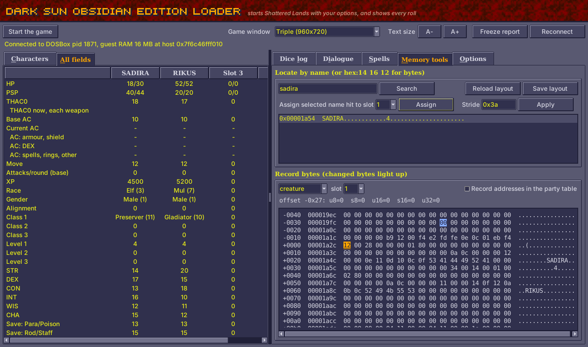

# Obsidian Edition: development

How Obsidian Edition and the Dark Sun Obsidian Edition Loader, which starts
the game with it, work inside: the patched game and its helper, what's known
of the game's data, the tools for mapping it, and how each part of the
[README](README.md) and the [features page](FEATURES.md) is done.

DSCLOG's routines and variables are named in capitals on these pages
(`SC_FIND`, `FAR_SEG`); in `dos/dsclog.asm` their labels are lower case
(`sc_find`, `far_seg`). Its constants (`equ`) are in capitals in both.

## Contents

- [Building and testing](#building-and-testing)
  - [The folders](#the-folders)
  - [Build](#build)
  - [Tests](#tests)
  - [Making a release](#making-a-release)
  - [From a command prompt](#from-a-command-prompt)
  - [Practising without the game](#practising-without-the-game)
  - [Mapping memory](#mapping-memory)
  - [Command-line mapping tools](#command-line-mapping-tools)
- [How the dice log works](#how-the-dice-log-works)
- [What is known](#what-is-known)
- [Room in the helper](#room-in-the-helper)
- [The crash report](#the-crash-report)
- [The freeze report](#the-freeze-report)
- [Reading the game's memory](#reading-the-games-memory)
  - [Changing the game's item lists](#changing-the-games-item-lists)
  - [The Loader's game flags](#the-loaders-game-flags)
- [How each part works](#how-each-part-works)
  - [What the game and the Loader show](DEVELOPMENT-SCREENS.md)
  - [The rules](DEVELOPMENT-RULES.md)
  - [Spells, items, people, graphics and the game's bugs](DEVELOPMENT-CONTENT.md)

## Building and testing

### The folders

| Folder or file | What it holds |
|---|---|
| `dsloader/` | the Loader: its window (`viewer.py`), starting the game (`launch.py`), the dice log (`dicelog.py`), the patched game (`gamepatch.py`) and the data written into the game's files (one module for each feature) |
| `dsloader/fonts/` | the Latin sets of the web pages' fonts, with their licences (`pagefonts.py`) |
| `dsloader/sound-data/` | the samples of the sounds for hiding and picking pockets (`hide.wav`, `pick.wav`), and `make.py`, which made them (`sounds.py`) |
| `dos/` | the helper DOSBox loads, `dsclog.asm` (built to `DSCLOG.EXE`), `umbplus.asm` (`UMBPLUS.COM`) and `gameend.asm` (`GAMEEND.COM`) |
| `layouts/` | the game's memory layout (`shattered_lands.json`), for the Loader's window and Memory tools |
| `tests/` | the unit tests, and `make_fake_party.py` for practising without the game |
| `docs/` | the screenshots and the item icons the documentation shows |
| `*.bat` | what players double-click: the Loader, the game with or without its window, a save file's party |
| `README.md`, `FEATURES.md`, `ITEMS.md`, `KITS.md`, `HOW-THE-GAME-WORKS.md`, `DICE-LOG.md`, `PLAYER-GUIDE.md` | the player's pages (`player-guide.html` is made from the guide) |
| `../PATCH-NOTES.md`, `../CHANGELOG.md`, `../release-notes/` | the repository's root: the patch notes, the record of every pull request, and each release's notes |
| `../playtest/` | the in-game test kit: tools that drive the game in DOSBox, saves and logs, and [its guide](../playtest/PLAYTESTING.md). It is outside this folder, so it never goes in the release zip |

Each module of `dsloader` opens with what it does. Those the sections below
don't come back to: `__main__.py` is the command line (below); `gff.py` and
`gpl.py` read the game's GFF files and its scripts; `guestmem.py` finds DOSBox's
guest memory; `savefile.py` reads a save's party (`Show Save.bat`);
`tracker.py` notes kills, XP and level-ups; `textlog.py` reads the dialogue and
message boxes DSCLOG copies; `partyview.py` and `spellbook.py` draw the
Characters and Spells tabs, `theme.py` the window's look, from `palette.py`'s
colours (sampled from the game's screens, each text colour's contrast checked
by `test_theme`); `bonescale.py` puts the bone scale set together in its chest;
`stuckwalk.py` sets people walking again whose scripted walk stopped;
`process.py` reads and writes another process's memory, `layout.py` the memory
layout files, `values.py` the value types they and the searches use (u8 to s32,
str), and `search.py` the Memory tools' value search; `unblock.py` takes
Windows' "downloaded from the internet" mark off the Loader's files;
`patchnotes.py` and `guidepage.py` make the web pages (below).

### Build

After changing `dos/dsclog.asm`, rebuild the helper with
[NASM](https://www.nasm.us/):

```
nasm -f bin -o dos/DSCLOG.EXE dos/dsclog.asm
```

The build fails if the helper outgrows its 64 KB segment or the room it has in
upper memory ([Room in the helper](#room-in-the-helper)). The header's
signature (`DSCLOGva` now: after Z, lowercase) goes up whenever the helper and
the Loader must change together (`HDR_SIG` in `dsloader/dicelog.py`), so a
Loader never talks to an older helper.

The post-game check that keeps an error on screen for the crash report, and
the program that moves upper memory down before the helper loads, are built the
same way:

```
nasm -f bin -o dos/GAMEEND.COM dos/gameend.asm
nasm -f bin -o dos/UMBPLUS.COM dos/umbplus.asm
```

Two web pages are made from Markdown: `player-guide.html` from
`PLAYER-GUIDE.md` (`python -m dsloader.guidepage`) and `../patch-notes.html`
from `../PATCH-NOTES.md` (`python -m dsloader.patchnotes`). Edit the Markdown,
then run the module. Both use `dsloader/pagestyle.css`, and carry their fonts
inside them (`pagefonts.py`, from `dsloader/fonts`), so they load nothing from
the internet.

### Tests

```
python -m unittest discover -s tests
```

Some tests need more, and are skipped without it:

- **unicorn** (`pip install unicorn`; the Release workflow pins 2.1.4):
  `test_dsclog`, `test_gamepatch` and `test_shadows` run the helper's
  interrupt handlers in a CPU emulator.
- **tkinter**: the window's tests (`test_theme`, `test_partyview`, `test_find`).
  Linux's Python often lacks it; in the cloud container `/usr/bin/python3.12`
  has it.
- **The game's files**, named by environment variables: `DSUN_GPLDATA` (its
  `GPLDATA.GFF`: `test_scriptnumbers`, `test_pehtuclchest`, `test_champions`,
  and `test_sounds`, which reads the `RESOURCE.GFF` beside it), `DSUN_OBJECTS`
  (its `SEGOBJEX.GFF`, with `GPLDATA.GFF` beside it: `test_figures`,
  `test_pehtuclchest`) and `DSUN_RESOURCE` (its `RESOURCE.GFF`:
  `test_kitpages`).

Without tkinter or the game's files, 24 are skipped; with the files set, the 9
that need tkinter.

Tests that guard the whole project rather than one module:

| Test | What it checks |
|---|---|
| `test_doclinks` | every relative link and anchor in the Markdown pages goes somewhere, and each README or features page section the DEVELOPMENT pages explain links to its explanation |
| `test_compiles` | every module of the Loader compiles, the window's too |
| `test_flagrange` | the Loader's game flags are in 756-807 and no two share one ([the table](#the-loaders-game-flags)) |
| `test_scriptnumbers` | the Loader's scripts have a number each, their calls land inside them, and each fits the game's script buffer |
| `test_dsclog`'s `test_fits_upper_memory` | what the helper puts in upper memory fits the room DOSBox gives it |
| `test_version` | the version is the same in `__init__.py`, the patch notes and the front page, and its release notes exist |
| `test_guidepage`, `test_patchnotes` | the web pages are up to date with their Markdown, and their links work |

The unit tests don't play the game. For anything DSCLOG or a script touches,
check it in the game too: [the playtesting guide](../playtest/PLAYTESTING.md)
has the tools and how to use them.

### Making a release

The **Release** workflow (`.github/workflows/release.yml`) runs the tests on
Windows (with unicorn 2.1.4), zips the `obsidian-edition` folder as
`Dark-Sun-Shattered-Lands-Obsidian-Edition-<version>.zip` (with `git archive`,
so only what is committed goes in) and publishes it with
`release-notes/v<version>.md` as its notes. Before it:

1. Set the version in `dsloader/__init__.py` (`__version__`), the patch notes'
   "Current version" (and drop their line on what comes with the next release)
   and the front page's "**Obsidian Edition ...** is out";
   `tests/test_version.py` checks they agree and that the release notes exist.
2. Finish `release-notes/v<version>.md` and the CHANGELOG's entry, and
   rebuild `DSCLOG.EXE` and the web pages if their sources changed.
3. Check in the game anything DSCLOG or a script touches ([the playtesting
   guide](../playtest/PLAYTESTING.md)).
4. Merge to `main`, then push the tag `v<version>`, or run the workflow by hand
   (Actions → Release → Run workflow), which makes the tag.
5. Once the pull request is merged, rename the CHANGELOG's "## Next pull
   request (not opened yet)" to "## Pull request #N (merged DATE)", with
   "merged DATE" a link to the pull request, as the other headings have it,
   and point the release's link in the list of releases at the top of the
   CHANGELOG to the new heading's anchor (`#pull-request-N-merged-DATE`;
   `test_doclinks` fails otherwise).

The zip holds the `obsidian-edition` folder only: the root's patch notes,
CHANGELOG and release notes stay on GitHub, so the folder's own pages link to
them by their GitHub address.

### From a command prompt

What the `.bat` files do, from a command prompt (`dsloader` is the program's
internal name):

```
python -m dsloader launch                        # start the game with the dice log, and the Loader's window
python -m dsloader view                          # the Loader's window only, game not started
python -m dsloader play                          # the game with the in-game additions, no window
python -m dsloader dicelog                       # the dice log in the command prompt
python -m dsloader checks                        # the scripts' thief skill and ability checks (spoilers)
python -m dsloader save C:\path\to\SAVE01.SAV   # the party stored in a save
python -m dsloader processes                     # is DOSBox found?
```

After `launch` or `play`, `--window-scale 1` to `4`, `--fullscreen` or
`--windowed` choose the game's window as **Game window** does, and
`--recompiled PROGRAM` runs Dark Sun Recompiled in place of DOSBox from then on (`--dosbox` goes
back: [the README](README.md#other-ways-to-start)). `--game-dir` names the
game's folder (for `launch`, `play` and `checks`; remembered after the first
time). `dicelog --all` also shows the rolls the log can't label (as **Show
unlabelled rolls**), and `dicelog --raw` records every `rand()` call, not just
rolls. If more than one DOSBox is running, add `--pid <number>` (from
`processes`).

### Practising without the game

`tests/make_fake_party.py` writes `FAKEPTY.COM`, a tiny DOS
program holding two made-up characters in the same record shapes as the game.
The first character loses 1 HP every second. Run it in DOSBox and try the
Loader (search for `SADIRA`).

```
python tests/make_fake_party.py
dosbox FAKEPTY.COM
```



### Mapping memory

For Shattered Lands the party is found automatically. The steps below are for
mapping new fields, or for other layouts:

1. Type a party member's name under **Locate by name** and press **Search**.
2. Select the hit that is the character's record and press **Assign**. In the
   hit list, the record shows its name followed by dots, since binary data
   follows the name. A copy in a text buffer is followed by more text. Slots
   2–4 follow automatically if the party's records sit next to each other in
   memory, as they do in save files. Otherwise assign each slot by name.
3. The **character sheet** (XP, classes, levels, saves) is found automatically:
   it carries the same ability scores and entity ID as the creature record.
4. **Save layout** (beside **Search**) stores the addresses. They may change
   when you load a save or restart the game. If a slot starts showing garbage,
   locate it again.

The **Record bytes** panel shows the raw record. Bytes that change light up
orange, and clicking a byte decodes it as u8/s8/u16/s16/u32. Use it to map
fields that aren't known yet. Watch a byte change as you take damage, spend
PSP, or equip armour, then add it to `layouts/shattered_lands.json` and press
**Reload layout**.

### Command-line mapping tools

```
python -m dsloader find-text Daaki               # hex dump around each hit
python -m dsloader dump 0x1a2c 128               # hex dump an address
python -m dsloader search u8 23 --near 0x1a2c    # Cheat-Engine-style value search
python -m dsloader next 17                       # ...narrow after the value changes
python -m dsloader next decreased                # also: changed, unchanged, increased
```

## How the dice log works

Every roll in the game goes through one function, Borland C++'s `rand()`.

1. When you start the game with the dice log, the launcher writes
   `dos\DSUNLOG.EXE`: a copy of the game's `DSUN.EXE` with a few hundred
   small changes, listed in `PATCHES` in `dsloader/gamepatch.py`. Most replace a few
   bytes of the game's code with an `INT` (60h to 65h, and 80h to FFh; all of
   them are taken, so later sites share one, a site number after the `INT`, as
   in [Scores and hit points as rolled](DEVELOPMENT-RULES.md#scores-and-hit-points-as-rolled)) that
   the helper answers: `rand()`, the saving throw, AC, the dialogue window and
   message boxes for the dice log; the inventory, View Character, USE and
   Effects screens and the Look box for what the Loader adds to them; and the
   places each rule change, new item and screen addition needs. The sections
   under [How each part works](#how-each-part-works) name the patches each part
   uses. One, at the start of a monster's turn, is in overlay code the game
   moves or unloads to load the dialogue window's, so the helper puts its way
   back in a stack frame the game's overlay manager fixes up (a stale address
   used to restart a fight, or stop the game with "Stack overflow!"). A few
   patches change the game outright: 29 saved characters rather than 19, DELETE
   deleting the one chosen and a New character counting as Okay (see [more
   characters](FEATURES.md#more-characters)), Enter loading only a save that is
   there (see [more saves](FEATURES.md#more-saves)), a script buffer of 11,776
   bytes rather than 10,000 (for [Dinos and the
   Trustee](FEATURES.md#what-dinos-and-the-trustee-say-about-them)), and data
   files looked for in the current folder rather than next to the program. The
   helper also hooks DOS's `INT 21h`, to open the launcher's copies of
   `SEGOBJEX.GFF`, `RESOURCE.GFF`, `GPLDATA.GFF` and some regions' files (for
   the [new items](FEATURES.md#new-items), [Kalzith](FEATURES.md#kalzith),
   [Semyon](FEATURES.md#semyon) and [no manual
   check](FEATURES.md#no-manual-check)), and to keep what the game last wrote to
   the screen for a crash report (see [the crash report](#the-crash-report)),
   the mouse driver's `INT 33h` (for [scrolling the
   map](FEATURES.md#scrolling-the-map)) and the keyboard's `INT 16h` (for Tab
   and Enter). DOSBox runs it from the game folder, so it uses your saves as
   usual.
2. `dos\DSCLOG.EXE` (source in `dos\dsclog.asm`) is a tiny DOS program loaded
   into upper memory before the game, so the game loses no memory. It answers
   those interrupts. Its `rand()` returns exactly the numbers the original
   would and also records each call, what code called it, and that code's
   arguments (dice count and sides, THAC0, AC...) in a ring buffer. Others
   record the final saving throw total, the AC the game uses, and the text
   of dialogues and messages (in a second buffer); the rest draw the in-game
   additions and make the new items and the rule changes count.
3. The Loader finds the buffer in DOSBox's memory and reads it every 20 ms
   from the command line (`dicelog`, `play`) and every 50 ms in its window.
   It works out what each roll was for from the code that asked for it, and
   reads the rest (names, weapons, spells, effects) from the game's own data.
   Some rolls come faster than that: the creation screen's die rolls a whole
   character several times while it tumbles, so the helper keeps each
   ability's last four 4d4 itself (`RL_TRIES`, the header's +282, counted at
   +280), and the dice log checks each ability against the one the screen
   shows.
4. To keep bursts of unimportant randomness from crowding out the rolls that
   matter, the helper only records calls from code it knows how to label,
   unless **Show unlabelled rolls** is ticked.
5. Each pass is a list of steps, each on its own (`DiceLog._step`): one that
   fails doesn't stop those after it. The game busy with its item lists
   (`ItemsBusy`) waits for a later pass; DOSBox gone (`ProcessError`) is
   passed on; anything else is said once, keyed by its kind and where it was
   raised (`dicelog.error_key`, not its text, which may carry an address), in
   the dice log, the window and `play` mode alike. A write the Loader stops
   (`GuestMemory.guarded`: low memory and the start of the game's data
   segment) is noted in `GuestMemory.refused` (the last 200, for a crash
   report) and told in the log once. What the Loader saves as it goes (picked
   pockets, learned speakers' names) is kept for the next pass if
   settings.json can't be written (`DiceLog.save_learned`).

Because the replacement produces identical numbers, the game plays exactly as
it would without it, apart from what you choose on the Options tab (picking
pockets, the [rule changes](FEATURES.md#rule-changes)), the Loader's other
additions (the new items and the Ring +1, the cooked vulture, Kalzith, Semyon,
what the party wears, shadows, dust, see-through figures, rings, Tab and Enter,
scrolling) and the fixes always made: no equipment penalty on thief skills (see
[Thief skills](HOW-THE-GAME-WORKS.md#how-the-game-works-out-thief-skills)), the
roster's DELETE and New characters counting as Okay (see
[More characters](FEATURES.md#more-characters)), no manual check (see
[No manual check](FEATURES.md#no-manual-check)), the game's people wearing their
gear from the start, Psionic Blast knocking out instead of killing, Scare's
save for elf and half-elf priests, and the rest of [the game's bugs
fixed](FEATURES.md#the-games-bugs-fixed).

Limitations:
- Only the GOG release (`DSUN.EXE` of 611,408 bytes) is supported. With
  another version the launcher starts the game without the dice log and says
  why.
- Outside combat, the thief skill, trap and ability checks, the character
  creation rolls and searching junk, hay and wardrobes are labelled; other
  rolls there (for example treasure or random encounters) show up only with
  **Show unlabelled rolls**, as raw numbers.
- A save-file load from the main menu is recognised, so the spells already
  active in it aren't reported as new. A save of the same party loaded in the
  middle of play is seen only when its clock is earlier than the game's was; a
  later one's effects may be listed as if just cast.
- Dialogue speakers are portrait numbers until the log learns their names or you
  name them (see [the Dialogue tab](README.md#the-dialogue-tab)): the game
  doesn't keep a name with the dialogue. A learned name is the creature the
  conversation was started on, so a scene in which one face speaks for someone
  else would get that someone's name.
- Weapon breaking was checked against the game's code, and the check's rolls
  were seen in play, but no weapon happened to break during testing; the
  game's own "is broken !" message is logged either way.

## What is known

A save file (`SAVEnn.SAV`) is an SSI **GFF** archive. Two of its chunks hold
the party:

- **`SAVE` chunk 5, creature table.** 58-byte records (`0x3a`) for everyone in
  the current region, party first.
- **`SAVE` chunk 6, character sheets.** 71-byte records (`0x47`).

The game keeps the same records in memory, with the party's sheets one after
another. Old copies of a record can linger elsewhere in memory, so the Loader
prefers the sheet at the party's stride position. Offsets are relative to the
start of each record. The evidence comes from five save files covering three
parties, plus the in-game View Character screens.

| Record | Offset | Type | Field | Evidence |
|---|---|---|---|---|
| creature | `+0x00` | s16 | Current HP | ≤ max HP everywhere; wounded characters lower |
| creature | `+0x02` | s16 | Current PSP | ≤ max PSP everywhere |
| creature | `+0x06` | u16 | Entity ID (`0x80nn` for the party) | same value in the sheet at `+0x10` |
| creature | `+0x1a` | s8 | Base AC, before armour and DEX | 10 for humanoids, 5 for the thri-kreen; the AC the game shows is worked out from this |
| creature | `+0x1b` | u8 | Movement | 12, 15 for the thri-kreen; each round of a fight gives Move × 10 movement points |
| creature | `+0x1f` | u8 | THAC0 | matches the AD&D warrior table at levels 3, 4, 7 and 8 |
| creature | `+0x22` | u8 ×6 | STR DEX CON INT WIS CHA | same as the sheet |
| creature | `+0x28` | str 18 | Name | |
| sheet | `+0x00` | u32 | XP | matches the game |
| sheet | `+0x04` | u32 | For monsters, the XP they're worth; for the party, usually equals XP | matches the XP the party gets for a kill |
| sheet | `+0x08` | s16 | Max HP | |
| sheet | `+0x0a` | s16 | The hit points rolled (or gained) for every class level, added up | the game's level-up code (DSUN.EXE 87250h) adds each new level's to it; max HP = this ÷ the number of classes + CON's bonus |
| sheet | `+0x0c` | s16 | Max PSP | worked out at each level-up (873B2h): CON, INT and WIS bonuses, and for a psionicist +10 a level after the first, plus 1 a level for each WIS point above 15 |
| sheet | `+0x10` | u16 | Entity ID | links the sheet to its creature record |
| sheet | `+0x18` | u8 | Race: 1 Human, 2 Dwarf, 3 Elf, 4 Half-elf, 5 Half-giant, 6 Halfling, 7 Mul, 8 Thri-kreen | ability modifiers fit; 2, 6 and 7 from the character creation code's race table |
| sheet | `+0x19` | u8 | Gender: 1 male, 2 female | |
| sheet | `+0x1a` | u8 | Alignment: 1 LG, 2 LN, 3 LE, 4 NG, 5 TN, 6 NE, 7 CG, 8 CN, 9 CE | 1, 5, 7 confirmed in game |
| sheet | `+0x1b` | u8 ×6 | STR DEX CON INT WIS CHA | |
| sheet | `+0x1d` | u8 | CON (among the abilities at `+0x1b`); sets the least a level's hit point roll counts for | read by the game's level-up code |
| sheet | `+0x21` | u8 ×3 | Class: 1–4 Cleric, 5–8 Druid, 9 Fighter, 10 Gladiator, 11 Preserver, 12 Psionicist, 13–16 Ranger, 17 Thief (0 = none); each four is air, earth, fire, water | 2, 7, 8, 9, 11, 12, 13, 14, 17 confirmed in game; the elements from the spheres in the game's class and spell tables (see Spells and effects) |
| sheet | `+0x24` | u8 ×3 | Level in each class | |
| sheet | `+0x27` | s8 | Base AC for the AC calculation | read by the game's AC code |
| sheet | `+0x29` | u8 | Magic resistance (%) | read by the game's magic resistance check |
| sheet | `+0x2a` | u8 | Attacks per round × 2 | read by the game's combat code |
| sheet | `+0x37` | u8 ×5 | Saves: para/poison, rod/staff, petrify, breath, spell | match the AD&D warrior table exactly |

In memory, the game reaches both tables through far pointers in its data
segment: `DS:0x1665` points to the creature table and `DS:0x1661` to the
sheets (a creature's sheet number is its word at `+0x04`). The data segment
starts with Borland's copyright string at `DS:0x0004`, which is how the Loader
finds the party by itself (`dsloader/game.py`).

**Items.** A creature's items hang off its record at `+0x08`, `+0x0a` and
`+0x0c`: each is an object number (the object table has a kind, 1 for an item
and 2 for a creature, and an index), the first item of a list, whose own
records then name the next.

**The party's three item lists.** A party member keeps what it wears in its
`+0x08` list (armour, a shield, rings, a cloak, ammunition: whatever is on the
body and isn't a weapon), the weapons it holds in its `+0x0a` one, and what's
in its backpack in its `+0x0c` one. The inventory screen moves an item from
one to another as it's put on or away, by its type's kind (`+0x00`): a melee,
missile or thrown weapon to `+0x0a`, anything else to `+0x08` (a new list when
there's none; seen in the game: chest and leg armour, a shield in
the left hand and arrows went to `+0x08`, a long sword, a gythka and a bow to
`+0x0a`). The game fights with every weapon in the `+0x0a` list, whatever the
item's slot byte says: a dagger put in a backpack cell but left in that list
is a weapon in hand to the game (its inventory panel lists it, and it attacks
with it). Its AC routine (58DD3h) counts only the `+0x08` list: armour left in
`+0x0a` or `+0x0c` shows as worn and gives no AC (Gerakis's dice-log AC in a
fight: arm armour in `+0x08`, leg and chest in `+0x0a`, armour -1; the two
lists swapped in memory, -2). So the Loader gives and moves the party's items
through `pickpocket.list_for`, `party_list` and `place`, and `mend_lists`
moves what an earlier version left in the held list: backpack items to the
backpack's list, and worn things that aren't weapons (starting armour, a
cloak) to the worn list. Worn items found in `+0x0c` are left alone (the
game's own party starts with its armour in `+0x08`, where the screen puts it:
Gerakis's arm armour in a new game, 2026-11-02). Items are 21-byte records (`DS:0x165D`), item types 20-byte ones
(`DS:0x1669`, 115 of them, from GPLDATA.GFF):

| Record | Offset | Field |
|---|---|---|
| item | `+0x04` | the next item in the list (9999: the end) |
| item | `+0x08` | a container's contents (an object number), as in a Dead Body |
| item | `+0x0a` | its type |
| item | `+0x0f` | a spell it carries, one past the spell's number (0: none): readied, the game casts a helpful one on the wearer, for good (DSUN.EXE 6F7F0h sets DS:5402h, so the cast routine at 78D00h makes the time -9999), and a cursed item's (plus below 0) spell against a creature too; C4h and up are the ability items; the acid's check reads it as the item's "magical power" |
| item | `+0x11` | where it's worn: 0-13 the game's slots (arm, ammo, missile, right hand, finger, waist, legs, head, neck, chest, left hand, finger, cloak, foot), 14-25 a backpack cell |
| item | `+0x12` | its name (an entry of the game's name table, 25 bytes each) |
| item | `+0x14` | its plus |
| type | `+0x04` | weight, in tenths of a pound |
| type | `+0x08` | material in the low four bits (wood, bone, stone, obsidian, metal, leather); `0x80` spares a weapon the material's to-hit penalty |
| type | `+0x0c`, `+0x0d`, `+0x0e` | damage dice: sides, count, bonus |
| type | `+0x0f` | `0x80`: counts for AC |
| type | `+0x12` | its AC (on top of the item's plus) |

Free item records and free objects are kept in lists (`DS:0x4D76`, `DS:0x4D72`),
which is how the Loader adds [the Ring +1](FEATURES.md#new-items) and Kalzith's
scrolls as the game would.

Also seen: per-region `RGnn` chunks hold a combined creature record, sheet and
inventory for each character. Region *nn* uses `SAVE` chunks *nn*×60+1 and up
for its own copy of the region state.

The saved characters are `CHAR` chunks of `CHARSAVE.GFF`, 314 bytes each: the
creature record at `+0x0A` (its name at `+0x32`, its status at `+0x26`), the
sheet at `+0x4E`, then its items. The game's own party, which START GAME uses
when no party has been made (Cermak, Cilla, Gerakis and K'ratchek), is objects
300, 307, 308 and 313 in `SEGOBJEX.GFF`: a creature record and a sheet each,
already Okay, with no items. The game gives them their gear as the game
starts (see [the game's own party](DEVELOPMENT-RULES.md#the-games-own-party)).

**Resting.** The rest is the routine at DSUN.EXE 8066Dh (REST, and a
script's request 1): each member's slots are refilled in turn there
(`REST_SITE`), and a priest's tending of the party is part of it (found by
CalvinRodo's yuan-ti, checked in DSUN.EXE).

**Spells.** They are numbered 0 to 137: 0 to 68 wizard spells (0 is Armor, the
first of the 1st level; its scroll is Old One-Eye's), 69 to 137 priest
spells, a 7-byte record each from 0 (its level first, its name's DS offset at
+5). What the party knows is a table of 138 bytes for each member, 1 for a
spell known, through the far pointer at `DS:0x132A` (in a save, `SAVE` chunk
19).

## Room in the helper

DSCLOG has to load into upper memory, or the game loses about 61 KB of conventional
memory (570 KB free rather than 632 KB, measured with an older, larger helper). It keeps its code and data in one
64 KB segment, all reached through CS, and its big buffers apart, in its far
block. With the map open the game needs 60,000 bytes in one piece each time it
opens the view ("Out of memory in OEOpenGraph" when it can't), so every block
the helper takes out of the game's 640 KB counts.

**Where DOSBox's memory is** (DOSBox 0.74, GOG's; its source comes with the
game, `DOSBOX/dosbox-0.74-2.1.tar.gz`). This table is the one place for the
sizes; the paragraphs after it say how each piece got there.

| Memory | Size | What uses it |
|---|---|---|
| Conventional (0-9FFFh) | 640 KB | DOS and the shell 8 KB; the game the rest: 97 KB free with the map open (86 KB before the music buffer moved out, 53 KB before the overlay buffer did; the unmodded game's 57 KB) |
| C000h-C7FFh | 32 KB | the video BIOS (ROM) |
| C800h-C8FFh | 4 KB | DOSBox's own tables (`DOS_PRIVATE_SEGMENT`, handed out from C800h up: to C8C0h with the game running) |
| C900h-EFFFh | 156 KB | upper memory, with `UMBPLUS.COM` (else D000h-EFFFh, 128 KB): the helper 61.2 KB (62,640 bytes with its PSP and its tail; 63,760 before the 2026-11-09 pass), the game's overlay buffer 32.2 KB, the game's music buffer 11.7 KB, the see-through figures' tables 13.8 KB, 36.5 KB (37,392 bytes; 35,856 before) free in one piece and 288 bytes between the helper and the overlay buffer (measured 2026-11-09, `memaudit.py`; group 4, later that day, made the helper 1,824 bytes longer, not measured since) |
| F000h-FFFFh | 64 KB | the BIOS (ROM) |
| 1 MB-1 MB+64 KB | 64 KB | the HMA (A20 on): the helper's far block, 63.9 KB (65,418 bytes; 64,768 before the per-fight tables moved there, 2026-11-09), 102 bytes free |
| above | 31 MB (`memsize=32`) | XMS: the game's memory layer (VMEM) |

**The budget.** Each limit fails the build when passed (a negative `times`):

- The helper's segment: what it reaches through CS is what stays (to
  `resident_end`, 61,104 bytes since the item box's `Hit -N` (2026-11-09,
  IB_MATERIAL; 61,024 when a natural 20 stopped saving against "can't save", SAVE_SUM; 60,912 when Turn Undead's record carried its creatures,
  60,864 after the audit's fixes: the per-fight
  tables SWEPT, TU_FAILED and DJ_DONE moved to the far block, 48 bytes freed;
  60,912 after group 4, 59,088 before it, 58,096 before group 3) and the
  buffers laid over the install code after it (`AFTER_INSTALL`, 1,408), together
  `kept_end`, 62,512 bytes, so 3,024 bytes of its 64 KB are spare. This is the limit for new code. The image
  (`image_len`) is as long. Buffers that start as zeros and aren't needed while
  installing are laid over the install code, as `seg_space` and `area_space`
  are (declared with `resb` after the image): `KEEP` zeroes them before its
  first DOS call and keeps memory to the tail's end (`KeepTests`). The segment
  holds whichever is longer, the install code or `AFTER_INSTALL`; the install
  code is the shorter (974 bytes: the vectors set from a table, `ALL_VECTORS`,
  each vector's byte and its handler's offset), so the image is made up to
  `AFTER_INSTALL`'s size with zeros (434 bytes at present), which is room for
  more install code at no cost. Moving a zeroed buffer into `AFTER_INSTALL`
  frees nothing: it lengthens what it leaves. The ways to free the segment:
  - **the tail** (`TAIL_SEG`, the header's +1834): the paragraphs after the
    image, in the EXE (`section tail`, its labels offsets from its own start),
    loaded with it and kept with it by `KEEP` (`KEPT_PARAS`), outside the
    segment. It costs upper memory as the segment did (the same block), but
    none of the segment's room and none of the HMA's; data that starts with
    values (the item types, the names) stays there as loaded, with no copy.
    Its segment is the image's + `TAIL_PARAS` (+1836, set by the install at
    +1834); the helper reaches it through a segment register set to
    `[cs:tail_seg]` around each use, and a buffer the Loader keeps there has
    its offset in its header field (the Loader reads it at `tail_seg` x 16:
    LBL_SLOTS, +1838; TICKS, +356). It is real-mode memory, so the game can
    be handed a far pointer into it (the HMA is less safe for that);
  - **the far block** (the HMA): FS, ES or DS set to `FAR_SEG` around a
    buffer's use; the drawing passes keep FS on it for their whole run, so a
    table they read costs nothing to move there (`cs:` becomes `fs:`). Buffers
    the Loader finds through the header keep their field, its value then an
    offset in the far block, which the Loader reads at `far_seg` (+142) x 16
    (DAC, RING_TAB, RED, LIGHT).
  (The install's 256-byte stack is past the image and the tail, in its own
  segment: `SS` in the EXE's header is the paragraph after the tail; the
  helper asks DOS for both, `LOAD_EXTRA`.) Code shared by many handlers is
  written once (`OVR_BACK`, the way back through the overlay manager's frame;
  `SHEET_CLASSES`; the sites after `VEC_CR_SPELLS`'s INT through one table,
  `SITE_TAB`). Text the game reads from RESOURCE.GFF belongs in the Loader's
  copy of it, not in the helper (`spelltexts.py`: the descriptions moved there
  freed 1.6 KB), and so does data read from the player's game (the pointer's
  picture, `POINTER.BIN`). What each change took is in the CHANGELOG.
- The far block: it ends at `FAR_END` (65,434), so the HMA has 102 bytes left
  for more buffers (650 of the 752 it had went to the per-fight tables over
  every combatant, `FAR_TU`, `FAR_SWEPT`, `FAR_DJ`, 2026-11-09).
- Upper memory without `UMBPLUS.COM` (`UMB_ROOM`, D00Ah to F000h, 8,182
  paragraphs): the helper as it loads (its tail and stack too) and the overlay
  buffer (`UMB_NEED`, the header's +372) need 6,168 (6,171 after group 4, 6,057 before it), and
  `test_fits_upper_memory` checks it too; what stays once installed, with the
  music buffer and the see-through figures' tables (`UMB_KEPT`: all four
  blocks and their MCBs), 7,805 (measured from the build, 2026-11-09, after
  IB_MATERIAL; 7,800 after SAVE_SUM, 7,793 after Turn Undead's creatures, 7,790 after the audit's fixes, 7,792 before them), so 377 (5.9 KB) are spare.

**What moved where (2026-11-08)**, freeing 3,136 bytes of the segment (3,040 of
what stays, 190 paragraphs of upper memory): DAC (768), RING_TAB (520) and RED
(256), the Loader's tables for the rings and the palette copy, to the far block
(`FAR_DAC`, `FAR_RING_TAB`, `FAR_RED`; the header's +238, +246, +248 are their
offsets there); how far each thing has walked for the dust (520) to
`FAR_WALKED`; the companion's item types (600) to the far block, copied there
from the install code's room (the tail's since 2026-11-09); the vectors set
from a table (about 790 bytes less install code); the AD&D XP table as words
of 50 XP, the ranger's row the gladiator's (448 to 196 bytes); the companion's
item names NUL-terminated (736 to 579 bytes, padded as they are copied).

**What moved where (2026-11-09)**, freeing 4,000 bytes of the segment (2,032 to
6,032 spare; logs/2026-11-09-memory-pass-2.md has each step in the game):

| Step | Segment spare after |
|---|---|
| before | 2,032 |
| the sites after `VEC_CR_SPELLS`'s INT (`RL_SITES`: 94 compares and jumps) through a table of a word a site, `SITE_TAB` (688) | 2,720 |
| the rings' outlines kept as a quarter each, a byte a point, `RING_POINTS` mirroring them (456 to 60 bytes, 336 with the code) | 3,056 |
| the tail (above); `LBL_SLOTS` (1,440, the Loader's labels) in it, its offset at the header's +1838; the header's +374 to +1813 hold other buffers of the helper's (SWAP_MATCH and SWAP_TEXT, PICK_TEXT, STATS, LOOK_FULL), so the fields after keep their offsets | 4,400 |
| `EXTRA_NAMES` (579) and `TICKS` (256, the header's +356 its offset in the tail) to the tail | 5,248 |
| the item types (600) kept in the tail as loaded (`FAR_DATA` and its copy gone: the header's +144 is `ALL_VECTORS`' place, +172 and +174 are 0); LIGHT (256, +236 its offset in the far block), the dust's puffs (288) and DARK (256, out of `AFTER_INSTALL`) to the far block; the crash report's stack written from where it is, not copied to the far block first (256 bytes of the HMA) | 6,032 |

To check the sizes after a change, build to a scratch file (`nasm -f bin -o
/tmp/x.exe dos/dsclog.asm`, from `obsidian-edition/`) and look at its size.

**The far block** (`FAR_SEG`, the header's +142) holds, at fixed offsets from
`FAR_RING` (10h) to `FAR_END`, 64,768 bytes: the dice log's ring (`NENT` 63
entries of `ESIZE` 192 bytes), the panel's picture, the shadows' cache
(`FAR_SC`), the text buffer, the shadows' spans and each thing's place as last
seen (for the dust), the frames steady pace holds back, the last text written
to the screen (`DOS_WRITE`, for `DOS_QUIT`'s crash report), the dust's table,
the palette as last read (`FAR_DAC`), the rings' tables (`FAR_RING_TAB`,
`FAR_RED`), how far each thing has walked (`FAR_WALKED`), each colour's lighter
one for the dust (`FAR_LIGHT`), the puffs (`FAR_PUFFS`) and the shadows'
colours (`FAR_DARK`), all cleared by `FAR_INIT`. `FAR_INIT` (install code) puts it in the **HMA** (FFFFh:0010h,
A20 on): XMS gives it (function 01h), or, where XMS says there is none (DOSBox
0.74's answer, 90h: its XMS blocks start at 1 MB + 64 KB, `XMS_START`), it is
used if all zero; A20 is turned on with XMS function 03h and checked
(FFFFh:0010h no longer 0000h:0000h). The game never calls XMS's A20 or HMA
functions (its XMS calls are 08h-0Dh), and no file DOSBox runs is EXEPACKed
(the unpacker fails with A20 on below 64 KB). Without the HMA the block is a
memory block of its own (upper memory, else conventional), `FAR_SEG` a
paragraph below it so that its offsets are the same. The header gives the
Loader each buffer's segment and offset: the ring's `ring_seg` (+268) and
`ring_off` (+16), the text buffer's `tbuf_seg` (+138) and `tbuf_off` (+128),
the panel's `panel_seg` (+328) and `panel_off` (+140). The helper reaches the
internal ones through FS, pushed and set around each use (the game never sees
it changed). The text buffer (`TSIZE`) is 2 KB; the Loader reads its size from
the header and drains it every 20 ms from the command line and every 50 ms in
its window (at most 251 bytes came in between two reads in the opening show,
the busiest stretch measured). The most entries put in the ring in 2 seconds,
measured, is 43 (the opening show), 16 in a fight.

**Upper memory moved down.** DOSBox makes its upper memory block at D000h, but
C800h-CFFFh is RAM too, and DOSBox's tables use only its first 192 paragraphs
(at most a few more later: a program asking for more than 20 file handles,
INT 21h AH=67h, takes some each time; the game does once, at DSUN.EXE 54F3h).
`UMBPLUS.COM`, run by the launcher's config just before `lh d:\dsclog.exe`,
moves the block's start to C900h: the system MCB at 9FFFh (owner 8, "SC") is
cut to end there and a free block's MCB goes at C900h, reaching F000h as
before. It does so only if the chain is exactly DOSBox 0.74's (9FFFh 'M' to
D000h, D000h 'Z' free to F000h) and C900h-CFFFh is all zero and keeps what is
written to it; otherwise it changes nothing and the helper loads at D00Ah. 63
paragraphs stay between DOSBox's tables and the block (the tables measured at
C8C0h throughout a save in the arena, walking and fighting, the helper at
C90Ah). The helper still has to fit D000h-EFFFh (`UMB_ROOM`), so it works where
the block can't be moved.

**EMS off.** With GOG's settings there is one upper memory block of 63 KB,
EMS's 64 KB page frame taking the rest, and the helper doesn't fit it (it loads
in the 640 KB and the game won't start). The launcher's config turns EMS off
(`launch.DOS_LINES`: the game's memory layer uses XMS instead), which leaves
upper memory for the helper and the game's buffers.

**The game's overlay buffer** (32,992 bytes: twice the largest overlay, the
code the overlay manager loads as needed). The game asks farmalloc for it at
startup (load+3653h:0D5Ch) and keeps it for good, so in the heap it was the
largest block the 640 KB never got back. The patch `overlay_umb` makes that
call `INT VEC_OVR_BUF` (`PROBE_OVR_BUF`), which hands over a block `KEEP`
reserved: `KEEP` (resident code) first cuts the helper's own block down to what
stays, then takes the buffer's block in the memory the install code had, so the
room is in one piece: the helper, the buffer and what is left free. The
header's `ovr_given` (+368) is the buffer's segment once the game has it.
Without the room the probe calls the game's farmalloc, as the call was. If the
buffer still ends up in the heap (another DOSBox, less upper memory), the
Loader says so in the dice log once, and crash reports say where it is
(`heapcheck.py`).

**The game's blocks kept for good.** Of the game's far heap (Borland's,
farmalloc at load:1231h, farfree 1127h, farrealloc 138Eh), 134 KB is taken
before the main menu and kept in place through loading a save, walking, an
area change and a fight, logged by a research build of the helper with those
three functions hooked: the music buffer (12,001 bytes: an XMIDI file), the
sound effects' (24,001: a Creative Voice File), both asked for by the sound
driver's set-up in an overlay; tables of 10,724, 4,963 and 11,778 bytes; the
font and other resources loaded as the menu comes up. Nearly every request goes
through the game's wrapper at 34FA4h (farmalloc of the size + 1, a guard byte
77h at the block's end, which its farfree wrapper at 34F3Ch checks), and its
callers are mostly overlays (running in upper memory, so not to be patched by
address). So `PROBE_HEAP` (INT CBh in place of each function's "push bp / mov
bp,sp") takes them by size: `farmalloc(12001)` is given `POOL_SEG`, a block
`KEEP` took in upper memory, with a heap block's first word (its paragraphs,
which the wrapper reads for the guard byte); farfree of it marks it free for
the next such request; farrealloc of it keeps it if the size fits, else moves
the contents to a block of the heap. Nothing else changes. The music buffer was
chosen as it fits in `UMB_ROOM` beside the rest (752 paragraphs with its MCB,
of the 1,236 the helper, the overlay buffer and the see-through tables leave):
the sound effects' 1,502 wouldn't, and the sound driver may play them by DMA,
which can't cross a 64 KB page. Measured with a save in the arena: the buffer
in upper memory holding the XMIDI file, walking, the arena's area change and a
fight as usual.

**Low memory in play.** While the game runs, the Loader reads its memory every
few seconds (`heapcheck.Watch`): with the map's view open (DS:1F82h set),
below 24 KB spare (DOS's after the game and the heap's free blocks) the dice
log says to save and restart soon, once until it has been back above 32 KB.
Nothing can be given back to the game from outside: every block is its own.

How the ring, the text buffer and the rest shrank or moved to get here is in
the CHANGELOG.

## The crash report

GAMEEND.COM only reads what is left on the screen, and the game's own fatal
errors (its memory manager's "ABEND: VM...Heap() returned error N", its script
engine's "Mel Fatal Error #: N Trap #: N") are printed while the screen is in
graphics, then cleared as the game puts it back in text mode on its way out.
So DSCLOG keeps the last 256 bytes the game writes to handles 1 and 2 (INT 21h
AH=40h: `DOS_WRITE`). At the first non-zero exit (AH=4Ch: `DOS_QUIT`), it writes
them to `D:\GAMEMSG.BIN`, with the code, the load segment and 256 bytes of the
stack. `launch.game_message` turns that into the crash report's lines: the
text, then the stack's likely far returns as places in DSUN.EXE.

A game that ends as usual has GAMEEND.COM write an empty `D:\GAMEOK.TXT`. The
Loader removes it (with `GAMEEND.TXT` and `GAMEMSG.BIN`) as it starts DOSBox:
DOSBox closing with no error noted and no `GAMEOK.TXT` means the game was cut
off while it ran (`launch.CUT_OFF`), and that is a crash report too.

## The freeze report

The game's timer handler (IRQ 0, DSUN.EXE 3925Ch, the game's own from its
start; its timers run from it, 120 strikes a second) begins with `INT VEC_TICK`
(`PROBE_TICK`). Every 32nd strike (about 4 a second) DSCLOG notes what the
timer interrupted: CS:IP, flags, SS:SP before the interrupt, BP, DS and ES, in
`TICKS` (16 records of 16 bytes, the last 4 seconds; in the tail, the header's
+356 its offset there, +358 the records taken). The Loader's
**Freeze report** (`freeze.py`) reads them newest first, names each place
(DSCLOG's, the BIOS's, or the game's segment and DSUN.EXE offset, which overlaid
code doesn't keep), shows the code there now and the newest stack, counts the
notes and the map's main loop for a second, and zips that with the memory below
1 MB + 64 KB. The handler itself loops forever on `INT 3` if the word at its
CS:1B2h is no longer "Test" (its check for memory written over), so notes all
at 33A5:04D9h to 04DBh (load-segment relative) point there.

## Reading the game's memory

DOSBox keeps the emulated PC's RAM in one block of its own process memory. The
tool finds that block by looking for the BIOS date string DOSBox writes at
guest address `0xFFFF5` ("01/01/92"), and checks it against the interrupt
table at guest address 0. After that, reading the game's memory is a plain
`ReadProcessMemory` at `block + guest address`. Dark Sun is a 16-bit real-mode
program, so a `segment:offset` address is simply `segment × 16 + offset` in
guest memory. If detection fails on an unusual DOSBox build, you can pass the
block's host address with `--host-base`.

The Loader never writes over the start of memory (`guestmem.LOW_MEMORY`, below
600h: the interrupt vectors, the BIOS's and DOS's data) or the first 40h bytes
of the game's data segment (`game.NULL_AREA`), which its C runtime checks at
exit ("Null pointer assignment"). Such a write could only come from a pointer
the game has left empty for a moment (`0:offset`). `GuestMemory.write` refuses
it and notes it in `GuestMemory.refused` (the last 200, for a crash report),
and the dice log tells it once.

### Changing the game's item lists

The game rebuilds its item lists as an area loads (and at START GAME): it writes
the area it leaves out, reads the next one in, and gives the party's items new
records, every one a new number (seen: 70 items of 70 renumbered at each change
between the pens and the arena). Its free lists of item records and of things
(`DS:4D76h`, `DS:4D72h`, the count in use at `DS:4C48h`) move as it does. A
change of the Loader's made across that, from numbers read before it, would land
on records that aren't what they were: a free record the game hands out too, or
a list linked through an item that is now another's. An item cut out of its list
that way is gone without a trace.

So every write of the Loader's to the item lists goes through one gate
(`itemgate.py`). `GuestMemory.write` asks `ItemGate.covers` whether a write
touches them: the free lists' heads, the item table (400 records of 21 bytes
from the far pointer at `DS:165Dh`), the things table with the few past its
520 (`THINGS_PAST`: the pointer's thing, 523), or a creature's list heads
(`CREATURE_ITEM_LISTS`), both where the tables are now and where they were at
the pass's start: a write the Loader worked out from the old place is held up
like any other. A table pointer that has gone null (an area loading) is covered
from 0 to the table's reach (20D0h for the items, 7400h for 512 creatures),
past the 600h the low-memory guard (`GuestMemory.LOW_MEMORY`) keeps, so a write
through it never lands in DOS's own memory, and the gate refuses while one is
null. Each pass of the dice log (`DiceLog.lines`)
begins the gate first, noting the heads, the region (`DS:117Ch`) and the item
and creature tables' pointers. The pass's first such write waits until
`itemgate.WAIT` (60 ms) has gone by since then, pauses DOSBox
(`ProcessMemory.suspend`: SIGSTOP on Linux, waiting until each thread shows
stopped, about 1.5 ms; `NtSuspendProcess` on Windows), and reads the same
things again. All as they were: the writes go ahead with the game held still,
until the block ends (`itemgate.release`) or the pass does. Anything changed:
`ItemsBusy` (a `ValueError`), none of the pass's item writes are made, and the
next pass tries again. A process that can't be paused gets the same look with
the writes right after it. A write outside a pass (a tool's) has the lists
looked at over the wait first, without pausing. The Loader lets the game go if
it exits mid-pass (`atexit`).

Whatever can't be done twice takes the gate before it starts (`itemgate.hold`),
so a refusal leaves nothing half done: Pick Pockets before its d100 (the request
stays unanswered until a later pass), a defiler's scroll before its roll (the
defiler isn't marked rolled for), Kalzith's loot before `LOOTED`, and the arena
ring before the search counts as answered. An item moved (`pickpocket.place`)
has its new list found or made before it leaves its old one: with the game's
things all in use nothing moves. The Loader leaves the game a reserve
(`ring.RESERVE`, 20): no new list once fewer than 20 of the 200 dynamic things
are free (`Items.spare_things`, from `DS:4C48h`), and no new item record once
fewer than 20 are on its free list (`Items.spare_items`), so the game's own
people, dressed in each area, and its scripts' items always find one. The
Loader's own writes inside a pass (once the gate has looked) don't count as the
game's changes: the gate notes the heads again as it lets the game go
(`release`), so the pass's later steps go ahead. A sold item's place in the buyback
queue moves on only once it is kept, and the game's own party's steps are marked
done only once made.

The item watch (`itemwatch.py`, the README's [Crash, freeze and item
reports](README.md#crash-freeze-and-item-reports)) reads the same lists once a
second and has to see past the renumbering too. Over half the party's items gone
at once (and at least `MOST_GONE`) is a bulk change: it waits until the new
numbers hold still at two looks, then matches old items with new by owner, slot
and what the item is (`_same`: its picture, type, name and plus), falling back
to owner and item. At least `BULK_MATCH` (half) matched is a change of area, and
an item with no match is reported; fewer, or no settling within `BULK_WAIT` (30
s), is a game loaded, and the watch starts afresh. An item gone whose record
still holds its type and name is outside the party (dropped, in a container) and
not reported, unless the record's first word went to 0 (`freed`): the game's
free (1A0A:0A3Ah) zeroes only that word and the free-list link at +4, so a
destroyed item keeps its type and name.

Every place the game deletes an item goes through A0:1CD6h. Its ten callers:

| Caller (DSUN.EXE) | When | The watch |
|---|---|---|
| 58D61h, the "use up one" routine, from 58C8Fh | an arrow shot (the last of a stack) | arrows are ordinary (62) |
| 58D61h, from 7AAEBh | Detonate's blast on a worn piece | reported |
| 7AA5Ah, 7ABC4h (from 79186h) | acid and corroding touch on a weapon or armour | reported |
| 73F36h, from 72206h | a wand's last charge (+0Eh down to 0) | wands are ordinary (70-73) |
| 73F36h, from 8B2B0h | an item used up from the USE screen | fruit, scrolls are ordinary |
| 6B143h (by 6B0CDh, 6B121h) | script TAKE (5Ch) to no one; and the effects (7872Fh, 79186h) taking the items spells make | quest types and spell items ordinary; anything else reported |
| 6A894h (by 6A720h) | script DROP (2Fh): the item becomes a thing on the map | reported, unless the whole party's drop (a bulk change) |
| 671C8h | a new character's starting gear that won't fit | (before the watch has seen it) |
| 67401h (40 bytes on) | a new character's worn items cleared | (before the watch has seen it) |
| 67401h (675B4h), from creation and DUAL (86C80h) | a piece the new class can't use, pack full: the item held on the pointer is deleted unless the inventory is open (read from the code, not seen) | reported |
| 7C7ACh, in the effects overlay | none found (no call reaches it) | — |


### The Loader's game flags

The game's script flags (read with var 141, set with var 13) run to 755; the
Loader keeps its own state in the numbers past them, so a save keeps it too:

| Flags | What |
|---|---|
| 756-758 | Semyon's shipment: told of, Thornwall put on the rack, a party member carrying it (`semyon.py`) |
| 759 | a party member killed Scar in the arena (the champions' bout due) |
| 760-763 | Kalzith: met, friendly, cold, his scrolls and gear given (`kalzith.py`) |
| 764-765 | Semyon: placed in the pens, met (`semyon.py`) |
| 766-769, 773-774 | Dinos's and the Trustee's questions (`pensasks.py`) |
| 770-771 | Semyon: left the arena after his fight, died |
| 772 | Kalzith seen dead |
| 775 | Kalzith and Semyon taken off the map after the escape |
| 776-778 | Kalzith: dressed, looted, sold out |
| 779, 782 | Semyon: settled in his pen; escaping with Scar |
| 780-781 | the cooked vulture: the meal, the reward given (`vulture.py`) |
| 783 | the arena ring's XP given (`ring.py`) |
| 784-794 | Alagorn's menus' overflow (794 at most: `test_pehtuclchest`) |
| 795-796 | Pehtucl's chest: the needle gone, the lock open |
| 797 | Legcrusher seen dead (Kurzak's lines) |
| 798-806 | the years of natural aging counted (798 once begun, 799-806 the number) |
| 807 | the champions fought |

A save keeps 808 flags (`game.FLAG_COUNT`: a bit each in `SAVE` chunk
29, 101 bytes), and all of 0-807 are in use. A new flag needs room found first (a flag
freed, or the save's flags made longer, if the game allows it); then it goes in
this table and in `tests/test_flagrange.py` (`FLAGS`, or `_ranges` for a block of them), which checks every
flag is in range and none is shared.

## How each part works

How each part of the [features page](FEATURES.md) and the [README](README.md) is done, on three pages of its own:

- [What the game and the Loader show](DEVELOPMENT-SCREENS.md) (its Contents lists each section)
- [The rules](DEVELOPMENT-RULES.md) (its Contents lists each section)
- [Spells, items, people, graphics and the game's bugs](DEVELOPMENT-CONTENT.md) (its Contents lists each section)
