# Features and rules

*Part of Obsidian Edition's documentation, from the [README](README.md). The
[player's guide](PLAYER-GUIDE.md) tells the same without the detail.*

Everything the mod changes and adds in the game, in the order of the Loader's
Options tab's sections; the game's bugs fixed come last. Most have a switch
in their section of the tab; what has none is said to be always on. A
switch's name here in bold (**Rangers' casting level**) is the short form of
the sentence the Options tab gives it. (The tab's **Saves** section is under
[More saves](#more-saves); where Wake of the Ravager is installed, in the
README's [Requirements](README.md#requirements).) How each is
done is in [DEVELOPMENT.md](DEVELOPMENT.md#how-each-part-works). Installing,
running the game, the Loader's window and its dice log are in the
[README](README.md).

## Contents

- [In the game](#in-the-game)
  - [The combat log in the game](#the-combat-log-in-the-game)
  - [Names over figures](#names-over-figures)
  - [What hurts a monster (the Look box)](#what-hurts-a-monster-the-look-box)
- [Always on](#always-on)
  - [THAC0, saves and thief skills](#thac0-saves-and-thief-skills)
  - [The creation screen](#the-creation-screen)
  - [Spell slots on the USE screen](#spell-slots-on-the-use-screen)
  - [Charges in item boxes](#charges-in-item-boxes)
  - [The Effects screen](#the-effects-screen)
  - [What a scroll says](#what-a-scroll-says)
  - [No manual check](#no-manual-check)
- [Rule changes](#rule-changes)
  - [Characters](#characters)
    - [Class restrictions](#class-restrictions)
    - [Multiclass hit points](#multiclass-hit-points)
    - [Hit dice: the better of two](#hit-dice-the-better-of-two)
    - [Scores and hit points as rolled](#scores-and-hit-points-as-rolled)
    - [AD&D's class tables](#adds-class-tables)
    - [CON as in AD&D](#con-as-in-add)
    - [Ages and magical aging](#ages-and-magical-aging)
    - [Dual-classing as the manual has it](#dual-classing-as-the-manual-has-it)
    - [Level cap by XP](#level-cap-by-xp)
  - [Weapons and armour](#weapons-and-armour)
    - [Two weapons](#two-weapons)
    - [Half-giants' two-handed weapons](#half-giants-two-handed-weapons)
    - [Weapon traits](#weapon-traits)
      - [Cahulaks](#cahulaks)
      - [Staff sling stinkpots](#staff-sling-stinkpots)
      - [Polearm reach](#polearm-reach)
    - [Creature size](#creature-size)
    - [Held targets](#held-targets)
    - [Rings and cloaks of protection](#rings-and-cloaks-of-protection)
    - [Helms give AC 1](#helms-give-ac-1)
    - [Items saving against acid](#items-saving-against-acid)
  - [Magic](#magic)
    - [Rangers' casting level](#rangers-casting-level)
    - [Preservers' INT](#preservers-int)
    - [Spells saved against with the spell save](#spells-saved-against-with-the-spell-save)
    - [Fire, cold and electricity: DEX instead of a doubled d20](#fire-cold-and-electricity-dex-instead-of-a-doubled-d20)
    - [Enlarge multiplies the weapon's dice only](#enlarge-multiplies-the-weapons-dice-only)
    - [Spells and psionics as the manual describes them](#spells-and-psionics-as-the-manual-describes-them)
    - [Spells roll to hit](#spells-roll-to-hit)
    - [Resting as in AD&D](#resting-as-in-add)
- [More character customization](#more-character-customization)
  - [Weapon specialization](#weapon-specialization)
  - [Kits](#kits) (a page of its own: [Kits and weapon specs](KITS.md))
  - [STORE and RECALL on the creation screen](#store-and-recall-on-the-creation-screen)
  - [Fuller starting gear](#fuller-starting-gear)
  - [Preservers' first spells](#preservers-first-spells)
  - [The game's own party](#the-games-own-party)
- [Expanded features](#expanded-features)
  - [The leader's CHA at shops](#the-leaders-cha-at-shops)
  - [Buying back magical items](#buying-back-magical-items)
  - [Improved thieving](#improved-thieving)
    - [Thief skills from AD&D's table](#thief-skills-from-adds-table)
    - [Hiding in shadows to backstab](#hiding-in-shadows-to-backstab)
    - [Picking pockets](#picking-pockets)
- [New content](#new-content)
  - [New wizard spells](#new-wizard-spells)
  - [6th-level priest spells](#6th-level-priest-spells)
  - [New items](#new-items)
  - [New people](#new-people)
    - [Kalzith](#kalzith)
    - [Semyon](#semyon)
    - [What Dinos and the Trustee say about them](#what-dinos-and-the-trustee-say-about-them)
  - [The champions' bout](#the-champions-bout)
  - [The cooked vulture](#the-cooked-vulture)
  - [Defilers' scrolls](#defilers-scrolls)
- [Graphics](#graphics)
  - [Elves and half-elves](#elves-and-half-elves)
  - [What the party wears](#what-the-party-wears)
  - [Shadows](#shadows)
  - [Dust](#dust)
  - [See-through figures](#see-through-figures)
  - [Magic items' icons](#magic-items-icons)
  - [Spells on the ground](#spells-on-the-ground)
- [Controls](#controls)
  - [Choosing an enemy: Tab, Enter and the rings](#choosing-an-enemy-tab-enter-and-the-rings)
  - [Scrolling the map](#scrolling-the-map)
  - [M, U and I: open a screen, close it again](#m-u-and-i-open-a-screen-close-it-again)
  - [The whole party in view](#the-whole-party-in-view)
  - [The view in fights](#the-view-in-fights)
  - [The pointer in scenes, and where it starts](#the-pointer-in-scenes-and-where-it-starts)
  - [Spells on the Effects screen](#spells-on-the-effects-screen)
- [Game speed](#game-speed)
- [More saves and characters](#more-saves-and-characters)
  - [More saves](#more-saves)
    - [Saves under their names](#saves-under-their-names)
  - [More characters](#more-characters)
- [The game's bugs, fixed](#the-games-bugs-fixed)

## In the game

Three things the game shows when it is started from the Loader (or either `.bat`
file) have a switch in the Options tab's **In the game** section: the combat log,
names over figures and the Look box. The rest it shows is [always
on](#always-on).

### The combat log in the game

With **A combat log in the game** ticked on the Options tab (the default),
**L** on the map shows the [dice log](README.md#the-dice-log)'s lines in the game
itself, and **L** again hides them: in a fight or out of one, whenever you
want to read back. It doesn't open by itself, and stays as you left it (from
one game to the next too). The lines are in a small font of the Loader's, 7
pixels a line (the game's own is 9, so 8 lines fit where 6 did), with the
game's drop shadow; the header, buttons and filters are in the game's font. The
lines are in the Loader's colours for each kind of line (hits green, misses grey, damage
amber, saving throws blue), the party's names in their colours and the
monsters' in red, a filled pip before a party member's line and a hollow one
before a monster's. In a fight its top line says the round, who is acting
and who is still to (`Round 2: Gerakis, then Cermak, Cilla`). Out of fights,
the lines with a roll in them go in too (a thief's skills, a scroll learned,
the hit points of a new level), so they can be checked after they happen.

Below the switch, pick how much it says: **at the least**
(`Rampager hits Defiler for 4`), **in short**, the default
(`Rampager hits Defiler for 4 (20 vs 16+)`,
`Slig fails vs Fireball (11 vs 16+)`), or **in detail**, every line of
the log. `(20 vs 16+)` is the d20 and the roll it needed (THAC0 less the
target's AC; a natural 20 always hits, a 1 always misses). A spell that
[rolls to hit](#spells-roll-to-hit) reads the same way
(`Cermak's Minute Meteors hits Kalzith for 2 (8 vs 7+)`, `... misses Kalzith
(4 vs 7+)`; at the least `Cermak's Minute Meteors misses Kalzith`), in the hits'
and misses' colours, as is Turn Undead's outcome (turned or destroyed a hit, not
turned a miss); the hit points a rest or Cell Adjustment gives back are in the
damage colour, as in the Loader's log. It never waits for a click.


In detail, each attack names the weapon and its dice, the d20 against what it needed, the chance
in percent, the AC it would hit and the target's AC, and the THAC0's parts follow (the panel
here is expanded, as below):


**The panel** sits over the map's lower right. A window the game opens over
the map (a character's menu, a question) hides it until it closes. Expanded, it
covers that part of the map, and the game's damage numbers over a creature
there; **-** makes it smaller.

- **Scrolling:** it keeps the last 200 lines. Drag the scrollbar's handle,
  click the bar above or below it for a page, or turn the mouse wheel with
  the pointer over the panel (on Windows). Scrolled back, it stays where it
  is as new lines come, and a **Latest** chip at its foot says how many have;
  click it (or scroll to the end) to follow again. Clicks on the panel are
  its own: the party doesn't walk there.
- **How long you've played.** Out of a fight, the top line says how long the
  game has run, `Day 47, 14:20`: from day 1 at 00:00, the game's own clock (it
  has no time of day, so 14:20 is the hours into that day; a rest moves it on 8
  hours). Saves keep it.
- **The arena's count of fights.** Between fights, in the slave pens and the arena, the top line
  says instead how many arena fights the party has had (`Arena fights: 4`; the
  time until the game has shown the count to the Loader): the game's
  own count, one a trip into the arena however many waves come (see [the
  arena's count of
  fights](HOW-THE-GAME-WORKS.md#the-arenas-count-of-fights)). Once the party
  has escaped Draj it's gone. (Not when the panel is collapsed to one line:
  that line stays the newest.)
- **Its buttons**, on the right of its top line: **L**, which hides it as the
  key does; the level (**Least**, **Short**, **Detail**; a click goes to the
  next, and the Options tab follows); and **-** and **+** for a smaller or
  bigger panel. It starts at seven lines; collapsed, it is one line, the
  newest; expanded, it is taller (12 lines) and has filters along its top: **All**, **Party** (the
  party's lines), **Damage** (hits, damage and deaths) and **Saves** (saving
  throws and magic resistance). Its size is remembered.

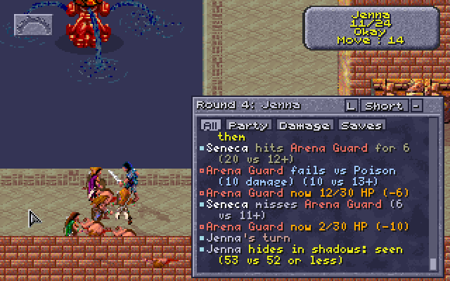

How it works: [DEVELOPMENT-SCREENS.md](DEVELOPMENT-SCREENS.md#the-combat-log-in-the-game).

### Names over figures

With **Names over figures** ticked on the Options tab (the default), a spell's
name floats over
its caster for a second and a half as it is cast, and "Miss" over anyone an
attack misses, in the game's lettering with a dark edge. They work in and out
of fights, for the party and the monsters alike, and a weapon's spell on a hit
shows too. A name stays with its figure; near the top of the screen it goes
under the figure's feet, clear of the game's boxes. Long names are shortened
("Lesser Water Elem."), and up to four show at once.

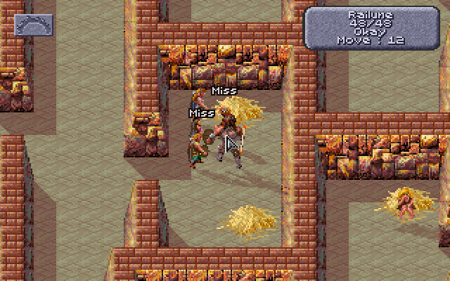

The same switch floats a spell's charge being used over whoever has it, in
light blue: "Armor: 7 left" for a hit Armor took, "Reflected Image: 2 left" for
a lost image, "Armor ends" for the last. These stay three seconds, twice as
long, and a "Miss" or a spell's name never pushes one out.

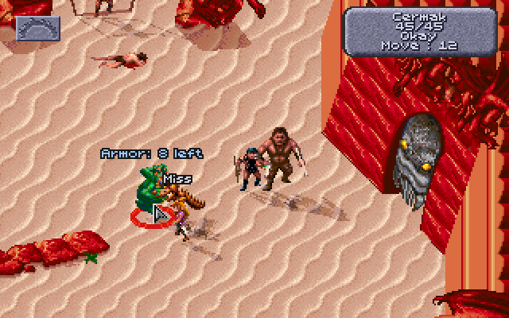

How it works: [DEVELOPMENT-SCREENS.md](DEVELOPMENT-SCREENS.md#names-over-figures).

### What hurts a monster (the Look box)

In a fight, Look at a monster (right-click until the pointer is the Look icon,
then click the monster) and the game's small box, under its name and level,
now also shows its hit points and AC (`HP 15/15 AC 2`), its THAC0 and
alignment (`THAC0 17 AL TN`), its magic resistance beside its level
(`LEVEL: 3 MR 30`), and its most important defence: `NEEDS +1 WEAPON`,
`IMM FIRE COLD`, `NO CRUSH`, `HALF FROM WPNS` or `UNDEAD`. The alignment is in
two letters: `LG`, `LN`, `LE`, `NG`, `TN`, `NE`, `CG`, `CN` or `CE`. (A line
that would run past the box's edge, such as a monster's with over 100 HP,
loses its spaces.) Its own status lines (casting, charmed, held...) follow in
any row left. When there's more to say, closing the box shows everything in
the game's dialogue window: the weapons it needs, the damage it's immune to or
takes half of, spells that don't work on it, and what its hits do besides
damage. The AC is the one the game last used against it; before anything
has attacked it, the Loader works it out as the game would, from its armour,
shield and DEX (spells on it, such as Barkskin, aren't counted until then).
The dice log gets the same lines (`Look: ...`). Untick **What hurts
a monster (the Look box)** on the Options tab to turn this
off.

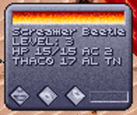

The arena's first monsters have no magic resistance or special defences, so
their box shows just the numbers and the alignment.

How it works:
[DEVELOPMENT-SCREENS.md](DEVELOPMENT-SCREENS.md#what-hurts-a-monster-the-look-box).

## Always on

More the game shows when it is started from the Loader (or either `.bat` file),
in its own lettering and windows, with no switch.

### THAC0, saves and thief skills

Started from the Loader, the game's own inventory screen (the one with the
character's figure and their equipment) shows six more things in its
right-hand panel, drawn by the game's text routine so they look like the rest:

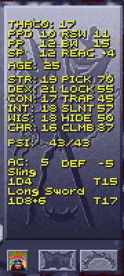

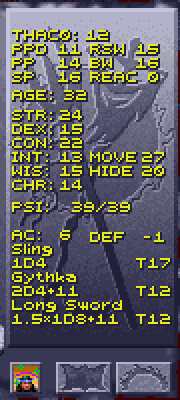

- above STR, **THAC0** and the five **saving throws**, with the usual AD&D
  short labels: `PPD` paralysis/poison/death, `RSW` rod/staff/wand, `PP`
  petrification/polymorph, `BW` breath weapon, `SP` spell;
- at the right of each weapon's damage line, the THAC0 with that weapon
  (`T14`);
- right of the abilities, level with STR to CHA, for a character with thief
  levels, six **thief skills**: `PICK` pockets, open `LOCK`s, find/remove
  `TRAP`s, `SLNT` (move silently), `HIDE` in shadows and `CLMB` walls. Move silently
  and hide in shadows are the ones the Loader rolls (for [picking
  pockets](#picking-pockets) and [hiding to
  backstab](#hiding-in-shadows-to-backstab)). A worn belt's 5 is in
  `PICK` and `LOCK`, and with hiding to backstab a worn cloak's 10 in `HIDE` and
  boots' 10 in `SLNT` (95 for the Cloak and Boots of Elvenkind). Hear noise (one
  script check) and read languages (a Shinobi's, for a scroll: on its
  [Effects screen](#the-effects-screen)) are left out for want of room. A
  ranger, with hiding to backstab on, gets their `SLNT` and `HIDE` in the same
  places, the cloak and boots counted (the other four left out);
- right of SP in the saves (where RSW and BW sit on the rows above), the DEX
  **reaction adjustment** (`REAC +4`): −6 at DEX 1 to +5 at DEX 24-25, the
  number the [two-weapon rule](#two-weapons) adds to its penalties,
  and the one initiative uses. It is worked out from the character's DEX each
  time the panel is drawn, so it follows any change (Cat's Grace's, while it
  lasts);
- with [ages](#ages-and-magical-aging) on, the character's **AGE**
  between the saving throws and STR;
- right of the AC line, the DEX **defensive adjustment** (`DEF -5`), as AD&D's
  table gives it, on AC: +5 at DEX 1 to −6 at DEX 24-25 (−4 at 18, −5 at 21-23).
  The game counts it in AC already; on saving throws against what can be dodged
  it counts the other way round (DEF −5 is +5 on the save), with the [rule
  change](#rule-changes) for fire, cold and electricity. Worked out
  the same way as REAC, each time the panel is drawn.

The **View Character** screen gets them too: the five saves under the item
icons, each with its label as above (`PPD 11  RSW 9` / `PP 10  BW 13` /
`SP 10`), and in the lower panel, right of HP and PSI as DAM is right of AC,
the character's **MOVE** (its movement in a fight, before boots or a spell
change it) and **THAC0**.

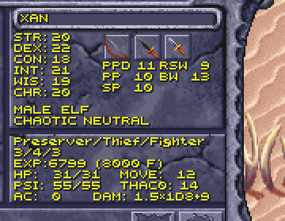

They're the numbers as they stand now, worked out by the Loader the way the
game's own attack and saving throw routines do, and brought up to date each
time the game draws one of these screens, so putting on a ring or readying
another weapon shows at once. Spells start and end as time passes in the game, which it
doesn't while these screens are open; open the screen again to see such a
change.

- **THAC0**: the character's THAC0 (its classes' best, a kit's warrior THAC0
  in it) less STR's to-hit adjustment (DEX's for a missile weapon), the
  weapon's plus (or, for a plain wooden, bone, stone or obsidian weapon, its
  material's penalty), its weapon spec's to-hit (specialization, mastery,
  expertise), a kit's (a Ravager's, a Brute's, an Arena Champion's...), the
  two-weapon penalty for the hand, Bless and Prayer (+1), Curse (−1), Slow (−4)
  and Graft Weapon (+1). The THAC0 at the top, and View Character's, is the
  main weapon's: the right hand's, else the left's, else the missile weapon's.
  What depends on the target (attacking from behind or backstabbing, a Blurred
  target) is left out; the dice log shows it on each attack.

- **Saves**: the d20 each needs, the character sheet's number less what the game
  adds to every save: the [Rings of Protection and the Cloak of
  Protection](#rings-and-cloaks-of-protection), Bless, Prayer,
  Barkskin, Spirit Armor (not on PPD), the Save penalty, and on PPD the CON
  adjustment (and a dwarf's or halfling's CON bonus). What depends on the spell
  or its caster (WIS against mind spells, Protection from Fire, a doubled d20
  against fire...) is left out; the dice log shows it on each save. A 1 always
  fails and a 20 always saves, so they show between 2 and 20.
- **Thief skills**: as they stand (with no equipment penalty in games started
  with the dice log: see [How the game works out thief
  skills](HOW-THE-GAME-WORKS.md#how-the-game-works-out-thief-skills)), at most
  95 with [AD&D's table](#thief-skills-from-adds-table), 0 for a
  skill an effect rules out or when the thief isn't Okay (New counts as Okay),
  and 100 for one an effect makes certain (Detect Traps). Only the situation's
  bonus or penalty (a hard lock) is left out: the dice log shows it on each
  roll.

The Characters tab shows the same THAC0 with each weapon and saves. The
game's own numbers (the character sheet's) come back on these screens when
the Loader isn't running.

**The next level's class.** For a character of more than one class, the number
in brackets on View Character's experience line is the XP at which the first
of their classes goes up a level, and the Loader adds which class that is:
`EXP:87230 (90000 Pr)` means the preserver goes up next, at 90,000. Each class
is its first letter (C, D, F, G, R, T), except the preserver's Pr and the
psionicist's Ps. When two classes go up at the same XP, both are named:
`(20000 Pr/T)`. A class already at the highest level (9, or its share of the
XP cap with [Level cap by XP](#level-cap-by-xp)) has no next level,
so it is never named.
A character of one class shows the line as the game always has, and so does a
human, who can only dual-class: the game counts only one of their classes
there.

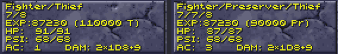

How it works: [DEVELOPMENT-SCREENS.md](DEVELOPMENT-SCREENS.md#thac0-saves-and-thief-skills).

### The creation screen

The character creation screen gains, beside the game's own scores and hit
points:

- **THAC0**, right of the hit points: `THAC0: M18 R19`, M for melee and R for
  ranged, the character's THAC0 as its classes and kit stand (a Scholar's 1
  worse, a Battle Mage's a warrior's...) less STR's to-hit adjustment (M) and
  DEX's missile adjustment (R), so a click on STR or DEX shows at once what it
  does to them. No weapon is counted (none is held yet, and weapon specs are
  picked after DONE): it is the inventory's THAC0 before the weapon's own
  parts.
- **AGE**, above RECALL, with [ages](#ages-and-magical-aging) on
  (`AGE: 23`): the age the character will start at, Table 7's dice rolled again
  with each roll of the die and each choice of race, sex or class. A click on a
  score keeps it, STORE and RECALL keep it with the roll, and EDIT on a party
  member shows its own until the die is rolled.
- **SUM**, under CHR: what the six scores add up to and the most they may
  ([scores as rolled](#scores-and-hit-points-as-rolled)).
- **STORE** and **RECALL**, under the hit points
  ([STORE and RECALL](#store-and-recall-on-the-creation-screen)).
- **KITS**, at the end of the disciplines' or spheres' panel
  ([choosing a kit](KITS.md#choosing-a-kit)); after DONE, the weapon window
  for a warrior's weapon specs
  ([weapon specialization](KITS.md#choosing-at-creation)).

A picture of it: [STORE and RECALL](#store-and-recall-on-the-creation-screen).
How it works: [DEVELOPMENT-SCREENS.md](DEVELOPMENT-SCREENS.md#the-creation-screen).

### Spell slots on the USE screen

The game's USE (cast spells) screen shows, at the top of the panel under the
spells, how many spells of the level on show (its LEVEL button) the selected
character can still cast, and the most they get after resting, for the list on
show only: `SPELLS LEFT`, then `WIZ` on the MAGE list (preservers' wizard
spells) or `PRI` on the CLERIC list (clerics', druids' and rangers' priest
spells), as `left/most` (`PRI 3/5`). The PSIONIC list shows none. Another level
or list shows its own when the LEVEL or list button turns to it:

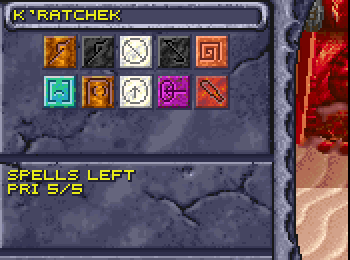

The numbers go down as spells are cast (the screen shows the new count when it
is next drawn) and back up after resting. A preserver in armour reads `NO
SPELLS IN ARMOUR` in place of the heading.

The numbers are the Characters tab's (see [spell slots](README.md#the-characters-tab)),
WIS bonus included, printed with the game's own text routine; they show while
the Loader (or its command-line dice log) is running.

How it works: [DEVELOPMENT-SCREENS.md](DEVELOPMENT-SCREENS.md#spell-slots-on-the-use-screen).

### Charges in item boxes

An item that casts a spell with charges (the wands, the Storm Ring, the
necklaces) shows how many it has left in its item box (right-click it on the
inventory screen), under its name, counting down as it's used. A cloak's,
boots' or belt's box shows what it adds to thief skills (with
[improved thieving](#improved-thieving) on):

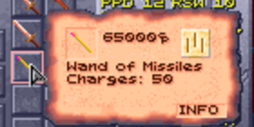

A plain weapon of a weaker material shows its to-hit penalty there: "Hit -3"
for wood, "Hit -1" for bone, "Hit -2" for stone and obsidian (Dark Sun's, as the
game's attack takes it; the damage line above already has the material's
damage off). Not for a weapon with a plus, nor for those the game spares
(clubs, staves, the chatkcha), nor for metal.

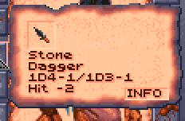

How it works: [DEVELOPMENT-SCREENS.md](DEVELOPMENT-SCREENS.md#charges-in-item-boxes).

### The Effects screen

The Effects screen (Current Spell Effects) shows more
in its lower panel and under the pointer:

- **Kits and weapon specs:** each kit (`KIT: RAVAGER`; the game's own party's
  features with no prefix, `SHADOW-WALKER`), with a Shinobi's chance
  to read a scroll under it (`READ LANG. 35%`), then the weapon specs, a page
  at a time when there are more than fit ([Changing
  class](KITS.md#changing-class) has pictures).
- **Charges left:** with the pointer on the icon of a spell that lasts a number
  of uses, the name under the icons says how many are left: IMPROVED AC (4
  CHARGES) for Armor, MIRROR IMAGES (3 CHARGES), REFLECTED IMAGE (2 CHARGES).
  Effects that last until removed (Charmed) and a magic item's power while
  it is readied (Shadowseeker's Detect Invisibility) show none.
- **Enlarge's damage:** with the pointer on its icon, how much more it gives,
  10% a level of its caster: ENLARGED (+90% DICE) from a 9th-level preserver,
  the weapon's dice made bigger
  ([the rule](#enlarge-multiplies-the-weapons-dice-only), on unless
  unticked), or ENLARGED (+90% DAMAGE) with it off, the whole melee damage. The inventory's and View Character's damage don't count it (no room);
  each hit's line in the dice log does (`+5 Enlarge (the dice 5 x190% = 10,
  level 9)`, or `x190% Enlarge (level 9)` with the rule off). A second Enlarge on someone already enlarged
  uses up the spell and adds nothing.
- **The armour spells' AC:** with the pointer on Barkskin's, Flesh Armor's or
  Magical Vestments' icon, the armour AC it gives by its caster's level:
  BARKSKIN (AC 3) from a 12th-level druid (Barkskin 6 less a quarter of the
  level, Flesh Armor 10 less the psionicist level, Magical Vestments 5, 1
  better for each 3 levels above 5). DEX and the rest are still added
  to it, and armour already better is kept, so a spell showing a worse AC
  than the character's armour does nothing for them.
- **A click on a spell's icon** no longer ends it: [Spells on the Effects
  screen](#spells-on-the-effects-screen).

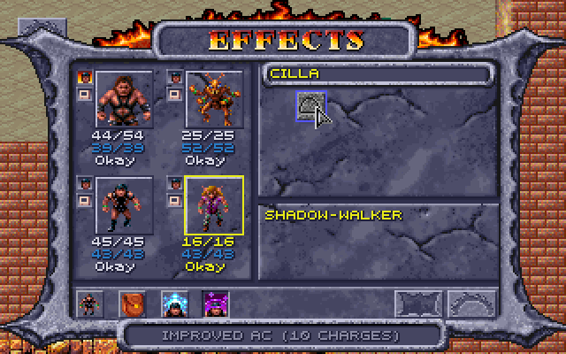

How it works: [DEVELOPMENT-CONTENT.md](DEVELOPMENT-CONTENT.md#the-games-spells).

### What a scroll says

Clicking a scroll's spell icon in its item box gives the result on the line
under the paper doll: YOU LEARN THE SPELL, YOU ALREADY KNOW THIS SPELL, YOU FAIL
TO LEARN THE SPELL, TOO MANY SPELLS OF THAT LEVEL, or a Shinobi's YOU CAN NOT
READ THE SCROLL and THAT IS NOT A SHINOBI SPELL. The game wrote these there too,
but they never reached the screen. Like the game's own messages on that line, it
stays until the pointer is on something else.

How it works: [DEVELOPMENT-RULES.md](DEVELOPMENT-RULES.md#preservers-int).

### No manual check

The game's copy protection is gone. Leaving the sewers (the Tari's warrens) the
first time, the game has a dragon appear and ask for a word from the manual
("The 3rd word on page 14, line 1, begins with the letter 'p'. What is that
word?"), and three wrong answers kill the party. Started from the Loader, the
dragon doesn't come: the game goes on as if it had been answered.

How it works: [DEVELOPMENT-SCREENS.md](DEVELOPMENT-SCREENS.md#no-manual-check).

## Rule changes

Twenty-five changes that bring the game's own rules closer to AD&D, each with its
own box in the Options tab's **Rule changes** section, grouped there as they
are here: [characters](#characters), [weapons and armour](#weapons-and-armour)
and [magic](#magic). All are on by default,
and they take effect in games started from the Loader or its `.bat` files
(**Play Dark Sun (in-game rolls)** uses the Options as last set). Untick one
and the game's own rule is back at once, but for two that change the game's
own copy as the Loader writes it, and so count from the next start: [spells and
psionics as the manual describes them](#spells-and-psionics-as-the-manual-describes-them)
and [spells roll to hit](#spells-roll-to-hit).
[How the game works](HOW-THE-GAME-WORKS.md) has what the game does without them.

Most of these put right a rule the game gets wrong (it departs from its own manual, from itself or from
the Player's Handbook), and count among [the game's bugs](GAME-BUGS.md#rules-it-got-wrong-with-a-switch),
with the switch to go back. The rest are the mod's own choices: helms' AC, resting, the XP level cap, hit dice,
creation scores, half-giants' weapons, creature size, cahulaks and ages.

### Characters

| Rule | The game | With the rule |
|---|---|---|
| [Class restrictions](#class-restrictions) | any one of a character's classes allowing an item is enough | each class's limits on armour, shields and weapons hold, the strictest winning; a multiclass preserver casts no spells in armour, and a thief with another class has no thief skills in armour that isn't light |
| [Multiclass hit points](#multiclass-hit-points) | CON's bonus once a level of the highest class | CON's bonus on every hit die (a warrior's for a character with a warrior class), the total shared between the classes |
| [Hit dice: the better of two](#hit-dice-the-better-of-two) | each hit die rolled once | each hit die rolled twice, the better kept, for every character |
| [Scores and hit points as rolled](#scores-and-hit-points-as-rolled) | a click raises any score to its most, and sets the hit points anywhere the classes could roll | on the creation screen, a click raises a score only while the six add up to no more than the die gave (lower one to raise another), and doesn't change the hit points |
| [AD&D's class tables](#adds-class-tables) | priests' THAC0 improving a level early (19 at 3rd), fewer priest and preserver spell slots (3 2 1 at 5th), gladiators, rangers and thieves needing a little less XP for 2nd level | the XP for each level, priests' THAC0, and clerics', druids' and preservers' spell slots from AD&D's tables |
| [CON as in AD&D](#con-as-in-add) | a hit point back every 5 minutes at any CON from 20; dwarves and halflings add CON's poison adjustment to their racial bonus | regeneration from CON 20 at AD&D's rates (an hour a hit point at 20 to 10 minutes at 25); dwarves and halflings add only their racial bonus to poison saves |
| [Ages and magical aging](#ages-and-magical-aging) | no ages; Haste costs nothing | each character has an age from Dark Sun's tables: its scores change at middle, old and venerable age, and it dies at the most its race lives; a year older each 365 days of game time; Haste ages its target a year, after a system shock roll to survive |
| [Dual-classing as the manual has it](#dual-classing-as-the-manual-has-it) | DUAL from 2nd level, one prime requisite checked a class (a ranger, druid or psionicist on WIS alone) | DUAL from 3rd level, as the manual says, and every prime requisite of the old class 15 or more, every one of the new class's 17 or more |
| [Level cap by XP](#level-cap-by-xp) | every class stops at 9th level | a class goes up past 9th while its next level needs no more than 749,999 XP, shared out between a character's classes |

#### Class restrictions

With **Class restrictions** ticked, a character's classes keep it from
armour, shields and weapons as in AD&D, the strictest class winning. The game
checks only that one of the character's classes may use an item; with the rule
the others must allow it too, and putting on what one forbids gets the game's
own "Cannot use this item":

| Class | Armour and helms | Shields | Weapons |
|---|---|---|---|
| **Psionicist**, whatever its other classes | light only (leather, hide, silk: Drake, Shimmer and Silk Armor) | leather only, and only with a fighter, gladiator, ranger or cleric class (the game's lists give a psionicist none, and a psionicist/thief none either) | daggers, short swords, maces, clubs, chatkchas, bows and slings, of those its classes' lists allow: alone, daggers, bone and obsidian short swords, clubs, chatkchas and bows (the game's lists leave out maces, slings and the metal short sword, and the rule takes away the axes, picks, gythka and long swords they allow) |
| **Thief** | light only; a multiclass thief, or a human thief once a warrior or cleric, as its other class allows, but no thief skills in armour that isn't light | leather ones; a multiclass thief only if another of its classes allows shields (a fighter, gladiator, ranger or cleric) | as its classes allow |
| **Preserver**, one class | none (a human preserver once a warrior: as the warrior could, but no spells in armour) | none | as the game has it |
| **Druid** | none | none | as the game has it (any but great axes) |
| **Cleric** | any | any | its sphere's: air missile and thrown weapons, daggers and cahulaks (thrown in Dark Sun); earth stone, obsidian, metal and wood; fire obsidian; water bone and wood |

A thief of any kind holds only leather shields, the rule or not: the game's own
lists leave thieves out of the wooden shield, and the mod's metal one.

A **multiclass preserver** may wear what its other classes allow, but casts no
spells (wizard or priest) while wearing armour (a helm counts, a shield
doesn't), as the game's own "No spell use" stops them. The **USE** screen
heads its spell slots **NO SPELLS IN ARMOUR**, and the Characters tab adds
"(no spells in armour)" to them. So does a human who has been a preserver and a
fighter, gladiator or ranger, in either order: it may wear what the warrior
could, and casts no spells in armour.

A **multiclass thief** (a fighter/thief, a cleric/thief), or a human thief who
was a fighter, gladiator, ranger or cleric, may wear the armour its other class
allows; in armour that isn't light, every **thief skill is 0** (the inventory
screen's PICK to CLMB, the Characters tab's "none in armour that isn't light")
and it can't **backstab** (nor hide in shadows to backstab). A human warrior who
was a thief is the same. The Assassin, Shinobi, Shadowblade, Poisoner and
Spellarcher wear light armour only, even while a human's kit is asleep after
a change of class ([Kits](KITS.md)).

A human who has changed class is held by the class it has now; another race by
all of its classes. A ranger turned cleric uses both spheres' weapons, and a
warrior who dual-classed uses the weapons it specialized in once the new
class's level passes the old (a fighter's, gladiator's or ranger's chosen
weapon specs, and a ranger's bow). A ranger's bow is always its own: a fire
ranger/cleric, whose fire sphere allows only obsidian weapons, may still use
bows. Cloaks, the Cloak of Protection among them, aren't armour: any class may
wear one.

A new character starts without the weapons, armour and shields its classes
can't use. The game gives a character of several classes one class's gear, the
first of fighter or ranger, cleric, thief, psionicist, preserver and druid,
and puts what it may not wear in the backpack: the Loader leaves that behind
and says so in the dice log
(`Yilballa's Chest Armor is left behind: their classes can't use it`, for a
fighter/druid's leather armour, given for its fighter class). A character left
without a weapon this way (a thief/psionicist loses its long sword) gets one
it can use with [Fuller starting gear](#fuller-starting-gear).

How it works: [DEVELOPMENT-RULES.md](DEVELOPMENT-RULES.md#class-restrictions).

#### Multiclass hit points

With **Multiclass hit points** ticked, a character of more than one class
gets its hit points as *Demihuman Deities* (TSR, 1998) sets out AD&D's rule
for multiclassed characters: every hit die it rolls, at creation and at each
level, gets CON's bonus, goes into a running total, and the total divided by
the number of classes (dropping fractions) is its most hit points. CON's
bonus is a warrior's (+3 at CON 17, +4 at 18 and so on) on every die if one
of its classes is a fighter, gladiator or ranger, as a "warrior character";
otherwise at most +2. Dice stop as usual after 9th or 10th level, and so
does CON's bonus.

The game already keeps the total and divides it, but gives CON's bonus only
once a level of the character's highest class, whole: a preserver 5 / thief 6
with CON 18 gets 2 × 11 dice / 2 = 11 hit points from CON with the rule,
rather than the game's 2 × 6 = 12. A human who dual-classes isn't affected
(one class at a time). Ticked during a game, a character's most hit points
change at its next level, when the game works them out again. The log shows
the bonus on each die:

```
Gerrard's 4th Fighter level: hit points d10 = 8, +3 CON 17, into the total shared by 2 classes
```

How it works: [DEVELOPMENT-RULES.md](DEVELOPMENT-RULES.md#multiclass-hit-points).

#### Hit dice: the better of two

With **Hit dice: the better of two** ticked, every character's hit die is rolled
twice and the better roll kept: at creation (one die for each starting level
of each class) and at every level gained. Everything after the roll is the
game's (or the other rules'): CON's least, a half-giant's double, and a
multiclass character's share. It isn't AD&D's, but it softens a bad roll; on
average a d10 gives 7.15 instead of 5.5, a d8 5.8 instead of 4.5, a d6 4.5
instead of 3.5 and a d4 3.1 instead of 2.5. Levels past the dice (a fixed
gain) don't change. The log shows both rolls:

```
Cilla's 3rd Ranger level: hit points d10 = 2 and 7, the better 7
Character creation, hit points 18: Fighter d10 per level: 10 (the better of 2 and 10) + 5 (the better of 5 and 1); ...
```

How it works: [DEVELOPMENT-RULES.md](DEVELOPMENT-RULES.md#hit-dice-the-better-of-two).

#### Scores and hit points as rolled

The game's creation screen lets a click change what the die rolled: a left
click raises a score by 1 (from its most, round to its least), a right click
lowers it, and a click on the hit points sets them anywhere the classes could
roll. Every score can go to its most that way. With **Scores and hit points as
rolled** ticked:

* **The six add up to no more than the die gave.** A score may still be
  lowered, and the points it frees raise another. A raise past what's spare
  stops at it, or does nothing when none is spare. The game's least and most
  for each score still hold.
* **The totals show under CHR**, the six's and the die's: `SUM:99/101` has 2
  points to spare. A new roll of the die (or of a new race or sex) sets both.
  A new class can raise a score to its least, as the game does; the die's
  total grows to match if the six then add up to more.
* **The hit points are as rolled**: a click on them does nothing. **CON moves
  them:** raising or lowering CON adds or takes off its bonus for every level,
  as the game counts it (a warrior's full bonus, at most +2 for others), where
  the game only kept them within the new least and most.

The dice log gives each roll's total with its scores:
`Character creation: the six scores add up to 101`.

How it works: [DEVELOPMENT-RULES.md](DEVELOPMENT-RULES.md#scores-and-hit-points-as-rolled).

#### AD&D's class tables

The game has tables of its own where AD&D's differ. With **AD&D's class
tables** ticked, AD&D's hold (the [player's guide](PLAYER-GUIDE.md) has them in
full):

- **Experience:** a gladiator needs 2,250 XP for 2nd level (the game uses
  the fighter's table), a ranger 2,250 (2,200) and a thief 1,250 (1,200);
  the rest are as the game has them. View Character's next-level figure and
  the level ups both follow it.
- **Priests' THAC0:** clerics and druids improve by 2 every 3 levels from
  4th (20, 20, 20, 18...), as AD&D's priests do; the game has them improve
  from 3rd (19 at 3rd, 17 at 6th, 15 at 9th). The new THAC0 comes at the
  next level up. Warriors', wizards' and rogues' were AD&D's already.
- **Spell slots:** clerics and druids take AD&D's priest table (3 3 1 at 5th
  level, the game 3 2 1), preservers AD&D's wizard table (4 2 1 at 5th); WIS
  still adds a priest's bonus slots. Rangers' slots were AD&D's already.

Hit dice were AD&D's already, past 9th level too with
[Level cap by XP](#level-cap-by-xp). Kits still change these tables.

How it works: [DEVELOPMENT-RULES.md](DEVELOPMENT-RULES.md#adds-class-tables).

#### CON as in AD&D

A party member with CON 20 or more gets hit points back by itself. The game
gives one every 5 minutes of game time at any such CON, 12 an hour. With **CON as in AD&D** ticked it is
the Player's Handbook's rate:

| CON | A hit point every |
|---|---|
| 20 | hour |
| 21 | 50 minutes |
| 22 | 40 minutes |
| 23 | 30 minutes |
| 24 | 20 minutes |
| 25 | 10 minutes |

Minutes short of the next hit point count towards it later. The dice log
shows each: `Gerakis regenerates 1 HP (CON 22), now 12/54 HP`.

The same box takes CON's adjustment off a dwarf's or a halfling's
paralysis/poison/death save. The game adds both their racial bonus (CON × 2 /
7, +1 for every 3.5 points) and the adjustment everyone with CON 19 or more
gets (+1 to +4); in AD&D the racial bonus takes its place. A dwarf with CON 19
saves at +5, not +6.

How it works: [DEVELOPMENT-RULES.md](DEVELOPMENT-RULES.md#con-as-in-add).

#### Ages and magical aging

The game keeps no ages. With **Ages and magical aging** ticked, each party
member has one, from the Dark Sun rules' tables: a starting age, the race's
base and Table 7's dice. A new character's dice are rolled on the creation
screen, again with each roll of the die, and kept with the character
at DONE; the game's own party, or a character from before ages, gets its roll
the first time the Loader sees it, which the dice log shows
(`Cermak is 22 (a human: 15 + 1d8 = [7]); middle-aged at 40.`). Each **365 days of
game time** (the game's own clock, from the start of the game) everyone is a
year older, and the dice log says so (`A year has passed: Cermak is 23.`),
the age categories counting as below. It is flavour: a party that rests
5000 times is only about 5 to 9 years older. The years counted are kept in the
save, so loading one shows the ages as they were then, and no year is counted twice
or missed (one that passes in the arena is counted as the party leaves it).

| Race | Starting age | Middle age | Old age | Venerable | Most it lives |
|---|---|---|---|---|---|
| Human | 15 + 1d8 | 40 | 53 | 80 | 80 + 2d20 |
| Dwarf | 25 + 4d6 | 100 | 133 | 200 | 200 + 3d20 |
| Elf | 15 + 3d4 | 50 | 67 | 100 | 100 + 2d20 |
| Half-elf | 15 + 2d4 | 45 | 60 | 90 | 90 + 2d20 |
| Half-giant | 20 + 5d4 | 60 | 80 | 120 | 120 + 1d100 |
| Halfling | 25 + 3d6 | 45 | 60 | 90 | 90 + 4d12 |
| Mul | 15 + 1d6 | 40 | 53 | 80 | 80 + 1d10 |
| Thri-kreen | 6 | | | 25 | 25 + 1d10 |

On reaching each age the scores change, once and for good, adding up: middle
age −1 STR and CON, +1 INT and WIS; old age −2 STR and DEX, −1 CON, +1 WIS;
venerable −1 STR, DEX and CON, +1 INT and WIS. A thri-kreen has only a
venerable age, and loses 1 STR and 1 DEX there. Reaching the most its race
lives (its own roll, kept secret) the character dies of old age.

**Haste** speeds the body up and ages it, as the AD&D spell does: each
creature it hastes must survive a **system shock** roll (the CON table: 85% at
CON 13, 88% at 14, 90% at 15, 95% at 16, 97% at 17, 99% at 18 to 24, 100% at
25) or die, and
a party member who survives is a year older, its age categories counting as
above. Monsters have no ages: for them it is the system shock alone. The dice
log shows both:

```
Cermak gives Hasted to K'ratchek: double movement and attacks; ends Slow
K'ratchek's system shock (Haste's aging): d100 = 89, needs 99 or less (CON 19) -> survives
  K'ratchek ages 1 year (Haste): now 7.
```

A thri-kreen, venerable at 25, feels it most: every Haste is a year of a short
life. A dwarf hardly notices.

The age shows on [the creation screen](#the-creation-screen) and [the
inventory screen's panel](#thac0-saves-and-thief-skills) (`AGE: 23`), and on
the Loader's Characters tab with the category and the next age to come (`Age:
45, middle-aged; old at 53`).

It shows on the map too: a party member's hair turns as they age, iron grey
streaks when middle-aged, grey when old, white when venerable, shade for shade
in the figure's own pictures, walking and fighting (with
[What the party wears](#what-the-party-wears) on). A helm or cloak over the
hair is left as it is. Dwarves and muls are hairless on Athas, and thri-kreen
have no hair, so they keep their looks.

How it works: [DEVELOPMENT-RULES.md](DEVELOPMENT-RULES.md#ages-and-magical-aging).

#### Dual-classing as the manual has it

A human changes class with **DUAL** on a portrait's right-click menu
([the Player's Guide](PLAYER-GUIDE.md#more-than-one-class) has every condition).
The game offers it from 2nd level and checks one prime requisite a class: the
old class's at 15 or more, the new one's at 17 or more, with WIS alone for a
ranger, druid or psionicist. The manual says "You must be at least third level
in your current class before you can dual class" (p. 12), and gives those three
classes more than one prime requisite (pp. 22-26). With **Dual-classing as the
manual has it** ticked, DUAL comes at **3rd level**, and **every** prime
requisite counts:

| Class | Prime requisites (the manual's) |
|---|---|
| Fighter, gladiator | STR |
| Ranger | STR, DEX, WIS |
| Preserver | INT |
| Cleric | WIS |
| Druid | WIS, CHA |
| Thief | DEX |
| Psionicist | CON, WIS |

A ranger who wants to become a thief needs STR, DEX and WIS 15 and DEX 17; a
fighter who wants to become a psionicist needs STR 15, CON 17 and WIS 17. A
class the window can't offer is greyed out, as the game's own refusals are.

How it works: [DEVELOPMENT-RULES.md](DEVELOPMENT-RULES.md#dual-classing-as-the-manual-has-it).

#### Level cap by XP

The game stops every class at level 9 (its manual's tables end there too).
With **Level cap by XP** ticked, a class goes up instead while its next level
needs no more than **749,999 XP**, shared out:

| Character | A class goes up while its next level needs no more than |
|---|---|
| One class | 749,999 |
| Two or three classes | an even share: 374,999 each for two, 249,999 for three |
| A human who changed class | 749,999 less what its old classes' levels needed |

A character of several classes already has its XP shared: the game splits
every award between the classes, and the sheet shows one class's share. A
human's XP starts again at 0 when it changes class, so its old classes' levels
count against the new one: a fighter who changed to cleric at 9th (250,000 XP)
can take the cleric to 10th, at 7th (64,000) to 11th. XP keeps counting past
the cap; only the levels stop. With [AD&D's class tables](#adds-class-tables),
the highest levels are in the player's guide's [Experience and
levels](PLAYER-GUIDE.md#experience-and-levels), with AD&D's XP table, and the
XP each class has left over at the top and the room a human's new class has
([XP left over at the top](PLAYER-GUIDE.md#xp-left-over-at-the-top)).

749,999 is the most XP that keeps a druid from 13th and a preserver from 12th
(both need 750,000), where a preserver would cast 6th-level spells. Without
AD&D's tables the game's own XP tables count.

Everything else past 9th level is the game's own: it had it all along, and
only the cap kept it out of reach. Its XP tables go on to level 20 (druids
with a table of their own, not the cleric's), and THAC0, saves, spell slots
and thief skills are worked out from the level. So past 9th:

- **Hit points** follow AD&D: preservers roll their d4 to 10th and thieves
  their d6 to 10th (CON's bonus counting too), then gain a fixed amount (+1 a
  level for preservers, +2 for thieves); the
  others gain a fixed amount from 10th (+3 for fighters, gladiators and
  rangers, +2 for clerics, druids and psionicists). The game's own table has
  the fixed gain for thieves at 10th too, as it keeps thieves and psionicists
  together and AD&D's psionicist stops rolling at 9th; with the rule thieves
  roll their 10th die.
- **Gladiators** optimise their armour, as the game already has them do: AC 1
  better for every 5 gladiator levels, so −2 at 10th where it was −1. (The
  Loader counts it in **AC: spells, rings, other**.) In armour only, as Dark
  Sun has it: the game gave it with none ([the game's bugs,
  fixed](GAME-BUGS.md#items)).
- **THAC0 and saves** improve as the game's formulas give: 11 for a 10th-level
  gladiator, 14 for a 10th-level druid, as for AD&D's warriors and priests.
- **Spell slots** grow at the levels casters already have, up to 5th. With
  AD&D's class tables a priest has 5 4 4 3 2 1 at 11th and 6 5 5 3 2 2 at 12th
  (a druid's; a cleric stops at 11th), a preserver 4 4 4 3 3 at 11th. The
  6th-level slots are for the mod's [6th-level priest
  spells](#6th-level-priest-spells); preservers have no 6th-level spells.
- **Thief skills** from AD&D's table go on to 13th
  ([Thief skills from AD&D's table](#thief-skills-from-adds-table)).
- **A preserver picks a new spell** on the game's own CHOOSE A SPELL screen,
  as at every level, offered from spell level (class level + 1) / 2 down, but
  no higher than 5th (the game would offer an empty 6th-level page at 11th).
  **A psionicist picks a new power** (the game gives one at each level, two at
  odd levels and 4th).
- Spell damage that grows with the caster's level counts up to level 10 in
  the game, so a caster past 10th does no more.

The level-up comes as the game's usual one ("Gerakis gains a level"), and
View Character stops showing the XP for the next level at the cap, as it does
at 9 without the rule. For a character of more than one class, a class
already at its cap isn't named in the brackets, since it has no next level.
Untick it and nobody goes past the level they have.

How it works: [DEVELOPMENT-RULES.md](DEVELOPMENT-RULES.md#level-cap-by-xp).

### Weapons and armour

| Rule | The game | With the rule |
|---|---|---|
| [Two weapons](#two-weapons) | no penalty (a small bonus at DEX 5 or less), and each hand attacks at the whole rate | −2 main hand, −4 off hand, DEX's reaction adjustment added; rangers, Twin-blades and Battle Dancers none in light armour, a Justifier none in any, a Ghetto Fighter 0 and −2; the off hand attacks once a round |
| [Half-giants' two-handed weapons](#half-giants-two-handed-weapons) | two hands for a two-handed weapon, as for anyone | a half-giant wields a two-handed weapon in one hand |
| [Weapon traits](#weapon-traits): [cahulaks](#cahulaks) | a plain two-handed 1d6 weapon | a head in each hand: one attack more a round at −2 and −4 (DEX added); a hit tangles a man-sized or smaller foe (not anyone Enlarged) that fails a save against petrification: it loses its next turn |
| [Weapon traits](#weapon-traits): [the staff sling](#staff-sling-stinkpots) | the staff sling shoots for 1d4 | it throws stinkpots: 1d3, and a target hit, unless undead or immune to poison, saves against poison or is nauseated, −2 to hit for 1d3+1 rounds |
| [Weapon traits](#weapon-traits): [polearm reach](#polearm-reach) | a polearm strikes only an adjacent foe | a polearm held with no other weapon in the hands strikes a foe two squares away too |
| [Creature size](#creature-size) | no sizes: a weapon does the same to a halfling and a Bulette; Hold Person and Charm Person take on a half-giant | a large target (a half-giant, a large monster, anyone Enlarged) takes AD&D's large weapon dice (a long sword 1d12); Hold Person, Charm Person and Charm Person or Mammal (on a person) don't take on it |
| [Held targets](#held-targets) | a blow on a held or Out Cold creature rolls to hit as ever and does double damage | it hits automatically and does normal damage, as AD&D's held target |
| [Rings and cloaks of protection](#rings-and-cloaks-of-protection) | no rings or cloaks of protection of its own; the mod's count in full, whatever else is worn | two rings don't add up, a ring gives no AC with magical armour, a cloak does nothing with magical or metal armour or a shield |
| [Helms give AC 1](#helms-give-ac-1) | AC 0 | the game's helms give AC 1 rather than 0 |
| [Items saving against acid](#items-saving-against-acid) | armour without a magical power destroyed outright, its plus ignored; a weapon on a d20 under 8 less its plus | an item the acid or corroding touch could destroy needs the easier of the game's number and AD&D's save by material, a plus helping |

#### Two weapons

With **Two weapons** ticked, a character with a melee weapon in each hand
attacks at −2 with the main (right) hand and −4 with the off (left) hand, plus
the DEX reaction adjustment (the table under
[Initiative](HOW-THE-GAME-WORKS.md#initiative)). That can bring the penalty to 0
but never make it a bonus, and low DEX makes it worse: DEX 17 gives 0 and −2,
DEX 21 0 and 0, DEX 3 −5 and −7. One weapon, a two-handed weapon, a weapon and a
shield, or a weapon and a bow or sling (the missile slot) have no penalty. The
game's own rule, a small bonus at DEX 5 or less, is gone.

Rangers (their kits too), [Twin-blades](KITS.md#gladiator-kits) and [Battle
Dancers](KITS.md#multiclass-kits) have no penalty in light armour: every armour
piece worn, a helm too, of leather or of no material. In other armour they take
it as anyone does, DEX included. A Justifier has none in any armour. A [Ghetto
Fighter](KITS.md#multiclass-kits)'s is 2 less, in any armour: none in the main
hand and −2 in the off hand, DEX's adjustment still added. The dice log names it (`-4 two weapons, off hand at DEX 15`),
as do the THAC0 lines on the Characters tab and the inventory screen.

The off hand attacks once a round, whoever holds it: extra attacks (a
fighter's, gladiator's or ranger's 3/2 from the game, a specialist's,
mastery's, the kits') are the main hand's alone. So a 7th-level Crusader
with a club in each hand attacks 3/2 + 1 a round: 1 + 1 in one round, 2 + 1
in the next. The game gives each hand the whole rate (1 + 1, then 2 + 2).
The off hand's DAM lines (the inventory screen and View Character) show its
one attack.

How it works: [DEVELOPMENT-RULES.md](DEVELOPMENT-RULES.md#two-weapons).

#### Half-giants' two-handed weapons

Half-giants stand up to twelve feet tall. With **Half-giants' two-handed
weapons** ticked, a half-giant can hold a two-handed
weapon (a two-handed sword, a halberd, a bow) in one hand, with a shield or a
light weapon in the other. The game's own rule that the two hands can't both
hold heavy weapons (over 30 in weight each) still stands, so no half-giant
holds two two-handed weapons. **Cahulaks** are the exception: a pair of
four-bladed heads on a rope, one in each hand, they take both of a half-giant's
hands too.
With two weapons ready, the two-weapon penalties apply as for anyone. The inventory screen still writes "2 handed" in the
weapon's line: that is its weapon type, not a limit.

How it works: [DEVELOPMENT-RULES.md](DEVELOPMENT-RULES.md#half-giants-two-handed-weapons).

#### Weapon traits

One switch, **Weapon traits** (on unless unticked), gives weapons what AD&D's books give
them and the game doesn't: the [cahulaks](#cahulaks) their two heads and their tangle, the
[staff sling](#staff-sling-stinkpots) its stinkpots, and the [polearm](#polearm-reach) its reach.
Untick it and all are the game's.

##### Cahulaks

Cahulaks are a pair of four-bladed heads tied to the ends of a rope, as Dark Sun's
rules describe them: one head in each hand. With **Weapon traits** ticked
(on unless unticked):

- **A head in each hand.** The wielder attacks one more time a round, with the
  off head, under the [two-weapon](#two-weapons) penalties whether that box is
  ticked or not: −2 for the main head's swings, −4 for the off head's (the
  round's last swing), DEX's reaction adjustment added and never better than 0.
  Rangers in light armour (a Justifier in any) take none, and a Ghetto Fighter
  0 and −2, as with two weapons. Twin-blades and Battle Dancers can't hold
  cahulaks at all: a Twin-blade's kit forbids two-handed weapons (for the
  cahulaks a half-giant's too), and a Battle Dancer's allows only long swords
  and bows.
  The inventory's damage line counts the extra attack.
- **The tangle.** A hit that does damage tangles the target unless it saves
  against petrification (its own number, a d20): a tangled foe loses its next
  turn, no movement and no attack (this round's, if it has yet to act). Only a
  man-sized or smaller foe can be tangled: not a half-giant, nor anything large
  or bigger in [the creatures' table](CREATURES.md) (whether or not
  [Creature size](#creature-size) is ticked), nor anyone Enlarged (large while
  the spell lasts), nor anything with no body a
  rope could hold (elementals, the Dust Devil, the Insect Swarm, Evard's
  Tentacle, the slimes, and the shadows, greater ones too), nor two the mod keeps from it by name
  (the Sand Howler and the Strine).

The game keeps no size for its creatures, so who is too big is the mod's call,
from AD&D's sizes. **[The creatures' table](CREATURES.md)** shows every creature
of the game with its figure, its size and whether the cahulaks can tangle it.

```
Lex attacks Templar with Bone Cahulaks (1d6): d20 = 16, needs 16+ (25%), hits AC 4, target AC 4 -> HIT
    THAC0 18, +3 STR, -1 bone, -4 cahulaks, off head at DEX 10 = 20
  Lex hits Templar for 12: 1d6 = [5] -1 bone +8 STR 20
    Lex's cahulaks tangle Templar? Save against petrification: d20 = 2, needs 19+ -> tangled: loses its next turn
```

How it works: [DEVELOPMENT-RULES.md](DEVELOPMENT-RULES.md#cahulaks).

##### Staff sling stinkpots

AD&D's *Arms and Equipment Guide* gives the staff sling a stinkpot to throw: a clay pot of burning
sulphur. With **Weapon traits** ticked (on unless unticked), the staff sling's standard shot
is one:

- **Damage 1d3** crushing, against any size (the game's staff sling 1d4). The inventory's and the
  item box's damage lines say 1D3; a grand master's die is the next size, 1d4
  ([Grand mastery's damage](KITS.md#grand-masterys-damage)).
- **The fumes.** A hit that does damage makes the target save against poison (paralysis, poison or
  death: the game's own saving throw, as against a monster's poisoned hit, with every bonus the game
  gives it; a held or sleeping target fails). On a failure it is **Nauseated** for 1d3+1 rounds:
  −2 on its attack rolls. The Effects screen, the Look box and the portrait's status name it
  NAUSEATED. Undead, and anything immune to poison, are unaffected. A second stinkpot on a
  nauseated creature brings its own rounds, which run beside the first's: the −2 lasts until the
  last of them ends, and never doubles. It is fumes, not magic: Dispel Magic doesn't end it (the
  game's Dispel Magic weighs only effects 0 to 73, and Nauseated is 75).

Untick it and the staff sling is the game's: 1d4, no fumes (a creature already nauseated stays so
until its rounds run out). The dice log names the save and what came of it:

```
Templar's saving throw vs a stinkpot from Lex (paralysis/poison/death): d20 = 7, needs 14 (40% to save) -> failed: nauseated
    Lex's stinkpot: Templar is nauseated, -2 to hit for 1d3+1 = 2 + 1 = 3 rounds
```

How it works: [DEVELOPMENT-RULES.md](DEVELOPMENT-RULES.md#staff-sling-stinkpots).

##### Polearm reach

A polearm is a long shaft with a blade or a hook at its end: it reaches past the square beside its
wielder. With **Weapon traits** ticked (on unless unticked), a combatant whose hands hold a polearm
and no other weapon strikes in melee at two squares as well as at one: two squares straight, or two
across and one along. The other hand may hold a shield (a half-giant holds a polearm in one hand) or
nothing; the missile slot doesn't count, so a bow there is fine. A second weapon in a hand, a second
polearm too, takes the reach away. It holds for the party and its foes alike: the attack pointer
shows the sword over a foe two squares away, a click on it swings, and the walk arrow's click on it
attacks from where the wielder stands. Every polearm has it: the bone and the metal polearm, the
Polearm +1, ***Thornwall*** and ***Linebreaker***.

What it doesn't do:

- **Two squares diagonally** (two across and two along) count as three, as the game measures: no
  reach there.
- It reaches **over a creature** standing between, friend or foe. A wall between stops it.
- With a bow in the missile slot, a click on a foe two squares away swings the polearm rather than
  shooting: the foe is in reach. From three squares on, the bow shoots as before.
- A foe the computer controls still walks up beside its target when it closes in; it uses the reach
  only against someone already two squares away.

Untick it and a polearm strikes only an adjacent foe, as in the game.

How it works: [DEVELOPMENT-RULES.md](DEVELOPMENT-RULES.md#polearm-reach).

#### Creature size

AD&D gives every creature a size, and some of its rules go by it; the game keeps
none. With **Creature size as in AD&D** ticked (on unless unticked), the mod
gives every creature of the game the size [the creatures' table](CREATURES.md)
lists (people by race, monsters by name), and two rules use it. **Large** means
large or bigger: a half-giant, the large monsters of the table (the Bulette, the
Rampager, the Mountain Stalker, the Djinn, the great tusked Magera and Guards of
their kind...), and **anyone Enlarged**, whatever their size.

- **Weapon damage.** A weapon hitting a large target rolls AD&D's dice against
  large creatures; the game's dice are AD&D's against small and man-sized ones.

  | Weapon | Small and man-sized | Large |
  |---|---|---|
  | Long sword | 1d8 | 1d12 |
  | Short sword | 1d6 | 1d8 |
  | Dagger | 1d4 | 1d3 |
  | Club | 1d6 | 1d3 |
  | Mace | 1d6+1 | 1d6 |
  | Pick | 1d6+1 | 2d4 |
  | Axe | 1d8 | 1d10 |
  | Chatkcha | 1d6+2 | 1d4+2 |
  | Great axe | 1d10 | 2d8 |
  | Polearm | 1d10 | 2d6 |
  | Gythka | 2d4 | 1d10 |
  | Quarterstaff, cahulaks, bow, sling | as the game | the same |
  | Staff sling | 1d3 with [Weapon traits](#staff-sling-stinkpots) (the game: 1d4) | the same |
  | Shillelagh | 1d6+1 (the game: 2d4) | 2d4 |
  | Spiritual Hammer | 1d4+1 | 1d4 |

  Where the dice come from: AD&D 2nd Edition's *Player's Handbook* weapons table, each weapon by
  the entry whose small and man-sized dice are the game's; the pick the footman's pick and the
  axe the battle axe of *Player's Option: Skills & Powers* (1d6+1/2d4 and 1d8/1d10: the pick was
  the horseman's, 1d4+1/1d4, and its 1d6+1 is the mod's, with no switch); the great axe the *Complete Book of Dwarves*' two-handed
  battle axe (1d10/2d8); the chatkcha, the gythka and the cahulaks from
  [a Dark Sun weapons guide](https://www.geocities.ws/danach.geo/guide_1.html), which also gives a
  thri-kreen's chatkcha its 2/1.

  Shillelagh's 2d4 is AD&D's against large creatures, so with the rule it rolls
  1d6+1 against smaller ones. A weapon's plus, STR, specialization and the rest
  are added as before; only the dice change. The dice log says so:
  `1d12 = [11] ... (1d12 for 1d8: a large target)`. A weapon's item box
  (right-click it) shows both, small and man-sized first: `1D8-1/1D12-1`; a
  Shillelagh's `1D6+1/2D4`, and its line elsewhere `1D6+1`. The inventory screen
  and View Character keep the game's lines, against small and man-sized foes:
  they have no room for more.

  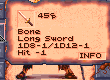
- **Hold Person, Charm Person, Charm Person or Mammal.** These take only on
  "persons", man-sized or smaller: a large target is unaffected, with no save
  (`Guard is too big for Hold Person -> unaffected`). Charm Person or Mammal
  still charms a large beast (its "mammal" half); it fails only on a large
  person, such as a half-giant. Hold Monster and Charm Monster take on anyone,
  as before.

How it works: [DEVELOPMENT-RULES.md](DEVELOPMENT-RULES.md#creature-size).

#### Held targets

A creature that is Paralyzed (Hold Person, Hold Monster, a sand howler's gaze, Blood Flow...) or
Out Cold is helpless. The game still rolls the d20 against it, and a blow that hits does **double**
damage ([how the game works](HOW-THE-GAME-WORKS.md#helpless-targets-take-double)). AD&D's
2nd edition (the Player's Handbook's combat modifiers, "defender sleeping or held: automatic")
has the attack **hit automatically and do normal damage**. With **Held targets as in AD&D** ticked
(on unless unticked), so it is: every melee blow, shot or throw at a helpless creature hits, a
natural 1 too (a Mirror Image can still take it), for the damage rolled. It works both ways: a
held party member is hit by every blow aimed at it. The dice log says it under the attack
(`    Paralyzed: hit automatically, for normal damage (AD&D's held target)`); with the rule off, the
damage line shows the game's `x2 Paralyzed`.

AD&D also lets a held creature be slain outright once no other fighting is going on; the rule
leaves that out. A helpless creature still makes no saving throw (the game's, and AD&D's
Paralyzed), and a spell's damage on it is still the most its dice can do (the game's).

How it works: [DEVELOPMENT-RULES.md](DEVELOPMENT-RULES.md#held-targets).

#### Rings and cloaks of protection

The game has no rings or cloaks of protection; the mod adds three, two rings
and a cloak ([New items](#new-items)), each +1 to AC and +1 on every saving
throw. With
**Rings and cloaks of protection as in AD&D** ticked, they follow the AD&D
rules for them:

- **Two rings don't add up:** only the better one counts (the left hand's,
  if they're equal). Two +1 rings give +1 together, not +2.
- **A ring gives no AC with magical armour** (any worn armour piece, helm
  included, with a plus), but still adds to saving throws.
- **A cloak does nothing,** neither AC nor saves, with magical armour, with
  metal armour (Chain, Grey's Scale, Tanelyv's Armor, the Warden's Plate, the
  Helm of Contemplation) or with a shield in either hand. Natural armour is fine:
  leather and bone (Ring, Brigandine and Scale are bone in Dark Sun), and
  plain helms. The cloak still adds to a ring.

Armour here is what is worn on the arms, legs, head or chest; something only
carried in a backpack doesn't count. Untick it and every ring and cloak worn
counts in full, whatever else is worn.

How it works: [DEVELOPMENT-RULES.md](DEVELOPMENT-RULES.md#rings-and-cloaks-of-protection).

#### Helms give AC 1

The game's helms count as armour but give AC 0. With **Helms give AC 1**
ticked every helm gives 1, the game's and the mod's: the leather Helm (Kel
sells one as Dapartea's Helm), the leather helm +1, the Helm of Might, the
metal Helm of Contemplation, the Bone Helm and the Warden's Helm. It shows on the View Character and inventory screens like
any armour, and as `AC BONUS:1` in a helm's box (right-click it), worn or not.

How it works: [DEVELOPMENT-RULES.md](DEVELOPMENT-RULES.md#helms-give-ac-1).

#### Items saving against acid

Two monsters' hits can destroy an item: the **Rampager's acid** a worn piece
of armour, and the **Babau's corroding touch** (the game's; with [the
manual's monsters](HOW-THE-GAME-WORKS.md#the-monsters-as-the-manual-describes-them) the Babau has its deadly
poison instead) a worn piece of armour and the
melee weapon held (the first one in the character's list of held items with a
melee reach: bows, slings and chatkchas never). The game makes the check on every such hit, whether or not
the target's saving throw against the attack succeeds, and shows its own
message when the item goes ("Armor is corroded", "Weapon is corroded"). Only
pieces worn on the arms, legs or chest count (bracers and robes among them),
not helms, shields, cloaks, boots or belts, and at most one piece of armour is
lost to a hit: the first that fails, in the order of the character's list.

The game's own checks:

- **A weapon** is destroyed on a d20 under 8 less its plus: a plain one 7 in
  20 (35%), a +1 30%, +7 or better never.
- **Armour** with a magical power (Drake Armor, Shimmer Armor) rolls a d20
  against 10 less its power's number, which for every such armour in the game
  means it always comes through. Any other piece is destroyed at once, without
  a roll, plus or no plus: Tanelyv's Armor +2 goes as surely as plain leather.
  (The game reads the byte that holds the item's power, not its plus.)

With **Items saving against acid as in AD&D** ticked, each item needs the easier
of the game's number and AD&D's saving throw against acid for its material
(the DMG's table), so no item is worse off than in the game. AD&D's number is
less the item's plus, and 1 less again for a magical power:

| Material | AD&D's number (the DMG's row) |
|---|---|
| Wood | 8 (thick wood) |
| Bone (the game's ring, brigandine and scale armour too) | 11 |
| Stone, obsidian | 5 (glass, the nearest) |
| Metal | 13 |
| Leather | 10 |
| None (Silk Armor) | 12 (cloth) |

| Item | Saved in the game | Saved with the rule |
|---|---|---|
| Leather Chest Armor | 0% | 55% (needs 10) |
| Chain chest | 0% | 40% (needs 13) |
| Tanelyv's arm or leg armour (metal, +2) | 0% | 50% (needs 11) |
| Drake Armor +1 (a power) | 100% | 100% (the game's) |
| Bone or metal Long Sword | 65% | 65% (the game's: needs 8) |
| Obsidian Dagger | 65% | 80% (needs 5) |

Every other armour piece and weapon, the mod's among them: [Items against
acid](ITEMS.md#items-against-acid).

The dice log shows every check, whichever rule is on:

```
Defiler's saving throw vs Acid from Rampager (paralysis/poison/death): d20 = 20 (natural 20) -> saved
  Rampager's acid on Defiler's Metal Chain Leg Armor: d20 = 16, needs 13 (AD&D's, 13 for metal; the game's: destroyed without a roll) -> safe
  Rampager's acid on Defiler's Leather Chest Armor: d20 = 12, needs 10 (AD&D's, 10 for leather; the game's: destroyed without a roll) -> safe
```

The Detonate psionic power (the daggorans' too) keeps the game's own rule for
the worn item it destroys ([Psionics](HOW-THE-GAME-WORKS.md#psionics)); the
dice log shows that check and its outcome.

How it works: [DEVELOPMENT-RULES.md](DEVELOPMENT-RULES.md#items-saving-against-acid).

### Magic

| Rule | The game | With the rule |
|---|---|---|
| [Rangers' casting level](#rangers-casting-level) | the level less 7 for the spell levels allowed, but the whole level for how long and how hard | a ranger's spells last and do damage as cast at its level less 7, as the spell levels it may cast already count it |
| [Preservers' INT](#preservers-int) | any spell learnt from any scroll, and every spell known | INT gives a preserver a chance to learn a spell from a scroll, and the most spells of each spell level it may know |
| [Spells saved against with the spell save](#spells-saved-against-with-the-spell-save) | almost every spell saved against with petrification/polymorph | the spell save rather than petrification/polymorph |
| [Fire, cold and electricity: DEX instead of a doubled d20](#fire-cold-and-electricity-dex-instead-of-a-doubled-d20) | the save's d20 doubled, so most creatures shrug off a Fireball (70% to save where 35% is due) | DEX's defensive adjustment on those saves rather than a doubled d20 |
| [Enlarge multiplies the weapon's dice only](#enlarge-multiplies-the-weapons-dice-only) | the whole melee damage multiplied, STR included | 10% a caster level on the weapon's dice, rounded up, STR and the rest added after |
| [Spells and psionics as the manual describes them](#spells-and-psionics-as-the-manual-describes-them) | twenty-four spells' (and the mod's Cat's Grace) and two powers' saves, times, damage and effects the game's own way, Turn Undead destroying or doing nothing, a classless monster's level 0 for its saves, seven monsters' powers not the manual's | as the manual has them, Turn Undead by AD&D's table (turned undead flee), the monster's level its hit dice, the shadows' STR drain, the Babau's and Blue Slaad's deadly poison, the Tari's disease, the Styr's breath, the Djinn's invisibility (from the next start) |
| [Spells roll to hit](#spells-roll-to-hit) | Acid Arrow, Turn Pebble to Boulder, Magical Stone, Condense, Minute Meteors and the touch spells never miss | they roll to hit against the target's AC, a missile's with DEX, a touch's with STR; a miss does nothing (from the next start) |
| [Resting as in AD&D](#resting-as-in-add) | a rest fills every member's hit points; priests' slots left unspent; the free cures only from a cleric or druid of 5th level | the priests spend their slots left on the party before the rest (poison, blindness, disease, then the most wounded) and psionicists their Cell Adjustment; then each heals 3 + CON's bonus a night |

#### Rangers' casting level

A ranger casts priest spells as a priest of its level less 7, as in AD&D: a
9th-level ranger counts as 2nd level, so it may cast 1st-level spells. The
game counts it so for the spell levels it may cast (and for Dispel Magic),
but a spell's duration and damage take the whole ranger level: that ranger's
spells lasted as a 9th-level priest's. With **Rangers' casting level**
ticked, they take the level less 7 too. A character with another class that
casts the spell (a cleric/ranger of the same element) casts it at the better
of the two, the ranger's counted 7 less. The Seeker and Justifier kits take
off 5 and 9 instead, ticked or not. A 9th-level ranger's Protection from Evil
(3 rounds a level) lasts 6 rounds with the rule, 27 without. The dice log's
duration and damage lines show the level wherever they roll dice.

How it works: [DEVELOPMENT-RULES.md](DEVELOPMENT-RULES.md#rangers-casting-level).

#### Preservers' INT

In the game a preserver learns any spell from a scroll it reads, and may know
every spell. With **Preservers' INT** ticked, AD&D's table for INT holds (the
table: the player's guide's [Learning preserver
spells](PLAYER-GUIDE.md#learning-preserver-spells)): a chance to learn each
spell from a scroll, 35% at INT 9 to 100% at 24, and a most of each spell level
the preserver may know, 6 at INT 9 to all from 19:

- **Reading a scroll:** the preserver rolls d100 against its chance. Under
  it, the spell is learnt and the scroll used up, as in the game; over it,
  the spell isn't learnt (YOU FAIL TO LEARN THE SPELL) and the scroll is used
  up all the same.
- **A full spell level:** a preserver that already knows the most spells of
  the scroll's spell level can't learn it (TOO MANY SPELLS OF THAT LEVEL),
  and keeps the scroll.
- **Level ups and new characters:** CHOOSE A SPELL leaves out the spells of a
  level the preserver already knows the most of, and doesn't open when
  nothing else is left to learn.

The dice log shows each try: `Dreamwalker reads the scroll of Magic Missile:
d100 = 37, needs 60 or less (INT 14) -> learnt`. Priest spells and psionic
powers are as the game has them.

How it works: [DEVELOPMENT-RULES.md](DEVELOPMENT-RULES.md#preservers-int).

#### Spells saved against with the spell save

One switch, **Saving throws against spells**, gives this and [DEX instead of a doubled
d20](#fire-cold-and-electricity-dex-instead-of-a-doubled-d20) together.

Almost every spell is marked for a save the game treats as
petrification/polymorph; with this rule it is the spell save. The spells
marked for paralysis/poison/death (the poison clouds, Poison, Slay Living, the
psionic attacks) keep it, as AD&D has them, and so do three monsters' powers
marked for petrification/polymorph. The dice log and the Spells tab name the
save used.

How it works:
[DEVELOPMENT-RULES.md](DEVELOPMENT-RULES.md#spells-saved-against-with-the-spell-save).

#### Fire, cold and electricity: DEX instead of a doubled d20

The game doubles the save's d20 against those spells (and nine monsters'
attacks of those kinds). With **Saving throws against spells** ticked the d20 isn't doubled and AD&D's DEX
defensive adjustment is added instead, as AD&D does for attacks that can be
dodged: −5 at DEX 1, −4 at 3, −3 at 4, ... none for 7-14, +1 at 15, +2 at 16,
+3 at 17, +4 at 18-20, +5 at 21-23 and +6 at 24-25. Fireball stays dangerous
for slow targets (needing 14 at DEX 12: 35% to save, where the doubled d20
gave 70%) and much less so for quick ones (DEX 21: 60%). The log names it:
`+5 DEX 21 dodging`.

How it works:
[DEVELOPMENT-RULES.md](DEVELOPMENT-RULES.md#fire-cold-and-electricity-dex-instead-of-a-doubled-d20).

#### Enlarge multiplies the weapon's dice only

The game's Enlarge adds 10% a level of its caster to the whole of a melee
hit's damage: STR's bonus, the weapon's plus and a specialist's bonus grow
with it, rounded down. AD&D's Enlarge makes the creature and what it carries
bigger, and the Player's Handbook (p. 173) says what that does to a blow: "damage rolls
increase proportionately with size" (its example: 6 x 1.6 = 9.6, rounded up to 10), and
"bonuses due to Strength, class, and magic are not altered". The game gets all three wrong, so
it is one of the [game's bugs](GAME-BUGS.md#rules-it-got-wrong-with-a-switch). With **Enlarge
multiplies the weapon's dice only** ticked only the weapon's dice grow, rounded up, and the rest
is added after. The dice log
shows it:

```
Gerakis hits Screamer Beetle for 21: 1d8 = [4] -1 bone +2 specialized +3 Wild Fighting +12 STR 24 +1 Enlarge (the dice 4 x110% = 5, level 1)
```

where the game made it 22 (20 × 110%). A backstab then multiplies the
enlarged dice. The Effects screen names it ENLARGED (+10% DICE) for this 1st-level caster,
not (+10% DAMAGE).

With [Creature size](#creature-size) ticked, an Enlarged creature also counts
as large: weapons hit it with their large dice, and Hold Person, Charm Person
and Charm Person or Mammal (on a person) don't take on it. That is a cost of
Enlarging a party member too. And cahulaks can't tangle anyone Enlarged, the
rule ticked or not ([Cahulaks](#cahulaks)).

How it works: [DEVELOPMENT-RULES.md](DEVELOPMENT-RULES.md#enlarge-multiplies-the-weapons-dice-only).

#### Spells and psionics as the manual describes them

Twenty-four of the manual's spells and two psionic powers whose saves, times,
damage or effects part from the manual (pp. 29-44), set as the manual has them
(and the mod's Cat's Grace by the Tome of Magic's dice; the mod's Heal cures
Feeblemind), a priest's Turn Undead by AD&D's turning table, a monster's level
for its saves, and seven monsters' powers as the manual describes them
(below). The box takes effect from the next start (it
changes the game's spell records and code as the Loader writes the game's copy,
and the descriptions of Fire Shield and Cat's Grace in its copy of RESOURCE.GFF);
unticked, they are the game's.

| Spell | The game | As the manual |
|---|---|---|
| Bestow Curse | no saving throw | a save negates it |
| Blood Flow | Paralyzed 1d4 rounds, no save | a save negates it |
| Flaming Sphere | 2d4 fire, a save halves it | a save negates it |
| Solid Fog | Stuck until removed | Stuck 1d3 rounds + 1 a caster level |
| Minor Spell Turning | turns one spell, then never ends | turns 1st- to 3rd-level spells for 3 rounds a caster level |
| Cause Fear | Afraid 1 round a caster level | Afraid 1d4 rounds |
| Quicksand | Stuck while in it, a save allowed | Stuck while in it, no save |
| Turn Pebble to Boulder | 6d6 (6-36) | 3d6+8 (11-26) |
| Ironskin | 1d6 blows stopped | a blow stopped for each caster level |
| Stinking Cloud | 1d6 rounds | 1d4+1 rounds |
| Chaos | only warriors may save | warriors, and creatures of INT 21 or more or 4 or less |
| Free Action | ends Paralyzed and Slowed only | also frees the Stuck: Web, Solid Fog, Quicksand, Entangle, Grease (a Poisoned creature stays Paralyzed, as in the game) |
| Color Spray | every creature saves | only creatures of more levels than the caster save (the rest at -100: they can't, even on a natural 20, as against Chaos and Cloudkill) |
| Hold Undead | any undead | only undead of no more levels (hit dice) than the caster's level; the rest are immune |
| Minute Meteors | one blast of 1d4 a caster level (at most 10d4) | five globes of 1d4, each aimed and landing on its own (with [Spells roll to hit](#spells-roll-to-hit), each rolls with +2) |
| Flame Arrow | one blast of 5d6 for every five caster levels (10d6 at level 10) | a bolt of 1d6 + 4d6 fire (5d6) for every five caster levels, at least one, each aimed and landing on its own (AD&D's bolts; no attack roll, no save, as the manual) |
| Fire Shield | the caster takes half damage from fire and cold spells | and saves at +2 against them (its description says so) |
| Blur | attackers −2 to hit | and +1 on its creature's saves against spells |
| Chill Touch | 1 STR off on a failed save, gone at once (the spell gives the effect no time); an undead takes the damage | 1 STR off (Weakened) for an hour; an undead takes no damage and is Afraid 1d4 rounds instead |
| Cloudkill | 1d10 poison, a save at −2 halves it; creatures of 6th level or lower "can't save" (and so saved: below) | under 4 levels (hit dice): dies, no save; 4 or 5: a failed save kills; 6 and up: the damage, a save halving it |
| Feeblemind | INT and WIS 3, no spells; nothing cures it | no psionic powers either; Heal cures it, INT and WIS as they were |
| Lower Resistance | magic resistance halved while it lasts | 30% + 1% a caster level off (at least 0); the cast's own check the same, the two not added up |
| Strength | STR + 1d6 for anyone | 1d8 for a warrior (fighter, gladiator, ranger), 1d6 a priest, rogue or psionicist, 1d4 a wizard; a multiclass character's best; not added to Adrenalin Control's (the bigger counts) |
| Cat's Grace (the mod's) | DEX + 1d6 for anyone | 1d8 a rogue, 1d6 a wizard, warrior or psionicist, 1d4 a priest (the Tome of Magic's); the best; two not added up |
| Rainbow Pattern | Paralyzed 1d3 rounds, whatever happens to it | Paralyzed 1 round a caster level, ended by any damage to the creature |
| Cell Adjustment (psionic) | heals 2 HP, cures disease | heals 1d4 HP, cures disease |
| Biofeedback (psionic) | AC −1, and 2 off each blow (and other crushing, edged or pointed damage), leaving 0 of a blow of 2 or less | the same, but at least 1 left |
| Turn Undead | a d20 against its own number: destroyed or nothing, as often as the priest likes | AD&D's turning table ([the table](HOW-THE-GAME-WORKS.md#adds-turning-table)): turned undead flee, D destroys, D\* destroys more of the kind, and a priest who fails can't try that undead again in the fight |

**Turn Undead** (the priests' button on the USE screen, not a spell) goes by AD&D's turning
table: by the undead's hit dice and the priest's level, a d20 turns it (it flees for 3d4 rounds),
or it is turned or destroyed with no roll, or it can't be turned at all; a priest who fails can't
try that undead again in the fight. The table and each result: [AD&D's turning
table](HOW-THE-GAME-WORKS.md#adds-turning-table).

A monster with no class (an elemental, a slaad, Mastyrial, the Rampager) had
level 0 for its saves, so Cloudkill slew it whatever its size, Scare frightened
it, and Dismissal's and Color Spray's level checks took it for the weakest
there is: with the box ticked its level for saving throws is its hit dice (the
game's level everywhere else is left as it was).

**The saves that couldn't fail.** In the game a creature that "can't save"
(Chaos for all but warriors, Cloudkill on the weak, Scare below 6th level, and
this box's Color Spray) always saved. That is [a bug fixed](GAME-BUGS.md#spells-and-psionics),
whether the box is ticked or not: "can't save" fails, even on a natural 20
([what the game did](HOW-THE-GAME-WORKS.md#the-games-saving-throws)).

Each spell in more detail, with the dice log's lines: [Spells and psionics as the manual
describes them](HOW-THE-GAME-WORKS.md#spells-and-psionics-as-the-manual-describes-them), in How the
game works.

**The monsters as the manual describes them** (the same box). Seven monsters get a power the
manual gives them, or lose one it doesn't: the Shadow and the Greater Shadows drain STR (and cold
doesn't hurt them), the Babau's and the Blue Slaad's poison is deadly, the Tari's bite brings
disease, the Styr breathes fire, and the Djinn turns invisible and makes mirror images of itself:
[the monsters, in detail](HOW-THE-GAME-WORKS.md#the-monsters-as-the-manual-describes-them).

Some spells are left as the game has them, where it has no way to do what the manual says:
[known differences](HOW-THE-GAME-WORKS.md#known-differences-left-as-they-are).

How it is done: [DEVELOPMENT-RULES.md](DEVELOPMENT-RULES.md#spells-and-psionics-as-the-manual-describes-them).

#### Spells roll to hit

In AD&D a missile spell is aimed like a missile and a touch spell needs a touch
attack, but the game lands them all, every time. With this box ticked (the
default; it takes effect from the next start) they roll to hit, as a weapon
does:

| Spells | How they roll |
|---|---|
| Acid Arrow | as an arrow from a fighter of the caster's level: THAC0 21 less the caster level, with the caster's DEX missile adjustment (the manual's "as if fired by a fighter") |
| Turn Pebble to Boulder, Magical Stone, Condense, and the spines some monsters shoot | the caster's own THAC0, with its DEX missile adjustment |
| Minute Meteors | the caster's own THAC0, with its DEX missile adjustment and the spell's own +2 (the manual's), each globe its own roll (five globes with [Spells and psionics as the manual describes them](#spells-and-psionics-as-the-manual-describes-them)) |
| Chill Touch, Shocking Grasp, Vampiric Touch, Cause Light, Serious and Critical Wounds, Cause Disease, Poison | a touch attack with the caster's own THAC0 and STR adjustment, only at a creature of another side (a foe, or a friend turned against it): on one's own side they land as before |

The roll is the game's own for an attack: a d20 against THAC0 less the
target's AC as the game works it out for a blow (armour, DEX, spells such as
Shield or Blur), with the game's other to-hit adjustments (Bless, Prayer, Curse
and the rest) and, for a monster, the game's difficulty setting, as on its
weapon attacks. A natural 20 always hits and a natural 1 always misses. A miss
does nothing: no damage (the dice are rolled first, so the dice log shows the
roll that was lost), no Acid burning on, no effect. A spell from a weapon's hit
(a spell arrow, a magical weapon) doesn't roll again: the hit was the roll.
Magic Missile, Flame Arrow (neither the manual nor AD&D gives its bolts an
attack roll), areas, cones and psionic powers are left as they are. Each roll has a line in the [dice log](DICE-LOG.md),
and "Miss" floats over the target. Unticked, the spells always hit, as in the
game. How it is done: [DEVELOPMENT-RULES.md](DEVELOPMENT-RULES.md#spells-roll-to-hit).

#### Resting as in AD&D

The game's rest at a fire ring fills every member's hit points, PSP and spell
slots, and casts its free cures ([how the game rests](HOW-THE-GAME-WORKS.md#resting)).
In AD&D a night's rest heals a hit point (the Dark Sun manual says nothing of
it), and priests heal the party with the spells they have left. The mod takes a
middle way between that point and the game's full heal: 3 hit points and CON's
bonus a night (step 3 below). With **Resting
as in AD&D** ticked, before the slots fill again:

1. Each priest who can cast (Okay, not feebleminded, paralysed, charmed or
   barred from spells) spends the priest spells it has left, a slot at a time:
   **Neutralize Poison** on the Poisoned (who would otherwise die as the rest
   ends), **Cure Blindness** on the Blind, **Cure Disease** on the Diseased (only
   with no cleric or druid of 5th level or more: the rest's own free cures see to
   them then), then the **Cure Wounds** spells and **Heal** on the most wounded,
   the cure that fits what the night's healing leaves (Cure Light for a wound
   of 4 or more, Serious 10, Critical 16, Heal 30), else the smallest left.
2. Each psionicist who knows **Cell Adjustment** uses it (5 PSP, 1d4 HP and a
   disease cured) on the Diseased, then on the wounded the priests couldn't
   reach, while its PSP last.
3. The rest itself: each member heals **3 hit points plus CON's hit point bonus**
   (the game's bonus a level: a warrior's in full, +1 at CON 15 up to +7 at 24;
   anyone else's at most +2),
   up to its most, rather than all of them. A member with CON 20 or more also
   regenerates for the 8 hours, as it would ([CON as in AD&D](#con-as-in-add)'s rates
   with that box, else the game's).

Slots and PSP still fill to the most, STR still comes back, the 8 hours pass
and a script's full rest (a vulture's meal, Kurzak's healers) is as it was. The
dice log names each: `At rest: Seneca casts Cure Serious Wounds on Gerakis
(4th-level slots: 1 left)`, then the healing itself, and `Gerakis rests 8 hours:
+3, +2 (CON 16) = +5, now 35/40 HP`.

How it is done: [DEVELOPMENT-RULES.md](DEVELOPMENT-RULES.md#resting-as-in-add).

## More character customization

More choices for each character: a weapon to specialize in, a kit, a roll to
keep while trying the die again, and fuller starting gear (levels past 9th are
a [rule change](#level-cap-by-xp)). Each has a box in the Options tab's **More character customization**
section. All are on by default and, like the rule changes, take effect at
once (STORE and RECALL from the next start); untick one and the game is as it
was. New preservers picking their first spells, and the game's own party
fitted to these choices, come with them.

| Box on the Options tab | What it adds |
|---|---|
| [Weapon specialization](#weapon-specialization) | fighters and gladiators specialize in weapon types, fighters on to mastery and grand mastery, rangers take expertise (and every ranger the bow); specialists and rangers shoot missiles faster; other weapons at a warrior's plain rate (missiles faster from 7th level) |
| [Kits](#kits) | a character of one class takes one of three kits for its class, or none; a few races' pairs of classes (and one set of three) have kits of their own |
| [STORE and RECALL on the creation screen](#store-and-recall-on-the-creation-screen) | a roll kept on the creation screen, to bring back after trying the die again |
| [Fuller starting gear](#fuller-starting-gear) | new characters get more plain gear: a weapon in hand they can use, a sling, leather armour, and a Stalker, Assassin or Shinobi a cloak |

### Weapon specialization

With **Weapon specialization** ticked, fighters, gladiators and rangers train
in chosen weapon specs (weapon types), as in AD&D: a fighter specializes in
one (+1 to hit, +2 damage), on to mastery at 5th level and grand mastery at
9th; a gladiator in two, a third at 6th level and a fourth at 9th; a ranger
has expertise in one and the bow. With a chosen weapon spec a warrior keeps
the game's attacks a round and shoots missiles faster; with any other weapon
it has AD&D's plain rate. Each warrior picks after DONE on the creation screen
and starts with a plain weapon of its pick. A thri-kreen throws a chatkcha once
more a round, whatever the rule. The attacks a round, the choices,
the starting weapons and where it shows are on the kits page: [Weapon
specialization](KITS.md#weapon-specialization).

How it works: [DEVELOPMENT-RULES.md](DEVELOPMENT-RULES.md#weapon-specialization).

### Kits

With **Kits** ticked, a character may take a kit when it is made, on the
creation panel's **KIT** page. Who may take which, and every kit's gains, costs,
starting gear and rules, are on a page of their own, [Kits and weapon
specs](KITS.md):

| Class | Kits |
|---|---|
| Fighter | [Myrmidon, Sentinel, Ravager](KITS.md#fighter-kits) |
| Gladiator | [Arena Champion, Twin-blade, Brute](KITS.md#gladiator-kits) |
| Ranger | [Stalker, Justifier, Seeker](KITS.md#ranger-kits) |
| Thief | [Swashbuckler, Assassin, Shinobi](KITS.md#thief-kits) |
| Preserver | [Scholar, Battle Mage, Arcanist](KITS.md#preserver-kits) |
| Cleric | [Elementalist, Healer, Crusader](KITS.md#cleric-kits) |
| Druid | [Grove Warden, Lifebinder, Wanderer](KITS.md#druid-kits) |
| Psionicist | [Mind Bender, Mind Warrior, Kineticist](KITS.md#psionicist-kits) |
| Two or three classes at once, one race each | [Battle Dancer, Shadowblade, Military Scout, Wilderness Avenger, Rescuer, Ghetto Fighter, Wayfinder, Spellarcher, Titan Mind, Poisoner, Spirit Caller, Wasteland Seer, Wild Fury](KITS.md#multiclass-kits) |

The game's own party gets features of its own
([The game's own party](#the-games-own-party)).

How it works: [DEVELOPMENT-RULES.md](DEVELOPMENT-RULES.md#kits).

### STORE and RECALL on the creation screen

The creation screen has two more buttons under the hit points, as Baldur's
Gate has them: **STORE** keeps the roll on screen, and **RECALL** brings it
back, however many times the die has been rolled since. A roll is the six
scores and what the die's total allows (the `SUM:` line), the hit points and
the PSP, and the age (with [Ages](#ages-and-magical-aging) on). So a good roll can be stored and the die tried again; if nothing
better comes, RECALL puts the stored one back, AC and damage with it.

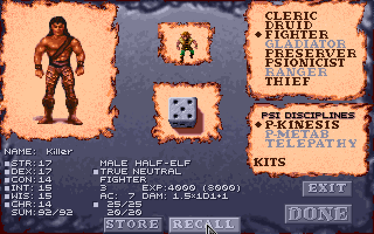

Changing the race, sex, classes or kit forgets the stored roll (its hit
points were rolled for those), even if they are changed back: RECALL then
does nothing until STORE keeps another. STORE again keeps the new roll in
place of the old. Unticked, the screen is as the game has it, from the next
time the game is started.

How it works:
[DEVELOPMENT-RULES.md](DEVELOPMENT-RULES.md#store-and-recall-on-the-creation-screen).

### Fuller starting gear

With **Fuller starting gear** ticked, the mod adds plain gear to a new
character's own while it is still New, after the class restrictions, weapon
specs and kits have changed theirs, and the dice log lists it
(`Swat starts with more gear: Short Sword (in hand), Arm Armor, Leg Armor`):

- **A weapon in hand.** A character with an empty right hand takes a weapon
  it can use from its backpack (a cleric's club), else gets a plain one: of
  its weapon spec, else a short sword, club, mace, dagger or quarterstaff (a
  cleric the club and mace first), in a material it can use. So a
  thief/psionicist, whose long sword the class restrictions take, gets a bone
  short sword, a fire cleric an obsidian mace, and an air cleric an obsidian
  dagger.
- **A missile weapon.** A sling in the missile slot for one with no bow or
  sling; an earth or fire cleric, who can't use one, an obsidian chatkcha in
  the backpack (a water cleric neither).
- **Leather armour** in its empty chest, arm and leg places, where it may wear
  it: a thief, gladiator, ranger, psionicist, cleric or Battle Mage goes out
  in a full suit.
- **A cloak** for a Stalker, an Assassin or a Shinobi (with [kits](#kits) on),
  to hide in ([Improved thieving](#improved-thieving)).
- **A thri-kreen gets nothing more** than the game's own starting gear: its
  claws serve it better than another weapon, and it wears no armour or
  cloak.
- **A multiclass preserver's armour** is left out, with the class
  restrictions on: it can't cast in armour.

Nothing is given that the character can't use or already has something of
the kind, so each item comes once. The [game's own party](#the-games-own-party)
gets it too, in the first moments of a new game. Unticked, a new character
starts with the game's gear, changed only by the rules above.

How it works: [DEVELOPMENT-RULES.md](DEVELOPMENT-RULES.md#fuller-starting-gear).

### Preservers' first spells

A human who becomes a preserver picks its first two spells on the game's
**CHOOSE A SPELL** window, twice over, from the 1st-level ones (the game gave
it Grease and Magic Missile), as a preserver picks one at each level up. If
it takes the **Scholar** kit for its new preserver class, it picks a third,
as a Scholar picks one more at each level up.

A new preserver picks its starting spells the same way when **DONE** is
clicked on the creation screen, in place of the ones the game handed out by
its starting level: two 1st-level spells at 1st level (where the game gives
Grease and Magic Missile), four at 2nd (the game adds Shield and Wall of
Fog), and four 1st-level and two 2nd-level at 3rd (the game adds Fog Cloud and
Mirror Image). A Scholar picks one more for each level. A multiclass preserver
picks too.

**EXIT** on CHOOSE A SPELL (then EXIT again at "YOU HAVEN'T CHOSEN") ends the
picking, at creation and on changing class: the spells still to pick are the
game's own, in its order (Grease, Magic Missile, Shield, Wall of Fog; then Fog
Cloud, Mirror Image), less any already picked. The character is already saved
when the window opens, so EXIT can't take you back to the creation screen.

Always on (it isn't a switch of its own). How it works:
[DEVELOPMENT-RULES.md](DEVELOPMENT-RULES.md#preservers-first-spells).

### The game's own party

START GAME with no party made plays the game's own four, who were made before
any of these choices existed. With weapon specialization, kits, class
restrictions and fuller starting gear on, the Loader fits them to those in the
first moments of a new game, and says so in the dice log (Cilla also gets the
elf's figure, with its own switch: see
[Elves and half-elves](#elves-and-half-elves)):

| Character | With weapon specialization | With class restrictions | With kits |
|---|---|---|---|
| **Gerakis**, half-giant gladiator | specializes in the long sword and the gythka; with [half-giants' two-handed weapons](#half-giants-two-handed-weapons), his club is a bone gythka, a two-handed weapon beside his long sword | | **Wild Fighting**, as a [Wild Fury](KITS.md#multiclass-kits) has it, as each fight starts |
| **K'ratchek**, thri-kreen fighter, druid and psionicist | specializes in the chatkcha, her only weapon | | casts and uses psionics as a [Wasteland Seer](KITS.md#multiclass-kits) does (druid spells 2 levels higher under the open sky, 1 lower under a roof; psionic powers 2 PSP less under the open sky, 1 more under a roof); her chatkcha's one throw more a round is every thri-kreen's (5/2 a round, specialized; [Weapon specialization](KITS.md#weapon-specialization)), not hers alone |
| **Cermak**, human preserver, once a gladiator | specializes in the long sword and the axe, which count once his gladiator levels do again (when his preserver level passes them) | | an **Arcanist**, the kit of his preserver class: two preserver spells a turn in a fight |
| **Cilla**, elf preserver, druid and thief | | no leather armour (a druid wears none), and she knows the **Armor** spell in its place | an **Elven Shadow-walker** (her own feature): with the [stealth rule](#hiding-in-shadows-to-backstab), her hiding in shadows is never halved in daylight |

Gerakis's, K'ratchek's and Cilla's features are their own, not kits'. The Effects screen lists them (as it
does kits), and the Characters tab beside the kit. Cermak's gear stays as it
is (an Arcanist has none of its own), and so do the hit points the game gave
him: the Arcanist's d3 counts from his next level.

With [fuller starting gear](#fuller-starting-gear), they get what a new
character would, after the changes above: Gerakis a sling and leather chest
and leg armour; Cermak and Cilla nothing more. K'ratchek, a thri-kreen, fights
with her claws and the game's own chatkcha, and gets nothing more either.

Cermak and Cilla keep the game's own starting spells: only a character made
on the creation screen [picks its own](#preservers-first-spells).

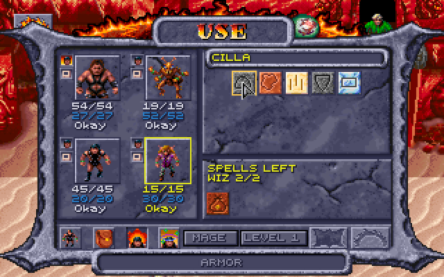

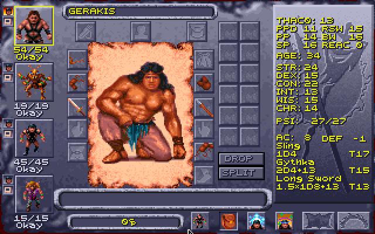

How it works: [DEVELOPMENT-RULES.md](DEVELOPMENT-RULES.md#the-games-own-party).

## Expanded features

New things to do in play, each with a box in the Options tab's **Expanded
features** section. All are on by default and, like the rule changes, take
effect at once; untick one and the game is as it was.

| Box on the Options tab | What it adds |
|---|---|
| [Shops as in AD&D](#the-leaders-cha-at-shops) | the party leader's CHA 18 or more lowers what shops ask, 5% to 40% at 25; shops pay 60%; a magical item sold stays in the merchant's stock, to [buy back](#buying-back-magical-items) |
| [Thieves as in AD&D](#thief-skills-from-adds-table) | AD&D's thief skill table by level, with Dark Sun's race and DEX adjustments; a backstab multiplies the weapon's dice only, STR and magic added after, on the round's first attack only; a lock or pocket failed is tried again by that thief only after a level gained |
| [Hiding in shadows to backstab](#hiding-in-shadows-to-backstab) | thieves hide and move silently to backstab, rangers to attack from behind |
| ... [a worn cloak, boots and belt](#hiding-in-shadows-to-backstab) | the box under it: +10 hiding, +10 moving silently, +5 picking pockets and opening locks |
| [Picking pockets](#picking-pockets) | a thief's Pick Pockets button, then anyone in sight, until caught |

### The leader's CHA at shops

The game's shops ask an item's price whoever buys. With **Shops as in AD&D**
ticked (one switch with [buying back magical items](#buying-back-magical-items)), the party leader's CHA lowers it, 5% from CHA 18 and 5% more
for each point after, to 40% at 25 (the highest a CHA can be):

| Leader's CHA | 17 or less | 18 | 19 | 20 | 21 | 22 | 23 | 24 | 25 |
|---|---|---|---|---|---|---|---|---|---|
| Discount | none | 5% | 10% | 15% | 20% | 25% | 30% | 35% | 40% |

The price shown under each item, the one charged, and whether the shop's list
greys an item as too dear all follow it (never below 1). Shops pay **60%** of
an item's price for what the party sells (rounded down, never below 1): the
most the CHA discount takes off is 40%, so nothing can be bought and sold back
at a profit, and at CHA 25 a round trip comes out even. The game pays all of
it, which with the discount would let anything be sold at a profit.

How it works: [DEVELOPMENT-RULES.md](DEVELOPMENT-RULES.md#the-leaders-cha-at-shops).

### Buying back magical items

The game destroys whatever the party sells. With **Shops as in AD&D** ticked
(one switch with [the leader's CHA](#the-leaders-cha-at-shops)), a magical item sold (one with a plus, or a power:
a ring, a wand, a scroll...) goes into the merchant's pack instead, and the
shop offers it for sale at its price, less the leader's CHA discount, so it
can be bought back. Anything else sold is gone, as in the game. With the CHA
rule's selling at 60%, buying an item back costs more than it was sold for, or
the same at CHA 25.

How it works: [DEVELOPMENT-RULES.md](DEVELOPMENT-RULES.md#buying-back-magical-items).

### Improved thieving

More for thieves to do: skills that grow by the Player's Handbook's table,
hiding in shadows and moving silently to backstab (rangers too, to attack from
behind), a cloak, boots and belt that help, and pockets to pick. The switches
are together under **Improved thieving** in the Options tab's Expanded
features section.

#### Thief skills from AD&D's table

The game's thief skills come out high: a 3rd-level elf thief with DEX 22 has
move silently 66 and hide in shadows 61. AD&D gives 27 and 20 at 3rd level
before race and DEX. The game adds 4 a level to a base of its own, and its DEX
formula gives move silently and hide in shadows less than Dark Sun's table at
high DEX, and some other skills more. With **Thieves as in AD&D**
ticked, a skill is:

- AD&D's average for the thief level (the Player's Handbook's table, carried on
  past 10th level),
- plus the race's adjustment, the game's own (already the Dark Sun rules'
  numbers),
- plus DEX's: AD&D's table up to 19, the Dark Sun rules' exceptional DEX
  past it, for the first five skills (hear noise, climb walls and read
  languages have none),
- to no more than 95, as in AD&D, after the belt, kits and armour too (the
  situation's bonus, a hard lock, say, still counts after it). A ranger's
  hiding and moving silently stop at 95 as well.

The tables (AD&D's averages by thief level, the race's adjustments and DEX's)
are in the player's guide's [Thieves' skills and picking
pockets](PLAYER-GUIDE.md#thieves-skills-and-picking-pockets).
The situation and effects then count as before. So Azil, a 3rd-level elf thief with
DEX 22: pick pockets 40 + 5 + 27 = 72, open locks 58, find traps 47, move
silently 62, hide in shadows 52, hear noise 20, climb walls 87. A ranger's
move silently and hide in shadows take the same race and DEX adjustments.
The same switch keeps a thief from a lock they failed until they have gained a
thief level (*Player's Option: Skills & Powers*: "If a thief fails to open a
lock, he cannot attempt to open that lock again until advancing a level"): the
game's safe, grate and cell doors and Pehtucl's chest. Tried again before, the
roll fails at once, and the dice log says why. Another thief of the party may
try it. A failed pocket is the same ([Picking pockets](#picking-pockets)).
Untick it for the game's numbers.

How it works: [DEVELOPMENT-RULES.md](DEVELOPMENT-RULES.md#thief-skills-from-adds-table).

#### Hiding in shadows to backstab

The game never rolls hide in shadows, and a thief only backstabs a target that
has turned to face someone else. With **Hiding in shadows to
backstab** ticked, a thief whose turn
comes in a fight with no enemy in any of the eight squares around them tries to
hide in shadows; if they do, they try to move silently up to someone; and if
both succeed, their next attack that turn counts as one from behind: +2 to hit,
the target's DEX and shield don't count, and with a weapon that can backstab it
is a backstab, the damage multiplied as usual. Hidden and unheard, the thief
makes a soft sound, a breath sinking away into the dark (the mod's own, played
through the game's sound effects, so not with them turned off). The attack gives the thief away,
and so does the turn ending without one. An enemy next to the thief when the
turn comes means no hiding at all: get clear first (a
[Shadowblade](KITS.md#multiclass-kits) tries anyway). A [Military
Scout](KITS.md#multiclass-kits) never backstabs: its hiding gives an attack from
behind.

```
Tezral's turn
Tezral hides in shadows: d100 = 21, needs 27 or less (54, halved in daylight) -> hidden
  Tezral moves silently: d100 = 30, needs 54 or less -> unheard: their next attack this turn is from behind (a backstab with a weapon that can)
Tezral attacks Slig BACKSTAB with Bone Long Sword (1d8): d20 = 11, needs 10+ (55%), hits AC 2, target AC 3 -> HIT
    THAC0 19, +2 from behind, +2 backstab, +3 STR, -1 bone = 13
  Tezral hits Slig for 9: 1d8 = [1] -1 bone (raised to the minimum of 1) +7 STR 19 +1 backstab (the dice 1 x2 = 2)
```

With **Thieves as in AD&D** (on unless unticked; one switch with [AD&D's thief
skills](#thief-skills-from-adds-table)) a backstab multiplies the weapon's dice and adds STR,
the weapon's plus and the rest once, as AD&D has it: `1d8 = [5] +12 STR 24 +10
backstab (the dice 5 x3 = 15)` is 27 (the 5 rolled and the 10 more that x3
adds) where the game made it 51. The multiplier is x2 at thief levels 1-4, x3
at 5-8, x4 at 9-12 and x5 from 13 (an [Assassin](KITS.md#thief-kits)'s one
more, x3 to x6). Only the round's first attack is a backstab: the game multiplies the first two, so a second
swing (an off-hand one after a miss) was multiplied too.

The chance to hide is **halved in daylight** (with [kits](#kits) on, not for an
Assassin, a Military Scout or Cilla, the Elven Shadow-walker). Which maps are under
the open sky goes by the game's regions: open desert and rock, the villages'
open ground and the arena are; the slave pens, the sewers, the lava caverns and
the other underground or roofed places aren't. Three maps have both, buildings
with floors of their own standing on open ground: there it goes by the floor
under the thief, so a thief in a
building is out of the sun and one in a roofless ruin isn't. The chances are the
thief's own as they stand (level, race, DEX, and effects: Invisibility makes
hiding certain, Fire Shield and Mirror Image rule it out).

**Rangers** hide and move silently too, with the same box ticked. The game
gives rangers no thief skills, so the Loader uses AD&D's ranger table, by
ranger level, with the race's and DEX's adjustments as for a thief:

| Ranger level | 1 | 2 | 3 | 4 | 5 | 6 | 7 | 8 | 9 | 10 |
|---|---|---|---|---|---|---|---|---|---|---|
| Hide in shadows | 10 | 15 | 20 | 25 | 31 | 37 | 43 | 49 | 56 | 63 |
| Move silently | 15 | 21 | 27 | 33 | 40 | 47 | 55 | 62 | 70 | 78 |

The light works the other way round for these outdoorsmen: the **full chance
under the open sky, half indoors** (the same maps and floors as for thieves).
Their attack from behind gets +2 to hit, and the target's DEX and shield don't
count, but it is never a backstab. Armour doesn't matter, nor does what they
hold. The Characters tab shows a ranger's two chances (**Ranger skills now**),
and the game's inventory screen shows them where a thief's `SLNT` and `HIDE`
go. Someone with thief levels hides as a thief.

```
Semyon hides in shadows: d100 = 15, needs 63 or less (63, a ranger under the open sky) -> hidden
  Semyon moves silently: d100 = 42, needs 78 or less -> unheard: their next attack this turn is from behind
Semyon attacks Slig from behind with Wooden Club (1d6): d20 = 12, needs 10+ (55%), hits AC 1, target AC 3 -> HIT
```

**Cloaks, boots and belts.** With the box under this one ticked, a worn cloak
adds 10 to hiding in shadows (before daylight halves it) and worn boots add 10
to moving silently, for rangers too, up to 95:
`needs 18 or less (26 +10 cloak = 36, halved in daylight)`. A cloak's or
boots' item box (right-click it on the inventory screen) says so under its
name, `Hide +10` or `Silent +10` ("Silent", not "Move", so a box
can't read as walking speed; the inventory screen's thief row is `SLNT`).

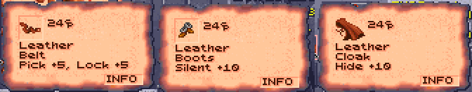

The [Cloak and Boots of Elvenkind](#new-items) do more (whatever the plain
gear's switch). Only thieves and rangers can wear them (multiclasses too; for
anyone else, the game's "Cannot use this item"). In the cloak, hiding in
shadows needs 95 or less under the open sky and 90 under a roof, not halved by
the light (AD&D's: all but invisible in the wild, 90% among buildings), unless
their own chance is better; in the boots, moving silently needs 95 or less.
Their boxes say `Hide 90-95%` and `Silent 95%`.

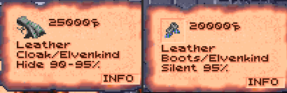

The same switch has a worn **belt** add 5 to a thief's **picking pockets and
opening locks**, whether hiding is on or not: the game's own lock picking
counts it, and so do the Loader's pockets and its thief rows (`PICK 80`,
`LOCK 64`). A belt's box says `Pick +5, Lock +5`.

Plain cloaks, boots and belts cost 24 (the game's Leather Cloak is 20), anywhere
in the region, shops included; magic ones (with a plus, or dearer than 100)
keep their prices.

How it works: [DEVELOPMENT-RULES.md](DEVELOPMENT-RULES.md#hiding-in-shadows-to-backstab).

#### Picking pockets

The game has one pocket to pick, in the Trustee's conversation (his key). With
**Picking pockets** ticked, a thief can try anyone's. On the **USE** screen, a
character with thief levels has a **Pick Pockets** button (a purse) where a
priest's Turn Undead is, under the spell counts. A cleric/thief has both
outside fights, Turn Undead and the purse beside it; in a fight, Turn Undead
alone.

Press it: the screen closes and the pointer is the one for talking. Click
someone in sight, and the thief who pressed it (party leader or not) tries
their pocket instead of talking to them. On the map, a right click that
changes the pointer puts the try away. (Right-clicked on the USE screen, the
purse says what it does, as a spell does.) A thief whose backpack is full
can't try ("Daaki's backpack is full."): nothing is rolled, and it doesn't
count as a try. Not in a fight: there's no time for it then, and the button
isn't there.

(Thieves' Tools from an earlier version, in a save, do nothing.)

The Loader rolls the thief's pick pockets chance as it stands now (effects and
a worn belt's 5 counted, as in the thief rows):

- **Success:** one small thing goes into the thief's backpack (its first free
  cell): something weighing 10 or less (a bag or arrows are 10, a helm 15, a
  long sword 30) that isn't worn on the body (armour, a belt, boots, a helm, a
  cloak). A dagger, a ring, an amulet, a gem or food can be lifted, and so can
  three weapons some of the game's people carry, whatever their weight
  ([New items](#new-items) says which). Lifting one is
  worth 200 XP to the thief, once a game for each weapon (sold and lifted back, it is worth
  nothing more), given as the game gives a quest's ("Cilla
  receives 200 experience points!", with the quest's sound; split among a
  multiclass thief's classes). Keys stay, as scripts may look for them.
  Anything else lifted, or the coins, comes with a purse's jingle (the mod's
  own sound; the three weapons keep the quest's).
  This goes by what each thing is, wherever its owner keeps it.
- **Failure:** a move silently roll. Made, the thief slips away unnoticed;
  missed, they're caught. With **Thieves as in AD&D**, a thief who slipped away
  can't try that person again until they have gained a thief level ("Daaki
  needs another level to try them again."); another thief of the party can.

With nothing like that left on them, the thief takes what's in their purse
instead: ceramic pieces, 2 to 5 for each of the thief's levels (a 4th-level
thief takes 8 to 20), added to the party's money. That is the last try on that
person.

A thief can go on trying the same person until **caught** (both rolls failed)
or until they take the coins; after that, that person keeps a hand on their
pockets for good. The Loader remembers who in `settings.json`, for this party,
with the time on the game's clock: load a game saved before the try and the
clock goes back past it, so the try is forgotten and the person can be tried
again. The Trustee is left to his own conversation. What happens comes up in
the game's message window and in the dice log:

```
Daaki picks Kurzak's pocket: d100 = 71, needs 63 or less -> failed
  Daaki moves silently to get away: d100 = 12, needs 55 or less -> success
  Daaki fumbles Kurzak's pockets, but slips away unnoticed.
```

How it works: [DEVELOPMENT-RULES.md](DEVELOPMENT-RULES.md#picking-pockets).

## New content

*Spoilers: this section says where the new items and people are, and what
they say. [The player's guide](PLAYER-GUIDE.md) has the rules without them.*

Spells, people, a quest, an arena bout and items the mod adds to the game,
each with a box in the Options tab's **New content** section (the bout with the
items'): the people, the quest, the bout and the items from the next time the
game is started, the spells and the defilers' scrolls at once.

### New wizard spells

Six wizard spells from AD&D's *Spells & Magic*, the *Player's Handbook* and
the Dark Sun books, added to the game's own 69 (numbers 196-201). Preservers
learn them as they learn any spell: picked at a level up or as starting
spells, or from a scroll. They're listed on the USE screen by level with their
own icons and descriptions (right-click one), use the usual slots, and show on
the Effects screen while they last. Who knows them is kept in the character's
sheet, so it saves with the game and the character.

| Spell | Level | Cast on | Lasts | Does |
|---|---|---|---|---|
| **Cat's Grace** | 2 | a party member (its portrait on the USE screen) | 60 rounds a caster level | DEX + 1d6 (at most 24), as Strength does for STR; by class with [the manual's spells](#spells-and-psionics-as-the-manual-describes-them) |
| **Erdlu Claw** | 1 | a party member (its portrait on the USE screen) | 5 rounds a caster level | each unarmed attack (a thri-kreen's claws, not its bite) does 1d6+1 where that's better than its own, is +1 to hit, counts as a +1 magical weapon, and cuts (edged, not crushing) |
| **Fogbolt** | 1 | one creature in sight | 2d4 rounds (a save negates) | −3 to its attacks, and +2 to attacks on it (its AC 2 worse) |
| **Reflected Image** | 1 | the caster | until the image is struck or dispelled | one image of the caster: a hit, or a foe's spell for one creature, has a 50% chance of striking the image instead, which vanishes |
| **Spook** | 1 | one creature in sight | 3 rounds (a save negates) | the creature panics and flees (Afraid); its save is 1 worse for every 2 caster levels (at most −6); undead aren't affected, magic resistance applies, and Cloak of Bravery gives +4 against it |
| **Friends** | 1 | the caster | 1d4 rounds and 1 a caster level | CHA + 2d4 (at most 25): lower shop prices |

- **Cat's Grace** is made to work exactly as the game's Strength does, for
  DEX. Everything that reads DEX follows it while it lasts: AC, initiative,
  REAC and DEF, thief skills, the two-weapon penalties and the saves against
  fire, cold and electricity. The log says what it rolled:
  `Cat's Grace: 1d6 = 4 -> Gerakis's DEX +4 while it lasts (at most 24)`. With
  [Spells and psionics as the manual describes them](#spells-and-psionics-as-the-manual-describes-them)
  (the default) the die is the Tome of Magic's by class: 1d8 for a rogue, 1d6
  for a wizard, warrior or psionicist, 1d4 for a priest, a multiclass
  character's best (`Cat's Grace: 1d8 = 3 (thief) -> Seneca's DEX +3`), and its
  description says so.
- **Erdlu Claw** grows talons like an erdlu's. A character with a weapon in hand
  is unchanged; one fighting unarmed hits for 1d6+1 instead. A thri-kreen's four
  claws become 1d6+1 each; its bite, no talon, stays 1d4+1, with nothing from
  the spell (a natural attack already better on average, as 2d4 or 1d8+2, stays
  as it is). The +1 to hit shows in the log's THAC0
  breakdown (`+1 Erdlu Claw`), and as a +1 weapon the talons hurt creatures that
  only magical weapons can. They cut: edged, where the game makes every unarmed
  attack crushing, so they hurt a creature that crushing weapons can't (a
  mastyrial). A thri-kreen in the party fights with edged claws the same way,
  with or without the spell, and its bite too. With **Body Weaponry** or
  **Animal Affinity** up, the power's dice get the claw's +1: 2d4+1 or 1d10+1.
  Those powers change only the first of a creature's natural attacks too (a
  thri-kreen's claws, not its bite), as the game has them.
- **Fogbolt** wraps one creature in clinging fog. It flies to its target as
  a dark grey bolt, Magic Missile's in smoky greys (Magic Missile keeps its
  own blue); like any bolt it needs a clear line to the target. Its THAC0
  breakdowns show `-3 Fogbolt` on its own attacks and `+2 target's Fogbolt` on
  attacks against it. Its icon is a grey cloud.
- **Reflected Image** is a smaller Mirror Image: one image, struck by a hit or a
  foe's spell instead of the caster half the time (Mirror Image's are three
  quarters of the time). The two don't add up: casting either one replaces the
  other, and casting Reflected Image again only gives the one image back. Dispel
  Magic ends it. Its icon is a hand mirror with one figure in it, on the Effects
  screen too, where it is named REFLECTED IMAGE (as in the Look box and under
  the portrait).
- **Spook** frightens one creature into running for 3 rounds. The log's save
  line shows the penalty:
  `d20 = 9 -1 Spook, the caster's levels = 8, needs 16 -> failed`.
- **Friends** makes the caster charming for a short while, as AD&D's spell
  does: CHA + 2d4, the dice log showing the roll
  (`Friends: 2d4 = [4 + 3] = 7 -> Xan's CHA +7 while it lasts (at most 25)`).
  Shop prices follow the party leader's CHA, so a leader who casts it before
  trading buys and sells better (see
  [the leader's CHA at shops](#the-leaders-cha-at-shops)). A second casting
  replaces the first rather than adding to it; a CHA of 25 or more already is
  left as it is.

A Shinobi can learn Reflected Image, Spook and Friends, as well as Fogbolt.

Each has sounds of its own: Cat's Grace lands with Haste's shimmer, Erdlu Claw
with Shocking Grasp's snap, and Fogbolt is cast and lands with Fog Cloud's.

With the **New spells** box unticked these spells are gone from the lists
and the game is as it was.

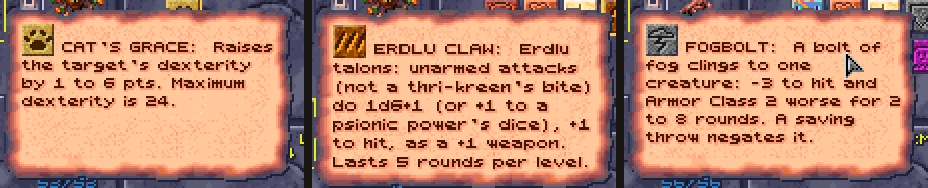

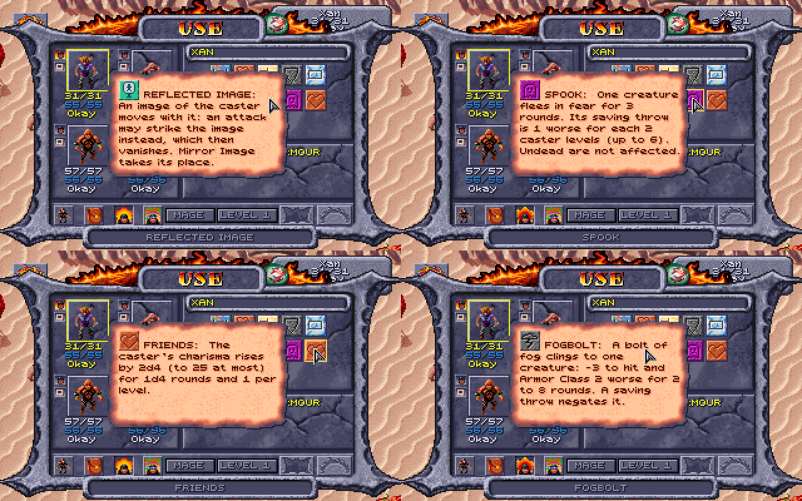

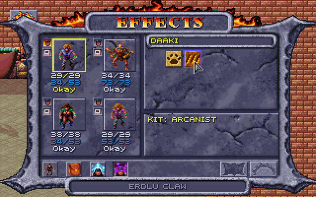

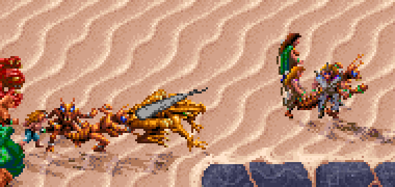

How it works:
[DEVELOPMENT-CONTENT.md](DEVELOPMENT-CONTENT.md#new-spells-wizard-and-6th-level-priest).

### 6th-level priest spells

Ten 6th-level priest spells, after AD&D's and Wake of the Ravager's (numbers
202-211). A cleric or druid gets them at 11th level, with AD&D's spell slots:
one 6th-level slot at 11th and two at 12th. Under the XP cap a druid can reach
12th, a cleric only 11th, so only a druid gets the second slot. Like the 4th and 5th-level common spells, the cosmos
ones are for druids and a Healer cleric; each element's are for the clerics
and druids of that sphere (an Elementalist's second sphere counts). They come
with the **New spells** switch, as the wizard spells do, and with
**AD&D's class tables** for the slots.

A Healer made before the kit had the cosmos (Obsidian Edition 2.5.0 and
earlier) is given its cosmos spells when the game is loaded, and the dice log
says so.

| Spell | Who | Cast on | Does |
|---|---|---|---|
| **Heal** | cosmos | touch | every wound healed, disease and blindness cured |
| **Harm** | cosmos | touch | the creature is left 1d4 hit points; no save |
| **Restore Youth** | cosmos | touch | takes back a year of magical aging (Haste's) a caster level, never below the creature's true age; it must survive a system shock ([Ages](#ages-and-magical-aging)) |
| **Blade Barrier** | air | a wall | 8d8 to each creature in it or passing through; a save for none |
| **Wall of Thorns** | earth | a wall | 8 plus the creature's AC to each creature in it or pushing through (at least 1) |
| **Sunstroke** | fire | one creature | if it fails its save it collapses, helpless, for 2 rounds a level, taking 1d4 fire at the start of each round |
| **Fire Seeds** | fire | an area | four seeds of 2d8 bursting together (8d8), a save for half |
| **Heartseeker** | earth, water | one creature | it saves against death or dies; one that saves takes half of 4d8 (2–16), as from Slay Living |
| **Water of Life** | water | touch | the creature's wounds healed by taking them onto the caster, who keeps at least 5 hit points |
| **Whirlwind** | air | an area, a round a caster level | 2d8 crushing each round to each creature in it, a save for half; one that fails is swept off its feet and loses its next turn |

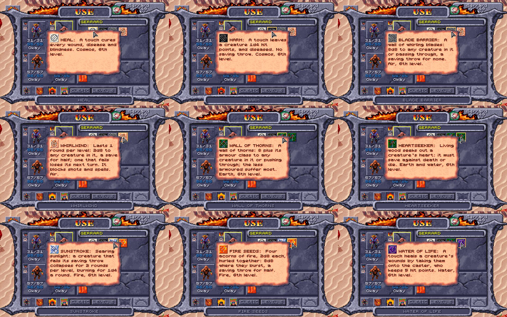

How they're made, and where they differ from the books:

- Each is built on a spell the game already has, so the game's own code casts
  it: Heal on Cure Critical Wounds, Harm on Cause Critical Wounds, the walls
  on the priest's Wall of Fire, Sunstroke on Hold Person, Fire Seeds on Flame
  Strike, Whirlwind on Stinking Cloud, Heartseeker on Slay Living, Water of
  Life on Lend Health and Restore Youth on Cure Critical Wounds (healing
  nothing).
- **Blade Barrier and Wall of Thorns are walls of their own**, made as the
  game makes its fire walls but each with its own damage and its own picture:
  a ring of circling blades and a tangle of thorns, Wake of the Ravager's (the
  fire wall in grey or dark brown without it). Any number of walls can stand at
  once, each doing its own. Blade Barrier's blades are edged, with a saving
  throw for none, as Wake of the Ravager's. Wall of Thorns does the book's 8
  plus the creature's AC (so the unarmoured suffer most), with no save: a
  party member's AC as the game last worked it out when something attacked
  them; anyone else's (and a party member's before that) counted as the game
  counts it, from the armour and shield worn, DEX and a gladiator's levels,
  but not spells such as Barkskin.
- **Sunstroke** strikes one creature, as in Wake of the Ravager, and holds it
  as Hold Person does, for 2 rounds a level, and the heat burns it for the
  book's 1d4 of fire at the start of each round while it lies there (a fire
  resistance counts). It ends with the paralysis, or when that is cured.
- **Fire Seeds** throws its four seeds of 2d8 together, one burst of 8d8 (the
  same dice), not one by one at different places; it bursts as a fireball (Wake
  of the Ravager's picture for it, which Shattered Lands has too) where Flame
  Strike rises as a column of fire.
- **Heartseeker** is a spell of death, not an arrow to shoot. It is
  Slay Living's, so one that saves still takes half of 4d8.
- **Whirlwind** stays where it is cast, as Stinking Cloud does, for a round a
  caster level, as AD&D has it: one tall, turning funnel of dust in the middle
  of its area, its ring of dust at the area's edge. Nothing can be shot or cast
  through it (it blocks sight, as Wall of Fog does). At the start of each
  round, before anyone acts, it does 2d8 crushing to every creature in it (a
  save for half), your party included, whether or not they get a turn; one that
  fails its save is swept off its feet and loses that round's turn (no movement,
  no action), without being helpless as a held creature is. As it is cast it
  strikes everyone in it at once: one swept then loses its turn that round if it
  hasn't acted yet, else the next round's. Walking into it does nothing until
  the next round starts. It doesn't move, and keeps striking those knocked out
  in it.
- **Harm** on a helpless creature, which the game hits with the most its dice
  can do, still leaves it 1d4 hit points. It also leaves the creature Diseased,
  as in AD&D, which here only keeps a STR lowered by something else from coming
  back ([Cause
  Disease](HOW-THE-GAME-WORKS.md#each-cleric-spell-against-the-manual)).
- **Restore Youth** is the mod's, the reverse of AD&D's Age Creature, and
  needs the **Ages and magical aging** rule: it takes back only the years
  magic added, as many as the caster's level, down to the age the character
  would be without them (its starting age, kept with the character, and the
  game's years), however many magic has added. The target rolls system shock first, as for Haste,
  and dies if it fails; one with no magical years rolls nothing. With the rule
  off, or on a monster, it does nothing. The dice log shows both:
  `Gerakis grows younger 10 years (Restore Youth): now 27.`

The dice log names each one: Harm's line says the game's own roll goes
unused, and Wall of Thorns' gives the AC its damage came from
(`Wall of Thorns' wall instead: 8 + AC 10 = 18`), and a creature Whirlwind
sweeps off its feet has a line of its own. Their icons are Wake of the
Ravager's, read from your copy (GOG sells it with Shattered Lands); without it
they have icons of their own (the game's, recoloured). Restore Youth, which
Wake of the Ravager hasn't, has the mod's own: a fountain on light blue water,
and is cast with Cure Disease's sound.

How it works:
[DEVELOPMENT-CONTENT.md](DEVELOPMENT-CONTENT.md#new-spells-wizard-and-6th-level-priest).

### New items

Items the game never had, or never placed. All but the arena's ring and
Thornwall (which the Loader hands over itself, while it runs) are written into the game's own data
each time the Loader starts the game, so the game makes them with their people
and chests and then keeps and saves them like its own. A changed switch takes
effect in regions the party hasn't visited yet; start a new game to have them
all. The dice log doesn't say where they are; [Items](ITEMS.md) does, with spoilers.

**New items, magical and mundane** on the Options tab places them all, the
arena's ring too, and brings [the champions' bout](#the-champions-bout). A thief can [lift](#picking-pockets) Pehtucl's ring,
Shadowseeker, Gutterknot and Mindshard (200 XP for each weapon).

**Where they are.** The mod's items are in the [item tables](ITEMS.md) with the
game's own: in ***bold italics*** in
[Every magic item](ITEMS.md#every-magic-item), each with where it is and what
it does, and marked **new** in
[Every mundane weapon](ITEMS.md#every-mundane-weapon). The game has no short
sword at all, no bone or obsidian axe or great axe, no bone dagger, no metal or
obsidian cahulaks, few plain metal weapons and no magic club, pick or staff sling. The mod also places
armour and a weapon the game has but never placed: the rest of the bone scale
set, with a **Bone Helm** of the mod's (AC 1 with [Helms give AC
1](#helms-give-ac-1), worn by those who can wear the armour, not thieves), the game's leather **Helm** and its own **Polearm +1**.

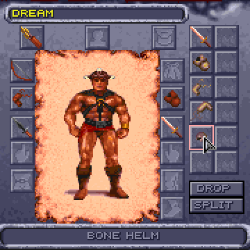

**People who fought with their fists.** Some of the people the party fights
had nothing in hand and struck bare-handed: Seref's Drajian Guards and the
slave village's, the White Sand Outlaws, the Lower Castle's one unarmed Guard,
Arant's lazy guard, the final battle's Psionicist and the arena's Tohr-kreen.
Each now carries what the armed of their kind carry, or plain gear to match
([Every mundane weapon](ITEMS.md#every-mundane-weapon)).

**Cahulaks** ([their rule](#cahulaks)): **Legcrusher**, the pens' half-giant
monster trainer, fights with a **Cahulaks +1**; the game's own Cahulaks +1 is
made the **Cahulaks +2**; the champions' mul fights with **metal cahulaks**
(the game has only bone ones); and the dead body by the arena's stone arch
holds plain bone ones. Metal and obsidian cahulaks are sold too, the metal by
Teaquetzl's Weapon Merchant and the obsidian by Jark (earth and fire clerics may
use obsidian ones, earth clerics metal ones too, air clerics any), and two have names of their own:
**Emberlash**, an obsidian cahulaks +1 wielded by Uzoma of the Drajian patrol near
the Hot Springs, and **Ironwhirl**, a metal cahulaks +2 on the Subterranean
Temple's weapon rack ([Items](ITEMS.md#every-magic-item)).

**The Boots of Speed** (the DMG's) are new: in a fight they double the
wearer's movement and better its AC by 2 ([Items](ITEMS.md#every-magic-item)).
Out of a fight they do nothing, and the DMG's slowing for weight and rest
after hours of running are left out. Like any boots they also give the
stealth rule's +10 to moving silently.

**Pehtucl's chest**, with the Cloak of Protection +1 in it, is locked and
trapped: a thief can disarm and pick it, anyone else bash it open, which sets
off its poisoned needle (2d6 poison). How, in
[Items](ITEMS.md#pehtucls-chest). A new game only.

The bone and obsidian weapons are also new characters' starting weapons with
[weapon specialization](KITS.md#starting-weapons), each in a material the
character can use. Dunesong, the bow +1 the Bowyer sells, counts at his
archery target as the game's own bows do ([the target's
rules](HOW-THE-GAME-WORKS.md#the-bowyers-archery-target)).

For those who wear no armour the mod adds AD&D's bracers of defense and two magic robes; for those
who wear the most, the Warden's Plate, plate mail +1 in four pieces. What they do, what every new
item costs, the new icons and names, and what Alagorn tells of the new items are in Items: [the
mod's new items](ITEMS.md#the-mods-new-items).

How it works: [DEVELOPMENT-CONTENT.md](DEVELOPMENT-CONTENT.md#new-items).

### New people

Two new people in the slave pens: Kalzith, there when the party first enters
the pens in a game started from the Loader, and Semyon, once he has left the
arena. A save made after that keeps the pens as they were.

#### Kalzith

**Kalzith** is a defiler slave the templars put
in the arena now and then (the crowd loves to watch a defiler burn), kept in a
pen of his own in the middle column the rest of the time. He has the arena
Defiler's figure and a face of his own, painted for him in the game's own
portrait style: an old man, white of brow and beard, in the green-teal hood his
figure wears. No one else has it, so the Dialogue tab never mistakes him for
anyone else.

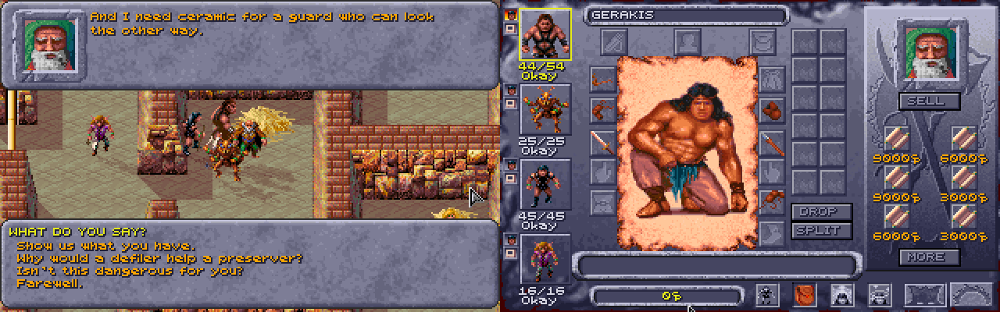

Talk to him as to anyone (click him with the look pointer, then the Look box's
Talk button). His conversation is the game's kind, just him speaking:

- **With respect** ("We mean no harm. We're slaves too."), he owns up to
  scribing spells on scraps of hide at night, to bribe a guard, and offers
  them: **Show us what you have** opens the game's shop screen, with his six
  scrolls, one of each, and what he wears (below):

  | Level | Scroll | Price |
  |---|---|---|
  | 1 | Shield, Burning Hands | 3,000 ceramic each |
  | 2 | Blur, Cat's Grace | 6,000 each |
  | 3 | Lightning Bolt, Haste | 9,000 each |

  None of them is a spell the game has a scroll of, so they're something you
  can't find elsewhere. The prices are the game's own for the spell's level
  (3,000 a level, as most of its scrolls are), less with
  [the leader's CHA](#the-leaders-cha-at-shops).

  Cat's Grace is there only with the new spells on (see
  [New wizard spells](#new-wizard-spells)). A preserver learns a scroll's
  spell as from any of the game's (right-click it in the inventory, click its
  spell), by the game's own rules (a spell of a level the preserver can cast),
  and with [Preservers' INT](#preservers-int) on it rolls to learn it. He
  remembers a friend ("Back again? Keep your voice down."). As with the game's
  own people, a question goes from his list once asked, until the next time
  you talk to him; the shop stays.
- **During the escape**, with the alarm sounding (the game's own alarm, which
  the pens' other slaves also answer to), he has only a line for the party,
  by how he stands with them, and no talk: to a friend, "That's the alarm. So
  it's you breaking out. Go, and go quickly: if they find you at my cell, I
  burn with you."
- **Calling him a defiler**, he answers back; take it back and he's friendly,
  or **threaten to tell the templars** and he won't speak to the party again
  until they make amends: **50 ceramic** (offered only to a party that has
  it), or a plea that he wins over with a **Charisma check** (the character
  talking rolls it).

He wears an Ashen Robe and a Cloak and carries a Quarterstaff (the game's
own), and sells them too: the game's shops sell everything a merchant carries,
worn or not. Once the party has bought it all, he has nothing more to sell.
Killed, he leaves whatever of these he still has and one of the scrolls he
still had, chosen at random, in his body, and the log says which scroll.
Attacked, he turns on the party as the pens' other slaves do, and only the
guards near him join the fight. If he dies, Dinos and the Trustee speak of him
as dead; after the party's escape he is gone from the pens with everyone else.

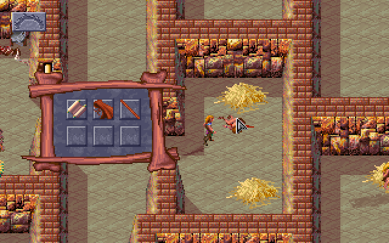

How it works: [DEVELOPMENT-CONTENT.md](DEVELOPMENT-CONTENT.md#kalzith).

#### Semyon

Untie the arena's prisoner and he is **Semyon**, a slave the templars tied up
in the sun for asking after the Veiled Alliance, "much more of a scout than a
warrior", as he says. He meets the party again in the arena's bone area, takes
them for the Alliance ("You must really be from the Veiled Alliance! I thought
they were a myth!") and asks to join. Made a member ("You, too, are now a
member of the Alliance.") and asked to help, he fights beside them in the next
fight and, if he survives it, leaves: "That's enough for me. I'm leaving. I'll
go find more members for the Alliance." (Some of his replies in the bone area
send him off before that: "That's enough for me. I'll see you in the holding
pens.", "Right, see you there!", or, still weak, "Why don't I meet you in the
holding pen?") Each way, he walks out through the arena's entrance to the
pens, where a script takes him off the map, and nothing in the pens brings him
back.

With the Loader, if he left after the fight he helped in, he is there, in a pen
of his own above Kalzith's, the first time the party is in the pens after it.
His other ways out stay as in the game, and so does a Semyon who was killed: he
isn't in the pens. Talk to him (Look, then Talk): he says why the templars tied
him up in the arena (he was asking about the Veiled Alliance), passes on what he
has heard (who carries keys), reminds the party where he hid his gem (the grain
pots), and talks about the Alliance's plans, in his own voice from the arena.
With the new items on, he also tells of a weapon shipment he passed ("Seen
anything useful?": "Guards were fussing over one crate like it held something
special. I didn't see where they took it, but it can't have gone far"). From
then on the pens' weapon rack holds **Thornwall**, a bone polearm +1, and once
the party carries it he has a word about it ("We found what was in that
crate.").
As with the game's own people, each question goes from the list once asked,
and comes back the next time you talk to him.

Attacked in his pen, he turns on the party as the pens' other slaves do.

**Breaking out with Scar.** A rare way through the arena: recruit Semyon just
before the fight with Scar, take up Scar's offer to break out together, and
head for the west exit. In the game, when the alarm goes up ("Gladiators
escaping! Guards! Sound the alarms!"), Scar and his henchmen come along to the
slave pens and Semyon is left behind. With the Loader, if he is still in the
arena, alive and on the party's side, he comes too: he stands beside Scar's
men in the pens and fights the guards with them, on the party's side. Talked
to then, he says: "Scar's gladiators and the Veiled Alliance, side by side!
Who would have believed it? Stay close to Scar: he knows the way out, and I'm
right behind you." He isn't made one of the pens' slaves while the escape
lasts, and once the party is out through the grate, he is gone with everyone
else.

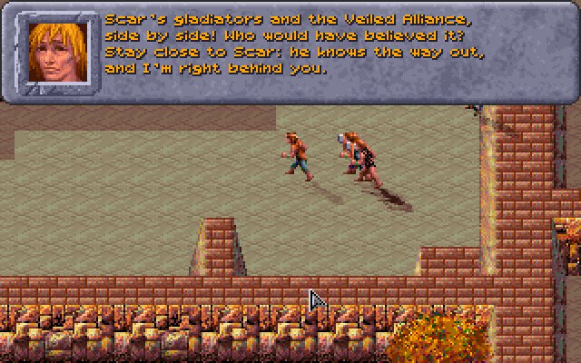

How it works: [DEVELOPMENT-CONTENT.md](DEVELOPMENT-CONTENT.md#semyon).

#### What Dinos and the Trustee say about them

Dinos ("Who else is in here?") and the Trustee ("Who else is in the
slavepens?") each answer questions about the others in the pens. With the
Loader their menus also ask about Kalzith, and about Semyon once he is in his
pen ("What do you know about Kalzith?", "What can you tell me about
Semyon?"). Kalzith's question waits until the Loader has found him in the pens
(the game's test for whether someone is there only knows the game's own
people); Semyon's once he has been in his pen. As with the game's own
questions, each is shown only until it's answered in that talk.

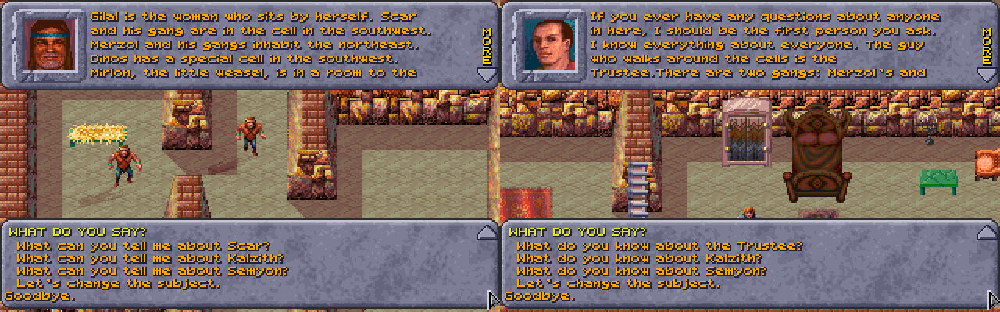

If either has been killed, they speak of him as they do of the game's dead:
the Trustee asks "What was Kalzith like?" (or Semyon) instead, with an answer
of its own, and Dinos keeps the question and answers it differently.

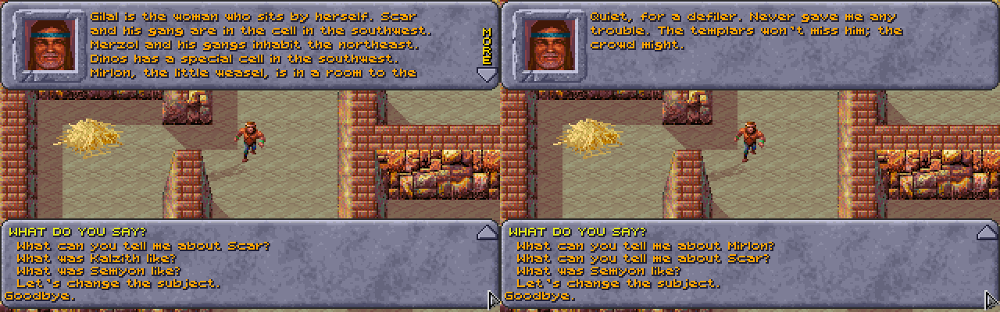

After the party's escape, when the game empties the pens ("They killed
everybody except for myself", the Trustee says on the torture rack), Kalzith
and Semyon are taken off the map too, the way the game takes the others, and
Semyon is never put in his pen after it.

How it works:
[DEVELOPMENT-CONTENT.md](DEVELOPMENT-CONTENT.md#what-dinos-and-the-trustee-say-about-them).

### The champions' bout

Kill **Scar** in the arena, and the pens have a new king (killed in the pens,
he makes no one king, and the champions don't come). On the party's next
visit to the arena the Announcer has news:

> Citizens of Draj! Scar is dead, and the pens have a new king. But word travels
> fast across the sands. From a distant arena come champions who have never known
> defeat, and they have come to see if the new king is worthy of the crown. Their
> leader, a Tohr-kreen, carries a gythka that has drunk the blood of a hundred
> gladiators.

The first wave is six **champions** in place of the game's:

| Champion | Weapons | Armour |
|---|---|---|
| Tohr-kreen | **Kreenfang** (a gythka +1) | none |
| Half-giant | a metal great axe | full scale, a bone helm, a leather shield |
| Mul gladiator | metal cahulaks | full scale, a bone helm |
| Halfling | a sling, a bone short sword | full leather, a leather helm, a leather shield |
| Elf | a bow and arrows, an obsidian long sword | full leather, a leather helm, a leather shield |
| Defiler | a bone dagger, and a scroll of Fogbolt, Spook or Reflected Image (chosen as the bout starts; of the game's own spells with the new spells off) | none |

They fight with their weapons, the two archers shooting, and their armour counts
on top of their kinds' AC, as the party's does (and as the game's own people's
do: [their gear is worn](GAME-BUGS.md#who-turns-up-and-how) from the start too).
What they carry is on their bodies afterwards; the Tohr-kreen falls as a dead
Tohr-kreen of its own, Kreenfang in it. It comes once. A party that breaks out
with Scar instead, or leaves the pens another way, doesn't meet them.

How it works: [DEVELOPMENT-CONTENT.md](DEVELOPMENT-CONTENT.md#the-champions-bout).

### Legcrusher at the fountain

When the party is slow to answer Kurzak's call, he sends Legcrusher, the pens'
half-giant, to fetch them. If Legcrusher finds them at the fountain (its room or
the passage before it, where the fountain's roar already masks a guard's yell),
he doesn't deliver his warning: he sees the gladiators out of their cells, yells
for the guards, the fountain drowns him, and he attacks, alone:

> Gladiators out of cells! Bad gladiators! Guards! GUARDS!
> *Legcrusher bellows for the guards, but the roar of the fountain swallows his voice.*
> Nobody hears. Then Legcrusher take you back himself!

No alarm goes up and no guards come. Killed, he is missed: Kurzak's later lines
say his monster trainer has gone (how: [DEVELOPMENT-CONTENT.md](DEVELOPMENT-CONTENT.md#kurzak-and-legcrusher)).
Elsewhere Legcrusher says what the game has him say.

### The cooked vulture

Hit the arena's vulture and its feathers come off (a plucked vulture); the
slave pens' campfire cooks it. In the game itself the cooked vulture is then
no use to anyone: no script asks for it. With the Loader running, **Dinos**,
the pens' fine cook, can be asked about it: talk to him while someone in the
party carries it, and among the first things the party can say to him, just
before "Goodbye.", is **"We cooked the vulture from the arena."** He takes it
("A vulture! Give it here. A pinch of salt, some agafari leaf, slow over the
coals... Sit down and eat with me. A meal like this puts the strength back in
you."), and the game's own window for a quest's reward follows, as for any of
its quests: "Each party member receives 100 experience points!", with the
sound the game plays when a quest is done (as for the Trustee's key or the
filled water jug). Each party member gets **100 XP** (split between a
multiclass character's classes, as the game splits all its XP) and is
**restored as after a full rest**: HP, PSP and spell slots full, and anyone
knocked out back on their feet. No time passes. The question is gone once the
vulture is. (Eaten by the party on their own, used on one of them from the
inventory, it's too tough to be worth the chewing.)

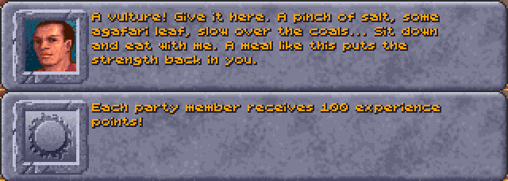

How it works: [DEVELOPMENT-CONTENT.md](DEVELOPMENT-CONTENT.md#the-cooked-vulture).

### Defilers' scrolls

A defiler may carry a spell scroll it was studying: with **Defilers' scrolls**
ticked, each defiler in a fight has a 5% chance (1 in 20) of carrying a scroll
of a random preserver spell, any of the game's 69 (1st to 5th level) or, with
the new spells on, the mod's new ones. When it dies the scroll is on its
body, with the rest of what it carried.

The defilers are those the game makes defilers: Balkazar, Wyrmias, Tara, the
Troop Leader, the arena's Defiler (who dies in the opening fight), the Dark
Spiders and the Spider Mother, the Hermit, and the thri-kreen Click-tunk!,
Churr-te-tunk! and Cheee-smak-tunk!, on either side of the fight. No one else
carries one. Kalzith keeps his own scrolls.

The scroll is the game's own kind: a preserver learns from it as from any
scroll (right-click it, then click its spell's icon), and it sells for 3,000
ceramic pieces a spell level. The dice log doesn't show the roll, so whether a
defiler had a scroll is found out on its body.

Each defiler is rolled for once in each fight, the arena's later defilers too.
A fight played again from a save is a new chance; a game saved mid-fight keeps the scroll a defiler was given.

How it works: [DEVELOPMENT-CONTENT.md](DEVELOPMENT-CONTENT.md#defilers-scrolls).

## Graphics

What the mod draws on the game's map, and the magic items' icons. The elves'
and half-elves' looks, Cilla drawn as an elf, the party's gear, shadows, dust
and see-through figures each have a switch in the Options tab's **Graphics**
section; the magic items' icons and the spells on the ground are always on.

### Elves and half-elves

Elves have pointed ears, walking and fighting, beside any helm. Half-elves have
their own look (the game draws them with the human pictures), made from the
game's pictures in colours the party's figures already use. A half-elf man is
built like the elf man, a little broader, with fair hair cut short at the nape,
a linen shirt under a leather jerkin, green trousers, brown boots and small
pointed ears. A half-elf woman is a little slimmer than the human woman, with
golden hair up in a bun, pointed ears, a purple cloak, purple wristbands and
red boots. Anything worn is drawn over these in its own colours, so a worn
cloak or boots replace the purple and the red.

With **Elves have pointed ears, and half-elves figures of their own**
unticked, elves are as the game draws them, and half-elves are the human
figures in their own colours. It counts from the next time the game is
started.

Cilla, in the game's own party, is an elf, but the game gives her the figure
it gives half-elf women. With **Cilla, an elf in the game's own party, drawn
as an elf** ticked, the Loader gives her the elf woman's, in a new game and in
one already begun (there from the next area or load on), whatever the switch
above. Unticked, she keeps the game's half-elf woman's figure, from the next
time the game is started (a game where she already has the elf's keeps it).


How it works: [DEVELOPMENT-CONTENT.md](DEVELOPMENT-CONTENT.md#elves-and-half-elves).

### What the party wears

The party's figures on the map and in fights show what each one wears, and
change as soon as their gear does (switch it off on the Options tab to see the
game's own). The game draws each race and sex the same whatever they carry;
the Loader keeps the artist's pictures and adds to them, frame by frame,
walking and fighting:

| Worn | Shown |
|---|---|
| **Weapons and shields** | each weapon type its shape, in its material's colours (below) |
| **Bows and slings** | the bow and quiver on the back (the game draws the bow when shooting), a sling or chatkcha at the hip |
| **Armour** | the character's own clothing recoloured toward its material, shade for shade (leather, bone, chain, plate, scale...): the chest piece above the waist, arm pieces at the wrists, leg pieces below the waist; on figures the artist drew mostly bare (the mul, the dwarf man) only their straps and loincloth change, so it shows little; magic armour (a plus or a power) has a scatter of sparks over it in its icon's glow colour, as have magic cloaks, helms, boots and belts. Seen from the front, a cloak hangs behind the wearer, its edges no wider than the back |
| **Helms** | a circlet at the brow blended into the hair: a feather on leather, a dark stone on iron, low spikes on bone |
| **Cloaks** | the cloak the game draws on the human woman (its folds and swing as she walks and fights), fitted to the wearer, under the hair, in the cloak's colours; a half-elf woman's own purple cloak takes the worn one's colours |
| **Boots and belts** | the feet and the waist recoloured (Boots of Elvenkind in soft green) |
| **Age** | with [ages](#ages-and-magical-aging) on, the hair greys: streaks when middle-aged, grey when old, white when venerable |

**Weapons and shields:**

- **Shapes:** dagger, sword, club, mace, axe, polearm, gythka, staff, and a
  round shield.
- **Colours:** the material's (wood, bone in ivory, stone, obsidian, metal); an
  axe or mace on a wooden haft, its head solid, as the game's own axemen carry
  them. Kreenfang's two blades are in the fire colours and Shadowseeker's in
  night steel, as their icons.
- **Magic:** the spells' weapons are whole in the colours the game animates,
  the Flame Blade and Shillelagh in the fire's and Spiritual Hammer's head in
  the water blue, as their icons glow. Any other magic weapon or shield (one
  with a plus or a power, Shadowseeker too) glints along its bright edge, a
  staff along its shaft, in whichever of the colours the game animates (fire,
  green, violet, water blue) is nearest its icon's own shine or colour: blue
  for steel and plain ones.
- **Walking:** a one-handed weapon is worn at the belt, hanging down and back
  like a scabbard; two-handed ones are carried upright; a shield is on the arm
  (from the side, on the far arm held forward of the chest, so it shows past
  the body).
- **In a fight:** the weapons are in the hands and swung, and the shield is on
  the other forearm in every pose (placed by hand for each model where the arm
  is hidden or flung).

The colours are muted ones no region's palette changes. A thri-kreen shows
only weapons and shields (all it can use). Two party members of the same race
and sex each show their own equipment: the game gives them one figure, so the
second is moved to pictures of their own.

A new outfit's pictures go into room the game's own picture store already has
(an outfit changed back takes its old pictures again), so gear can be changed as
often as you like in one area (on Dark Sun Recompiled, where the store can't be
reached, a figure near a full store keeps its outfit until the next area).
Without this, some 30 to 60 changes in one area filled the store, and figures,
the party's and the monsters', vanished from the map until the next area. (The
store is a different limit from the game's 300 picture slots, which [the bugs
fixed](GAME-BUGS.md#screens-and-memory) also see to: "Graphics disappearing in a busy
area".)

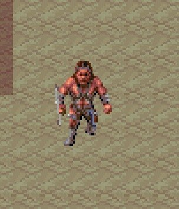

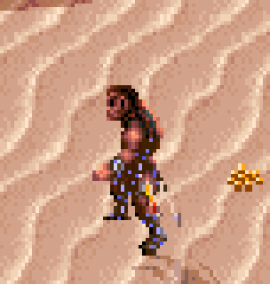

How it works: [DEVELOPMENT-CONTENT.md](DEVELOPMENT-CONTENT.md#what-the-party-wears).

### Shadows

Every living figure on the map (the party, the people, the monsters; not the
dead, nor items) casts a soft see-through shadow on the floor, its outline laid
long toward the lower right, the way the walls' own shadows fall (the light on
the game's maps comes from the upper left). The shadows are drawn on the floor
before anything else, so every figure and wall stands on top of them: a shadow
never covers another figure. Switch them off on the Options tab.

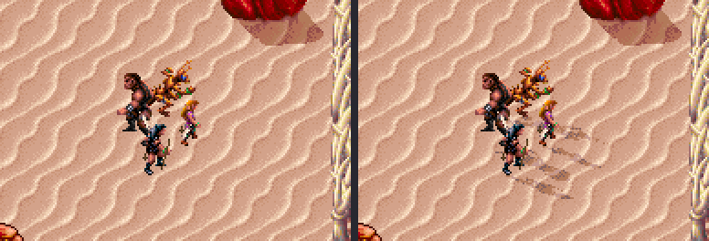

How it works: [DEVELOPMENT-CONTENT.md](DEVELOPMENT-CONTENT.md#shadows).

### Dust

Anyone walking on sand or dirt raises little puffs of dust behind their feet,
which spread, rise a little and fade in about a second. The walls and figures
stand in front of them, as with the shadows. Switch it off on the Options tab.

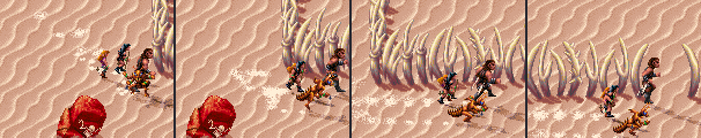

How it works: [DEVELOPMENT-CONTENT.md](DEVELOPMENT-CONTENT.md#dust).

### See-through figures

A thief or ranger hidden in shadows and unheard in a fight (see [Hiding in
shadows to backstab](#hiding-in-shadows-to-backstab)), and anyone invisible (the
Invisibility spells; among the game's foes only the psurlons, by their Superior
Invisibility), is drawn half see-through: each pixel halfway between the
figure's colour and what lies under it, so the floor, a wall or a shadow shows
through. The hidden thief turns solid again with the attack that gives them
away, or as the turn ends. A party member who is invisible is always drawn so;
an invisible enemy is drawn solid while one of the party detects invisibility
(the spell, or [Shadowseeker](ITEMS.md#every-magic-item) readied), as the party sees it then. The
game itself draws the invisible like anyone else: being unseen only makes them
harder to hit (4 worse) and better at shrugging off a spell aimed at them (4
better), for whoever can't detect invisibility. Switch it off on the Options
tab.

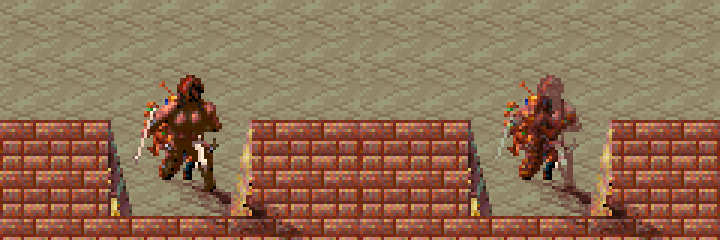

How it works: [DEVELOPMENT-CONTENT.md](DEVELOPMENT-CONTENT.md#see-through-figures).

### Magic items' icons

The game makes most of its magic items' icons shine in the inventory, a shop
and on the ground: their colours turn, as the water's and the fire's do. Some
it left still. The Loader gives 19 of them the shine of the others: the Parting
Staff, the Chameleon Gloves, the Hornblade, the Cahulaks +1 (now Legcrusher's;
the game's own is the mod's Cahulaks +2, glowing blue: [New items](#new-items)),
Dag's Dagger, the Terror Blade, Blackmace, the Shimmer, Drake and Silk Armor,
Tanelyv's and Grey's arm and leg pieces, the Living Cloak, the Golden Torque,
Light of Dawn, El's Ring and the Orb of Knowledge. The Cahulaks +1, Light of
Dawn and El's Ring share their picture with a plain item, so they get one of
their own and the plain cahulaks and ring stay still. The
Loader's own magic items shine in their icons too. Always on: only the pictures change.

How it works: [DEVELOPMENT-CONTENT.md](DEVELOPMENT-CONTENT.md#new-items).

### Spells on the ground

The [6th-level priest spells](#6th-level-priest-spells) that stay on the map,
Blade Barrier, Wall of Thorns, Fire Seeds and Whirlwind, have pictures of their
own, described with the spells. Always on, with the new spells: Whirlwind's
funnel of dust turns as you watch (two Whirlwinds at once each turn).

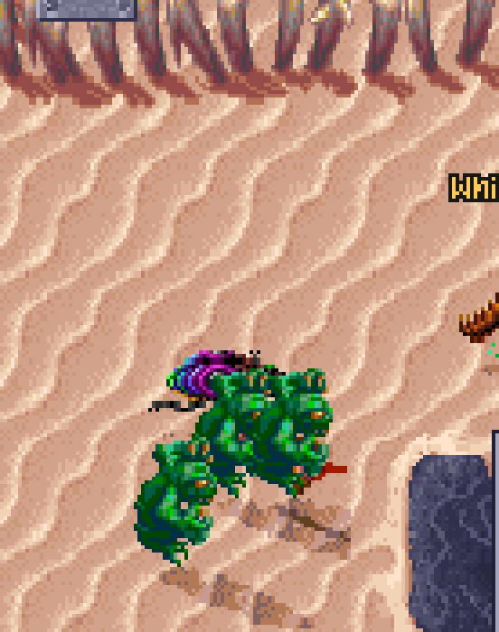

How it works:
[DEVELOPMENT-CONTENT.md](DEVELOPMENT-CONTENT.md#new-spells-wizard-and-6th-level-priest).

## Controls

Each has a switch in the Options tab's **Controls** section, but M, U and I,
and T for looting, which are always on.

### Looting a body: T and Shift+T

With a body's window open (the look pointer on a body, or on a chest, a
container of any kind), **T** takes everything in it and **Shift+T** everything
but plain weapons (a weapon with no plus and no power: the guards' bone and
wooden swords, bows and clubs). The window closes, and each thing goes into a
backpack, in the order the window shows them: the first party member's, in the
party's order, that has a free cell (a member dying or dead takes nothing).
What doesn't fit stays in the body, and so do the plain weapons for Shift+T:
open it again and press T to take those too. The purse's jingle plays, and the
dice log says who took what:

```
Lex takes Slavepen key, Grapes, Guava (4), Obsidian Bloodwrath +1
Ester takes Leather Belt, Leather Arm Armor, Leather Chest Armor, Wooden Arrows
Plain weapons left: Wooden Bow, Obsidian Long Sword
```

*Without the mod:* each thing is a click to take it from the window and another
to put it down, a body at a time.

How it works: `dsloader/loot.py`; DSCLOG's `LOOT_KEY` (the key made Escape,
which shuts the window, and the body noted for the Loader: the game's DS:05E6h
names the container whose window is open).

### Choosing an enemy: Tab, Enter and the rings

In a fight, on a party member's turn, **Tab** chooses an enemy, the nearest
first, then the next nearest (**Shift+Tab** goes back): a red ring on the
ground marks it, under its feet (the figure stands in it, as on its shadow),
the view scrolls to it if it is out of sight, and the log names it. **Enter**
then attacks it, as clicking on it does (walking up to it first when it is out
of reach), even where another figure stands in front of it. On the Options tab
the ring can be switched off (**none**), and Tab and Enter have a switch of
their own.

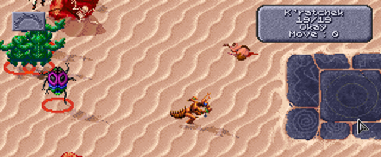

Tab and Enter also make attacking possible without aiming the mouse at all.

How it works:
[DEVELOPMENT-SCREENS.md](DEVELOPMENT-SCREENS.md#choosing-an-enemy-tab-enter-and-the-rings).

### Scrolling the map

Press the mouse wheel on the map and move the mouse: the map moves with the
pointer, as if dragged, in fights too. On the Options tab it can be switched
off. The game still scrolls on its own when the pointer touches
the screen's edge, and still brings the view back to whoever's turn it is in a
fight.

The view can't be zoomed: the game draws a 320 by 200 screen at one scale,
with the view's size built into its drawing code and its video memory pages.

How it works: [DEVELOPMENT-SCREENS.md](DEVELOPMENT-SCREENS.md#scrolling-the-map).

### M, U and I: open a screen, close it again

**M** on the map opens the overhead map, as the game's **O** does, and **M**
again closes it. **U** and **I** open the USE and inventory screens and close
them when pressed a second time. **U** on the inventory, or **I** on USE,
switches to the other screen, as in the game. After a click on a screen's
buttons or another key, the next **U** or **I** works as in the game.

How it works: [DEVELOPMENT-SCREENS.md](DEVELOPMENT-SCREENS.md#m-u-and-i-open-a-screen-close-it-again).

### The whole party in view

The game shows the party on the map as one figure, the leader, until you
press **5**, and gathers it back into the leader after every fight and in
saves made that way. With the mod, a game starts and loads with the whole
party in view, and the party stays in view after a fight, as if you had
pressed **5**. **6** still gathers the party into the leader, and it stays so
until the next fight or load. On by default: **The whole party in view as a
game starts or loads and after each fight** on the Options tab, from the next
start.

How it works: [DEVELOPMENT-SCREENS.md](DEVELOPMENT-SCREENS.md#the-whole-party-in-view).

### The view in fights

The game moved the view after a figure walking in a fight as soon as it came
near the screen's edge, a step at a time, so the view drifted after every
figure that walked, monsters' too. Now it moves only once the figure has
walked off the screen, to bring it back into view (on by default: **The view
in fights** on the Options tab, from the next start). Out of fights the view follows the party
as the game has it.

How it works: [DEVELOPMENT-SCREENS.md](DEVELOPMENT-SCREENS.md#the-view-in-fights).

### The pointer in scenes, and where it starts

The game shows no pointer in its intro, the logos before it and its other
scenes (the king's decree, the arena gate), and only a key skips them. Now the
game's own pointer (read from your copy of the game) follows the mouse there,
in the scene's nearest colours, and a click of either button skips a
scene as a key does: in the intro, straight to the main menu. (With DOSBox's
**autolock**, as GOG's setup has it, the first click in the window only takes
the mouse; the next one skips.) As before, a key or click is noticed between a
scene's steps, so a long still picture, like the decree, plays to its end.

The game left the pointer at the right edge of the screen when its menu came
up, and it moved half as far up and down as across (the mouse driver's own
setting). Now it starts in the middle, stays where you leave it from one screen
to the next (the intro, the menus, loading), and moves as far each way. In a
window it also moves as fast as your desktop's pointer: DOSBox moved it a whole
game pixel (three screen pixels in the usual window) for each pixel the mouse
moved, too fast and coarse to put an item where you meant in the inventory.

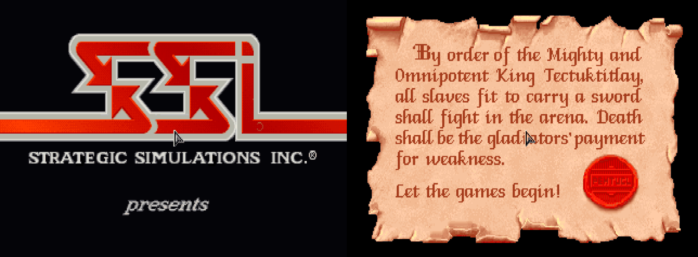

Each has its switch on the Options tab (**The pointer in scenes** and **Where
the pointer starts**), on by default (from the next start).

How it works:
[DEVELOPMENT-SCREENS.md](DEVELOPMENT-SCREENS.md#the-pointer-in-scenes-and-where-it-starts).

### Spells on the Effects screen

On the Effects screen (a character's spells and powers in effect), a click on
an effect's icon ends it in the game, so a stray click loses a spell. With the
Loader a click leaves a spell on; a psionic power's effect still ends, as that
is how a power is stopped. It has a switch in the Options tab's **Controls**
section (**Spells on the Effects screen**, from the next start).

What else the Effects screen shows (a spell's charges left, Enlarge's damage,
the armour spells' AC, kits and weapon specs): [the Effects
screen](#the-effects-screen).

How it works: [DEVELOPMENT-SCREENS.md](DEVELOPMENT-SCREENS.md#spells-on-the-effects-screen).

## Game speed

In the game everything on the map moves a step at each tick of its clock (96
a second), but a tick that passes while a picture is still being drawn is a
step lost, for every walker. The more there is to draw (the whole party in
view, shadows and dust), the more steps are lost and the slower everyone walks
([how fast the party walks](HOW-THE-GAME-WORKS.md#how-fast-the-party-walks)).

**Steady pace** (under Game speed on the Options tab, on unless switched off;
from the next start): on the map it counts the steps lost while drawing. A
picture that loses no more than the unmodded game's pictures do (a tick and a
half) is always shown; while more are lost, the next picture isn't drawn: the
game still moves everyone, and the picture after shows all that moved. So a
quick computer sees every picture, and a busy screen shows fewer pictures
rather than a slower walk. Fights draw every frame, as the game does.

| Slave pens, whole party walking, everything on | Pictures a second | Walking (map units a second) |
|---|---|---|
| 20,000 cycles, steady pace off | 18.9 | 103 |
| 20,000 cycles, steady pace on | 15.5 | 112 |
| 35,000 cycles, steady pace on | 18.9 | 141 |

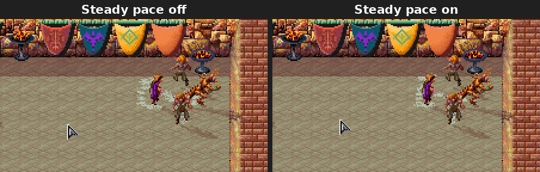

*The same save and the same clicks, recorded from the game at 70 frames a
second and played here at half speed (a GIF can't show 70 a second), every
frame kept. On the right the party reaches each spot sooner, in bigger steps.
Recorded before steady pace kept the game's own schedule and before the
cheaper drawing: it left more pictures out then, so the steps on the right
are bigger than they are now (the table above has today's figures).*

The Loader also gives DOSBox more of the computer's time: 35,000 cycles a
millisecond by default, where GOG's settings give 7,000. On the Options tab
**Game speed** is GOG's own (7,000), Faster (20,000, for an older computer), or
Fastest (35,000, the default): there nearly every frame is drawn in time even
with the whole party in view, and the party walks fastest. It applies the next time the game is started.
The Loader's two speeds also run DOSBox's faster way of running the game, which
costs the computer less.

What each setting asks of the computer:
[Suggested system requirements](README.md#suggested-system-requirements).

How it works: [DEVELOPMENT-SCREENS.md](DEVELOPMENT-SCREENS.md#game-speed).

## More saves and characters

### More saves

The game's save and load window holds 10 saves. With the Loader it holds 40,
on four pages of ten: the **PAGE 1** to **PAGE 4** buttons under EXIT show a
page, the page shown has its button greyed, and **PgDn** and **PgUp** go to
the next page and the one before. Save and load as always; the window opens
on the page last shown. In the load window, PgDn and PgUp pass by pages with
no saves; a page's button shows it even with none, with **LOAD** greyed (and
Enter doing nothing) until you go to a page with a save. (The game itself
never lets you choose an empty row to load; loading one would start a new
game.)

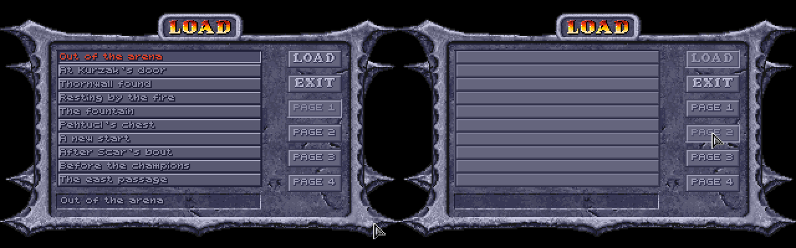

Page 1 is the game's own saves, `SAVE01.SAV` to `SAVE10.SAV` in the game
folder (or, with GOG's DOSBox, its `cloud_saves` folder); pages 2 to 4 are
`SAVB01.SAV` to `SAVB10.SAV`, `SAVC..` and `SAVD..`, next to them. The game
started without the Loader shows page 1 only, as always: it looks for
`SAVE??.SAV`, and the other pages' names don't match.

How it works: [DEVELOPMENT-SCREENS.md](DEVELOPMENT-SCREENS.md#more-saves).

#### Saves under their names

Only the game's list says which file is which save. While the Loader's window
is open, it copies every save, as the game writes it, under the name you typed
for it in the game, into its own **Named saves** folder (the `.bat` files that
start the game without that window don't):
`Page 2 slot 05 - Before Scar's battle.SAV`. Saving over a slot replaces that
slot's copy. The Options tab's **Saves** section has **Open the folder**, and
**Put a save in a slot...**, which copies a named save (or any save file) into
the page and slot you give, asking first if that slot holds one, to be loaded
from the game's list. The save it replaces is kept in the folder as
`Replaced - Page 1 slot 05 - NAME.SAV`.

### More characters

The game keeps up to 19 characters made with CREATE CHARACTERS (and the party
members dropped back to the roster); a 20th is refused with "Maximum
characters". With the Loader it keeps 29. The roster in the ADD window
scrolls through them all, as it did through 19.

They are in the game's own `CHARSAVE.GFF`, each under a number, 1 to 29. The
game started without the Loader reads numbers 1 to 19 only: characters saved
under 20 to 29 aren't shown, and aren't lost; they come back with the Loader.
(The game saves a new character under the highest free number, so the first
ten made after the 19th go to 20 to 29.)

The patched game also fixes DELETE in a scrolled roster and New characters'
thief skills ([bugs fixed](GAME-BUGS.md#making-and-keeping-characters)).

How it works: [DEVELOPMENT-SCREENS.md](DEVELOPMENT-SCREENS.md#more-characters).

## The game's bugs, fixed

The patched game also mends some fifty of the game's own bugs, whatever the Options tab says:
spells that never did what they say, fights, screens, and people and quests that could stall.
They have a page of their own, grouped by kind: [The game's bugs, fixed](GAME-BUGS.md) (some
spoilers).
