# Features and rules

*Part of Obsidian Edition's documentation, from the [README](README.md). The [player's
guide](PLAYER-GUIDE.md) has the rules and tables; this page is the catalogue.*

Everything the mod changes and adds in Shattered Lands, one short entry each, in the order of the Loader's
**Options** tab and its sections, ending with **Saves**; then the sections that are always on
(**Expanded features**, **Graphics**, **Controls**), what else is **always on**, and
the game's bugs it mends. Each entry says what it does, names its switch with the words the tab gives
it (or says **Always on**: most of the rule changes, the combat log, the thieving, the graphics and
the controls have no switch), and links to the rules ("Rules:", in the player's guide and the
reference pages) and to how it is made ("How it works:", the developer pages on GitHub). Each ends
with a line saying whether [Wake of the Ravager](RAVAGER.md) has it too; what the mod does only in the
sequel, and what it has yet to get, is on that page.

**Every switch is on by default.** The choices of more than one have defaults of their own:
the combat log's level is **in short**, the red ring is **under the enemy chosen with Tab**, the
game speed is **Fastest**, the picture is **Plain** and the music device is **Windows' default**. The switches count in games started from the Loader or its `.bat` files
(**Play Dark Sun (in-game rolls)** uses the Options as last set), most at once; one whose label says
"from the next start" waits until the game is started again. Untick one and the game's own way is
back. What is always on can't be turned off: a settings file from before, with one of those
unticked, has it on all the same. When each takes effect, switch by switch: the player's guide's [Options tab at a
glance](README.md#the-options-tab-at-a-glance). Installing, running the game and the Loader's
window are in the [README](README.md).

## Contents

- [In the game](#in-the-game)
- [Rule changes](#rule-changes): [rules the game got wrong](#rules-the-game-got-wrong),
  [characters](#characters), [weapons and armour](#weapons-and-armour), [magic](#magic)
- [More character customization](#more-character-customization)
- [New content](#new-content)
- [Game speed](#game-speed)
- [Picture and music](#picture-and-music)
- [The engine: GOG's DOSBox or DOSBox-X](#the-engine-gogs-dosbox-or-dosbox-x)
- [Wake of the Ravager](#wake-of-the-ravager)
- [Saves](#saves)
- Always on: [Expanded features](#expanded-features), [Graphics](#graphics),
  [Controls](#controls)
- [Always on](#always-on), and [the game's bugs, fixed](#the-games-bugs-fixed)

## In the game

What the game shows when it is started from the Loader: the Options tab's **In the game** section
(the combat log, always on, with its level; the red ring's choice, under [choosing an
enemy](#choosing-an-enemy-tab-enter-and-the-rings); and the switches below). More the game's screens
show, with no switch: [always on](#always-on).

### The combat log in the game

**L** on the map shows the [dice log](DICE-LOG.md)'s lines in the game itself, in a panel over the
map's lower right, and **L** again hides it: in a fight or out of one, whenever you want to read
back. The lines are in the Loader's colours (hits green, misses grey, damage amber, saving throws
blue), the party's names in their colours and the monsters' in red, in a small font of the Loader's
(7 lines where the game's own fits 6). In a fight its top line says the round and who is still to
act (`Round 2: Gerakis, then Cermak, Cilla`); out of one it says how long the game has run (`Day 47,
14:20`, the game's own clock, kept in saves), and between arena fights the arena's [count of
fights](HOW-THE-GAME-WORKS.md#the-arenas-count-of-fights) (`Arena fights: 4`) until the party has
escaped Draj. Out of fights the lines with a roll go in too (a thief's skills, a scroll learnt, a
new level's hit points). It never waits for a click, and stays shown or hidden as you left it.
While a window, a screen, a menu or a talk is up (the save and load windows, the inventory, a
member's END menu) the panel is put away, so it never covers them, and it is back when the map
is.

**Always on** (no switch). How much it says is the tab's choice, under *The combat log in the
game (L on the map shows and hides it):* *...
at the least: what came of each attack and spell* (`Rampager hits Defiler for 4`), *... in short:
each roll, what it needed and the damage* (the default: `Rampager hits Defiler for 4 (20 vs 16+)`,
the d20 and the roll it needed), or *... in detail, as in the log* (every line, each attack's THAC0
and its parts). A spell that [rolls to hit](#spells-roll-to-hit) and Turn Undead read as hits and
misses.

**The panel** keeps the last 200 lines: drag its scrollbar, click above or below the handle for a
page, or turn the mouse wheel over it (on Windows); scrolled back, it stays put and a **Latest**
chip counts the new lines (click it to follow again). Clicks on it are its own: the party doesn't
walk there. Its top line's buttons are **L** (hide), the level (**Least**, **Short**, **Detail**;
the Options tab follows), and **-** and **+**: collapsed, one line, the newest; seven lines;
expanded, 12 lines with the filters **All**, **Party**, **Damage** (hits, damage and deaths) and
**Saves** (saving throws and magic resistance). Its size is remembered. A window the game opens over
the map hides it until it closes; expanded, it covers the game's damage numbers there.


Rules: [the dice log, line by line](DICE-LOG.md). How it works:
[DEVELOPMENT-SCREENS.md](https://github.com/daaki85/darksun-obsidian-edition/blob/main/obsidian-edition/DEVELOPMENT-SCREENS.md#the-combat-log-in-the-game).

**In Wake of the Ravager:** yes.

### What hurts a monster (the Look box)

In a fight, Look at a monster and the game's small box, under its name and level, also shows its hit
points and AC (`HP 15/15 AC 2`), its THAC0 and alignment in two letters (`THAC0 17 AL TN`), its
magic resistance (`LEVEL: 3 MR 30`) and its most important defence (`NEEDS +1 WEAPON`, `IMM FIRE
COLD`, `NO CRUSH`, `HALF FROM WPNS`, `UNDEAD`), then its own status lines. Closing the box shows the
rest in the game's dialogue window: the weapons it needs, the damage it's immune to or takes half
of, the spells that don't work on it and what its hits do. The AC is the one the game last used
against it, or worked out as the game would (armour, shield, DEX) until something has attacked it.
The dice log gets the same lines (`Look: ...`).

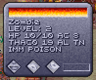

**Switch:** *What hurts a monster (the Look box): Look at one in a fight for its hit points, AC,
THAC0 and defences; closing the box shows the rest in a window*. Rules:
[monsters](PLAYER-GUIDE.md#monsters), [monsters' defences](HOW-THE-GAME-WORKS.md#monsters-defences).
How it works:
[DEVELOPMENT-SCREENS.md](https://github.com/daaki85/darksun-obsidian-edition/blob/main/obsidian-edition/DEVELOPMENT-SCREENS.md#what-hurts-a-monster-the-look-box).

**In Wake of the Ravager:** yes.

### Names over figures

A spell's name floats over its caster for a second and a half as it is cast, and "Miss" over anyone
an attack misses, in the game's lettering, for the party and the monsters, in fights and out (a
weapon's spell on a hit too). A charge used floats over its owner in light blue for three seconds
("Armor: 7 left", "Reflected Image: 2 left", "Armor ends"), and after a party archer's shot the
arrows left ("Arrows: 17 left", "Stones" for a sling, "Out of arrows"). Up to four show at once;
long names are shortened ("Lesser Water Elem."), and near the top of the screen a name goes under
the figure's feet. An archer whose quiver runs dry in the middle of its shots keeps its turn, to
walk, fight hand to hand or end it.

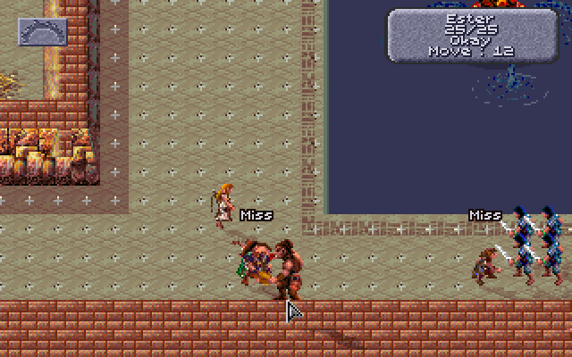

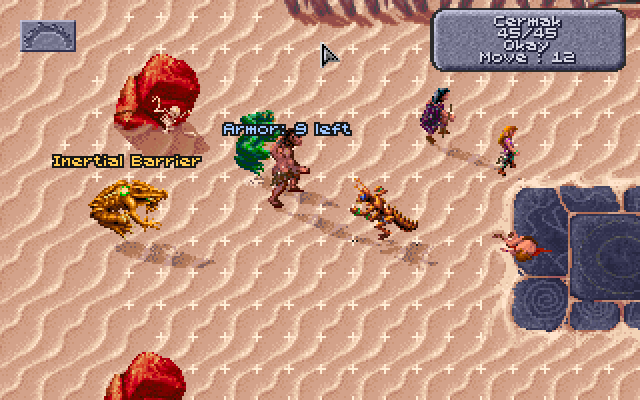

**Switch:** *Names over figures: a spell's name over its caster, "Miss" over whoever an attack
missed, a used charge ("Armor: 7 left") over its owner, and the arrows left over a party archer
after each shot*. How it works:
[DEVELOPMENT-SCREENS.md](https://github.com/daaki85/darksun-obsidian-edition/blob/main/obsidian-edition/DEVELOPMENT-SCREENS.md#names-over-figures).

**In Wake of the Ravager:** yes, but not yet the arrows left after an archer's shot ([the sequel's gaps](RAVAGER.md#not-in-the-sequel-yet)).

### The chance to hit before the swing

With an enemy chosen with Tab, the Loader says what the party member whose turn it is must roll on
the d20 to hit it, and the chance, before anything is swung: on the dice log's line that names the
enemy (`Chosen with Tab: Guard (50 HP), needs 14+ (35%) - Enter attacks it`) and in the combat log's
header, in place of the round's line while the enemy is chosen (`Needs 14+ (35%)`). It is the
number the dice log shows for the attack itself, worked out the way the game does: THAC0 with the
weapon less the enemy's AC as it counts against this attacker. Each weapon is named where they
differ, and both numbers are given where the swing may come from behind.

**Under the pointer.** On a party member's turn, rest the game's pointer on an enemy and the same
number floats over it, as "Miss" does: `12+ (45%)`. It goes when the pointer leaves the enemy or
the turn passes. A label is narrow, so it gives one weapon, the one a click would swing first:
next to the enemy the first weapon in hand; farther off the walk-up's with the walk arrow and the
shot's with the attack pointer. With the look pointer (the eye) nothing shows: a click there only
looks. Tab's choice is left alone: the pointer changes neither the ring nor the combat log's
header.

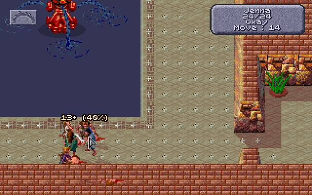

**Switches:** *The chance to hit: with an enemy chosen with Tab, what the d20 must show to hit it and
the chance, in the dice log and the combat log's header*, and *The chance to hit under the pointer:
in a fight, with the pointer over an enemy, what the d20 must show and the chance float over it*. Rules: [the chance shown before the
swing](PLAYER-GUIDE.md#the-chance-shown-before-the-swing). How it works:
[DEVELOPMENT-SCREENS.md](https://github.com/daaki85/darksun-obsidian-edition/blob/main/obsidian-edition/DEVELOPMENT-SCREENS.md#the-chance-to-hit-before-the-swing).

**In Wake of the Ravager:** yes.

### Squares in reach

In a fight, on a party member's turn, every square that member can still walk to this turn has a
small cross on the floor: a light one on sand, dirt and paving, a dark one on a floor of other
colours. The crosses follow the turn: fewer as the member walks and its
movement is spent, none once it is spent, and the next member's as the turn passes. They are drawn
on the floor, so figures and walls stand on them, and a square a figure stands on (an ally's too)
has none: nobody walks through anybody. What lies on the floor covers them as well: a square under
a rug or the arena's stone platform can be walked on but shows no cross.

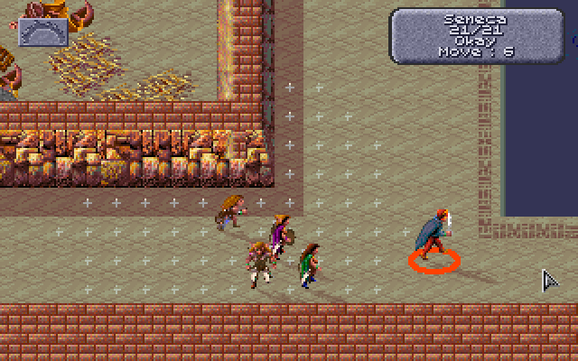

A marked square is one a single click walks to. The game counts 10 for a step straight and 14 for
a diagonal one out of ten times the Move the name box shows, and the crosses are counted the same
way, by the shortest way round walls, through doorways and past whoever stands in the way ([moving
in a fight](PLAYER-GUIDE.md#moving-in-a-fight)). **One limit:** where a wall or a doorway makes
the game go round, its own way can cost a little more than the shortest, so the farthest crosses
behind a wall may be a step out of one click's reach: click a nearer cross first, then the far
one. Walking past an enemy costs nothing more, and a click on an enemy's figure is still an
attack, not a walk. **F10**, the game's own key, takes a move back ([below](#f10-takes-a-whole-move-back)).

**R hides the crosses and shows them again**, on the map in a fight, as L does the combat log: the
dice log says which (`Squares in reach: hidden (R shows them)`), "Squares hidden" or "Squares
shown" floats over the member whose turn it is (with [names over figures](#names-over-figures)
on), and the choice is remembered for the next fight and the next start. The game has no use for R
on the map. With the switch off there are no crosses and R does nothing.

**Switch:** *Squares in reach: in a fight, a small cross on each square the party member whose turn
it is can still walk to (R in a fight hides and shows them)*. Rules: [moving in a fight](HOW-THE-GAME-WORKS.md#moving-in-a-fight). How it works:
[DEVELOPMENT-SCREENS.md](https://github.com/daaki85/darksun-obsidian-edition/blob/main/obsidian-edition/DEVELOPMENT-SCREENS.md#squares-in-reach).

**In Wake of the Ravager:** yes.

### F10 takes a whole move back

In a fight **F10**, the game's own key, takes a party member's move back: the member stands where
its turn began, with the movement it had. In the game that works only while some movement is left:
after the last step F10 still puts the member back, and the name box shows its Move again, but no
click walks it ([moving in a fight](HOW-THE-GAME-WORKS.md#moving-in-a-fight)). With the Loader the
member can walk again then too, and the dice log says so (`F10: Ester's move taken back (can walk
again)`). Nothing else changes: an attack is not taken back, and after an attack (one that kills
can leave the member its turn) F10 gives no walk, nor to a member held or stuck (Paralyzed,
Stuck).

**A held or stuck member stays put.** The game's F10 put a Paralyzed or Stuck member back on the
square its turn began on, with its points, as if it could still move. Now F10 does nothing for
such a member: it stays where it is. This one is always on, whatever the switch.

**Switch:** *F10 takes a whole move back: after the last step too, the party member can walk again
(the game's F10 puts it back but lets it walk no more)*. Rules: [moving in a
fight](PLAYER-GUIDE.md#moving-in-a-fight). How it works:
[DEVELOPMENT-SCREENS.md](https://github.com/daaki85/darksun-obsidian-edition/blob/main/obsidian-edition/DEVELOPMENT-SCREENS.md#f10-takes-a-whole-move-back).

**In Wake of the Ravager:** yes, once the sequel's own END MOVE menu is closed ([how](RAVAGER.md#the-mod-in-the-sequel)).


### Showing what can be used: Alt

Hold **Alt** on the map, out of a fight: a gold ring appears on the ground under everything in view
that a click does something with, and the four nearest the pointer have their names over them.
Move the pointer and the names move to what is nearest it; let go of Alt and all of it is gone.

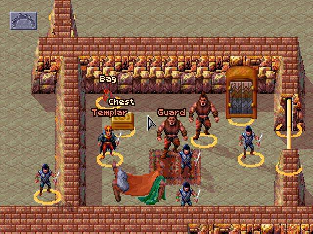

What gets a ring: **people to talk to**, their names in pale gold, and anyone else on another side
than the party's (guards with nothing to say, monsters), named in red: there is nothing to do with
them but fight; **doors**, each leaf (the look pointer opens and closes them); **chests, bags and
other containers**, and **bodies**; **items lying on the ground**; and **things a script answers
to** (a haystack that can be searched, a button, a lever, a fountain a pot can be filled at). Plain
scenery gets nothing, nor does the party, and a secret door stays secret; a thing the game has no
name for is ringed without one.

Walking and clicking work as ever while Alt is held. In a fight Alt does nothing: the ring there is
the red one under the enemy chosen with Tab, and a fight that starts while Alt is held takes the
gold rings and the names away. The marks cost some speed while they are up (a walking party is
about a sixth slower). Alt with another key is still what it was (Alt+Enter is DOSBox's full
screen), and if Alt reads as held for 30 seconds on end the marks go until it is let go, so a key
left "held" by switching windows can't leave them up.

**Switch:** *Showing what can be used: hold Alt on the map, out of a fight*. How it works:
[DEVELOPMENT-SCREENS.md](https://github.com/daaki85/darksun-obsidian-edition/blob/main/obsidian-edition/DEVELOPMENT-SCREENS.md#showing-what-can-be-used-alt).

**In Wake of the Ravager:** yes.


## Rule changes

The game's rules brought closer to AD&D's, in three groups: [characters](#characters), [weapons and
armour](#weapons-and-armour) and [magic](#magic). **Most are always on**, with no switch; three keep
one in the Options tab's **Rule changes** section: [hit dice](#hit-dice-the-better-of-two),
[half-giants' two-handed weapons](#half-giants-two-handed-weapons) and [helms give AC
1](#helms-give-ac-1). Untick one and the game's own rule is back at once. [How the game
works](HOW-THE-GAME-WORKS.md) has what the game does without them, and the player's guide the rules
with them.

Most put right a rule the game gets wrong ([below](#rules-the-game-got-wrong)). The rest are the
mod's own choices: helms' AC, resting, the XP level cap, hit dice, creation scores, half-giants'
weapons, creature size, weapon traits (cahulaks, stinkpots, polearm reach), rings and cloaks of
protection, and ages.

### Rules the game got wrong

**Corrects the game:** each of these rule changes puts right a rule the game gets wrong (it departs
from its own manual, from itself or from the Player's Handbook), and is one of [the game's
bugs](GAME-BUGS.md) that the mod mends. All are always on now, with no switch.

| Rule | The game | As it should be | Entry |
|---|---|---|---|
| Saves against spells | Petrification or polymorph for almost every spell | The save against spells | [Spells saved against with the spell save](#spells-saved-against-with-the-spell-save) |
| Fire, cold and electricity | The save's d20 doubled (70% to save a Fireball where 35% is due), which the manual and AD&D don't have | DEX's adjustment | [Fire, cold and electricity: DEX instead of a doubled d20](#fire-cold-and-electricity-dex-instead-of-a-doubled-d20) |
| Spells, psionics and monsters | Saves, times, damage and effects that part from its own manual (pp. 30-86: the bestiary, spells and psionics) | As the manual has them | [As the manual describes them](#spells-and-psionics-as-the-manual-describes-them) |
| Turn Undead | A d20 against a number of its own, a row too easy for 2- and 3-HD undead and a row too hard for 5 HD; a success destroys, there is no fleeing, and a priest may try the same undead as often as they like | AD&D's turning table: undead turned flee for 3d4 rounds, D destroys, D* destroys more of the kind, "---" no chance; a priest who fails can't try that undead again that fight ([the table](HOW-THE-GAME-WORKS.md#adds-turning-table)) | [As the manual describes them](#spells-and-psionics-as-the-manual-describes-them) (it goes with the spells) |
| Missile and touch spells | Every one lands, every time | They roll to hit ("as if fired by a fighter") | [Spells roll to hit](#spells-roll-to-hit) |
| Enlarge | Grows the whole hit, STR's bonus and magic's too, rounded down | The weapon's dice grow, rounded up; STR, class and magic aren't altered (Player's Handbook p. 173) | [Enlarge](#enlarge-multiplies-the-weapons-dice-only) |
| A ranger's spells | Spell levels by its level less 7, but duration and damage by its whole level | Level less 7 for all | [Rangers' casting level](#rangers-casting-level) |
| Preservers' spells | Any spell learnt from any scroll, every spell known | INT's chance to learn, and its most spells of each level | [Preservers' INT](#preservers-int) |
| Dual-classing | From 2nd level, one prime requisite a class | From 3rd level, every prime requisite (the game's manual, pp. 12 and 22-26) | [Dual-classing](#dual-classing-as-the-manual-has-it) |
| Class restrictions | The game's item lists, one class allowing an item enough | Those lists as they are, and AD&D's limits for every class, the strictest winning | [Class restrictions](#class-restrictions) |
| Multiclass hit points | CON's bonus once a level | CON's bonus on every hit die, the total shared | [Multiclass hit points](#multiclass-hit-points) |
| Class tables | Priests' THAC0 a level early, short spell slots, a little too little XP for 2nd level, saves that stop improving | AD&D's tables | [AD&D's class tables](#adds-class-tables) |
| CON 20 and up | A hit point back every 5 minutes at any CON; CON's adjustment on a dwarf's or halfling's poison save | AD&D's rate (one an hour at CON 20, one every 10 minutes at 25); the racial bonus only | [CON as in AD&D](#con-as-in-add) |
| Two weapons | No penalty (a small bonus at DEX 5 or less), the full rate in each hand | -2 and -4, DEX's adjustment, one attack with the off hand | [Two weapons](#two-weapons) |
| Warriors' attacks | 3/2 with any weapon | The plain rate outside a specialization | [Weapon specialization](#weapon-specialization) |
| Held and Out Cold targets | A roll to hit as ever, and double damage | A hit automatically, for normal damage | [Held targets](#held-targets) |
| Acid on armour | The item destroyed outright | Each item saves by its material | [Items saving against acid](#items-saving-against-acid) |
| Thief skills and backstabs | Skills too high (a 3rd-level elf with move silently 66); a backstab multiplied STR's bonus too | The Player's Handbook's table; a backstab multiplies the weapon's dice only | [Thieves as in AD&D](#thief-skills-from-adds-table) |

Two more of the game's bugs are mended for good too: Cilla's figure (the game gives the elf the
half-elf woman's; see [Elves and half-elves](#elves-and-half-elves)), and a click on a spell's icon
on the Effects screen ending it ([Spells on the Effects screen](#spells-on-the-effects-screen)).

**In Wake of the Ravager:** yes, every one (the spell save is the sequel's own rule already).

### Characters

#### Class restrictions

The game's own item lists still need only one of a character's classes; on top of them, each
class's limits on armour, shields and weapons hold for every class, the strictest winning. A multiclass preserver casts no spells in armour (the USE screen says
**NO SPELLS IN ARMOUR**), and a thief with another class has no thief skills or backstab in armour
that isn't light; a new character starts without what its classes can't use.

**Always on** (no switch). Rules: [what each class may
use](PLAYER-GUIDE.md#what-each-class-may-use), the kits' own limits in [Kits](KITS.md). How it
works:
[DEVELOPMENT-RULES.md](https://github.com/daaki85/darksun-obsidian-edition/blob/main/obsidian-edition/DEVELOPMENT-RULES.md#class-restrictions).

**In Wake of the Ravager:** yes.

#### Multiclass hit points

A character of several classes gets CON's bonus on every hit die it rolls (a warrior's if one of its
classes is a warrior, else at most +2), into a total shared between its classes, as *Demihuman
Deities* (TSR, 1998) sets out AD&D's rule; the game gave it once a level of the highest class. A
human who dual-classes isn't affected (`Gerrard's 4th Fighter level: hit points d10 = 8, +3 CON 17,
into the total shared by 2 classes`).

**Always on** (no switch). Rules: [hit points](PLAYER-GUIDE.md#hit-points). How it works:
[DEVELOPMENT-RULES.md](https://github.com/daaki85/darksun-obsidian-edition/blob/main/obsidian-edition/DEVELOPMENT-RULES.md#multiclass-hit-points).

**In Wake of the Ravager:** yes.

#### Hit dice: the better of two

Every character's hit die is rolled twice and the better kept, at creation and at every level: not
AD&D's, but it softens a bad roll (a d10 gives 7.15 on average instead of 5.5, a d4 3.1 instead of
2.5). CON's least, a half-giant's double and a multiclass share come after, as before (`Cilla's 3rd
Ranger level: hit points d10 = 2 and 7, the better 7`).

**Switch:** *Hit dice: the better of two, each die rolled twice at creation and at every level
(every character)*. Rules: [hit points](PLAYER-GUIDE.md#hit-points). How it works:
[DEVELOPMENT-RULES.md](https://github.com/daaki85/darksun-obsidian-edition/blob/main/obsidian-edition/DEVELOPMENT-RULES.md#hit-dice-the-better-of-two).

**In Wake of the Ravager:** yes, with the same switch.

#### Scores and hit points as rolled

On the creation screen the six scores add up to no more than the die gave (lower one to raise
another; **SUM** under CHR shows both totals, `SUM:99/101`), and the hit points are as rolled, CON
moving them by its bonus. The game let a click raise any score to its most and set the hit points
anywhere the classes could roll.

**Always on** (no switch). Rules: [ability
scores](PLAYER-GUIDE.md#ability-scores). How it works:
[DEVELOPMENT-RULES.md](https://github.com/daaki85/darksun-obsidian-edition/blob/main/obsidian-edition/DEVELOPMENT-RULES.md#scores-and-hit-points-as-rolled).

**In Wake of the Ravager:** yes.

#### AD&D's class tables

AD&D's tables hold where the game's differ: the XP for each level (a gladiator, ranger and thief
need a little more for 2nd), priests' THAC0 (20, 20, 20, 18..., where the game improves a level
early) and clerics', druids' and preservers' spell slots (3 3 1 and 4 2 1 at 5th, where the game
gives 3 2 1), and the saving throws, the Player's Handbook's by class group and level and a
psionicist's Dark Sun's own: the game took AD&D's best save as the most a save could improve by, so it
held a warrior at 11/11/11/13/11 from 10th level and no save went below 8 (a 12th-level fighter saves at
7/9/8/8/10, a 17th at 3/5/4/4/6), and gave a psionicist the thief's saves (a psionicist/thief has the
better of its two classes' each). The
rest were AD&D's already; kits still change these tables.

**Always on** (no switch). Rules: [experience and
levels](PLAYER-GUIDE.md#experience-and-levels), [THAC0 by level](PLAYER-GUIDE.md#thac0-by-level),
[saving throws](PLAYER-GUIDE.md#saving-throws), [spell slots](PLAYER-GUIDE.md#spell-slots). How it works:
[DEVELOPMENT-RULES.md](https://github.com/daaki85/darksun-obsidian-edition/blob/main/obsidian-edition/DEVELOPMENT-RULES.md#adds-class-tables).

**In Wake of the Ravager:** yes, on to the sequel's higher levels ([the tables](PLAYER-GUIDE.md#in-wake-of-the-ravager)).

#### CON as in AD&D

A party member with CON 20 or more gets hit points back at the Player's Handbook's rate, from one an
hour at CON 20 to one every 10 minutes at 25, where the game gave one every 5 minutes at any such
CON. The same box leaves a dwarf's or halfling's racial bonus alone on paralysis/poison/death saves,
where the game added CON's adjustment on top (a dwarf with CON 19 saves at +5, not +6).

**Always on** (no switch). Rules: [hit
points](PLAYER-GUIDE.md#hit-points), [saving throws](PLAYER-GUIDE.md#saving-throws). How it works:
[DEVELOPMENT-RULES.md](https://github.com/daaki85/darksun-obsidian-edition/blob/main/obsidian-edition/DEVELOPMENT-RULES.md#con-as-in-add).

**In Wake of the Ravager:** yes.

#### Ages and magical aging

Each party member has an age from the Dark Sun rules' tables, a year older each 365 days of game
time; middle, old and venerable age change the scores, and a character dies at the most its race
lives. **Haste** ages a year, after a system shock roll to survive, as the AD&D spell does. The age
shows on the creation screen, the inventory panel and the Characters tab, and the hair greys on the
map. The game keeps no ages.

**Always on** (no switch). Rules:
[ages](PLAYER-GUIDE.md#ages) (the tables). How it works:
[DEVELOPMENT-RULES.md](https://github.com/daaki85/darksun-obsidian-edition/blob/main/obsidian-edition/DEVELOPMENT-RULES.md#ages-and-magical-aging).

**In Wake of the Ravager:** yes, and the party ages between the games ([taking the party across](RAVAGER.md#taking-the-party-to-wake-of-the-ravager)); Restore Youth not yet ([the sequel's gaps](RAVAGER.md#not-in-the-sequel-yet)).

#### Dual-classing as the manual has it

**DUAL** comes at **3rd level**, as the manual says ("You must be at least third level in your
current class before you can dual class", p. 12), and **every** prime requisite counts (pp. 22-26),
15 for the old class and 17 for the new. The game offered it from 2nd level and checked one score a
class (WIS alone for a ranger, druid or psionicist).

**Always on** (no switch). Rules: [more than one
class](PLAYER-GUIDE.md#more-than-one-class), [prime requisites](PLAYER-GUIDE.md#ability-scores). How
it works:
[DEVELOPMENT-RULES.md](https://github.com/daaki85/darksun-obsidian-edition/blob/main/obsidian-edition/DEVELOPMENT-RULES.md#dual-classing-as-the-manual-has-it).

**In Wake of the Ravager:** yes.

#### Level cap by XP

The game stops every class at 9th level. With the rule a class goes up while its next level needs no
more than **749,999 XP**, shared between a character's classes: the most that keeps a druid from
13th and a preserver from 12th, where it would cast 6th-level spells. Everything past 9th (hit
points, THAC0, saves, spell slots, thief skills) is the game's own, which the cap kept out of reach.
XP stops at the cap too: the Loader holds a character's XP at its share, so none is banked past its
highest level (the dice log says what wasn't counted; *without the mod* it counts on to 2,000,000,000).

**Always on** (no switch). Rules: [experience and levels](PLAYER-GUIDE.md#experience-and-levels), [XP stops at
the cap](PLAYER-GUIDE.md#xp-stops-at-the-cap). How it works:
[DEVELOPMENT-RULES.md](https://github.com/daaki85/darksun-obsidian-edition/blob/main/obsidian-edition/DEVELOPMENT-RULES.md#level-cap-by-xp).

**In Wake of the Ravager:** a cap of its own, 5,625,000 XP, levels on to 30th ([the cap there](RAVAGER.md#the-mod-in-the-sequel)).

### Weapons and armour

#### Two weapons

Always on, with no switch: a character with a melee weapon in each hand attacks at −2 with the main
hand and −4 with the off hand, plus DEX's reaction adjustment (never a bonus), and the off hand
attacks once a round. Rangers, Twin-blades and Battle Dancers in light armour have no penalty, a
Justifier none in any, a Ghetto Fighter 0 and −2. The game had no penalty and gave each hand the
whole rate. Rules: [two weapons](PLAYER-GUIDE.md#two-weapons); the game's, [the game's two
weapons](HOW-THE-GAME-WORKS.md#the-games-two-weapons). How it works:
[DEVELOPMENT-RULES.md](https://github.com/daaki85/darksun-obsidian-edition/blob/main/obsidian-edition/DEVELOPMENT-RULES.md#two-weapons).

**In Wake of the Ravager:** yes.

#### Half-giants' two-handed weapons

Half-giants stand up to twelve feet tall: a half-giant holds a two-handed weapon in one hand, with a
shield or a light weapon in the other. Two heavy weapons still can't be held at once, and cahulaks
still take both hands. The inventory's "2 handed" is the weapon's type, not a limit.

**Switch:** *Half-giants' two-handed weapons: a half-giant wields one in one hand, a shield or a
light weapon in the other*. Rules: [races](PLAYER-GUIDE.md#races). How it works:
[DEVELOPMENT-RULES.md](https://github.com/daaki85/darksun-obsidian-edition/blob/main/obsidian-edition/DEVELOPMENT-RULES.md#half-giants-two-handed-weapons).

**In Wake of the Ravager:** yes, with the same switch.

#### Weapon traits

The mod gives weapons what AD&D's books give them and the game doesn't: the cahulaks their two
heads and their tangle, the staff sling its stinkpots, the polearm its reach; and Wake of the
Ravager's lotulis, double spear and trikal what the sequel's weapons guide gives them.

**Always on** (no switch).

**In Wake of the Ravager:** yes, each trait below.

##### Cahulaks

A pair of four-bladed heads on a rope, one in each hand, as Dark Sun's rules describe them: the
wielder attacks once more a round with the off head, under the [two-weapon](#two-weapons) penalties,
and a hit that does damage **tangles** a man-sized or smaller foe that fails a save against
petrification: it loses its next turn. Who is too big, or has no body a rope could hold, is the
mod's call: [the creatures' table](CREATURES.md) (spoilers) marks each.

```
Lex attacks Templar with Bone Cahulaks (1d6): d20 = 16, needs 16+ (25%), hits AC 4, target AC 4 -> HIT
    THAC0 18, +3 STR, -1 bone, -4 cahulaks, off head at DEX 10 = 20
  Lex hits Templar for 12: 1d6 = [5] -1 bone +8 STR 20
    Lex's cahulaks tangle Templar? Save against petrification: d20 = 2, needs 19+ -> tangled: loses its next turn
```

Rules: [cahulaks](PLAYER-GUIDE.md#cahulaks). How it works:
[DEVELOPMENT-RULES.md](https://github.com/daaki85/darksun-obsidian-edition/blob/main/obsidian-edition/DEVELOPMENT-RULES.md#cahulaks).

**In Wake of the Ravager:** yes, by size alone: a shadow or a dust devil can be tangled there ([the sequel's gaps](RAVAGER.md#not-in-the-sequel-yet), [its creatures](CREATURES.md#wake-of-the-ravager)).

##### Lotulis and double spear

Two-headed weapons, a blade or a point at each end: a specialist (its weapon spec chosen, mastery
too) fighting with one turns the round's last swing on **a second foe** beside it, one on the first
target's side and next to the wielder, when the round has two swings or more. The double spear's
second head does 1 less damage (no less than 1). With no other foe beside it, the swing stays on
the first.

```
  Jenna hits Arena Guard for 14: 1d8 = [4] +2 specialized +8 STR 20
    Jenna turns the double spear's last swing from Arena Guard to Arena Guard, beside it (a specialist's second foe, 1 less damage)
Jenna attacks Arena Guard with Wooden Double Spear (1d8): d20 = 6, needs 10+ (55%), hits AC 8, target AC 4 -> HIT
```

**In Wake of the Ravager:** yes, on the sequel's own lotulis and double spear.

##### Trikal

A three-bladed polearm with a hooked haft: a specialist's hit that does damage **trips** a
man-sized or smaller foe unless it saves against paralysis: it loses its next turn. Who is too big,
or has nothing to trip, is the [cahulaks](#cahulaks)' list. Held with no other weapon, it reaches two
squares as a polearm does ([polearm reach](#polearm-reach)).

```
  Jenna hits Arena Guard for 15: 1d10 = [5] +2 specialized +8 STR 20
    Jenna's trikal trips Arena Guard? Save against paralysis: d20 = 12, needs 13+ -> tripped: loses its next turn
```

Rules: [two-headed weapons and the trikal](PLAYER-GUIDE.md#lotulis-double-spear-and-trikal). How
it works:
[DEVELOPMENT-RULES.md](https://github.com/daaki85/darksun-obsidian-edition/blob/main/obsidian-edition/DEVELOPMENT-RULES.md#lotulis-double-spear-and-trikal).

**In Wake of the Ravager:** yes, on the sequel's own trikal.

##### Staff sling stinkpots

AD&D's *Arms and Equipment Guide* gives the staff sling a clay pot of burning sulphur to throw: 1d3
against any size (the game's shot 1d4), and a target hit saves against poison or is **Nauseated**,
−2 to hit for 1d3+1 rounds (`Lex's stinkpot: Templar is nauseated, -2 to hit for 1d3+1 = 2 + 1 = 3
rounds`). Undead and the immune to poison are spared; it is fumes, so Dispel Magic doesn't end it.
Rules: [stinkpots](PLAYER-GUIDE.md#stinkpots), [grand mastery's
damage](WEAPON-SPECS.md#grand-masterys-damage). How it works:
[DEVELOPMENT-RULES.md](https://github.com/daaki85/darksun-obsidian-edition/blob/main/obsidian-edition/DEVELOPMENT-RULES.md#staff-sling-stinkpots).

**In Wake of the Ravager:** yes.

##### Polearm reach

A polearm held with no other weapon (a shield or a bow in the missile slot is fine) strikes in melee
at two squares as well as one, straight or two across and one along, over a creature in between but
not through a wall. It holds for the party and its foes alike; every polearm has it, ***Thornwall***
and ***Linebreaker*** too, and Wake of the Ravager's [trikal](#trikal), a polearm with three blades. Rules: [polearm reach](PLAYER-GUIDE.md#polearm-reach). How it works:
[DEVELOPMENT-RULES.md](https://github.com/daaki85/darksun-obsidian-edition/blob/main/obsidian-edition/DEVELOPMENT-RULES.md#polearm-reach).

**In Wake of the Ravager:** yes.

#### Creature size

The game keeps no sizes; the mod gives each creature the size [the creatures' table](CREATURES.md)
lists. A **large** target (a half-giant, a large monster, anyone Enlarged) takes AD&D's dice against
large creatures (a long sword 1d12 for 1d8), and Hold Person, Charm Person and Charm Person or
Mammal (on a person) don't take on it (`Guard is too big for Hold Person -> unaffected`). A weapon's
item box shows both dice (`1D8-1/1D12-1`). The pick does the
footman's pick's 1d6+1, where the game had the horseman's 1d4+1.

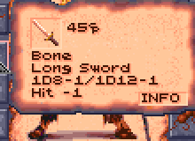

**Always on** (no switch). Rules: [equipment](PLAYER-GUIDE.md#equipment) (every
weapon's dice), [size](PLAYER-GUIDE.md#size). How it works:
[DEVELOPMENT-RULES.md](https://github.com/daaki85/darksun-obsidian-edition/blob/main/obsidian-edition/DEVELOPMENT-RULES.md#creature-size)
(and where the dice come from).

**In Wake of the Ravager:** yes, by the sequel's own table of sizes ([its creatures](CREATURES.md#wake-of-the-ravager)).

#### Held targets

A Paralyzed or Out Cold creature is hit automatically by every blow, shot or throw, a natural 1 too,
for normal damage, as the Player's Handbook has it, both ways; the game rolled the d20 as ever and
doubled the damage ([helpless targets take
double](HOW-THE-GAME-WORKS.md#helpless-targets-take-double)). A Mirror Image can still take the
blow.

**Always on** (no switch). Rules: [hitting](PLAYER-GUIDE.md#hitting). How
it works:
[DEVELOPMENT-RULES.md](https://github.com/daaki85/darksun-obsidian-edition/blob/main/obsidian-edition/DEVELOPMENT-RULES.md#held-targets).

**In Wake of the Ravager:** yes.

#### Rings and cloaks of protection

The mod's two rings and cloak of protection ([new items](#new-items)), +1 to AC and saves, follow
AD&D's rules: two rings don't add up, a ring gives no AC with magical armour, and a cloak does
nothing with magical or metal armour or a shield.

**Always on** (no switch). Rules:
[protection](PLAYER-GUIDE.md#protection). How it works:
[DEVELOPMENT-RULES.md](https://github.com/daaki85/darksun-obsidian-edition/blob/main/obsidian-edition/DEVELOPMENT-RULES.md#rings-and-cloaks-of-protection).

**In Wake of the Ravager:** yes.

#### Helms give AC 1

The game's helms count as armour but give AC 0; with the rule every helm gives 1, the game's and the
mod's, shown on View Character, the inventory and as `AC BONUS:1` in a helm's box.

**Switch:** *Helms give AC 1 (the game's helms give none)*. Rules: [armour](PLAYER-GUIDE.md#armour),
the helms in [Items](ITEMS.md#head). How it works:
[DEVELOPMENT-RULES.md](https://github.com/daaki85/darksun-obsidian-edition/blob/main/obsidian-edition/DEVELOPMENT-RULES.md#helms-give-ac-1).

**In Wake of the Ravager:** yes, with the same switch.

#### Items saving against acid

The Rampager's acid and the Babau's corroding touch destroy worn armour, or a held weapon, without a
magical power outright in the game, plus or no plus. With the rule each item needs the easier of the game's number
and AD&D's saving throw against acid by its material, less its plus (leather armour goes from 0% to
55%), so no item is worse off. The dice log shows every check.

**Always on** (no switch). Rules: [acid](PLAYER-GUIDE.md#acid); every item's chance,
[items against acid](ITEMS.md#items-against-acid). How it works:
[DEVELOPMENT-RULES.md](https://github.com/daaki85/darksun-obsidian-edition/blob/main/obsidian-edition/DEVELOPMENT-RULES.md#items-saving-against-acid).

**In Wake of the Ravager:** yes.

### Magic

#### Rangers' casting level

A ranger's spells last and do damage as cast at its level less 7, as the spell levels it may cast
already count it (a 9th-level ranger's Protection from Evil lasts 6 rounds, not 27); the game took
the whole ranger level. The Seeker and Justifier take off 5 and 9 instead.

**Always on** (no switch). Rules: [how spells work](PLAYER-GUIDE.md#how-spells-work). How it works:
[DEVELOPMENT-RULES.md](https://github.com/daaki85/darksun-obsidian-edition/blob/main/obsidian-edition/DEVELOPMENT-RULES.md#rangers-casting-level).

**In Wake of the Ravager:** yes.

#### Preservers' INT

AD&D's table for INT holds: a chance to learn each spell from a scroll (35% at INT 9 to 100% at 24;
a failed roll uses the scroll up) and a most of each spell level known (6 at INT 9 to all from 19).
The game let a preserver learn any spell from any scroll, and know them all.

**Always on** (no switch). Rules: [learning preserver
spells](PLAYER-GUIDE.md#learning-preserver-spells). How it works:
[DEVELOPMENT-RULES.md](https://github.com/daaki85/darksun-obsidian-edition/blob/main/obsidian-edition/DEVELOPMENT-RULES.md#preservers-int).

**In Wake of the Ravager:** yes.

#### Spells saved against with the spell save

This goes with [DEX instead of a doubled
d20](#fire-cold-and-electricity-dex-instead-of-a-doubled-d20). Almost every spell is saved against
with the spell save, where the game used petrification/polymorph; those marked for
paralysis/poison/death (the poison clouds, Poison, Slay Living, the psionic attacks) keep it, as in
AD&D. The dice log and the Spells tab name the save used.

**Always on** (no switch). Rules: [saving
throws](PLAYER-GUIDE.md#saving-throws). How it works:
[DEVELOPMENT-RULES.md](https://github.com/daaki85/darksun-obsidian-edition/blob/main/obsidian-edition/DEVELOPMENT-RULES.md#spells-saved-against-with-the-spell-save).

**In Wake of the Ravager:** yes: the sequel's own rule already.

#### Fire, cold and electricity: DEX instead of a doubled d20

The game doubles the save's d20 against these spells (and nine monsters' attacks), so most creatures
shrug off a Fireball. With the mod DEX's defensive adjustment is added instead, as AD&D does
for what can be dodged: 35% to save a Fireball at DEX 12, where the doubled d20 gave 70%, and 60% at
DEX 21 (`+5 DEX 21 dodging`). Rules: [saving throws](PLAYER-GUIDE.md#saving-throws) (the table). How
it works:
[DEVELOPMENT-RULES.md](https://github.com/daaki85/darksun-obsidian-edition/blob/main/obsidian-edition/DEVELOPMENT-RULES.md#fire-cold-and-electricity-dex-instead-of-a-doubled-d20).

**In Wake of the Ravager:** yes.

#### Enlarge multiplies the weapon's dice only

Only the weapon's dice grow, 10% a caster level, rounded up, and STR, the weapon's plus and the rest
are added after, as the Player's Handbook (p. 173) has it; the game multiplied the whole hit,
rounded down. With [creature size](#creature-size) an Enlarged creature also counts as large.

```
Gerakis hits Screamer Beetle for 21: 1d8 = [4] -1 bone +2 specialized +3 Wild Fighting +12 STR 24 +1 Enlarge (the dice 4 x110% = 5, level 1)
```

**Always on** (no switch). Rules: [how spells work](PLAYER-GUIDE.md#how-spells-work). How
it works:
[DEVELOPMENT-RULES.md](https://github.com/daaki85/darksun-obsidian-edition/blob/main/obsidian-edition/DEVELOPMENT-RULES.md#enlarge-multiplies-the-weapons-dice-only).

**In Wake of the Ravager:** yes.

#### Spells and psionics as the manual describes them

Twenty-four spells and two psionic powers whose saves, times, damage or effects part from the manual
are set as it has them (the mod's Cat's Grace by the Tome of Magic's dice); a priest's **Turn
Undead** goes by AD&D's turning table, turned undead fleeing; a classless monster saves by its hit
dice, not as level 0; and seven monsters get a power the manual gives them or lose one it doesn't
(the shadows drain STR, the Styr breathes fire, the Djinn turns invisible...). "Can't save" now
failing is [a bug fixed](GAME-BUGS.md#spells-and-psionics).

**Always on** (no switch). Rules: [spells and psionics as
the manual describes them](HOW-THE-GAME-WORKS.md#spells-and-psionics-as-the-manual-describes-them)
(every spell and monster it changes, and what is left as it is), [AD&D's turning
table](HOW-THE-GAME-WORKS.md#adds-turning-table). How it works:
[DEVELOPMENT-RULES.md](https://github.com/daaki85/darksun-obsidian-edition/blob/main/obsidian-edition/DEVELOPMENT-RULES.md#spells-and-psionics-as-the-manual-describes-them).

**In Wake of the Ravager:** yes, for the spells and powers the two games share, and Turn Undead; the monsters' powers are Shattered Lands' monsters'.

#### Spells roll to hit

Missile spells (Acid Arrow as if fired by a fighter of the caster's level, Turn Pebble to Boulder,
Magical Stone, Condense, Minute Meteors' globes, monsters' spines) and touch spells on a foe (Chill
Touch, Shocking Grasp, Vampiric Touch, the Cause spells, Poison) roll a d20 against the target's AC
as a weapon does, and a miss does nothing. The game landed them all, every time. Magic Missile,
Flame Arrow, areas, cones and psionic powers are left as they are.

**Always on** (no switch). Rules: [how spells work](PLAYER-GUIDE.md#how-spells-work). How it works:
[DEVELOPMENT-RULES.md](https://github.com/daaki85/darksun-obsidian-edition/blob/main/obsidian-edition/DEVELOPMENT-RULES.md#spells-roll-to-hit).

**In Wake of the Ravager:** yes.

#### Resting as in AD&D

The game's rest fills every member's hit points ([how the game
rests](HOW-THE-GAME-WORKS.md#resting)). With the rule the priests first spend the spells they have
left on the party (Neutralize Poison, Cure Blindness, Cure Disease, then the cures on the most
wounded), the psionicists their Cell Adjustment, and then each member heals **3 hit points plus
CON's bonus**: a middle way between AD&D's night and the game's full heal. Slots and PSP still fill.

**Always on** (no switch). Rules:
[resting](PLAYER-GUIDE.md#resting). How it works:
[DEVELOPMENT-RULES.md](https://github.com/daaki85/darksun-obsidian-edition/blob/main/obsidian-edition/DEVELOPMENT-RULES.md#resting-as-in-add).

**In Wake of the Ravager:** yes.

## More character customization

More choices for each character. [Kits](#kits) and [fuller starting gear](#fuller-starting-gear)
have switches, in the Options tab's **More character customization** section; [weapon
specialization](#weapon-specialization) and [STORE and RECALL](#store-and-recall-on-the-creation-screen)
are always on. The picks every new character makes at DONE are [always on](#preservers-first-spells)
too.

### Weapon specialization

Fighters, gladiators and rangers train in chosen weapon specs, as in AD&D: a fighter specializes in
one, on to mastery at 5th level and grand mastery at 9th; a gladiator in two, then more; a ranger
has expertise in one and the bow; three kits take expertise and the Swashbuckler a weapon of choice.
With a chosen weapon spec a warrior keeps the game's attacks a round and shoots faster, with any
other AD&D's plain rate. Each picks after DONE and starts with a plain weapon of its pick.

**Always on** (no switch). Rules: [Weapon
specs](WEAPON-SPECS.md). How it works:
[DEVELOPMENT-RULES.md](https://github.com/daaki85/darksun-obsidian-edition/blob/main/obsidian-edition/DEVELOPMENT-RULES.md#weapon-specialization).

**In Wake of the Ravager:** yes ([In Wake of the Ravager](WEAPON-SPECS.md#in-wake-of-the-ravager)).

### Kits

A character may take a kit when it is made, on the creation panel's **KIT** page: three for each
class, and thirteen for one race's pair or set of classes (the Battle Dancer, Spellarcher, Wild
Fury...), each giving something and costing something. A human with no kit may take one for its new
class right after **DUAL**.

**Switch:** *Kits: three for each class and some for multiclass characters, one a character, each
giving something and costing something (chosen on the creation panel's KIT page, or after DUAL by a
human with none)*. Rules: [Kits](KITS.md), [choosing one](KITS.md#choosing-a-kit), [changing
class](KITS.md#changing-class). How it works:
[DEVELOPMENT-KITS.md](https://github.com/daaki85/darksun-obsidian-edition/blob/main/obsidian-edition/DEVELOPMENT-KITS.md).

**In Wake of the Ravager:** nearly all, kit by kit in [In Wake of the Ravager](KITS.md#in-wake-of-the-ravager).

### STORE and RECALL on the creation screen

**STORE**, under the hit points, keeps the roll on screen (the scores, the die's total, hit points,
PSP and age), and **RECALL** brings it back however many times the die has been rolled since, as in
Baldur's Gate. Changing the race, sex, classes or kit forgets it.


**Always on** (no switch). Rules: [ability scores](PLAYER-GUIDE.md#ability-scores). How
it works:
[DEVELOPMENT-RULES.md](https://github.com/daaki85/darksun-obsidian-edition/blob/main/obsidian-edition/DEVELOPMENT-RULES.md#store-and-recall-on-the-creation-screen).

**In Wake of the Ravager:** yes.

### Fuller starting gear

A new character also gets a weapon in hand it can use, a sling (a Battle Dancer a bow and arrows),
leather armour where it may wear it, and a Stalker, Assassin or Shinobi a cloak to hide in; never
what it can't use or already has, and nothing for a thri-kreen (`Swat starts with more gear: Short
Sword (in hand), Arm Armor, Leg Armor`).

**Switch:** *Fuller starting gear: new characters (and the game's own party) also get a weapon they
can use, a sling, and leather armour where they may wear it*. Rules: [the
classes](PLAYER-GUIDE.md#the-classes) (each class's gear), [starting gear](KITS.md#starting-gear).
How it works:
[DEVELOPMENT-RULES.md](https://github.com/daaki85/darksun-obsidian-edition/blob/main/obsidian-edition/DEVELOPMENT-RULES.md#fuller-starting-gear).

**In Wake of the Ravager:** yes, from the sequel's own items ([how](RAVAGER.md#the-mod-in-the-sequel)).

### The game's own party

START GAME with no party made plays the game's own four, made before these choices existed. The
Loader fits them to weapon specialization and class restrictions (always on), and to kits and
fuller starting gear when those are on, in the first moments of a new game, and says so in the dice
log:

| Character | Weapon specialization | Class restrictions | With kits |
|---|---|---|---|
| **Gerakis**, half-giant gladiator | specializes in the long sword and the gythka; with [half-giants' two-handed weapons](#half-giants-two-handed-weapons), his club is a bone gythka, a two-handed weapon beside his long sword | | **Wild Fighting**, as a [Wild Fury](KITS.md#multiclass-kits) has it, as each fight starts |
| **K'ratchek**, thri-kreen fighter, druid and psionicist | specializes in the chatkcha, her only weapon | | casts and uses psionics as a [Wasteland Seer](KITS.md#multiclass-kits) does (druid spells 2 levels higher under the open sky, 1 lower under a roof; psionic powers 2 PSP less under the open sky, 1 more under a roof); her chatkcha's one throw more a round is every thri-kreen's (5/2 a round, specialized; [Weapon specialization](WEAPON-SPECS.md)), not hers alone |
| **Cermak**, human preserver, once a gladiator | specializes in the long sword and the axe, which count once his gladiator levels do again (when his preserver level passes them) | | an **Arcanist**, the kit of his preserver class: his preserver spells cast a level higher |
| **Cilla**, elf preserver, druid and thief | | no leather armour (a druid wears none), and she knows the **Armor** spell in its place | an **Elven Shadow-walker** (her own feature): her [hiding in shadows](#hiding-in-shadows-to-backstab) is never halved in daylight |

The features are their own, not kits', and show where kits do. Cermak keeps his gear and hit points
(the Arcanist's d3 counts from his next level); with fuller starting gear Gerakis gets a sling and
leather chest and leg armour, the others nothing more. Cermak and Cilla keep the game's starting
spells. Cilla is drawn as the elf she is: [elves and half-elves](#elves-and-half-elves).

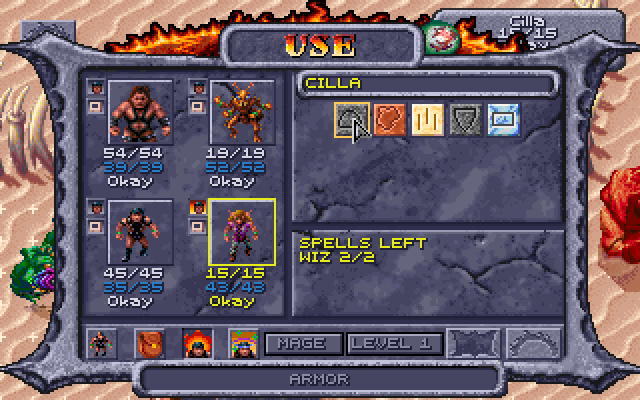

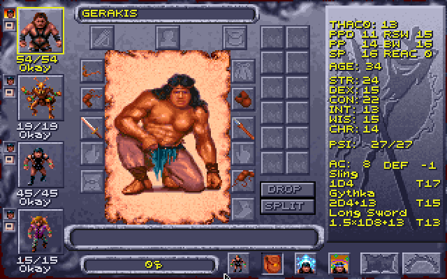

How it works:
[DEVELOPMENT-RULES.md](https://github.com/daaki85/darksun-obsidian-edition/blob/main/obsidian-edition/DEVELOPMENT-RULES.md#the-games-own-party).

**In Wake of the Ravager:** the sequel's own party gets the same: [the sequel's own party](RAVAGER.md#the-sequels-own-party).

## New content

*Spoilers, mild: the people and scenes are told in full, with spoilers, in [People](PEOPLE.md), and
where each item is in [Items](ITEMS.md).*

Spells, people, a quest, an arena bout and items the mod adds, in the Options tab's **New content**
section. The people, the quest, the bout and the items count from the next start, in places not yet
visited (a saved game keeps what it already has: people met, items given); the new spells and the
defilers' scrolls at once.

### New wizard spells

Six wizard spells from AD&D's *Spells & Magic*, the *Player's Handbook* and the Dark Sun books,
added to the game's own 69 and learnt as any is (at a level up, as starting spells, or from a
scroll), with their own icons, descriptions, sounds and Effects screen entries. A Shinobi can learn
Fogbolt, Reflected Image, Spook and Friends.

| Spell | Level | Does |
|---|---|---|
| **Cat's Grace** | 2 | DEX up by a die, as Strength does for STR, an hour a caster level |
| **Erdlu Claw** | 1 | unarmed attacks (a thri-kreen's claws) 1d6+1, +1 to hit, a +1 magical edged weapon |
| **Fogbolt** | 1 | a grey bolt of fog: −3 to the target's attacks, +2 to attacks on it, 2d4 rounds |
| **Reflected Image** | 1 | one image of the caster, struck half the time instead of it |
| **Spook** | 1 | one creature flees for 3 rounds, its save worse as the caster rises |
| **Friends** | 1 | CHA + 2d4 for a short while: lower shop prices |

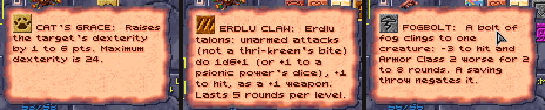

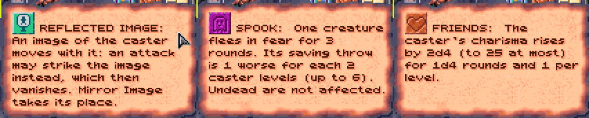

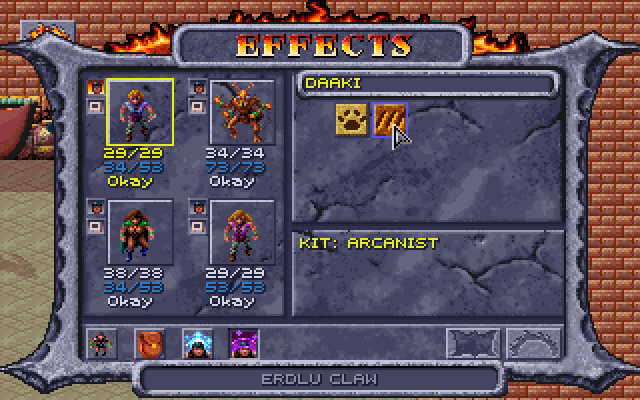

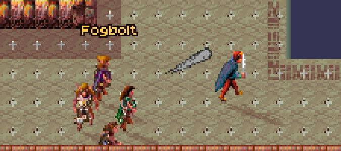

**Switch:** *New spells: six for wizards (Cat's Grace, Erdlu Claw, Fogbolt, Reflected Image, Spook
and Friends) and ten 6th-level priest spells (Heal, Harm, Blade Barrier...)*. Rules: [how spells
work](PLAYER-GUIDE.md#how-spells-work) (each spell in full), [spell
lists](PLAYER-GUIDE.md#spell-lists). How it works:
[DEVELOPMENT-CONTENT.md](https://github.com/daaki85/darksun-obsidian-edition/blob/main/obsidian-edition/DEVELOPMENT-CONTENT.md#new-spells-wizard-and-6th-level-priest).

**In Wake of the Ravager:** yes, with spellbooks at Notaku's ([the mod's gear](RAVAGER.md#the-mods-gear-in-the-sequel)).

### 6th-level priest spells

Ten 6th-level priest spells, after AD&D's and Wake of the Ravager's, with the same switch: Heal,
Harm and Restore Youth for druids and a Healer cleric (never Harm for a Healer), and each element's
for its clerics and druids (Blade Barrier and Whirlwind for air, Wall of Thorns and Heartseeker for
earth, Sunstroke and Fire Seeds for fire, Heartseeker and Water of Life for water). A cleric or
druid gets them at 11th level, with [AD&D's class tables](#adds-class-tables) (one 6th-level slot at
11th, two at 12th: only a druid reaches it). Each is built on a spell the game has, so the game's
own code casts it; where they part from the books is in the player's guide. Their icons and the walls' pictures are Wake of the Ravager's, read from your copy ([Wake of
the Ravager](#wake-of-the-ravager)); Restore Youth, which it hasn't, has the mod's own.

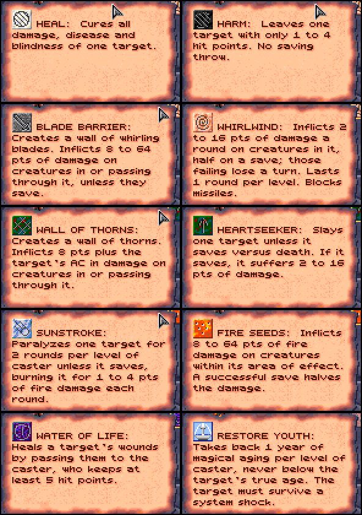

Rules: [how spells work](PLAYER-GUIDE.md#how-spells-work) (each spell), [spell
lists](PLAYER-GUIDE.md#spell-lists), [ages](PLAYER-GUIDE.md#ages) (Restore Youth). How it works:
[DEVELOPMENT-CONTENT.md](https://github.com/daaki85/darksun-obsidian-edition/blob/main/obsidian-edition/DEVELOPMENT-CONTENT.md#new-spells-wizard-and-6th-level-priest).

**In Wake of the Ravager:** the sequel's own 6th-level priest spells; Restore Youth and the mod's Whirlwind and Sunstroke not yet ([the sequel's gaps](RAVAGER.md#not-in-the-sequel-yet)).

### Kalzith

A defiler slave in a pen of his own in the slave pens, there the first time the party enters them,
with a face of his own. Talked to with respect, he sells six scrolls of spells the game has no
scroll of, and what he wears; threatened, he must be won back. The story: [People:
Kalzith](PEOPLE.md#kalzith) (spoilers).

**Switch:** *Kalzith, a defiler slave in the slave pens who sells arcane scrolls*. How it works:
[DEVELOPMENT-CONTENT.md](https://github.com/daaki85/darksun-obsidian-edition/blob/main/obsidian-edition/DEVELOPMENT-CONTENT.md#kalzith).

**In Wake of the Ravager:** no: Shattered Lands' story only.

### Semyon

The arena's tied-up prisoner, once freed, helped and gone from the arena, is in a pen of his own in
the slave pens, with things to say; and a party that breaks out with Scar takes him along. Dinos and
the Trustee are asked about both new people. The story: [People: Semyon](PEOPLE.md#semyon) and [what
Dinos and the Trustee say](PEOPLE.md#what-dinos-and-the-trustee-say-about-them) (spoilers).

**Switch:** *Semyon in the slave pens after he leaves the arena, and breaking out with Scar*. How it
works:
[DEVELOPMENT-CONTENT.md](https://github.com/daaki85/darksun-obsidian-edition/blob/main/obsidian-edition/DEVELOPMENT-CONTENT.md#semyon).

**In Wake of the Ravager:** no: Shattered Lands' story only.

### The cooked vulture

The arena's vulture, plucked and cooked at the pens' campfire, is no use in the game; with the
switch Dinos cooks it for the party: 100 XP each and a full rest. The scene: [People: the cooked
vulture](PEOPLE.md#the-cooked-vulture) (spoilers).

**Switch:** *The cooked vulture: Dinos cooks it for the party (XP and a full rest)*. How it works:
[DEVELOPMENT-CONTENT.md](https://github.com/daaki85/darksun-obsidian-edition/blob/main/obsidian-edition/DEVELOPMENT-CONTENT.md#the-cooked-vulture).

**In Wake of the Ravager:** no: Shattered Lands' story only.

### Defilers' scrolls

A defiler may carry a spell scroll it was studying: each defiler in a fight has a 1 in 20 chance of
carrying a scroll of a random preserver spell (the game's 69, and the new ones with the new spells
on), found on its body when it dies. The defilers are those the game makes defilers, on either side:
Balkazar, Wyrmias, Tara, the Troop Leader, the arena's Defiler, the Dark Spiders and the Spider
Mother, the Hermit, and the thri-kreen Click-tunk!, Churr-te-tunk! and Cheee-smak-tunk!; Kalzith
keeps his own. It is the game's own kind of scroll (3,000 a spell level to sell). Each defiler is
rolled for once a fight, the arena's later ones too; a fight played again from a save is a new
chance, and a game saved mid-fight keeps the scroll given. The dice log doesn't show the roll.

**Switch:** *Defilers' scrolls: a defiler in a fight carries a scroll of a random preserver spell
one time in 20, dropped where it dies*. Rules: [learning preserver
spells](PLAYER-GUIDE.md#learning-preserver-spells). How it works:
[DEVELOPMENT-CONTENT.md](https://github.com/daaki85/darksun-obsidian-edition/blob/main/obsidian-edition/DEVELOPMENT-CONTENT.md#defilers-scrolls).

**In Wake of the Ravager:** not yet ([the sequel's gaps](RAVAGER.md#not-in-the-sequel-yet)).

### New items

Items the game never had, or never placed: weapons of every type in more materials (short swords,
bone and obsidian axes and great axes, metal and obsidian cahulaks...), twenty-two magic weapons
(Shadowseeker, Kreenfang, Thornwall, Emberlash, Ironwhirl...), the rest of the bone scale set with a
Bone Helm, rings and a cloak of protection, bracers of defense, two robes, the Warden's Plate, the
Boots of Speed, the Cloak and Boots of Elvenkind and more, on the game's people, in its shops and
chests; and six of Wake of the Ravager's weapons the game has none of (a two-handed sword, the
lotulis, double spear and trikal, the javelin and darts) in the shops of Teaquetzl and Kel's
caravan and on people of the like (the arena's gladiators, one of Scar's henchmen, the Drajian Guards,
the Silt Runners, the White Sand Outlaws, Teaquetzl's Village Heroes and Elite Guards: [the
table](ITEMS.md)), each with a [weapon spec](WEAPON-SPECS.md) of its own: three of them in metal too (a two-handed
sword and a lotulis at Melkor's in Gedron, a javelin on the slave pens' weapon rack), an obsidian
lotulis for fire clerics and a bone great sword for water clerics (at Melkor's too), and magic ones
along the way through the game, the weaker early (Darts +1 on the arena's defiler champion; a Double
Spear +1 at the Fields' gate, a Trikal +1 with the elven slavers, a Lotulis +1 at the Hot Springs, a
Javelin +1 with the Silt Sea's ssurans, a Lotulis +2 in the Lower Castle, a Great Sword +2 in the
Upper Castle, a Trikal +2 at the way into the Wyrm Belly, a Double Spear +2 at the gladiators' camp,
a Great Sword +3 in Balkazar's treasure room; an Obsidian Lotulis +1 on Dagger, the White Sand
Outlaws' chief, and a Bone Great Sword +1 on Dakaren at the Silt Sea). Those carried by one of a group are given to one
person there, an object of their own in the Loader's copy of the region, so they show only in a
region the party hasn't yet entered in that game. People who fought bare-handed carry what the armed of their kind do. All but the arena's
ring and Thornwall (which the Loader hands over itself, while it runs) are written into the game's
own data each time the Loader starts it, so the game makes them with their people and chests and
then keeps and saves them like its own. A thief can [lift](#picking-pockets) Pehtucl's ring,
Shadowseeker, Gutterknot and Mindshard.

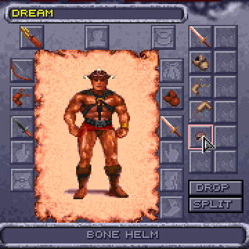

**Switch:** *New items, magical and mundane: weapons, armour and other gear on the game's people, in
its shops and chests, and the champions' arena bout after Scar's death*. Rules: [new
items](PLAYER-GUIDE.md#new-items) (what each is, spoiler-free), [magic weapons by
class](PLAYER-GUIDE.md#magic-weapons-by-class); where each is, its numbers and its price,
[Items](ITEMS.md) (spoilers), [the mod's new items](ITEMS.md#the-mods-new-items), [Pehtucl's
chest](ITEMS.md#pehtucls-chest). How it works:
[DEVELOPMENT-CONTENT.md](https://github.com/daaki85/darksun-obsidian-edition/blob/main/obsidian-edition/DEVELOPMENT-CONTENT.md#new-items).

**In Wake of the Ravager:** the mod's weapons and Bone Helm in its shops and on its people ([the mod's gear](RAVAGER.md#the-mods-gear-in-the-sequel)); the rest come with a party taken across.

### The champions' bout

With the new items: kill Scar in the arena, and on the party's next visit six champions from a
distant arena, led by a Tohr-kreen with Kreenfang, come to try the pens' new king, armed and
armoured as the party is. It comes once. The bout: [People: the champions'
bout](PEOPLE.md#the-champions-bout) (spoilers). How it works:
[DEVELOPMENT-CONTENT.md](https://github.com/daaki85/darksun-obsidian-edition/blob/main/obsidian-edition/DEVELOPMENT-CONTENT.md#the-champions-bout).

**In Wake of the Ravager:** no: Shattered Lands' story only.

## Game speed

The Loader's two speeds give DOSBox more of the computer's time than GOG's settings (7,000 cycles a
millisecond) and run it DOSBox's faster way, which costs the computer less. In the game everything on
the map moves a step at each tick of its clock, 96 a second, but a tick that passes while a picture
is being drawn is a step lost: the more there is to draw (the whole party, shadows and dust), the
slower everyone walks ([how fast the party walks](HOW-THE-GAME-WORKS.md#how-fast-the-party-walks)).
**Steady pace** counts the steps lost on the map and, while more are lost than the unmodded game's
pictures lose, leaves the next picture undrawn rather than the party slowed: a quick computer sees
every picture, a busy screen fewer pictures. Fights draw every frame. At the default 35,000 cycles
nearly every picture is drawn either way.

**Switches** (Game speed, from the next start): *GOG's own (walking can be choppy with shadows and
dust)* (7,000 cycles), *Faster: for an older PC (fewer pictures a second with the whole party in
view)* (20,000) or *Fastest: the whole party walks at full speed, nearly every picture shown (the
default)* (35,000); and *Steady pace: walking at full speed on the map whatever is drawn (a picture
skipped rather than the party slowed)*.

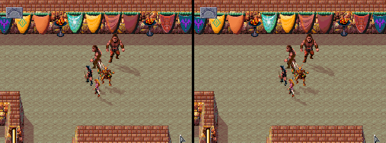

*The same save and the same clicks at 20,000 cycles, recorded at 70 frames a second and played here
at half speed, every frame kept: on the right, with steady pace, the party walks about a tenth
quicker.*

What each speed asks of the computer: [suggested system
requirements](README.md#suggested-system-requirements). How it works, with the measurements:
[DEVELOPMENT-SCREENS.md](https://github.com/daaki85/darksun-obsidian-edition/blob/main/obsidian-edition/DEVELOPMENT-SCREENS.md#game-speed).

**In Wake of the Ravager:** yes, the speeds; steady pace not yet ([the sequel's gaps](RAVAGER.md#not-in-the-sequel-yet)).

## Picture and music

Two choices for DOSBox, in the Options tab's **Picture and music** section, both from the next start.
They hold in either [engine](#the-engine-gogs-dosbox-or-dosbox-x); where DOSBox-X draws or plays them
differently, the engine's table says how.

**Picture**: how DOSBox draws the game's 320x200 picture larger, in a [game
window](README.md#every-time-you-play) of twice the game's size or more and in full screen. A
**Single** window is always plain; the window's size and the pointer's speed are the same with
every picture.

| Picture | What you see |
|---|---|
| **Plain** (the default) | Every pixel of the game as a block of one colour. |
| **Scanlines** | A black line under each row of the picture, as an old monitor showed it. The picture is darker for it: at Double half of it is black, at Triple and in full screen a third. |
| **TV** | Each row fades downwards instead of ending in a black line: softer than scanlines, and darker than plain. |
| **Sharp** | Hard-edged pixels at any size: DOSBox stretches the picture to its window (and to the whole screen in full screen) without smoothing it. Drawn with OpenGL; if your graphics driver doesn't take to that, DOSBox falls back to its plain drawing by itself. |

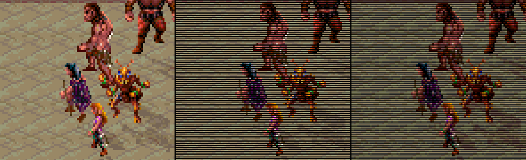

*Plain, Scanlines and TV in a Triple window (a part of it, at its own size). Sharp looks like Plain
at this size.*

DOSBox has Scanlines and TV at twice and three times the game's size only, so a Quadruple window
shows the twice-size one doubled and smoothed, and full screen stretches the three-times one to
your screen (on a screen whose height isn't a multiple of the game's rows the lines can't all be the
same thickness). Sharp is plainest to see at Quadruple and in full screen, where DOSBox smooths the
plain picture as it stretches it.

**Music device**: where DOSBox sends the game's music. The game writes its music as General MIDI
notes, and GOG's DOSBox has no synthesizer of its own: it hands the notes to Windows, which plays
them on its default MIDI device (the "Microsoft GS Wavetable Synth", unless you have set another).
If you have installed another MIDI device (a software synthesizer that plays a soundfont, a driver
that imitates a Roland MT-32, a real sound module on a MIDI port), the list names it and you can
pick it. The Loader comes with none and doesn't change Windows' settings: it only tells DOSBox which
of Windows' devices to use. If the device you chose isn't there the next time (unplugged, or its
program not running), the list says so, and the game would play without music until you choose
again: DOSBox doesn't fall back by itself. The game still sends its General MIDI score whatever
the device (on an MT-32 that is the wrong set of instruments; the game's own MT-32 score is chosen
in its sound setup, which the Loader leaves alone), and sound effects and speech don't go to this
device. Where the Loader can't read Windows' list (it runs on Linux, say, with the game's DOSBox
under Wine), there is a field for the device's number in place of the list, 0 the first; a Linux
DOSBox takes an ALSA port there, such as `128:0`. Empty is the default. The device is for
Shattered Lands only: [Wake of the Ravager](RAVAGER.md)'s music is its CD's audio tracks,
which DOSBox plays itself, so the Loader starts it with the picture and speed chosen here but leaves
its music as it is.

**Switches** (Picture and music, from the next start): *Plain: every pixel of the game as a block
(the default)*, *Scanlines: a black line under each row of the picture, as on an old monitor*, *TV: a
dimmed line under each row of the picture, softer than scanlines* or *Sharp: hard-edged pixels at
any size, the stretching left unsmoothed (DOSBox's OpenGL)*; and *Music device*. How it works:
[DEVELOPMENT-SCREENS.md](https://github.com/daaki85/darksun-obsidian-edition/blob/main/obsidian-edition/DEVELOPMENT-SCREENS.md#picture-and-music).

**In Wake of the Ravager:** the picture, yes; the music device isn't needed (the sequel's music is its CD's audio).

## The engine: GOG's DOSBox or DOSBox-X

The game runs in an emulator of an old PC. GOG's release comes with one, DOSBox 0.74; the mod
runs it in a newer one, [DOSBox-X](https://dosbox-x.com), whenever there is one, and in GOG's
DOSBox otherwise (nothing about that start has changed). **On Windows DOSBox-X comes with the
mod**: the release's `dosbox-x` folder holds DOSBox-X's own 64-bit Windows program, unchanged, with
its licence (it is free software under the GNU GPL, version 2) and `SOURCE.txt`, which says where
its source is (a copy of it is beside the mod's download). **On Linux and macOS** install DOSBox-X
yourself and point the Loader to its program with **Choose the DOSBox-X program...** on the
Options tab's **Engine** section; the tab then says which version it found. It needs **DOSBox-X
2025.01.01 or later**; an older one is refused, with the reason, and isn't used by default. So is
an **OS-free** build (DOSBox-X's downloads with "osfree" in their name, on a release page of their
own): it has no DOS of its own, so it can't run the game. On Windows the right one is
`dosbox-x-vsbuild-win64-VERSION-portable.zip`, its `bin\x64\Release SDL2\dosbox-x.exe`. A
DOSBox-X you choose goes before the one that comes with the mod. To play in GOG's DOSBox, choose it
in the same section. **Wake of the Ravager**, started from the Loader, runs in the same engine: in
DOSBox-X with its CD and its music tracks mounted as in GOG's DOSBox (GOG's `DOSBOX` folder isn't
needed then), or in its own GOG DOSBox when that is the engine.

Why DOSBox-X:

- **More memory for the mod.** The mod's helper in the game, DSCLOG, lives in the PC's *upper
  memory*, a few blocks between the screen's memory and the BIOS. GOG's DOSBox has 128 KB of it;
  DOSBox-X, as the Loader sets it up, 192 KB (its BIOS made smaller), so the helper has about
  64 KB more room to grow into.

- **Linux without root.** The Loader has to read and write the game's memory while it runs. With
  DOSBox 0.74 it does that through DOSBox's process, which on Linux needs root or a system setting
  (`kernel.yama.ptrace_scope=0`), and GOG's DOSBox is a Windows program there besides. DOSBox-X
  can keep the emulated PC's memory in a file, and the Loader follows the game through that file:
  no root, no setting, and **Play Shattered Lands** works on Linux with only the game's folder (GOG's
  `DOSBOX` folder isn't needed with this engine).
- **Music without a synthesizer set up outside.** DOSBox-X has a synthesizer of its own
  (FluidSynth). Give it a soundfont, a `.sf2` file of instrument sounds that you have, with
  **Choose a soundfont file...** in the **Picture and music** section, and it plays the game's
  music through it. The Loader comes with no soundfont. A **Music device** chosen there goes
  before the soundfont; with neither, DOSBox-X uses its own default, which on Linux usually means
  no music.

What stays the same: the saves (a game saved on one engine loads on the other), every feature of
the mod, the Loader's window, the dice log, the game window's four sizes and full screen, the four
pictures and the three game speeds, each set to walk as it does on GOG's DOSBox. What differs:

| | GOG's DOSBox 0.74 | DOSBox-X |
|---|---|---|
| Comes with | the game | the mod, on Windows; elsewhere your own copy, 2025.01.01 or later |
| Upper memory (DSCLOG's room) | 128 KB (D000h-EFFFh) | 192 KB (CC00h-FBFFh) |
| Full screen while playing | Alt+Enter | F12 and F together (F11 and F on Windows) |
| **Plain** at Triple and Quadruple, and **Sharp** | Plain is DOSBox's own drawing; Sharp needs OpenGL | both drawn with OpenGL, and they look alike: every pixel a block |
| **Scanlines** and **TV** at Quadruple | the twice-size picture doubled and smoothed | the twice-size picture doubled, not smoothed |
| Music | Windows' MIDI devices | the same, or its own synthesizer with your soundfont file |
| Screenshots, DOSBox's own keys | DOSBox 0.74's (Ctrl+F5) | DOSBox-X's (its menu is hidden; F12, F11 on Windows, is its key for its own commands) |

**What has and hasn't been tried.** On Linux, with DOSBox-X 2026.10.01, the mod was played
through a fight, quick saves and autosaves, a rest, the walk from the slave pens into the arena
and twenty minutes without a stop. **On Windows it has started**: with the player's own DOSBox-X
the game loads and its music plays (2026-11-27); a fuller play there is under way. **On macOS it
has not been run at all**: the Loader's side is written from DOSBox-X's source, but nobody has
started it there. A
packaged DOSBox-X that runs in a sandbox (a Flatpak, a Snap, the Steam Deck's) may not be able to
reach the Loader's memory file; that is untried too. If it doesn't work for you, choose GOG's
DOSBox. **Restore defaults** takes the choice away again (DOSBox-X whenever there is one) and
remembers where your DOSBox-X is.

**Switches** (Engine, from the next start): *DOSBox-X (the default when there is one: it comes
with the mod on Windows; elsewhere choose your own below)* or *GOG's DOSBox 0.74, which comes with
the game*; the button
**Choose the DOSBox-X program...**; and, under Picture and music, **Choose a soundfont file...**
and **No soundfont**. How it works:
[DEVELOPMENT-SCREENS.md](https://github.com/daaki85/darksun-obsidian-edition/blob/main/obsidian-edition/DEVELOPMENT-SCREENS.md#the-engine-gogs-dosbox-or-dosbox-x).

**In Wake of the Ravager:** yes, the same engine.

## Wake of the Ravager

The [6th-level priest spells](#6th-level-priest-spells) take their icons, and Blade Barrier and Wall
of Thorns their pictures, from your copy of Dark Sun: Wake of the Ravager (GOG sells it with
Shattered Lands), when the Loader finds it, and so do its weapons and the great axes their inventory icons (in the game's colours, each head in its material); without it they have icons of their own (the game's,
recoloured) and the walls are the game's fire wall in grey or dark brown. Fire Seeds bursts as a
fireball either way, a picture Shattered Lands has too. The Options tab's **Wake of the Ravager (optional)** section says where
it was found, and **Choose its folder...** points the Loader to it (from the next start). Rules:
[requirements](README.md#requirements).

The sequel itself starts from the Loader too, with most of the mod, and your Shattered Lands party
can go on into it: [Wake of the Ravager](RAVAGER.md), its own page (starting it, taking the party
across, and the mod's rules, screens and keys there). Each start there converts the sequel's roster and saves
for the mod, a copy of each kept: [your sequel saves are
converted](RAVAGER.md#your-sequel-saves-are-converted) says how to turn them back.

### Taking the party to Wake of the Ravager

The Options tab's **Take the party to Wake of the Ravager...** button puts the party of a Shattered
Lands save into the sequel's roster: [Taking the party to Wake of the
Ravager](RAVAGER.md#taking-the-party-to-wake-of-the-ravager).

## Saves

The Options tab's **Saves** section (quick save and autosave, and the named saves), and the room the Loader makes for more saves and characters
(always on).

### More saves

The game's save and load window holds 10 saves; with the Loader it holds 40, on four pages of ten,
and a fifth page, **QUICK**, that fills itself ([quick save, quick load and
autosave](#quick-save-quick-load-and-autosave)): the **PAGE 1** to **PAGE 4** and **QUICK** buttons
under EXIT, or **PgDn** and **PgUp**, show a page, and the window opens on the page last shown
(never on QUICK by itself). In the load window an empty page shows with **LOAD** greyed.
Page 1 is the game's own `SAVE01.SAV` to `SAVE10.SAV` (in the game folder or GOG's `cloud_saves`);
pages 2 to 4 are `SAVB..`, `SAVC..` and `SAVD..` and the QUICK page `SAVQ..` beside them, which the game started without the
Loader doesn't see.

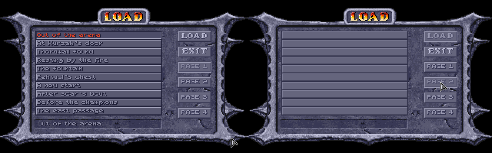

How it works:
[DEVELOPMENT-SCREENS.md](https://github.com/daaki85/darksun-obsidian-edition/blob/main/obsidian-edition/DEVELOPMENT-SCREENS.md#more-saves).

**In Wake of the Ravager:** not yet: the sequel's own ten saves, and the QUICK saves in its own window ([saves in the sequel](RAVAGER.md#saves-in-the-sequel), [the sequel's gaps](RAVAGER.md#not-in-the-sequel-yet)).

### Quick save, quick load and autosave

On the map, **F5** saves the game at once: no window, no name to type. The game stands still for a
third of a second, **Quick save** floats over the leader, and the dice log says which (`Quick save:
"Quick - Day 3, 14:20" (the QUICK page, slot 2)`). **F9** opens the game's own LOAD window on those
saves with the newest chosen: **Enter** (or LOAD) loads it. And the game saves by itself a few
seconds after the party comes into another area (`Auto - Day 1, 16:31 - The arena`) and after a
fight ends (`Auto - Day 1, 00:56 - after a fight`; at most one a minute, so the arena's waves don't
fill the page). An autosave due during a quick save or quick load waits until the game is back on
the map and ready. When the Loader detects a loaded save, it drops any autosave that was waiting.

All of them are on a fifth page of the [save and load window](#more-saves), **QUICK** (the button
under PAGE 4, or PgDn past page 4): its first five rows are the quick saves and the last five the
autosaves. Each kind fills its empty rows and then writes over its oldest, so the last five of each
are kept. They are saves like any other, and load in the game started without the Loader's window
too.

Nothing is saved in a fight (the game itself saves none there: F5 says so in the dice log), nor
while a window, a talk, a screen or a menu is up, where F5 and F9 stay the game's keys; the game's
own F1 (its SAVE window) and F2 (LOAD) work as always. A save you want to keep belongs on pages 1 to
4, where nothing is written over: load the quick save and save it there. For the same reason the
QUICK page's saves are not copied to [Named saves](#saves-under-their-names), and the save and load
windows never open on the QUICK page by themselves: once the window is shut it is back on the page
of 1 to 4 it showed last. With less than 4 MB free on the disk no quick save or autosave is made,
and the dice log says so.

Both are switched on the Options tab's **Saves** section, and take effect at once. With no Loader
window (the dice log run on its own, or the game started without the window), a change to
`autosave` or `quick_save` in `settings.json` is taken within a second, with no restart (the dice
log on its own prints a line saying so).

**Switches:** *Quick save and quick load: on the map, F5 saves at once on the QUICK page of the save
window, and F9 opens the load window there* (off, F5 and F9 are the game's own: F5 draws the view
again, F9 breaks the camp of the game's rest, where the Loader leaves both to the game anyway) and
*Autosave: on coming into another area and after a fight, on the QUICK page of the save window*.
How it works:
[DEVELOPMENT-SCREENS.md](https://github.com/daaki85/darksun-obsidian-edition/blob/main/obsidian-edition/DEVELOPMENT-SCREENS.md#quick-save-quick-load-and-autosave).

**In Wake of the Ravager:** yes, in the sequel's own save window: [saves in the sequel](RAVAGER.md#saves-in-the-sequel).

### Saves under their names

Only the game's list says which file is which save. While the Loader's window is open (not with the
`.bat` files that start the game without it), it copies the manual save slots under the
name you typed for it, into its own **Named saves** folder (`Page 2 slot 05 - Before Scar's
battle.SAV`); saving over a slot replaces that slot's copy. **Open the folder** opens it, and **Put
a save in a slot...** copies a named save (or another Shattered Lands save) into the page and slot you give, asking
first if one is there, and keeps the save it replaces as `Replaced - Page 1 slot 05 - NAME.SAV`.

**Buttons:** *Open the folder*, *Put a save in a slot...* Rules: [compatibility with older
saves](README.md#compatibility-with-older-saves). How it works:
[DEVELOPMENT-SCREENS.md](https://github.com/daaki85/darksun-obsidian-edition/blob/main/obsidian-edition/DEVELOPMENT-SCREENS.md#more-saves)
(saves under their names).

**In Wake of the Ravager:** yes, in a folder of its own: [saves in the sequel](RAVAGER.md#saves-in-the-sequel).

### More characters

The game keeps up to 19 characters made with CREATE CHARACTERS (and those dropped back to the
roster), and refuses a 20th; with the Loader it keeps 29, and the ADD window scrolls through them
all. They are in the game's own `CHARSAVE.GFF`, numbers 1 to 29: the game started without the Loader
reads only 1 to 19, and the others come back with the Loader (the game saves a new character under
the highest free number, so the first ten after the 19th go to 20 to 29). The patched game also
fixes DELETE in a scrolled roster and New characters' thief skills ([bugs
fixed](GAME-BUGS.md#making-and-keeping-characters)). How it works:
[DEVELOPMENT-SCREENS.md](https://github.com/daaki85/darksun-obsidian-edition/blob/main/obsidian-edition/DEVELOPMENT-SCREENS.md#more-characters).

**In Wake of the Ravager:** not needed: the sequel's own roster holds 40.

## Expanded features

New things to do in play, **always on**.

### The leader's CHA at shops

The party leader's CHA lowers what shops ask, 5% from CHA 18 to 40% at 25, and shops pay **60%** of
an item's price, so nothing can be bought and sold back at a profit; the game asked and paid the
full price whoever traded. [Friends](#new-wizard-spells) raises the leader's CHA for a while.

**Always on** (no switch), with [buying back](#buying-back-magical-items). Rules: [ability scores](PLAYER-GUIDE.md#ability-scores) (CHA's
table). How it works:
[DEVELOPMENT-RULES.md](https://github.com/daaki85/darksun-obsidian-edition/blob/main/obsidian-edition/DEVELOPMENT-RULES.md#the-leaders-cha-at-shops).

**In Wake of the Ravager:** yes, a shopkeeper's own discount on top.

### Buying back magical items

The game destroys whatever the party sells. With the mod a magical item sold (a plus or a
power) goes into the merchant's pack, offered at its price less the CHA discount, to be bought back;
anything else is gone. How it works:
[DEVELOPMENT-RULES.md](https://github.com/daaki85/darksun-obsidian-edition/blob/main/obsidian-edition/DEVELOPMENT-RULES.md#buying-back-magical-items).

**In Wake of the Ravager:** yes.

### Improved thieving

Skills by the Player's Handbook's table, hiding and moving silently to backstab (rangers to attack
from behind), a cloak, boots and belt that help, and pockets to pick, all always on. Rules: [thieves' skills and picking
pockets](PLAYER-GUIDE.md#thieves-skills-and-picking-pockets), [hiding in
shadows](PLAYER-GUIDE.md#hiding-in-shadows).

**In Wake of the Ravager:** yes, each part below.

#### Thief skills from AD&D's table

A skill is AD&D's average for the thief level plus the race's and DEX's adjustments, at most 95,
where the game's came out high (a 3rd-level elf with move silently 66). A backstab multiplies the
weapon's dice only, STR and the plus added once after, on the round's first attack. A lock the thief
failed, or a pocket it was caught at, waits for a thief level gained (*Player's Option: Skills &
Powers*); another thief may try at once.

**Always on** (no switch). Rules:
[thieves' skills](PLAYER-GUIDE.md#thieves-skills-and-picking-pockets),
[backstabs](PLAYER-GUIDE.md#from-behind-and-backstabs); the game's, [how the game works out thief
skills](HOW-THE-GAME-WORKS.md#how-the-game-works-out-thief-skills). How it works:
[DEVELOPMENT-RULES.md](https://github.com/daaki85/darksun-obsidian-edition/blob/main/obsidian-edition/DEVELOPMENT-RULES.md#thief-skills-from-adds-table).

**In Wake of the Ravager:** yes.

#### Hiding in shadows to backstab

A thief whose turn comes in a fight with no enemy beside it tries to hide in shadows, then to move
silently; with both, its next attack that turn is from behind, a backstab with a weapon that can.
Thieves' hiding is halved in daylight; rangers hide too, for an attack from behind, halved indoors.
The game never rolled hide in shadows. A worn cloak, boots and belt help.

```
Tezral hides in shadows: d100 = 21, needs 27 or less (54, halved in daylight) -> hidden
  Tezral moves silently: d100 = 30, needs 54 or less -> unheard: their next attack this turn is from behind (a backstab with a weapon that can)
```

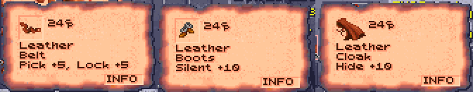

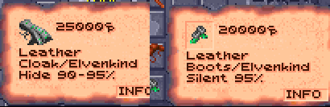

**Always on** (no switch), with what worn gear adds: a cloak 10 to hiding, boots 10 to moving
silently, a belt 5 to picking pockets and opening locks (plain ones cost 24; the [Cloak and Boots of
Elvenkind](ITEMS.md#other-worn-items) do more: [their numbers](PLAYER-GUIDE.md#hiding-in-shadows)). Rules: [hiding in
shadows](PLAYER-GUIDE.md#hiding-in-shadows), the kits that hide their own way in [Kits](KITS.md).
How it works:
[DEVELOPMENT-RULES.md](https://github.com/daaki85/darksun-obsidian-edition/blob/main/obsidian-edition/DEVELOPMENT-RULES.md#hiding-in-shadows-to-backstab).

**In Wake of the Ravager:** yes.

#### Picking pockets

A thief's **Pick Pockets** button (a purse, where a priest's Turn Undead is on the USE screen), then
a click on anyone in sight, not in a fight: made, one small thing goes into its backpack (or coins,
the last try); failed, a move silently roll to slip away, else caught. The game has one pocket to
pick, in the Trustee's talk. Three weapons some people carry are worth 200 XP each to lift. In
[Wake of the Ravager](RAVAGER.md) too.

**Always on** (no switch). Rules: [thieves' skills and picking
pockets](PLAYER-GUIDE.md#thieves-skills-and-picking-pockets). How it works:
[DEVELOPMENT-RULES.md](https://github.com/daaki85/darksun-obsidian-edition/blob/main/obsidian-edition/DEVELOPMENT-RULES.md#picking-pockets).

**In Wake of the Ravager:** yes ([the purse there](RAVAGER.md#the-mod-in-the-sequel)).

## Graphics

What the mod draws on the game's map, **always on**. The magic items' icons and the spells on the ground are [always on](#magic-items-icons) too.

### Elves and half-elves

Elves have pointed ears, walking and fighting, beside any helm. Half-elves have their own look (the
game draws them with the human pictures), from the game's pictures in the colours the party's
figures use: the man built like the elf man, a little broader, fair-haired in a leather jerkin and
green trousers; the woman a little slimmer than the human woman, golden hair in a bun, a purple
cloak and red boots. Anything worn is drawn over these in its own colours. Cilla, in the game's own
party, is an elf the game gives the half-elf woman's figure: with the mod she has the elf
woman's, in a new game and in one already begun (from the next area or load). These are the
figures the [class outfits](#what-the-party-wears) are drawn on: in the party they show bare only
in a class combination outside the outfits' roster, such as Cilla's, an elf with Druid among her
classes. The picture shows them bare, as drawn for the mod.


**Always on** (no switch), both. How it works:
[DEVELOPMENT-CONTENT.md](https://github.com/daaki85/darksun-obsidian-edition/blob/main/obsidian-edition/DEVELOPMENT-CONTENT.md#elves-and-half-elves).

**In Wake of the Ravager:** the sequel's own figures, [redrawn in Shattered Lands' style](RAVAGER.md#the-mod-in-the-sequel).

### What the party wears

**Class outfits.** Each party member is dressed for their class before any gear goes on: humans in the
outfit of their class (the mage in a plum mantle, the thief hooded, the psionicist in teal),
dwarves, elves, half-elves, half-giants, halflings and the mul in an outfit for their whole class
combination. Each half-elf has 48 outfits, including the Cleric/Preserver’s cream and plum robe.
The thri-kreen and combinations outside the outfit roster, such as an elf with Druid among her
classes, keep the game's own figure. The creation screen's small figure wears the outfit
of the class (or classes) picked, and changes as the class, race or sex does. The outfits were drawn for the mod on the game's own figures and poses: [every outfit,
animated online](https://github.com/daaki85/darksun-obsidian-edition/blob/7a0b6200b0c218f7a27ccc4b0c3fece7cdf59fe4/obsidian-edition/docs/class-outfits/README.md).

The game draws each race and sex the same whatever they carry; the Loader keeps the outfit (or, outside
the outfits, the artist's picture) and adds the gear, frame by frame, walking and fighting, changing as
soon as the gear does:

| Worn | Shown |
|---|---|
| **Weapons and shields** | each weapon type its shape (dagger, sword, club, mace, axe, polearm, gythka, staff, a round shield; Wake of the Ravager's kinds as the nearest: a two-handed sword a sword, a lotulis a gythka, a double spear a staff, a trikal a polearm, a javelin or darts a chatkcha) in its material's colours (wood, ivory bone, stone, obsidian, metal); worn at the belt or carried upright while walking, in the hands and swung in a fight, the shield on the arm |
| **Bows and slings** | the bow and quiver on the back (the game draws the bow when shooting), a sling or chatkcha at the hip |
| **Armour** | on a class outfit, the outfit's own chest, arm and leg regions painted in the armour's material (plate fitted to the body); outside the outfits, the character's own clothing recoloured toward its material, shade for shade: the chest piece above the waist, arm pieces at the wrists, leg pieces below the waist; on figures drawn mostly bare (the mul, the dwarf man) only straps and loincloth, so little shows |
| **Helms** | a circlet at the brow: a feather on leather, a dark stone on iron, low spikes on bone |
| **Cloaks** | on a class outfit, the outfit's own mantle or hood, or a cape fitted to it, in the cloak's colours; outside the outfits, the human woman's cloak, fitted to the wearer, under the hair; from the front it hangs behind |
| **Boots and belts** | the feet and the waist recoloured (Boots of Elvenkind in soft green) |
| **Magic** | the spells' weapons whole in the game's animated colours (Flame Blade, Shillelagh, Spiritual Hammer); any other magic weapon or shield glints along its edge, and magic armour, cloaks, helms, boots and belts have a scatter of sparks, in its icon's colour |
| **Age** | the hair greys with [age](#ages-and-magical-aging) |

A thri-kreen shows only weapons and shields; two party members of the same race and sex each show
their own. New outfits go into room the game's picture store already has, so gear can be changed as
often as you like in one area (without that, 30 to 60 changes filled the store and figures vanished
until the next area; [the game's own limit of 300 picture slots](GAME-BUGS.md#pictures-and-memory)
is a bug mended apart). The outfits and the gear keep their colours in every area (each area's own
palette would turn the outfits' browns grey and their plums magenta).


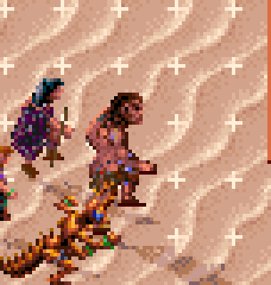

**Always on** (no switch). How it works:
[DEVELOPMENT-CONTENT.md](https://github.com/daaki85/darksun-obsidian-edition/blob/main/obsidian-edition/DEVELOPMENT-CONTENT.md#what-the-party-wears)
(and where the picture store can't be reached, on Dark Sun Recompiled).

**In Wake of the Ravager:** not yet ([the sequel's gaps](RAVAGER.md#not-in-the-sequel-yet)).

### Shadows

Every living figure on the map (the party, the people, the monsters; not the dead, nor items) casts
a soft see-through shadow on the floor, its outline laid long toward the lower right, as the walls'
own shadows fall. They are drawn on the floor first, so a shadow never covers a figure or a wall.

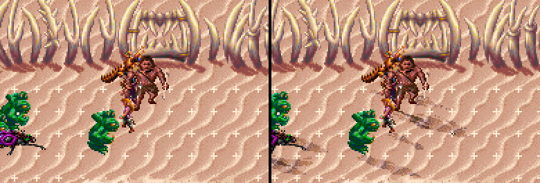

**Always on** (no switch). How it works:
[DEVELOPMENT-CONTENT.md](https://github.com/daaki85/darksun-obsidian-edition/blob/main/obsidian-edition/DEVELOPMENT-CONTENT.md#shadows).

**In Wake of the Ravager:** yes.

### Dust

Anyone walking on sand or dirt raises little puffs of dust behind their feet, which spread, rise a
little and fade in about a second, behind the walls and figures.

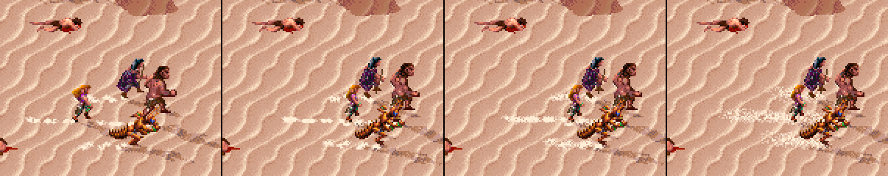

**Always on** (no switch). How it works:
[DEVELOPMENT-CONTENT.md](https://github.com/daaki85/darksun-obsidian-edition/blob/main/obsidian-edition/DEVELOPMENT-CONTENT.md#dust).

**In Wake of the Ravager:** yes.

### See-through figures

A thief or ranger [hidden in shadows](#hiding-in-shadows-to-backstab) and unheard in a fight, and
anyone invisible (the Invisibility spells; among the game's foes only the psurlons), is drawn half
see-through, the floor, a wall or a shadow showing through. The hidden thief turns solid with the
attack that gives it away, or as the turn ends. An invisible enemy is drawn solid while one of the
party detects invisibility (the spell, or [Shadowseeker](ITEMS.md#every-magic-item) readied). The
game draws the invisible like anyone else; being unseen only makes them harder to hit (4 worse) and
better at saving against a spell aimed at them, for whoever can't detect invisibility.

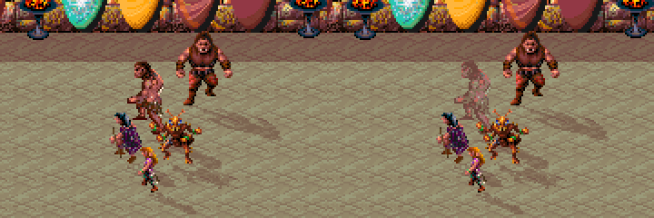

**Always on** (no switch). How it works:
[DEVELOPMENT-CONTENT.md](https://github.com/daaki85/darksun-obsidian-edition/blob/main/obsidian-edition/DEVELOPMENT-CONTENT.md#see-through-figures).

**In Wake of the Ravager:** yes.

## Controls

The mouse and keys in the game, **always on** (the red ring's choice is in the Options tab's **In
the game** section). The keys T, S, M, U and I are [always
on](#looting-a-body-t-and-shiftt) too.

### Choosing an enemy: Tab, Enter and the rings

In a fight, on a party member's turn, **Tab** chooses an enemy, the nearest first, then the next
(**Shift+Tab** goes back): a red ring on the ground marks it, the view scrolls to it if it is out of
sight, and the log names it. **Enter** then attacks it, as clicking on it does (walking up first
when it is out of reach), even where another figure stands in front of it: attacking without aiming
the mouse at all.

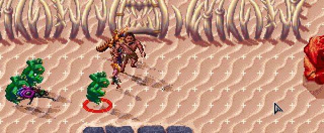

**Always on** (no switch); the ring has a choice in the tab's **In the game** section: *A red
ring on the ground in a fight:* *... none* or *... under the enemy chosen with Tab* (the default). How it works:
[DEVELOPMENT-SCREENS.md](https://github.com/daaki85/darksun-obsidian-edition/blob/main/obsidian-edition/DEVELOPMENT-SCREENS.md#choosing-an-enemy-tab-enter-and-the-rings).

**In Wake of the Ravager:** yes.

### Scrolling the map

Press the mouse wheel on the map and move the mouse: the map moves with the pointer, as if dragged,
in fights too. The game still scrolls when the pointer touches the screen's edge, and brings the
view back to whoever's turn it is. The view can't be zoomed: the game draws a 320 by 200 screen at
one scale, built into its drawing code.

**Always on** (no switch). How it works:
[DEVELOPMENT-SCREENS.md](https://github.com/daaki85/darksun-obsidian-edition/blob/main/obsidian-edition/DEVELOPMENT-SCREENS.md#scrolling-the-map).

**In Wake of the Ravager:** not yet ([the sequel's gaps](RAVAGER.md#not-in-the-sequel-yet)).

### The view in fights

The game moved the view after a figure walking in a fight as soon as it came near the screen's edge,
a step at a time, so the view drifted after every figure that walked. Now it moves only once the
figure has walked off the screen, to bring it back. Out of fights the view follows the party as the
game has it.

**Always on** (no switch). How it works:
[DEVELOPMENT-SCREENS.md](https://github.com/daaki85/darksun-obsidian-edition/blob/main/obsidian-edition/DEVELOPMENT-SCREENS.md#the-view-in-fights).

**In Wake of the Ravager:** not yet ([the sequel's gaps](RAVAGER.md#not-in-the-sequel-yet)).

### The pointer in scenes, and where it starts

The game shows no pointer in its intro and other scenes (the logos, the king's decree, the arena
gate), and only a key skips them; now the game's own pointer follows the mouse there, and a click
skips a scene as a key does (between a scene's steps, so a long still picture plays to its end). The
game also left the pointer at the screen's right edge, moving half as far up and down as across; now
it starts in the middle, stays where you leave it from one screen to the next, moves as far each
way, and in a window as fast as your desktop's pointer, fine enough to place an item where you mean.

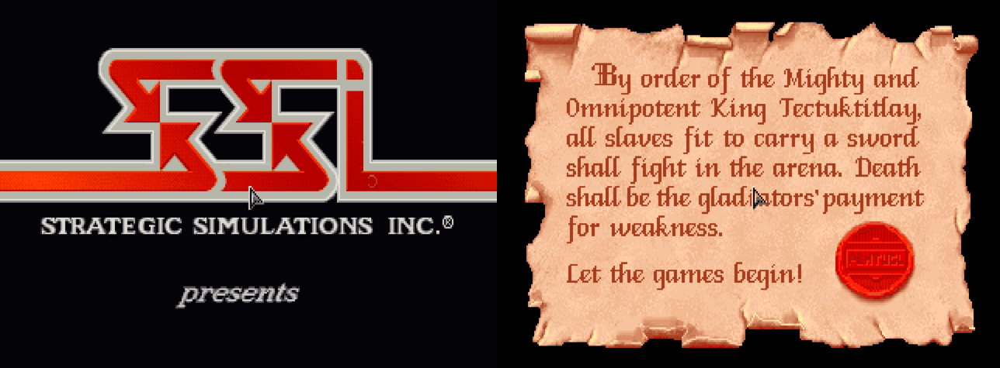

**Always on** (no switch), both. How it works:
[DEVELOPMENT-SCREENS.md](https://github.com/daaki85/darksun-obsidian-edition/blob/main/obsidian-edition/DEVELOPMENT-SCREENS.md#the-pointer-in-scenes-and-where-it-starts).

**In Wake of the Ravager:** not yet ([the sequel's gaps](RAVAGER.md#not-in-the-sequel-yet)).

### The whole party in view

The game shows the party on the map as one figure, the leader, until you press **5**, and gathers it
back after every fight and in saves made that way. With the mod a game starts and loads with the
whole party in view, and stays so after a fight. **6** still gathers the party into the leader,
until the next fight or load.

**Always on** (no switch). How it works:
[DEVELOPMENT-SCREENS.md](https://github.com/daaki85/darksun-obsidian-edition/blob/main/obsidian-edition/DEVELOPMENT-SCREENS.md#the-whole-party-in-view).

**In Wake of the Ravager:** not yet ([the sequel's gaps](RAVAGER.md#not-in-the-sequel-yet)).

### Spells on the Effects screen

On the Effects screen, a click on an effect's icon ends it in the game, so a stray click loses a
spell. With the mod a click leaves a spell on; a psionic power still ends, as that is how a power
is stopped. What else the screen shows: [the Effects screen](#the-effects-screen).

**Always on** (no switch). How it works:
[DEVELOPMENT-SCREENS.md](https://github.com/daaki85/darksun-obsidian-edition/blob/main/obsidian-edition/DEVELOPMENT-SCREENS.md#spells-on-the-effects-screen).

**In Wake of the Ravager:** yes.

## Always on

What the mod does with no switch, in games started from the Loader or its `.bat` files: more on the
game's own screens, in its own lettering and windows; the picks at creation; its keys (T, S, M, U and I); the magic
items' icons and the spells on the ground; and the game's bugs mended. Elsewhere: the
[two-weapon](#two-weapons) penalties, the pick's [footman's dice](#creature-size) and [Legcrusher at
the fountain](GAME-BUGS.md#scripts-that-stuck-or-ran-twice).

These are always on too, each in its own entry above: [the combat
log in the game](#the-combat-log-in-the-game), most [rule changes](#rule-changes) (all but hit dice,
half-giants' two-handed weapons and helms' AC), [weapon specialization](#weapon-specialization),
[STORE and RECALL](#store-and-recall-on-the-creation-screen), and all of [expanded
features](#expanded-features), [graphics](#graphics) and [controls](#controls) (the red ring keeps
its choice).

### THAC0, saves and thief skills

The inventory screen's right-hand panel shows, in the game's own lettering: above STR the **THAC0**
and the five **saving throws** (`PPD`, `RSW`, `PP`, `BW`, `SP`); each weapon's THAC0 at the end of
its damage line (`T14`); for a character with thief levels six **thief skills** (`PICK`, `LOCK`,
`TRAP`, `SLNT`, `HIDE`, `CLMB`), and for a ranger its `SLNT` and `HIDE`; DEX's
**reaction adjustment** (`REAC +4`) and **defensive adjustment** (`DEF -5`); and with
[ages](#ages-and-magical-aging) the **AGE**. **View Character** gets the saves under the item icons,
and **MOVE** and **THAC0** beside HP and PSI. For a character of several classes, its experience
line names the class that goes up next (`EXP:87230 (90000 Pr)`).

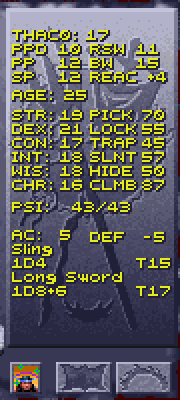

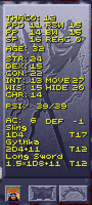

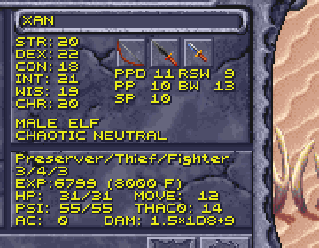

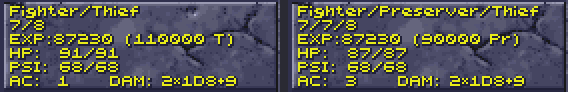

They are the numbers as they stand, worked out as the game's own attack and saving throw routines
do, and brought up to date each time the screen is drawn (a spell that starts or ends shows the next
time the screen opens):

- **THAC0**: the classes' best (a kit's warrior THAC0 with its chosen weapon) less STR's to-hit
  adjustment (DEX's for a missile weapon), the weapon's plus or its material's penalty, its weapon
  spec's to-hit, a kit's, the two-weapon penalty for the hand, Bless and Prayer, Curse, Slow and
  Graft Weapon. The THAC0 at the top is the main weapon's. What depends on the target (from behind,
  a Blurred target) is left out; the dice log shows it on each attack.
- **Saves**: the d20 each needs, less what the game adds to every save (rings and the cloak of
  protection, Bless, Prayer, Barkskin, Spirit Armor but on PPD, the Save penalty, and on PPD CON's
  adjustment). What depends on the spell or its caster (WIS against mind spells, Protection from
  Fire...) is left out; they show between 2 and 20.
- **Thief skills**: as they stand, with no equipment penalty ([how the game works them
  out](HOW-THE-GAME-WORKS.md#how-the-game-works-out-thief-skills)), at most 95, 0 for a skill an
  effect rules out or when the thief isn't Okay, 100 for one an effect makes certain; a worn belt's
  5 and, with hiding, a cloak's and boots' 10 included. The situation's bonus (a hard lock) is
  left out. Hear noise and read languages are left out for want of room.
- **REAC**: −6 at DEX 1 to +5 at 24-25, the number initiative uses and the [two-weapon
  rule](#two-weapons) adds. **DEF**: +5 at DEX 1 to −6 at 24-25, counted in AC already, and the
  other way round on saves against what can be dodged.
- **The next level's class**: each class is its first letter (C, D, F, G, R, T), the preserver's Pr
  and the psionicist's Ps; two that go up at the same XP are both named (`(20000 Pr/T)`), and a class
  at its highest level never is. A character of one class, or a human, shows the line as the game
  has it.

The Characters tab shows the same THAC0 and saves; without the Loader the game's own numbers come
back. How it works:
[DEVELOPMENT-SCREENS.md](https://github.com/daaki85/darksun-obsidian-edition/blob/main/obsidian-edition/DEVELOPMENT-SCREENS.md#thac0-saves-and-thief-skills).

**In Wake of the Ravager:** yes.

### The creation screen

Beside the game's own scores and hit points the character creation screen shows: **THAC0** right of
the hit points (`THAC0: M18 R19`, melee with STR's to-hit adjustment and ranged with DEX's, as the
classes and kit stand, no weapon counted), so a click on STR or DEX shows at once what it does;
**AGE** under it ([ages](#ages-and-magical-aging)); **SUM** under CHR ([scores as
rolled](#scores-and-hit-points-as-rolled)); **STORE** and **RECALL**
([above](#store-and-recall-on-the-creation-screen), with its picture); and **KITS** at the end of
the disciplines' or spheres' panel ([choosing a kit](KITS.md#choosing-a-kit)). After DONE comes the
weapon window for a warrior's weapon specs ([choosing at
creation](WEAPON-SPECS.md#choosing-at-creation)). How it works:
[DEVELOPMENT-SCREENS.md](https://github.com/daaki85/darksun-obsidian-edition/blob/main/obsidian-edition/DEVELOPMENT-SCREENS.md#the-creation-screen).

**In Wake of the Ravager:** yes.

### Spell slots on the USE screen

The USE screen shows, at the top of the panel under the spells, how many spells of the level on show
the selected character can still cast and the most after resting, for the list on show: `SPELLS
LEFT`, then `WIZ` on the MAGE list or `PRI` on the CLERIC list, as `left/most` (`PRI 3/5`). The
numbers are the Characters tab's, WIS bonus included; they go down as spells are cast and back up
after resting. A preserver in armour reads `NO SPELLS IN ARMOUR` instead.

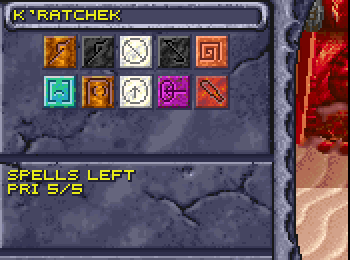

Rules: [spell slots](PLAYER-GUIDE.md#spell-slots). How it works:
[DEVELOPMENT-SCREENS.md](https://github.com/daaki85/darksun-obsidian-edition/blob/main/obsidian-edition/DEVELOPMENT-SCREENS.md#spell-slots-on-the-use-screen).

**In Wake of the Ravager:** yes.

### Charges in item boxes

An item that casts a spell with charges (the wands, the Storm Ring, the necklaces) shows how many it
has left in its item box (right-click it on the inventory screen), counting down as it's used. A
cloak's, boots' or belt's box shows what it adds to thief skills. A plain weapon of a weaker
material shows its to-hit penalty ("Hit -3" wood, "Hit -1" bone, "Hit -2" stone and obsidian; not
for clubs, staves or the chatkcha, nor metal or a weapon with a plus), and the Spellarcher's Fine
Bow "Hit +1".

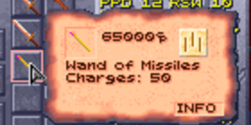

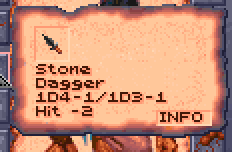

Rules: [weaker materials](PLAYER-GUIDE.md#what-each-class-may-use). How it works:
[DEVELOPMENT-SCREENS.md](https://github.com/daaki85/darksun-obsidian-edition/blob/main/obsidian-edition/DEVELOPMENT-SCREENS.md#charges-in-item-boxes).

**In Wake of the Ravager:** yes.

### The Effects screen

The Effects screen (Current Spell Effects) shows more in its lower panel and under the pointer:

- **Kits and weapon specs**: each kit (`KIT: RAVAGER`; the game's own party's features with no
  prefix, `SHADOW-WALKER`), a Shinobi's chance to read a scroll (`READ LANG. 35%`), then the weapon
  specs, a page at a time ([changing class](KITS.md#changing-class) has pictures).
- **Charges left**, with the pointer on a spell that lasts a number of uses: IMPROVED AC (4 CHARGES)
  for Armor, MIRROR IMAGES (3 CHARGES), REFLECTED IMAGE (2 CHARGES). In Wake of the Ravager the
  effect's own name carries them (ARMOR (14 CHARGES)); an item's power, which the game gives a stray
  count, shows none there either; Reflected Image's Mirror Images take its name there too (REFLECTED
  IMAGE (1 CHARGE)), and the Enlarge and armour spells' lines below are the same.
- **Enlarge's damage**: ENLARGED (+90% DICE) from a 9th-level caster ([the
  rule](#enlarge-multiplies-the-weapons-dice-only)). The inventory's
  damage doesn't count it; each hit's dice log line does. A second Enlarge on someone enlarged adds
  nothing.
- **The armour spells' AC**: BARKSKIN (AC 3) from a 12th-level druid (Barkskin 6 less a quarter of
  the level, Flesh Armor 10 less the psionicist level, Magical Vestments 5, 1 better for each 3
  levels above 5); armour already better is kept.
- A click on a spell's icon no longer ends it: [spells on the Effects
  screen](#spells-on-the-effects-screen).

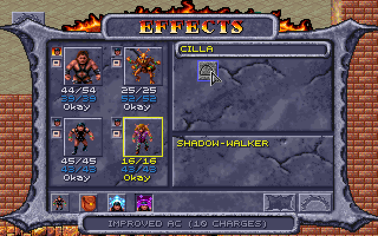

How it works:
[DEVELOPMENT-CONTENT.md](https://github.com/daaki85/darksun-obsidian-edition/blob/main/obsidian-edition/DEVELOPMENT-CONTENT.md#the-games-spells).

**In Wake of the Ravager:** yes.

### What a scroll says

Clicking a scroll's spell icon in its item box gives the result on the line under the paper doll:
YOU LEARN THE SPELL, YOU ALREADY KNOW THIS SPELL, YOU FAIL TO LEARN THE SPELL, TOO MANY SPELLS OF
THAT LEVEL, or a Shinobi's YOU CAN NOT READ THE SCROLL and THAT IS NOT A SHINOBI SPELL. The game
wrote these there too, but they never reached the screen. In Wake of the Ravager the same messages
come up in the game's own message box over the inventory, for a few seconds. How it works:
[DEVELOPMENT-RULES.md](https://github.com/daaki85/darksun-obsidian-edition/blob/main/obsidian-edition/DEVELOPMENT-RULES.md#preservers-int).

**In Wake of the Ravager:** yes, and the sequel's messages stay on screen ([how](RAVAGER.md#the-mod-in-the-sequel)).

### No manual check

The game's copy protection is gone: leaving the sewers the first time, the game has a dragon ask for
a word from the manual, and three wrong answers kill the party. Started from the Loader, the dragon
doesn't come, and the game goes on as if it had been answered. How it works:
[DEVELOPMENT-SCREENS.md](https://github.com/daaki85/darksun-obsidian-edition/blob/main/obsidian-edition/DEVELOPMENT-SCREENS.md#no-manual-check).

**In Wake of the Ravager:** yes, the sequel's own check gone too.

### Preservers' first spells

A new preserver picks its starting spells on the game's **CHOOSE A SPELL** window when **DONE** is
clicked, where the game handed out Grease and Magic Missile (and more at higher starting levels):
two 1st-level spells at 1st level, four at 2nd, four 1st-level and two 2nd-level at 3rd; a
multiclass preserver too, and a [Scholar](KITS.md#preserver-kits) one more each level. A human who
becomes a preserver picks its first two the same way. **EXIT** (twice) ends the picking, the rest
being the game's own in its order; the character is already saved, so EXIT can't take you back.
Rules: [the preserver](PLAYER-GUIDE.md#preserver), [learning preserver spells](PLAYER-GUIDE.md#learning-preserver-spells). How it works:
[DEVELOPMENT-RULES.md](https://github.com/daaki85/darksun-obsidian-edition/blob/main/obsidian-edition/DEVELOPMENT-RULES.md#preservers-first-spells).

**In Wake of the Ravager:** yes, for the sequel's own grants ([how](RAVAGER.md#the-mod-in-the-sequel)).

### Psionic powers at creation

Every new character picks its psionic powers at **DONE**, on the game's **PICK A PSIONIC POWER**
window, where the game always handed out the same ones: anyone not a psionicist picks **four** of
its chosen discipline's, a psionicist as many as the game gave for its starting level (4 at 1st, 5
at 2nd, 10 at 3rd) from all three. Everyone still knows **Mind Blank**. **EXIT** (twice) leaves the
rest to the game's own; **EDIT** on a member that keeps its classes, race, kit and discipline keeps
its powers, and the game's own party keeps the game's. Rules: [the psionicist](PLAYER-GUIDE.md#psionicist), [psionics](PLAYER-GUIDE.md#psionics).
How it works:
[DEVELOPMENT-RULES.md](https://github.com/daaki85/darksun-obsidian-edition/blob/main/obsidian-edition/DEVELOPMENT-RULES.md#psionic-powers-at-creation).

**In Wake of the Ravager:** yes ([how](RAVAGER.md#the-mod-in-the-sequel)).

### Looting a body: T and Shift+T

With a body's (or a chest's) window open, **T** takes everything in it and **Shift+T** everything
but plain weapons (no plus and no power). Each thing goes into the first backpack, in the party's
order, with a free cell; what doesn't fit stays, and so do the plain weapons for Shift+T (press T to
take them too). The purse jingles and the dice log says who took what (`Lex takes Slavepen key,
Grapes, Guava (4), Obsidian Bloodwrath +1`). *Without the mod:* two clicks a thing, a body at a
time. How it works:
[DEVELOPMENT-SCREENS.md](https://github.com/daaki85/darksun-obsidian-edition/blob/main/obsidian-edition/DEVELOPMENT-SCREENS.md#looting-a-body-t-and-shiftt).

**In Wake of the Ravager:** yes.

### Selling plain gear: S

On a shop's screen, **S** sells everything plain in the backpack of the party member on show:
weapons, armour, shields and clothing with no plus and no magic. What the member wears or holds
stays, and so do ammunition, anything of metal, magic, keys, scrolls, food, water, gems and what the
shop won't buy. Each thing fetches what the shop would pay for it alone (60% with [shops as in
AD&D](#the-leaders-cha-at-shops)); the shop closes back to the merchant's talk and the dice log
lists the sale (`Gerakis sells 9 things for 95 ceramic pieces: Wooden Club 1, Bone Axe 4, ...`). How
it works:
[DEVELOPMENT-SCREENS.md](https://github.com/daaki85/darksun-obsidian-edition/blob/main/obsidian-edition/DEVELOPMENT-SCREENS.md#selling-plain-gear-s).

**In Wake of the Ravager:** yes.

### M, U and I: open a screen, close it again

**M** on the map opens the overhead map, as the game's **O** does, and **M** again closes it. **U**
and **I** open the USE and inventory screens and close them when pressed a second time; **U** on the
inventory, or **I** on USE, switches to the other, as in the game. How it works:
[DEVELOPMENT-SCREENS.md](https://github.com/daaki85/darksun-obsidian-edition/blob/main/obsidian-edition/DEVELOPMENT-SCREENS.md#m-u-and-i-open-a-screen-close-it-again).

**In Wake of the Ravager:** yes (M is the sequel's own overhead map).

### Magic items' icons

The game makes most of its magic items' icons shine in the inventory, a shop and on the ground, but
left some still. The Loader gives 20 of them the shine of the others: the Parting Staff, the
Chameleon Gloves, the Hornblade, the Cahulaks +1 (now Legcrusher's), Dag's Dagger, the Terror Blade,
Blackmace, the Shimmer, Drake and Silk Armor, Tanelyv's three pieces, Grey's arm and leg pieces, the Living
Cloak, the Golden Torque, Light of Dawn, El's Ring and the Orb of Knowledge (the three that shared a
plain item's picture get one of their own; the Silk Armor and the Living Cloak shimmer green). The
Loader's own magic items shine too, a magic weapon in the fire's colours as the game's own unless
its story calls for another the game animates: water's blue (Stillwater, Hayneedle), the air's
white and blue (Windlash, Galefang, Skycutter), violet (Mindshard) or green (Greenbright). How it works:
[DEVELOPMENT-CONTENT.md](https://github.com/daaki85/darksun-obsidian-edition/blob/main/obsidian-edition/DEVELOPMENT-CONTENT.md#new-items).

**In Wake of the Ravager:** yes, in its shops too.

### Spells on the ground

With the new spells, the [6th-level priest spells](#6th-level-priest-spells) that stay on the map
have pictures of their own: Blade Barrier's ring of circling blades and Wall of Thorns' tangle
(from [Wake of the Ravager](#wake-of-the-ravager); without it, the game's fire wall recoloured),
Fire Seeds' burst, and Whirlwind's funnel of dust, which turns as you watch.

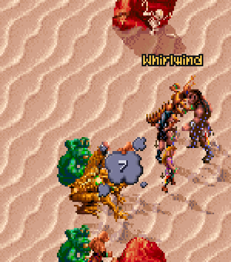

How it works:
[DEVELOPMENT-CONTENT.md](https://github.com/daaki85/darksun-obsidian-edition/blob/main/obsidian-edition/DEVELOPMENT-CONTENT.md#new-spells-wizard-and-6th-level-priest).

**In Wake of the Ravager:** the sequel's own pictures for its own spells; Whirlwind's funnel not yet.

### The game's bugs, fixed

The patched game also mends dozens of the game's own bugs, whatever the Options tab says: spells
that never did what they say, fights, screens, and people and quests that could stall. They have a
page of their own, grouped by kind: [The game's bugs, fixed](GAME-BUGS.md) (some spoilers).

With the game's people wearing their weapons and armour from the start (one of those fixes: [who
turns up](GAME-BUGS.md#who-turns-up-and-how)), the mod also puts on what else they carry to wear: a
cloak, a belt, boots, an amulet and up to two rings, which the game never did. Each counts by the
same rules as the party's.

**In Wake of the Ravager:** most: [in Wake of the Ravager](GAME-BUGS.md#in-wake-of-the-ravager).
