# Features and rules

*Part of Obsidian Edition's documentation, from the [README](README.md). The
[player's guide](PLAYER-GUIDE.md) tells the same without the detail.*

Everything the mod changes and adds in the game, in the order of the Loader's
Options tab, each with its switch there; the game's bugs fixed come last. A
switch's name here in bold (**Rangers' casting level**) is the short form of the
sentence the Options tab gives it, in the same section and order. How each is
done is in [DEVELOPMENT.md](DEVELOPMENT.md#how-each-part-works).

## Contents

- [Rule changes](#rule-changes)
  - [Class restrictions](#class-restrictions)
  - [Multiclass hit points](#multiclass-hit-points)
  - [Hit dice: the better of two](#hit-dice-the-better-of-two)
  - [Scores and hit points as rolled](#scores-and-hit-points-as-rolled)
  - [Rangers' casting level](#rangers-casting-level)
  - [Preservers' INT](#preservers-int)
  - [AD&D's class tables](#adds-class-tables)
  - [Spells saved against with the spell
    save](#spells-saved-against-with-the-spell-save)
  - [Fire, cold and electricity: DEX instead of a doubled
    d20](#fire-cold-and-electricity-dex-instead-of-a-doubled-d20)
  - [Two weapons](#two-weapons)
  - [Items saving against acid](#items-saving-against-acid)
  - [Rings and cloaks of protection](#rings-and-cloaks-of-protection)
  - [Half-giants' two-handed weapons](#half-giants-two-handed-weapons)
  - [Helms](#helms)
- [More character customization](#more-character-customization)
  - [Weapon specialization](#weapon-specialization)
  - [Kits](#kits) (a page of its own: [Kits](KITS.md))
  - [Level cap by XP](#level-cap-by-xp)
  - [STORE and RECALL on the creation
    screen](#store-and-recall-on-the-creation-screen)
  - [Fuller starting gear](#fuller-starting-gear)
  - [Preservers' first spells](#preservers-first-spells)
  - [The game's own party](#the-games-own-party)
- [Expanded features](#expanded-features)
  - [The leader's CHA at shops](#the-leaders-cha-at-shops)
  - [Buying back magical items](#buying-back-magical-items)
  - [Improved thieving](#improved-thieving)
    - [Thief skills from AD&D's table](#thief-skills-from-adds-table)
    - [Hiding in shadows to backstab](#hiding-in-shadows-to-backstab)
    - [Picking pockets](#picking-pockets)
- [New content](#new-content)
  - [New wizard spells](#new-wizard-spells)
  - [6th-level priest spells](#6th-level-priest-spells)
  - [New items](#new-items)
    - [Bracers of defense](#bracers-of-defense)
    - [Robes](#robes)
  - [New people](#new-people)
    - [Kalzith](#kalzith)
    - [Semyon](#semyon)
    - [What Dinos and the Trustee say about
      them](#what-dinos-and-the-trustee-say-about-them)
  - [The cooked vulture](#the-cooked-vulture)
  - [Defilers' scrolls](#defilers-scrolls)
- [Graphics](#graphics)
  - [Elves and half-elves](#elves-and-half-elves)
  - [What the party wears](#what-the-party-wears)
  - [Shadows](#shadows)
  - [Dust](#dust)
  - [Magic items' icons](#magic-items-icons)
  - [Spells on the ground](#spells-on-the-ground)
- [Controls](#controls)
  - [Choosing an enemy: Tab, Enter and the
    rings](#choosing-an-enemy-tab-enter-and-the-rings)
  - [Scrolling the map](#scrolling-the-map)
  - [M, U and I: open a screen, close it again](#m-u-and-i-open-a-screen-close-it-again)
  - [The whole party in view](#the-whole-party-in-view)
  - [The view in fights](#the-view-in-fights)
  - [The pointer in scenes, and where it
    starts](#the-pointer-in-scenes-and-where-it-starts)
- [More saves and characters](#more-saves-and-characters)
  - [More saves](#more-saves)
    - [Saves under their names](#saves-under-their-names)
  - [More characters](#more-characters)
- [Game speed](#game-speed)
- [The game's bugs, fixed](#the-games-bugs-fixed)
  - [Spells on the Effects screen](#spells-on-the-effects-screen)
  - [Rules the game got wrong](#rules-the-game-got-wrong)

## Rule changes

Fourteen changes that bring the game's own rules closer to AD&D, each with its
own box in the Options tab's **Rule changes** section. All are on by default,
and they take effect in games started from the Loader or its `.bat` files
(**Play Dark Sun (in-game rolls)** uses the Options as last set). Untick one
and the game's own rule is back at once.
[How the game works](HOW-THE-GAME-WORKS.md) has what the game does without them.

| Rule | What it changes |
|---|---|
| [Class restrictions](#class-restrictions) | each class's limits on armour, shields and weapons hold, the strictest winning; a multiclass preserver casts no spells in armour, and a thief with another class has no thief skills in armour that isn't light |
| [Multiclass hit points](#multiclass-hit-points) | CON's bonus on every hit die (a warrior's for a character with a warrior class), the total shared between the classes |
| [Hit dice: the better of two](#hit-dice-the-better-of-two) | each hit die rolled twice, the better kept, for every character |
| [Scores and hit points as rolled](#scores-and-hit-points-as-rolled) | on the creation screen, a click raises a score only while the six add up to no more than the die gave (lower one to raise another), and doesn't change the hit points |
| [Rangers' casting level](#rangers-casting-level) | a ranger's spells last and do damage as cast at its level less 7, as the spell levels it may cast already count it |
| [Preservers' INT](#preservers-int) | INT gives a preserver a chance to learn a spell from a scroll, and the most spells of each spell level it may know |
| [AD&D's class tables](#adds-class-tables) | the XP for each level, priests' THAC0, and clerics', druids' and preservers' spell slots from AD&D's tables |
| [Spells saved against with the spell save](#spells-saved-against-with-the-spell-save) | the spell save rather than petrification/polymorph |
| [Fire, cold and electricity: DEX instead of a doubled d20](#fire-cold-and-electricity-dex-instead-of-a-doubled-d20) | DEX's defensive adjustment on those saves rather than a doubled d20 |
| [Two weapons](#two-weapons) | −2 main hand, −4 off hand, DEX's reaction adjustment added; rangers none in light armour; the off hand attacks once a round |
| [Items saving against acid](#items-saving-against-acid) | an item the acid or corroding touch could destroy needs the easier of the game's number and AD&D's save by material, a plus helping |
| [Rings and cloaks of protection](#rings-and-cloaks-of-protection) | two rings don't add up, a ring gives no AC with magical armour, a cloak does nothing with magical or metal armour or a shield |
| [Half-giants' two-handed weapons](#half-giants-two-handed-weapons) | a half-giant wields a two-handed weapon in one hand |
| [Helms give AC 1](#helms) | the game's helms give AC 1 rather than 0 |

### Class restrictions

With **Class restrictions** ticked, a character's classes keep it from
armour, shields and weapons as in AD&D, the strictest class winning. The game
checks only that one of the character's classes may use an item; with the rule
the others must allow it too, and putting on what one forbids gets the game's
own "Cannot use this item":

| Class | Armour and helms | Shields | Weapons |
|---|---|---|---|
| **Psionicist**, whatever its other classes | light only (leather, hide, silk: Drake, Shimmer and Silk Armor) | leather only, and only with a fighter, gladiator, ranger or cleric class (the game's lists give a psionicist none, and a psionicist/thief none either) | daggers, short swords, maces, clubs, chatkchas, bows and slings, of those its classes' lists allow: alone, daggers, bone and obsidian short swords, clubs, chatkchas and bows (the game's lists leave out maces, slings and the metal short sword, and the rule takes away the axes, picks, gythka and long swords they allow) |
| **Thief** | light only; a multiclass thief, or a human thief once a warrior or cleric, as its other class allows, but no thief skills in armour that isn't light | leather ones; a multiclass thief only if another of its classes allows shields (a fighter, gladiator, ranger or cleric) | as its classes allow |
| **Preserver**, one class | none (a human preserver once a warrior: as the warrior could, but no spells in armour) | none | as the game has it |
| **Druid** | none | none | any |
| **Cleric** | any | any | its sphere's: air missile and thrown weapons and daggers; earth stone, obsidian, metal and wood; fire obsidian; water bone and wood |

A thief of any kind holds only leather shields, the rule or not: the game's own
lists leave thieves out of the wooden shield, and the mod's metal one.

A **multiclass preserver** may wear what its other classes allow, but casts no
spells (wizard or priest) while wearing armour (a helm counts, a shield
doesn't), as the game's own "No spell use" stops them. The **USE** screen
heads its spell slots **NO SPELLS IN ARMOUR**, and the Characters tab adds
"(no spells in armour)" to them. So does a human who has been a preserver and a
fighter, gladiator or ranger, in either order: it may wear what the warrior
could, and casts no spells in armour.

A **multiclass thief** (a fighter/thief, a cleric/thief), or a human thief who
was a fighter, gladiator, ranger or cleric, may wear the armour its other class
allows; in armour that isn't light, every **thief skill is 0** (the inventory
screen's PICK to CLMB, the Characters tab's "none in armour that isn't light")
and it can't **backstab** (nor hide in shadows to backstab). A human warrior who
was a thief is the same. The Assassin, Shinobi, Shadowblade, Poisoner and
Spellarcher wear light armour only, even while a human's kit is asleep after
a change of class ([Kits](KITS.md)).

A human who has changed class is held by the class it has now; another race by
all of its classes. A ranger turned cleric uses both spheres' weapons, and a
warrior who dual-classed uses the weapons it specialized in once the new
class's level passes the old (a fighter's, gladiator's or ranger's chosen
weapon specs, and a ranger's bow). A ranger's bow is always its own: a fire
ranger/cleric, whose fire sphere allows only obsidian weapons, may still use
bows. Cloaks, the Cloak of Protection among them, aren't armour: any class may
wear one.

A new character starts without the weapons, armour and shields its classes
can't use. The game gives a character of several classes one class's gear, the
first of fighter or ranger, cleric, thief, psionicist, preserver and druid,
and puts what it may not wear in the backpack: the Loader leaves that behind
and says so in the dice log
(`Yilballa's Chest Armor is left behind: their classes can't use it`, for a
fighter/druid's leather armour, given for its fighter class). A character left
without a weapon this way (a thief/psionicist loses its long sword) gets one
it can use with [Fuller starting gear](#fuller-starting-gear).

How it works: [DEVELOPMENT.md](DEVELOPMENT.md#class-restrictions).

### Multiclass hit points

With **Multiclass hit points** ticked, a character of more than one class
gets its hit points as *Demihuman Deities* (TSR, 1998) sets out AD&D's rule
for multiclassed characters: every hit die it rolls, at creation and at each
level, gets CON's bonus, goes into a running total, and the total divided by
the number of classes (dropping fractions) is its most hit points. CON's
bonus is a warrior's (+3 at CON 17, +4 at 18 and so on) on every die if one
of its classes is a fighter, gladiator or ranger, as a "warrior character";
otherwise at most +2. Dice stop as usual after 9th or 10th level, and so
does CON's bonus.

The game already keeps the total and divides it, but gives CON's bonus only
once a level of the character's highest class, whole: a preserver 5 / thief 6
with CON 18 gets 2 × 11 dice / 2 = 11 hit points from CON with the rule,
rather than the game's 2 × 6 = 12. A human who dual-classes isn't affected
(one class at a time). Ticked during a game, a character's most hit points
change at its next level, when the game works them out again. The log shows
the bonus on each die:

```
Gerrard's 4th Fighter level: hit points d10 = 8, +3 CON 17, into the total shared by 2 classes
```

How it works: [DEVELOPMENT.md](DEVELOPMENT.md#multiclass-hit-points).

### Hit dice: the better of two

With **Hit dice rolled twice** ticked, every character's hit die is rolled
twice and the better roll kept: at creation (one die for each starting level
of each class) and at every level gained. Everything after the roll is the
game's (or the other rules'): CON's least, a half-giant's double, and a
multiclass character's share. It isn't AD&D's, but it softens a bad roll; on
average a d10 gives 7.15 instead of 5.5, a d8 5.8 instead of 4.5, a d6 4.5
instead of 3.5 and a d4 3.1 instead of 2.5. Levels past the dice (a fixed
gain) don't change. The log shows both rolls:

```
Cilla's 3rd Ranger level: hit points d10 = 2 and 7, the better 7
Character creation, hit points 18: Fighter d10 per level: 10 (the better of 2 and 10) + 5 (the better of 5 and 1); ...
```

How it works: [DEVELOPMENT.md](DEVELOPMENT.md#hit-dice-the-better-of-two).

### Scores and hit points as rolled

The game's creation screen lets a click change what the die rolled: a left
click raises a score by 1 (from its most, round to its least), a right click
lowers it, and a click on the hit points sets them anywhere the classes could
roll. Every score can go to its most that way. With **Scores and hit points as
rolled** ticked:

* **The six add up to no more than the die gave.** A score may still be
  lowered, and the points it frees raise another. A raise past what's spare
  stops at it, or does nothing when none is spare. The game's least and most
  for each score still hold.
* **The totals show under CHR**, the six's and the die's: `SUM:99/101` has 2
  points to spare. A new roll of the die (or of a new race or sex) sets both.
  A new class can raise a score to its least, as the game does; the die's
  total grows to match if the six then add up to more.
* **The hit points are as rolled**: a click on them does nothing. **CON moves
  them:** raising or lowering CON adds or takes off its bonus for every level,
  as the game counts it (a warrior's full bonus, at most +2 for others), where
  the game only kept them within the new least and most.

The dice log gives each roll's total with its scores:
`Character creation: the six scores add up to 101`.

How it works: [DEVELOPMENT.md](DEVELOPMENT.md#scores-and-hit-points-as-rolled).

### Rangers' casting level

A ranger casts priest spells as a priest of its level less 7, as in AD&D: a
9th-level ranger counts as 2nd level, so it may cast 1st-level spells. The
game counts it so for the spell levels it may cast (and for Dispel Magic),
but a spell's duration and damage take the whole ranger level: that ranger's
spells lasted as a 9th-level priest's. With **Rangers' casting level**
ticked, they take the level less 7 too. A character with another class that
casts the spell (a cleric/ranger of the same element) casts it at the better
of the two, the ranger's counted 7 less. The Seeker and Justifier kits take
off 5 and 9 instead, ticked or not. A 9th-level ranger's Protection from Evil
(3 rounds a level) lasts 6 rounds with the rule, 27 without. The dice log's
duration and damage lines show the level wherever they roll dice.

How it works: [DEVELOPMENT.md](DEVELOPMENT.md#rangers-casting-level).

### Preservers' INT

In the game a preserver learns any spell from a scroll it reads, and may know
every spell. With **Preservers' INT** ticked, AD&D's table for INT holds:

| INT | Chance to learn a spell | Most spells of each spell level |
|---|---|---|
| 9 | 35% | 6 |
| 10 | 40% | 7 |
| 11 | 45% | 7 |
| 12 | 50% | 7 |
| 13 | 55% | 9 |
| 14 | 60% | 9 |
| 15 | 65% | 11 |
| 16 | 70% | 11 |
| 17 | 75% | 14 |
| 18 | 85% | 18 |
| 19 | 95% | all |
| 20 to 23 | 96% to 99% | all |
| 24 and 25 | 100% | all |

- **Reading a scroll:** the preserver rolls d100 against its chance. Under
  it, the spell is learnt and the scroll used up, as in the game; over it,
  the spell isn't learnt (YOU FAIL TO LEARN THE SPELL) and the scroll is used
  up all the same.
- **A full spell level:** a preserver that already knows the most spells of
  the scroll's spell level can't learn it (TOO MANY SPELLS OF THAT LEVEL),
  and keeps the scroll.
- **Level ups and new characters:** CHOOSE A SPELL leaves out the spells of a
  level the preserver already knows the most of, and doesn't open when
  nothing else is left to learn.

The dice log shows each try: `Dreamwalker reads the scroll of Magic Missile:
d100 = 37, needs 60 or less (INT 14) -> learnt`. Priest spells and psionic
powers are as the game has them.

How it works: [DEVELOPMENT.md](DEVELOPMENT.md#preservers-int).

### AD&D's class tables

The game has tables of its own where AD&D's differ. With **AD&D's class
tables** ticked, AD&D's hold (the [player's guide](PLAYER-GUIDE.md) has them in
full):

- **Experience:** a gladiator needs 2,250 XP for 2nd level (the game uses
  the fighter's table), a ranger 2,250 (2,200) and a thief 1,250 (1,200);
  the rest are as the game has them. View Character's next-level figure and
  the level ups both follow it.
- **Priests' THAC0:** clerics and druids improve by 2 every 3 levels from
  4th (20, 20, 20, 18...), as AD&D's priests do; the game has them improve
  from 3rd (19 at 3rd, 17 at 6th, 15 at 9th). The new THAC0 comes at the
  next level up. Warriors', wizards' and rogues' were AD&D's already.
- **Spell slots:** clerics and druids take AD&D's priest table (3 3 1 at 5th
  level, the game 3 2 1), preservers AD&D's wizard table (4 2 1 at 5th); WIS
  still adds a priest's bonus slots. Rangers' slots were AD&D's already.

Hit dice were AD&D's already, past 9th level too with
[Level cap by XP](#level-cap-by-xp). Kits still change these tables.

How it works: [DEVELOPMENT.md](DEVELOPMENT.md#adds-class-tables).

### Spells saved against with the spell save

Almost every spell is marked for the game's "kind 5" save, which it treats as
petrification/polymorph; with this rule it is the spell save. The spells
marked for paralysis/poison/death (the poison clouds, Poison, Slay Living, the
psionic attacks) keep it, as AD&D has them, and so do three monsters' powers
marked for petrification/polymorph. The dice log and the Spells tab name the
save used.

How it works:
[DEVELOPMENT.md](DEVELOPMENT.md#spells-saved-against-with-the-spell-save).

### Fire, cold and electricity: DEX instead of a doubled d20

The game doubles the save's d20 against those spells (and nine monsters'
attacks of those kinds). With this rule the d20 isn't doubled and AD&D's DEX
defensive adjustment is added instead, as AD&D does for attacks that can be
dodged: −5 at DEX 1, −4 at 3, −3 at 4, ... none for 7-14, +1 at 15, +2 at 16,
+3 at 17, +4 at 18-20, +5 at 21-23 and +6 at 24-25. Fireball stays dangerous
for slow targets (needing 14 at DEX 12: 35% to save, where the doubled d20
gave 70%) and much less so for quick ones (DEX 21: 60%). The log names it:
`+5 DEX 21 dodging`.

How it works:
[DEVELOPMENT.md](DEVELOPMENT.md#fire-cold-and-electricity-dex-instead-of-a-doubled-d20).

### Two weapons

With **Two weapons** ticked, a character with a melee weapon in each hand
attacks at −2 with the main (right) hand and −4 with the off (left) hand, plus
the DEX reaction adjustment (the table under
[Initiative](HOW-THE-GAME-WORKS.md#initiative)). That can bring the penalty to 0
but never make it a bonus, and low DEX makes it worse: DEX 17 gives 0 and −2,
DEX 21 0 and 0, DEX 3 −5 and −7. One weapon, a two-handed weapon, a weapon and a
shield, or a weapon and a bow or sling (the missile slot) have no penalty. The
game's own rule, a small bonus at DEX 5 or less, is gone.

Rangers (their kits too) and [Twin-blades](#kits) have no penalty in light
armour: every armour piece worn, a helm too, of leather or of no material. In
other armour they take it as anyone does, DEX included. A Justifier has none
in any armour. The dice log names it (`-4 two weapons, off hand at DEX 15`),
as do the THAC0 lines on the Characters tab and the inventory screen.

The off hand attacks once a round, whoever holds it: extra attacks (a
fighter's, gladiator's or ranger's 3/2 from the game, a specialist's,
mastery's, the kits') are the main hand's alone. So a 7th-level Crusader
with a club in each hand attacks 3/2 + 1 a round: 1 + 1 in one round, 2 + 1
in the next. The game gives each hand the whole rate (1 + 1, then 2 + 2).
The off hand's DAM lines (the inventory screen and View Character) show its
one attack.

How it works: [DEVELOPMENT.md](DEVELOPMENT.md#two-weapons).

### Items saving against acid

Two monsters' hits can destroy an item: the **Rampager's acid** a worn piece
of armour, and the **Babau's corroding touch** a worn piece of armour and the
melee weapon held (the first one in the character's list of held items; bows
and slings never). The game makes the check on every such hit, whether or not
the target's saving throw against the attack succeeds, and shows its own
message when the item goes ("Armor is corroded", "Weapon is corroded"). Only
pieces worn on the arms, legs or chest count (bracers and robes among them),
not helms, shields, cloaks, boots or belts, and at most one piece of armour is
lost to a hit: the first that fails, in the order of the character's list.

The game's own checks:

- **A weapon** is destroyed on a d20 under 8 less its plus: a plain one 7 in
  20 (35%), a +1 30%, +7 or better never.
- **Armour** with a magical power (Drake Armor, Shimmer Armor) rolls a d20
  against 10 less its power's number, which for every such armour in the game
  means it always comes through. Any other piece is destroyed at once, without
  a roll, plus or no plus: Tanelyv's Armor +2 goes as surely as plain leather.
  (The game reads the byte that holds the item's power, not its plus.)

With **Items save against acid as in AD&D** ticked, each item needs the easier
of the game's number and AD&D's saving throw against acid for its material
(the DMG's table), so no item is worse off than in the game. AD&D's number is
less the item's plus, and 1 less again for a magical power:

| Material | AD&D's number (the DMG's row) |
|---|---|
| Wood | 8 (thick wood) |
| Bone (the game's ring, brigandine and scale armour too) | 11 |
| Stone, obsidian | 5 (glass, the nearest) |
| Metal | 13 |
| Leather | 10 |
| None (Silk Armor) | 12 (cloth) |

| Item | Saved in the game | Saved with the rule |
|---|---|---|
| Leather Chest Armor | 0% | 55% (needs 10) |
| Chain chest | 0% | 40% (needs 13) |
| Tanelyv's arm or leg armour (metal, +2) | 0% | 50% (needs 11) |
| Drake Armor +1 (a power) | 100% | 100% (the game's) |
| Bone or metal Long Sword | 65% | 65% (the game's: needs 8) |
| Obsidian Dagger | 65% | 80% (needs 5) |

Every other armour piece and weapon, the mod's among them: [Items against
acid](ITEMS.md#items-against-acid).

The dice log shows every check, whichever rule is on:

```
Defiler's saving throw vs Acid from Rampager (paralysis/poison/death): d20 = 20 (natural 20) -> saved
  Rampager's acid on Defiler's Metal Chain Leg Armor: d20 = 16, needs 13 (AD&D's, 13 for metal; the game's: destroyed without a roll) -> safe
  Rampager's acid on Defiler's Leather Chest Armor: d20 = 12, needs 10 (AD&D's, 10 for leather; the game's: destroyed without a roll) -> safe
```

The Detonate psionic power (the daggorans' too) keeps the game's own rule:
besides its blast, it picks the item the target wears that breaks most easily (a
cloak, then a bone helm or leather chest armour, then bone scale armour) and
destroys it on a d20 under 15 less the item's plus, so 70% for a plain item. The
dice log shows that check and its outcome.

How it works: [DEVELOPMENT.md](DEVELOPMENT.md#items-saving-against-acid).

### Rings and cloaks of protection

The game has no rings or cloaks of protection; the mod adds three (the
arena's Ring +1, and Pehtucl's ring and cloak in the slave pens: see
[New items](#new-items)), each +1 to AC and +1 on every saving throw. With
**Rings and cloaks of protection as in AD&D** ticked, they follow the AD&D
rules for them:

- **Two rings don't add up:** only the better one counts (the left hand's,
  if they're equal). The arena's ring and Pehtucl's, both +1, give +1 together,
  not +2.
- **A ring gives no AC with magical armour** (any worn armour piece, helm
  included, with a plus), but still adds to saving throws.
- **A cloak does nothing,** neither AC nor saves, with magical armour, with
  metal armour (Chain, Grey's Scale, Tanelyv's Armor, the Helm of
  Contemplation) or with a shield in either hand. Natural armour is fine:
  leather and bone (Ring, Brigandine and Scale are bone in Dark Sun), and
  plain helms. The cloak still adds to a ring.

Armour here is what is worn on the arms, legs, head or chest; something only
carried in a backpack doesn't count. Untick it and every ring and cloak worn
counts in full, whatever else is worn.

How it works: [DEVELOPMENT.md](DEVELOPMENT.md#rings-and-cloaks-of-protection).

### Half-giants' two-handed weapons

Half-giants stand up to twelve feet tall. With **Half-giants wield
two-handed weapons in one hand** ticked, a half-giant can hold a two-handed
weapon (a two-handed sword, a halberd, a bow) in one hand, with a shield or a
light weapon in the other. The game's own rule that the two hands can't both
hold heavy weapons (over 30 in weight each) still stands, so no half-giant
holds two two-handed weapons. With two weapons ready, the two-weapon penalties
apply as for anyone. The inventory screen still writes "2 handed" in the
weapon's line: that is its weapon type, not a limit.

How it works: [DEVELOPMENT.md](DEVELOPMENT.md#half-giants-two-handed-weapons).

### Helms

The game's helms count as armour but give AC 0. With **Helms give AC 1**
ticked they give 1: the plain leather Helm, Dapartea's Helm, the metal Helm of
Contemplation and the Helm of Might (item types 5, 89 and 109, all at AC 0 in
the game's tables). It shows on the View Character and inventory screens like
any armour, and as `AC BONUS:1` in a helm's box (right-click it), worn or not.
The helms keep the game's own names (earlier versions called the plain one
**Helm (AC 1)**; the Loader names it back).

How it works: [DEVELOPMENT.md](DEVELOPMENT.md#helms).

## More character customization

More choices for each character: a weapon to specialize in, a kit, levels
past 9th, a roll to keep while trying the die again, and fuller starting
gear. Each has a box in the Options tab's **More character customization**
section. All are on by default and, like the rule changes, take effect at
once (STORE and RECALL from the next start); untick one and the game is as it
was. New preservers picking their first spells, and the game's own party
fitted to these choices, come with them.

| Box on the Options tab | What it adds |
|---|---|
| [Weapon specialization](#weapon-specialization) | fighters and gladiators specialize in weapon types, fighters on to mastery and grand mastery, rangers take expertise (and every ranger the bow); specialists and rangers shoot missiles faster; other weapons at a warrior's plain rate (missiles faster from 7th level) |
| [Kits](#kits) | a character of one class takes one of three kits for its class, or none; a few races' pairs of classes have kits of their own |
| [Level cap by XP](#level-cap-by-xp) | classes go up to a cap of 749,999 XP, shared between a character's classes (the game stops at 9th level) |
| [STORE and RECALL on the creation screen](#store-and-recall-on-the-creation-screen) | a roll kept on the creation screen, to bring back after trying the die again |
| [Fuller starting gear](#fuller-starting-gear) | new characters get more plain gear: a weapon in hand they can use, a sling, leather armour, and a Stalker, Assassin or Shinobi a cloak |

### Weapon specialization

With **Weapon specialization** ticked, fighters, gladiators and rangers train
in chosen weapon specs (weapon types), as in AD&D. **Every ranger starts
with expertise in the bow**, on top of the weapon spec it chooses.

| Who | Chooses | With a weapon of a chosen weapon spec |
|---|---|---|
| **Fighter** (one class or more) | 1 weapon spec | specialized: +1 to hit, +2 damage; **mastery** from 5th fighter level (+3 to hit, +3 damage); **grand mastery** from 9th (the same, the damage die a size larger, d8 to d10, and one more attack a round) |
| **Gladiator** | 2 weapon specs at creation, a 3rd at 6th level and a 4th at 9th | specialized in each: +1 to hit, +2 damage |
| **Ranger** (one class or more) | **the bow from the start**, and 1 weapon spec (any but the bow) | expertise: the game's attacks a round in melee, a specialist's rate of fire with a missile weapon, no other bonus |

The game already gives every fighter, gladiator and ranger the specialist's
attacks in melee (3/2 a round, 2 from 7th level). With the rule, a warrior
fighting with a weapon outside its chosen weapon specs gets AD&D's plain rate,
half an attack less; with a chosen weapon spec it keeps the game's rate (a
grand master one more).

Missile weapons have a rate of fire of their own in the game, the same for
everyone (a bow 2 a round, a sling, staff sling or chatkcha 1). With the rule,
fighters and gladiators shoot faster with a chosen weapon spec, and rangers
with theirs and every bow: AD&D's specialist's rate for the sling, a step above
it for the bow, staff sling and chatkcha. From 7th level every warrior shoots
its other missile weapons faster too, a step behind a specialist, as in melee
(AD&D keeps the weapon's own rate). Mastery's and grand mastery's bonuses to
hit and damage count for missiles too.

**Attacks a round,** by skill and level (a warrior's level: the highest of its
fighter, gladiator and ranger levels; a warrior class goes no higher than
10th under the [XP cap](#level-cap-by-xp)):

| Skill with the weapon | Who | Melee, levels 1–6 | Melee, levels 7–10 | Bow, levels 1–6 | Bow, levels 7–10 | Sling, staff sling or chatkcha, levels 1–6 | Sling, staff sling or chatkcha, levels 7–10 |
|---|---|---|---|---|---|---|---|
| none | non-warriors: clerics, druids, preservers, psionicists, thieves | 1 | 1 | 2 | 2 | 1 | 1 |
| not a chosen weapon spec | any warrior | 1 | 3/2 | 2 | 3 | 1 | 3/2 |
| expertise | a ranger: every bow, and its chosen weapon spec (a [Justifier](#kits)'s are specialized); a [Battle Mage](#kits), [Crusader](#kits) or [Mind Warrior](#kits): its chosen weapon spec (melee only, but a thri-kreen Mind Warrior's chatkcha; by its own class's level, a chatkcha by its warrior level) | 3/2 | 2 | 3 | 4 | 3/2 | 2 |
| specialized | a fighter's or gladiator's chosen weapon spec | 3/2 | 2 | 3 | 4 | 3/2 | 2 |
| mastery | a fighter's chosen weapon spec, from 5th level | 3/2 | 2 | 3 | 4 | 3/2 | 2 |
| grand mastery | a fighter's chosen weapon spec, from 9th level | | 3 | | 5 | | 3 |

In a fight Haste doubles all of these and Slow halves them, rounded down (and a
slowed character loses every other turn); the game's DAM lines and the
Characters tab show them so.

The sixteen weapon specs take in the game's weapons of every material and its
named ones (Bloodwrath, Swiftbite and the like are long swords); gloves are
none. The weapons spells make count for specialization as their AD&D weapon: the
Flame Blade a long sword (AD&D's scimitar, which Athas hasn't), Shillelagh a
club, Spiritual Hammer a mace (the war hammer's nearest). Class and kit
restrictions leave them as the game has them: anyone who can cast the spell can
hold its weapon.

| Weapon specs (the weapon window's rows, from the top) |
|---|
| long sword, club, dagger, short sword |
| mace, axe, great axe, pick |
| quarterstaff, polearm, gythka, cahulaks |
| chatkcha, bow, sling, staff sling |

**Choosing at creation.** Press **DONE** on the character creation screen and
a warrior (and a [Battle Mage](#kits), [Crusader](#kits) or
[Mind Warrior](#kits)) picks its weapon specs on the weapon window, the one a
level gained brings up (below), as a preserver picks its
spells on CHOOSE A SPELL: a fighter or ranger one, a gladiator two, a
[Myrmidon](#kits) two. A preserver warrior picks its spells first. A
multiclass warrior can choose only the weapon specs its other class lets it
use: those of which the game (or the Loader) has a weapon the character may
use, in any material. The rest are greyed:

| A warrior (fighter, gladiator or ranger)… | Weapon specs it can choose | Starts with |
|---|---|---|
| …of one class, or with thief, preserver or druid | all sixteen (a ranger all but the bow) | the game's bone long sword |
| …with psionicist (small weapons) | club, dagger, short sword, mace, chatkcha, bow, sling | a wooden club |
| …with air cleric (missile and thrown weapons, daggers) | dagger, chatkcha, bow, sling, staff sling | an obsidian dagger |
| …with earth cleric (stone, obsidian, metal, wood) | long sword, club, dagger, short sword, mace, axe, great axe, pick, quarterstaff, polearm, chatkcha, bow (the polearm in the mod's metal) | an obsidian long sword |
| …with fire cleric (obsidian) | long sword, dagger, short sword, mace, axe, great axe, chatkcha | an obsidian long sword |
| …with water cleric (bone, wood) | long sword, club, dagger, short sword, mace, axe, great axe, quarterstaff, polearm, gythka, cahulaks, bow | the game's bone long sword |

(The starting weapon is for the weapon spec picked first; the next table has the
rest. A ranger never has the bow to choose: its expertise with the bow comes
anyway.)

**EXIT** leaves picks unmade, and the Loader picks them (a Myrmidon's second
excepted: it stays unpicked): the kit's weapon (a
Ghetto Fighter's or Poisoner's dagger, a Battle Dancer's long sword), a
thri-kreen's chatkcha, else the long sword (a gladiator's second the club), each
only if it may be chosen, else the first that may. EXIT can't go back to the
creation screen: DONE has made the character by then.

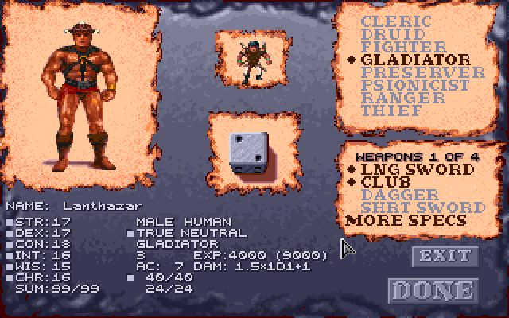

A new character starts the game with a plain weapon of its first weapon spec in
place of the bone long sword the game gives warriors, in a material it may use,
and the log says so (`Grog starts with a plain obsidian long sword for the
weapon specialization chosen, in place of the bone long sword`):

| Weapon spec | Starting weapon | For a cleric's sphere that can't use it |
|---|---|---|
| long sword | the game's bone long sword | obsidian (fire, earth) |
| club, quarterstaff, bow | wooden (a bow with 20 arrows) | |
| dagger, chatkcha | obsidian | a dagger: bone, the mod's (water) |
| short sword | bone, the mod's | obsidian (fire, earth) |
| mace, polearm, gythka, cahulaks | bone | a mace: obsidian, the game's plain Mace type with a picture of the mod's; a polearm: metal, the mod's (earth) |
| axe | bone, the mod's | obsidian (fire, earth) |
| great axe | bone, the mod's | obsidian (fire, earth) |
| pick | stone | |
| sling, staff sling | leather | |

A two-handed weapon held in the hands puts the game's starting shield in the
backpack (not a half-giant's, with
[its rule](#half-giants-two-handed-weapons)). A bow or staff sling goes in the
missile slot instead, and the shield stays, as the game asks nothing of the
hands for it. The weapon is made once: a long sword handed to the character
later stays one.

**At a level gained.** A warrior with fewer weapon specs than it is due (a
gladiator reaching 6th or 9th, or any warrior from a game begun before the rule)
picks the rest the way a psionicist picks a new power: in the game's own pop-up,
made bigger, a picture of each weapon spec on a slot, six to a row, those its
classes can't use (or it has) greyed. The pointer on a slot names it under them
(**SPECIALIZE IN** / **POLEARM**, or **EXPERT IN** where the pick would be
expertise: a ranger's, a Battle Mage's, a Crusader's or Mind Warrior's; as
CHOOSE A SPELL names a spell), and lights the slot if it can be picked; off the
slots the title comes back. The picks left are beside **EXIT** (which asks, as
for powers, whether to leave with picks unmade: they're offered again at the
next level).

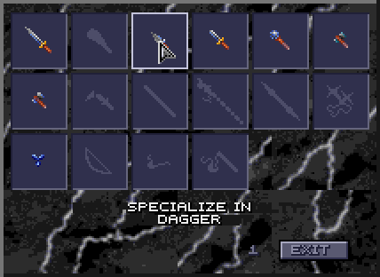

**Where it shows.** The **Effects** screen lists the selected character's
weapon specs under its effects ("SPECIALIZED IN", "MASTER OF", "GRAND MASTER
OF", "EXPERT IN"); View Character's DAM line and the inventory screen's weapon
lines count it (a staff sling specialist's `1.5x1D4+2`); the Characters tab
lists them (**Weapons: long sword (grand mastery)**) and gives the attacks a
round with each weapon ready, a missile weapon's its own (**Attacks: 3/2 a
round with Long Sword, 1 with Axe, 3 with Bow**); and the dice log names it on
each attack (`+1 specialized`, `+3 grand mastery`,
`(d10 for d8: grand mastery)`). Both lists end with a ranger's bow, which
every ranger is an expert with, chosen or not; and View Character, as the game
has it, gives a character's melee rate whatever weapon is ready.

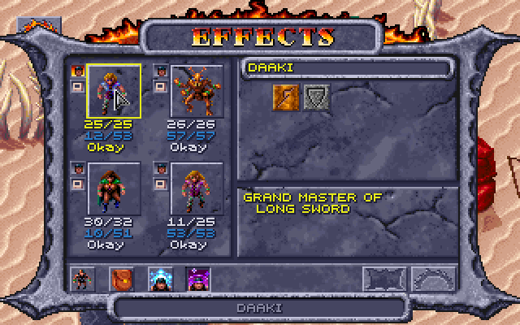

A human who dual-classes keeps what it earned as a fighter, gladiator or
ranger: its weapon specs, and the weapons it chose, whatever the new class (or
a kit) allows, count again once the new class's level passes the old. Till
then they are asleep, as the class is.

How it works: [DEVELOPMENT.md](DEVELOPMENT.md#weapon-specialization).

### Kits

With **Kits** ticked, a character of one class may take one of three kits for
its class when it is made, on the creation panel's **KIT** page, or none; a
few races' pairs of classes taken at once have kits of their own, and a human
who changes class may take one for the new class too. Each gives something and
costs something. Every kit's gains, costs, starting gear and rules are on a
page of their own, [Kits](KITS.md):

| Class | Kits |
|---|---|
| Fighter | [Myrmidon, Sentinel, Ravager](KITS.md#fighter-kits) |
| Gladiator | [Arena Champion, Twin-blade, Brute](KITS.md#gladiator-kits) |
| Ranger | [Stalker, Seeker, Justifier](KITS.md#ranger-kits) |
| Thief | [Assassin, Swashbuckler, Shinobi](KITS.md#thief-kits) |
| Preserver | [Arcanist, Scholar, Battle Mage](KITS.md#preserver-kits) |
| Cleric | [Healer, Crusader, Elementalist](KITS.md#cleric-kits) |
| Druid | [Grove Warden, Wanderer, Lifebinder](KITS.md#druid-kits) |
| Psionicist | [Mind Warrior, Mind Bender, Kineticist](KITS.md#psionicist-kits) |
| Two classes at once, one race each | [Battle Dancer, Shadowblade, Military Scout, Wilderness Avenger, Rescuer, Ghetto Fighter, Wayfinder, Spellarcher, Titan Mind, Poisoner, Spirit Caller, Wasteland Seer, Wild Fury](KITS.md#multiclass-kits) |

The game's own party gets features of its own
([The game's own party](#the-games-own-party)).

How it works: [DEVELOPMENT.md](DEVELOPMENT.md#kits).

### Level cap by XP

The game stops every class at level 9 (its manual's tables end there too).
With **Level cap by XP** ticked, a class goes up instead while its next level
needs no more than **749,999 XP**, shared out:

| Character | A class goes up while its next level needs no more than |
|---|---|
| One class | 749,999 |
| Two or three classes | an even share: 374,999 each for two, 249,999 for three |
| A human who changed class | 749,999 less what its old classes' levels needed |

A character of several classes already has its XP shared: the game splits
every award between the classes, and the sheet shows one class's share. A
human's XP starts again at 0 when it changes class, so its old classes' levels
count against the new one: a fighter who changed to cleric at 9th (250,000 XP)
can take the cleric to 10th, at 7th (64,000) to 11th. XP keeps counting past
the cap; only the levels stop. With [AD&D's class tables](#adds-class-tables),
the highest levels are:

| Class | One class | Two classes | Three classes |
|---|---|---|---|
| Cleric | 11 | 9 | 9 |
| Druid | 12 | 12 | 11 |
| Fighter | 10 | 9 | 8 |
| Gladiator | 10 | – | – |
| Preserver | 11 | 10 | 9 |
| Psionicist | 11 | 9 | 9 |
| Ranger | 10 | 9 | 8 |
| Thief | 13 | 11 | 11 |

749,999 is the most XP that keeps a druid from 13th and a preserver from 12th
(both need 750,000), where a preserver would cast 6th-level spells. Without
AD&D's tables the game's own XP tables count.

Everything else past 9th level is the game's own: it had it all along, and
only the cap kept it out of reach. Its XP tables go on to level 20 (druids
with a table of their own, not the cleric's), and THAC0, saves, spell slots
and thief skills are worked out from the level. So past 9th:

- **Hit points** follow AD&D: preservers roll their d4 to 10th and thieves
  their d6 to 10th (CON's bonus counting too), then gain a fixed amount; the
  others gain a fixed amount from 10th (+3 for fighters, gladiators and
  rangers, +2 for clerics, druids and psionicists). The game's own table has
  the fixed gain for thieves at 10th too, as it keeps thieves and psionicists
  together and AD&D's psionicist stops rolling at 9th; with the rule thieves
  roll their 10th die.
- **Gladiators** optimise their armour, as the game already has them do: AC 1
  better for every 5 gladiator levels, so −2 at 10th where it was −1. (The
  Loader counts it in **AC: spells, rings, other**. The game gives it with or
  without armour.)
- **THAC0 and saves** improve as the game's formulas give: 11 for a 10th-level
  gladiator, 14 for a 10th-level druid, as for AD&D's warriors and priests.
- **Spell slots** grow at the levels casters already have, up to 5th. With
  AD&D's class tables a priest has 5 4 4 3 2 at 11th and 6 5 5 3 2 at 12th, a
  preserver 4 4 4 3 3 at 11th. Priests also have a 6th-level slot at 11th and
  two at 12th, for the mod's [6th-level priest
  spells](#6th-level-priest-spells); preservers have no 6th-level spells.
- **Thief skills** from AD&D's table go on to 13th
  ([Thief skills from AD&D's table](#thief-skills-from-adds-table)).
- **A preserver picks a new spell** on the game's own CHOOSE A SPELL screen,
  as at every level, offered from spell level (class level + 1) / 2 down, but
  no higher than 5th (the game would offer an empty 6th-level page at 11th).
  **A psionicist picks a new power** (the game gives one at each level, two at
  odd levels and 4th).
- Spell damage that grows with the caster's level counts up to level 10 in
  the game, so a caster past 10th does no more.

The level-up comes as the game's usual one ("Gerakis gains a level"), and
View Character stops showing the XP for the next level at the cap, as it does
at 9 without the rule. For a character of more than one class, a class
already at its cap isn't named in the brackets, since it has no next level.
Untick it and nobody goes past the level they have.

How it works: [DEVELOPMENT.md](DEVELOPMENT.md#level-cap-by-xp).

### STORE and RECALL on the creation screen

The creation screen has two more buttons under the hit points, as Baldur's
Gate has them: **STORE** keeps the roll on screen, and **RECALL** brings it
back, however many times the die has been rolled since. A roll is the six
scores and what the die's total allows (the `SUM:` line), the hit points and
the PSP. So a good roll can be stored and the die tried again; if nothing
better comes, RECALL puts the stored one back, AC and damage with it.

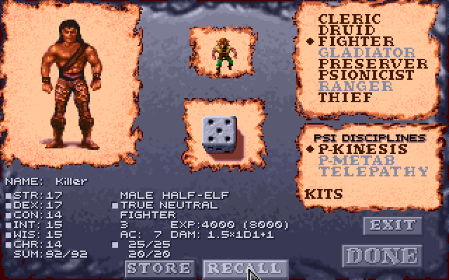

Changing the race, sex, classes or kit forgets the stored roll (its hit
points were rolled for those), even if they are changed back: RECALL then
does nothing until STORE keeps another. STORE again keeps the new roll in
place of the old. Unticked, the screen is as the game has it, from the next
time the game is started.

How it works:
[DEVELOPMENT.md](DEVELOPMENT.md#store-and-recall-on-the-creation-screen).

### Fuller starting gear

With **Fuller starting gear** ticked, the mod adds plain gear to a new
character's own while it is still New, after the class restrictions, weapon
specs and kits have changed theirs, and the dice log lists it
(`Swat starts with more gear: Short Sword (in hand), Arm Armor, Leg Armor`):

- **A weapon in hand.** A character with an empty right hand takes a weapon
  it can use from its backpack (a cleric's club), else gets a plain one: of
  its weapon spec, else a short sword, club, mace, dagger or quarterstaff (a
  cleric the club and mace first), in a material it can use. So a
  thief/psionicist, whose long sword the class restrictions take, gets a bone
  short sword, a fire cleric an obsidian mace, and an air cleric an obsidian
  dagger.
- **A missile weapon.** A sling in the missile slot for one with no bow or
  sling; an earth or fire cleric, who can't use one, an obsidian chatkcha in
  the backpack (a water cleric neither).
- **Leather armour** in its empty chest, arm and leg places, where it may wear
  it: a thief, gladiator, ranger, psionicist, cleric or Battle Mage goes out
  in a full suit.
- **A cloak** for a Stalker, an Assassin or a Shinobi (with [kits](#kits) on),
  to hide in ([Improved thieving](#improved-thieving)).
- **A thri-kreen gets nothing more** than the game's own starting gear: its
  claws serve it better than another weapon, and it wears no armour or
  cloak.
- **A multiclass preserver's armour** is left out, with the class
  restrictions on: it can't cast in armour.

Nothing is given that the character can't use or already has something of
the kind, so each item comes once. The [game's own party](#the-games-own-party)
gets it too, in the first moments of a new game. Unticked, a new character
starts with the game's gear, changed only by the rules above.

How it works: [DEVELOPMENT.md](DEVELOPMENT.md#fuller-starting-gear).

### Preservers' first spells

A human who becomes a preserver picks its first two spells on the game's
**CHOOSE A SPELL** window, twice over, from the 1st-level ones (the game gave
it Grease and Magic Missile), as a preserver picks one at each level up. If
it takes the **Scholar** kit for its new preserver class, it picks a third,
as a Scholar picks one more at each level up.

A new preserver picks its starting spells the same way when **DONE** is
clicked on the creation screen, in place of the ones the game handed out by
its starting level: two 1st-level spells at 1st level (where the game gives
Grease and Magic Missile), four at 2nd (the game adds Shield and Wall of
Fog), and four 1st-level and two 2nd-level at 3rd (the game adds Fog Cloud and
Mirror Image). A Scholar picks one more for each level. A multiclass preserver
picks too.

**EXIT** on CHOOSE A SPELL (then EXIT again at "YOU HAVEN'T CHOSEN") ends the
picking, at creation and on changing class: the spells still to pick are the
game's own, in its order (Grease, Magic Missile, Shield, Wall of Fog; then Fog
Cloud, Mirror Image), less any already picked. The character is already saved
when the window opens, so EXIT can't take you back to the creation screen.

Always on (it isn't a switch of its own). How it works:
[DEVELOPMENT.md](DEVELOPMENT.md#kits) (its rows for a new preserver's spells).

### The game's own party

START GAME with no party made plays the game's own four, who were made before
any of these choices existed. With weapon specialization, kits, class
restrictions and fuller starting gear on, the Loader fits them to those in the
first moments of a new game, and says so in the dice log (Cilla also gets the
elf's figure, with its own switch: see
[Elves and half-elves](#elves-and-half-elves)):

| Character | With weapon specialization | With class restrictions | With kits |
|---|---|---|---|
| **Gerakis**, half-giant gladiator | specializes in the long sword and the gythka; with [half-giants' two-handed weapons](#half-giants-two-handed-weapons), his club is a bone gythka, a two-handed weapon beside his long sword | | **Wild Fighting**, as a [Wild Fury](KITS.md#multiclass-kits) has it, as each fight starts |
| **K'ratchek**, thri-kreen fighter, druid and psionicist | specializes in the chatkcha, her only weapon | | casts as a [Wasteland Seer](KITS.md#multiclass-kits) (druid spells 2 levels higher under the open sky, 1 lower under a roof); her **chatkcha comes back as if she had several**: one more throw a round (2 instead of 1, or more with its weapon spec) |
| **Cermak**, human preserver, once a gladiator | specializes in the long sword and the axe, which count once his gladiator levels do again (when his preserver level passes them) | | an **Arcanist**, the kit of his preserver class: two preserver spells a turn in a fight |
| **Cilla**, elf preserver, druid and thief | | no leather armour (a druid wears none), and she knows the **Armor** spell in its place | an **Elven Wanderer**: with the [stealth rule](#hiding-in-shadows-to-backstab), her hiding in shadows is never halved in daylight |

Gerakis's, K'ratchek's and Cilla's features are their own: no character made
on the creation screen can have them. The Effects screen lists them (as it
does kits), and the Characters tab beside the kit. Cermak's gear stays as it
is (an Arcanist has none of its own), and so do the hit points the game gave
him: the Arcanist's d3 counts from his next level.

With [fuller starting gear](#fuller-starting-gear), they get what a new
character would, after the changes above: Gerakis a sling and leather chest
and leg armour; Cermak and Cilla nothing more. K'ratchek, a thri-kreen, fights
with her claws and the game's own chatkcha, and gets nothing more either.

Cermak and Cilla keep the game's own starting spells: only a character made
on the creation screen [picks its own](#preservers-first-spells).

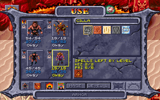

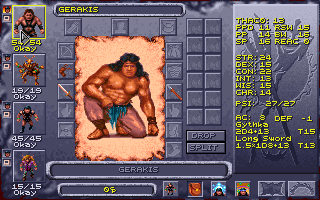

How it works: [DEVELOPMENT.md](DEVELOPMENT.md#the-games-own-party).

## Expanded features

New things to do in play, each with a box in the Options tab's **Expanded
features** section. All are on by default and, like the rule changes, take
effect at once; untick one and the game is as it was.

| Box on the Options tab | What it adds |
|---|---|
| [The leader's CHA at shops](#the-leaders-cha-at-shops) | the party leader's CHA 18 or more lowers what shops ask, 5% to 40% at 25; shops pay 60% |
| [Buying back magical items](#buying-back-magical-items) | a magical item sold stays in the merchant's stock, to buy back |
| [Thief skills from AD&D's table](#thief-skills-from-adds-table) | AD&D's table by level, with Dark Sun's race and DEX adjustments |
| [Hiding in shadows to backstab](#hiding-in-shadows-to-backstab) | thieves hide and move silently to backstab, rangers to attack from behind |
| ... [a worn cloak, boots and belt](#hiding-in-shadows-to-backstab) | the box under it: +10 hiding, +10 moving silently, +5 picking pockets and opening locks |
| [A backstab multiplies the weapon's dice only](#hiding-in-shadows-to-backstab) | STR and magic added after, on the round's first attack only, as in AD&D |
| [Picking pockets](#picking-pockets) | a thief's Pick Pockets button, then anyone in sight, until caught |

### The leader's CHA at shops

The game's shops ask an item's price whoever buys. With **The leader's CHA at
shops** ticked, the party leader's CHA lowers it, 5% from CHA 18 and 5% more
for each point after, to 40% at 25 (the highest a CHA can be):

| Leader's CHA | 17 or less | 18 | 19 | 20 | 21 | 22 | 23 | 24 | 25 |
|---|---|---|---|---|---|---|---|---|---|
| Discount | none | 5% | 10% | 15% | 20% | 25% | 30% | 35% | 40% |

The price shown under each item, the one charged, and whether the shop's list
greys an item as too dear all follow it (never below 1). Shops pay **60%** of
an item's price for what the party sells (rounded down, never below 1): the
most the CHA discount takes off is 40%, so nothing can be bought and sold back
at a profit, and at CHA 25 a round trip comes out even. The game pays all of
it, which with the discount would let anything be sold at a profit.

How it works: [DEVELOPMENT.md](DEVELOPMENT.md#the-leaders-cha-at-shops).

### Buying back magical items

The game destroys whatever the party sells. With **Merchants keep the magical
items the party sells them** ticked, a magical item sold (one with a plus, or a power:
a ring, a wand, a scroll...) goes into the merchant's pack instead, and the
shop offers it for sale at its price, less the leader's CHA discount, so it
can be bought back. Anything else sold is gone, as in the game. With the CHA
rule's selling at 60%, buying an item back costs more than it was sold for, or
the same at CHA 25.

How it works: [DEVELOPMENT.md](DEVELOPMENT.md#buying-back-magical-items).

### Improved thieving

More for thieves to do: skills that grow by the Player's Handbook's table,
hiding in shadows and moving silently to backstab (rangers too, to attack from
behind), a cloak, boots and belt that help, and pockets to pick. The switches
are together under **Improved thieving** in the Options tab's Expanded
features section.

#### Thief skills from AD&D's table

The game's thief skills come out high: a 3rd-level elf thief with DEX 22 has
move silently 66 and hide in shadows 61. AD&D gives 27 and 20 at 3rd level
before race and DEX. The game adds 4 a level to a base of its own, and its DEX
formula gives move silently and hide in shadows less than Dark Sun's table at
high DEX, and some other skills more. With **Thief skills from AD&D's table**
ticked, a skill is:

- AD&D's average for the thief level (the Player's Handbook's table, carried on
  past 10th level),
- plus the race's adjustment, the game's own (already the Dark Sun rules'
  numbers),
- plus DEX's: AD&D's table up to 19, the Dark Sun rules' exceptional DEX
  past it, for the first five skills (hear noise, climb walls and read
  languages have none),
- to no more than 95, as in AD&D, after the belt, kits and armour too (the
  situation's bonus, a hard lock, say, still counts after it). A ranger's
  hiding and moving silently stop at 95 as well.

AD&D's averages, by thief level (before the cap of 95):

| Thief level | 1 | 2 | 3 | 4 | 5 | 6 | 7 | 8 | 9 | 10 | 11 | 12 | 13 |
|---|---|---|---|---|---|---|---|---|---|---|---|---|---|
| Pick pockets | 30 | 35 | 40 | 45 | 50 | 55 | 60 | 65 | 70 | 80 | 90 | 95 | 99 |
| Open locks | 25 | 29 | 33 | 37 | 42 | 47 | 52 | 57 | 62 | 67 | 72 | 77 | 82 |
| Find/remove traps | 20 | 25 | 30 | 35 | 40 | 45 | 50 | 55 | 60 | 65 | 70 | 75 | 80 |
| Move silently | 15 | 21 | 27 | 33 | 40 | 47 | 55 | 62 | 70 | 78 | 86 | 94 | 99 |
| Hide in shadows | 10 | 15 | 20 | 25 | 31 | 37 | 43 | 49 | 56 | 63 | 70 | 77 | 85 |
| Hear noise | 10 | 10 | 15 | 15 | 20 | 20 | 25 | 25 | 30 | 30 | 35 | 35 | 40 |
| Climb walls | 85 | 86 | 87 | 88 | 90 | 92 | 94 | 96 | 98 | 99 | 99 | 99 | 99 |
| Read languages | 0 | 0 | 0 | 20 | 25 | 30 | 35 | 40 | 45 | 50 | 55 | 60 | 65 |

The race adjustments, as the game has them (humans, half-giants and
thri-kreen have none):

| Race | Pick pockets | Open locks | Find/remove traps | Move silently | Hide in shadows | Hear noise | Climb walls | Read languages |
|---|---|---|---|---|---|---|---|---|
| Dwarf | 0 | +10 | +15 | 0 | 0 | 0 | −10 | −5 |
| Elf | +5 | −5 | 0 | +5 | +10 | +5 | 0 | 0 |
| Half-elf | +10 | 0 | 0 | 0 | +5 | 0 | 0 | 0 |
| Halfling | +5 | +5 | +5 | +10 | +15 | +5 | −15 | −5 |
| Mul | 0 | −5 | 0 | +5 | 0 | 0 | +5 | −5 |

The DEX adjustments:

| DEX | Pick pockets | Open locks | Find/remove traps | Move silently | Hide in shadows |
|---|---|---|---|---|---|
| 9 | −15 | −10 | −10 | −20 | −10 |
| 10 | −10 | −5 | −10 | −15 | −5 |
| 11 | −5 | 0 | −5 | −10 | 0 |
| 12 | 0 | 0 | 0 | −5 | 0 |
| 13-15 | 0 | 0 | 0 | 0 | 0 |
| 16 | 0 | +5 | 0 | 0 | 0 |
| 17 | +5 | +10 | 0 | +5 | +5 |
| 18 | +10 | +15 | +5 | +10 | +10 |
| 19 | +15 | +20 | +10 | +15 | +15 |
| 20 | +20 | +25 | +12 | +20 | +17 |
| 21 | +25 | +27 | +15 | +25 | +20 |
| 22 | +27 | +30 | +17 | +30 | +22 |

then the situation and effects as before. So Azil, a 3rd-level elf thief with
DEX 22: pick pockets 40 + 5 + 27 = 72, open locks 58, find traps 47, move
silently 62, hide in shadows 52, hear noise 20, climb walls 87. A ranger's
move silently and hide in shadows take the same race and DEX adjustments.
Untick it for the game's numbers.

How it works: [DEVELOPMENT.md](DEVELOPMENT.md#thief-skills-from-adds-table).

#### Hiding in shadows to backstab

The game never rolls hide in shadows, and a thief only backstabs a target that
has turned to face someone else. With **Thieves hide in shadows and move
silently to backstab, rangers to attack from behind** ticked, a thief whose turn
comes in a fight with no enemy in any of the eight squares around them tries to
hide in shadows; if they do, they try to move silently up to someone; and if
both succeed, their next attack that turn counts as one from behind: +2 to hit,
the target's DEX and shield don't count, and with a weapon that can backstab it
is a backstab, the damage multiplied as usual. The attack gives the thief away,
and so does the turn ending without one. An enemy next to the thief when the
turn comes means no hiding at all: get clear first (a
[Shadowblade](KITS.md#multiclass-kits) tries anyway). A [Military
Scout](KITS.md#multiclass-kits) never backstabs: its hiding gives an attack from
behind.

```
Tezral's turn
Tezral hides in shadows: d100 = 21, needs 27 or less (54, halved in daylight) -> hidden
  Tezral moves silently: d100 = 30, needs 54 or less -> unheard: their next attack this turn is from behind (a backstab with a weapon that can)
Tezral attacks Slig BACKSTAB with Bone Long Sword (1d8): d20 = 11, needs 10+ (55%), hits AC 2, target AC 3 -> HIT
    THAC0 19, +2 from behind, +2 backstab, +3 STR, -1 bone = 13
  Tezral hits Slig for 9: 1d8 = [1] -1 bone (raised to the minimum of 1) +7 STR 19 +1 backstab (the dice 1 x2 = 2)
```

With **A backstab multiplies the weapon's dice only** (on unless unticked, in
the same Options group) a backstab multiplies the weapon's dice and adds STR,
the weapon's plus and the rest once, as AD&D has it: `1d8 = [5] +12 STR 24 +10
backstab (the dice 5 x3 = 15)` is 27 (the 5 rolled and the 10 more that x3
adds) where the game made it 51. The multiplier is x2 at thief levels 1-4, x3
at 5-8, x4 at 9-12 and x5 from 13 (an [Assassin](KITS.md#thief-kits)'s one
more, x3 to x6). Only the round's first attack is a backstab: the game multiplies the first two, so a second
swing (an off-hand one after a miss) was multiplied too.

The chance to hide is **halved in daylight** (with [kits](#kits) on, not for an
Assassin, a Military Scout or Cilla, the Elven Wanderer). Which maps are under
the open sky goes by the game's regions: open desert and rock, the villages'
open ground and the arena are; the slave pens, the sewers, the lava caverns and
the other underground or roofed places aren't. Three maps have both, buildings
with floors of their own standing on open ground: there it goes by the floor
under the thief (from the game's map of the region in memory), so a thief in a
building is out of the sun and one in a roofless ruin isn't. The chances are the
thief's own as they stand (level, race, DEX, and effects: Invisibility makes
hiding certain, Fire Shield and Mirror Image rule it out).

**Rangers** hide and move silently too, with the same box ticked. The game
gives rangers no thief skills, so the Loader uses AD&D's ranger table, by
ranger level, with the race's and DEX's adjustments as for a thief:

| Ranger level | 1 | 2 | 3 | 4 | 5 | 6 | 7 | 8 | 9 | 10 |
|---|---|---|---|---|---|---|---|---|---|---|
| Hide in shadows | 10 | 15 | 20 | 25 | 31 | 37 | 43 | 49 | 56 | 63 |
| Move silently | 15 | 21 | 27 | 33 | 40 | 47 | 55 | 62 | 70 | 78 |

The light works the other way round for these outdoorsmen: the **full chance
under the open sky, half indoors** (the same maps and floors as for thieves).
Their attack from behind gets +2 to hit, and the target's DEX and shield don't
count, but it is never a backstab. Armour doesn't matter, nor does what they
hold. The Characters tab shows a ranger's two chances (**Ranger skills now**),
and the game's inventory screen shows them where a thief's `MOVE` and `HIDE`
go. Someone with thief levels hides as a thief.

```
Semyon hides in shadows: d100 = 15, needs 63 or less (63, a ranger under the open sky) -> hidden
  Semyon moves silently: d100 = 42, needs 78 or less -> unheard: their next attack this turn is from behind
Semyon attacks Slig from behind with Wooden Club (1d6): d20 = 12, needs 10+ (55%), hits AC 1, target AC 3 -> HIT
```

**Cloaks, boots and belts.** With the box under this one ticked, a worn cloak
adds 10 to hiding in shadows (before daylight halves it) and worn boots add 10
to moving silently, for rangers too, up to 95:
`needs 18 or less (26 +10 cloak = 36, halved in daylight)`. A cloak's or
boots' item box (right-click it on the inventory screen) says so under its
name, `Hide +10` or `Move +10` (the skills' short names, as the
inventory screen's thief rows have them).


The [Cloak and Boots of Elvenkind](#new-items) do more (whatever the plain
gear's switch). Only thieves and rangers can wear them (multiclasses too; for
anyone else, the game's "Cannot use this item"). In the cloak, hiding in
shadows needs 95 or less under the open sky and 90 under a roof, not halved by
the light (AD&D's: all but invisible in the wild, 90% among buildings), unless
their own chance is better; in the boots, moving silently needs 95 or less.
Their boxes say `Hide 90-95%` and `Move 95%`.

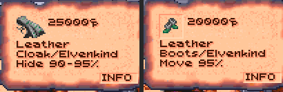

The same switch has a worn **belt** add 5 to a thief's **picking pockets and
opening locks**, whether hiding is on or not: the game's own lock picking
counts it, and so do the Loader's pockets and its thief rows (`PICK 80`,
`LOCK 64`). A belt's box says `Pick +5, Lock +5`.

Plain cloaks, boots and belts cost 24 (the game's Leather Cloak is 20), anywhere
in the region, shops included; magic ones (with a plus, or dearer than 100)
keep their prices.

How it works: [DEVELOPMENT.md](DEVELOPMENT.md#hiding-in-shadows-to-backstab).

#### Picking pockets

The game has one pocket to pick, in the Trustee's conversation (his key). With
**Picking pockets** ticked, a thief can try anyone's. On the **USE** screen, a
character with thief levels has a **Pick Pockets** button (a purse) where a
priest's Turn Undead is, under the spell counts. A cleric/thief has both
outside fights, Turn Undead and the purse beside it; in a fight, Turn Undead
alone.

Press it: the screen closes and the pointer is the one for talking. Click
someone in sight, and the thief who pressed it (party leader or not) tries
their pocket instead of talking to them. On the map, a right click that
changes the pointer puts the try away. (Right-clicked on the USE screen, the
purse says what it does, as a spell does.) A thief whose backpack is full
can't try ("Daaki's backpack is full."): nothing is rolled, and it doesn't
count as a try. Not in a fight: there's no time for it then, and the button
isn't there.

(Earlier versions had a thief use **Thieves' Tools** for this, from Mirlon or
Kel. No one has them now; a set already in a game keeps its name and does
nothing.)

The Loader rolls the thief's pick pockets chance as it stands now (effects and
a worn belt's 5 counted, as in the thief rows):

- **Success:** one small thing goes into the thief's backpack (its first free
  cell): something weighing 10 or less (a bag or arrows are 10, a helm 15, a
  long sword 30) that isn't worn on the body (armour, a belt, boots, a helm, a
  cloak). A dagger, a ring, an amulet, a gem or food can be lifted, and so can
  three weapons whatever their weight: Kurzak's Shadowseeker, Churrr's
  Gutterknot and Maris's Mindshard (see [New items](#new-items)). Lifting one is
  worth 200 XP to the thief, given as the game gives a quest's ("Cilla
  receives 200 experience points!", with the quest's sound; split among a
  multiclass thief's classes). Keys stay, as scripts may look for them.
  People outside the party keep all they own in their pack, so this goes by
  what each thing is.
- **Failure:** a move silently roll. Made, the thief slips away unnoticed;
  missed, they're caught.

With nothing like that left on them, the thief takes what's in their purse
instead: ceramic pieces, 2 to 5 for each of the thief's levels (a 4th-level
thief takes 8 to 20), added to the party's money. That is the last try on that
person.

A thief can go on trying the same person until **caught** (both rolls failed)
or until they take the coins; after that, that person keeps a hand on their
pockets for good. The Loader remembers who in `settings.json`, for this party,
with the time on the game's clock: load a game saved before the try and the
clock goes back past it, so the try is forgotten and the person can be tried
again. The Trustee is left to his own conversation. What happens comes up in
the game's message window and in the dice log:

```
Daaki picks Kurzak's pocket: d100 = 71, needs 63 or less -> failed
  Daaki moves silently to get away: d100 = 12, needs 55 or less -> success
  Daaki fumbles Kurzak's pockets, but slips away unnoticed.
```

**The Trustee's own key.** Picked in his talk by a thief with no room for it,
the game drops it at his feet, and after each step of his rounds he went back
for it ("There it is!") without picking it up: his rounds stalled, and he
stayed busy ("I'd love to talk more... get back to work") for good. The
Loader's copy of his scripts leaves the key where it lies, for the party to
pick up, and has him say the busy line once and walk on (see
[The game's bugs, fixed](#the-games-bugs-fixed) for the other way his rounds
stalled).

How it works: [DEVELOPMENT.md](DEVELOPMENT.md#picking-pockets).

## New content

*Spoilers: this section says where the new items and people are, and what
they say. [The player's guide](PLAYER-GUIDE.md) has the rules without them.*

Spells, people, a quest and items the mod adds to the game, each with a box
in the Options tab's **New content** section: the people, the quest and the
items from the next time the game is started, the spells and the defilers'
scrolls at once.

### New wizard spells

Six wizard spells from AD&D's *Spells & Magic*, the *Player's Handbook* and
the Dark Sun books, added to the game's own 69 (numbers 196-201). Preservers
learn them as they learn any spell: picked at a level up or as starting
spells, or from a scroll. They're listed on the USE screen by level with their
own icons and descriptions (right-click one), use the usual slots, and show on
the Effects screen while they last. Who knows them is kept in the character's
sheet, so it saves with the game and the character.

| Spell | Level | Cast on | Lasts | Does |
|---|---|---|---|---|
| **Cat's Grace** | 2 | a party member (its portrait on the USE screen) | 60 rounds a caster level | DEX + 1d6 (at most 24), as Strength does for STR |
| **Erdlu Claw** | 1 | a party member (its portrait on the USE screen) | 5 rounds a caster level | each natural (unarmed) attack does 1d6+1 where that's better than its own, is +1 to hit, counts as a +1 magical weapon, and cuts (edged, not crushing) |
| **Fogbolt** | 1 | one creature in sight | 2d4 rounds (a save negates) | −3 to its attacks, and +2 to attacks on it (its AC 2 worse) |
| **Reflected Image** | 1 | the caster | until the image is struck or dispelled | one image of the caster: a hit, or a foe's spell for one creature, has a 50% chance of striking the image instead, which vanishes |
| **Spook** | 1 | one creature in sight | 3 rounds (a save negates) | the creature panics and flees (Afraid); its save is 1 worse for every 2 caster levels (at most −6); undead aren't affected, magic resistance applies, and Cloak of Bravery gives +4 against it |
| **Friends** | 1 | the caster | 1d4 rounds and 1 a caster level | CHA + 2d4 (at most 25): lower shop prices |

- **Cat's Grace** is made to work exactly as the game's Strength does, for
  DEX. Everything that reads DEX follows it while it lasts: AC, initiative,
  REAC and DEF, thief skills, the two-weapon penalties and the saves against
  fire, cold and electricity. The log says what it rolled:
  `Cat's Grace: 1d6 = 4 -> Gerakis's DEX +4 while it lasts (at most 24)`.
- **Erdlu Claw** grows talons like an erdlu's. A character with a weapon in hand
  is unchanged; one fighting unarmed hits for 1d6+1 instead. A thri-kreen's four
  claws and bite become 1d6+1 each (a natural attack already better on average,
  as 2d4 or 1d8+2, stays as it is). The +1 to hit shows in the log's THAC0
  breakdown (`+1 Erdlu Claw`), and as a +1 weapon the talons hurt creatures that
  only magical weapons can. They cut: edged, where the game makes every unarmed
  attack crushing, so they hurt a creature that crushing weapons can't (a
  mastyrial). A thri-kreen in the party fights with edged claws the same way,
  with or without the spell. With **Body Weaponry** or **Animal Affinity** up,
  the power's dice for the first attack get the claw's +1: 2d4+1 or 1d10+1.
- **Fogbolt** wraps one creature in clinging fog. It flies to its target as
  a dark grey bolt, Magic Missile's in smoky greys (Magic Missile keeps its
  own blue); like any bolt it needs a clear line to the target. Its THAC0
  breakdowns show `-3 Fogbolt` on its own attacks and `+2 target's Fogbolt` on
  attacks against it. Its icon is a grey cloud.
- **Reflected Image** is a smaller Mirror Image: one image, struck by a hit or a
  foe's spell instead of the caster half the time (Mirror Image's are three
  quarters of the time). The two don't add up: casting either one replaces the
  other, and casting Reflected Image again only gives the one image back. Dispel
  Magic ends it. Its icon is a hand mirror with one figure in it, on the Effects
  screen too, where it is named REFLECTED IMAGE (as in the Look box and under
  the portrait).
- **Spook** frightens one creature into running for 3 rounds. The log's save
  line shows the penalty:
  `d20 = 9 -1 Spook, the caster's levels = 8, needs 16 -> failed`.
- **Friends** makes the caster charming for a short while, as AD&D's spell
  does: CHA + 2d4, the dice log showing the roll
  (`Friends: 2d4 = [4 + 3] = 7 -> Xan's CHA +7 while it lasts (at most 25)`).
  Shop prices follow the party leader's CHA, so a leader who casts it before
  trading buys and sells better (see
  [the leader's CHA at shops](#the-leaders-cha-at-shops)). A second casting
  replaces the first rather than adding to it; a CHA of 25 or more already is
  left as it is.

A Shinobi can learn Reflected Image, Spook and Friends, as well as Fogbolt.

Each has sounds of its own: Cat's Grace lands with Haste's shimmer, Erdlu Claw
with Shocking Grasp's snap, and Fogbolt is cast and lands with Fog Cloud's.

With the **New wizard spells** box unticked the spells are gone from the lists
and the game is as it was.

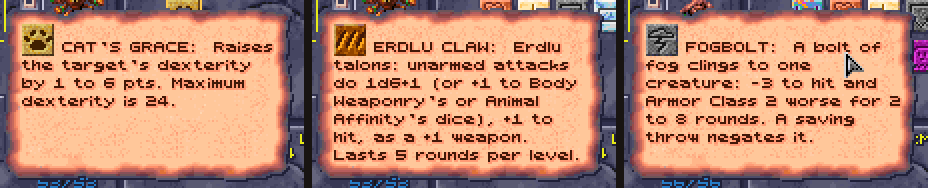

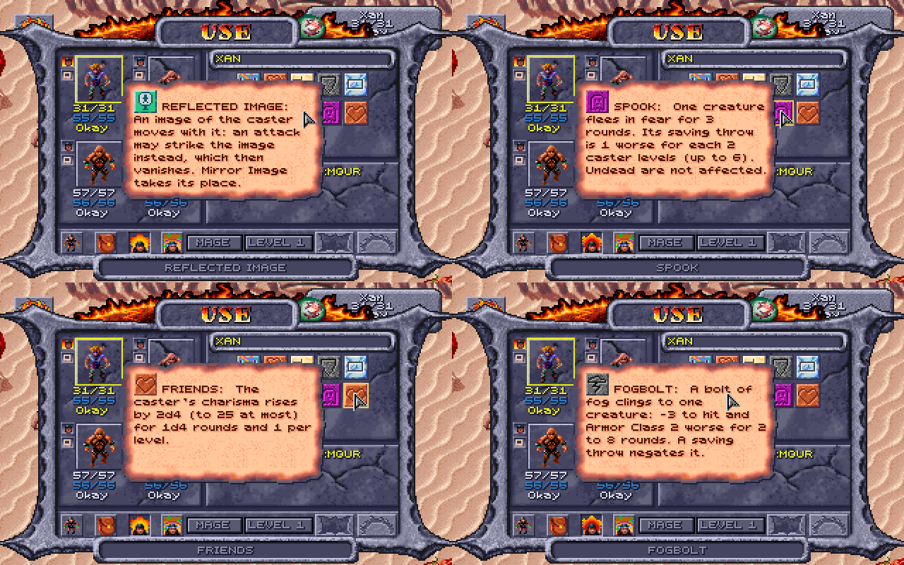


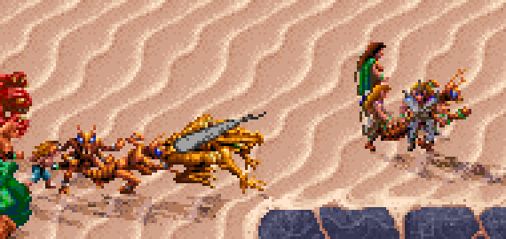

How it works:
[DEVELOPMENT.md](DEVELOPMENT.md#new-spells-wizard-and-6th-level-priest).

### 6th-level priest spells

Nine 6th-level priest spells, after AD&D's and Wake of the Ravager's (numbers
202-210). A cleric or druid gets them at 11th level, with AD&D's spell slots:
one 6th-level slot at 11th and two at 12th (a druid reaches 12th under the XP
cap, a cleric 11th). Like the 4th and 5th-level common spells, the cosmos
ones are for druids and a Healer cleric; each element's are for the clerics
and druids of that sphere (an Elementalist's second sphere counts). They come
with the **New wizard spells** switch (it covers these too), and with
**AD&D's class tables** for the slots.

A Healer made before the kit had the cosmos (Obsidian Edition 2.5.0 and
earlier) is given its cosmos spells when the game is loaded, and the dice log
says so.

| Spell | Who | Cast on | Does |
|---|---|---|---|
| **Heal** | cosmos | touch | every wound healed, disease and blindness cured |
| **Harm** | cosmos | touch | the creature is left 1d4 hit points; no save |
| **Blade Barrier** | air | a wall | 8d8 to each creature in it or passing through; a save for none |
| **Wall of Thorns** | earth | a wall | 8 plus the creature's AC to each creature in it or pushing through (at least 1) |
| **Sunstroke** | fire | one creature | if it fails its save it collapses, helpless, for 2 rounds a level, taking 1d4 fire at the start of each round |
| **Fire Seeds** | fire | an area | four seeds of 2d8 bursting together (8d8), a save for half |
| **Heartseeker** | earth, water | one creature | it saves against death or dies; one that saves takes half of 4d8 (2–16), as from Slay Living |
| **Water of Life** | water | touch | the creature's wounds healed by taking them onto the caster, who keeps at least 5 hit points |
| **Whirlwind** | air | an area, a round a caster level | 2d8 crushing each round to each creature in it, a save for half; one that fails is swept off its feet and loses its next turn |

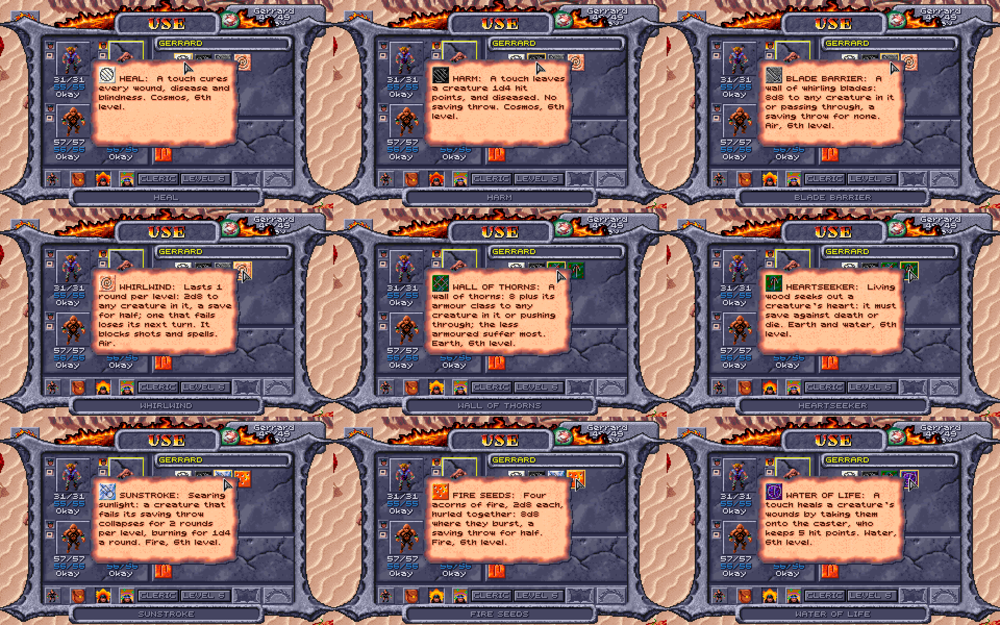

How they're made, and where they differ from the books:

- Each is built on a spell the game already has, so the game's own code casts
  it: Heal on Cure Critical Wounds, Harm on Cause Critical Wounds, the walls
  on the priest's Wall of Fire, Sunstroke on Hold Person, Fire Seeds on Flame
  Strike, Whirlwind on Stinking Cloud, Heartseeker on Slay Living and Water of
  Life on Lend Health.
- **Blade Barrier and Wall of Thorns are walls of their own**, made as the
  game makes its fire walls but each with its own damage and its own picture:
  a ring of circling blades and a tangle of thorns, Wake of the Ravager's (the
  fire wall in grey or dark brown without it). Any number of walls can stand at
  once, each doing its own. Blade Barrier's blades are edged, with a saving
  throw for none, as Wake of the Ravager's. Wall of Thorns does the book's 8
  plus the creature's AC (so the unarmoured suffer most), with no save: a
  party member's AC as the game last worked it out when something attacked
  them; anyone else's (and a party member's before that) counted as the game
  counts it, from the armour and shield worn, DEX and a gladiator's levels,
  but not spells such as Barkskin.
- **Sunstroke** strikes one creature, as in Wake of the Ravager, and holds it
  as Hold Person does, for 2 rounds a level, and the heat burns it for the
  book's 1d4 of fire at the start of each round while it lies there (a fire
  resistance counts). It ends with the paralysis, or when that is cured.
- **Fire Seeds** throws its four seeds of 2d8 together, one burst of 8d8 (the
  same dice), not one by one at different places; it bursts as a fireball (Wake
  of the Ravager's picture for it, which Shattered Lands has too) where Flame
  Strike rises as a column of fire.
- **Heartseeker** is a spell of death, not an arrow to shoot. It is
  Slay Living's, so one that saves still takes half of 4d8.
- **Whirlwind** stays where it is cast, as Stinking Cloud does, for a round a
  caster level, as AD&D has it: one tall, turning funnel of dust in the middle
  of its area, its ring of dust at the area's edge. Nothing can be shot or cast
  through it (it blocks sight, as Wall of Fog does). At the start of each
  round, before anyone acts, it does 2d8 crushing to every creature in it (a
  save for half), your party included, whether or not they get a turn; one that
  fails its save is swept off its feet and loses that round's turn (no movement,
  no action), without being helpless as a held creature is. As it is cast it
  strikes everyone in it at once: one swept then loses its turn that round if it
  hasn't acted yet, else the next round's. Walking into it does nothing until
  the next round starts. It doesn't move, and keeps striking those knocked out
  in it.
- **Harm** on a helpless creature, which the game hits with the most its dice
  can do, still leaves it 1d4 hit points. It also leaves the creature Diseased,
  as in AD&D, which here only keeps a STR lowered by something else from coming
  back ([Cause
  Disease](HOW-THE-GAME-WORKS.md#each-cleric-spell-against-the-manual)).

The dice log names each one: Harm's line says the game's own roll goes
unused, and Wall of Thorns' gives the AC its damage came from
(`Wall of Thorns' wall instead: 8 + AC 10 = 18`), and a creature Whirlwind
sweeps off its feet has a line of its own. Their icons are Wake of the
Ravager's, read from your copy (GOG sells it with Shattered Lands); without it
they have icons of their own (the game's, recoloured).

How it works:
[DEVELOPMENT.md](DEVELOPMENT.md#new-spells-wizard-and-6th-level-priest).

### New items

Items the game never had, or never placed. All but the arena's ring (which the
Loader hands over itself, while it runs) are written into the game's own data
each time the Loader starts the game, so the game makes them with their people
and chests and then keeps and saves them like its own. A changed switch takes
effect in regions the party hasn't visited yet; start a new game to have them
all. The log doesn't say where they are: they're there to be found.

**New items, magical and mundane** on the Options tab places them all, the
arena's ring too. A thief can [lift](#picking-pockets) Pehtucl's ring,
Shadowseeker, Gutterknot and Mindshard (200 XP for each weapon).

**Where they are.** The mod's items are in the [item tables](ITEMS.md) with the
game's own: in ***bold italics*** in
[Every magic item](ITEMS.md#every-magic-item), each with where it is and what
it does, and marked **new** in
[Every mundane weapon](ITEMS.md#every-mundane-weapon). The game has no short
sword at all, no bone or obsidian axe or great axe, no bone dagger, few plain
metal weapons and no magic club, pick or staff sling. Two more, armour:

| Icon | Item | Where | What it is |
|---|---|---|---|
| 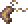 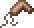  | **Bone Scale Arm Armor**, **Leg Armor** and **Bone Helm** | in the slave pens' chest with the Bone Scale Chest Armor and Arrows +3 (the game has the set but places only the chest piece) | the set; the helm AC 1 with [Helms give AC 1](#helms), worn by those who can wear the armour (not thieves) |
|  | **Helm** | in **Kurzak**'s pack, in the slave pens | the game's leather helm |

The bone and obsidian weapons are also new characters' starting weapons with
[weapon specialization](#weapon-specialization), each in a material the
character can use. Dunesong, the bow +1 the Bowyer sells, counts at his
archery target as the game's own bows do ([the target's
rules](HOW-THE-GAME-WORKS.md#the-bowyers-archery-target)).

**Prices** follow the game's own (a price can't go past 65,535; the game's
dearest, the Wand of Missiles, is 65,000):

| Items | Price |
|---|---|
| Magic melee weapons, and Dunesong | 20,800 a plus (41,600 for a +2; a +1 with a spell 22,000; the game's Bow +2 is 50,800) |
| Windlash; Skycutter | 2,800 (as the game's Sling +1); 3,500 (as its Sling +2) |
| Plain metal weapons | 50 to 300 |
| Bracers of defense | 5,000 a point of AC |
| Rings and Cloak of Protection | 15,000 |
| Inixhide; the Ashen Robe | 6,000 |
| Veiled Robe | 40,000 |
| Cloak and Boots of Elvenkind | 25,000 and 20,000 |
| Warden's Arms and Legs; Chest; Helm | 27,000 each; 36,000; 30,000 |
| Arrowbane; Sunking Crown | 30,000; 40,000 |
| Girdle of Back Defense; Golden Girdle of Urnst; Amulet of Magic Resistance | 25,000; 20,000; 35,000 |
| Gutterward; Ironbulwark | 25,000; 65,000 (the game's Drake Shield +1 is 25,400, El's Shield +2 50,200) |
| Tome of Understanding | 43,500 (AD&D's) |


**The Warden's Plate** is plate mail +1 in four pieces: the chest 4 better
than no armour (its AC 3, +1), the arms and legs 3 each (AC 2, +1), the helm 2
(a helm's AC 1 with [helms giving AC 1](#helms), +1): 12 better as a set, so a
wearer with no other help goes from AC 10 to AC −2. (With that rule off the
helm gives only its +1: 11 better, AC −1.) The game adds up its pieces' AC
this way for all armour, so a full set does better than AD&D's plate mail +1
(one suit, AC 2: 8 better). It is metal armour, worn by the classes that can
wear the game's chain (no single-class thieves), and kept from more with
[class restrictions](#class-restrictions). **Grey's Scale**'s arm and leg
armour is AC 3 each (the game's is 2).


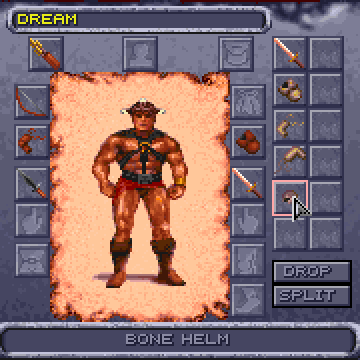

**Icons and names.** Each has an icon of its own (in [Items](ITEMS.md)), made
from the plain item's the way the game makes its magic items' (a few pixels in
the colours it cycles like fire); dropped on the map they look like the plain
item. The game's names are at most 15 letters, so the rings are
**RING/PROTECTION** and the cloak **Cloak/Protectn**; the Loader's screens and
the log give them in full. As with its own items, the game puts the material
first: **Leather Inixhide**, **Metal +1 Shadowseeker** in the item box.

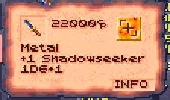

**Alagorn**, the wizard of the Painted Badlands who identifies magic items,
tells the story of every magic item in the table but the plain Gythka +2, the
two girdles and the Amulet of Magic Resistance when
the party carries it, in the menu the game would put it in (swords, weapons,
rings, armor, shields, clothes or other items), before "Nothing". As with the
game's own, one story for each kind: the four pairs of bracers share one, and
so do both rings of protection. The Warden's Plate's pieces each tell a part
of Haldren's, the last of the Wardens.

How it works: [DEVELOPMENT.md](DEVELOPMENT.md#new-items).

#### Bracers of defense

A preserver can't cast in armour (with [class
restrictions](#class-restrictions)), so the mod adds AD&D's bracers of defense
([where](#new-items)). They are worn on the arms, in the arm armour's place, and
give the AC their name says: AC 6 is 4 better than no armour, AC 2 is 8 better.
As in AD&D they give nothing while armour is worn: on the arms, legs or chest,
or a helm (bone, leather or metal, magical or not). A shield, rings and cloaks
of protection, and the mod's circlet and crown (worn on the head, but not
armour) go with them. They aren't armour to anything else: a preserver casts in
them, a thief wears them, and a ring or cloak of protection still counts. In the
game they are **BRACERS/DEFNS** with their plus (Bracers/Defns+4 is AC 6),
priced 5,000 a point of AC.

How it works: [DEVELOPMENT.md](DEVELOPMENT.md#bracers-of-defense).

#### Robes

Two magic robes for those who go without armour: preservers, psionicists and
druids alone may wear them. A robe is worn on the chest, in the chest armour's
place; like the bracers its plus betters AC only while no armour is worn on
the arms, legs or head, and it isn't armour to anything else: a preserver
casts in it, and a ring or cloak of protection still counts. Bracers go with
it.

| Icon | Robe | What it does | Where |
|---|---|---|---|
|  | **Ashen Robe** (+1) | AC 1 better; +1 on saves against wizards' and priests' spells | worn by [Kalzith](#kalzith), who sells it with his scrolls, and left with his body if he's killed (6,000) |
|  | **Veiled Robe** (+2), a robe of the Veiled Alliance | AC 2 better; +1 on every save; a wizard spell slot more at spell levels 1, 2 and 3 where the wearer has any | sold by **Kel** (40,000) |

The dice log and the Loader name a robe among a save's modifiers, and the
Spells tab counts the Veiled Robe's slots. Alagorn tells both their stories.

How it works: [DEVELOPMENT.md](DEVELOPMENT.md#robes).

### New people

Two new people in the slave pens. They are there when the party first enters
the pens in a game started from the Loader; a save made after that keeps the
pens as they were.

#### Kalzith

**Kalzith** is a defiler slave the templars put
in the arena now and then (the crowd loves to watch a defiler burn), kept in a
pen of his own in the middle column the rest of the time. He has the arena
Defiler's figure and a face of his own: the game's portrait 61 with a slave's
brand on the brow, so the Dialogue tab never mistakes him for anyone else.

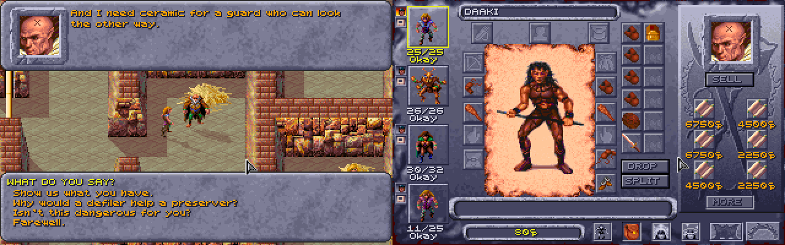

Talk to him as to anyone (click him with the look pointer, then the Look box's
Talk button). His conversation is the game's kind, just him speaking:

- **With respect** ("We mean no harm. We're slaves too."), he owns up to
  scribing spells on scraps of hide at night, to bribe a guard, and offers
  them: **Show us what you have** opens the game's shop screen, with his six
  scrolls, one of each, and what he wears (below):

  | Level | Scroll | Price |
  |---|---|---|
  | 1 | Shield, Burning Hands | 3,000 ceramic each |
  | 2 | Blur, Cat's Grace | 6,000 each |
  | 3 | Lightning Bolt, Haste | 9,000 each |

  None of them is a spell the game has a scroll of, so they're something you
  can't find elsewhere. The prices are the game's own for the spell's level
  (3,000 a level, as most of its scrolls are), less with
  [the leader's CHA](#the-leaders-cha-at-shops).

  Cat's Grace is there only with the new spells on (see
  [New wizard spells](#new-wizard-spells)). A preserver learns a scroll's
  spell as from any of the game's (right-click it in the inventory, click its
  spell), by the game's own rules (a spell of a level the preserver can cast),
  and with [Preservers' INT](#preservers-int) on it rolls to learn it. He
  remembers a friend ("Back again? Keep your voice down."). As with the game's
  own people, a question goes from his list once asked, until the next time
  you talk to him; the shop stays.
- **During the escape**, with the alarm sounding (the game's own alarm, which
  the pens' other slaves also answer to), he has only a line for the party,
  by how he stands with them, and no talk: to a friend, "That's the alarm. So
  it's you breaking out. Go, and go quickly: if they find you at my cell, I
  burn with you."
- **Calling him a defiler**, he answers back; take it back and he's friendly,
  or **threaten to tell the templars** and he won't speak to the party again
  until they make amends: **50 ceramic** (offered only to a party that has
  it), or a plea that he wins over with a **Charisma check** (the character
  talking rolls it).

He wears an Ashen Robe and a Cloak and carries a Quarterstaff (the game's
own), and sells them too: the game's shops sell everything a merchant carries,
worn or not. Once the party has bought it all, he has nothing more to sell.
Killed, he leaves whatever of these he still has and one of the scrolls he
still had, chosen at random, in his body, and the log says which scroll.
Attacked, he turns on the party as the pens' other slaves do, and only the
guards near him join the fight. If he dies, Dinos and the Trustee speak of him
as dead; after the party's escape he is gone from the pens with everyone else.

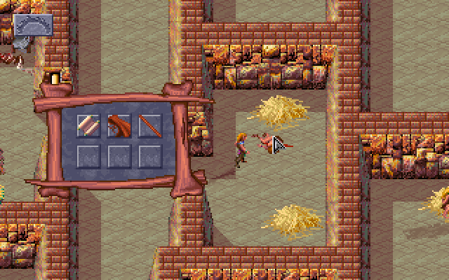

How it works: [DEVELOPMENT.md](DEVELOPMENT.md#kalzith).

#### Semyon

Untie the arena's prisoner and he is **Semyon**, a slave the templars tied up
in the sun for asking after the Veiled Alliance, "much more of a scout than a
warrior", as he says. He meets the party again in the arena's bone area, takes
them for the Alliance ("You must really be from the Veiled Alliance! I thought
they were a myth!") and asks to join. Made a member ("You, too, are now a
member of the Alliance.") and asked to help, he fights beside them in the next
fight and, if he survives it, leaves: "That's enough for me. I'm leaving. I'll
go find more members for the Alliance." (Some of his replies in the bone area
send him off before that: "That's enough for me. I'll see you in the holding
pens.", "Right, see you there!", or, still weak, "Why don't I meet you in the
holding pen?") Each way, he walks out through the arena's entrance to the
pens, where a script takes him off the map, and nothing in the pens brings him
back.

With the Loader, if he left after the fight he helped in, he is there, in a pen
of his own above Kalzith's, the first time the party is in the pens after it.
His other ways out stay as in the game, and so does a Semyon who was killed: he
isn't in the pens. Talk to him (Look, then Talk): he says why the templars tied
him up in the arena (he was asking about the Veiled Alliance), passes on what he
has heard (who carries keys), reminds the party where he hid his gem (the grain
pots), and talks about the Alliance's plans, in his own voice from the arena.
As with the game's own people, each question goes from the list once asked,
and comes back the next time you talk to him.

Attacked in his pen, he turns on the party as the pens' other slaves do.

**Breaking out with Scar.** A rare way through the arena: recruit Semyon just
before the fight with Scar, take up Scar's offer to break out together, and
head for the west exit. In the game, when the alarm goes up ("Gladiators
escaping! Guards! Sound the alarms!"), Scar and his henchmen come along to the
slave pens and Semyon is left behind. With the Loader, if he is still in the
arena, alive and on the party's side, he comes too: he stands beside Scar's
men in the pens and fights the guards with them, on the party's side. Talked
to then, he says: "Scar's gladiators and the Veiled Alliance, side by side!
Who would have believed it? Stay close to Scar: he knows the way out, and I'm
right behind you." He isn't made one of the pens' slaves while the escape
lasts, and once the party is out through the grate, he is gone with everyone
else.

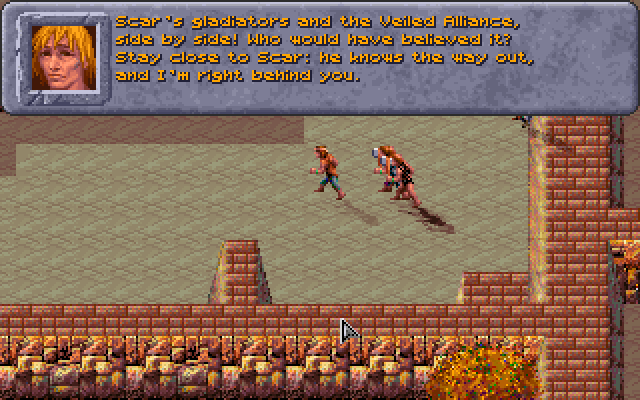

How it works: [DEVELOPMENT.md](DEVELOPMENT.md#semyon).

#### What Dinos and the Trustee say about them

Dinos ("Who else is in here?") and the Trustee ("Who else is in the
slavepens?") each answer questions about the others in the pens. With the
Loader their menus also ask about Kalzith, and about Semyon once he is in his
pen ("What do you know about Kalzith?", "What can you tell me about
Semyon?"). Kalzith's question waits until the Loader has found him in the pens
(the game's test for whether someone is there only knows the game's own
people); Semyon's once he has been in his pen. As with the game's own
questions, each is shown only until it's answered in that talk.

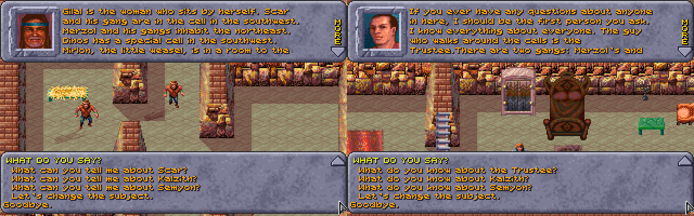

If either has been killed, they speak of him as they do of the game's dead:
the Trustee asks "What was Kalzith like?" (or Semyon) instead, with an answer
of its own, and Dinos keeps the question and answers it differently.

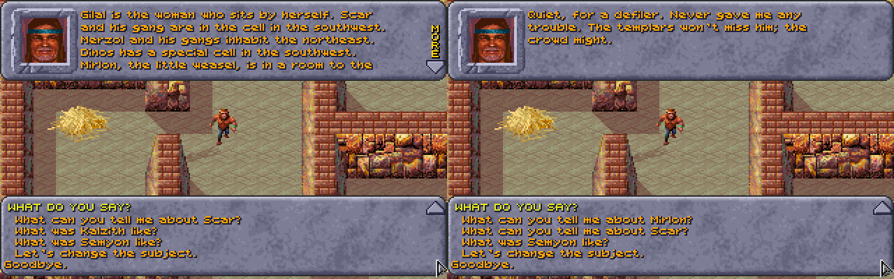

After the party's escape, when the game empties the pens ("They killed
everybody except for myself", the Trustee says on the torture rack), Kalzith
and Semyon are taken off the map too, the way the game takes the others, and
Semyon is never put in his pen after it.

How it works:
[DEVELOPMENT.md](DEVELOPMENT.md#what-dinos-and-the-trustee-say-about-them).

### The cooked vulture

Hit the arena's vulture and its feathers come off (a plucked vulture); the
slave pens' campfire cooks it. In the game itself the cooked vulture is then
no use to anyone: no script asks for it. With the Loader running, **Dinos**,
the pens' fine cook, can be asked about it: talk to him while someone in the
party carries it, and among the first things the party can say to him, just
before "Goodbye.", is **"We cooked the vulture from the arena."** He takes it
("A vulture! Give it here. A pinch of salt, some agafari leaf, slow over the
coals... Sit down and eat with me. A meal like this puts the strength back in
you."), and the game's own window for a quest's reward follows, as for any of
its quests: "Each party member receives 100 experience points!", with the
sound the game plays when a quest is done (as for the Trustee's key or the
filled water jug). Each party member gets **100 XP** (split between a
multiclass character's classes, as the game splits all its XP) and is
**restored as after a full rest**: HP, PSP and spell slots full, and anyone
knocked out back on their feet. No time passes. The question is gone once the
vulture is. (Eaten by the party on their own, used on one of them from the
inventory, it's too tough to be worth the chewing.)

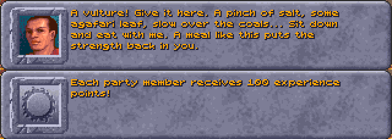

How it works: [DEVELOPMENT.md](DEVELOPMENT.md#the-cooked-vulture).

### Defilers' scrolls

A defiler may carry a spell scroll it was studying: with **Defilers' scrolls**
ticked, each defiler in a fight has a 5% chance (1 in 20) of carrying a scroll
of a random preserver spell, any of the game's 69 (1st to 5th level) or, with
the new spells on, the mod's new ones. When it dies the scroll is on its
body, with the rest of what it carried.

The defilers are those the game makes defilers: Balkazar, Wyrmias, Tara, the
Troop Leader, the arena's Defiler (who dies in the opening fight), the Dark
Spiders and the Spider Mother, the Hermit, and the thri-kreen Click-tunk!,
Churr-te-tunk! and Cheee-smak-tunk!, on either side of the fight. No one else
carries one. Kalzith keeps his own scrolls.

The scroll is the game's own kind: a preserver learns from it as from any
scroll (right-click it, then click its spell's icon), and it sells for 3,000
ceramic pieces a spell level. The dice log doesn't show the roll, so whether a
defiler had a scroll is found out on its body.

Each defiler is rolled for once in each fight, the arena's later defilers too.
A fight played again from a save is a new chance; a game saved mid-fight keeps the scroll a defiler was given.

How it works: [DEVELOPMENT.md](DEVELOPMENT.md#defilers-scrolls).

## Graphics

What the mod draws on the game's map, and the magic items' icons. The elves'
and half-elves' looks, the party's gear, shadows and dust each have a switch in
the Options tab's **Graphics** section.

### Elves and half-elves

Elves have pointed ears, walking and fighting, beside any helm. Half-elves have
their own look (the game draws them with the human pictures), made from the
game's pictures in colours the party's figures already use. A half-elf man is
built like the elf man, a little broader, with fair hair cut short at the nape,
a linen shirt under a leather jerkin, green trousers, brown boots and small
pointed ears. A half-elf woman is a little slimmer than the human woman, with
golden hair up in a bun, pointed ears, a purple cloak, purple wristbands and
red boots. Anything worn is drawn over these in its own colours, so a worn
cloak or boots replace the purple and the red.

With **Elves have pointed ears, and half-elves figures of their own**
unticked, elves are as the game draws them, and half-elves are the human
figures in their own colours. It counts from the next time the game is
started.

Cilla, in the game's own party, is an elf, but the game gives her the figure
it gives half-elf women. With **Cilla, an elf in the game's own party, drawn
as an elf** ticked, the Loader gives her the elf woman's, in a new game and in
one already begun (there from the next area or load on), whatever the switch
above. Unticked, she keeps the game's half-elf woman's figure, from the next
time the game is started (a game where she already has the elf's keeps it).


How it works: [DEVELOPMENT.md](DEVELOPMENT.md#elves-and-half-elves).

### What the party wears

The party's figures on the map and in fights show what each one wears, and
change as soon as their gear does (switch it off on the Options tab to see the
game's own). The game draws each race and sex the same whatever they carry;
the Loader keeps the artist's pictures and adds to them, frame by frame,
walking and fighting:

| Worn | Shown |
|---|---|
| **Weapons and shields** | each weapon type its shape (dagger, sword, club, mace, axe, polearm, gythka, staff, a round shield), in its material's colours (wood, bone in ivory, stone, obsidian, metal; an axe or mace on a wooden haft, its head solid, as the game's own axemen carry them; Kreenfang's two blades in the fire colours and Shadowseeker's in night steel, as their icons; the spells' weapons whole in the colours the game animates, the Flame Blade and Shillelagh in the fire's and Spiritual Hammer's head in the water blue, as their icons glow; any other magic weapon or shield, one with a plus or a power, Shadowseeker too, glints along its bright edge, a staff along its shaft, in whichever of the colours the game animates (fire, green, violet, water blue) is nearest its icon's own shine or colour, blue for steel and plain ones); walking, a one-handed weapon is worn at the belt, hanging down and back like a scabbard, two-handed ones are carried upright, and a shield is on the arm (from the side, on the far arm held forward of the chest, so it shows past the body); in a fight they are in the hands and swung, and the shield is on the other forearm in every pose (placed by hand for each model where the arm is hidden or flung) |
| **Bows and slings** | the bow and quiver on the back (the game draws the bow when shooting), a sling or chatkcha at the hip |
| **Armour** | the character's own clothing recoloured toward its material, shade for shade (leather, bone, chain, plate, scale...): the chest piece above the waist, arm pieces at the wrists, leg pieces below the waist; on figures the artist drew mostly bare (the mul, the dwarf man) only their straps and loincloth change, so it shows little; magic armour (a plus or a power) has a scatter of sparks over it in its icon's glow colour, as have magic cloaks, helms, boots and belts. Seen from the front, a cloak hangs behind the wearer, its edges no wider than the back |
| **Helms** | a circlet at the brow blended into the hair: a feather on leather, a dark stone on iron, low spikes on bone |
| **Cloaks** | the cloak the game draws on the human woman (its folds and swing as she walks and fights), fitted to the wearer, under the hair, in the cloak's colours; a half-elf woman's own purple cloak takes the worn one's colours |
| **Boots and belts** | the feet and the waist recoloured (Boots of Elvenkind in soft green) |

The colours are muted ones no region's palette changes. A thri-kreen shows
only weapons and shields (all it can use). Two party members of the same race
and sex each show their own equipment: the game gives them one figure, so the
second is moved to pictures of their own.


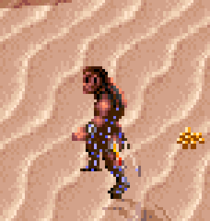

How it works: [DEVELOPMENT.md](DEVELOPMENT.md#what-the-party-wears).

### Shadows

Every living figure on the map (the party, the people, the monsters; not the
dead, nor items) casts a soft see-through shadow on the floor, its outline laid
long toward the lower right, the way the walls' own shadows fall (the light on
the game's maps comes from the upper left). The shadows are drawn on the floor
before anything else, so every figure and wall stands on top of them: a shadow
never covers another figure. Switch them off on the Options tab.

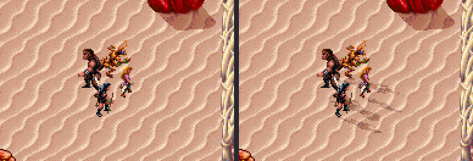

How it works: [DEVELOPMENT.md](DEVELOPMENT.md#shadows).

### Dust

Anyone walking on sand or dirt raises little puffs of dust behind their feet,
which spread, rise a little and fade in about a second. The walls and figures
stand in front of them, as with the shadows. Switch it off on the Options tab.

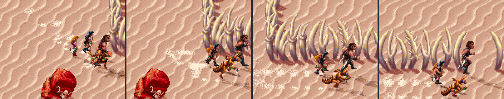

How it works: [DEVELOPMENT.md](DEVELOPMENT.md#dust).

### Magic items' icons

The game makes most of its magic items' icons shine in the inventory, a shop
and on the ground: their colours turn, as the water's and the fire's do. Some
it left still. The Loader gives 19 of them the shine of the others: the Parting
Staff, the Chameleon Gloves, the Hornblade, Cahulaks +1, Dag's Dagger, the
Terror Blade, Blackmace, the Shimmer, Drake and Silk Armor, Tanelyv's and
Grey's arm and leg pieces, the Living Cloak, the Golden Torque, Light of Dawn,
El's Ring and the Orb of Knowledge. Cahulaks +1, Light of Dawn and El's Ring
share their picture with a plain item in the game, so they get one of their own
and the plain cahulaks and ring stay still. The Loader's own magic items shine
in their icons too. There's no switch: only the pictures change.

How it works: [DEVELOPMENT.md](DEVELOPMENT.md#new-items).

### Spells on the ground

The [6th-level priest spells](#6th-level-priest-spells) that stay on the map
have pictures of their own: Blade Barrier a ring of circling blades and Wall of
Thorns a tangle of thorns (Wake of the Ravager's, from your copy; the game's
fire wall recoloured without it), Fire Seeds a fireball, and Whirlwind one tall
funnel of dust in the middle of its area that turns as you watch, its ring of
dust at the edge (two Whirlwinds at once each turn).

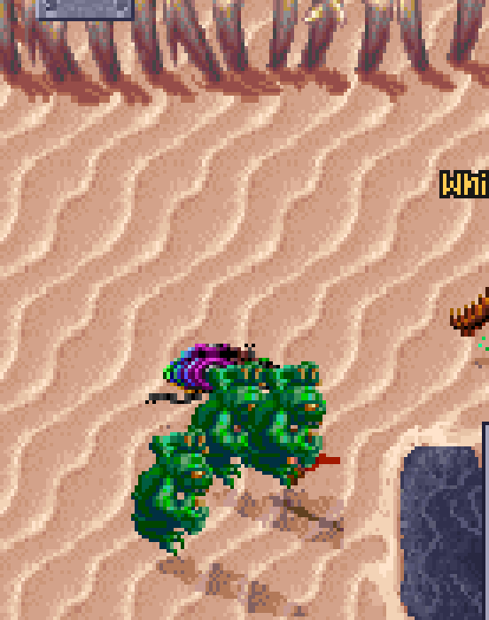

How it works:
[DEVELOPMENT.md](DEVELOPMENT.md#new-spells-wizard-and-6th-level-priest).

## Controls

Each has a switch in the Options tab's **Controls** section, but M, U and I,
which are always on.

### Choosing an enemy: Tab, Enter and the rings

In a fight, on a party member's turn, **Tab** chooses an enemy, the nearest
first, then the next nearest (**Shift+Tab** goes back): a red ring on the
ground marks it, under its feet (the figure stands in it, as on its shadow),
the view scrolls to it if it is out of sight, and the log names it. **Enter**
then attacks it, as clicking on it does (walking up to it first when it is out
of reach), even where another figure stands in front of it. On the Options tab
the ring can be switched off (**none**), and Tab and Enter have a switch of
their own.

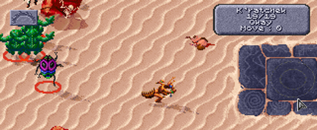

Tab and Enter also make attacking possible without aiming the mouse at all.

How it works:
[DEVELOPMENT.md](DEVELOPMENT.md#choosing-an-enemy-tab-enter-and-the-rings).

### Scrolling the map

Press the mouse wheel on the map and move the mouse: the map moves with the
pointer, as if dragged, in fights too. On the Options tab it can be switched
off. The game still scrolls on its own when the pointer touches
the screen's edge, and still brings the view back to whoever's turn it is in a
fight.

The view can't be zoomed: the game draws a 320 by 200 screen at one scale,
with the view's size built into its drawing code and its video memory pages.

How it works: [DEVELOPMENT.md](DEVELOPMENT.md#scrolling-the-map).

### M, U and I: open a screen, close it again

**M** on the map opens the overhead map, as the game's **O** does, and **M**
again closes it. **U** and **I** open the USE and inventory screens and close
them when pressed a second time. **U** on the inventory, or **I** on USE,
switches to the other screen, as in the game. After a click on a screen's
buttons or another key, the next **U** or **I** works as in the game.

How it works: [DEVELOPMENT.md](DEVELOPMENT.md#scrolling-the-map) (its
paragraph on M, U and I).

### The whole party in view

The game shows the party on the map as one figure, the leader, until you
press **5**, and gathers it back into the leader after every fight and in
saves made that way. With the mod, a game starts and loads with the whole
party in view, and the party stays in view after a fight, as if you had
pressed **5**. **6** still gathers the party into the leader, and it stays so
until the next fight or load. On by default: **The whole party in view as a
game starts or loads and after each fight** on the Options tab, from the next
start.

How it works: [DEVELOPMENT.md](DEVELOPMENT.md#scrolling-the-map) (its
paragraph on the whole party in view).

### The view in fights

The game moved the view after a figure walking in a fight as soon as it came
near the screen's edge, a step at a time, so the view drifted after every
figure that walked, monsters' too. Now it moves only once the figure has
walked off the screen, to bring it back into view (on by default: **In a
fight, the view moves to a figure only when it walks off the screen** on the
Options tab, from the next start). Out of fights the view follows the party
as the game has it.

How it works: [DEVELOPMENT.md](DEVELOPMENT.md#scrolling-the-map) (its part
on the view in a fight).

### The pointer in scenes, and where it starts

The game shows no pointer in its intro, the logos before it and its other
scenes (the king's decree, the arena gate), and only a key skips them. Now the
game's own pointer (read from your copy of the game) follows the mouse there,
in the scene's nearest colours, and a click of either button skips a
scene as a key does: in the intro, straight to the main menu. (With DOSBox's
**autolock**, as GOG's setup has it, the first click in the window only takes
the mouse; the next one skips.) As before, a key or click is noticed between a
scene's steps, so a long still picture, like the decree, plays to its end.

The game left the pointer at the right edge of the screen when its menu came
up, and it moved half as far up and down as across (the mouse driver's own
setting). Now it starts in the middle, stays where you leave it from one screen
to the next (the intro, the menus, loading), and moves as far each way. In a
window it also moves as fast as your desktop's pointer: DOSBox moved it a whole
game pixel (three screen pixels in the usual window) for each pixel the mouse
moved, too fast and coarse to put an item where you meant in the inventory.

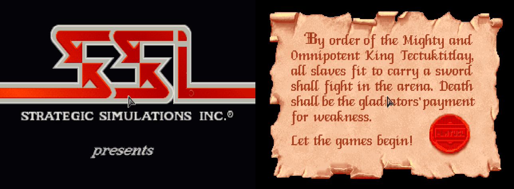

Each has its switch on the Options tab, on by default (from the next start).

How it works:
[DEVELOPMENT.md](DEVELOPMENT.md#the-pointer-in-scenes-and-where-it-starts).

## More saves and characters

### More saves

The game's save and load window holds 10 saves. With the Loader it holds 40,
on four pages of ten: the **PAGE 1** to **PAGE 4** buttons under EXIT show a
page, the page shown has its button greyed, and **PgDn** and **PgUp** go to
the next page and the one before. Save and load as always; the window opens
on the page last shown. In the load window, PgDn and PgUp pass by pages with
no saves; a page's button shows it even with none, with **LOAD** greyed (and
Enter doing nothing) until you go to a page with a save. (The game itself
never lets you choose an empty row to load; loading one would start a new
game.)

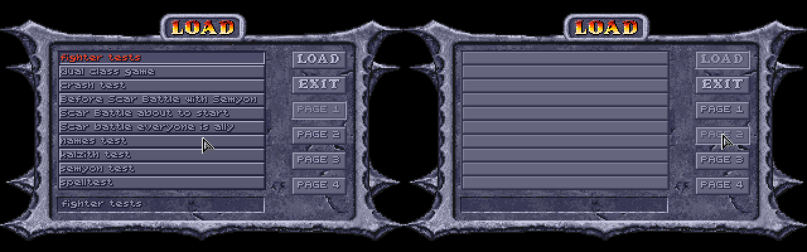

Page 1 is the game's own saves, `SAVE01.SAV` to `SAVE10.SAV` in the game
folder (or, with GOG's DOSBox, its `cloud_saves` folder); pages 2 to 4 are
`SAVB01.SAV` to `SAVB10.SAV`, `SAVC..` and `SAVD..`, next to them. The game
started without the Loader shows page 1 only, as always: it looks for
`SAVE??.SAV`, and the other pages' names don't match. (It had better not see
them: it puts each save it finds in the row its number names, with room for
ten, and a `SAVE11.SAV` would be written past the end.)

How it works: [DEVELOPMENT.md](DEVELOPMENT.md#more-saves).

#### Saves under their names

Only the game's list says which file is which save. While its window is open,
the Loader keeps a second copy of every save, under the name you typed for it
in the game, in its own **Named saves** folder:
`Page 2 slot 05 - Before Scar's battle.SAV`. Saving over a slot replaces that
slot's copy. The Options tab's **Saves** section has **Open the folder**, and
**Put a save in a slot...**, which copies a named save (or any save file) into
the page and slot you give, asking first if that slot holds one, to be loaded
from the game's list.

### More characters

The game keeps up to 19 characters made with CREATE CHARACTERS (and the party
members dropped back to the roster); a 20th is refused with "Maximum
characters". With the Loader it keeps 29. The roster in the ADD window
scrolls through them all, as it did through 19.

They are in the game's own `CHARSAVE.GFF`, each under a number, 1 to 29. The
game started without the Loader reads numbers 1 to 19 only: characters saved
under 20 to 29 aren't shown, and aren't lost; they come back with the Loader.
(The game saves a new character under the highest free number, so the first
ten made after the 19th go to 20 to 29.)

The patched game also fixes a bug of the game's own: **DELETE** in the
roster deleted the character in the row clicked counting from the top of the
list, not from the top of what was shown. With the list scrolled down,
another character was deleted. Now it deletes the one chosen.

A character made with CREATE CHARACTERS is **New** (with its starting gear,
given when DONE is clicked) until the game starts, when the game makes it
Okay. The game's tests for Okay left New out, so a New thief's skills all
showed 0 on the inventory screen, and the Loader did the same. The patched
game counts New as Okay wherever it tests for Okay, and so does the Loader.
Left as they were: the status under the portrait still reads New, and the game
still makes New characters Okay when the game starts.

How it works: [DEVELOPMENT.md](DEVELOPMENT.md#more-characters).

## Game speed

In the game a walking figure takes a step for each frame drawn, and a frame
drawn a moment too late waits for the screen's next refresh (70 a second), so
with the whole party in view, shadows and dust on, everyone walked at about
half speed ([how fast the party
walks](HOW-THE-GAME-WORKS.md#how-fast-the-party-walks)).

**Steady pace** (under Game speed on the Options tab, on unless switched off;
from the next start): on the map the party walks at its full speed whatever is
drawn. When a frame is late, the next one isn't drawn: the game still moves
everyone a step, and the frame after shows all that moved in both. On a busy
screen you see fewer pictures: with the whole party walking in the slave pens,
about 27 a second, where the game shows about 37 without steady pace (and 70
when no frame is late; counted by the game's page flips). So walkers move two
or three steps between pictures rather than one, but no one slows down. Fights
draw every frame, as the game does.

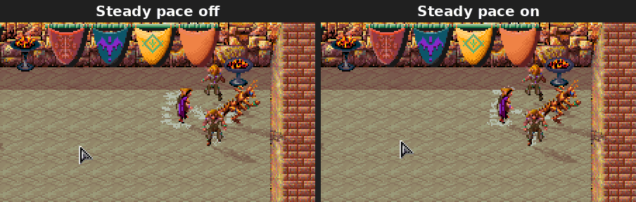

*The same save and the same clicks, recorded from the game at 70 frames a
second and played here at half speed (a GIF can't show 70 a second), every
frame kept. On the right the party reaches each spot sooner, in bigger steps.*

The Loader also gives DOSBox more of the computer's time: 20,000 cycles a
millisecond by default, where GOG's settings give 7,000. On the Options tab
**Game speed** is GOG's own (7,000), that (20,000), or 35,000: there nearly
every frame is drawn in time even with the whole party in view, the smoothest,
but it needs a faster computer (measured, frames stop being skipped from about
30,000). It applies the next time the game is started. The
Loader's two speeds run on DOSBox's dynamic core (GOG's settings run this game
on the slower normal core): the same cycles do more, and cost the computer
about a third less.

Measured in the slave pens at 20,000 cycles with everything on, walking (the
leader's speed in pixels a second of the game's time):

| | The leader's speed |
|---|---|
| The whole party in view, steady pace off | 152 to 175 |
| The whole party in view, steady pace on | 249 to 278 |
| The leader alone | about 220 to 260 |

What each setting asks of the computer:
[Suggested system requirements](README.md#suggested-system-requirements).

How it works: [DEVELOPMENT.md](DEVELOPMENT.md#game-speed).

## The game's bugs, fixed

The patched game mends these whatever the Options tab says (the rules the game
got wrong, each with a switch, are [below](#rules-the-game-got-wrong)):

| | The game | With the Loader |
|---|---|---|
| **Mirror Image** (and Reflected Image) | The images stopped no weapon blow, and took a spell for one creature three times in four whoever cast it: Armor cast on oneself was lost, an image with it | Each hit, and each foe's spell for one creature, strikes an image three times in four (Reflected Image's half the time); your own side's spells always get through ([how long it lasts](HOW-THE-GAME-WORKS.md#spells-and-effects)) |
| **Armor** | A charge used each time any spell or blow landed on the wearer, as well as for the damage: two for each hit, and one for a friend's Bless | One charge for each damaging hit |
| **Share Strength** (any maintained power on someone else) | Ended, it stayed on the one who got it, and could end another of the psionicist's own effects instead | It ends on everyone it was on |
| **Dispel Magic** (the preserver's) | Also laid "No spell use" on everyone it caught, your own party too, which Dispel Magic can't remove | Only dispels, as the cleric's always did |
| **Cause Serious and Critical Wounds** | 2d9 and 3d9 (the Cure spells heal AD&D's 2d8+1 and 3d8+3) | 2d8+1 and 3d8+3 |
| **Absorb Disease** (the psionic power) | Also gave the psionicist 1d6 STR, as Strength does (its code ran on into Strength's), and the STR alone when there was no disease to take | Takes the disease only |
| **Bless** and **Aid** | Left out those of the caster's side with an enemy beside them, but measured it from the wrong place (a slip in the code), so the wrong ones were left out | Measured from where each stands |
| **Negative Plane Protection** | Saved as against Vampiric Touch, which allows no save, so it never stopped anything | A save against paralysis, poison and death, as AD&D's against death magic: saved, the undead's touch is stopped and it takes 2d6 |
| **Acid Arrow** | After the hit its acid never burned again: its time was a timer that only ended it, and nothing spent it a round at a time | 2d4 acid at the start of each round it lasts (a round for each started minute of its time: four for an 11th-level caster) |
| **Cloak of Bravery** | Its +4 on saves against fear asked for a mark no spell had, so it never applied | +4 against Scare, Fear, Cause Fear and Insect Plague (and a Cloak of Fear's), and the new [Spook](#new-wizard-spells) |
| A **berserk** or **confused** party member | Could end it fighting for the monsters' side: their side is rolled each turn, and only a charm's end put it back | Back on their own side when it ends |
| The **fire elementals** | The resistances the wrong way round: the fire elemental hurt by +1 weapons, the lesser one only by +2 and by fire | The fire elemental needs +2 weapons and the lesser one +1, as the clue book has them, and neither takes anything from fire |
| **Walls** cast by monsters | The computer aimed both ends of a wall at the same spot, so its walls were a single point | Across the line of fire, four cells long |
| A **thri-kreen's claws** | Crushing, as the game makes every unarmed attack, so a creature crushing weapons can't hurt (a mastyrial) was safe from them | Edged: they cut, for a thri-kreen in the party ([Erdlu Claw](#new-wizard-spells)'s talons too) |
| **Thief skills**' equipment penalty | Taken for anything in the hands, quiver or leg slot (a weapon held cost 5 to 10 points), never for the armour worn | None ([how the game works out thief skills](HOW-THE-GAME-WORKS.md#how-the-game-works-out-thief-skills)) |
| **DELETE** in the roster | With the list scrolled, deleted another character | Deletes the one chosen ([more characters](#more-characters)) |
| A **New** character's thief skills | Shown as 0 | Shown as they are ([more characters](#more-characters)) |
| **The Trustee** in the slave pens | His rounds' two pauses took their corner from numbers other scripts in the pens change, so he could set off for a spot that doesn't exist and stay busy ("I'd love to talk more...") for good | The pauses keep a corner of their own, and his busy line starts his rounds again, so one already stuck walks on once talked to |
| A thief skill rolled **for the whole party** (a trap going off, hearing the men by the wagon) | Meant for the member with the best chance, but the pick compared the wrong way round, so the first party member always rolled | The member with the best chance rolls ([where the game rolls them](HOW-THE-GAME-WORKS.md#where-the-game-rolls-thief-skills)) |
| **Random monsters** (a vanishing body, a survivor's warning) | How many came was worked out from the wrong monster's strength, and in seven regions the last monster on the list divided by 0, which ended the game ("Divide error") | Worked out from the monster that comes: 1 to 6, fewer of the strong ones |
| A magic item's **glow in a shop** | Stood still: a shop runs its own loop, which never turned the colours that make it shine | Shines, as on the map and in the inventory |
| The game's **Sling +1** | A blank icon (its picture is missing from the game's data) | The Sling's, with a glow |
| **View Character's DAM line** with a wooden, bone, stone or obsidian weapon | One or two more than the attack does: it left out the weaker material's damage (2 for wood, 1 for the others, on a weapon with no plus), which the inventory's line and the attack take off | The same as the inventory's and the attack's |
| The **DAM lines** of a **hasted** or **slowed** character (the inventory screen, View Character) | The attacks a round as if neither: a fight's attack doubles them for Haste and halves them for Slow, but the lines never did, and the inventory's showed half an attack a round (Slow's) as one | Twice, or half, as the attack has them (`3x1D8+13` hasted, `0.5x1D8+6` slowed), as on the Loader's Characters tab |
| **Darkhold**'s scripts | Story events left some creatures' triggers pointing at an empty script: the wyvern scene's creature and two in the queen's chamber lost their look text, and the portcullis guard no longer fought back when attacked | Each keeps its own |
| The **Lava Rifts** ranger | His sight trigger, set again, pointed at the hermit's script: endless hermit talk, and a second Iron Necklace | He keeps his own |
| **Linara** in Gedron | Once the extract was delivered, her talk ended with no menu, so Jasmine's spellbook could never come up | Her talk goes on to her menu |
| **"Out of memory in OEOpenGraph"** in a long session | The map needs 60,000 bytes in one piece each time it comes back (after the USE screen, a talk, a menu), and with the map up the game had about 57 KB to spare, so it could stop | Part of the game's code and its music buffer kept in upper memory: about 97 KB to spare with the map up, and a warning in the dice log if it runs low ([crash, freeze and item reports](README.md#crash-freeze-and-item-reports)) |
| **Slay Living**'s description | Said a creature that saves takes 3 to 17 | Says 2 to 16 (half of 4d8), what the game does |
| An archer's **pointer** after a shot | Showed "can't shoot" once any shot of the round was made (one that killed its target, say), though the click still shot the shots left | Shows "can't" only once every shot of the round is made |

Two more have a switch: Cilla's figure (the game gives the elf the half-elf
woman's; see [Elves and half-elves](#elves-and-half-elves)), and a click on a
spell's icon on the Effects screen ending it ([Spells on the Effects
screen](#spells-on-the-effects-screen)). How the fixes work:
[DEVELOPMENT.md](DEVELOPMENT.md#the-games-spells). The three script bugs
(Darkhold, the Lava Rifts, Linara) were found by the OpenDS project and checked
by yuan-ti; the Loader mends them in its copy of the game's scripts
(`scriptfixes.py`).

**Saved games.** There's no need to start a new game for these: they're in
the patched game, not in a save, so they work from the moment a game is
loaded, on effects already running too. What a bug already did stays in the
save: a character who kept Share Strength's strength still has it (load a save
from before the power was used to be rid of it), and one silenced by the
preserver's Dispel Magic casts again once that wears off. A new game is still
the way to see all of the mod: kits, STORE and RECALL and fuller starting gear
come with characters made with it, and much of the
[new content](#new-content) is in the game's first areas.

### Spells on the Effects screen

On the Effects screen (a character's spells and powers in effect), a click on
an effect's icon ends it in the game, so a stray click loses a spell. With the
Loader a click leaves a spell on; a psionic power's effect still ends, as that
is how a power is stopped. It has a switch in the Options tab's **Controls**
section (**A click on a spell's icon on the Effects screen leaves it on**,
from the next start).

With the pointer on the icon of a spell that lasts a number of uses, the
Effects screen names the uses left: IMPROVED AC (10 CHARGES). Enlarge's icon
names the melee damage it adds, 10% a level of its caster: ENLARGED (+90% DAMAGE). A magic item's
power (Shadowseeker's Detect Invisibility) lasts while the item is readied and shows no
charges.

### Rules the game got wrong

Where the game's own rules contradict its manual or AD&D, or each other, a
[rule change](#rule-changes) puts them right. Each has a switch on the
Options tab, on by default:

| | The game | With the rule |
|---|---|---|
| **Saving throws against spells** | Almost every spell saved against with petrification/polymorph | The spell save ([spell save](#spells-saved-against-with-the-spell-save)) |
| **Fire, cold and electricity** | The save's d20 rolled twice and added up, so most creatures shrugged off a Fireball (70% to save where 35% was due) | One d20, with DEX's defensive adjustment for dodging ([DEX instead of a doubled d20](#fire-cold-and-electricity-dex-instead-of-a-doubled-d20)) |
| **Two weapons** | No penalty (a small bonus at DEX 5 or less), and each hand attacking at the whole rate | −2 main hand, −4 off hand, DEX helping; the off hand attacks once a round ([two weapons](#two-weapons)) |
| **Warriors' attacks** | Every fighter, gladiator and ranger attacking at a specialist's 3/2 a round with any weapon | AD&D's plain rate, the specialist's only with a chosen weapon spec ([weapon specialization](#weapon-specialization)) |
| **Multiclass characters' gear** | Any one class allowing an item was enough | Each class's limits hold ([class restrictions](#class-restrictions)) |
| **Multiclass hit points** | CON's bonus once a level of the highest class | On every hit die, shared between the classes ([multiclass hit points](#multiclass-hit-points)) |
| **Rangers' spells** | Cast at the ranger level less 7 for the spell levels allowed, but lasting and hurting as the whole level | The level less 7 for both ([rangers' casting level](#rangers-casting-level)) |
| **Acid on armour** | Any armour without a magical power destroyed outright, its plus ignored | A save by material, a plus helping ([items saving against acid](#items-saving-against-acid)) |
| **Class tables** | Priests' THAC0 improving a level early (19 at 3rd), fewer priest and preserver spell slots (3 2 1 at 5th), and gladiators, rangers and thieves needing AD&D's XP less a little | AD&D's tables ([AD&D's class tables](#adds-class-tables)) |
| **Thief skills** | A table of the game's own, high from the start (a 3rd-level elf: move silently 66, hide in shadows 61) | AD&D's table by level, with Dark Sun's race and DEX adjustments ([thief skills from AD&D's table](#thief-skills-from-adds-table)) |
