# Items

*Part of Obsidian Edition's documentation. **Spoilers:** this page says where
every item is. The [player's guide](PLAYER-GUIDE.md#new-items) lists what the
mod adds and who can use it, without saying where.*

Every magic item, mundane weapon and mundane armour piece in a game with the mod's [new
items](FEATURES.md#new-items), the game's and the mod's, with their icons and where each is;
first, more on the mod's own items; last, each item's chance [against acid](#items-against-acid).

## Contents

- [The mod's new items](#the-mods-new-items): [prices](#prices), [the Warden's Plate](#the-wardens-plate),
  [bracers of defense](#bracers-of-defense), [robes](#robes), [icons and names](#icons-and-names),
  [Alagorn's stories](#alagorns-stories), [Pehtucl's chest](#pehtucls-chest)
- [Every magic item](#every-magic-item): weapons, missile weapons, by weapon
  spec, body armour, arm and leg armour, head, shields and gloves, other worn
  items, held items
- [Every mundane weapon](#every-mundane-weapon)
- [Every mundane armour piece](#every-mundane-armour-piece)
- [Items against acid](#items-against-acid): chest, arms and legs, weapons

## The mod's new items

What the mod's [new items](FEATURES.md#new-items) cost, the armour that needs saying more of,
their icons and names, what Alagorn tells of them, and Pehtucl's chest. Where each is, and what it does, is in the
tables below.

### Prices

Prices follow the game's own (a price can't go past 65,535; the game's
dearest, the Wand of Missiles, is 65,000):

| Items | Price |
|---|---|
| Magic melee weapons, and Dunesong | 20,800 a plus (41,600 for a +2; a +1 with a spell 22,000; the game's Bow +2 is 50,800) |
| Legcrusher's Cahulaks +1; the Cahulaks +2 | 11,600 (the game's Cahulaks +1's); 32,400 (that, +20,800 for the plus more) |
| Windlash; Skycutter | 2,800 (as the game's Sling +1); 3,500 (as its Sling +2) |
| Plain metal weapons | 50 to 300 (metal cahulaks 200) |
| Plain obsidian cahulaks | 15 (bone 10, as the other obsidian weapons dearer than bone) |
| Bracers of defense | 5,000 a point of AC |
| Rings and Cloak of Protection | 15,000 |
| Inixhide; the Ashen Robe | 6,000 |
| Veiled Robe | 40,000 |
| Cloak and Boots of Elvenkind | 25,000 and 20,000 |
| Boots of Speed | 20,000 (as the game's Serpent Boots) |
| Warden's Arms and Legs; Chest; Helm | 27,000 each; 36,000; 30,000 |
| Arrowbane; Sunking Crown | 30,000; 40,000 |
| Girdle of Back Defense; Golden Girdle of Urnst; Amulet of Magic Resistance | 25,000; 20,000; 35,000 |
| Gutterward; Ironbulwark | 25,000; 65,000 (the game's Drake Shield +1 is 25,400, El's Shield +2 50,200) |
| Tome of Understanding | 43,500 (AD&D's) |

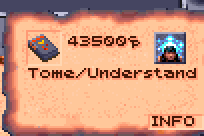

### The Warden's Plate

The **Warden's Plate** is plate mail +1 in four pieces: the chest 4 better
than no armour (its AC 3, +1), the arms and legs 3 each (AC 2, +1), the helm 2
(a helm's AC 1 with [helms giving AC 1](FEATURES.md#helms-give-ac-1), +1): 12 better as a set, so a
wearer with no other help goes from AC 10 to AC −2. (With that rule off the
helm gives only its +1: 11 better, AC −1.) The game adds up its pieces' AC
this way for all armour, so a full set does better than AD&D's plate mail +1
(one suit, AC 2: 8 better). It is metal armour, worn by the classes that can
wear the game's chain (no single-class thieves), and kept from more with
[class restrictions](FEATURES.md#class-restrictions). **Grey's Scale**'s arm and leg
armour is AC 3 each (the game's is 2).

### Bracers of defense

A preserver can't cast in armour (with [class
restrictions](FEATURES.md#class-restrictions)), so the mod adds AD&D's bracers of defense
([where](#every-magic-item)). They are worn on the arms, in the arm armour's place, and
give the AC their name says: AC 6 is 4 better than no armour, AC 2 is 8 better.
As in AD&D they give nothing while armour is worn: on the arms, legs or chest,
or a helm (bone, leather or metal, magical or not). A shield, rings and cloaks
of protection, and the mod's circlet and crown (worn on the head, but not
armour) go with them. They aren't armour to anything else: a preserver casts in
them, a thief wears them, and a ring or cloak of protection still counts. In the
game they are **BRACERS/DEFNS** with their plus (Bracers/Defns+4 is AC 6),
priced 5,000 a point of AC.

How it works: [DEVELOPMENT-CONTENT.md](DEVELOPMENT-CONTENT.md#bracers-of-defense).

### Robes

Two magic robes for those who go without armour: preservers, psionicists and
druids alone may wear them. A robe is worn on the chest, in the chest armour's
place; like the bracers its plus betters AC only while no armour is worn on
the arms, legs or head, and it isn't armour to anything else: a preserver
casts in it, and a ring or cloak of protection still counts. Bracers go with
it.

| Icon | Robe | What it does | Price |
|---|---|---|---|
|  | **Ashen Robe** (+1) | AC 1 better; +1 on saves against wizards' and priests' spells | 6,000 |
|  | **Veiled Robe** (+2), a robe of the Veiled Alliance | AC 2 better; +1 on every save; a wizard spell slot more at spell levels 1, 2 and 3 where the wearer has any | 40,000 |

Where they are: [Every magic item](#every-magic-item).

The dice log and the Loader name a robe among a save's modifiers, and the
Spells tab counts the Veiled Robe's slots. Alagorn tells both their stories.

How it works: [DEVELOPMENT-CONTENT.md](DEVELOPMENT-CONTENT.md#robes).

### Icons and names

Each of the mod's magic items has an icon of its own (in the [tables below](#every-magic-item)), made
from the plain item's the way the game makes its magic items' (a few pixels in
the colours it cycles like fire); dropped on the map they look like the plain
item. The game's names are at most 15 letters, so the rings are
**RING/PROTECTION** and the cloak **Cloak/Protectn**; the Loader's screens and
the log give them in full. As with its own items, the game puts the material
first: **Leather Inixhide**, **Metal +1 Shadowseeker** in the item box.

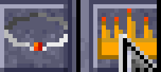

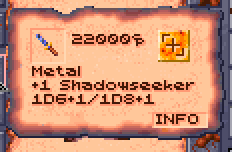

### Alagorn's stories

**Alagorn**, the wizard of the Painted Badlands who identifies magic items,
tells the story of every one of the mod's magic items in [Every magic
item](#every-magic-item) but the plain Gythka +2, the two cahulaks, the
Boots of Speed, the two girdles and the Amulet of Magic Resistance when
the party carries it, in the menu the game would put it in (swords, weapons,
rings, armor, shields, clothes or other items), before "Nothing". As with the
game's own, one story for each kind: the four pairs of bracers share one, and
so do both rings of protection. The Warden's Plate's pieces each tell a part
of Haldren's, the last of the Wardens.

Two of the game's own stories now say what the item does (always, a fix of the
game's text): the **Quicksilver Glove** (his menus called it "Quicksilver
Gauntlets", grafting a weapon to the hand) "holds a psionic charge. Whatever it
strikes is blasted from within, and the blast can shatter what the foe wears":
it casts Detonate on every hit; the **Helm of Contemplation** (a "shield of
thought against all psionic attacks") "turns a creature's gaze back on itself":
Gaze Reflection.

### Pehtucl's chest

The chest beside Pehtucl, the slave pens' head templar, holds the Cloak of
Protection +1. It is locked, with a poisoned needle in the lock, and can only
be worked from beside it. Used by a thief, it is first searched for traps
(find/remove traps: the needle drawn out, or set off) and then picked (open
locks; a failed try can be tried again). Anyone else can try to bash it open
(5% a try, and 5% more for each of STR 18, 20, 22 and 24), which sets the
needle off if it is still there. A needle set off is a trap as the game's are:
the party's best at find/remove traps may still spot it in time (or Detect
Traps), else it does 2d6 poison damage to the one who sprang it. Once open, it stays open. It comes with a new game, with
**New items, magical and mundane** on.

How it works: [DEVELOPMENT-CONTENT.md](DEVELOPMENT-CONTENT.md#pehtucls-chest).

## Every magic item

All the magic items in a game with the mod's new content on: the game's own,
read from its data (each item type's slot and material, each item's plus and
power, and who carries it), and the mod's, in ***bold italics***. In
**Where**, "—" means nothing in the data or the scripts places or gives the item.

A weapon's spell (Dark Flame's Burning Hands, Balk's Staff's Slow...) goes on
whoever it hits, every hit, with no charge used; one the game counts as helpful
(Shadowseeker's Detect Invisibility) is on its wielder instead while it is
readied. The powers here are the item's own, from the data. What Alagorn says of
an item when shown it isn't always what it does: the Golden Torque has no power
(two of his stories are corrected: [Alagorn's stories](#alagorns-stories)). The items that change a
score (Draketooth, Dag's Dagger, the Helm and Belt of Might, El's Ring, the
Steadfast Ring and the Ring of Insight) do it while worn, the
Belt of Might making STR at least 24.

**Weapons**, by material, then type:

| Icon | Material | Type | Item | Bonus / power | Where |
|---|---|---|---|---|---|
| 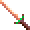 | Bone | long sword | Swiftbite | +2 | a reward in the party's house in Teaquetzl, when the party agrees to gather allies (with Arrows +2, a lemon and grapes) |
| 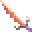 | Bone | long sword | Draketooth | +1, STR +3 | on a platform in the Wyrm School |
| 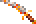 | Bone | long sword | Hornblade | +1 | Kalinin's reward |
| 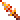 | Bone | dagger | ***Hayneedle*** | a bone dagger +1: a water cleric can wield it | hidden in **Merzol**'s haystack in the slave pens, with his sack of ceramic pieces |
| 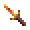 | Bone | short sword | ***Stillwater*** | a bone short sword +1: a **psionicist** can wield it, alone or with a water cleric | in the chest **Chaya** gives as her apology |
| 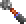 | Bone | mace | Mace +2 | +2 | a weapon rack in the Subterranean Temple, with the Storm Ring |
|  | Bone | axe | ***Drakejaw*** | a bone axe +1 (1d8+1): a water cleric can wield it | carried by one of the **Magera** guarding the wagon's prisoners |
| 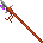 | Bone | polearm | Polearm +1 | +1 | carried by **Seref**, the Draj agent at the Elven Caravan, and by the Seref met on the road with his Drajian Guards and daggorans (his script makes a copy of him there). Placed by the mod: the game defines it but never places or gives it (the cluebook says the Elven Caravan) |
| 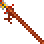 | Bone | polearm | ***Thornwall*** | a bone polearm +1 | on the slave pens' **weapon rack**, once **Semyon**, in his pen, has told of the weapon shipment ("Seen anything useful?") |
| 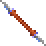 | Bone | gythka | Gythka +3 | +3 | carried by **Hototo**, chief of the White Sand Outlaws who burst from the sand (fought if the talk goes wrong; the mod's); and the arena's [1000th trip](HOW-THE-GAME-WORKS.md#the-arenas-count-of-fights), King Tectuktitlay's gift |
| 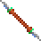 | Bone | gythka | ***Gythka +2*** | the game's Gythka +1, made +2 | the **Elven Leader**'s gift, after the fight with his men (he carries it too) |
| 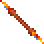 | Bone | gythka | ***Kreenfang*** | a gythka +1 (2d4+1) | carried by the **Tohr-kreen** leading the champions in the arena, after **Scar** is killed ([the champions' bout](FEATURES.md#the-champions-bout)) |
| 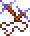 | Bone | cahulaks | ***Cahulaks +2*** | +2; casts Cause Light Wounds on a hit (the game's Cahulaks +1, made +2); its blades glow blue | the Elven Caravan's buried chest (Kel's caravan), with the Boots of Elvenkind |
| 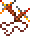 | Bone | cahulaks | ***Cahulaks +1*** | +1; its blades glow in fire colours | carried by **Legcrusher**, the pens' half-giant monster trainer, in place of his two clubs (the mod's) |
| 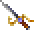 | Metal | long sword | Dragonsbane | +4 | Kraxis' sword, taken from his body after the final battle against Draj's army |
| 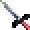 | Metal | long sword | El's Drinker | +2, Vampiric Touch | the safe in Gedron, with 2,000 ceramic pieces; and the arena's [1000th trip](HOW-THE-GAME-WORKS.md#the-arenas-count-of-fights), King Tectuktitlay's gift |
| 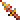 | Metal | dagger | Dag's Dagger | +3, CHA +1 | Dagolar |
| 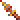 | Metal | dagger | ***Galefang*** | a metal dagger +2 an **air cleric** can wield | carried by the **Rogue Shaman**, with his Shaman Followers |
| 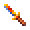 | Metal | short sword | ***Greenbright*** | a metal short sword +2 | carried by **Arant**, who holds the captured gladiators |
| 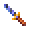 | Metal | short sword | ***Shadowseeker*** | a short sword +1 (1d6+1): whoever wields it, in either hand, sees the invisible | wielded by **Kurzak**, the pens' guard leader; a thief can lift it (200 XP, once a game) |
|  | Metal | axe | Soulcrusher | +1 | Kel |
| 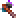 | Metal | axe | Axe +1 | +1 | hidden in a sewer hole in the Tari's warrens; or made at Teaquetzl's forge from the Meteor Metal and the Metal Rod |
| 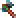 | Metal | great axe | Great Axe +3 | +3 (the game gave its type no material: metal with the Loader) | the Army Commander |
|  | Metal | great axe | ***Headsman*** | a metal great axe +2 | in the arena **Announcer**'s stash, with his Stoneskin scroll, rings and gems |
|  | Metal | polearm | ***Linebreaker*** | a metal polearm +2 | carried by the **Troop Leader** |
| 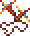 | Metal | cahulaks | ***Ironwhirl*** | a metal cahulaks +2 (two-handed); its blades' greys all burn in fire colours | on the **weapon rack** of the Subterranean Temple beneath Teaquetzl, with the Mace +2 and a metal axe |
| 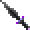 | Obsidian | long sword | Dark Flame | +2, Burning Hands | the Lower Castle's chest |
| 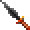 | Obsidian | long sword | Bloodwrath | +1 | Pehtucl, the pens' templar |
| 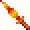 | Obsidian | long sword | ***Flame Blade*** | an obsidian long sword +1 (1d8+1) whose blade burns what it hits: the fire clerics' Focus Heat, 2d6 fire damage to the creature hit (a save for half), as the game's Dark Flame casts Burning Hands. Obsidian, so a fire (or earth) cleric can wield it | carried by the **Templar** of the Hot Springs (the one with the Drake Shield) |
| 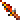 | Obsidian | dagger | Terror Blade | +2, poison | made in the Wyrm School: pour the terror blossom extract into the mixing bowl, then dip a stone dagger in it (the cluebook says obsidian; the game takes stone) |
| 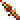 | Obsidian | dagger | ***Nightsliver*** | an obsidian dagger +2: a fire or earth cleric can wield it | carried by the **Hermit** of the Lava Rift, in place of his stone dagger |
| 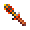 | Obsidian | short sword | ***Mindshard*** | an obsidian short sword +1: a **psionicist** can wield it, alone or with a fire or earth cleric | carried by **Maris**; a thief can lift it (200 XP, once a game) |
| 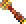 | Obsidian | mace | Blackmace | +1, Shocking Grasp | the Shadow King |
|  | Obsidian | axe | ***Glasshewer*** | an obsidian axe +2 (1d8+2): a fire or earth cleric can wield it | carried by the **Templar** of the elven slavers' camp (the one with the Chain Arm Armor) |
| 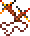 | Obsidian | cahulaks | ***Emberlash*** | an obsidian cahulaks +1 (two-handed): a fire or earth cleric can wield it | wielded by **Uzoma**, leader of the Drajian patrol met west of the Hot Springs once its templar is gone (fought if the party turns on his patrol) |
| 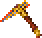 | Stone | pick | ***Deepbiter*** | a stone pick +1 (the game has no magic pick) | carried by one of the **Undermountain folk** (the miners) |
| 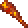 | Wooden | club | ***Gutterknot*** | a club +1 (the game has no magic club) | carried by **Churrr** in the warrens; a thief can lift it (200 XP, once a game) |
| 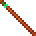 | Wooden | quarterstaff | Quarterstaff +2 | +2 | Maris |
| 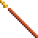 | Wooden | quarterstaff | Balk's Staff | +1, Slow | Balkazar |
|  | Wooden | quarterstaff | Parting Staff | +1 | hidden in a sewer hole in the Tari's warrens, the high warren elders' treasure (the Skull Elder objects if he sees it taken) |

**Missile weapons and ammunition:**

| Icon | Material | Type | Item | Bonus / power | Where |
|---|---|---|---|---|---|
|  | Leather | sling | Sling +2 | +2 | Chaya, and her apology chest |
|  | Leather | sling | Sling +1 | +1 | a chest |
| 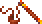 | Leather | staff sling | ***Windlash*** | a staff sling +1 (the game has no magic staff sling) | sold by the **Bowyer** |
|  | Obsidian | chatkcha | ***Skycutter*** | a chatkcha +2 | carried by one of the **thri-kreen** hunting the Gemfields |
|  | Obsidian | chatkcha | Chatkcha +1 | +1, Produce Fire | the Guardian |
| 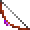 | Wooden | bow | Bow +2 | +2 | a skeleton in the Upper Castle |
| 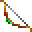 | Wooden | bow | Phrain's Bow | +1, Acid Arrow | a reward in the party's hut in Teaquetzl, once Gedron joins the alliance (with Arrows +2, a scroll and an orange) |
| 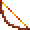 | Wooden | bow | ***Dunesong*** | a bow +1, which the Bowyer's archery target counts as the game's own bows | sold by the **Bowyer** |
| 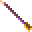 | Wooden | arrows | Arrows +3, +2, +1 | | +3 in chests; +2 from the Bowyer's archery target and Teaquetzl's rewards; +1 Kel, the Elven Leader and a bag in the slave pens |
| 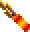 | Wooden | arrows | ***Burning Arrows*** | cast Burning Hands on what they hit | made by a [Spellarcher](KITS.md#multiclass-kits) (its arrow buttons), and readied by a Spellarcher only; worth nothing, gone at the next rest |
| 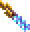 | Wooden | arrows | ***Chill Arrows*** | cast Chill Touch on what they hit | the same |
| 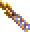 | Wooden | arrows | ***Shocking Arrows*** | cast Shocking Grasp on what they hit | the same |
| 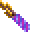 | Wooden | arrows | ***Vampiric Arrows*** | cast Vampiric Touch on what they hit | the same |

**By weapon spec**, for [weapon
specialization](KITS.md#weapon-specialization), in the weapon window's order:

| Weapon spec | Magic weapons |
|---|---|
| Long sword | Dragonsbane +4, Swiftbite +2, El's Drinker +2, Dark Flame +2, Draketooth +1, Hornblade +1, Bloodwrath +1, ***Flame Blade*** +1 |
| Club | ***Gutterknot*** +1 |
| Dagger | Dag's Dagger +3, Terror Blade +2, ***Galefang*** +2, ***Nightsliver*** +2, ***Hayneedle*** +1 |
| Short sword | ***Greenbright*** +2, ***Shadowseeker*** +1, ***Mindshard*** +1, ***Stillwater*** +1 |
| Mace | Mace +2, Blackmace +1 |
| Axe | ***Glasshewer*** +2, ***Drakejaw*** +1, Soulcrusher +1, Axe +1 |
| Great axe | Great Axe +3, ***Headsman*** +2 |
| Pick | ***Deepbiter*** +1 |
| Quarterstaff | Quarterstaff +2, Balk's Staff +1, Parting Staff +1 |
| Polearm | ***Linebreaker*** +2, Polearm +1, ***Thornwall*** +1 |
| Gythka | Gythka +3, ***Gythka +2***, ***Kreenfang*** +1 |
| Cahulaks | ***Ironwhirl*** +2, ***Cahulaks +2***, ***Emberlash*** +1, ***Cahulaks +1*** |
| Chatkcha | ***Skycutter*** +2, Chatkcha +1 |
| Bow | Bow +2, Phrain's Bow +1, ***Dunesong*** +1 |
| Sling | Sling +2, Sling +1 |
| Staff sling | ***Windlash*** +1 |

**Body armour:**

| Icon | Material | Item | Bonus / power | Where |
|---|---|---|---|---|
|  | Leather | Shimmer Armor | +3, Free Action | Dakaren |
| 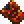 | Leather | Drake Armor | +1, Resist Cold | the Wyvern Master |
| 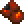 | Leather | ***Inixhide*** | Leather Chest Armor +1: the leather's AC, +1 | worn by **Legcrusher**, the pens' half-giant |
|  | Metal | ***Warden's Chest*** | plate chest armour +1 (AC 3, +1): Resist Fire on its wearer while worn | on **Balkazar**'s body |
|  | none | Silk Armor | +2 | the Outcast's gift in Undermountain, once the party has ended the curse, unless it has killed the dark spiders of Darkhold |

**Arm and leg armour:**

| Icon | Slot | Material | Item | Bonus / power | Where |
|---|---|---|---|---|---|
| 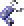 | Arms | Metal | Tanelyv's Armor | chain +2 | the spirit Tanelyv's gift in the Wyrm Temple (with the chest piece), once Balkazar is dead |
|  | Arms | Metal | ***Warden's Arms*** | plate arm armour +1 (AC 2, +1) | the Lower Castle's treasure chest, with Dark Flame (behind the wall the Serpent Boots show, where the vrock perch) |
| 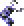 | Arms | Metal | Grey's Scale | no plus (AC 3 with the Loader) | Arant |
|  | Legs | Metal | Tanelyv's Armor | chain +2 | the spirit Tanelyv's gift in the Wyrm Temple (with the chest piece), once Balkazar is dead |
|  | Legs | Metal | ***Warden's Legs*** | plate leg armour +1 (AC 2, +1) | the Wagon Train's chest, in magera country |
|  | Legs | Metal | Grey's Scale | no plus (AC 3 with the Loader) | Arant |

Tanelyv's Armor also has a chest piece, metal, with no plus (AC 4 better: the chain chest's is 2).

**Head:**

| Icon | Material | Item | Bonus / power | Where |
|---|---|---|---|---|
|  | Leather | Helm of Might | STR +1 | a reward in the party's hut in Teaquetzl, once Cedrilte joins the alliance (with Arrows +3, a bracelet and a pear) |
|  | Leather | Leather helm +1 | | a chest |
|  | Metal | Helm of Contemplation | Gaze Reflection | the Warren Chief |
|  | Metal | ***Warden's Helm*** | the game's metal helm +1: Cloak of Bravery on its wearer while worn | on **Dagolar**'s body (the one carrying Dag's Dagger) |
|  | none (not armour) | ***Arrowbane*** | a silver circlet: Protection from Normal Missiles on its wearer while worn (normal arrows, sling stones and chatkchas can't hurt them); worn on the head, not armour | sold by **Kel** |
|  | none (not armour) | ***Sunking Crown*** | a gold crown: Protection from Evil on its wearer while worn; worn on the head, not armour | worn by **Keldar**, the templar of Dagolar's tunnels |

**Shields and gloves** (worn in a hand, in this game):

| Icon | Material | Item | Bonus / power | Where |
|---|---|---|---|---|
|  | Leather | El's Shield | +2 | Notaku's payment in the Red Sands Plateau for a mastyrial's stinger |
|  | Leather | Drake Shield | +1, Resist Fire | the Hot Springs' Templar |
|  | Wooden | ***Gutterward*** | the game's wooden shield +1: AC 2 better in a hand | on a **skeleton** in the Tari's warrens (the sewers): one of the three there |
|  | Metal | ***Ironbulwark*** | a metal shield +3, the game's first: AC 4 better in a hand | carried by the **Guardian** of Balkazar's fortress (the one with the Chatkcha +1) |
|  | Leather | Chameleon Gloves | blind whoever they touch | Mikquetzl |
|  | Leather | Quicksilver Glove | a weapon (1d6+2): every hit casts Detonate on the target, 1d10 with no save, and may destroy its most fragile worn item | the Palace Ruins: the Genie's gift, if Cragg lives and you wish for help against Draj |

**Other worn items:**

| Icon | Slot | Item | Bonus / power | Where |
|---|---|---|---|---|
|  | Arms | ***Bracers of Defense*** | AC for those wearing no armour: [bracers of defense](#bracers-of-defense) | **Mikquetzl** (AC 6, in his pack), **Wyrmias** (AC 5), **Balkazar** (AC 4), **Dagolar** (AC 2, the one carrying Dag's Dagger) |
|  | Chest | ***Ashen Robe*** | +1 AC; +1 on saves against spells | worn by **Kalzith**, who sells it with his scrolls, and left with his body if he's killed ([Robes](#robes)) |
|  | Chest | ***Veiled Robe*** | +2 AC; +1 on every save; a wizard slot more at spell levels 1-3 | sold by **Kel** ([Robes](#robes)) |
|  | Waist | Belt of Might | STR at least 24 | on the ground in the Wyrm School |
|  | Waist | ***Girdle of Back Defense*** | no enemy gets the +2 to hit for attacking its wearer from behind, nor a thief's backstab | carried by the **Troop Leader**, with Linebreaker |
|  | Waist | ***Golden Girdle of Urnst*** | AC 3 better against swords (long and short), in melee | carried by **Wyrmias**, with his bracers |
|  | Feet | Serpent Boots | Displacement | a ceramic pot (the cluebook's broken jar) in the Lower Castle |
|  | Feet | ***Boots of Elvenkind*** | soft boots: [silent](FEATURES.md#hiding-in-shadows-to-backstab), with hiding to backstab on; thieves and rangers only | the Elven Caravan's buried chest (Kel's caravan), with the Cahulaks +2 |
|  | Feet | ***Boots of Speed*** | in a fight, the wearer's movement doubled (the speed of a fast horse: Move 24 to a human's 12) and AC 2 better while it can move (not Stuck, Paralyzed or Slowed); anyone may wear them; not out of a fight | carried by **Dagger**, chief of the White Sand Outlaws, whose band comes for the blank-eyed slave (fought if the party keeps the slave from him) |
|  | Cloak | Living Cloak | Inertial Barrier | Dagolar |
|  | Cloak | ***Cloak of Protection +1*** | +1 AC and +1 on every saving throw, from the cloak slot | in [Pehtucl's chest](#pehtucls-chest), beside the slave pens' head templar: locked and trapped. In a game saved before 2.14.0 that has been to the pens, he wears the cloak instead, and the chest is the plain one |
|  | Cloak | ***Cloak of Elvenkind*** | a grey cloak: [all but invisible](FEATURES.md#hiding-in-shadows-to-backstab) in a fight, with hiding to backstab on; thieves and rangers only | the **Elven Leader**'s gift with his Gythka +2, after the fight with his men: "And take this cloak, woven by my own tribe for our best runners..." (left on the ground by him when it can't be carried, as the Gythka is) |
|  | Neck | Silver Necklace | Biofeedback | appears in the Lower Castle when Tara is destroyed with the Wind Potion (with Tynan's heart) |
|  | Neck | ***Amulet of Magic Resistance*** | 15% magic resistance, added to the wearer's own (as from Mind Bar); it never shatters | sold by **Kel** |
|  | Neck | Obsidian Necklace | Disintegrate | the Troop Leader |
|  | Neck | Iron Necklace | Fireball | the Hermit |
|  | Neck | Golden Torque | none in the data (no spell or plus): metal, so the Wand of Metal Detection points to whoever carries it; Alagorn's story says its wearer takes on its maker's morals | — (no script gives it) |
|  | Finger | Light of Dawn | Dismissal | on the ground, in Balkazar's region |
|  | Finger | Steadfast Ring | CON +3 | Laussa's gift, once the party has found her a new tribe (Ssovan's) and isn't greedy: she gives it in the Nazca Lines, after moving there |
|  | Finger | Ring of Insight | WIS +2 | the spirit Tanelyv's gift in the Wyrm Temple, once the Blind One and the slaves he offered to heal are healed (or with his armour, if Balkazar dies first) |
|  | Finger | El's Ring | DEX +3 | on the ground |
|  | Finger | Storm Ring | Ice Storm | a chest |
|  | Finger | Wind Ring | Protection from Normal Missiles | the Wyvern Master |
|   | Finger | ***Ring of Protection +1*** (two) | +1 AC and +1 on every saving throw | one on the arena's Tied-up Prisoner: free him, then look at his body (the game's script says there's nothing; the Loader finds a ring sewn into his loincloth, 50 XP to whoever searched); the other worn by **Pehtucl**, the slave pens' head templar (in the south-west corner, with the Obsidian Bloodwrath); a thief can lift it from his finger |

**Held, or used from the pack:**

| Icon | Item | Power | Where |
|---|---|---|---|
|  | Orb of Knowledge (held) | no spell; used, it shows what became of Llod, and crumbles (the cluebook; Alagorn: "watch the one it's tuned to") | on the ground in the Palace Ruins |
|  | Dagolar's Wand | Control Body | Dagolar |
|  | Wand of Missiles | Magic Missile | a chest |
|  | Derth's Wand | Lightning Bolt | Notaku's payment in the Red Sands Plateau for a terror bloom |
|  | Wildwynd Wand | Confusion | dropped by Queen Cheee-smak-tunk! of the dark spiders in Undermountain (Darkhold) when she is defeated |
|  | Wand of Metal Detection ("Metal Detection" in the game) | detects metal (25 charges) | the sage's gift in the Red Sands Plateau, after he identifies the party's magic items (with an obelisk gem) |
|  | Llod's Rod | travel between the obelisks | the Visionary |
|  | ***Tome of Understanding*** | read as a scroll is (right-click it in the inventory, click its icon): the one whose pack it is in gains a point of WIS for good (at most 25), and the tome is gone. Not in a fight, as no scroll can be read in one | **Father Garyn**'s gift, in Teaquetzl, when the party brings him the ranike pith from Notaku |
|    | Magic fruit (15 kinds), spell scrolls (19), psionic scrolls (11), ***Kalzith's six scrolls*** | used once | many places; Kalzith's in [his shop](FEATURES.md#kalzith), spells the game has no scroll of |

## Every mundane weapon

Every plain weapon in a game with the new items, the game's and the mod's,
by type and material: who sells it and who carries it (by the names the game
gives them; many are of a kind, such as every Renegade or Tari). The **Weapon
Merchant** and the **Bowyer** are in Teaquetzl, **Jark** and **Kel** in the Elven
Caravan (Kel's caravan). The game's plain stone pick is a
[starting weapon](KITS.md#starting-weapons), and two lie in the Hot
Springs; Deepbiter is its magic one.

| Icon | Type | Material | Sold by | Carried by, or found in | The mod's |
|---|---|---|---|---|---|
|  | long sword | bone | Jark, Weapon Merchant | Ranger, Templar, Chaero, Castle Guard, Arant's Guard, Warrior, Dagolar Guard, Caravan Guard, Guard, Lt. Kwerin, Slaver Guard, Messenger, Visitor, Renegade, Silt Runner, the White Sand Outlaws (Slave Hunters, Hototo, Dagger) and Arant's lazy guard (the mod's) |  |
|  | long sword | metal | Weapon Merchant | Uskuye, Elven Leader, Elite Guard, Village Hero, a chest in the warrens |  |
|  | long sword | obsidian | Jark, Weapon Merchant | Wyvern Master, Arant, Keldar, Kurzak, Guard, Chaya, Uskuye, Arena Guard, Caravan Master, Chahl, Mayor of Gedron, Merzol, Drajian Guard, Council Member, Templar, the arena's champions (the elf) |  |
|  | club | wood | Weapon Merchant | Warren Chief, Churrr, Tari, Skull Guardian, Worshipper, Low Warren Thug, Gladiator, Wild Mul, Guard, a dead body in the arena, a chest, a weapon rack; "Striker", a plain club, on the ground in the Lower Castle |  |
|  | dagger | bone | Jark, Weapon Merchant | Defiler, the arena's champions (the defiler) | **new**: 1d4: the only dagger a water cleric can use; a water cleric's starting dagger |
|  | dagger | metal | — | Tobrian | **new**: the game's dagger, in metal |
|  | dagger | obsidian | — | Defiler, Notaku |  |
|  | dagger | stone | Jark, Weapon Merchant | Balkazar, Dagolar, Wyrmias, Tobrian, Villager, Linara, Maris, a chest in Dagolar's tunnels, on the ground in the Wyrm School (the Hermit's is Nightsliver with the mod), the final battle's Psionicist (the mod's) |  |
|  | short sword | bone | Jark, Weapon Merchant | Renegade, the arena's champions (the halfling) | **new**: 1d6 |
|  | short sword | metal | Weapon Merchant | — | **new**: 1d6: Shadowseeker without the plus |
|  | short sword | obsidian | Jark, Weapon Merchant | Chaero | **new**: 1d6 |
|  | mace | bone | Jark, Weapon Merchant | Wyvern Master, Krikor, Templar, a chest, a chest in Dagolar's tunnels |  |
|  | mace | metal | — | Templar | **new**: the game's mace, in metal |
|  | mace | obsidian | Jark, Weapon Merchant | Tari | **new**: the game's Mace (1d6+1), in obsidian (its only obsidian mace is Blackmace) |
|  | axe | bone | Jark, Weapon Merchant | Wild Mul, Scar's henchman | **new**: 1d8; weighs 30, so not HEAVY: it goes in either hand with another weapon, and [backstabs](HOW-THE-GAME-WORKS.md#attacks-from-behind-and-backstabs) |
|  | axe | metal | — | Slaver Guard, Uzoma, a weapon rack in the Lower Castle, a weapon rack, a weapon rack in the slave pens |  |
|  | axe | obsidian | Weapon Merchant | Merzol | **new**: 1d8; 30, as the bone axe |
|  | great axe | bone | Jark, Weapon Merchant | Wild Mul | **new**: 1d10, two-handed; lighter than metal (and breaks as bone does); a warrior's starting great axe |
|  | great axe | metal | Weapon Merchant | the arena's champions (the half-giant) | **new**: the game's great axe, in metal |
|  | great axe | obsidian | Jark, Weapon Merchant | — | **new**: 1d10, two-handed; a fire or earth cleric's starting great axe |
|  | pick | metal | Weapon Merchant | — | **new**: the game's pick, in metal |
|  | pick | stone | — | on the ground in the Hot Springs (two); a starting weapon |  |
|  | quarterstaff | wood | Jark, Weapon Merchant | Mikquetzl, Troop Leader, Dakaren, Dagolar, Wyrmias, Hermit, Father Garyn, Notaku, a weapon rack in the Lower Castle, a skeleton in the Undermountain, a chest, a weapon rack in the slave pens |  |
|  | polearm | bone | Weapon Merchant | a weapon rack in the Lower Castle, a weapon rack in the slave pens |  |
|  | polearm | metal | — | Castle Guard | **new**: the game's polearm, in metal; an earth cleric's starting polearm |
|  | gythka | bone | Jark, Weapon Merchant | Guardian, the arena's Tohr-kreen (the mod's: its picture holds one) |  |
|  | cahulaks | bone | Weapon Merchant | the dead body by the arena's stone arch, in place of the game's plain gythka (the mod's, with the champions' bout) |  |
|  | cahulaks | metal | Weapon Merchant | the arena's champions (the mul) | **new**: the game's cahulaks, in metal; an earth cleric may use them |
|  | cahulaks | obsidian | Jark | Scar | **new**: the game's cahulaks, in obsidian: earth and fire clerics may use them; an earth or fire cleric-warrior's starting cahulaks |
|  | chatkcha | obsidian | Jark, Bowyer | — |  |
|  | bow | wood | Jark, Kel, Bowyer | Wyvern Master, Ranger, Arant, Castle Guard, Guard, Arant's Guard, Arena Guard, Caravan Guard, Slaver Guard, Elven Leader, Uzoma, Drajian Guard, Army Commander, Elite Guard, Village Hero, a chest in the Upper Castle, a chest, a chest in Dagolar's tunnels, the arena's champions (the elf), Arant's lazy guard (the mod's) |  |
|  | sling | leather | Bowyer | Mehtar, Renegade, Silt Runner, a chest in the slave pens, a bag in the slave pens, the arena's champions (the halfling) |  |
|  | staff sling | leather | Jark, Bowyer | — |  |

## Every mundane armour piece

Every plain piece of armour and every plain shield in a game with the new
items, as the weapons above: who sells it and who carries it. Ring, brigandine
and scale armour are bone on Athas. **AC better by** is what each piece takes
off AC 10 (the game's own numbers; a character's AC adds up its pieces).

| Worn on | Material | Item | AC better by | Sold by | Carried by, or found in | The mod's |
|---|---|---|---|---|---|---|
| Chest | leather | Leather Chest Armor | 1 | Jark, Armor Merchant | Warren Chief, Churrr, Krikor, Ranger, Kurzak, Chaero, Castle Guard, Guard, Tari, Skull Guardian, Worshipper, Low Warren Thug, Arant's Guard, Scar, Arena Guard, Warrior, Dagolar Guard, Tobrian, Caravan Guard, Lt. Kwerin, Mayor of Gedron, Slaver Guard, Merzol, Messenger, Visitor, Drajian Guard, Council Member, Notaku, Renegade, Wild Mul, Village Hero, Kalinin, the arena's champions (the halfling, the elf), the White Sand Outlaws, Arant's lazy guard (the mod's) |  |
| Chest | bone | Ring Chest Armor | 1 | Armor Merchant | Mikquetzl, Uzoma |  |
| Chest | bone | Brigandine Chest Armor | 2 | Jark, Armor Merchant | Arant, Keldar, Templar, Chaya, Caravan Master, Chahl, Father Garyn, Elven Leader |  |
| Chest | bone | Scale Chest Armor | 2 | Jark | Templar, Uskuye, Elite Guard, a chest in the slave pens, the arena's champions (the half-giant, the mul) |  |
| Chest | metal | Chain Chest Armor | 2 | — | Shadow King, Army Commander, a skeleton in the Undermountain |  |
| Arms | leather | Leather Arm Armor | 1 | Armor Merchant | Churrr, Krikor, Ranger, Kurzak, Chaero, Castle Guard, Guard, Arant's Guard, Scar, Arena Guard, Warrior, Dagolar Guard, Tobrian, Caravan Guard, Lt. Kwerin, Mayor of Gedron, Slaver Guard, Merzol, Messenger, Visitor, Notaku, Village Hero, Kalinin, the arena's champions (the halfling, the elf), Hototo, Dagger, Arant's lazy guard (the mod's) |  |
| Arms | bone | Ring Arm Armor | 1 | Armor Merchant | Wyvern Master, Mikquetzl |  |
| Arms | bone | Brigandine Arm Armor | 1 | Armor Merchant | Keldar, Templar, Chaya, Caravan Master, Chahl, Elven Leader, Gladiator, Uzoma |  |
| Arms | bone | Scale Arm Armor | 1 | Jark | Uskuye, Elite Guard, a chest in the slave pens, the arena's champions (the half-giant, the mul) | **new** placement |
| Arms | metal | Chain Arm Armor | 2 | — | Templar, Army Commander, a chest in the Undermountain |  |
| Legs | leather | Leather Leg Armor | 1 | Armor Merchant | Warren Chief, Churrr, Ranger, Skull Guardian, Worshipper, Mayor of Gedron, Council Member, Notaku, Village Hero, a chest in the Upper Castle, the arena's champions (the halfling, the elf) |  |
| Legs | bone | Ring Leg Armor | 1 | Jark, Armor Merchant | Mikquetzl |  |
| Legs | bone | Brigandine Leg Armor | 1 | Jark, Armor Merchant | Keldar, Templar, Chaya, Caravan Master, Chahl, Elven Leader |  |
| Legs | bone | Scale Leg Armor | 1 | Jark | Uskuye, Elite Guard, a chest in the slave pens, the arena's champions (the half-giant, the mul) | **new** placement |
| Legs | metal | Chain Leg Armor | 1 | Armor Merchant | Army Commander, a skeleton in the Upper Castle |  |
| Head | leather | Helm | 0 (1 with [Helms give AC 1](FEATURES.md#helms-give-ac-1)) | Armor Merchant, Kel (who sells it as Dapartea's Helm) | Kurzak, a chest in the Upper Castle, a chest in the slave pens, a bag in the slave pens, the arena's champions (the halfling, the elf) | **new** placement |
| Head | bone | Bone Helm | 0 (1 with [Helms give AC 1](FEATURES.md#helms-give-ac-1)) | — | a chest in the slave pens, the arena's champions (the half-giant, the mul) | **new**: the bone scale set's helm |
| Hand | wood | Shield | 1 | — | Wyvern Master, Arant, Chaya, Elven Leader, Templar, a chest in the slave pens |  |
| Hand | leather | Shield | 1 | — | Keldar, Templar, Caravan Master, Gladiator, the arena's champions (the half-giant, the halfling, the elf) |  |

The game has the bone scale set but places only its chest piece. The mod puts
the arm and leg pieces and a Bone Helm of its own
( 
) in the slave pens' chest with the chest piece and
the Arrows +3, and the game's leather Helm () on
**Kurzak**, in the slave pens.

## Items against acid

What each item's chance is against the Rampager's acid and the Babau's
corroding touch, in the game and with
[Items saving against acid as in AD&D](FEATURES.md#items-saving-against-acid)
(the easier of the game's number and AD&D's by material). Only what is worn on
the arms, legs or chest can be lost, and the melee weapon held: helms,
shields, cloaks, boots, belts, rings and amulets never are. A worn piece with
no magical power is lost at once in the game (0%); one with a power never is
(100%).

**Chest:**

| Item | Saved in the game | Saved with the rule |
|---|---|---|
| Leather Chest Armor | 0% | 55% (needs 10) |
| Leather Chest Armor +1, ***Inixhide*** | 0% | 60% (needs 9) |
| Ring, brigandine or scale chest (bone) | 0% | 50% (needs 11) |
| Chain chest | 0% | 40% (needs 13) |
| Tanelyv's Armor (metal, no plus) | 0% | 40% (needs 13) |
| Silk Armor +2 (no material: cloth's) | 0% | 55% (needs 10) |
| Drake Armor +1, Shimmer Armor +3, ***Warden's Chest*** +1 (each with a power) | 100% | 100% (the game's) |
| ***Ashen Robe*** (cloth, +1) | 0% | 50% (needs 11) |
| ***Veiled Robe*** (cloth, +2) | 0% | 55% (needs 10) |

**Arms and legs** (each piece on its own, as the chest):

| Item | Saved in the game | Saved with the rule |
|---|---|---|
| Leather arm or leg armour | 0% | 55% (needs 10) |
| Ring, brigandine or scale arm or leg armour (bone) | 0% | 50% (needs 11) |
| Chain arm or leg armour; Grey's Scale (metal) | 0% | 40% (needs 13) |
| ***Warden's Arms***, ***Warden's Legs*** (metal, +1) | 0% | 45% (needs 12) |
| Tanelyv's Armor arms or legs (metal, +2) | 0% | 50% (needs 11) |
| ***Bracers of Defense*** AC 6 (no material: cloth's, +4) | 0% | 65% (needs 8) |
| ***Bracers of Defense*** AC 5 (+5) | 0% | 70% (needs 7) |
| ***Bracers of Defense*** AC 4 (+6) | 0% | 75% (needs 6) |
| ***Bracers of Defense*** AC 2 (+8) | 0% | 85% (needs 4) |

**Weapons** (the first melee weapon held), by material, the game's and the
mod's. A weapon's spell (Dark Flame's Burning Hands) is a magical power. Only a
melee weapon is ever taken: chatkchas (the Chatkcha +1, ***Skycutter***),
slings and bows never are:

| Item | Saved in the game | Saved with the rule |
|---|---|---|
| Plain bone or metal weapons | 65% | 65% (the game's: needs 8) |
| Plain wooden weapons | 65% | 65% (needs 8) |
| Plain stone or obsidian weapons | 65% | 80% (needs 5) |
| Bone +1: Hornblade, Draketooth, Polearm +1, ***Cahulaks +1***, ***Stillwater***, ***Hayneedle***, ***Drakejaw***, ***Thornwall***, ***Kreenfang*** | 70% | 70% (the game's: needs 7) |
| Bone +2: Swiftbite, Mace +2, ***Gythka +2*** | 75% | 75% (the game's: needs 6) |
| Bone +2 with a power: ***Cahulaks +2*** (Cause Light Wounds) | 75% | 75% (the game's: needs 6) |
| Bone +3: Gythka +3 | 80% | 80% (the game's: needs 5) |
| Metal +1: Soulcrusher, Axe +1, ***Shadowseeker*** | 70% | 70% (the game's: needs 7) |
| Metal +2: El's Drinker, ***Greenbright***, ***Galefang***, ***Headsman***, ***Linebreaker***, ***Ironwhirl*** | 75% | 75% (the game's: needs 6) |
| Metal +3: Dag's Dagger, Great Axe +3 | 80% | 80% (the game's: needs 5) |
| Metal +4: Dragonsbane | 85% | 85% (the game's: needs 4) |
| Obsidian +1: Bloodwrath, ***Mindshard***, ***Emberlash*** | 70% | 85% (needs 4) |
| Obsidian +1 with a power: Blackmace, ***Flame Blade*** | 70% | 90% (needs 3) |
| Obsidian +2: ***Nightsliver***, ***Glasshewer*** | 75% | 90% (needs 3) |
| Obsidian +2 with a power: Dark Flame, Terror Blade (Poison) | 75% | 95% (needs 2) |
| Stone +1: ***Deepbiter*** | 70% | 85% (needs 4) |
| Wooden +1: Parting Staff, ***Gutterknot*** | 70% | 70% (needs 7) |
| Wooden +1 with a power: Balk's Staff | 70% | 75% (needs 6) |
| Wooden +2: Quarterstaff +2 | 75% | 75% (needs 6) |
| Leather gloves with a power: Chameleon Gloves, Quicksilver Glove | 65% | 65% (the game's: needs 8) |
