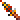
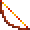
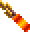
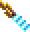
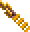
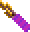
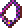

# Items

*Part of Obsidian Edition's documentation. **Spoilers:** this page says where
every item is. The [player's guide](PLAYER-GUIDE.md#new-items) lists what the
mod adds and who can use it, without saying where.*

Every magic item and every mundane weapon in a game with the mod's
[new items](FEATURES.md#new-items), the game's and the mod's, with their icons
and where each is; then each item's chance
[against acid](#items-against-acid).

## Every magic item

All the magic items in a game with the mod's new content on: the game's own,
read from its data (each item type's slot and material, each item's plus and
power, and who carries it), and the mod's, in ***bold italics***. In
**Where**, "—" means the item isn't placed with anyone in the data: the game's
scripts hand it out (a reward, a gift or a find).

**Weapons**, by material, then type:

| Icon | Material | Type | Item | Bonus / power | Where |
|---|---|---|---|---|---|
|  | Bone | long sword | Swiftbite | +2 | — |
|  | Bone | long sword | Draketooth | +1, strength | — |
|  | Bone | long sword | Hornblade | +1 | Kalinin's reward |
|  | Bone | short sword | ***Stillwater*** | a bone short sword +1: a **psionicist** can wield it, alone or with a water cleric | in the chest **Chaya** gives as her apology |
|  | Bone | gythka | Gythka +3 | +3 | the arena's [1000th trip](HOW-THE-GAME-WORKS.md#the-arenas-count-of-fights), King Tectuktitlay's gift |
|  | Bone | gythka | ***Gythka +2*** | the game's Gythka +1, made +2 | the **Elven Leader**'s gift, after the fight with his men |
|  | Bone | gythka | ***Kreenfang*** | a gythka +1 (2d4+1) | the 2 handed Bone Gythka on the dead body by the arena's stone arch |
|  | Bone | dagger | ***Hayneedle*** | a bone dagger +1: a water cleric can wield it | hidden in **Merzol**'s haystack in the slave pens, with his sack of ceramic pieces |
|  | Bone | axe | ***Drakejaw*** | a bone axe +1 (1d8+1): a water cleric can wield it | carried by one of the **Magera** guarding the wagon's prisoners |
|  | Bone | mace | Mace +2 | +2 | a chest |
|  | Bone | polearm | Polearm +1 | +1 | — |
|  | Bone | polearm | ***Thornwall*** | a bone polearm +1 | on the slave pens' **weapon rack**, in place of one of its two plain bone polearms |
|  | Bone | cahulaks | Cahulaks +1 | +1, Cause Light Wounds | the caravan's buried chest |
|  | Metal | long sword | Dragonsbane | +4 | — |
|  | Metal | long sword | El's Drinker | +2, Vampiric Touch | the arena's [1000th trip](HOW-THE-GAME-WORKS.md#the-arenas-count-of-fights), King Tectuktitlay's gift |
|  | Metal | short sword | ***Greenbright*** | a metal short sword +2 | carried by **Arant**, who holds the captured gladiators |
|  | Metal | short sword | ***Shadowseeker*** | a short sword +1 (1d6+1): whoever wields it, in either hand, sees the invisible | in the pack of **Kurzak**, the pens' guard leader |
|  | Metal | dagger | Dag's Dagger | +3, extra damage | Dagolar |
|  | Metal | dagger | ***Galefang*** | a metal dagger +2 an **air cleric** can wield | carried by the **Rogue Shaman**, with his Shaman Followers |
|  | Metal | axe | Soulcrusher | +1 | Kel |
|  | Metal | axe | Axe +1 | +1 | — |
|  | Metal | great axe | ***Headsman*** | a metal great axe +2 | in the arena **Announcer**'s stash, with his Stoneskin scroll, rings and gems |
|  | Metal | polearm | ***Linebreaker*** | a metal polearm +2 | carried by the **Troop Leader** |
|  | Obsidian | long sword | Dark Flame | +2, Burning Hands | the Lower Castle's chest |
|  | Obsidian | long sword | Bloodwrath | +1 | Pehtucl, the pens' templar |
|  | Obsidian | long sword | ***Flame Blade*** | an obsidian long sword +1 (1d8+1) whose blade burns what it hits: the fire clerics' Focus Heat, 2d6 fire damage to the creature hit (a save for half), as the game's Dark Flame casts Burning Hands. Obsidian, so a fire (or earth) cleric can wield it | in the pack of the **Templar** of the Hot Springs (the one with the Drake Shield) |
|  | Obsidian | short sword | ***Mindshard*** | an obsidian short sword +1: a **psionicist** can wield it, alone or with a fire or earth cleric | carried by **Maris**; a thief can lift it (200 XP) |
|  | Obsidian | dagger | Terror Blade | +2, poison | — |
|  | Obsidian | dagger | ***Nightsliver*** | an obsidian dagger +2: a fire or earth cleric can wield it | carried by the **Hermit** of the Lava Rift, in place of his stone dagger |
|  | Obsidian | mace | Blackmace | +1, Shocking Grasp | the Shadow King |
|  | Obsidian | axe | ***Glasshewer*** | an obsidian axe +2 (1d8+2): a fire or earth cleric can wield it | carried by the **Templar** of the elven slavers' camp (the one with the Chain Arm Armor) |
|  | Wooden | quarterstaff | Quarterstaff +2 | +2 | Maris |
|  | Wooden | quarterstaff | Balk's Staff | +1, Slow | Balkazar |
|  | Wooden | quarterstaff | Parting Staff | +1 | — |
|  | Wooden | club | ***Gutterknot*** | a club +1 (the game has no magic club) | carried by **Churrr** in the warrens; a thief can lift it (200 XP) |
|  | Stone | pick | ***Deepbiter*** | a stone pick +1 (the game has no magic pick) | carried by one of the **Undermountain folk** (the miners) |
|  | none | great axe | Great Axe +3 | +3 | the Army Commander |

**Missile weapons and ammunition:**

| Icon | Material | Type | Item | Bonus / power | Where |
|---|---|---|---|---|---|
|  | Wooden | bow | Bow +2 | +2 | a chest |
|  | Wooden | bow | Phrain's Bow | +1, Acid Arrow | — |
|  | Wooden | bow | ***Dunesong*** | a bow +1, which the Bowyer's archery target counts as the game's own bows | sold by the **Bowyer** |
|  | Leather | sling | Sling +2 | +2 | Chaya and her apology chest; a chest |
|  | Leather | sling | Sling +1 | +1 | a chest |
|  | Leather | staff sling | ***Windlash*** | a staff sling +1 (the game has no magic staff sling) | sold by the **Bowyer** |
|  | Obsidian | chatkcha | ***Skycutter*** | a chatkcha +2 | carried by one of the **thri-kreen** hunting the Gemfields |
|  | Obsidian | chatkcha | Chatkcha +1 | +1, Produce Fire | the Guardian |
|  | Wooden | arrows | Arrows +3, +2, +1 | | chests; Kel and the Elven Leader (+1) |
|  | Wooden | arrows | ***Burning Arrows*** | cast Burning Hands on what they hit | made by a [Spellarcher](KITS.md#multiclass-kits) (its arrow buttons), and readied by a Spellarcher only; worth nothing, gone at the next rest |
|  | Wooden | arrows | ***Chill Arrows*** | cast Chill Touch on what they hit | the same |
|  | Wooden | arrows | ***Shocking Arrows*** | cast Shocking Grasp on what they hit | the same |
|  | Wooden | arrows | ***Vampiric Arrows*** | cast Vampiric Touch on what they hit | the same |

**By weapon spec**, for [weapon
specialization](FEATURES.md#weapon-specialization):

| Weapon spec | Magic weapons |
|---|---|
| Long sword | Dragonsbane +4, Swiftbite +2, El's Drinker +2, Dark Flame +2, Draketooth +1, Hornblade +1, Bloodwrath +1, ***Flame Blade*** +1 |
| Short sword | ***Greenbright*** +2, ***Shadowseeker*** +1, ***Mindshard*** +1, ***Stillwater*** +1 |
| Dagger | Dag's Dagger +3, Terror Blade +2, ***Galefang*** +2, ***Nightsliver*** +2, ***Hayneedle*** +1 |
| Axe | ***Glasshewer*** +2, ***Drakejaw*** +1, Soulcrusher +1, Axe +1 |
| Great axe | Great Axe +3, ***Headsman*** +2 |
| Gythka | Gythka +3, ***Gythka +2***, ***Kreenfang*** +1 |
| Polearm | ***Linebreaker*** +2, Polearm +1, ***Thornwall*** +1 |
| Mace | Mace +2, Blackmace +1 |
| Quarterstaff | Quarterstaff +2, Balk's Staff +1, Parting Staff +1 |
| Sling | Sling +2, Sling +1 |
| Club, pick, cahulaks | ***Gutterknot*** +1, ***Deepbiter*** +1, Cahulaks +1 |
| Bow | Bow +2, Phrain's Bow +1, ***Dunesong*** +1 |
| Staff sling, chatkcha | ***Windlash*** +1, ***Skycutter*** +2, Chatkcha +1 |

**Body armour:**

| Icon | Material | Item | Bonus / power | Where |
|---|---|---|---|---|
|  | Leather | Shimmer Armor | +3, Free Action | Dakaren |
|  | Leather | Drake Armor | +1, Resist Cold | the Wyvern Master |
|  | Leather | ***Inixhide*** | Leather Chest Armor +1: the leather's AC, +1 | worn by **Legcrusher**, the pens' half-giant |
|  | Metal | ***Warden's Chest*** | plate chest armour +1 (AC 3, +1): Resist Fire on its wearer while worn | on **Balkazar**'s body |
|  | none | Silk Armor | +2 | — |

**Arm and leg armour:**

| Icon | Slot | Material | Item | Bonus | Where |
|---|---|---|---|---|---|
|  | Arms | Metal | Tanelyv's Armor | chain +2 | — |
|  | Arms | Metal | ***Warden's Arms*** | plate arm armour +1 (AC 2, +1) | the Lower Castle's treasure chest, with Dark Flame (behind the wall the Serpent Boots show, where the vrock perch) |
|  | Arms | Metal | Grey's Scale | no plus (AC 3 with the Loader) | Arant |
|  | Legs | Metal | Tanelyv's Armor | chain +2 | — |
|  | Legs | Metal | ***Warden's Legs*** | plate leg armour +1 (AC 2, +1) | the Wagon Train's chest, in magera country |
|  | Legs | Metal | Grey's Scale | no plus (AC 3 with the Loader) | Arant |

Tanelyv's Armor also has a chest piece, with no plus.

**Head:**

| Icon | Material | Item | Power | Where |
|---|---|---|---|---|
|  | Leather | Helm of Might | strength | — |
|  | Leather | Leather helm +1 | | a chest |
|  | Metal | Helm of Contemplation | a shield of thought against psionic attacks | the Warren Chief |
|  | Metal | ***Warden's Helm*** | the game's metal helm +1: Cloak of Bravery on its wearer while worn | on **Dagolar**'s body (the one carrying Dag's Dagger) |
|  | none (not armour) | ***Arrowbane*** | a silver circlet: Protection from Normal Missiles on its wearer while worn (normal arrows, sling stones and chatkchas can't hurt them); worn on the head, not armour | sold by **Kel** |
|  | none (not armour) | ***Sunking Crown*** | a gold crown: Protection from Evil on its wearer while worn; worn on the head, not armour | worn by **Keldar**, the templar of Dagolar's tunnels |

**Shields and gloves** (worn in a hand, in this game):

| Icon | Material | Item | Bonus / power | Where |
|---|---|---|---|---|
|  | Leather | El's Shield | +2 | — |
|  | Leather | Drake Shield | +1, Resist Fire | the Hot Springs' Templar |
|  | Wooden | ***Gutterward*** | the game's wooden shield +1: AC 2 better in a hand | on a **skeleton** in the Tari's warrens (the sewers): one of the three there |
|  | Metal | ***Ironbulwark*** | a metal shield +3, the game's first: AC 4 better in a hand | carried by the **Guardian** of Balkazar's fortress (the one with the Chatkcha +1) |
|  | Leather | Chameleon Gloves | blind whoever they touch | Mikquetzl |
|  | none | Quicksilver Gauntlets | graft a one-handed weapon to the hand | — |

**Other worn items:**

| Icon | Slot | Item | Power | Where |
|---|---|---|---|---|
|  | Arms | ***Bracers of Defense*** | AC for those wearing no armour: [bracers of defense](FEATURES.md#bracers-of-defense) | **Mikquetzl** (AC 6, in his pack), **Wyrmias** (AC 5), **Balkazar** (AC 4), **Dagolar** (AC 2, the one carrying Dag's Dagger) |
|  | Chest | ***Ashen Robe*** | +1 AC; +1 on saves against spells | Kalzith ([Robes](FEATURES.md#robes)) |
|  | Chest | ***Veiled Robe*** | +2 AC; +1 on every save; a wizard slot more at spell levels 1-3 | sold by Kel ([Robes](FEATURES.md#robes)) |
|  | Waist | Belt of Might | strength | — |
|  | Waist | ***Girdle of Back Defense*** | no enemy gets the +2 to hit for attacking its wearer from behind, nor a thief's backstab | carried by the **Troop Leader**, with Linebreaker |
|  | Waist | ***Golden Girdle of Urnst*** | AC 3 better against swords (long and short), in melee | carried by **Wyrmias**, with his bracers |
|  | Feet | Serpent Boots | Displacement | a chest |
|  | Feet | ***Boots of Elvenkind*** | soft boots: [silent](FEATURES.md#hiding-in-shadows-to-backstab), with hiding to backstab on; thieves and rangers only | the buried chest of Kel's caravan, with the Cahulaks +1 |
|  | Cloak | Living Cloak | Inertial Barrier | Dagolar |
|  | Cloak | ***Cloak of Protection +1*** | +1 AC and +1 on every saving throw, from the cloak slot | worn by Pehtucl |
|  | Cloak | ***Cloak of Elvenkind*** | a grey cloak: [all but invisible](FEATURES.md#hiding-in-shadows-to-backstab) in a fight, with hiding to backstab on; thieves and rangers only | the **Elven Leader**'s gift with his Gythka +2, after the fight with his men: "And take this cloak, woven by my own tribe for our best runners..." (left on the ground by him when it can't be carried, as the Gythka is) |
|  | Neck | Silver Necklace | Biofeedback | — |
|  | Neck | ***Amulet of Magic Resistance*** | 15% magic resistance, added to the wearer's own (as from Mind Bar); it never shatters | sold by **Kel** |
|  | Neck | Obsidian Necklace | Disintegrate | the Troop Leader |
|  | Neck | Iron Necklace | Fireball | the Hermit |
|  | Neck | Golden Torque | takes on its maker's morals | — |
|  | Finger | Light of Dawn | Dismissal | on the ground, in Balkazar's region |
|  | Finger | Ring of Steadfastness | Constitution | — |
|  | Finger | Ring of Insight | Wisdom | — |
|  | Finger | El's Ring | Dexterity | on the ground |
|  | Finger | Storm Ring | Ice Storm | a chest |
|  | Finger | Wind Ring | Protection from Normal Missiles | the Wyvern Master |
|   | Finger | ***Ring of Protection +1*** (two) | +1 AC and +1 on every saving throw | one on the arena's Tied-up Prisoner: free him, then look at his body (the game's script says there's nothing; the Loader finds a ring sewn into his loincloth, 50 XP to whoever searched); the other worn by **Pehtucl**, the slave pens' head templar (in the south-west corner, with the Obsidian Bloodwrath) |

**Held, or used from the pack:**

| Icon | Item | Power | Where |
|---|---|---|---|
|  | Orb of Knowledge (held) | watch the one it's tuned to | — |
|  | Dagolar's Wand | Control Body | Dagolar |
|  | Wand of Missiles | Magic Missile | a chest |
|  | Derth's Wand | Lightning Bolt | — |
|  | Wildwynd Wand | Confusion | — |
|  | Llod's Rod | travel between the obelisks | the Visionary |
|  | ***Tome of Understanding*** | read as a scroll is (right-click it in the inventory, click its icon): the one whose pack it is in gains a point of WIS for good (at most 25), and the tome is gone. Not in a fight, as no scroll can be read in one | **Father Garyn**'s gift, in Teaquetzl, when the party brings him the ranike pith from Notaku |
|    | Magic fruit (14 kinds), spell scrolls (18), psionic scrolls (11), ***Kalzith's six scrolls*** | used once | many places; Kalzith's in [his shop](FEATURES.md#kalzith), spells the game has no scroll of |

## Every mundane weapon

Every plain weapon in a game with the new items, the game's and the mod's,
by type and material: who sells it and who carries it (by the names the game
gives them; many are of a kind, such as every Renegade or Tari). The **Weapon
Merchant** and the **Bowyer** are in Teaquetzl, **Jark** and **Kel** in Kel's
caravan. The game's plain stone pick is only ever a
[starting weapon](FEATURES.md#weapon-specialization); Deepbiter is its magic
one.

| Icon | Type | Material | Sold by | Carried by, or found in | The mod's |
|---|---|---|---|---|---|
|  | long sword | bone | Jark, Weapon Merchant | Ranger, Templar, Chaero, Castle Guard, Arant's Guard, Warrior, Dagolar Guard, Caravan Guard, Guard, Lt. Kwerin, Slaver Guard, Messenger, Visitor, Renegade, Silt Runner |  |
|  | long sword | metal | Weapon Merchant | Uskuye, Elven Leader, Elite Guard, Village Hero, a chest in the warrens |  |
|  | long sword | obsidian | Jark, Weapon Merchant | Wyvern Master, Arant, Keldar, Kurzak, Guard, Chaya, Uskuye, Scar, Arena Guard, Caravan Master, Chahl, Mayor of Gedron, Merzol, Drajian Guard, Council Member, Templar |  |
|  | club | wood | Weapon Merchant | Warren Chief, Churrr, Tari, Skull Guardian, Worshipper, Low Warren Thug, Gladiator, Wild Mul, Guard, Legcrusher, a dead body in the arena, a chest, a weapon rack |  |
|  | dagger | bone | Jark, Weapon Merchant | Defiler | **new**: 1d4: the only dagger a water cleric can use; a water cleric's starting dagger |
|  | dagger | metal | — | Tobrian | **new**: the game's dagger, in metal |
|  | dagger | obsidian | — | Defiler, Notaku |  |
|  | dagger | stone | Jark, Weapon Merchant | Balkazar, Dagolar, Wyrmias, Hermit, Tobrian, Villager, Linara, Maris, a chest in Dagolar's tunnels |  |
|  | short sword | bone | Jark, Weapon Merchant | Renegade | **new**: 1d6 |
|  | short sword | metal | Weapon Merchant | — | **new**: 1d6: Shadowseeker without the plus |
|  | short sword | obsidian | Jark, Weapon Merchant | Chaero | **new**: 1d6 |
|  | mace | bone | Jark, Weapon Merchant | Wyvern Master, Krikor, Templar, a chest, a chest in Dagolar's tunnels |  |
|  | mace | metal | — | Templar | **new**: the game's mace, in metal |
|  | mace | obsidian | Jark, Weapon Merchant | Tari | **new**: the game's Mace (1d6+1), in obsidian (its only obsidian mace is Blackmace) |
|  | axe | bone | Jark, Weapon Merchant | Wild Mul, Scar's henchman | **new**: 1d8; weighs 30, so not HEAVY: it goes in either hand with another weapon, and [backstabs](HOW-THE-GAME-WORKS.md#attacks-from-behind-and-backstabs) |
|  | axe | metal | — | Slaver Guard, Uzoma, a weapon rack in the Lower Castle, a weapon rack, a weapon rack in the slave pens |  |
|  | axe | obsidian | Weapon Merchant | Merzol | **new**: 1d8; 30, as the bone axe |
|  | great axe | bone | Jark, Weapon Merchant | Wild Mul | **new**: 1d10, two-handed; lighter than metal (and breaks as bone does); a warrior's starting great axe |
|  | great axe | metal | Weapon Merchant | — | **new**: the game's great axe, in metal |
|  | great axe | obsidian | Jark, Weapon Merchant | — | **new**: 1d10, two-handed; a fire or earth cleric's starting great axe |
|  | pick | metal | Weapon Merchant | — | **new**: the game's pick, in metal |
|  | quarterstaff | wood | Jark, Weapon Merchant | Mikquetzl, Troop Leader, Dakaren, Dagolar, Wyrmias, Hermit, Father Garyn, Notaku, a weapon rack in the Lower Castle, a skeleton in the Undermountain, a chest, a weapon rack in the slave pens |  |
|  | polearm | bone | Weapon Merchant | a weapon rack in the Lower Castle, a weapon rack in the slave pens |  |
|  | polearm | metal | — | Castle Guard | **new**: the game's polearm, in metal; an earth cleric's starting polearm |
|  | gythka | bone | Jark, Weapon Merchant | Guardian |  |
|  | cahulaks | bone | Weapon Merchant | — |  |
|  | chatkcha | obsidian | Jark, Bowyer | — |  |
|  | bow | wood | Jark, Kel, Bowyer | Wyvern Master, Ranger, Arant, Castle Guard, Guard, Arant's Guard, Arena Guard, Caravan Guard, Slaver Guard, Elven Leader, Uzoma, Drajian Guard, Army Commander, Elite Guard, Village Hero, a chest in the Upper Castle, a chest, a chest in Dagolar's tunnels |  |
|  | sling | leather | Bowyer | Mehtar, Renegade, Silt Runner, a chest in the slave pens, a bag in the slave pens |  |
|  | staff sling | leather | Jark, Bowyer | — |  |

## Items against acid

What each item's chance is against the Rampager's acid and the Babau's
corroding touch, in the game and with
[Items save against acid as in AD&D](FEATURES.md#items-saving-against-acid)
(the easier of the game's number and AD&D's by material). Only what is worn on
the arms, legs or chest can be lost, and the melee weapon held: helms,
shields, cloaks, boots, belts, rings and amulets never are. A worn piece with
no magical power is lost at once in the game (0%); one with a power never is
(100%).

**Chest:**

| Item | Saved in the game | Saved with the rule |
|---|---|---|
| Leather Chest Armor | 0% | 55% (needs 10) |
| Leather Chest Armor +1, ***Inixhide*** | 0% | 60% (needs 9) |
| Bone scale chest | 0% | 50% (needs 11) |
| Chain chest | 0% | 40% (needs 13) |
| Tanelyv's Armor (metal, no plus) | 0% | 40% (needs 13) |
| Silk Armor +2 (no material: cloth's) | 0% | 55% (needs 10) |
| Drake Armor +1, Shimmer Armor +3, ***Warden's Chest*** +1 (each with a power) | 100% | 100% (the game's) |
| ***Ashen Robe*** (cloth, +1) | 0% | 50% (needs 11) |
| ***Veiled Robe*** (cloth, +2) | 0% | 55% (needs 10) |

**Arms and legs** (each piece on its own, as the chest):

| Item | Saved in the game | Saved with the rule |
|---|---|---|
| Leather arm or leg armour | 0% | 55% (needs 10) |
| Bone scale arm or leg armour | 0% | 50% (needs 11) |
| Chain arm or leg armour; Grey's Scale (metal) | 0% | 40% (needs 13) |
| ***Warden's Arms***, ***Warden's Legs*** (metal, +1) | 0% | 45% (needs 12) |
| Tanelyv's Armor arms or legs (metal, +2) | 0% | 50% (needs 11) |
| ***Bracers of Defense*** AC 6 (no material: cloth's, +4) | 0% | 65% (needs 8) |
| ***Bracers of Defense*** AC 5 (+5) | 0% | 70% (needs 7) |
| ***Bracers of Defense*** AC 4 (+6) | 0% | 75% (needs 6) |
| ***Bracers of Defense*** AC 2 (+8) | 0% | 85% (needs 4) |

**Weapons** (the first melee weapon held):

| Item | Saved in the game | Saved with the rule |
|---|---|---|
| Bone or metal Long Sword | 65% | 65% (the game's: needs 8) |
| Shadowseeker (metal, +1) | 70% | 70% (the game's: needs 7) |
| Obsidian Dagger | 65% | 80% (needs 5) |
| The mod's plain bone weapons (Dagger, Short Sword, Axe, Great Axe) | 65% | 65% (the game's: needs 8) |
| The mod's plain obsidian weapons (Short Sword, Axe, Mace, Great Axe) | 65% | 80% (needs 5) |
| The mod's plain metal weapons (Short Sword, Dagger, Mace, Great Axe, Pick, Polearm) | 65% | 65% (the game's: needs 8) |
| Kreenfang, Drakejaw, Stillwater, Thornwall, Hayneedle (bone, +1) | 70% | 70% (the game's: needs 7) |
| Mindshard (obsidian, +1) | 70% | 85% (needs 4) |
| Flame Blade (obsidian, +1, a power) | 70% | 90% (needs 3) |
| Glasshewer, Nightsliver, Skycutter (obsidian, +2) | 75% | 90% (needs 3) |
| Deepbiter (stone, +1) | 70% | 85% (needs 4) |
| Gutterknot (wood, +1) | 70% | 70% (the game's: needs 7) |
| Greenbright, Galefang, Headsman, Linebreaker (metal, +2) | 75% | 75% (the game's: needs 6) |
