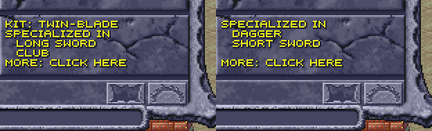
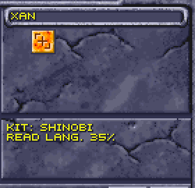
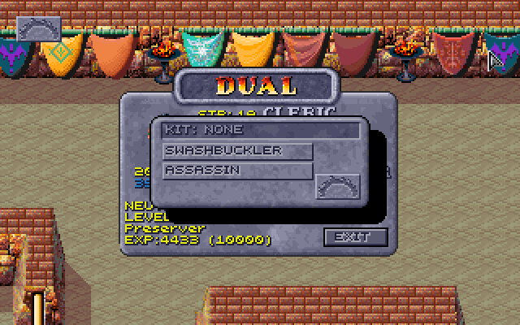

# Kits

*Part of Obsidian Edition's documentation, from the [README](README.md) and
[Features and rules](FEATURES.md#kits). The
[player's guide](PLAYER-GUIDE.md#kits) tells who takes each kit on Athas.*

With **Kits** ticked, a character of one class may take one of three kits for
its class when it is made, or none (the class as it is). A few pairs of classes
(and one set of three) taken at once by one race have kits of their own ([Multiclass
kits](#multiclass-kits)). Each gives something and costs something. The game's
own party gets features of its own ([The game's own
party](FEATURES.md#the-games-own-party)). A human who changes class may take a
kit for the new class if it has none yet ([Changing class](#changing-class)).

Each class has a table of its three kits, a line each for what it gives and
costs, and under it each kit's rules in full: what a new character starts with
([Starting gear](#starting-gear)) and what else to know ([Kits that rule out
classes and each other](#kits-that-rule-out-classes-and-each-other)). Levels are
the kit's own class's. The weapon specs a kit picks, and the attacks a round
they bring, are on their own page: [Weapon specs](WEAPON-SPECS.md). How the kits
work: [DEVELOPMENT-KITS.md](https://github.com/daaki85/darksun-obsidian-edition/blob/main/obsidian-edition/DEVELOPMENT-KITS.md).

## Contents

- [Fighter kits](#fighter-kits)
- [Gladiator kits](#gladiator-kits)
- [Ranger kits](#ranger-kits)
- [Thief kits](#thief-kits)
- [Preserver kits](#preserver-kits)
- [Cleric kits](#cleric-kits)
- [Druid kits](#druid-kits)
- [Psionicist kits](#psionicist-kits)
- [Multiclass kits](#multiclass-kits)
- [Choosing a kit](#choosing-a-kit)
- [Starting gear](#starting-gear)
- [The kits in play](#the-kits-in-play)
  - [A warrior's THAC0](#a-warriors-thac0)
  - [Sphere weapon limits](#sphere-weapon-limits)
- [Kits' spell slots](#kits-spell-slots)
- [Changing class](#changing-class)
- [Kits that rule out classes and each
  other](#kits-that-rule-out-classes-and-each-other)

## Fighter kits

A fighter starts with a bone long sword, shield, leather chest, arm and leg
armour.

| Kit | Gives | Costs |
|---|---|---|
| [Myrmidon](#myrmidon) | with weapon specialization, a second weapon spec, the polearm; both on to mastery and grand mastery | −4 on saves against charms; initiative 2 worse |
| [Sentinel](#sentinel) | AC 2 better with a shield in a hand | −1 on saves against wizards' and priests' spells; −1 to hit in melee without a shield |
| [Ravager](#ravager) | +1 to hit and damage in melee; a base AC by level | no missile or thrown weapons; no shield; leather armour or none |

#### Myrmidon

With weapon specialization, a second weapon spec at 1st level, **the polearm**
(+1 to hit, +2 damage, 3/2 attacks a round; its reach of two squares with the
weapon traits rule), its first chosen as any fighter's on the weapon window
after DONE (any a fighter may take but the polearm). Both weapon specs go on to
**mastery at 5th level** (+3 to hit, +3 damage) and **grand mastery at 9th**
(+3, +3, the damage die the next greater die size, against large targets too,
and one more attack a round: [Weapon specs](WEAPON-SPECS.md#who-picks-what)).
Its second weapon spec is the polearm, not a choice; a Myrmidon of an older save
keeps the second it chose. The charms it saves at −4 against: Charm Person,
Charm Monster, Charm Person or Mammal, Domination (spell and power), Mass
Domination.

**Starts with** the fighter's gear, and a plain polearm in the backpack.

#### Sentinel

The AC counts from 1st level. **Starts with** the fighter's gear. Can't dual to
druid or preserver.

#### Ravager

A base AC by level: **7 at 1st-2nd, 6 at 3rd-4th, 5 at 5th-6th, 4 at 7th-8th, 3
at 9th-10th**, armour bettering it as usual. Cahulaks are allowed (the game
doesn't throw them). **Starts with** the fighter's gear, with a second of its
weapon in place of the shield (none if the weapon takes both hands). The dice
log shows its bonus as `+1 Ravager`.

## Gladiator kits

A gladiator starts with a bone long sword, a club in the off hand, leather arm
armour.

| Kit | Gives | Costs |
|---|---|---|
| [Arena Champion](#arena-champion) | with a shield in a hand, +1 to hit and damage in melee and AC 1 better | −1 to hit in melee with no shield |
| [Twin-blade](#twin-blade) | no penalty for two weapons in light armour | no shield; no two-handed weapon but the cahulaks |
| [Brute](#brute) | +2 to hit and damage with a two-handed melee weapon | two-handed melee weapons only, not the cahulaks |

#### Arena Champion

Its gifts count from 1st level. **Starts with** a shield in place of the
off-hand club. Can't dual to druid or preserver.

#### Twin-blade

No penalty for two weapons in light armour, leather or none (others: −2 main
hand, −4 off hand), the cahulaks' two heads too (others: −2 and −4 with them); in
heavier armour, the usual penalty. No two-handed weapon, bows and the staff sling
among them (a half-giant may hold one in one hand, with the half-giants' rule),
except the cahulaks (a blade in each hand). **Starts with** the gladiator's gear:
its long sword and club are its two weapons.

#### Brute

Not the cahulaks: two blades, not one weapon in two hands (a half-giant may add a
shield). It may use missile weapons, but not take one as its weapon spec, and a
bow or staff sling, two-handed as it is, doesn't get the +2. **Starts with** a
two-handed weapon (a bone great axe without weapon specialization); the club is
left behind. Can't dual to psionicist or air cleric (neither has a two-handed
melee weapon it may use).

## Ranger kits

A ranger starts with a bone long sword, bow and arrows, leather chest and arm
armour.

| Kit | Gives | Costs |
|---|---|---|
| [Stalker](#stalker) | +2 movement in a fight; +15 hide in shadows and move silently, hiding not halved indoors | leather armour or none |
| [Justifier](#justifier) | its chosen weapon spec specialized; no penalty for two weapons in any armour | one 1st-level priest spell slot from 10th level, in place of a ranger's |
| [Seeker](#seeker) | priest spell slots from 6th level, cast at the ranger level less 5 | its sphere's weapon limits; no ranger's expertise with the bow |

#### Stalker

Its hiding is not halved indoors, as another ranger's is (with [hiding to
backstab](FEATURES.md#hiding-in-shadows-to-backstab)). **Starts with** the
ranger's gear; with fuller starting gear, a cloak. Can't dual to thief, and a
thief (any thief kit or none) who duals to ranger can't take it: its hiding
would add to a thief's own.

#### Justifier

With weapon specialization, its expertise with its chosen weapon spec becomes
specialization: +1 to hit, +2 damage (SPECIALIZED IN on the Effects screen); the
bow stays at every ranger's expertise unless it is the chosen weapon spec
([Weapon specs](WEAPON-SPECS.md#who-picks-what)). No penalty for two weapons in
any armour (another ranger's is in light armour only). **One 1st-level priest
spell slot from 10th level**, in place of a ranger's slots, cast at the ranger
level less 9 (1st at 10th); WIS gives it no bonus slots. **Starts with** the
ranger's gear. Can't dual to cleric.

#### Seeker

Priest spell slots in place of a ranger's: **one 1st-level slot at 6th level,
two at 7th, and a 2nd-level slot at 8th, two at 9th, and a 3rd-level slot at
10th**; cast at the ranger level less 5 (1st at 6th, 5th at 10th; a ranger's:
less 7), so 2nd-level spells from 8th and 3rd-level from 10th. WIS gives it no
bonus slots.

It keeps to its [sphere's weapon limits](#sphere-weapon-limits), as a cleric of
that sphere does, the bow too (a fire Seeker has none), and has **no ranger's
expertise with the bow** unless the bow is its weapon spec. The weapon window
offers it only its sphere's weapons, the bow among them where the sphere allows
one (another ranger isn't offered the bow: it has expertise with it already).

**Starts with** the ranger's gear, its long sword of a material its sphere
allows, a bow its sphere forbids in the backpack. Can't dual to cleric.

## Thief kits

A thief starts with a bone long sword, sling, leather chest armour.

| Kit | Gives | Costs |
|---|---|---|
| [Swashbuckler](#swashbuckler) | a [warrior's THAC0](#a-warriors-thac0) with its weapon of choice | bad luck: each thief skill roll 0 to 25 worse |
| [Assassin](#assassin) | hiding not halved in daylight; a backstab one step deadlier | −15 pick pockets and open locks; light armour only |
| [Shinobi](#shinobi) | a few preserver spells, from a list of its own, from 6th level | no spell but its own from a scroll; few weapons; light armour only; no shield |

#### Swashbuckler

Its **weapon of choice**, as *The Complete Thief's Handbook* has it: with weapon
specialization, one weapon spec it picks on the weapon window after DONE of the
long sword, dagger and short sword; without it, any of the three. It gives no
specialization's bonus or extra attacks; its weapon of choice is the long sword
for an EXIT. Its **bad luck** is rolled each time; the skills shown are without
it, and the dice log names it. **Starts with** the thief's gear; with weapon
specialization, a plain weapon of its weapon of choice in place of the long
sword. Can't dual to fighter, gladiator or ranger.

#### Assassin

A backstab one step deadlier: **×3 at 1st-4th level, ×4 at 5th-8th, ×5 at
9th-12th, ×6 from 13th** (a thief's ×2 to ×5). Its light armour limit sleeps with
the kit after a change of class. **Starts with** the thief's gear; with fuller
starting gear, a cloak.

#### Shinobi

A few preserver spells, from **a short list of its own** (21: [the
list](#kits-spell-slots)), not every preserver spell: **one 1st-level slot at
6th level, two at 7th, and a 2nd-level slot at 8th, two at 9th, and a 3rd-level
slot at 10th; then 3 2 1 at 11th, 3 2 2 at 12th and 3 3 2 1 at 13th, a
4th-level slot**, as *The Complete Ranger's Handbook*'s Seeker table goes on;
cast at the thief level less 5 (1st at 6th, 5th at 10th, 8th at 13th), in light
armour too.

It learns one spell at each level up from 6th, from its own 21 (a 4th-level one
at a level up from 13th, with its slot, or sooner from a scroll, to cast from
13th); and one of its own from a scroll too, if it first reads it (a d100 against
its **read languages**) and then, with the rule for INT on, learns it (INT's
chance): a failed roll uses the scroll up. No spell but its own from a scroll.

Its weapons: dagger, short sword, quarterstaff, chatkcha, sling, staff sling and
bow only; light armour only (the limit sleeps with the kit after a change of
class); no shield. **Starts with** a bone short sword in place of the long sword;
with fuller starting gear, a cloak. Can't dual to preserver.

## Preserver kits

A preserver starts with a quarterstaff and sling, and picks two 1st-level
spells.

| Kit | Gives | Costs |
|---|---|---|
| [Scholar](#scholar) | more spells learnt | −1 to hit, every spell that rolls to hit too |
| [Battle Mage](#battle-mage) | a [warrior's THAC0](#a-warriors-thac0) and expertise with its chosen weapon spec; casts after being hit; a d6 hit die; light armour | one fewer spell slot at each spell level; nothing in the off hand |
| [Arcanist](#arcanist) | its spells cast a level higher | a d3 hit die |

#### Scholar

**More spells learnt**: one more on CHOOSE A SPELL for each level it starts at (3
at 1st level, a preserver's 2), one more at each level up (2, a preserver's 1),
and one more on changing class to preserver; its slots are any preserver's. It
learns from scrolls as any preserver (INT's chance and most a level).

Its −1 to hit (THAC0 1 worse) counts for every spell that rolls to hit too: its
touch spells (Chill Touch, Shocking Grasp, Vampiric Touch), Minute Meteors and
Turn Pebble to Boulder, which roll with its THAC0, and Acid Arrow (a fighter's of
its level, 1 worse). **Starts with** the preserver's gear.

#### Battle Mage

A [warrior's THAC0](#a-warriors-thac0) with its **chosen weapon spec** only
(without weapon specialization, with its weapon kinds: the one-handed melee ones
below). With weapon specialization, expertise in one weapon spec of its choice
(long sword, club, dagger, short sword, mace, axe or pick), whose weapons it may
use as well as a preserver's own, at **3/2 attacks a round, 2 from 7th level**
by its preserver level; with any other weapon it attacks as a preserver does
([Weapon specs](WEAPON-SPECS.md#attacks-a-round)). Its weapon spec is chosen on
the weapon window after DONE (the long sword for an EXIT). Without weapon
specialization it has no weapon spec, only a preserver's weapons.

A spell is still cast after being hit earlier in the round ([the
rule](PLAYER-GUIDE.md#initiative)). It has a d6 hit die, and wears light armour
(leather, or none), and casts in it; its light armour holds whatever the class
restrictions say of a preserver. One fewer spell slot at each spell level (none
at 1st level); nothing in the off hand.

**Starts with**, with weapon specialization, a plain weapon of its chosen weapon
spec in place of the quarterstaff. Can't dual to fighter, gladiator or ranger.

#### Arcanist

Its preserver spells are **cast a level higher** for their duration and damage (a
5th-level Arcanist's Magic Missile and Fireball are a 6th-level caster's); not
the spell levels it may cast. Its hit die is a d3 (a preserver's is a d4).
**Starts with** the preserver's gear.

## Cleric kits

A cleric starts with a shield, leather chest and arm armour, a club in the
backpack.

| Kit | Gives | Costs |
|---|---|---|
| [Elementalist](#elementalist) | a second sphere's spells and weapons | spell slots a level behind |
| [Healer](#healer) | the sphere of the cosmos; cures heal 1 more a die | the water sphere only; never the harming spells; no weapon in the off hand |
| [Crusader](#crusader) | a [warrior's THAC0](#a-warriors-thac0) and expertise with its chosen weapon spec; a warrior's extra attacks | one fewer spell slot at each spell level |

#### Elementalist

The second sphere's spells are cast at its cleric level and known from the start,
and its weapons are allowed as well as its own sphere's. Its slots are a level
behind (a 7th-level Elementalist has a 6th-level cleric's), but at least 1 at
each spell level a cleric of its level casts (1 at 1st level). The second sphere
is chosen on the CLERICAL SPHERE list after the kit is taken (or on the kit menu
after DUAL: [Choosing a kit](#choosing-a-kit)). **Starts with** the cleric's gear.

#### Healer

The **sphere of the cosmos**: the spells every druid casts and no cleric, known
from the start and cast at its cleric level (4th level: Abjure, Cloak of Bravery,
Cloak of Fear, Cure Serious Wounds, Free Action, Neutralize Poison, Protection
from Evil 10' Radius; 5th: Cure Critical Wounds, Dispel Evil, Raise Dead; 6th,
with the new priest spells: Heal, Restore Youth). Cure Light, Serious and
Critical Wounds heal 1 more a die (+1, +2, +3), and Cell Adjustment (a
psychometabolism power, if it took that discipline at creation) 1 more.

**The water sphere only**; it **never knows the harming spells**: Cause Light,
Serious and Critical Wounds, Cause Disease, Poison, Slay Living, Harm; no weapon
in the off hand (a shield is fine). **Starts with** the cleric's gear (its club
in hand, with fuller starting gear).

It is taken on the KIT page with WATER marked ([Choosing a kit](#choosing-a-kit));
after DUAL, offered to a water cleric only, and not to one who was a ranger of
air, earth or fire; a Healer who changes class to a ranger is a water one (the
sphere menu says WATER ONLY).

#### Crusader

A [warrior's THAC0](#a-warriors-thac0) with its **chosen weapon spec** only
(without weapon specialization, with its weapon kinds: any melee weapon). A
warrior's extra attacks in melee, **3/2 a round from 7th level**, without weapon
specialization; with it, expertise in one melee weapon spec of its choice (of
those its class can use) at **3/2 attacks a round, 2 from 7th level**, its extra
attacks with that weapon alone ([Weapon specs](WEAPON-SPECS.md#attacks-a-round)).
Its weapon spec is chosen on the weapon window after DONE (the long sword, or its
sphere's first, for an EXIT). One fewer spell slot at each spell level (none at
1st level). **Starts with** the cleric's gear. Can't dual to fighter, gladiator
or ranger.

## Druid kits

A druid starts with a club and sling.

| Kit | Gives | Costs |
|---|---|---|
| [Grove Warden](#grove-warden) | AC 1 better for every 3 druid levels | its [sphere's weapon limits](#sphere-weapon-limits), the bow too |
| [Lifebinder](#lifebinder) | cures heal a die more | blunt weapons only; never the harming spells |
| [Wanderer](#wanderer) | resists fire and cold | AC 1 worse |

#### Grove Warden

AC **1 better at 3rd level, 2 at 6th, 3 at 9th, 4 at 12th**. It keeps to its
sphere's weapon limits as a cleric of that sphere does, the bow too. **Starts
with** the druid's gear. Can't dual to gladiator, and a gladiator who duals to
druid can't take it (its AC would add to a gladiator's own).

#### Lifebinder

Cure Light, Serious and Critical Wounds heal a d8 more, Blood Flow a d6, and Cell
Adjustment (a psychometabolism power, if it took that discipline at creation) a
d4; the dice log notes the extra die. Blunt weapons only (club, mace,
quarterstaff, sling, staff sling); it **never knows the harming spells**: Cause
Light, Serious and Critical Wounds, Cause Disease, Poison, Slay Living, Harm.
**Starts with** the druid's gear.

#### Wanderer

It resists fire and cold as the Resist Fire and Resist Cold spells do: +3 on
saves against fire and cold spells, and half the damage of a spell that is all
fire or all cold. **Starts with** the druid's gear.

## Psionicist kits

A psionicist starts with a club, bow and arrows, leather chest armour.

| Kit | Gives | Costs |
|---|---|---|
| [Mind Bender](#mind-bender) | telepathy powers (the defence modes too) cost 2 PSP less | psychokinesis powers cost 2 PSP more |
| [Mind Warrior](#mind-warrior) | a [warrior's THAC0](#a-warriors-thac0) and expertise with its chosen weapon spec; a warrior's extra attacks | a fifth fewer PSP |
| [Kineticist](#kineticist) | psychokinesis powers cost 2 PSP less | telepathy powers (the defence modes too) cost 2 PSP more |

#### Mind Bender

The 2 counts both to use a power and to keep it up each round, never below 1 (a
power with no upkeep still has none). **Starts with** the psionicist's gear.

#### Mind Warrior

A [warrior's THAC0](#a-warriors-thac0) with its **chosen weapon spec** only
(without weapon specialization, with its weapon kinds: any melee weapon). A
warrior's extra attacks in melee, **3/2 a round from 7th level**, without weapon
specialization; with it, expertise in one melee weapon spec of its choice (of
those its class can use; a thri-kreen the chatkcha too, at 3/2 throws a round, 2
from a warrior class's 7th level, and one more as every thri-kreen) at **3/2
attacks a round, 2 from 7th level**, its extra attacks with that weapon alone
([Weapon specs](WEAPON-SPECS.md#attacks-a-round)). Its weapon spec is chosen on
the weapon window after DONE (the club for an EXIT; a thri-kreen's the chatkcha).

Its PSP are a fifth fewer, the fifth rounded down (25 becomes 20), and stay so
even with the kit asleep after a change of class. **Starts with** the
psionicist's gear. Can't dual to fighter, gladiator or ranger.

#### Kineticist

As the Mind Bender's, the other way round. **Starts with** the psionicist's gear.

## Multiclass kits

([How they work](https://github.com/daaki85/darksun-obsidian-edition/blob/main/obsidian-edition/DEVELOPMENT-KITS.md#multiclass-kits).)

A character of two or three classes taken at once may take a kit if its race
and classes have one, and only that race may: the table's second column says
which. "Under the open sky"
means an outdoor map, or open ground outside the buildings on a city map.

| Kit | Race and classes | Gives | Costs |
|---|---|---|---|
| [Battle Dancer](#battle-dancer) | elf cleric/fighter | a dance as each fight starts: at best +1 to hit, damage and AC for some rounds; two weapons in light armour | long swords and bows only; no shield; −1 to hit, damage and AC for 1d8 rounds when it stumbles |
| [Shadowblade](#shadowblade) | half-elf fighter/thief | +10 hide in shadows, +5 move silently; hides even beside an enemy | −10 pick pockets; no shield; light armour only |
| [Military Scout](#military-scout) | half-elf fighter/thief | under the open sky, +10 to four thief skills, +2 initiative, +1 to hit with a bow or sling | under a roof, −5 to the same skills; never backstabs |
| [Wilderness Avenger](#wilderness-avenger) | half-elf druid/fighter | +1 to hit and damage; the cause wounds spells stronger; hides and moves silently | no healing spells |
| [Rescuer](#rescuer) | half-elf cleric/ranger | cures heal 1 more a die; +2 movement in a fight | from behind, +1 to hit, not +2; no shield |
| [Ghetto Fighter](#ghetto-fighter) | dwarf fighter/thief | +1 to hit and damage with a dagger, two daggers more easily; +5 pick pockets and hide in shadows | −5 find/remove traps; −1 to hit with anything but a dagger; no shield |
| [Wayfinder](#wayfinder) | dwarf fighter/thief | +10 hide in shadows and move silently; Path-finder: initiative for the party | −10 pick pockets |
| [Spellarcher](#spellarcher) | half-elf fighter/preserver | spell arrows: a touch spell cast onto an arrow | its weapon spec the bow alone; no armour, helm or shield |
| [Titan Mind](#titan-mind) | half-giant fighter/psionicist | psychometabolism powers cost 2 PSP less | telepathy powers (the defence modes too) cost 2 PSP more |
| [Poisoner](#poisoner) | halfling fighter/thief | each melee weapon's first hit in a fight poisons | its weapon spec the dagger or short sword only; light armour only |
| [Spirit Caller](#spirit-caller) | halfling cleric/psionicist | under the open sky, cleric spells cast 2 levels higher | under a roof, 1 level lower |
| [Wasteland Seer](#wasteland-seer) | thri-kreen druid/fighter/psionicist | under the open sky, druid spells 2 levels higher and powers 2 PSP less | under a roof, spells 1 level lower and powers 1 PSP more |
| [Wild Fury](#wild-fury) | mul druid/fighter | Wild Fighting: at best one more attack a round in melee and +3 damage | fighting wild, −3 to hit and AC 3 worse |

Each kit starts with its classes' gear, fitted as other kits' is ([Starting
gear](#starting-gear)); where it differs, its section says. A thief skill a kit
lowers never goes below 0. A multiclass character can't change class, so these
kits rule nothing else out.

#### Battle Dancer

A dance as each fight starts: a d20 against DEX − 4 (the Dancing proficiency's
check at −4; a natural 20 always fails). At DEX − 4 or under, **+1 to hit, to
damage and to AC** for that less the roll in rounds (at least 1), ending with the
fight if that comes first (each fight, and each of the arena's waves, dances
anew); over it, it stumbles: **−1 to hit, to damage and to AC for 1d8 rounds**.
The dice log shows the dance's roll and its end. No penalty for two weapons in
light armour (leather or none).

Long swords and bows only (but any long sword or bow, whatever its cleric's sphere
allows), so no cahulaks; no shield. Its weapon spec is the long sword if none is
picked. **Starts with** a second long sword in the left hand, in place of the
shield; with fuller starting gear, a bow and arrows if it has no missile weapon.

#### Shadowblade

With the stealth rule, it tries to hide in shadows even with an enemy right beside
it. **Starts with** its classes' gear, without the shield.

#### Military Scout

Under the open sky, +10 to find/remove traps, move silently, hide in shadows and
climb walls, +2 initiative, and +1 to hit with a bow, sling or staff sling; hiding
in shadows not halved in daylight. Under a roof, −5 to the same four skills. It
**never backstabs** (attacking from behind still gives +2 to hit). The panel's and
the dice log's numbers follow where it stands.

#### Wilderness Avenger

+1 to hit and damage against anything, melee or missile; Cause Light, Serious and
Critical Wounds do 1 more a die (+1, +2, +3). It hides in shadows and moves
silently as a ranger does, but at 5 a level of its best class (lower than a
ranger's table), with its race's and DEX's adjustments; with the stealth rule, its
hiding gives an attack from behind (+2 to hit), never a backstab, as a ranger's
does. **No healing spells**: it never knows Cure Light, Serious or Critical
Wounds, Blood Flow, Heal or Water of Life.

#### Rescuer

Cure Light, Serious and Critical Wounds heal 1 more a die (+1, +2, +3), and Cell
Adjustment (if it took psychometabolism at creation) 1 more. Attacking from behind
gives **+1 to hit, not +2** (the dice log says "from behind (Rescuer)"). **Starts
with** its classes' gear, without the shield.

#### Ghetto Fighter

+1 to hit and damage with a dagger in melee; no penalty in the main hand and −2 in
the off hand with daggers (others: −2 and −4), DEX's adjustment still applying.
**−1 to hit with anything but a dagger** (melee, missile or unarmed). Its weapon
spec is the dagger if none is picked. **Starts with** its classes' gear, without
the shield, with a dagger in its hand (whatever its weapon spec).

#### Wayfinder

**Path-finder**: while it's up (Okay), every party member has +1 initiative in a
fight, and the Wayfinder itself **+2 more** (+3 in all). The dice log's initiative
lines say "Wayfinder's Path-finder" and "Wayfinder".

#### Spellarcher

**Spell arrows**, as the Spellarcher of *Dragon* #214's "The Complete Half-Elf"
casts a touch spell onto an arrow: a button on the USE screen (in the row where
Turn Undead and Pick Pockets go) for each touch spell it knows: Chill Touch,
Shocking Grasp (1st level), Vampiric Touch (3rd) (Burning Hands, a cone from the
caster in the game's manual, is not a touch: no arrows). Outside a fight, a click
uses a slot of that level for **one arrow**, with the spell's own cast sound,
which casts the spell on what it hits at the archer's preserver level.

It keeps **one stack of each spell's arrows, 24 at most**: the arrow joins that
stack wherever it is (the quiver or the pack); with none, a new stack goes in the
quiver if it is empty, else in the pack; a full stack takes no more (no slot
used). They **last until shot** (no fading at a rest), are readied and put away as
any arrows, and are worth nothing. What an arrow hits saves as against the spell
itself ("all normal saving throw attempts are allowed"): against Chill Touch, none
against Shocking Grasp or Vampiric Touch. Shot from a bow, its spell arrows are
**+1 from its 5th preserver level and +2 from its 9th**, so they hurt what only
magic weapons hurt; its other arrows are as they are. Only a Spellarcher carries
spell arrows (another party member can't ready them, and any it is given go back
to the Spellarcher). Outside the party, anyone who shoots them is their archer too
(the arena's elf champion): they cast their spell on a hit, with its highest level
in the preserver level's place. How: [Spell
arrows](https://github.com/daaki85/darksun-obsidian-edition/blob/main/obsidian-edition/DEVELOPMENT-KITS.md#spell-arrows).

Its weapon spec is the bow, and only the bow (the weapon window offers nothing
else); **no armour, helm or shield at all** (bracers, robes and a cloak of
protection are fine).

**Starts with** a **Fine Bow** (a bow of fine make, The Complete Fighter's
Handbook's: **+1 to hit**, not magic) and arrows by the touch spells picked as it
is made: **24 Chill Arrows** for Chill Touch, **24 Shocking Arrows** for Shocking
Grasp, 24 of each for both, else 24 plain arrows; no armour or shield. The Fine
Bow is a bow as any other in another's hands, but only a Spellarcher starts with
one.

#### Titan Mind

As the Mind Bender's: the 2 counts to use a power and to keep it up, never below 1.

#### Poisoner

**Each melee weapon's first hit in a fight poisons**, as a dose is used up (a
dagger in each hand, two doses a fight; not a shot or a throw): the monsters' own
poison (as a giant spider's bite), a save against paralysis/poison/death or 10
damage; the dice log shows the save as "vs Poison (10 damage)". Its weapon spec is
the dagger or the short sword only (the weapon window offers no other), the dagger
if none is picked. **Starts with** its classes' gear, with one of its weapon spec
(a dagger, or a short sword if that is picked) in each hand (its long sword made
one, its shield left behind).

#### Spirit Caller

Its cleric spells are cast **2 levels higher** under the open sky (duration and
damage), and 1 level lower under a roof (no lower than 1). The spells it may cast
and its slots are its own level's.

#### Wasteland Seer

Under the open sky, its druid spells are cast **2 levels higher** (duration and
damage), and its psionic powers cost **2 PSP less**; under a roof, its druid
spells 1 level lower (no lower than 1), and its powers 1 PSP more. As the Spirit
Caller's, the spells it may cast and its slots are its own level's; the PSP counts
both to use a power and to keep it up, never below 1 (a power with no upkeep still
has none).

#### Wild Fury

**Wild Fighting** as each fight starts: a d20 against CON − 4 (the proficiency's
check at −4; a natural 20 always fails); at CON − 4 or under, **1 more attack a
round in melee and +3 damage** (melee or missile) for the fight, checked anew in
each fight (each of the arena's waves too). Fighting wild, the check passed or
not, it has **−3 to hit and AC 3 worse** (no worse than 10) for the fight: a
failed check gives these and none of the gains, as *The Complete Barbarian's
Handbook* has it. The dice log shows the check.

## Choosing a kit

The kit is chosen on the creation panel's **KIT** page, opened with **KITS**,
the button at the end of the panel: under the psionic disciplines for a
fighter, gladiator, preserver, psionicist or thief; under the clerical spheres
for a cleric, druid or ranger. NO KIT, the first row, is what a new character
has. As with the clerical spheres, the
rows not chosen are greyed: click the marked row to take it back, then click
the kit you want. A few names are shortened to fit the panel (CHAMPION,
SWASHBUCK, ELEMENTAL, WARDEN, BATTLMAGE, M-BENDER, M-WARRIOR, B-DANCER,
SHADOWBLD, M-SCOUT, W-AVENGER, G-FIGHTER, SPELLARCH, S-CALLER, WASTE SEER). A
multiclass character with kits finds KITS where its classes put it: under the
clerical spheres if one class has them, else under the psionic disciplines.
Choosing another class puts the kit back to none; a new roll of the die keeps
it. The Effects screen names the kit (`KIT: RAVAGER`), as does the Loader's
Characters tab.

**EDIT** on a party member (its portrait's menu) opens the screen with its
kit, and while its classes and kit stay the same, DONE keeps its weapon specs
without asking again (a new name, a new roll of the die); choosing another
class takes the kit back, and DONE then asks for the weapon specs as for a new
character, as it does after another kit is chosen.

The Healer is a water cleric's: its row is greyed unless WATER is the sphere
marked (take back the game's AIR and mark WATER, then open KITS). Taking WATER
back afterwards takes the Healer back with it, as choosing another class does.

The Elementalist chooses its second sphere on the creation panel's
**CLERICAL SPHERE** list: once the kit is taken (KITS, then ELEMENTAL), its
own sphere marked, the other spheres stay in use, and a click on one marks it
as the second; a click on it again takes it back, and taking back its own
sphere takes back both. The Loader's Characters tab names it (**Kit:
Elementalist (and water)**). Its second sphere's spells are known from the
start, as its own sphere's are (a priest knows every spell of its spheres from
the start: the game marks them when the character is made, and again when a
human changes class, not at a level up).

The game rolls a new character's hit points and works out its PSP when a
class is clicked, before a kit can be chosen, so choosing or taking back a
kit with a die or PSP of its own (Battle Mage, Arcanist; Mind Warrior) rolls
the hit points and works out the PSP again, and the screen shows the new
numbers.

## Starting gear

The game hands a new character its class's gear (named above each class's table)
when DONE is clicked. With **Kits** ticked, the Loader fits that gear to the kit
while the character is new, as each kit's **Starts with** says: a weapon or
shield the kit forbids is swapped or taken away, and a kit with a weapon spec of
its own gets a plain weapon of it ([Starting
weapons](WEAPON-SPECS.md#starting-weapons)). The dice log says what it changed
(`T'Jun starts with a plain bone axe for the Battle Mage's weapon spec, in place
of the Quarterstaff`). [Fuller starting gear](FEATURES.md#fuller-starting-gear)
adds more on top.

## The kits in play

- **Shown everywhere.** The dice log and the Loader show each kit's part: a
  Ravager's to-hit and damage, a Sentinel's saves and to-hit, a Stalker's
  hiding, the THAC0 for each weapon, a kit's hit die on the hit point lines.
- **Hit dice.** The Battle Mage's and Arcanist's are rolled at every level up
  (on the creation screen: [above](#choosing-a-kit)).
- **The Scholar's −1** is in the THAC0 the game keeps for the character, worked
  out when the character is made and at each level up.
- **Spell slots** are the game's own wherever it counts them (resting, the
  spell lists, the Loader's Spells tab). WIS's bonus slots count for the
  Crusader and Elementalist as for a cleric, not for the Seeker's and
  Justifier's own tables; a preserver has none from INT.
- **Casting level.** A kit's casting level is the one a spell's duration and
  damage take, and half of it (rounded up) is the highest spell level it may
  cast (the Seeker's, Justifier's and Shinobi's are in their sections above; a
  plain ranger's: [Rangers' casting level](FEATURES.md#rangers-casting-level)).
- **Casting when hit.** The Battle Mage alone still casts after being hit in
  the round ([the rule](PLAYER-GUIDE.md#initiative)).

The Effects screen names the kit (a longer name shortened as on the KIT page,
`(ASLEEP)` after one that sleeps: [changing class](#changing-class) says
when; a Shinobi's with its read languages under it,
`READ LANG. 35%`; a character of an older save may have several, oldest first),
then the weapon specs.
Its lower panel has room for five lines: when there are more, it shows four and
**MORE: CLICK HERE** under them, and a click on the panel shows the next page
(a weapon spec's heading again at the top of a page that goes on with its
weapons), the first again after the last:

### A warrior's THAC0

The Swashbuckler, Battle Mage, Crusader and Mind Warrior have a warrior's THAC0,
21 less its level (20 at 1st, 11 at 10th, 8 at 13th): the game's own for a
fighter, where it is better than the class's. It counts only with the kit's
chosen weapon spec (the Swashbuckler's weapon of choice; without weapon
specialization, the kit's weapon kinds: a Swashbuckler's long sword, dagger and
short sword, a Battle Mage's one-handed melee weapons, a Crusader's or Mind
Warrior's any melee weapon). It is added on the attack, so the character sheet's
THAC0 (the creation screen's, and the game's own without the Loader) is the
class's; the inventory's and View Character's THAC0 with the chosen weapon, the
Loader's THAC0 for each weapon and the dice log count it ("Swashbuckler (a
warrior's THAC0)"). None of the four can dual to fighter, gladiator or ranger:
a warrior's THAC0 is already their kit's.

### Sphere weapon limits

A cleric uses only the weapons its sphere allows ([what each class may
use](PLAYER-GUIDE.md#what-each-class-may-use)); the Seeker and Grove Warden keep
to their own sphere's limits as a cleric of it does, the bow too, and an
Elementalist adds its second sphere's weapons to its own's:

| Sphere | Weapons | Bow |
|---|---|---|
| air | missile and thrown weapons, daggers, cahulaks | yes |
| earth | stone, obsidian, metal, wood | yes (wooden) |
| fire | obsidian | no |
| water | bone, wood | yes (wooden) |

## Kits' spell slots

The kits that change spell slots, by the level of the kit's class (spells of
1st to 6th level), with [AD&D's class tables](FEATURES.md#adds-class-tables) on,
to the highest level each class reaches under the
[XP cap](FEATURES.md#level-cap-by-xp) (a preserver and a cleric 11th, a ranger
10th, a thief 13th). — means no slot yet at that level, n/a that the class
reaches no such level. The preserver's, cleric's and druid's own slots, to set
these beside: [the player's guide](PLAYER-GUIDE.md#spell-slots).

| Level | Battle Mage (preserver) | Elementalist (cleric) | Crusader (cleric) | Justifier (ranger) | Seeker (ranger) | Shinobi (thief) |
|---|---|---|---|---|---|---|
| 1 | — | 1 | — | — | — | — |
| 2 | 1 | 1 | 1 | — | — | — |
| 3 | 1 | 2 1 | 1 | — | — | — |
| 4 | 2 1 | 2 1 | 2 1 | — | — | — |
| 5 | 3 1 | 3 2 1 | 2 2 | — | — | — |
| 6 | 3 1 1 | 3 3 1 | 2 2 1 | — | 1 | 1 |
| 7 | 3 2 1 | 3 3 2 1 | 2 2 1 | — | 2 | 2 |
| 8 | 3 2 2 1 | 3 3 2 1 | 2 2 2 1 | — | 2 1 | 2 1 |
| 9 | 3 2 2 1 | 3 3 3 2 1 | 3 3 2 1 | — | 2 2 | 2 2 |
| 10 | 3 3 2 1 1 | 4 4 3 2 1 | 3 3 2 2 1 | 1 | 2 2 1 | 2 2 1 |
| 11 | 3 3 3 2 2 | 4 4 3 3 2 1 | 4 3 3 2 1 | n/a | n/a | 3 2 1 |
| 12 | n/a | n/a | n/a | n/a | n/a | 3 2 2 |
| 13 | n/a | n/a | n/a | n/a | n/a | 3 3 2 1 |

- A **Crusader** and an **Elementalist** add WIS's bonus slots as a cleric
  does; the Crusader still has one fewer at each spell level with them.
- An **Elementalist**'s slots are a level behind, but never none at a spell
  level a cleric of its own level casts: 1 there (1st-level spells at 1st, 2nd
  at 3rd, 3rd at 5th, 4th at 7th, 5th at 9th, and 6th at 11th with AD&D's
  tables, as a cleric's 6th-level slots come only with them).
- A cleric's 11th level brings a **6th-level slot**
  ([6th-level priest spells](FEATURES.md#6th-level-priest-spells)); a
  Crusader's one fewer leaves it none, and an Elementalist has 1 there (above). A preserver has no 6th-level spells to cast.
- A **Seeker** and a **Justifier** have these in place of a ranger's own
  slots, with no bonus slots for WIS.
- A **Shinobi** casts preserver spells at its thief level less 5, from its own
  list, learning one at each level up from 6th: **1st level** Gaze Reflection,
  Charm Person, Shield, Color Spray, Wall of Fog, Fogbolt, Reflected Image,
  Spook, Friends (the last four with the new spells on); **2nd** Invisibility,
  Mirror Image, Blur, Detect Invisibility, Fog Cloud; **3rd** Blink, Haste,
  Protection from Normal Missiles, Hold Person; **4th** (from thief level 13,
  where its 4th-level slot comes) Improved Invisibility, Solid Fog, Confusion.

## Changing class

A kit belongs to the class it was chosen with. A human who changes class
(**DUAL** on the menu a right-click on a portrait opens, for a human of 3rd
level or more; 2nd with [the manual's dual-classing](FEATURES.md#dual-classing-as-the-manual-has-it) off) keeps it, but it sleeps as that class does: gifts and costs
alike count again once the new class's level passes the old one's. The Effects
screen shows `KIT: BATTLMAGE (ASLEEP)` until then, and the Loader's Characters
tab says so too. Once
awake, the kit goes by its own class's level (a Ravager's AC, a Seeker's
slots, a Battle Mage's expertise from 7th preserver level), its hit die only
ever counts for its own class (the new class rolls its own), and a Mind
Warrior's PSP stays a fifth fewer, asleep or not (they are its psionicist
levels'). A Battle Mage's chosen weapon spec is the kit's alone: a Battle Mage
turned fighter isn't specialized in it, and has expertise with it once the kit
wakes. A warrior's own weapon specs stay, as the game keeps them, and count
again once the new class's level passes the old.

A weapon spec is a weapon learnt for good, while the class or kit that gave it
is awake: no kit keeps a character from a weapon type it specialized in (but
for the off hand's rules: the Healer's, the Battle Mage's), and a human who
has changed class may use the weapon types it chose whatever the new class
allows. While that class or kit sleeps, the types go with it, and come back
when it wakes.

**One kit a character.** A human who changes class keeps the kit it has, and
takes no other: one that has a kit for an earlier class is offered none for
the new one. A human with no kit yet may take one for the new class: right
after DUAL (and the sphere a new cleric picks), the game's own three-choice
menu asks for it, **KIT: NONE** at the top, then the new class's kits; click
one, or the top row for none. A kit that can't go with the character's other
classes (below) is left off the menu. A new **Elementalist** then picks its
second sphere on the same menu (**SPHERE 2: NONE**, then the three other
spheres). The kit sleeps and wakes with its own class.

With **Weapon specialization** ticked, a human who becomes a fighter, gladiator
or ranger (or a Battle Mage, Crusader, Mind Warrior or Swashbuckler) then picks
the weapon specs it is due ([Changing class](WEAPON-SPECS.md#changing-class) on
the weapon specs page).

## Kits that rule out classes and each other

Some kits keep a human from some classes, both ways: greyed on the DUAL
window for a human who has the kit (as the game greys the classes it already
bars), and left off the KIT menu for a human who has had the class. Only
classes the game would allow are listed: it never lets a cleric or druid
become the other, and a druid must be true neutral, a ranger good.

| Kit | Can't dual to | Why |
|---|---|---|
| Seeker, Justifier | cleric | their own priest slot tables would take the new class's slots' place |
| Shinobi | preserver | its own wizard slot table would take the new class's slots' place |
| Swashbuckler, Crusader, Battle Mage, Mind Warrior | fighter, gladiator, ranger | a [warrior's THAC0](#a-warriors-thac0) is already their kit's |
| Arena Champion, Sentinel | druid, preserver | their gift needs a shield, which those classes can't hold |
| Brute | psionicist, air cleric | it needs a two-handed melee weapon, and a psionicist can use none, nor an air cleric (its only one, the cahulaks, a Brute can't use) |
| Stalker | thief | its +15 to hiding would add to a thief's own skills |
| Grove Warden | gladiator | its AC would add to a gladiator's own, which betters with level too |
| Healer | ranger of air, earth or fire | its sphere is water's only (after DUAL to a ranger, the sphere menu offers WATER ONLY) |

For a Brute, CLERIC stays open on the DUAL window for earth, fire and water, and
the sphere menu's AIR (or closing the menu) changes nothing.

A character of a save made before one kit a character may hold several; the pairs barred then,
and how it all works: [DEVELOPMENT-KITS.md](https://github.com/daaki85/darksun-obsidian-edition/blob/main/obsidian-edition/DEVELOPMENT-KITS.md#where-each-effect-goes).
