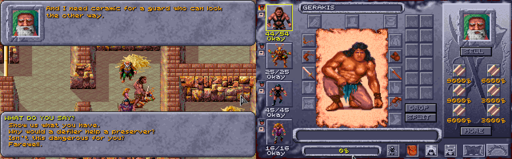
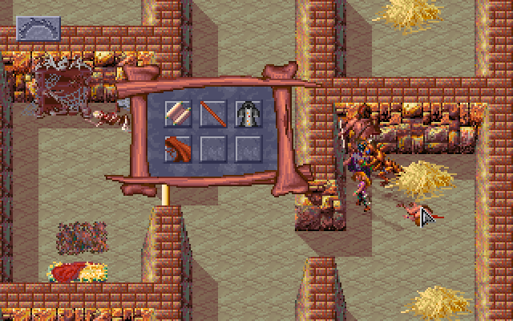
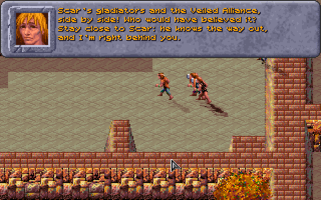
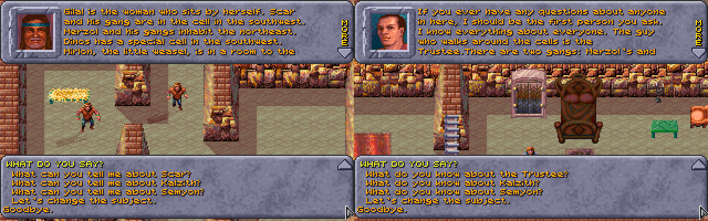
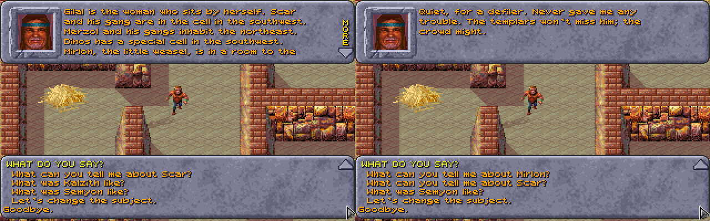
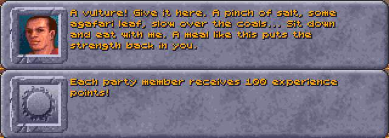

# People

*Part of Obsidian Edition's documentation. **Spoilers:** this page tells who the mod's new people
are, where they are and what happens with them. [Features and rules](FEATURES.md#new-content) has
each one's switch, without the story.*

The people and scenes the mod adds to the slave pens and the arena of Draj: Kalzith, Semyon, what
Dinos and the Trustee say of them, the champions' bout, the cooked vulture and Legcrusher at the
fountain. All but Legcrusher's scene have a switch in the Options tab's **New content** section,
on by default; people and the bout count from the next start, in places not yet visited, and a
saved game keeps what it already has.

## Contents

- [Kalzith](#kalzith)
- [Semyon](#semyon)
  - [Breaking out with Scar](#breaking-out-with-scar)
- [What Dinos and the Trustee say about them](#what-dinos-and-the-trustee-say-about-them)
- [The champions' bout](#the-champions-bout)
- [The cooked vulture](#the-cooked-vulture)
- [Legcrusher at the fountain](#legcrusher-at-the-fountain)

## Kalzith

**Kalzith** is a defiler slave the templars put in the arena now and then (the crowd loves to watch
a defiler burn), kept in a pen of his own in the middle column of the slave pens the rest of the
time. He is there when the party first enters the pens in a game started from the Loader (switch:
**Kalzith, a defiler slave in the slave pens who sells arcane scrolls**). He has the arena
Defiler's figure and a face of his own, painted in the game's portrait style: an old man, white of
brow and beard, in the green-teal hood his figure wears. No one else has it, so the Loader's
Dialogue tab never mistakes him for anyone else.

Talk to him as to anyone (Look at him, then the Look box's Talk button). Spoken to with respect
("We mean no harm. We're slaves too."), he owns up to scribing spells on scraps of hide at night,
to bribe a guard, and **Show us what you have** opens the game's shop screen with his six scrolls,
one of each: Shield and Burning Hands at 3,000 ceramic, Blur and Cat's Grace at 6,000, Lightning
Bolt and Haste at 9,000 (the game's own price, 3,000 a spell level, less with [the leader's
CHA](FEATURES.md#the-leaders-cha-at-shops)). None is a spell the game has a scroll of. Cat's Grace
is there only with [the new spells](FEATURES.md#new-wizard-spells) on. A preserver learns from them
as from any scroll, by the game's rules, rolling with [Preservers' INT](FEATURES.md#preservers-int)
on. He also sells what he wears and carries (an Ashen Robe, a Cloak, a Quarterstaff), as the game's
merchants sell everything they carry; once the party has bought it all, he has nothing more. He
remembers a friend ("Back again? Keep your voice down."), and, as with the game's own people, a
question goes from his list once asked, until the next talk; the shop stays.

Call him a defiler and he answers back; take it back and he is friendly again, but **threaten to
tell the templars** and he won't speak to the party until they make amends: **50 ceramic**
(offered only to a party that has it), or a plea he is won over by with a **Charisma check** by the
character talking. **During the escape**, with the alarm sounding (the game's own, which the pens'
other slaves answer to as well), he has only a line for the party, by how he stands with them; to a
friend: "That's the alarm. So it's you breaking out. Go, and go quickly: if they find you at my
cell, I burn with you."

Attacked, he turns on the party as the pens' other slaves do, and only the guards near him join in.
Killed, he leaves on his body what he still wears and one of the scrolls he still had, chosen at
random (the dice log says which), and Dinos and the Trustee speak of him as dead. After the party's
escape he is gone from the pens with everyone else.

How it works: [DEVELOPMENT-CONTENT.md](https://github.com/daaki85/darksun-obsidian-edition/blob/main/obsidian-edition/DEVELOPMENT-CONTENT.md#kalzith).

## Semyon

Untie the arena's prisoner and he is **Semyon**, a slave the templars tied up in the sun for asking
after the Veiled Alliance, "much more of a scout than a warrior", as he says. In the game he meets
the party again in the arena's bone area, takes them for the Alliance and asks to join; made a
member and asked to help, he fights beside them in the next fight and, if he lives, leaves to find
more members (some of his replies in the bone area send him off before that). Each way he walks
out through the arena's entrance to the pens, where a script takes him off the map, and nothing in
the pens brings him back.

With the Loader (switch: **Semyon in the slave pens after he leaves the arena, and breaking out with
Scar**), if he left after the fight he helped in, he is in a pen of his own above Kalzith's the
first time the party is in the pens after it. His other ways out stay as in the game, and so does a
Semyon who was killed. Talked to (Look, then Talk), he says why the templars tied him up, passes on
what he has heard (who carries keys), reminds the party where he hid his gem (the grain pots), and
talks of the Alliance's plans, in his own voice from the arena; each question goes from the list
once asked, and comes back the next talk. Attacked, he turns on the party as the pens' other slaves
do.

With the [new items](FEATURES.md#new-items) on he also tells of a weapon shipment he passed, a crate
the guards fussed over. From then on the pens' weapon rack holds **Thornwall**, a bone polearm +1
([Items](ITEMS.md#every-magic-item)), and once the party carries it he has a word about it ("We
found what was in that crate.").

How it works: [DEVELOPMENT-CONTENT.md](https://github.com/daaki85/darksun-obsidian-edition/blob/main/obsidian-edition/DEVELOPMENT-CONTENT.md#semyon).

### Breaking out with Scar

A rare way through the arena: recruit Semyon just before the fight with Scar, take up Scar's offer
to break out together, and head for the west exit. In the game, when the alarm goes up, Scar and
his henchmen come along to the slave pens and Semyon is left behind. With the Loader, if he is
still in the arena, alive and on the party's side, he comes too: he stands beside Scar's men in the
pens and fights the guards with them. Talked to then, he says: "Scar's gladiators and the Veiled
Alliance, side by side! Who would have believed it? Stay close to Scar: he knows the way out, and
I'm right behind you." He isn't made one of the pens' slaves while the escape lasts, and once the
party is out through the grate he is gone with everyone else.

## What Dinos and the Trustee say about them

Dinos ("Who else is in here?") and the Trustee ("Who else is in the slavepens?") each answer
questions about the others in the pens. With the Loader their menus also ask about Kalzith, and
about Semyon once he is in his pen ("What do you know about Kalzith?", "What can you tell me about
Semyon?"). Kalzith's question waits until the Loader has found him in the pens (the game's test for
whether someone is there knows only the game's own people); Semyon's until he has been in his pen.
As with the game's own questions, each is shown only until it's answered in that talk.

If either has been killed, they speak of him as they do of the game's dead: the Trustee asks "What
was Kalzith like?" (or Semyon) instead, with an answer of its own, and Dinos keeps the question and
answers it differently.

After the party's escape, when the game empties the pens ("They killed everybody except for
myself", the Trustee says on the torture rack), Kalzith and Semyon are taken off the map too, the
way the game takes the others, and Semyon is never put in his pen after it.

How it works: [DEVELOPMENT-CONTENT.md](https://github.com/daaki85/darksun-obsidian-edition/blob/main/obsidian-edition/DEVELOPMENT-CONTENT.md#what-dinos-and-the-trustee-say-about-them).

## The champions' bout

Kill **Scar** in the arena and the pens have a new king (killed in the pens, he makes no one king,
and the champions don't come). On the party's next visit to the arena the Announcer has news: from
a distant arena come champions who have never known defeat, to see if the new king is worthy of the
crown, led by a Tohr-kreen whose gythka "has drunk the blood of a hundred gladiators". It comes
with **New items, magical and mundane**.

The first wave is six **champions** in place of the game's:

| Champion | Weapons | Armour |
|---|---|---|
| Tohr-kreen | **Kreenfang** (a gythka +1) | none |
| Half-giant | a metal great axe | full scale, a bone helm, a leather shield |
| Mul gladiator | metal cahulaks | full scale, a bone helm |
| Halfling | a sling, a bone short sword | full leather, a leather helm, a leather shield |
| Elf | a **Fine Bow** (the Spellarcher's: +1 to hit, not magic) and 24 **Chill Arrows** (the Spellarcher's: only a Spellarcher's shot casts their spell, so the elf's hit as plain arrows), an obsidian long sword | full leather, a leather helm, a leather shield |
| Defiler | a bone dagger, and a scroll of Fogbolt, Spook or Reflected Image (chosen as the bout starts; of the game's own spells with the new spells off) | **Bracers of Defense** AC 6 (no armour to cancel them) |

The elf has DEX 22 (AC 5 better and +4 with missiles and to initiative, as AD&D's table has it). They fight with their weapons, the two archers shooting, and their armour counts on top of their
kinds' AC, as the party's does (and the game's own people's: [their gear is
worn](GAME-BUGS.md#who-turns-up-and-how) from the start too). What they carry is on their bodies
afterwards; the Tohr-kreen falls as a dead Tohr-kreen of its own (as every thri-kreen now does),
Kreenfang in it (and the elf's Fine Bow and the Chill Arrows it didn't shoot in the elf's, the defiler's Bracers of Defense in its: a party can have them early, the arrows for a Spellarcher alone). The bout comes once. A party that breaks out with Scar instead, or leaves the pens
another way, doesn't meet them.

How it works: [DEVELOPMENT-CONTENT.md](https://github.com/daaki85/darksun-obsidian-edition/blob/main/obsidian-edition/DEVELOPMENT-CONTENT.md#the-champions-bout).

## The cooked vulture

Hit the arena's vulture and its feathers come off (a plucked vulture); the slave pens' campfire
cooks it. In the game the cooked vulture is then no use to anyone: no script asks for it. With the
Loader running (switch: **The cooked vulture**), **Dinos**, the pens' fine cook, takes it: talk to
him while someone in the party carries it, and just before "Goodbye." the party can say **"We
cooked the vulture from the arena."** He takes it, cooks it with salt and agafari leaf and sits
them down to eat, and the game's own window for a quest's reward follows, with the quest's sound:
"Each party member receives 100 experience points!". Each gets **100 XP** (split between a
multiclass character's classes, as the game splits all its XP) and is **restored as after a full
rest**: hit points, PSP and spell slots full, anyone knocked out back on their feet. No time
passes. The question is gone once the vulture is. (Eaten by the party on their own, it's too tough
to be worth the chewing.)

How it works: [DEVELOPMENT-CONTENT.md](https://github.com/daaki85/darksun-obsidian-edition/blob/main/obsidian-edition/DEVELOPMENT-CONTENT.md#the-cooked-vulture).

## Legcrusher at the fountain

Always on, with no switch: a mend of the game's script ([the game's
bugs](GAME-BUGS.md#scripts-that-stuck-or-ran-twice)). When the party is slow to answer Kurzak's
call, he sends **Legcrusher**, the pens' half-giant monster trainer, to fetch them. In the game,
wherever he found them, he gave his warning as if they were in their cells. If he finds them at the
fountain (its room, or the passage before it, where the fountain's roar already masks a guard's
yell), he now sees the gladiators out of their cells and yells for the guards, the fountain drowns
him, and he attacks alone, in three windows (his face, the narration, his face again):

> Gladiators out of cells! Bad gladiators! Guards! GUARDS!
>
> *Legcrusher tries to yell for help but the roar of the fountain masks his voice.*
>
> Nobody come? Then Legcrusher take you back himself!

No alarm goes up and no guards come. Killed, he is missed: Kurzak's later lines say his monster
trainer has gone, and Dinos says Kurzak will come down himself. Elsewhere Legcrusher says what the
game has him say. With the new items on he fights with a **Cahulaks +1** in place of his two clubs.

How it works: [DEVELOPMENT-CONTENT.md](https://github.com/daaki85/darksun-obsidian-edition/blob/main/obsidian-edition/DEVELOPMENT-CONTENT.md#the-games-script-bugs)
("Kurzak and Legcrusher", "Legcrusher at the fountain").
