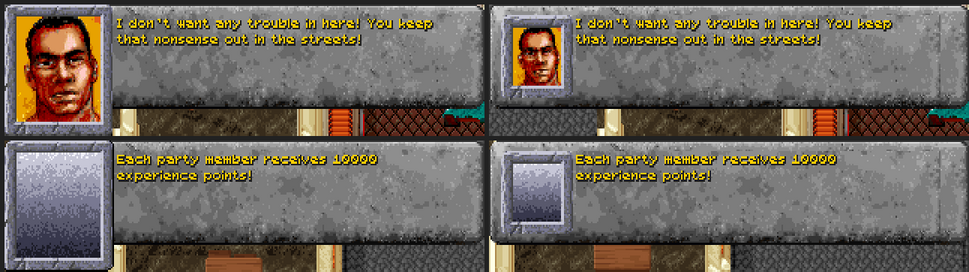

# Wake of the Ravager

*Part of Obsidian Edition's documentation, from the [README](README.md) and
[Features and rules](FEATURES.md#wake-of-the-ravager).*

Dark Sun: Wake of the Ravager, the sequel (GOG sells it with Shattered Lands), starts from the Loader
with most of the mod, and a Shattered Lands party can go on into it. This page is what the mod does
there: how to start it, how the party comes across, and the mod's rules, screens and keys in the
sequel. Which kits work there: [In Wake of the Ravager](KITS.md#in-wake-of-the-ravager). Which of
the game's bugs are mended there: [the game's bugs](GAME-BUGS.md#in-wake-of-the-ravager). The levels
past Shattered Lands': [the player's guide](PLAYER-GUIDE.md#in-wake-of-the-ravager). Its creatures, their sizes and redrawn
figures: [Creatures](CREATURES.md#wake-of-the-ravager). Its dice log: [the dice log](DICE-LOG.md#in-wake-of-the-ravager).

## Starting the sequel

**Play Wake of the Ravager**, beside **Play Shattered Lands** at the top of the window, or `Play Wake
of the Ravager.bat`, starts it from its folder in the same engine as Shattered Lands ([the
engine](FEATURES.md#the-engine-gogs-dosbox-or-dosbox-x)), with the mod's fixes and rules ported to it
(below) and the dice log of its fights. When the Loader hasn't found it, the button says so and points
to **Choose its folder...** ([starting it](README.md#other-ways-to-start)). **It converts the sequel's
roster and saves first** ([below](#your-sequel-saves-are-converted)). `Play Wake of the Ravager (in-game rolls).bat` starts it with
the in-game additions and no Loader window, as `Play Dark Sun (in-game rolls).bat` does Shattered Lands (a
problem said in a message box and written to `play.log`).

### Your sequel saves are converted

**Each start from the Loader converts the sequel's roster and saves**, in the sequel's own folder:
`CHARSAVE.GFF` (the roster), `DARKRUN.GFF`, `DARKSAVE.GFF`, the saves `SAVEnn.SAV` and the quick
saves and autosaves `SAVQnn.SAV`, each made to hold the Loader's longer character sheet. Each file
is copied first as it was, as `NAME.42H` (`CHARSAVE.GFF.42H`). A file already converted is left
alone; one the game wrote again in its own form (the sequel played without the Loader) is converted
again at the next start, and its `.42H` copy replaced by the newer one. [Taking the party
across](#taking-the-party-to-wake-of-the-ravager) changes the roster too (kept first as
`CHARSAVE.GFF.BAK`). Shattered Lands' files are never converted.

Converted, they are the Loader's: **the sequel started by itself can't read them**, shows the Loader's
items as money bags, and can stop in a fight on the turn of a member with a kit.

**To play the sequel without the Loader again** (and before you delete the Loader, since this needs
it), convert them back: in the Loader's folder run

    python -m dsloader.ravager narrow FOLDER

with FOLDER the sequel's. The roster and the saves become the game's again, the weapon specs dropped,
each file copied first as `NAME.48H`. The Loader converts them again at its next start. Or put back a
`.42H` copy by hand (rename it without `.42H`): the file as it was before that conversion.

## Taking the party to Wake of the Ravager

The Options tab's **Take the party to Wake of the Ravager...** button puts the party of a Shattered
Lands save into the sequel's roster, for a game that goes on with the same characters. Choose the
save; the save itself is not changed. Then start Wake of the Ravager from the Loader and **ADD** them
on its CREATE CHARACTERS screen. A window lists what came across.

- **XP comes across up to Shattered Lands' cap.** A member arrives with no more than its share of
  749,999 XP (the whole for one class, an equal share for several, a human's the cap less its old
  classes' levels' XP), so XP banked past the cap in an older save stays behind; the report after the
  transfer says so (`XP 749,999 (Shattered Lands' cap: 2,000,000 in the save)`).
- **Every item comes across.** What the sequel has, it gets as the sequel's own item (as SSI's
  CHARTRAN does); the rest, which CHARTRAN turns into money bags, the Loader makes for the sequel,
  with its picture and name from your own Shattered Lands files: the mod's weapons, armour and magic
  items, and the game's quest items as keepsakes (carried and sold, no use in the sequel's story).
  Scrolls come across as the sequel's scroll of that spell (a wizard learns a spellbook's spell from its
  box outside a fight); a spell the sequel lacks makes a keepsake.
  Weapons a spell made (Shillelagh, Flame Blade, Spiritual Hammer) stay behind. The sequel's own
  weapons the mod brought into Shattered Lands (the two-handed sword, lotulis, double spear, trikal
  and javelin, and their magic ones of the same material) go back as the sequel's own weapon of that
  kind (the darts, wooden, as the mod's own: the sequel's are stone or of no material), and a spec in one of them stays that spec, for the sequel's own weapons of it ([In Wake of
  the Ravager](WEAPON-SPECS.md#in-wake-of-the-ravager)). **Every weapon keeps its kind and its
  material**: the metal great sword, lotulis and javelin, the obsidian lotulis and the bone great sword
  (a fire cleric's Obsidian Lotulis +1, a water cleric's Bone Great Sword +1) are their own types there,
  with Shattered Lands' damage, weight and who may wield them; and where SSI's own swap gave one of
  Shattered Lands' weapons another material or kind (a bone Long Sword the sequel's obsidian one, the
  Great Axe +3 an obsidian axe, the Polearm +1 a double spear, Terror Blade a stone dagger, Bloodwrath a
  metal sword) the Loader makes it in its own material and kind instead. The sequel had no bone long
  sword: the Loader adds Shattered Lands' to it. Its club and bow are wood and its sling leather, as in
  Shattered Lands (SSI made them of no material), so an earth or water cleric, druid or ranger may use
  them there too.
- **Time passes between the games**: 3 to 12 months, rolled once. Each member ages a year with a
  chance of the months in twelve, with the [age rule](FEATURES.md#ages-and-magical-aging)'s usual effects.
- **The roster**: the sequel's own is kept first as CHARSAVE.GFF.BAK (the first time). A character
  taken across before takes its old place again; the others take free places. With too few free, the
  Loader says so: delete characters in the sequel first.

## The sequel's own party

The sequel's own four (a new game started with no party made) are fitted to the mod as [Shattered Lands' own
party](FEATURES.md#the-games-own-party) is, the owner's choices of 2026-11-26. The Loader does so once, when
it finds them with no weapon specs and no kit (a game saved before, too), and says so in the dice log:

| Character | Weapon specialization | With kits |
|---|---|---|
| **Gerakis**, half-giant gladiator | the long sword, the gythka and the trikal | **Wild Fighting**, as in Shattered Lands |
| **Thy'rokh**, thri-kreen fighter and fire druid | the gythka (mastery at once: he is a 6th-level fighter) | a **Grove Warden's AC**: 1 better for every 3 druid levels |
| **Terrannus**, human earth cleric | the long sword, his kit's chosen weapon spec | a **Crusader** (a warrior's THAC0, expertise with the long sword, a warrior's extra attacks), at the kit's full cost: one fewer spell slot at each spell level |
| **Ar'Anda**, elf preserver, psionicist and thief | | the **Elven Shadow-walker's** hiding (never halved in daylight), and she **casts in light armour** (leather, or of no material), though a multiclass preserver |

Without these, the sequel's level up would ask each of them for weapon specs, as it does in Shattered Lands
for a game begun before the rule.

## Saves in the sequel

The sequel keeps its own save and load window: its ten saves, `SAVE01.SAV` to `SAVE10.SAV`, with no more
pages ([more saves](FEATURES.md#more-saves) is Shattered Lands' alone so far).

[Quick save, quick load and autosave](FEATURES.md#quick-save-quick-load-and-autosave) work in the sequel too
(started from the Loader), with the same switches, in its own save and load window: F9 opens its LOAD window
on the quick saves (`SAVQ01.SAV` to `SAVQ10.SAV` beside the game's `SAVE..`), and once it is shut the window
is back on the game's own ten (the sequel's own F1 and F2 windows never open on the quick saves). Its
autosaves have shorter names, to fit its narrower rows (`Auto Day 1, 09:05 Mines 1`, `Auto Day 1, 00:06
fight`). Each quick save keeps its own part of the map's limits, which the sequel stores beside a save, so
loading one never takes another save's. There is no camp in the sequel, so no camp autosave. While the
switch is on and the Loader is there, F5 is the quick save, not the sequel's own F5 (the sound effects on
and off: F4 and the game's menu still have the music, and the menu the sound effects); with the switch off
or without the Loader, F5 is the game's again.

[Saves under their names](FEATURES.md#saves-under-their-names) work for the sequel too: its ten manual slots
are copied into **Named saves (Wake of the Ravager)** (`Page 1 slot 02 - In Tyr.SAV`), the **Wake of the
Ravager's** button opens that folder, and a sequel's save put back into a slot is made the Loader's (the
bigger character sheets) as it goes in (a game already running lists it from its next start).

## The mod in the sequel

- **[The combat log in the game](FEATURES.md#the-combat-log-in-the-game)**: L on the map shows the dice
  log's lines over the sequel's map too, as in Shattered Lands.
- **[Kits](KITS.md#in-wake-of-the-ravager)** come across with each character on its character sheet
  (with its spells and starting age), and work there nearly all whole: their fight rules, spell slots,
  spells known, PSP costs, hit dice and the gear each forbids or allows (a Ravager's shield and bow are
  refused). The Effects screen names each kit (`KIT: RAVAGER`). A new character takes one from KITS on
  the creation panel, and a human with no kit is asked for one right after DUAL. The Wanderer and
  the Spellarcher work only in part: [kit by kit](KITS.md#in-wake-of-the-ravager).
- **[Weapon specs](WEAPON-SPECS.md#in-wake-of-the-ravager)** come across and work there, in all twenty-two
  (the sequel's Twohand Sword and Crystal sword are two-handed swords). A new fighter, gladiator or ranger
  picks them on the weapon window after DONE, and its starting weapon becomes a +1 weapon of its first
  pick's kind, in the weapon hand (the sequel's own gear put it in the left hand, where it swung once a round).
- **The [new wizard spells](FEATURES.md#new-wizard-spells)** come across, and a preserver learns them there
  at a level up, at creation or from a spellbook: Notaku in Tyr sells one of each (Cat's Grace 6000, the
  others 3000), and three of the sequel's wizards carry one ([the mod's gear](#the-mods-gear-in-the-sequel)).
- **The creation screen** has [STORE and RECALL](FEATURES.md#store-and-recall-on-the-creation-screen), and a
  new character gets [fuller starting gear](FEATURES.md#fuller-starting-gear) fitted to its kit from the
  sequel's own items.
- **The screens** show it all as in Shattered Lands: the DAM lines (the kits' damage and a kit's
  expertise too), the creation screen's THAC0 (a Scholar's), the Effects screen's weapon kinds and an
  effect's charges in its name ([the Effects screen](FEATURES.md#the-effects-screen)), and the Look box's whole
  description of a monster in the dialogue window.
- **[Choosing an enemy](FEATURES.md#choosing-an-enemy-tab-enter-and-the-rings)** with Tab and Enter works in
  the sequel's fights, with the red ring and [the chance to hit](FEATURES.md#the-chance-to-hit-before-the-swing)
  (without the Loader, Tab opens the sequel's own menu).
- The Loader's copy of the sequel gives every character sheet six more bytes for all this, its own
  characters' too.
- **The mod's items work as they did**: who may wield them, the spells they cast on a hit or put on
  their wearer (taken off, the spell ends), the AC and saves of the rings, cloak, bracers and robes,
  the Veiled Robe's extra spells, the Boots of Speed, the girdles, the Amulet of Magic Resistance and
  the Tome of Understanding (+1 WIS). The sequel's own rules hold where they differ: Focus Heat burns
  for 2d6+6. The spell arrows (Chill, Shocking and Vampiric Arrows) cast their spell at the archer's
  preserver level, as in Shattered Lands; shot by a member with no preserver class they are plain
  arrows. The tome is read from its box (right-click it in the pack, then its icon) in a fight, on its
  reader's turn: outside a fight its icon does nothing.
- **Hiding in shadows** comes too, as in Shattered Lands: in a fight a thief or a ranger with no enemy
  beside them may hide and move silently, and then their next attack is from behind (a thief's, in
  melee with a light weapon, a backstab). The Cloak and Boots of Elvenkind work as they did: hidden
  95% of the time under the open sky (90% under a roof), silent 95%. Tyr's streets, the forest, the
  Jann's desert, the Silt Sea islands and the clouds count as daylight.
- **[Thieves as in AD&D](FEATURES.md#thief-skills-from-adds-table)** hold in the sequel too: a thief's skills are
  the Player's Handbook's average for the thief level plus the race's and Dark Sun's DEX adjustment
  (no more than 95 after armour), the inventory shows those numbers, and a backstab multiplies the
  weapon's dice only (Enlarge's enlarged dice), STR's bonus and the weapon's plus added once, on the
  round's first attack; an Assassin's backstab multiplies them once more (x3 to x6), as in Shattered
  Lands.
- **[Picking pockets](FEATURES.md#picking-pockets)** comes too: a thief's **Pick Pockets** button (the purse, where
  a cleric's Turn Undead is on the USE screen), then a click on anyone in sight, not in a fight, with the
  look pointer it gives: made, one small thing (a dagger, a sling, a ring; not a long sword nor anything
  worn) goes into the thief's backpack, or coins when there is nothing else, the last try on them;
  failed, a move silently roll to slip away, else caught, and that thief keeps from them until a thief
  level is gained. A cleric/thief keeps Turn Undead alone (no purse beside it), a right click on the
  purse shows no description, and there are no weapons worth XP to lift.
- **A lock a thief failed** is out of reach in the sequel too until that thief gains a level, as in
  Shattered Lands (with [Thieves as in AD&D](FEATURES.md#thief-skills-from-adds-table)); the dice log says why.
- **Shattered Lands' fixes of the game's own bugs** that the sequel shares come with it: a character's
  most PSP from its own scores, the computer's walls cast across the line of fire, a party thri-kreen's
  claws and bite that cut, the gladiator's armour optimisation only with armour on, a berserk creature
  back on its own side as Berserk ends, and the rest
  ([which](GAME-BUGS.md#shattered-lands-fixes-in-the-sequel)). The dice log there says when an effect starts
  and ends (`Thy'rokh gives Paralyzed to Draxan`, `Controlled ends on Draxan`), a member's PSP spent or
  regained, an ability score changing, and the monsters killed (`Draxan is killed`, counted in the
  fight's summary), as in Shattered Lands.
- **Items weigh what they do in Shattered Lands.** SSI left most of the sequel's items weighing
  nothing, though its program still reads weight as Shattered Lands' does. With the Loader a long sword,
  a mace, a shield and armour weigh as they do there, so the sequel's own rules
  ([weight and carrying](HOW-THE-GAME-WORKS.md#weight-and-carrying)) work again: two heavy weapons
  (over 3 lb each: metal long swords, maces, axes) can't be held together, the item box says HEAVY,
  a backstab needs a weapon of 4 lb or less (no great axe, polearm or two-handed sword), and picking
  pockets goes by weight. The few weapons SSI made oddly light
  weigh as Shattered Lands' copies of them do (the two-handed sword 15 lb, the lotulis 10). As in
  Shattered Lands, no load is too heavy and nothing slows a loaded character.
- **[Weapon traits](FEATURES.md#weapon-traits)** in the sequel too: the cahulaks' two heads and tangle, the staff
  sling's stinkpots, the polearm's reach, and on the sequel's own Lotulis, Double Spear and Trikal a
  specialist's [second foe](FEATURES.md#lotulis-and-double-spear) and [trip](FEATURES.md#trikal), the trikal reaching two squares.
  The sequel's **Double Spear** swings beside its foe: SSI gave it a range of 2 squares, which the game
  took as a shot (once a round, DEX to hit and no STR damage; a double spear specialist under Computer
  Control swung once a round from 2 squares); with the Loader its range is 1, as Shattered Lands' double
  spear's, and it swings at the warrior's rate ([In Wake of the Ravager](WEAPON-SPECS.md#in-wake-of-the-ravager)).
- **[A level cap by XP](FEATURES.md#level-cap-by-xp)** of its own in the sequel: **5,625,000 XP**, shared between a
  character's classes as Shattered Lands' 749,999 is, in place of the game's stop at 15th. Levels go past
  the sequel's table (20th) to 30th by AD&D's tables, as far as the share allows: most characters of three
  classes reach 15th, a fighter alone 30th ([the table](PLAYER-GUIDE.md#in-wake-of-the-ravager)). THAC0, thief
  skills, spell slots and **saving throws** go on by AD&D's tables too (the game held every save at its
  table's last row, and a psionicist saved as a thief), and a preserver learns spells up to 9th level only:
  the sequel's four 10th-level spells stay the monsters'. A level up past 20th says "21st", not "21th".
- **[Shops as in AD&D](FEATURES.md#the-leaders-cha-at-shops)** hold in the sequel too: the party leader's CHA takes 5%
  (CHA 18) to 40% (25) off what a shop asks, a shop pays 60% of an item's price, and a magical item sold
  (a plus or a power: a scroll, a ring, a wand...) goes into the merchant's pack, listed again to be
  bought back. A shopkeeper's own discount in the sequel (Tasarla's for the Veiled Alliance) comes on top.
- **[Two weapons](FEATURES.md#two-weapons)** as in Shattered Lands: -2 in the main hand and -4 in the off hand, DEX's
  adjustment, one attack a round with the off hand; a ranger has none of it only in light armour (leather, or
  armour of no material), as in Shattered Lands, where the sequel let a ranger off in any armour. And over the
  figures, a spell's charge used floats its count as in Shattered Lands (`Armor: 7 left`).
- **[Psionic Blast](GAME-BUGS.md#spells-and-psionics)'s imagined wounds** come back as a fight ends in the sequel
  too ("Seneca shakes off Psionic Blast's imagined wounds as the fight ends"), and until then a blow that would kill
  the member knocks it out instead. The dice log's saving throws there show the d20 rolled and each modifier by
  name, as in Shattered Lands (`d20 = 13 +1 Ring of Protection -1 WIS 6 +1 CON 19 = 14, needs 13`), with a
  natural 1's line that went missing before, and the creation screen's rolls each score's four 4d4 (`best of
  four 4d4 (12, 9, 8, 7) = 12, +4 = 16`). Its attack lines break the THAC0 down as Shattered Lands' do (`THAC0
  13, +3 STR, -2 stone, +2 difficulty = 10`), the cahulaks' heads named (`-2 cahulaks, main head at DEX 12`);
  a Battle Dancer in light armour has no head penalty with the cahulaks, as in Shattered Lands.
- **[Looting with T and Shift+T](FEATURES.md#looting-a-body-t-and-shiftt), [selling with S](FEATURES.md#selling-plain-gear-s)
  and [M, U and I](FEATURES.md#m-u-and-i-open-a-screen-close-it-again)** work in the sequel too (started from the
  Loader). A body's window opens with the eye (right-click twice). The items go into the backpacks and the
  dice log names them (`Ar'Anda takes Bow, Stone Lotulis, Bone Brigandine Armor (3), Arrow`). S sells the
  plain gear of the member on show and shuts the shop back to the talk. M is the sequel's own overhead map
  (its O). No purse sound plays in the sequel. Without the Loader, T and S are the game's keys and leave the
  window or the shop open.
- **The sequel's messages are seen**: its message box (a scroll's [YOU LEARN THE
  SPELL](FEATURES.md#what-a-scroll-says) and the rest, a shop's I COULDN'T SELL THAT) was never on screen, drawn
  and gone at once; now it stays for the time the game's options set (five seconds at first) while the
  game waits, and with it [a wizard's INT](FEATURES.md#preservers-int)'s YOU FAIL TO LEARN THE SPELL and TOO MANY
  SPELLS OF THAT LEVEL.
- **The Loader's Dialogue and Journal tabs follow the sequel**: every conversation with the replies
  offered and the one chosen (`You chose: Who are you?`), the speaker named once a talk shows whose
  face it is (`Caravan Master`; or name it with **Name speaker...**, kept apart from Shattered Lands'
  faces), and each message box in the journal and in the dice log (`Message: YOU ALREADY KNOW THIS
  SPELL`). The sequel's journal is one of its own from the Loader's start: it doesn't follow the
  sequel's saves as Shattered Lands' does (a game loaded there goes on in the same journal). The Spells
  and Memory tools tabs read the sequel's spells and records.
- **[Spells on the Effects screen](FEATURES.md#spells-on-the-effects-screen)**: a click on a spell's icon leaves it on in the sequel too.
- **[Squares in reach](FEATURES.md#squares-in-reach), [F10](FEATURES.md#f10-takes-a-whole-move-back) and
  [Alt](FEATURES.md#showing-what-can-be-used-alt)** work in the sequel's fights too. On a party member's turn
  small crosses mark the squares they can still walk to, and R hides or shows them. After the last
  step the sequel opens its own **END MOVE** menu (GUARD, WAIT, END TURN), and F10 does nothing
  while it is up: Escape closes it, and F10 then puts the member back where the turn began, with the
  move to walk again (`F10: Lex's move taken back (can walk again)`). Without the Loader the sequel
  gives the points back but not the walk, so a click goes nowhere. A member held where they stand
  (Paralyzed, or Cannot Move) stays there. Out of a fight, holding Alt rings what can be used in gold
  and names it: things to take, doors, bodies to search, people to talk to.
- **The sequel's figures drawn in Shattered Lands' style**: its people, the party's figures, its creatures,
  the people lying or sitting in its scenes, the Tarrasque and its three drakes, redrawn to Shattered Lands'
  size and look (the Shattered Lands party figures, a mul or an elf of the sequel on the same body as
  Shattered Lands', its elementals Shattered Lands' own). The Loader puts them into its copies of the
  sequel's files each start (nothing in the sequel's folder changes), with the Mines' dining room laid
  out again for its smaller furniture, and Tyr's tables, chairs, beds and other furniture lowered to
  two-thirds of their height for Shattered Lands' steeper view. The same treatment now reaches 19
  freestanding shelf pictures used in Tyr, the Veiled Alliance headquarters, the Yuan-ti area, Mines 3
  and both inhabited volcano levels. Another 61 pictures lower loose furniture and storage in nine regions,
  including Forest beds, the Mines 1 worktable and the volcano tables and stools. The Forest dining sets, the Veiled Alliance crate and vase, and
  the two-piece Mines 3 throne now have coordinated heights and placements. The Jann camp cushions sit lower around the Sultan,
  and the Silt Sea Giants’ tables and chairs keep their width at the lower height. The Crypt barracks beds, tables and seats and the Cloud jars
  use the same proportions. Jumah’s table still partly conceals the key. In the ruined Alliance headquarters, the loose pillows and
  broken pottery sit against the lowered beds and crates. Both halves of the weapon display line up in the Yuan-ti tunnels and Mines 3.
  In El’s Temple the bowls of the six braziers sit lower beneath their curling smoke. The barrel and sack pile shared by the mines and Tyr
  sits lower while both barrel lids remain visible over the Tyr wall. The air and fire drakes have been seen fighting on their own maps.
- **Shattered Lands' screens and icons in the sequel**: the USE screen, the inventory, the status box, the
  END menu and the other screens the two games share draw Shattered Lands' own pictures (smoother, a little
  bluer stone), and 221 spell, psionic and button icons are Shattered Lands' drawings of the same thing,
  taken from your Shattered Lands folder each start and put in the sequel's colours. The MORE and scroll
  buttons stay the sequel's, since they sit on its own talk boxes. Without a Shattered Lands folder the
  sequel's own are used. The box "Shattered Lands' screens and icons in Wake of the Ravager", in the Options
  tab's Wake of the Ravager section, turns it off (from the sequel's next start).
- **Talk portraits at Shattered Lands' size**: the sequel's faces in its talk and message boxes were 72 by
  72 in a box 72 high, the text starting a quarter of the way across. The Loader's copy draws them as
  Shattered Lands does: a 32 by 32 face in a 48-pixel stone frame at the box's top left, the box 58 high
  and the text from the same place as Shattered Lands' (five lines, as there). The empty frame at the end
  of a fight ("Each party member receives ... experience points!") and the merchant's face in a shop are
  the smaller size too. The faces are the sequel's own, made smaller each start, with the sequel's own
  frame cut down round them: each small pixel the average colour of the big pixels it covers, put back
  to the nearest colour the face itself uses, so it is smooth shading as in Shattered Lands' faces, not
  the big picture's dithering left as speckle ([the faces side by side](docs/ravager-portrait-resample.png)).
  
- **[Shadows](FEATURES.md#shadows)** under the figures in the sequel too: every living creature on the map (the
  party, the people, the monsters; not the dead) casts its see-through shadow on the floor, laid long
  toward the lower right, beside the shadows the Loader's copy gives the sequel's walls (it draws none of
  its own).
- **[Dust](FEATURES.md#dust)** in the sequel too: whoever walks over dirt or sand raises little puffs behind them
  (Tyr's squares and yards; its grey cobbles and the dark floors indoors take none).
- **[Magic items' icons](FEATURES.md#magic-items-icons)** shine in the sequel's shops too (they stood still on a
  shop's screen), and twelve of its own magic items that never shone now do as the others: Dragonsbane,
  the Toothed Club, the Chatchka +1, the Gloves +3, three magic armours, the Boots, the Amulet, the Ioun
  Stone, the Necklace and the Rod.
- **[See-through figures](FEATURES.md#see-through-figures)** in the sequel too: a party member hidden in shadows in
  a fight, and anyone invisible (unless the party detects invisibility), is drawn half see-through.
- **[Preservers' first spells](FEATURES.md#preservers-first-spells) and [psionic powers at
  creation](FEATURES.md#psionic-powers-at-creation)** are picked in the sequel too, in place of its own
  grants (a new 7th-level preserver's ten spells, some at random, and a psionicist's fixed eighteen powers).
  With the Loader, **DONE** opens **CHOOSE A SPELL** for as many as the game would have given, level by
  level, then **PICK A PSIONIC POWER**. **EXIT** leaves the rest to the game, and **EDIT** keeps the powers
  of a member whose classes and disciplines stay.

## The mod's gear in the sequel

[The item tables](ITEMS.md#wake-of-the-ravagers-items) list every item of the sequel and where it is.
Wake of the Ravager has no short sword at all and no magic pick, and few magic great axes, cahulaks,
staff slings and polearms. The mod adds 14 magic weapons, +1 to +3, plain-named as the game's own,
and puts the 15 plain items the mod brought to Shattered Lands (bone, metal and obsidian short swords,
daggers, maces, axes, great axes, picks, polearms, cahulaks and the Bone Helm) in the sequel's shops,
on its people and in its chests. Pictures are Shattered Lands', from your copy; the magic ones have a
few fire-coloured pixels, which don't shimmer as Shattered Lands' do.

| Item | Where |
|---|---|
| Short Sword +1 | Notaku's stall, Tyr |
| Short Sword +2 | a Draxan in Tyr |
| Short Sword +3 | a body in the Crypt |
| Pick +1 | the receptionist who sells picks |
| Pick +2 | a crate in the third mine level |
| Pick +3 | the silt giants' leader |
| Great Axe +1 | a Draxan in Tyr |
| Great Axe +2 | a Draxan in the Pyramid |
| Cahulaks +1 | Alhena, the Jann's lands |
| Cahulaks +2 | the Runner, the Yuan-ti tunnels |
| Polearm +1 | a guard at the Veiled Alliance's headquarters |
| Polearm +2 | a Draxan, the third volcano level |
| Staff Sling +1 | the ranged-weapon stall, Tyr |
| Staff Sling +2 | Sureshot, in the forest |

The weaponer sells all 13 plain weapons; the armourers the Bone Helm; other stalls a few each. A game
saved before has them in its shops too: the Loader stocks each seller once, as you meet it, and what you
buy isn't put back (`dsloader/shopstock.py`); its other people and chests keep what they had. The Bone
Helm gives AC 1
with [Helms give AC 1](FEATURES.md#helms-give-ac-1), as in Shattered Lands (a transferred one too). Built by the Loader (`dsloader/ravgear.py`) when the Shattered Lands folder is set.

With the [new wizard spells](FEATURES.md#new-wizard-spells) on, **Notaku** sells a spellbook of each of the six (Cat's
Grace 6000, Erdlu Claw, Fogbolt, Reflected Image, Spook and Friends 3000 each: 3000 a level, the sequel's own
price), on his list's second and third pages after the Short Sword +1; read from the inventory, a book teaches
its spell (not in the shop's screen). Three of the sequel's wizards who carry a spellbook carry one more,
Fogbolt, Spook or Reflected Image, as a defiler in Shattered Lands may. In Shattered Lands Kalzith sells Cat's
Grace. A game saved before gets them at Notaku's as the weapons (four of the six fit his pack).

## Not in the sequel yet

The mod's rule is that both games get each change. These are the parts of the mod that Shattered Lands has
and the sequel does not yet, each checked against the Loader's code (2026-11-27):

- **[What the party wears](FEATURES.md#what-the-party-wears)**: the class outfits, and the new character's
  figure on the creation screen. The sequel keeps its own figures, [drawn in Shattered Lands'
  style](#the-mod-in-the-sequel).
- **Spells**: Restore Youth, the mod's Whirlwind damage and Sunstroke's heat (the sequel casts its own
  Whirlwind and Sunstroke), and so a Healer cleric's two more cosmos spells.
- **Controls**: [scrolling the map](FEATURES.md#scrolling-the-map) with the mouse wheel held down (the
  sequel's map scrolls only at the screen's edge, as the game has it), [the view in
  fights](FEATURES.md#the-view-in-fights), [the pointer in scenes](FEATURES.md#the-pointer-in-scenes-and-where-it-starts)
  and [the whole party in view](FEATURES.md#the-whole-party-in-view).
- **[More saves](FEATURES.md#more-saves)**: the sequel's window keeps its own ten saves, with no pages 2 to 4
  and no QUICK page (F9 opens its quick saves: [saves in the sequel](#saves-in-the-sequel)).
- **[More characters](FEATURES.md#more-characters)**: the sequel's roster keeps its own limit, not 29.
- **[Steady pace](FEATURES.md#game-speed)**: the switch does nothing for the sequel (the speeds do).
- **[Names over figures](FEATURES.md#names-over-figures)**: the arrows left after a party archer's shot.
- **The [cahulaks](FEATURES.md#cahulaks)' tangle** goes by size alone: Shattered Lands spares the shapeless (a
  shadow, a dust devil, an elemental) and a few creatures by name, the sequel only the half-giants and the
  large ([its creatures](CREATURES.md#wake-of-the-ravager)).
- **The DAM lines** leave out a thri-kreen's chatkcha throws, Hasted and Slowed, and a weak material's damage on
  View Character.
- **[Defilers' scrolls](FEATURES.md#defilers-scrolls)** (in the sequel Notaku sells the new spells' books
  and three of its wizards carry one), and the game's people wearing and wielding their gear as they come on
  the map.
- **The dice log**: the XP each kill gave and the level-ups (it names the kills), the report when an item goes
  missing from the party, and the line of each round's initiative scores.
- **The game's bugs** the mod mends in Shattered Lands but not yet in the sequel:
  [GAME-BUGS.md](GAME-BUGS.md#shattered-lands-fixes-in-the-sequel).
