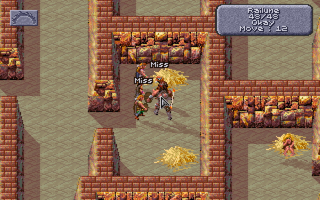

# Obsidian Edition

Obsidian Edition is a mod for **Dark Sun: Shattered Lands** (the GOG release)
in DOSBox. You start the game with the **Dark Sun Obsidian Edition Loader**
(called Templar's Ledger up to 2.2.1), which loads the mod with your options.

**Where to start**

- **To play:** [Running it](#running-it-windows): unzip, double-click
  `Start Obsidian Edition.bat`, press **Start the game**.
- **To learn the rules:** [the player's guide](PLAYER-GUIDE.md), without
  spoilers, with a [glossary](PLAYER-GUIDE.md#glossary) of THAC0, AC, PSP and
  the rest.
- **If something goes wrong:** [Troubleshooting](#troubleshooting),
  [Known issues](#known-issues) and [Reporting a problem](#reporting-a-problem).
- **Everything in detail:** the contents below, the [features and rules](FEATURES.md), the [kits](KITS.md), the
  [items](ITEMS.md) (spoilers) and the [patch notes](https://github.com/daaki85/darksun-obsidian-edition/blob/main/PATCH-NOTES.md).

## Contents

- [What it does](#what-it-does)
- [Requirements](#requirements)
  - [Suggested system requirements](#suggested-system-requirements)
- [Running it (Windows)](#running-it-windows)
  - [One-time setup](#one-time-setup)
  - [Every time you play](#every-time-you-play)
  - [Other ways to start](#other-ways-to-start)
  - [Crash, freeze and item reports](#crash-freeze-and-item-reports)
  - [Reporting a problem](#reporting-a-problem)
  - [Updating, backups and the Loader's files](#updating-backups-and-the-loaders-files)
  - [Troubleshooting](#troubleshooting)
  - [Known issues](#known-issues)
- [In the game](#in-the-game)
  - [The combat log in the game](#the-combat-log-in-the-game)
  - [Names over figures](#names-over-figures)
  - [THAC0, saves and thief skills](#thac0-saves-and-thief-skills)
  - [Spell slots on the USE screen](#spell-slots-on-the-use-screen)
  - [What hurts a monster (the Look box)](#what-hurts-a-monster-the-look-box)
  - [Charges in item boxes](#charges-in-item-boxes)
  - [No manual check](#no-manual-check)
- [The Loader's window](#the-loaders-window)
  - [The Characters tab](#the-characters-tab)
  - [The Spells tab](#the-spells-tab)
  - [The Dialogue tab](#the-dialogue-tab)
- [The dice log](#the-dice-log)
- [How the game works](#how-the-game-works)
- [Features and rules](FEATURES.md): rule changes, character customization, expanded features, new content, graphics, controls, the game's bugs fixed, more saves and characters, game speed
- [Item tables](#item-tables) (a page of its own: [Items](ITEMS.md))
- [Accessibility](#accessibility)
- [Without the game](#without-the-game)
- [The player's guide](PLAYER-GUIDE.md)
- [Development](DEVELOPMENT.md)

## What it does

New to the game, or to the mod? [The player's guide](PLAYER-GUIDE.md) has its
rules without spoilers, with a section for each class and its kits (also as a web page, [`player-guide.html`](player-guide.html)).

- **Shows what the game keeps hidden.** Every roll is logged as it happens:
  attacks, damage, saving throws, thief skills, initiative, even the dice at
  character creation, each with what it needed and where every bonus came from
  ([the dice log](#the-dice-log)). **L** shows a combat log over the map, a
  spell's name floats over its caster, the game's own screens gain THAC0,
  saves, thief skills and spell slots, and the Look box tells you what can
  hurt a monster ([In the game](#in-the-game)).
- **Brings the rules closer to AD&D:** class restrictions, AD&D's class tables
  (experience, priests' THAC0, spell slots), INT's limits on learning spells,
  saving throws and multiclass hit points as the books have them, and scores
  and hit points kept as rolled ([Rule changes](FEATURES.md#rule-changes)).
- **More ways to build a character:** weapon specialization and mastery, kits
  (three for each class, and thirteen for races' pairs of classes), levels up
  to 10, STORE and RECALL for a creation roll, fuller starting gear, and
  features of their own for the game's own party
  ([More character customization](FEATURES.md#more-character-customization)).
- **Expanded play:** thieves with AD&D's skills hide in shadows to backstab
  and pick pockets, the party leader's CHA lowers shop prices, and merchants
  sell back the magical items you sold them
  ([Expanded features](FEATURES.md#expanded-features)).
- **More of Athas:** new weapons in every material, magic items with stories
  of their own (robes and bracers among them, for those who wear no armour),
  six wizard spells
  ([Cat's Grace, Erdlu Claw, Fogbolt, Reflected Image, Spook and Friends](FEATURES.md#new-wizard-spells)),
  Kalzith (a defiler who sells scrolls), defilers who drop scrolls, more of
  Semyon's story, and a use for the cooked vulture
  ([New content](FEATURES.md#new-content)). On the map, the party wears its weapons and
  armour, figures cast shadows and kick up dust, and elves and half-elves have
  a look of their own ([Graphics](FEATURES.md#graphics)).
- **Quality of life:** choosing an enemy with Tab and attacking it with Enter,
  a view that stays put in fights, dragging the map with the mouse wheel held
  down ([Controls](FEATURES.md#controls)), 40 saves, each also kept under its name, and
  29 saved characters
  ([More saves and characters](FEATURES.md#more-saves-and-characters)), a game speed
  setting ([Game speed](FEATURES.md#game-speed)), crash, freeze and item reports, and no dragon asking for
  a word from the manual ([No manual check](#no-manual-check)).
- **Fixes the game's bugs:** Mirror Image stopping no blow, Armor wearing out
  twice as fast, Share Strength never ending, Dispel Magic silencing the party,
  Negative Plane Protection never working, Cause Wounds' odd dice, and more; and the
  rules it got wrong, from spell saves to warriors' attacks, put right
  ([The game's bugs, fixed](FEATURES.md#the-games-bugs-fixed)).

**What it changes on your computer.** The game's own files are never
modified: the Loader runs a patched copy of the game from its own folder, and
writes to the game folder only your saves and characters. A save with the new
items in it needs the Loader to load. Every file it writes, and how to update
or back up: [Updating, backups and the Loader's files](#updating-backups-and-the-loaders-files).

The Loader's window is dressed in the game's own colours, sampled from it; no
game artwork is copied.

## Requirements

- **Windows** and the **GOG release** of Dark Sun: Shattered Lands. The
  Loader runs it in the DOSBox that comes with it.
- **64-bit Python 3.8+** (64-bit, as 64-bit DOSBox can't be read from 32-bit
  Python). The `.bat` files offer to install it
  ([One-time setup](#one-time-setup)); it needs no extra packages.
- Linux works too if you can read other processes' memory (root, or
  `kernel.yama.ptrace_scope=0`).

### Suggested system requirements

DOSBox runs the whole game on one processor core, so what counts is the speed
of a single core, not how many there are. By [game speed](FEATURES.md#game-speed)
setting (suggestions, not tested limits):

| Game speed | Processor (one core's speed) | Memory |
|---|---|---|
| GOG's own | anything that runs GOG's release | 2 GB |
| Faster (20,000 cycles, the default) | a dual-core from about 2010 on, 2 GHz or more (Intel Core i3 or AMD Phenom II) | 4 GB |
| Fastest (35,000 cycles) | a processor from about 2015 on, 3 GHz or more (Intel Core i5 or AMD Ryzen) | 4 GB |

The Loader itself (Python and its window) needs about 100 MB of memory and
little processor time. A screen of 1920×1080 or more shows the game's window
at **Triple** size beside the Loader's; on a smaller one choose **Double**.
If the computer can't keep up, the sound crackles or stutters and the game
slows instead of speeding up: choose the next setting down.

## Running it (Windows)

The Loader starts DOSBox with a patched copy of the game and your options,
and stays open while you play. You don't install anything into the game
folder.

### One-time setup

1. Download the latest release,
   `Dark-Sun-Shattered-Lands-Obsidian-Edition-<version>.zip`, from the
   [Releases page](https://github.com/daaki85/darksun-obsidian-edition/releases),
   and unzip it anywhere: the files you need are in its
   `Dark-Sun-Shattered-Lands-Obsidian-Edition-<version>` folder. (Or the
   project as it stands: on its GitHub page click **Code → Download ZIP**; the
   files are then in its `obsidian-edition` folder.)
2. Python: the first time you double-click one of the `.bat` files, it
   checks for a 64-bit Python 3.8 or later. If there is none, it asks
   whether to install it with Windows' own package manager (winget): that
   downloads the official, signed installer from python.org, for your user
   only, with no administrator rights. Answer **Y**, and when it's done, start
   the `.bat` file again. (If you'd rather do it yourself, or winget isn't
   there, install the 64-bit Python from <https://www.python.org/downloads/>
   and tick **"Add python.exe to PATH"** on the installer's first screen.)

**"Open File - Security Warning"** ("The publisher could not be verified"):
Windows asks this for any `.bat` file unzipped from a download, since a `.bat`
file can't be signed. To skip it altogether, before unzipping right-click the
zip, choose **Properties**, tick **Unblock** and press **OK**. Otherwise press
**Run** the first time: the Loader then takes the download mark off the files
in its own folder (what that Unblock box does, and nothing outside the
folder), so the other `.bat` files start without asking.

Everything else is plain text you can read: the `.bat` files, the Python
code in `dsloader`, and the dice log helper's source (`dos\dsclog.asm`,
which builds `dos\DSCLOG.EXE`, the small DOS program DOSBox loads). There is
no packaged program to trust.

### Every time you play

1. Double-click **`Start Obsidian Edition.bat`** in that folder. The Loader
   opens on its own.
2. On its **Options** tab, pick what you want: the rule changes, the new
   content, picking pockets, the combat log in the game and so on (see
   [The Loader's window](#the-loaders-window) and [Rule changes](FEATURES.md#rule-changes)).
   They're remembered for next time.
3. Pick the **Game window** size at the top if you like, then press **Start
   the game** (top left).

That starts Shattered Lands (through GOG's own DOSBox) with the dice log helper
loaded and your options in force, and the Loader picks it up once DOSBox is up.
Your saves are the same ones the game normally uses. The first time, it looks
for the game in the usual GOG folders; if it can't find it, it asks you where
the game is installed and remembers the answer.

DOSBox opens in a window three times the game's size (960x720), not full
screen. To change that, pick **Game window** at the top of the Loader:
**Double (640x480)**, **Triple (960x720)**, **Quadruple (1280x960)** or **Full
screen**. It's remembered, and used from the next time you start the game.
Alt+Enter switches between window and full screen while playing. (From a
command prompt: `--window-scale 2` to `4`, `--fullscreen` or `--windowed` after
`launch` or `play` do the same.) GOG's DOSBox has no four-times scaler, so
Quadruple has DOSBox stretch its window with OpenGL (`output=opengl`,
`windowresolution=1280x960`); if your graphics driver doesn't take to that,
pick Triple. With the [combat log below the map](#the-combat-log-in-the-game)
(an option) each is a little taller: 640x532, 960x798, 1280x1064.

Load your game. The party's stats fill in by themselves, and rolls appear in
the **Dice log** tab as they happen.

### Other ways to start

**Game and Loader in one double-click:** **`Start Game with Dice Log.bat`**
starts the game with the dice log and opens the Loader next to it, with the
options as you last set them on the Options tab. With the game started the
normal way instead (GOG's own shortcut), the Loader still shows the party, but
the dice log will say the game was started without it.

**Just the game, with the in-game additions, no Loader window:** double-click
**`Play Dark Sun (in-game rolls).bat`**. The dice log runs unseen and stops
when you close DOSBox. It uses the switches on the Loader's Options tab as you
last set them (the combat log, monster descriptions, picking pockets, the rule
changes); the new items, the new people and the cooked vulture are there too.
If anything goes wrong it says so in a message box and writes the details to
`play.log`.

### Crash, freeze and item reports

When something goes wrong, the Loader saves a report in the `crash-logs`
folder (beside `Start Obsidian Edition.bat`), named for the time, and says so
in the dice log (or, with `Play Dark Sun (in-game rolls).bat`, in a message
box). Send it along with what you were doing just before (see
[Reporting a problem](#reporting-a-problem)). Reports need the game started
from the Loader or one of its `.bat` files: from GOG's own shortcut the Loader
can't see how the game closed. Every report holds the Loader's switches (not
where the game is installed, nor the party's names), the last 300 lines of the
dice log and the last 80 of the dialogue, and besides:

| Report | When | What else it holds |
|---|---|---|
| **Crash** (`crash-2026-10-04-213012.txt`) | the game stops with an error, or DOSBox closes while the game still runs | how DOSBox closed (its exit code), what the game left on the screen and the message it last wrote, with the calls that led to it; how long the game ran and the game speed; DOSBox's own `stdout.txt` and `stderr.txt`, if it wrote them; any writes into the game the Loader refused as unsafe; the game's memory at the last reading and at its lowest |
| **Freeze** (`freeze-2026-10-16-213012.zip`) | you press **Freeze report** | where the game was running for the last few seconds (the helper notes it about 8 times a second), whether the game's timer and the map still move, the helper's own state, and a copy of the game's memory (about 1 MB: the party, the map and the fight, nothing outside DOSBox) |
| **Item** (`item-2026-10-18-213012.txt`) | an item vanishes from the party | the item, who had it and where, what its record in the game's item table says now (freed, or reused for another item), the game's time, the region, whether a fight was on and whose turn, the item's record and its type's before and after, and the owner's and the party's items |

**Memory running low.** The game has little memory to spare, and in a long
session it can run out ("Out of memory in OEOpenGraph"). The Loader watches it,
and if it gets low with the map up, the dice log says so: save and restart the
game soon, as a fresh start has all of it back.

**A crash.** When the game stops with an error (such as "Null pointer
assignment"), DOSBox waits with the game's message on screen ("The game
stopped with an error", then press a key) rather than closing over it. Some of
the game's own errors (its memory manager's `ABEND: ...`, its script engine's
`Mel Fatal Error`) are printed while the screen is still in graphics and wiped
as the game quits; the helper keeps what the game last wrote, so the report
has them anyway. The dice log also says how DOSBox closed:
`DOSBox closed: it crashed (an access violation, code C0000005h)` means DOSBox
itself failed, not the game. If DOSBox closes while the game is still running
(after a freeze, DOSBox stopping with an error of its own, or its window's
button), the report says the game didn't end on its own. A game ended from
its own menu (Exit to DOS) writes none.

**A freeze.** If the game stops responding but DOSBox stays open, leave DOSBox
as it is, switch to the Loader and press **Freeze report**. The Loader watches
the game for a second, then saves the zip and says where.

**An item gone.** The Loader watches the party's items (every member's, worn
or carried). When one is gone from the whole party for two seconds with
nothing ordinary to explain it, it saves the report. It watches through rests
too; only loading a game starts it afresh:

```
Inix Hide Chest Armor is gone from Garyn's chest: its record is empty: the game freed it (destroyed, used up or discarded). An item report is saved in ...
```

The ordinary ways for an item to go pass in silence: an item that still
exists outside the party (dropped, put in a chest, given, sold or stolen), one
used up or taken for a quest (fruit, quest items, arrows, scrolls), one a
spell made (Shillelagh, Flame Blade, Spiritual Hammer), one sold (the party's
money went up by what a shop pays for it), and a weapon that broke (a Broken
Weapon in its place). An item the game destroys (acid, Detonate's blast) is
reported too, so the loss is on record. Nor is an item handed to another member news, even where
the game gives it a new record, or one moved and back within the two seconds.
A change of area gives every item a new record at once: the Loader matches
each to its new one (same owner, place and item) and reports only an item with
no match. A game loaded (even a later save of the same party) starts the watch
afresh.

### Reporting a problem

Open an issue on
[the project's Issues page](https://github.com/daaki85/darksun-obsidian-edition/issues),
saying what you were doing, the version (the Loader's title bar), and
attaching the crash, freeze or item report if there is one (all three are in
`crash-logs`). A save from just before
it happened helps most of all.

### Updating, backups and the Loader's files

**Updating.** Unzip the new release into a folder of its own and copy
`settings.json` from the old folder into it to keep your options (the
**Named saves** folder too, if you want its copies). Your saves and characters
are in the game folder, so nothing else needs moving. Then delete the old
folder.

**Back up your saves first.** Before the first game with the mod, copy the
game folder's save files (`SAVE*`, and `SAVB*`, `SAVC*` and `SAVD*` once
you have them) and `CHARSAVE.GFF` somewhere safe. The Loader never
changes the game's own files, but your saves are written by the patched game:
one with the new items ticked can hold item types the original game doesn't
have, so load such a save with the Loader. To go back to the original game,
start it the GOG way and load a save from before the mod.

**What the Loader writes**, all in its own folder (beside
`Start Obsidian Edition.bat`) but the saves:

| File or folder | What it holds |
|---|---|
| `settings.json` | your options, and what the Loader remembers (who has had their pockets picked, speakers' names) |
| `crash-logs` | crash, freeze and item reports |
| `Named saves` | a copy of each save under the name you gave it |
| `play.log` | what went wrong, when the game was started with `Play Dark Sun (in-game rolls).bat` |
| `dos` | the Loader's helpers, and the patched copy of the game (`DSUNLOG.EXE`) with copies of its data |
| the game folder | your saves (pages 2 to 4 as `SAVB`, `SAVC` and `SAVD` files) and characters 20 to 29 in `CHARSAVE.GFF` |

**The game version.** Only the GOG release is supported (its `DSUN.EXE` is
611,408 bytes). With another one, the Loader starts the game without the dice
log and says why.

### Troubleshooting

- **Windows warns about the `.bat` file** ("Open File - Security Warning"):
  see [One-time setup](#one-time-setup).
- **An antivirus program blocks or quarantines the Loader.** The Loader reads
  and writes DOSBox's memory while you play, as debuggers and game trainers do,
  which some antivirus programs distrust. Allow the Loader's folder, or start
  just the game with **`Play Dark Sun (in-game rolls).bat`** to see whether
  the trouble is the Loader's window.
- **The game runs slowly, or the sound stutters:** choose a lower
  [game speed](FEATURES.md#game-speed).
- **The Loader shows no party or rolls:** check that Python is the 64-bit one
  ([Requirements](#requirements)) and that the game was started from the
  Loader or one of its `.bat` files.

### Known issues

Being looked into; a crash report, a save from just before and what you were
doing help (see [Reporting a problem](#reporting-a-problem)):

- **The game can stop with an error after a fight in the arena.** The Loader
  writes a crash report; load the last save to go on.
- **In a long session, figures can vanish from the screen and the game then
  freeze.** A likely cause is fixed, but it isn't proven to be the only one: if
  it happens, press **Freeze report** on the Loader before closing DOSBox.

## In the game

The game itself shows more, in its own lettering and windows, when it is started
from the Loader (or either `.bat` file).

### The combat log in the game

With **A combat log in the game** ticked on the Options tab (the default),
**L** on the map shows the [dice log](#the-dice-log)'s lines in the game
itself, and **L** again hides them: in a fight or out of one, whenever you
want to read back. It doesn't open by itself, and stays as you left it (from
one game to the next too). The lines are in the game's own font, in the
Loader's colours for each kind of line (hits green, misses grey, damage
amber, saving throws blue), the party's names in their colours and the
monsters' in red, a filled pip before a party member's line and a hollow one
before a monster's. In a fight its top line says the round, who is acting
and who is still to (`Round 2: Gerakis, then Cermak, Cilla`). Out of fights,
the lines with a roll in them go in too (a thief's skills, a scroll learned,
the hit points of a new level), so they can be checked after they happen.

Below the switch, pick how much it says: **at the least**
(`Rampager hits Defiler for 4`), **in short**, the default
(`Rampager attacks Defiler: 20 vs 16+ HIT, 4 damage (2d6)`,
`Slig's save vs Fireball: 11 vs 16, failed`), or **in detail**, every line of
the log. `20 vs 16+ HIT` is the d20 and the roll it needed (THAC0 less the
target's AC; a natural 20 always hits, a 1 always misses). It never waits for
a click, and needs the game started from the Loader (which turns off DOSBox's
EMS to make room for it).


**The panel** sits over the map's lower right. A window the game opens over
the map (a character's menu, a question) hides it until it closes. Expanded, it
covers that part of the map, and the game's damage numbers over a creature
there; **-** makes it smaller, or the strip below the map covers nothing.

- **Scrolling:** it keeps the last 200 lines. Drag the scrollbar's handle,
  click the bar above or below it for a page, or turn the mouse wheel with
  the pointer over the panel (on Windows). Scrolled back, it stays where it
  is as new lines come, and a **Latest** chip at its foot says how many have;
  click it (or scroll to the end) to follow again. Clicks on the panel are
  its own: the party doesn't walk there.
- **The arena's count of fights.** Between fights in the slave pens and the
  arena, the top line says how many arena fights the party has had
  (`Arena fights: 4`): the game's own count, one a trip into the arena however
  many waves come (see
  [the arena's count of fights](HOW-THE-GAME-WORKS.md#the-arenas-count-of-fights)).
  In a fight it says the round, and once the party has escaped Draj it's gone.
  (Docked or expanded; collapsed, the one line stays the newest.)
- **Its buttons**, on the right of its top line: **L**, which hides it as the
  key does; the level (**Least**, **Short**, **Detail**; a click goes to the
  next, and the Options tab follows); and **-** and **+** for a smaller or
  bigger panel. Collapsed, it is one line, the newest; expanded, it is
  taller (11 lines) and has filters along its top: **All**, **Party** (the
  party's lines), **Damage** (hits, damage and deaths) and **Saves** (saving
  throws and magic resistance). Its size is remembered.


**Below the map instead.** With **... always shown, below the map instead of
over it** ticked (from the next start), the game's screen is 22 rows taller,
320 × 222, and the log is a strip under the map, the full width, in the
panel's darker shade, always there: L doesn't hide it. Nothing of the map is
covered, and the game runs at its own speed with the map its usual shape;
DOSBox's window is a little taller than 4:3.

- **What it shows:** in a fight, the round and the newest line; between
  fights, the two newest lines (the next fight starts again at its newest).
- **Scrolling:** the pointer doesn't go there, so the strip has no buttons.
  On Windows the mouse wheel scrolls it a line a notch wherever the pointer
  is (DOSBox doesn't pass the wheel to the game, so the Loader listens for it
  itself), with a **Latest** chip while scrolled back; under a talk window it
  moves once the pointer does. The level is set on the Options tab.
- **On other screens:** it stays under a talk or a screen over the map, and
  is kept up while the game plays a scene out (the arena's opening show). A
  screen in other colours has the panel's blue-grey there instead, the log
  back on the map; the title, the main menu and character creation have it
  black.


How it works: [DEVELOPMENT.md](DEVELOPMENT.md#the-combat-log-in-the-game).

### Names over figures

With **Float a spell's name over its caster, and "Miss" over whoever an attack
missed** ticked on the Options tab (the default), a spell's name floats over
its caster for a second and a half as it is cast, and "Miss" over anyone an
attack misses, in the game's lettering with a dark edge. They work in and out
of fights, for the party and the monsters alike, and a weapon's spell on a hit
shows too. A name stays with its figure; near the top of the screen it goes
under the figure's feet, clear of the game's boxes. Long names are shortened
("Lesser Water Elem."), and at most two show at once.



How it works: [DEVELOPMENT.md](DEVELOPMENT.md#names-over-figures).

### THAC0, saves and thief skills

Started with the dice log, the game's own inventory screen (the one with the
character's figure and their equipment) shows five more things in its
right-hand panel, drawn by the game's text routine so they look like the rest:


- above STR, **THAC0** and the five **saving throws**, with the usual AD&D
  short labels: `PPD` paralysis/poison/death, `RSW` rod/staff/wand, `PP`
  petrification/polymorph, `BW` breath weapon, `SP` spell;
- at the right of each weapon's damage line, the THAC0 with that weapon
  (`T14`);
- right of the abilities, level with STR to CHA, for a character with thief
  levels, six **thief skills**: `PICK` pockets, open `LOCK`s, find/remove
  `TRAP`s, `MOVE` silently, `HIDE` in shadows and `CLMB` walls. Move silently
  and hide in shadows are the ones the Loader rolls (for
  [picking pockets](FEATURES.md#picking-pockets) and
  [hiding to backstab](FEATURES.md#hiding-in-shadows-to-backstab)). A worn belt's 5 is in
  `PICK` and `LOCK`, and with hiding to backstab a worn cloak's 10 in `HIDE`
  and boots' 10 in `MOVE` (the Cloak and Boots of Elvenkind's 95). Hear noise
  (one script check) and read languages (none) are left out for want of room.
  A ranger, with hiding to backstab on, gets their `MOVE` and `HIDE` in the
  same places, the cloak and boots counted (the other four left out);
- right of SP in the saves (where RSW and BW sit on the rows above), the DEX
  **reaction adjustment** (`REAC +4`): −6 at DEX 1 to +5 at DEX 24-25, the
  number the [two-weapon rule](FEATURES.md#two-weapons) adds to its penalties, and the
  one initiative uses. It is worked out from the character's DEX each time
  the panel is drawn, so it follows any change (Cat's Grace's, while it
  lasts);
- right of the AC line, the DEX **defensive adjustment** (`DEF -5`), as
  AD&D's table gives it, on AC: +5 at DEX 1 to −6 at DEX 24-25 (−4 at 18, −5
  at 21-23). The game counts it in AC already; on saving throws against what
  can be dodged it counts the other way round (DEF −5 is +5 on the save), with
  the [rule change](FEATURES.md#rule-changes) for fire, cold and electricity. Worked out
  the same way as REAC, each time the panel is drawn.

The **View Character** screen gets them too: the five saves under the item
icons, each with its label as above (`PPD 11  RSW 9` / `PP 10  BW 13` /
`SP 10`), and in the lower panel, right of HP and PSI as DAM is right of AC,
the character's **MOVE** (its movement in a fight, before boots or a spell
change it) and **THAC0**.


They're the numbers as they stand now, worked out by the Loader the way the
game's own attack and saving throw routines do. Each time the game draws one
of these screens, the helper has the Loader bring them up to date first (the
game waits a moment for it), so putting on a ring or readying another weapon
shows at once. Spells start and end as time passes in the game, which it
doesn't while these screens are open; open the screen again to see such a
change.

- **THAC0**: the character's THAC0 less STR's to-hit adjustment (DEX's for a
  missile weapon), the weapon's plus (or, for a plain wooden, bone, stone or
  obsidian weapon, its material's penalty), Bless and Prayer (+1), Curse
  (−1), Slow (−4) and Graft Weapon (+1). The THAC0 at the top is the main
  weapon's: the right hand's, else the left's, else the missile weapon's.
  What depends on the target (attacking from behind or backstabbing, a Blurred
  target) is left out; the dice log shows it on each attack.
- **Saves**: the d20 each needs, the character sheet's number less what the
  game adds to every save: the
  [Rings of Protection and the Cloak of Protection](FEATURES.md#rings-and-cloaks-of-protection),
  Bless, Prayer, Barkskin, Spirit Armor (not on PPD), the Save penalty, and on
  PPD the CON adjustment (and a dwarf's or halfling's CON bonus). What depends
  on the spell or its caster (WIS against mind spells, Protection from Fire, a
  doubled d20 against fire...) is left out; the dice log shows it on each
  save. A 1 always fails and a 20 always saves, so they show between 2 and 20.
- **Thief skills**: as they stand (with no equipment penalty in games started
  with the dice log: see
  [How the game works out thief skills](HOW-THE-GAME-WORKS.md#how-the-game-works-out-thief-skills)),
  0 for a skill an effect rules out or when the thief isn't Okay (New counts
  as Okay), and 100 for one an effect makes certain (Detect Traps). Only the
  situation's bonus or penalty (a hard lock) is left out: the dice log shows
  it on each roll.

The Characters tab shows the same THAC0 with each weapon and saves. The
game's own numbers (the character sheet's) come back on these screens when
the Loader isn't running.

**The next level's class.** For a character of more than one class, the number
in brackets on View Character's experience line is the XP at which the first
of their classes goes up a level, and the Loader adds which class that is:
`EXP:87230 (90000 Pr)` means the preserver goes up next, at 90,000. Each class
is its first letter (C, D, F, G, R, T), except the preserver's Pr and the
psionicist's Ps. When two classes go up at the same XP, both are named: `(20000 Pr/T)`. A class
already at the highest level (9, or its share of the XP cap with
[Level cap by XP](FEATURES.md#level-cap-by-xp)) has no next level, so it is never named.
A character of one class shows the line as the game always has, and so does a
human, who can only dual-class: the game counts only one of their classes
there.


How it works: [DEVELOPMENT.md](DEVELOPMENT.md#thac0-saves-and-thief-skills).

### Spell slots on the USE screen

The game's USE (cast spells) screen shows, at the top of the panel under the
spells, how many spells of the level on show (its LEVEL button) the selected
character can still cast, and the most they get after resting, for the list on
show only: `SPELLS LEFT`, then `WIZ` on the MAGE list (preservers' wizard
spells) or `PRI` on the CLERIC list (clerics', druids' and rangers' priest
spells), as `left/most` (`PRI 2/1`). The PSIONIC list shows none. Another level
or list shows its own when the LEVEL or list button turns to it:


The numbers go down as spells are cast (the screen shows the new count when it
is next drawn) and back up after resting. A preserver in armour reads `NO
SPELLS IN ARMOUR` in place of the heading.

The numbers are the Characters tab's (see [spell slots](#the-characters-tab)),
WIS bonus included, printed with the game's own text routine; they show while
the Loader (or its command-line dice log) is running.

### What hurts a monster (the Look box)

In a fight, Look at a monster (right-click until the cursor is the Look icon,
then click the monster) and the game's small box, under its name and level,
now also shows its hit points and AC (`HP 15/15 AC 2`), its THAC0 and
alignment (`THAC0 17 AL TN`), its magic resistance beside its level
(`LEVEL: 3 MR 30`), and its most important defence: `NEEDS +1 WEAPON`,
`IMM FIRE COLD`, `NO CRUSH`, `HALF FROM WPNS` or `UNDEAD`. The alignment is in
two letters: `LG`, `LN`, `LE`, `NG`, `TN`, `NE`, `CG`, `CN` or `CE`. (A line
that would run past the box's edge, such as a monster's with over 100 HP,
loses its spaces.) Its own status lines (casting, charmed, held...) follow in
any row left. When there's more to say, closing the box shows everything in
the game's dialogue window: the weapons it needs, the damage it's immune to or
takes half of, spells that don't work on it, and what its hits do besides
damage. The dice log gets the same lines (`Look: ...`). Untick **Describe
monsters when you Look at them in a fight** on the Options tab to turn this
off.


(The arena's first monsters, like the people in the early fights, have no
magic resistance or special defences, so the box shows just the numbers and
the alignment.)

How it works: [DEVELOPMENT.md](DEVELOPMENT.md#what-hurts-a-monster-the-look-box).

### Charges in item boxes

An item that casts a spell with charges (the wands, the Storm Ring, the
necklaces) shows how many it has left in its item box (right-click it on the
inventory screen), under its name, counting down as it's used. A cloak's,
boots' or belt's box shows what it adds to thief skills (with
[improved thieving](FEATURES.md#improved-thieving) on):


How it works: [DEVELOPMENT.md](DEVELOPMENT.md#charges-in-item-boxes).

### No manual check

The game's copy protection is gone. Leaving the sewers (the Tari's warrens) the
first time, the game has a dragon appear and ask for a word from the manual
("The 3rd word on page 14, line 1, begins with the letter 'p'. What is that
word?"), and three wrong answers kill the party. Started from the Loader, the
dragon doesn't come: the game goes on as if it had been answered. Always on.

How it works: [DEVELOPMENT.md](DEVELOPMENT.md#no-manual-check).

## The Loader's window

The window has the party on one side and the logs and tools on the other, with
**Start the game**, the game window's size, the text size and **Reconnect**
(to find the game again) along the top. The party pane has two tabs:

- **Characters** (Alt+C): a card for each character, laid out like the game's
  View Character screen (scroll with the mouse wheel, or Tab to the cards and
  use the arrow and Page keys):
  - the figure for their race and sex (as on the character creation screen,
    read from your install), their name, and HP and PSP (PSP in blue);
  - their condition (New, for a character not yet played, Okay, Stunned, Out
    Cold, Dying, Dead, Animated, Petrified or Gone), then the spells and
    effects on them with the rounds or charges left: `Blur (22 rounds)`,
    `Stoneskin (5 charges)`;
  - the character sheet: scores, sex, race and alignment, classes and levels,
    experience, AC (the one the game last used in a fight, with the base AC
    beside it), THAC0 with each weapon ready (`THAC0: 15 with Wooden Club, 14
    with Wooden Bow (base 19)`), the saves as the d20 needed now (see
    [In the game](#thac0-saves-and-thief-skills)), movement (`Move: 12 (14 in
    a fight: Stalker)`) and attacks;
  - what they wear and hold, by the game's own slot names ("Right hand: Bone
    Long Sword"; "Carried" for the backpack), with each item's material and
    plus;
  - last, spell slots for spellcasters (see below), thief skills for thieves,
    and for rangers, with hiding to backstab on, their chances to hide and move
    silently (`Ranger skills now`).
- **All fields** (Alt+A): every field the layout maps, in a table, with rows
  of its own for the AC in a fight and what it's made of, THAC0 with each
  weapon and the saves now, and at the end the spell slots, thief skills and
  equipment.

The other side has the **Dice log**, **Dialogue** and **Spells** tabs (below),
**Memory tools** (for mapping the game's memory, with **Save layout** and
**Reload layout**: see [DEVELOPMENT.md](DEVELOPMENT.md#mapping-memory)), and
**Options** (Alt+O) with the Loader's switches, in sections that open and
close: click a section's heading (or Tab to it and press Space or Enter) to
open it, ▸ when closed and ▾ when open. Which sections are open is remembered.
Everything there applies in games started from the Loader; a switch that says
"from the next start" waits until the game is started again. The sections:

- **In the game**: the combat log, where it goes and how much it says,
  names floating over figures, monster descriptions ([In the game](#in-the-game)).
- **Rule changes** ([Rule changes](FEATURES.md#rule-changes)): the game's rules closer
  to AD&D.
- **More character customization**
  ([More character customization](FEATURES.md#more-character-customization)): weapon
  specialization, kits, the XP level cap, STORE and RECALL on the creation
  screen, and fuller starting gear.
- **Expanded features** ([Expanded features](FEATURES.md#expanded-features)): the
  leader's CHA at shops, buying back magical items, and **Improved thieving**
  (AD&D's thief skills, hiding to backstab, the cloak, boots and belt, and
  picking pockets).
- **New content** ([New content](FEATURES.md#new-content)): the new spells, at once; the
  new people, the vulture, defilers' scrolls and the new items, from the next
  time the game is started (what a saved game already has stays in it).
- **Graphics** ([Graphics](FEATURES.md#graphics)): the elves' and half-elves' looks,
  Cilla drawn as an elf, what the party wears, shadows and dust.
- **Controls** ([Controls](FEATURES.md#controls)) and **Game speed**
  ([Game speed](FEATURES.md#game-speed)).
- **Saves** ([Saves under their names](FEATURES.md#saves-under-their-names)): the folder
  of saves kept under their names, and putting one back in a slot.

All are on by default except scrolling by holding the right button and the
combat log below the map, and are remembered for next time. **Restore
defaults**, at the bottom of the tab, sets them all back (after asking). In a
window too small to show the open sections, the tab scrolls (scrollbar, mouse
wheel, or arrow and page keys once it has the focus).


### The Characters tab

What some of a card's lines mean.

**Spell slots.** `Priest spells left: 1st 5/5, 2nd 3/3, 3rd 2/2` means five
first-level priest spells can still be cast out of five, and so on. Casting a
spell uses one slot of its level, and resting fills them again. Wizard slots
belong to preservers; priest slots belong to clerics, druids and rangers. A
multiclass character's classes add up, for example a druid/preserver has both.
The "most" is worked out the way the game does it when it refills them (its
tables are read from memory):
- Preservers: from their level only.
- Clerics and druids: from their level plus a WIS bonus.
- Rangers: from their level only, with their first slot at level 8.

With [AD&D's class tables](FEATURES.md#adds-class-tables) on (the default), clerics',
druids' and preservers' come from AD&D's tables instead. Some [kits](FEATURES.md#kits)
have more or fewer, and the [Veiled Robe](ITEMS.md#every-magic-item) adds a wizard slot at
spell levels 1 to 3.

The game's WIS bonus doesn't depend on level, so it gives a 2nd-level druid
with WIS 19 slots at the 2nd to 4th levels too, though a druid that level
casts only 1st-level spells. Those aren't shown (here or in the game): only
the spell levels the character's class levels reach, as in AD&D, where the WIS
bonus counts only at levels the priest can cast. For a human dual-class
character, a later class counts only while its level is below the first
class's.

**AC.** The AC shown (**Current AC** on All fields) is the one the game last
used for each character in a fight (armour, DEX and spells included), and the
rows under it say what it was made of: armour and shield (and spells that take
their place, such as Spirit Armor and Magical Vestments), DEX (the game's
table: −1 at 15 down to −6 at 24; not counted when attacked from behind), and
spells, rings (the [rings of protection](FEATURES.md#rings-and-cloaks-of-protection)) and
anything else. They show "-" until the game has worked out that character's AC
in a fight.

**Scores.** Ability scores such as `STR 24 (20 without spells)` show the score
now and, in brackets, the character's own score when a spell (Strength, for
one) has raised it. The character's own score already includes the racial
adjustment: a half-giant's 20 + 4 shows as 24.

### The Spells tab

What each wizard and priest spell and psionic power does, read from the
running game's records: its damage dice and kinds (and that damage stops
growing at caster level 10), its saving throw (which of the five, any
modifier, whether the d20 counts double, and whether saving halves or stops
the damage), the effect it gives and what that does, how long it lasts, and
each party member's caster level for it. **Show** picks wizard, priest or
psionic, and **Only spells the party has a caster level for** leaves out the
rest. **Save...** writes it to a text file. It's filled when you open the tab
(or press **Refresh**) while the game is running.

### The Dialogue tab

Everything the game shows in its dialogue window, one entry per window of
text, with the replies offered numbered underneath (and the list's title,
such as "Answer Yes or No", above them), and then the one you picked:
`You chose: No`.


**Who's speaking.** The game's dialogue window gets only a portrait number,
never a name. But when the game runs a script on someone (you click them, or
they come up to you), it notes who; the log reads that when a conversation
opens. A conversation that shows one face, started on a named creature outside
the party, is that creature talking, and from then on the portrait carries its
name: in the pens, portrait 5 became `Kurzak` ("Legcrusher! Get gladiators!")
and portrait 100 `Legcrusher` ("Kurzak told me to bring you to the arena").
When several faces take turns in one conversation, nothing is learned from it,
as it can't be told who is who. Names learned are shown on the lines already
there too, and kept in `settings.json` (`speakers_learned`). A speaker not
named yet shows as `Portrait 57`. Portrait 119 is named `The Announcer`, as
the game itself calls him ("Yell something back at the Announcer?"). That name
isn't replaced by one learned (he calls out in the middle of fights, when the
game's last script ran on a fighter). To name a speaker yourself (your name
wins over a learned one), right-click the name line in the Dialogue tab, or
press **Name speaker...** (it names the latest speaker). The name replaces the
number on every line from that portrait, the ones already shown included, and
is remembered in `settings.json` for next time (the command-line log uses it
too). Leave the name empty to go back to the number. Text shown without a face
(the emblem instead) is `Narration`.

Each entry shows the speaker's portrait, as the game's own dialogue window
does. Portraits and the title's lettering are read from your installed game at
run time (GPLDATA.GFF and RESOURCE.GFF in the install folder the Loader
remembers); nothing from the game is copied into the Loader. Without the game
installed the window uses its own lettering and no portraits.

How it works: [DEVELOPMENT.md](DEVELOPMENT.md#the-dialogue-tab).

## The dice log


**Finding something.** Type a word in **Find** above the log (Ctrl+F puts
you there) and press Enter: every match lights up, the log jumps to the first,
and the count beside it says which one of how many you're on. Enter or **Next**
goes on to the next, Shift+Enter or **Previous** back, round the end either
way; Escape clears it. Case doesn't matter, and hidden details aren't searched
(tick **Show details** to include them). While you're looking at a match the
log stays put as new lines come in. The Dialogue tab has the same box.

**Reading it at a glance.** Lines at the left edge are the events: a round
starting, whose turn it is, attack rolls, saves, spells, kills. Lines indented
two spaces are their results (damage, HP left); lines indented four spaces are
the details: the sums behind a THAC0, a save's modifiers, the initiative
scores. Untick **Show details**, above the log, to hide the details and keep
the rest; they come back when it's ticked again. In the window, each kind has
its colour (hits green, misses grey, damage amber, saves blue, turns sand,
rounds underlined with a gap above), but the words say the same thing, so
nothing depends on telling colours apart. Names stand out in bold: each party
member in a colour of their own (cyan, magenta, peach and white, by place in
the party) and every monster and other creature in red, so who acts and who is
hit can be followed down the log. Every colour has at least 4.5:1 contrast
with the log's background (WCAG 2.0 AA, as AODA asks).

**Fights**

| Line | Meaning |
|---|---|
| `Round 2: K'ratchek 32, Cermak 31, Cilla 30, Gerakis 26, Slig 26` | A new round of a fight, numbered from the fight's start, and the order everyone acts in (highest first). The order also stays in view above the log for the whole round, however far the log has scrolled: `Round 2. Now: Cilla (30). Still to act: Gerakis 26, Slig 26. Done: K'ratchek 32, Cermak 31. Down: ...`, and the [combat log in the game](#the-combat-log-in-the-game) begins with who acts and who is next. The lines under it (shown with **Show details**) give each score's make-up: `    Gerakis 26 = 20 + 6 (0-9 roll), tie broken by 38 (0-199 roll)` (see [Initiative](HOW-THE-GAME-WORKS.md#initiative)). If the log was started in the middle of a round, the list has only the rolls it saw. |
| `Gerakis's turn` | Whose turn it is now, each time the turn passes in a fight. |
| `X attacks Y with Long Sword +1 (1d8+1): d20 = 14, needs 12+ (45%), hits AC 1, target AC 3 -> HIT` | An attack roll, the weapon and its damage dice: the d20, the roll this attacker needed against this target (THAC0 − target AC) and the chance of it, the lowest AC the roll hits, and the target's AC as the game used it. More below the table. |
| `    THAC0 16, +1 Blessed, +6 STR, +1 weapon = 8` | Where the attacker's THAC0 for this attack comes from: STR (melee) or DEX (missiles), spells (Bless, Prayer, Slow, Graft Weapon, the target's Blur), attacking from behind, the weapon's plus, the penalty for non-metal weapons (wooden −3, bone −1, stone and obsidian −2), the two-weapon adjustment (see [Two weapons](FEATURES.md#two-weapons)), and the difficulty setting for monsters. |
| `  X hits Y for 14: 1d8 = [6] +8 STR 20` | The damage of that hit: the dice, the weapon's bonus, and the STR bonus the game adds for melee. Damage is at least 1. |
| `  X hits Y for 27: 1d8 = [5] +12 STR 24 +10 backstab (the dice x3)` / `  X hits Y for 51: (1d8 = [5] +12 STR 24) x3 backstab` | A backstab (see [backstabs](HOW-THE-GAME-WORKS.md#attacks-from-behind-and-backstabs)) multiplies the weapon's dice, the rest added once; with that option off, the whole damage, STR bonus included. |
| `Mistra dances: d20 = 3, needs 18 or less (DEX 22 -4) -> +1 to hit, damage and AC for 15 rounds` / `Halton fights wild: d20 = 9, needs 11 or less (CON 15 -4) -> 1 more attack a round and +3 damage for the fight` | A Battle Dancer's dance or a Wild Fury's Wild Fighting as a fight starts (see [Multiclass kits](KITS.md#multiclass-kits)). |
| `Chosen with Tab: Guard (50 HP) - Enter attacks it` | An enemy chosen with Tab in a fight (see [Choosing an enemy](FEATURES.md#choosing-an-enemy-tab-enter-and-the-rings)). |

**Attack rolls, in more detail.** `hits on anything but a 1` or `only a 20
hits` replace `needs 12+` when the roll is out of the ordinary range.
`X attacks Y from behind ...` and `X attacks Y BACKSTAB ...` mark attacks from
behind and backstabs (see
[Attacks from behind and backstabs](HOW-THE-GAME-WORKS.md#attacks-from-behind-and-backstabs)).
The target's AC includes armour, DEX and spells. A natural 20 always hits and a
natural 1 always misses, but a 20 does no extra damage: the game has no
critical hits (see [No critical hits](HOW-THE-GAME-WORKS.md#no-critical-hits)).

**Spells, saves and effects**

| Line | Meaning |
|---|---|
| `Shocking Grasp damage: 1d8 = [5] +10 = 15 (1d8 + 1 for each caster level: 10 at caster level 20, which counts as 10)` | A spell's damage roll, rolled for each target before its saving throw, with the spell's formula from the game's data. Damage stops growing at caster level 10 (Fireball does at most 10d6). Magic Missile, Flame Arrow and Minute Meteors are rolled elsewhere in the game, without the caster's level, so their line says how many steps the dice stand for. |
| `  Slig takes 15 from Shocking Grasp, now 3/18 HP` / `  Cilla takes 9 from Fireball (halved: Prot Fire)` | What the spell really did to each creature, after its save, resistances and protections (or the healing it gave). A protection that halved it is named: Resist Fire or Cold, Protection from Fire or Lightning, Fire Shield, a Wanderer's own. A creature that is Out Cold gets no save and takes the most the dice can do (the game's damage code does that), marked `(Out Cold: the most the dice can do)`. |
| `    Blur lasts 23 rounds (caster level 20: 1 for each caster level = 20 + 3 from the dice; dice 3d1)` | How long a spell's effect lasts, and how the game worked it out. A round is 60 game seconds. The game often "rolls" dice with one side, which are fixed numbers. |
| `    Stoneskin has 23 charges (caster level 20: 1 for each caster level = 20 + 3 from the dice; dice 1d4 = [3])` | Effects that last a number of uses rather than a time (Stoneskin's blows, Mirror Image's images, Invisibility's one attack, Poison's rounds): the game stores them as charges, worked out like a duration. |
| `    Acid on Slig: 2d4 = [3 + 1] = 4 acid damage` / `    Sunstroke's heat on Scar: 1d4 = 3 fire damage` / `    Ironskin on Cilla: one charge used` | Acid Arrow's damage each round while the acid lasts; Sunstroke's heat each round while it holds; and an effect with charges using one up (Stoneskin or Ironskin stopping a blow, Mirror Image losing an image...). |
| `Strength: 1d6 = 5 -> Cilla's STR +5 while it lasts (at most 24)` | The amount Strength (or Adrenalin Control) adds. |
| `Y magic resistance 30% vs Fireball: d100 = 71 -> not resisted` | The magic resistance roll (only shown for targets that have some), counting Mind Bar and Lower Resistance. |
| `    Dispel Magic on Slig's Blessed: d100 = 60, needs 85 or less (50 + 5 x 7 - 5 x 0 (its caster's level)) -> dispelled` | Dispel Magic tries each effect on its target separately: 50 + 5 for each of the dispeller's levels, less 5 for each of the level the effect was cast at. It can't touch some (Biofeedback, Diseased, Feeblemind, Poisoned, Graft Weapon, No spell use, Stuck, Mind Bar and a few more). |
| `Cilla can't cast Fireball there: no line of sight` | A spell you clicked to cast that the game refused, and why: no creature there, not a creature that spell takes, a wall too long, no line of sight, or too far away. The game itself only crosses out the pointer. |
| `Script: random monsters come (request 8: 32766, 1, 0)` | Something a script asked the game to do: the party resting, random monsters, an arena bout, a creature changing sides, a cinematic, game over. The numbers are the request's own values. The everyday ones (doors, blocked cells, music) only show with "Show unlabelled rolls". |
| `Cilla's STR 12 -> 16` | A party member's ability score changed, once the change holds: a spell's or effect's (Strength, Remove Curse giving back a lowered STR, Raise Dead's point of CON), and the game's own. |
| `    Abjure on Y: d20 = 14, needs 12 or more (11 - caster level 5 + its level 6) -> sent away` | Abjure sends a summoned creature away (1000 damage) on a d20 at or over 11 - the caster's level + the creature's. |
| `    Summoning: 1d3 = 2 picks which of its 3 creatures comes` | Which creature a summoning spell brings. |
| `Y's saving throw vs Fireball from X (petrification/polymorph): d20 = 6, doubled against fire = 12 +1 Blessed = 13, needs 11 (80% to save) -> saved: half damage, 19 of 38` | A saving throw: which of the target's five saves it uses, the d20, each of the game's modifiers by name (anything the log can't account for shows as `other`), the number it had to reach and the chance of that; for a damaging spell, what the save left of that target's damage roll. More below the table. |
| `X gives Blessed to Y, Z: +1 to hit, +1 on saves` / `Blessed ends on Y` | A spell or psionic effect starting or ending, with what it does in the game's code where that is known: to-hit, AC and saving throws, movement and attacks, whether the creature can attack or cast, who controls it (see [Spells and effects](HOW-THE-GAME-WORKS.md#spells-and-effects)). `Stuck on Y` (no "gives") is an effect a creature has from a spell on the ground or cast on itself. |

**Saving throws, in more detail.** The modifiers are those of
[the game's saving throws](HOW-THE-GAME-WORKS.md#the-games-saving-throws). With
the [rule changes](FEATURES.md#rule-changes) off, the game uses petrification/polymorph for
almost every spell and doubles the d20 against fire, cold and electricity
spells, as in the example above, so Fireball's victims usually save; with them
on (the default), the line names the spell save and DEX's adjustment instead
(`+5 DEX 21 dodging`). A natural 1 always fails and a natural 20 always saves.
For a damaging spell the result says what the save left: `saved: half damage,
19 of 38`, `failed: full damage, 38`, or `saved: no damage` for spells such as
Chill Touch; the HP line after it shows what the creature really lost, once
resistances and protections have had their say. A failed save also lets the
spell's effect take hold. Spells left on the ground (Grease, clouds) make
creatures save again as they stay in them; those lines have no "from".

**Checks, thief skills and searches**

| Line | Meaning |
|---|---|
| `X DEX check: d20 = 9, needs 16 or less (DEX 16) -> success` | An ability check. A natural 20 always fails. |
| `Cilla tries to open locks: d100 = 35, needs 40 or less -> success` / `    open locks 40 = 18 + 16 thief level 4 + 10 elf...` | A thief skill roll (see [How the game works out thief skills](HOW-THE-GAME-WORKS.md#how-the-game-works-out-thief-skills)), and what its chance is made of. |
| `Zulak uses Graft Weapon: power check d20 = 14, needs 11 or less -> it fails` / `    power score 11 = 16 CON - 5 Graft Weapon` | A psionic power's check (see [Psionics](HOW-THE-GAME-WORKS.md#psionics)): a d20 at or under the power's score, the ability it uses plus the power's adjustment. A failure is the game's `psionic power check fails`, and costs half the PSP. A line `... within X's Synaptic Static: ...` comes first when someone else keeps Synaptic Static up. |
| `Gerakis's psionic defence: d6 = 5 and 6, both need over 4 (the attacker's power check d20) -> resisted` | A psionic attack mode (Ego Whip, Id Insinuation, Psychic Crush, Psionic Blast) resisted or not: its target rolls 1 to its defence twice, each needing more than the attacker's power check (see [Psionics](HOW-THE-GAME-WORKS.md#psionics)). |
| `Tezral hides in shadows: d100 = 21, needs 27 or less (54, halved in daylight) -> hidden` / `  Tezral moves silently: ...` | A thief's or ranger's hiding and moving silently at the start of their turn (with [hiding to backstab](FEATURES.md#hiding-in-shadows-to-backstab) on). |
| `    X's special effect on Y: d10 = 1, works on a 1 -> it works` | The 1-in-10 extra effect some creatures' hits have (the thri-kreen bite, for one). |
| `    X's Bone Long Sword nearly broke: 0 on 0-7, then 12 on 0-19 (needed 0)` / `... BREAKS` | The weapon check the game makes after an attack sequence whose last attack hit. Only non-magical wood, bone, stone and obsidian weapons can break (and not every kind: clubs and quarterstaffs can't): they break when a 0-7 roll and then a 0-19 roll both come up 0, 1 chance in 160. The line only appears when the first roll comes up 0. |
| `  Rampager's acid on Gerakis's Leather Chest Armor: d20 = 12, needs 10 (AD&D's, 10 for leather; the game's: destroyed without a roll) -> safe` | An item the Rampager's acid or the Babau's corroding touch could destroy: the d20, the number it needed and whose number that was (see [Items saving against acid](FEATURES.md#items-saving-against-acid)). |
| `Detonate's blast on Cilla's Bone Helm: d20 = 7, breaks it under 15 (15) -> DESTROYED` | Detonate (a daggoran's too) trying to destroy its target's worn item: the one that breaks most easily, a bone helm before bone armour, on a d20 under 15 less its plus. |
| `Haystack searched: 0-10 = 7, an old, soiled loincloth (the party's 2nd find of 6 in hay)` / `  The rat's bite: 0-4 = 3 damage` | Searching a junk pile, a haystack or a wardrobe: the game's roll, what it found, and how far its count has got (see [Searching junk, hay and wardrobes](HOW-THE-GAME-WORKS.md#searching-junk-hay-and-wardrobes)); a rat's bite or a falling pot rolls its damage the same way. |

**Hit points, kills and levels**

| Line | Meaning |
|---|---|
| `  Slig now 8/18 HP (-10)` / `  Gerakis now 51/54 HP (+1)` | Any combatant's hit points going down or up, with what's left out of their most. The game never shows a monster's HP; this does. The line comes just after the damage that caused it (sometimes after the next roll, when the game is quick). |
| `  Gerrard regenerates 1 HP (CON 22), now 16/35 HP` | A hit point back by itself: the game gives one now and then to anyone with CON 20 or more (in the game, CON 20 regenerates and 18 or 19 don't). |
| `  Rampager now 69/72 HP (-3: 3 of the 7 rolled, non-magical weapons do half)` / `  Mastyrial takes none of the 6 damage: crushing weapons can't hurt it` | A weapon hit that took less than its roll, or none at all (no HP lost three seconds on, or by the next round), with the reason when the monster's own defences give one (what weapons hurt it); otherwise "a protection or resistance took it" (Stoneskin, say). |
| `Slig is killed` | A creature dying. What it's worth comes on the XP line below, only if the party gains it (the opening fight in the arena gives none, whoever dies). |
| `XP: Gerakis +67, K'ratchek +22, ... (for Slig 270)` | Experience the party got, and for which kills, with each one's XP from its character sheet. The game gives it right after the kill: an equal share to each character, split again between a multiclass character's classes (the sheet counts XP per class, so a three-class thri-kreen shows a third of the share). |
| `Cilla is now a 3rd level Ranger` / `    max HP 15 -> 21 (+6)` | A level gained, and the new maximum HP. |
| `    max HP unchanged: the game divides the hit point total by the classes, ...` | A multiclass character gained a level and its most hit points stayed the same: every class level rolls its die, but the game divides the whole total by the number of classes, so a small roll can add only a fraction (it counts at a later level). A human who changed class gets none in the new class until its level passes the old class's. |
| `Cilla's 3rd Ranger level: hit points d10 = 2, raised to 3 for CON 21` | The hit point roll for a new level: the class's die (d8 clerics and druids, d10 fighters, gladiators and rangers, d4 preservers, d6 psionicists and thieves; three [kits](FEATURES.md#kits) have their own), never less than 2, 3 or 4 with CON 20, 21-22 or 23+, and doubled for half-giants. After level 9 or 10 there's no roll, just a fixed gain (thieves roll at 10th too with [Level cap by XP](FEATURES.md#level-cap-by-xp)). With [the better of two](FEATURES.md#hit-dice-the-better-of-two) both rolls show (`d10 = 2 and 7, the better 7`), and with [multiclass hit points](FEATURES.md#multiclass-hit-points) CON's bonus on the die (`, +4 CON 18, into the total shared by 3 classes`). |

**Character creation**

| Line | Meaning |
|---|---|
| `Character creation, STR 17: best of four 4d4 (7, 11, 9, 10) = 11, +4, +1 dwarf = 16, raised to 17 (the Fighter's prime requisite)` | An ability score rolled on the character creation screen (see [Character creation](HOW-THE-GAME-WORKS.md#character-creation)). The die rolls a whole character several times while it tumbles, faster than the log can read every roll, so the helper keeps each ability's last four 4d4 itself; the log gives only the character the die stops on, once it stops, each ability checked against the one the screen shows. A hit point roll that came too fast to record leaves a note: `some of its rolls came too fast to record`. |
| `Character creation: the six scores add up to 101` | After the scores, what they add up to: the most they may add up to with [Scores and hit points as rolled](FEATURES.md#scores-and-hit-points-as-rolled). |
| `Character creation, hit points 15: Fighter d10 per level: 7 + 9; Thief d6 per level: 5 + 1 = 22, / 2 classes = 11, +4 CON 16 = 15` | The new character's hit points: a die for every level of every class, divided by the number of classes, plus CON's bonus (see [Character creation](HOW-THE-GAME-WORKS.md#character-creation)). With [the better of two](FEATURES.md#hit-dice-the-better-of-two) each die shows both rolls (`10 (the better of 2 and 10)`); with [multiclass hit points](FEATURES.md#multiclass-hit-points) CON's bonus goes on each die before the total is shared (`+2 CON 16 on each of 4 dice = 30, / 2 classes = 15`). |
| `Character creation: a name picked at random, 1d33 = 6` | The game picks a new name from its lists when the sex or race changes. |

**Everything else**

| Line | Meaning |
|---|---|
| `Message: Long Sword is broken !` | The game's own message boxes: broken or corroded weapons and armour, level-ups, "NO PATH FROM HERE" and so on. |
| `Dinos cooks the vulture and the party eats with him: ... restored as after a full rest (HP, PSP and spell slots); the game gives each 100 XP` | Dinos asked about the cooked vulture (see [The cooked vulture](FEATURES.md#the-cooked-vulture)); the XP itself is on the `XP:` line after it. |
| `Daaki makes 20 burning arrows (5 a preserver level, 4): a 1st-level slot used; ...` | A Spellarcher's arrow button (see [Multiclass kits](KITS.md#multiclass-kits)); `no room in the backpack: left on the ground` when they went at the party's feet. |
| `Dice: 1d8 = [3] = 3` | Dice the log couldn't tie to anything (for example a spell with no saving throw). |
| `(The Loader stopped one of its own writes over the game's memory: ...)` | A safety net: the Loader never writes over the start of memory (the interrupt vectors, the BIOS's and DOS's data) or the first bytes of the game's data, which its C runtime checks ("Null pointer assignment"). Such a write could only come from a pointer the game has left empty for a moment; the line says where in the Loader it came from. Please report it. |

The log keeps its newest line in view. Scroll up to read back and it stays
where you are; scroll to the bottom again and it follows the new lines once
more. The Dialogue tab does the same.

**Show unlabelled rolls**, beside it, also lists everything else the game
randomises (creatures wandering, animations and so on), as raw numbers with
where in the game's code they came from. It's noisy, but useful for finding
more rolls worth labelling.

## How the game works

What the game does that its manual doesn't say, from its code and checked in
play, has a page of its own, [How the game works](HOW-THE-GAME-WORKS.md):

- [Initiative](HOW-THE-GAME-WORKS.md#initiative)
- [Spells and effects](HOW-THE-GAME-WORKS.md#spells-and-effects)
- [Psionics](HOW-THE-GAME-WORKS.md#psionics)
- [Character creation](HOW-THE-GAME-WORKS.md#character-creation)
- [Monsters' defences](HOW-THE-GAME-WORKS.md#monsters-defences)
- [Searching junk, hay and wardrobes](HOW-THE-GAME-WORKS.md#searching-junk-hay-and-wardrobes)
- [No critical hits](HOW-THE-GAME-WORKS.md#no-critical-hits)
- [The game's two weapons](HOW-THE-GAME-WORKS.md#the-games-two-weapons)
- [How the game works out thief skills](HOW-THE-GAME-WORKS.md#how-the-game-works-out-thief-skills)
- [Where the game rolls thief skills](HOW-THE-GAME-WORKS.md#where-the-game-rolls-thief-skills)
- [Attacks from behind and backstabs](HOW-THE-GAME-WORKS.md#attacks-from-behind-and-backstabs)
- [The game's saving throws](HOW-THE-GAME-WORKS.md#the-games-saving-throws)
- [The arena's count of fights](HOW-THE-GAME-WORKS.md#the-arenas-count-of-fights)

## Item tables

Every magic item and every mundane weapon, the game's and the mod's, with
their icons and where each is, has a page of its own, [Items](ITEMS.md)
(spoilers):

- [Every magic item](ITEMS.md#every-magic-item): weapons and missile weapons (and the magic weapons by weapon spec), armour, helms, shields, rings and the rest
- [Every mundane weapon](ITEMS.md#every-mundane-weapon): who sells and who carries each plain weapon
- [Items against acid](ITEMS.md#items-against-acid): each armour piece's and weapon's chance to come through acid

## Accessibility

The Loader aims at the AODA's standard for software people read, WCAG 2.0
level AA:

- **Contrast:** every colour used for text has at least 4.5:1 contrast with
  its background (the game's lighter stone is kept for bevels, not behind
  text). `tests/test_theme.py` checks each pair.
- **Colour is never the only signal:** log lines say `HIT`, `miss`, `saves`
  and so on in words, and changed bytes in the record view are underlined as
  well as highlighted.
- **Text size:** **A+** / **A-** at the top, or **Ctrl +**, **Ctrl -** and
  **Ctrl 0** (back to normal), enlarge or shrink all text up to 2.5 times.
  The Options tab's longer lines wrap to the window rather than run out of it.
- **Keyboard:** Tab and Shift+Tab move between controls, and the one with the
  keyboard focus is outlined in yellow. **Ctrl+Tab** switches tabs, as do
  **Alt+L** (Dice log), **Alt+I** (Dialogue), **Alt+S** (Spells), **Alt+M**
  (Memory tools) and **Alt+O** (Options), and on the party side **Alt+C**
  (Characters) and **Alt+A** (All fields).
- **In the game,** Tab and Enter choose and attack an enemy in a fight with no
  aiming of the mouse (see
  [Choosing an enemy](FEATURES.md#choosing-an-enemy-tab-enter-and-the-rings)).
- **The game's font** is only used for the window's title: it's a 9-pixel
  bitmap font, fine enlarged as a heading but harder to read than ordinary
  text, so everything else is in the system's fonts. The combat log in the
  game is in that font, at the game's size; the same lines are in the Dice
  log tab at any text size.
- **Screen readers:** tkinter's windows are not read well by screen readers.
  **Save...** on the Dice log and Dialogue tabs writes the log to a text file,
  and `python -m dsloader dicelog` prints the same log (dialogue included) in
  a command prompt, which screen readers do read.

## Without the game

**Checking a save file:** drag a `SAVEnn.SAV` file from the game folder onto
**`Show Save.bat`**.

**Practising:** `tests/make_fake_party.py` writes `FAKEPTY.COM`, a tiny DOS
program holding two made-up characters in the same record shapes as the game.
The first character loses 1 HP every second. Run it in DOSBox and try the
Loader (search for `SADIRA`).

```
python tests/make_fake_party.py
dosbox FAKEPTY.COM
```


