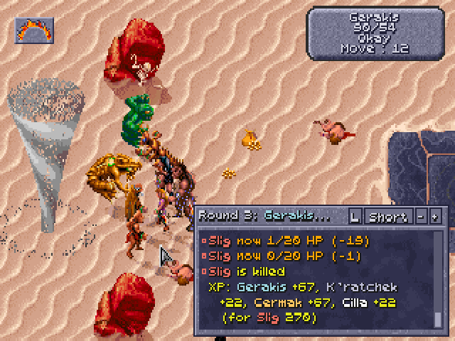
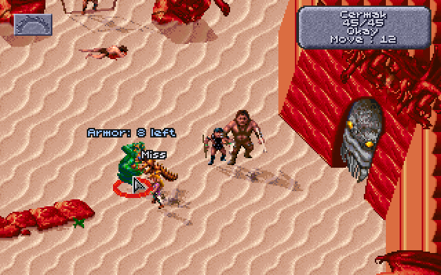
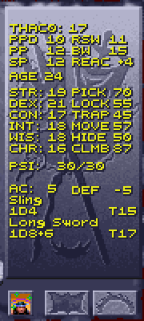
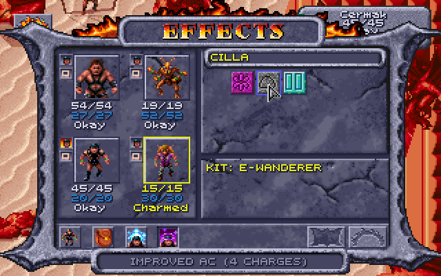

# Obsidian Edition

Obsidian Edition is a mod for **Dark Sun: Shattered Lands** (the GOG release)
in DOSBox. You start the game with the **Dark Sun Obsidian Edition Loader**
(called Templar's Ledger up to 2.2.1), which loads the mod with your options.

**Where to start**

- **To play:** [Running it](#running-it-windows): unzip, double-click
  `Start Obsidian Edition.bat`, press **Start the game**.
- **To learn the rules:** [the player's guide](PLAYER-GUIDE.md), without
  spoilers, with a [glossary](PLAYER-GUIDE.md#glossary) of THAC0, AC, PSP and
  the rest.
- **If something goes wrong:** [When something goes
  wrong](#when-something-goes-wrong).
- **Everything in detail:** the contents below, the [features and
  rules](FEATURES.md), the [kits](KITS.md), the [dice log's lines](DICE-LOG.md), the
  [items](ITEMS.md) (spoilers),
  [how the original game works](HOW-THE-GAME-WORKS.md), from its code, the
  [patch
  notes](https://github.com/daaki85/darksun-obsidian-edition/blob/main/PATCH-NOTES.md)
  and, for developers, the [development notes](DEVELOPMENT.md).

## Contents

- [What it does](#what-it-does)
- [Requirements](#requirements)
  - [Suggested system requirements](#suggested-system-requirements)
- [Running it (Windows)](#running-it-windows)
  - [One-time setup](#one-time-setup)
  - [Every time you play](#every-time-you-play)
  - [Other ways to start](#other-ways-to-start)
  - [Updating, backups and the Loader's
    files](#updating-backups-and-the-loaders-files)
- [In the game](#in-the-game)
  - [The combat log in the game](#the-combat-log-in-the-game)
  - [Names over figures](#names-over-figures)
  - [THAC0, saves and thief skills](#thac0-saves-and-thief-skills)
  - [Spell slots on the USE screen](#spell-slots-on-the-use-screen)
  - [What hurts a monster (the Look box)](#what-hurts-a-monster-the-look-box)
  - [Charges in item boxes](#charges-in-item-boxes)
  - [The Effects screen](#the-effects-screen)
  - [What a scroll says](#what-a-scroll-says)
  - [No manual check](#no-manual-check)
- [The Loader's window](#the-loaders-window)
  - [The Characters tab](#the-characters-tab)
  - [The Spells tab](#the-spells-tab)
  - [The Dialogue tab](#the-dialogue-tab)
- [The dice log](#the-dice-log)
- [Accessibility](#accessibility)
- [When something goes wrong](#when-something-goes-wrong)
  - [Troubleshooting](#troubleshooting)
  - [Known issues](#known-issues)
  - [Crash, freeze and item reports](#crash-freeze-and-item-reports)
  - [Reporting a problem](#reporting-a-problem)

## What it does

- **Shows what the game keeps hidden.** Every roll is logged as it happens:
  attacks, damage, saving throws, thief skills, initiative, even the dice at
  character creation, each with what it needed and where every bonus came from
  ([the dice log](#the-dice-log)). **L** shows a combat log over the map,
  spells' names and charges used float over the figures, the game's own
  screens gain THAC0, saves, thief skills, spell slots and charges left, and
  the Look box tells you what can hurt a monster ([In the game](#in-the-game)).
- **Brings the rules closer to AD&D:** class restrictions, AD&D's class tables
  (experience, priests' THAC0, spell slots), INT's limits on learning spells,
  saving throws and multiclass hit points as the books have them, scores and
  hit points kept as rolled, ages (a year each 365 days of game time, and Haste's cost), Enlarge's weapon dice
  and CON's regeneration ([Rule changes](FEATURES.md#rule-changes)).
- **More ways to build a character:** weapon specialization and mastery, kits
  (three for each class, and thirteen for races' classes taken together:
  pairs, and one set of three), levels
  past 9th up to a cap by XP (10th to 13th for one class, lower for two or
  three), STORE and RECALL for a
  creation roll, fuller starting gear, and features of their own for the
  game's own party
  ([More character customization](FEATURES.md#more-character-customization)).
- **Expanded play:** thieves with AD&D's skills hide in shadows to backstab
  and pick pockets, the party leader's CHA lowers shop prices, and merchants
  sell back the magical items you sold them
  ([Expanded features](FEATURES.md#expanded-features)).
- **More of Athas:** new weapons in every material, magic items with stories of
  their own (robes and bracers among them, for those who wear no armour), six
  wizard spells ([Cat's Grace, Erdlu Claw, Fogbolt, Reflected Image, Spook and
  Friends](FEATURES.md#new-wizard-spells)) and ten [6th-level priest
  spells](FEATURES.md#6th-level-priest-spells) (Heal, Blade Barrier,
  Whirlwind, Restore Youth...), Kalzith (a defiler who sells scrolls), defilers who drop
  scrolls, more of Semyon's story, and a use for the cooked vulture ([New
  content](FEATURES.md#new-content)). On the map, the party wears its weapons
  and armour (its magic gear glinting), figures cast shadows and kick up dust,
  and elves and half-elves have a look of their own; and the game's magic items
  whose icons stood still shine as the rest do ([Graphics](FEATURES.md#graphics)).
- **Quality of life:** better [controls](FEATURES.md#controls) (Tab and Enter
  in fights, dragging the map with the mouse wheel held down), [more saves and
  characters](FEATURES.md#more-saves-and-characters), a [game
  speed](FEATURES.md#game-speed) setting, crash, freeze and item reports, and
  [no manual check](#no-manual-check).
- **Fixes the game's bugs:** Mirror Image stopping no blow, Armor wearing out
  twice as fast, Share Strength never ending, Dispel Magic silencing the party,
  Negative Plane Protection never working, Cause Wounds' odd dice, and more; and
  the rules it got wrong, from spell saves to warriors' attacks, put right ([The
  game's bugs, fixed](FEATURES.md#the-games-bugs-fixed)).

**What it changes on your computer.** The game's own files are never modified:
the Loader runs a patched copy of the game from its own folder, and writes to
the game folder only your saves and characters. Every file it writes, and how to
update or back up: [Updating, backups and the Loader's
files](#updating-backups-and-the-loaders-files).

## Requirements

- **Windows** and the **GOG release** of Dark Sun: Shattered Lands (its
  `DSUN.EXE` is 611,408 bytes; with another version the Loader starts the game
  without the dice log and says why). The Loader runs it in the DOSBox that
  comes with it.
- **64-bit Python 3.8+** (32-bit Python can't read 64-bit DOSBox's memory),
  with no extra packages. The `.bat` files offer to install it
  ([One-time setup](#one-time-setup)).
- **Linux**: the dice log and the Loader's window can follow a DOSBox you
  start yourself, if you can read other processes' memory (root, or
  `kernel.yama.ptrace_scope=0`); the `.bat` files, **Start the game** and the
  Python install are Windows only. macOS isn't supported.
- **Wake of the Ravager** (optional; GOG sells it with Shattered Lands): the
  [6th-level priest spells](FEATURES.md#6th-level-priest-spells) use its icons
  and pictures, read from your copy as the game starts; without it they have
  the Loader's own. The Loader looks beside Shattered Lands and in GOG's usual
  folders; the Options tab's **Wake of the Ravager** section says whether it
  found it, and **Choose its folder...** points it anywhere else.

### Suggested system requirements

DOSBox runs the whole game on one processor core, so what counts is the speed of
a single core, not how many there are. By [game speed](FEATURES.md#game-speed)
setting (suggestions, not tested limits):

| Game speed | Processor (one core's speed) | Memory |
|---|---|---|
| GOG's own (7,000 cycles) | anything that runs GOG's release | 2 GB |
| Faster (20,000 cycles, the default) | a dual-core from about 2010 on, 2 GHz or more (Intel Core i3 or AMD Phenom II) | 4 GB |
| Fastest (35,000 cycles: nearly every frame drawn in time, the smoothest) | a processor from about 2015 on, 3 GHz or more (Intel Core i5 or AMD Ryzen) | 4 GB |

The Loader itself (Python and its window) needs about 100 MB of memory and
little processor time. A screen of 1920×1080 or more shows the game's window
at **Triple** size beside the Loader's; on a smaller one choose **Double**.
If the computer can't keep up, the sound crackles or stutters and the game
slows instead of speeding up: choose the next setting down.

## Running it (Windows)

### One-time setup

1. Download the latest release,
   `Dark-Sun-Shattered-Lands-Obsidian-Edition-<version>.zip`, from the [Releases
   page](https://github.com/daaki85/darksun-obsidian-edition/releases), and
   unzip it anywhere: the files you need are in its
   `Dark-Sun-Shattered-Lands-Obsidian-Edition-<version>` folder. (Or the project
   as it stands: on its GitHub page click **Code → Download ZIP**; the files are
   then in its `obsidian-edition` folder.)
2. Python: the first time you double-click one of the `.bat` files, it
   checks for a 64-bit Python 3.8 or later. If there is none, it asks
   whether to install it with Windows' own package manager (winget): that
   downloads the official, signed installer from python.org, for your user
   only, with no administrator rights. Answer **Y**, and when it's done, start
   the `.bat` file again. (If you'd rather do it yourself, or winget isn't
   there, install the 64-bit Python from <https://www.python.org/downloads/>
   and tick **"Add python.exe to PATH"** on the installer's first screen.)

**"Open File - Security Warning"** ("The publisher could not be verified"):
Windows asks this for any `.bat` file unzipped from a download, since a `.bat`
file can't be signed. To skip it altogether, before unzipping right-click the
zip, choose **Properties**, tick **Unblock** and press **OK**. Otherwise press
**Run** the first time: the Loader then takes the download mark off the files
in its own folder (what that Unblock box does, and nothing outside the
folder), so the other `.bat` files start without asking.

Nothing in the download is a packaged program to trust: the `.bat` files and
the Python code in `dsloader` are plain text, and so is the source of the
three built files, small DOS programs DOSBox loads (`dos\dsclog.asm` builds
`dos\DSCLOG.EXE`; `gameend.asm` and `umbplus.asm` the two `.COM` files beside
them).

### Every time you play

1. Double-click **`Start Obsidian Edition.bat`** in that folder. The Loader
   opens on its own.
2. On its **Options** tab, pick what you want: the rule changes, the new
   content, picking pockets, the combat log in the game and so on (see [The
   Loader's window](#the-loaders-window) and [Rule
   changes](FEATURES.md#rule-changes)). They're remembered for next time.
3. Press **Start the game** (top left).

That starts Shattered Lands (through GOG's own DOSBox) with the dice log helper
loaded and your options in force, and the Loader picks it up once DOSBox is up.
Your saves are the same ones the game normally uses. The first time, it looks
for the game in the usual GOG folders; if it can't find it, it asks you where
the game is installed and remembers the answer.

DOSBox opens in a window three times the game's size (960x720). **Game
window** at the top of the Loader picks **Double**, **Triple**, **Quadruple**
or **Full screen** from the next start, and Alt+Enter switches between window
and full screen while playing. Quadruple has DOSBox stretch its window with
OpenGL; if your graphics driver doesn't take to that, pick Triple.

Load your game. The party's stats fill in by themselves, and rolls appear in
the **Dice log** tab as they happen.

### Other ways to start

**Game and Loader in one double-click:** **`Start Game with Dice Log.bat`**
starts the game with the dice log and opens the Loader next to it, with the
options as you last set them on the Options tab. With the game started the
normal way instead (GOG's own shortcut), the Loader still shows the party, but
the dice log will say the game was started without it.

**Just the game, with the in-game additions, no Loader window:** double-click
**`Play Dark Sun (in-game rolls).bat`**. The dice log runs unseen and stops
when you close DOSBox. It uses the switches on the Loader's Options tab as you
last set them (the combat log, monster descriptions, picking pockets, the rule
changes); the new items, the new people and the cooked vulture are there too.
If anything goes wrong it says so in a message box and writes the details to
`play.log`.

**Checking a save file:** drag a `SAVEnn.SAV` file from the game folder onto
**`Show Save.bat`** to see the party it holds.

**With Dark Sun Recompiled instead of DOSBox:** the game translated into a
program of its own ([daaki85/darksun-recompiled](https://github.com/daaki85/darksun-recompiled)),
with the mod's patched game and helper built in. Unzip its
`darksun-recompiled-windows-x64.zip` into this folder (so that
`recompiled\dsun.exe` is here, or `dsun.exe` itself) or next to this
folder, and the Loader starts that program instead of DOSBox from then on,
the dice log and the Loader's window attached as usual. As the game starts,
the dice log says which one runs (`... in DOSBox` or `... as Dark Sun Recompiled`
and where it is). The game's own `DSUN.EXE` is never taken for it, even with
this folder in the game's. A program elsewhere is named once:

```
dsloader launch --recompiled "C:\path\to\dsun.exe"
dsloader launch --dosbox
```

The second line goes back to DOSBox (and stays there until `--recompiled`
again). The program reads the game's data files from the GOG folder and
the mod's `dos` folder as it would in DOSBox, and keeps its memory images
(`build\ds1o`) next to itself. DOSBox's own settings (the window's size,
full screen, the CPU speed, `UMBPLUS.COM`) don't apply to it. The program
started on its own (double-clicked) finds this folder too, when it is in or
beside it, and offers "Shattered Lands with the Obsidian Edition" among
its choices, once the Loader has prepared the `dos` folder (the first
start through the Loader does that).

### Updating, backups and the Loader's files

**Updating.** Unzip the new release into a folder of its own and copy
`settings.json` from the old folder into it to keep your options (the
**Named saves** folder too, if you want its copies). Your saves and characters
are in the game folder, so nothing else needs moving. Then delete the old
folder.

**Back up your saves first.** Before the first game with the mod, copy the
game folder's save files (`SAVE*`, and `SAVB*`, `SAVC*` and `SAVD*` once
you have them) and `CHARSAVE.GFF` somewhere safe. The Loader never
changes the game's own files, but your saves are written by the patched game:
one with the new items ticked can hold item types the original game doesn't
have, so load such a save with the Loader. To go back to the original game,
start it the GOG way and load a save from before the mod.

**What the Loader writes**, all in its own folder (beside
`Start Obsidian Edition.bat`) but the saves:

| File or folder | What it holds |
|---|---|
| `settings.json` | your options, and what the Loader remembers (who has had their pockets picked, speakers' names); if it is ever damaged, it is kept as `settings.json.bad` and the defaults used |
| `crash-logs` | crash, freeze and item reports |
| `Named saves` | a copy of each save under the name you gave it |
| `dosbox_dicelog.conf` | DOSBox's settings for the game the Loader starts, written at each start |
| `play.log` | what went wrong, when the game was started with `Play Dark Sun (in-game rolls).bat` |
| `dos` | the Loader's helpers, and the patched copy of the game (`DSUNLOG.EXE`) with copies of its data |
| `layouts`, `.dsloader-search.json` | only from the Memory tools: a layout you save there, and a memory search's results |
| the game folder | your saves (page 1 in the game's own `SAVE` files, pages 2 to 4 as `SAVB`, `SAVC` and `SAVD`) and characters in `CHARSAVE.GFF` |

## In the game

The game itself shows more, in its own lettering and windows, when it is started
from the Loader (or either `.bat` file).

### The combat log in the game

With **A combat log in the game** ticked on the Options tab (the default),
**L** on the map shows the [dice log](#the-dice-log)'s lines in the game
itself, and **L** again hides them: in a fight or out of one, whenever you
want to read back. It doesn't open by itself, and stays as you left it (from
one game to the next too). The lines are in the game's own font, in the
Loader's colours for each kind of line (hits green, misses grey, damage
amber, saving throws blue), the party's names in their colours and the
monsters' in red, a filled pip before a party member's line and a hollow one
before a monster's. In a fight its top line says the round, who is acting
and who is still to (`Round 2: Gerakis, then Cermak, Cilla`). Out of fights,
the lines with a roll in them go in too (a thief's skills, a scroll learned,
the hit points of a new level), so they can be checked after they happen.

Below the switch, pick how much it says: **at the least**
(`Rampager hits Defiler for 4`), **in short**, the default
(`Rampager attacks Defiler: 20 vs 16+ HIT, 4 damage (2d6)`,
`Slig's save vs Fireball: 11 vs 16, failed`), or **in detail**, every line of
the log. `20 vs 16+ HIT` is the d20 and the roll it needed (THAC0 less the
target's AC; a natural 20 always hits, a 1 always misses). It never waits for
a click.



**The panel** sits over the map's lower right. A window the game opens over
the map (a character's menu, a question) hides it until it closes. Expanded, it
covers that part of the map, and the game's damage numbers over a creature
there; **-** makes it smaller.

- **Scrolling:** it keeps the last 200 lines. Drag the scrollbar's handle,
  click the bar above or below it for a page, or turn the mouse wheel with
  the pointer over the panel (on Windows). Scrolled back, it stays where it
  is as new lines come, and a **Latest** chip at its foot says how many have;
  click it (or scroll to the end) to follow again. Clicks on the panel are
  its own: the party doesn't walk there.
- **How long you've played.** Out of a fight, the top line says how long the
  game has run, `Day 47, 14:20`: from day 1 at 00:00, the game's own clock (it
  has no time of day, so 14:20 is the hours into that day; a rest moves it on 8
  hours). Saves keep it.
- **The arena's count of fights.** Between fights in the arena, the top line
  says instead how many arena fights the party has had (`Arena fights: 4`; the
  time until the game has shown the count to the Loader): the game's
  own count, one a trip into the arena however many waves come (see [the
  arena's count of
  fights](HOW-THE-GAME-WORKS.md#the-arenas-count-of-fights)). Once the party
  has escaped Draj it's gone. (Not when the panel is collapsed to one line:
  that line stays the newest.)
- **Its buttons**, on the right of its top line: **L**, which hides it as the
  key does; the level (**Least**, **Short**, **Detail**; a click goes to the
  next, and the Options tab follows); and **-** and **+** for a smaller or
  bigger panel. Collapsed, it is one line, the newest; expanded, it is
  taller (11 lines) and has filters along its top: **All**, **Party** (the
  party's lines), **Damage** (hits, damage and deaths) and **Saves** (saving
  throws and magic resistance). Its size is remembered.


How it works: [DEVELOPMENT.md](DEVELOPMENT.md#the-combat-log-in-the-game).

### Names over figures

With **Float a spell's name over its caster, and "Miss" over whoever an attack
missed** ticked on the Options tab (the default), a spell's name floats over
its caster for a second and a half as it is cast, and "Miss" over anyone an
attack misses, in the game's lettering with a dark edge. They work in and out
of fights, for the party and the monsters alike, and a weapon's spell on a hit
shows too. A name stays with its figure; near the top of the screen it goes
under the figure's feet, clear of the game's boxes. Long names are shortened
("Lesser Water Elem."), and up to four show at once.


The same switch floats a spell's charge being used over whoever has it, in
light blue: "Armor: 7 left" for a hit Armor took, "Reflected Image: 2 left" for
a lost image, "Armor ends" for the last. These stay three seconds, twice as
long, and a "Miss" or a spell's name never pushes one out.



How it works: [DEVELOPMENT.md](DEVELOPMENT.md#names-over-figures).

### THAC0, saves and thief skills

Started from the Loader, the game's own inventory screen (the one with the
character's figure and their equipment) shows six more things in its
right-hand panel, drawn by the game's text routine so they look like the rest:




- above STR, **THAC0** and the five **saving throws**, with the usual AD&D
  short labels: `PPD` paralysis/poison/death, `RSW` rod/staff/wand, `PP`
  petrification/polymorph, `BW` breath weapon, `SP` spell;
- at the right of each weapon's damage line, the THAC0 with that weapon
  (`T14`);
- right of the abilities, level with STR to CHA, for a character with thief
  levels, six **thief skills**: `PICK` pockets, open `LOCK`s, find/remove
  `TRAP`s, `MOVE` silently, `HIDE` in shadows and `CLMB` walls. Move silently
  and hide in shadows are the ones the Loader rolls (for [picking
  pockets](FEATURES.md#picking-pockets) and [hiding to
  backstab](FEATURES.md#hiding-in-shadows-to-backstab)). A worn belt's 5 is in
  `PICK` and `LOCK`, and with hiding to backstab a worn cloak's 10 in `HIDE` and
  boots' 10 in `MOVE` (95 for the Cloak and Boots of Elvenkind). Hear noise (one
  script check) and read languages (a Shinobi's, for a scroll: on its
  [Effects screen](#the-effects-screen)) are left out for want of room. A
  ranger, with hiding to backstab on, gets their `MOVE` and `HIDE` in the same
  places, the cloak and boots counted (the other four left out);
- right of SP in the saves (where RSW and BW sit on the rows above), the DEX
  **reaction adjustment** (`REAC +4`): −6 at DEX 1 to +5 at DEX 24-25, the
  number the [two-weapon rule](FEATURES.md#two-weapons) adds to its penalties,
  and the one initiative uses. It is worked out from the character's DEX each
  time the panel is drawn, so it follows any change (Cat's Grace's, while it
  lasts);
- with [ages](FEATURES.md#ages-and-magical-aging) on, the character's **AGE**
  between the saving throws and STR;
- right of the AC line, the DEX **defensive adjustment** (`DEF -5`), as AD&D's
  table gives it, on AC: +5 at DEX 1 to −6 at DEX 24-25 (−4 at 18, −5 at 21-23).
  The game counts it in AC already; on saving throws against what can be dodged
  it counts the other way round (DEF −5 is +5 on the save), with the [rule
  change](FEATURES.md#rule-changes) for fire, cold and electricity. Worked out
  the same way as REAC, each time the panel is drawn.

The **View Character** screen gets them too: the five saves under the item
icons, each with its label as above (`PPD 11  RSW 9` / `PP 10  BW 13` /
`SP 10`), and in the lower panel, right of HP and PSI as DAM is right of AC,
the character's **MOVE** (its movement in a fight, before boots or a spell
change it) and **THAC0**.


They're the numbers as they stand now, worked out by the Loader the way the
game's own attack and saving throw routines do. Each time the game draws one
of these screens, the helper has the Loader bring them up to date first (the
game waits a moment for it), so putting on a ring or readying another weapon
shows at once. Spells start and end as time passes in the game, which it
doesn't while these screens are open; open the screen again to see such a
change.

- **THAC0**: the character's THAC0 (its classes' best, a kit's warrior THAC0
  in it) less STR's to-hit adjustment (DEX's for a missile weapon), the
  weapon's plus (or, for a plain wooden, bone, stone or obsidian weapon, its
  material's penalty), its weapon spec's to-hit (specialization, mastery,
  expertise), a kit's (a Ravager's, a Brute's, an Arena Champion's...), the
  two-weapon penalty for the hand, Bless and Prayer (+1), Curse (−1), Slow (−4)
  and Graft Weapon (+1). The THAC0 at the top, and View Character's, is the
  main weapon's: the right hand's, else the left's, else the missile weapon's.
  What depends on the target (attacking from behind or backstabbing, a Blurred
  target) is left out; the dice log shows it on each attack.

The **creation screen** shows a THAC0 too, right of the hit points and above
the age: `THAC0: M18 R19`, M for melee and R for ranged, the character's
THAC0 as its classes stand less STR's to-hit adjustment (M) and DEX's missile
adjustment (R). So a click on STR or DEX shows at once what it does to them.
No weapon is counted (none is held yet, and weapon specs are picked after
DONE): it is the inventory's THAC0 before the weapon's own parts.
- **Saves**: the d20 each needs, the character sheet's number less what the game
  adds to every save: the [Rings of Protection and the Cloak of
  Protection](FEATURES.md#rings-and-cloaks-of-protection), Bless, Prayer,
  Barkskin, Spirit Armor (not on PPD), the Save penalty, and on PPD the CON
  adjustment (and a dwarf's or halfling's CON bonus). What depends on the spell
  or its caster (WIS against mind spells, Protection from Fire, a doubled d20
  against fire...) is left out; the dice log shows it on each save. A 1 always
  fails and a 20 always saves, so they show between 2 and 20.
- **Thief skills**: as they stand (with no equipment penalty in games started
  with the dice log: see [How the game works out thief
  skills](HOW-THE-GAME-WORKS.md#how-the-game-works-out-thief-skills)), at most
  95 with [AD&D's table](FEATURES.md#thief-skills-from-adds-table), 0 for a
  skill an effect rules out or when the thief isn't Okay (New counts as Okay),
  and 100 for one an effect makes certain (Detect Traps). Only the situation's
  bonus or penalty (a hard lock) is left out: the dice log shows it on each
  roll.

The Characters tab shows the same THAC0 with each weapon and saves. The
game's own numbers (the character sheet's) come back on these screens when
the Loader isn't running.

**The next level's class.** For a character of more than one class, the number
in brackets on View Character's experience line is the XP at which the first
of their classes goes up a level, and the Loader adds which class that is:
`EXP:87230 (90000 Pr)` means the preserver goes up next, at 90,000. Each class
is its first letter (C, D, F, G, R, T), except the preserver's Pr and the
psionicist's Ps. When two classes go up at the same XP, both are named:
`(20000 Pr/T)`. A class already at the highest level (9, or its share of the
XP cap with [Level cap by XP](FEATURES.md#level-cap-by-xp)) has no next level,
so it is never named.
A character of one class shows the line as the game always has, and so does a
human, who can only dual-class: the game counts only one of their classes
there.


How it works: [DEVELOPMENT.md](DEVELOPMENT.md#thac0-saves-and-thief-skills).

### Spell slots on the USE screen

The game's USE (cast spells) screen shows, at the top of the panel under the
spells, how many spells of the level on show (its LEVEL button) the selected
character can still cast, and the most they get after resting, for the list on
show only: `SPELLS LEFT`, then `WIZ` on the MAGE list (preservers' wizard
spells) or `PRI` on the CLERIC list (clerics', druids' and rangers' priest
spells), as `left/most` (`PRI 2/1`). The PSIONIC list shows none. Another level
or list shows its own when the LEVEL or list button turns to it:


The numbers go down as spells are cast (the screen shows the new count when it
is next drawn) and back up after resting. A preserver in armour reads `NO
SPELLS IN ARMOUR` in place of the heading.

The numbers are the Characters tab's (see [spell slots](#the-characters-tab)),
WIS bonus included, printed with the game's own text routine; they show while
the Loader (or its command-line dice log) is running.

### What hurts a monster (the Look box)

In a fight, Look at a monster (right-click until the pointer is the Look icon,
then click the monster) and the game's small box, under its name and level,
now also shows its hit points and AC (`HP 15/15 AC 2`), its THAC0 and
alignment (`THAC0 17 AL TN`), its magic resistance beside its level
(`LEVEL: 3 MR 30`), and its most important defence: `NEEDS +1 WEAPON`,
`IMM FIRE COLD`, `NO CRUSH`, `HALF FROM WPNS` or `UNDEAD`. The alignment is in
two letters: `LG`, `LN`, `LE`, `NG`, `TN`, `NE`, `CG`, `CN` or `CE`. (A line
that would run past the box's edge, such as a monster's with over 100 HP,
loses its spaces.) Its own status lines (casting, charmed, held...) follow in
any row left. When there's more to say, closing the box shows everything in
the game's dialogue window: the weapons it needs, the damage it's immune to or
takes half of, spells that don't work on it, and what its hits do besides
damage. The AC is the one the game last used against it; before anything
has attacked it, the Loader works it out as the game would, from its armour,
shield and DEX (spells on it, such as Barkskin, aren't counted until then).
The dice log gets the same lines (`Look: ...`). Untick **Describe
monsters when you Look at them in a fight** on the Options tab to turn this
off.


The arena's first monsters have no magic resistance or special defences, so
their box shows just the numbers and the alignment.

How it works:
[DEVELOPMENT.md](DEVELOPMENT.md#what-hurts-a-monster-the-look-box).

### Charges in item boxes

An item that casts a spell with charges (the wands, the Storm Ring, the
necklaces) shows how many it has left in its item box (right-click it on the
inventory screen), under its name, counting down as it's used. A cloak's,
boots' or belt's box shows what it adds to thief skills (with
[improved thieving](FEATURES.md#improved-thieving) on):


How it works: [DEVELOPMENT.md](DEVELOPMENT.md#charges-in-item-boxes).

### The Effects screen

The Effects screen (Current Spell Effects) shows more
in its lower panel and under the pointer:

- **Kits and weapon specs:** each kit (`KIT: RAVAGER`), with a Shinobi's chance
  to read a scroll under it (`READ LANG. 35%`), then the weapon specs, a page
  at a time when there are more than fit ([Changing
  class](KITS.md#changing-class) has pictures).
- **Charges left:** with the pointer on the icon of a spell that lasts a number
  of uses, the name under the icons says how many are left: IMPROVED AC (4
  CHARGES) for Armor, MIRROR IMAGES (3 CHARGES), REFLECTED IMAGE (2 CHARGES).
  Effects that last until removed (Charmed) and a magic item's power while
  it is readied (Shadowseeker's Detect Invisibility) show none.
- **Enlarge's damage:** with the pointer on its icon, how much more it gives,
  10% a level of its caster: ENLARGED (+90% DICE) from a 9th-level preserver,
  the weapon's dice made bigger
  ([the rule](FEATURES.md#enlarge-multiplies-the-weapons-dice-only), on unless
  unticked), or ENLARGED (+90% DAMAGE) with it off, the whole melee damage. The inventory's and View Character's damage don't count it (no room);
  each hit's line in the dice log does (`+5 Enlarge (the dice 5 x190% = 10,
  level 9)`, or `x190% Enlarge (level 9)` with the rule off). A second Enlarge on someone already enlarged
  uses up the spell and adds nothing.
- **The armour spells' AC:** with the pointer on Barkskin's, Flesh Armor's or
  Magical Vestments' icon, the armour AC it gives by its caster's level:
  BARKSKIN (AC 3) from a 12th-level druid. DEX and the rest are still added
  to it, and armour already better is kept, so a spell showing a worse AC
  than the character's armour does nothing for them.
- **A click on a spell's icon leaves it on** (the game ended it); a psionic
  power's icon still ends the power, as that is how one is stopped ([Spells on
  the Effects screen](FEATURES.md#spells-on-the-effects-screen)).



How it works: [DEVELOPMENT.md](DEVELOPMENT.md#the-games-spells).

### What a scroll says

Clicking a scroll's spell icon in its item box gives the result on the line
under the paper doll: YOU LEARN THE SPELL, YOU ALREADY KNOW THIS SPELL, YOU FAIL
TO LEARN THE SPELL, TOO MANY SPELLS OF THAT LEVEL, or a Shinobi's YOU CAN NOT
READ THE SCROLL and THAT IS NOT A SHINOBI SPELL. The game wrote these there too,
but they never reached the screen. Like the game's own messages on that line, it
stays until the pointer is on something else. Always on.

How it works: [DEVELOPMENT.md](DEVELOPMENT.md#preservers-int).

### No manual check

The game's copy protection is gone. Leaving the sewers (the Tari's warrens) the
first time, the game has a dragon appear and ask for a word from the manual
("The 3rd word on page 14, line 1, begins with the letter 'p'. What is that
word?"), and three wrong answers kill the party. Started from the Loader, the
dragon doesn't come: the game goes on as if it had been answered. Always on.

How it works: [DEVELOPMENT.md](DEVELOPMENT.md#no-manual-check).

## The Loader's window

The window has the party on one side and the logs and tools on the other, with
**Start the game**, the game window's size, the text size and **Reconnect**
(to find the game again) along the top. The party pane has two tabs:

- **Characters** (Alt+C): a card for each character, laid out like the game's
  View Character screen ([The Characters tab](#the-characters-tab)).
- **All fields** (Alt+A): every field the layout maps, in a table, with rows
  of its own for the AC in a fight and what it's made of, THAC0 with each
  weapon and the saves now, and at the end the spell slots, thief skills and
  equipment.

The other side has the **Dice log**, **Dialogue** and **Spells** tabs (below),
**Memory tools** (for mapping the game's memory, with **Save layout** and
**Reload layout**: see [DEVELOPMENT.md](DEVELOPMENT.md#mapping-memory)), and
**Options** (Alt+O) with the Loader's switches, in sections that open and
close: click a section's heading (or Tab to it and press Space or Enter) to
open it, ▸ when closed and ▾ when open. Which sections are open is remembered.
Everything there applies in games started from the Loader; a switch that says
"from the next start" waits until the game is started again. The sections are
[In the game](#in-the-game), [Rule changes](FEATURES.md#rule-changes), [More
character customization](FEATURES.md#more-character-customization), [Expanded
features](FEATURES.md#expanded-features), [New content](FEATURES.md#new-content),
[Graphics](FEATURES.md#graphics), [Controls](FEATURES.md#controls), [Game
speed](FEATURES.md#game-speed), **Wake of the Ravager (optional)** (where it is,
for the 6th-level priest spells' icons and pictures: [Requirements](#requirements))
and **Saves** ([Saves under their names](FEATURES.md#saves-under-their-names)).
[The Options tab at a glance](PLAYER-GUIDE.md#the-options-tab-at-a-glance), in
the player's guide, lists every switch with its default and when it counts.

All are on by default (the red ring under the chosen enemy, the game speed
Faster) and are remembered for next time. **Restore defaults**, at the bottom
of the tab, sets them all back (after asking). In a
window too small to show the open sections, the tab scrolls (scrollbar, mouse
wheel, or arrow and page keys once it has the focus).


### The Characters tab

A card holds, from the top (scroll with the mouse wheel, or Tab to the cards
and use the arrow and Page keys):

- the figure for their race and sex (as on the character creation screen,
  read from your install), their name, and HP and PSP (PSP in blue);
- their condition (New, for a character not yet played, Okay, Stunned, Out
  Cold, Dying, Dead, Animated, Petrified or Gone), then the spells and
  effects on them with the rounds or charges left: `Blur (22 rounds)`,
  `Stoneskin (5 charges)`;
- the character sheet: scores, sex, race and alignment, classes and levels,
  experience, AC (the one the game last used in a fight, with the base AC
  beside it), THAC0 with each weapon ready (`THAC0: 15 with Wooden Club, 14
  with Wooden Bow (base 19)`), the saves as the d20 needed now (see
  [In the game](#thac0-saves-and-thief-skills)), movement (`Move: 12 (14 in
  a fight: Stalker)`) and attacks; with [ages](FEATURES.md#ages-and-magical-aging)
  on, their age, its category and the next to come (`Age: 45, middle-aged;
  old at 53`);
- what they wear and hold, by the game's own slot names ("Right hand: Bone
  Long Sword"; "Carried" for the backpack), with each item's material and
  plus;
- last, spell slots for spellcasters (see below), thief skills for thieves,
  and for rangers, with hiding to backstab on, their chances to hide and move
  silently (`Ranger skills now`).

What some of its lines mean:

**Spell slots.** `Priest spells left: 1st 5/5, 2nd 3/3, 3rd 2/2` means five
first-level priest spells can still be cast out of five, and so on. Casting a
spell uses one slot of its level, and resting fills them again. Wizard slots
belong to preservers; priest slots belong to clerics, druids and rangers. A
multiclass character's classes add up, for example a druid/preserver has both.
The "most" is worked out the way the game does it when it refills them (its
tables are read from memory):
- Preservers: from their level only.
- Clerics and druids: from their level plus a WIS bonus.
- Rangers: from their level only, with their first slot at level 8.

With [AD&D's class tables](FEATURES.md#adds-class-tables) on (the default),
clerics', druids' and preservers' come from AD&D's tables instead. Some
[kits](FEATURES.md#kits) have more or fewer, and the [Veiled
Robe](ITEMS.md#every-magic-item) adds a wizard slot at spell levels 1 to 3.

The game's WIS bonus doesn't depend on level, so it gives a 2nd-level druid
with WIS 19 slots at the 2nd to 4th levels too, though a druid that level
casts only 1st-level spells. Those aren't shown (here or in the game): only
the spell levels the character's class levels reach, as in AD&D, where the WIS
bonus counts only at levels the priest can cast. For a human dual-class
character, a later class counts only while its level is below the first
class's.

**AC.** The AC shown (**Current AC** on All fields) is the one the game last
used for each character in a fight (armour, DEX and spells included), and the
rows under it say what it was made of: armour and shield (and spells that take
their place, such as Spirit Armor and Magical Vestments), DEX (the game's table:
−1 at 15 down to −6 at 24; not counted when attacked from behind), and spells,
rings (the [rings of protection](FEATURES.md#rings-and-cloaks-of-protection))
and anything else. They show "-" until the game has worked out that character's
AC in a fight.

**Scores.** Ability scores such as `STR 24 (20 without spells)` show the score
now and, in brackets, the character's own score when a spell (Strength, for
one) has raised it. The character's own score already includes the racial
adjustment: a half-giant's 20 + 4 shows as 24.

### The Spells tab

What each wizard and priest spell and psionic power does, read from the running
game's records: its damage dice and kinds (and that damage stops growing at
caster level 10), its saving throw (which of the five, any modifier, whether the
d20 counts double, and whether saving halves or stops the damage), the effect it
gives and what that does, how long it lasts, and each party member's caster
level for it. With the [new spells](FEATURES.md#new-content) on, the mod's
spells are listed too; a 6th-level priest spell built on another spell's record
(Harm on Cause Critical Wounds', say) has its lines written out, as the record
would mislead. **Show** picks wizard, priest or psionic, and **Only spells the
party has a caster level for** leaves out the rest. **Save...** writes it to a
text file. It's filled when you open the tab (or press **Refresh**) while the
game is running.

### The Dialogue tab

Everything the game shows in its dialogue window, one entry per window of
text, with the replies offered numbered underneath (and the list's title,
such as "Answer Yes or No", above them), and then the one you picked:
`You chose: No`.


**Who's speaking.** The game's dialogue window gets only a portrait number,
never a name. But when the game runs a script on someone (you click them, or
they come up to you), it notes who; the log reads that when a conversation
opens. A conversation that shows one face, started on a named creature outside
the party, is that creature talking, and from then on the portrait carries its
name: in the pens, portrait 5 became `Kurzak` ("Legcrusher! Get gladiators!")
and portrait 100 `Legcrusher` ("Kurzak told me to bring you to the arena").
When several faces take turns in one conversation, nothing is learned from it,
as it can't be told who is who. Names learned are shown on the lines already
there too, and kept in `settings.json` (`speakers_learned`). A speaker not
named yet shows as `Portrait 57`. Portrait 119 is named `The Announcer`, as
the game itself calls him ("Yell something back at the Announcer?"). That name
isn't replaced by one learned (he calls out in the middle of fights, when the
game's last script ran on a fighter). To name a speaker yourself (your name
wins over a learned one), right-click the name line in the Dialogue tab, or
press **Name speaker...** (it names the latest speaker). The name replaces the
number on every line from that portrait, the ones already shown included, and
is remembered in `settings.json` for next time (the command-line log uses it
too). Leave the name empty to go back to the number. Text shown without a face
(the emblem instead) is `Narration`.

Each entry shows the speaker's portrait, as the game's own dialogue window
does. Portraits and the title's lettering are read from your installed game at
run time (GPLDATA.GFF and RESOURCE.GFF in the install folder the Loader
remembers); nothing from the game is copied into the Loader. Without the game
installed the window uses its own lettering and no portraits.

How it works: [DEVELOPMENT.md](DEVELOPMENT.md#the-dialogue-tab).

## The dice log


**Finding something.** Type a word in **Find** above the log (Ctrl+F puts
you there) and press Enter: every match lights up, the log jumps to the first,
and the count beside it says which one of how many you're on. Enter or **Next**
goes on to the next, Shift+Enter or **Previous** back, round the end either
way; Escape clears it. Case doesn't matter, and hidden details aren't searched
(tick **Show details** to include them). While you're looking at a match the
log stays put as new lines come in. The Dialogue tab has the same box.

**Reading it at a glance.** Lines at the left edge are the events: a round
starting, whose turn it is, attack rolls, saves, spells, kills. Lines indented
two spaces are their results (damage, HP left); lines indented four spaces are
the details: the sums behind a THAC0, a save's modifiers, the initiative
scores. Untick **Show details**, above the log, to hide the details and keep
the rest; they come back when it's ticked again. In the window, each kind has
its colour (hits green, misses grey, damage amber, saves blue, turns sand,
rounds underlined with a gap above), but the words say the same thing, so
nothing depends on telling colours apart. Names stand out in bold: each party
member in a colour of their own (cyan, magenta, peach and white, by place in
the party) and every monster and other creature in red, so who acts and who is
hit can be followed down the log. Every colour has at least 4.5:1 contrast
with the log's background (WCAG 2.0 AA, as AODA asks).

**Every line, and what it means.** [The dice log, line by line](DICE-LOG.md):
fights, spells and saves, checks and thief skills, hit points and levels, character creation
and the rest, each kind of line with an example.

The log keeps its newest line in view. Scroll up to read back and it stays
where you are; scroll to the bottom again and it follows the new lines once
more. The Dialogue tab does the same.

**Show unlabelled rolls**, beside it, also lists everything else the game
randomises (creatures wandering, animations and so on), as raw numbers with
where in the game's code they came from. It's noisy, but useful for finding
more rolls worth labelling.

## Accessibility

The Loader aims at the AODA's standard for software people read, WCAG 2.0
level AA:

- **Contrast:** every colour used for text has at least 4.5:1 contrast with
  its background (the game's lighter stone is kept for bevels, not behind
  text). `tests/test_theme.py` checks each pair.
- **Colour is never the only signal:** log lines say `HIT`, `miss`, `saves`
  and so on in words, and changed bytes in the record view are underlined as
  well as highlighted.
- **Text size:** **A+** / **A-** at the top, or **Ctrl +**, **Ctrl -** and
  **Ctrl 0** (back to normal), enlarge or shrink all text up to 2.5 times.
  The Options tab's longer lines wrap to the window rather than run out of it.
- **Keyboard:** Tab and Shift+Tab move between controls, and the one with the
  keyboard focus is outlined in yellow. **Ctrl+Tab** switches tabs, as do
  **Alt+L** (Dice log), **Alt+I** (Dialogue), **Alt+S** (Spells), **Alt+M**
  (Memory tools) and **Alt+O** (Options), and on the party side **Alt+C**
  (Characters) and **Alt+A** (All fields).
- **In the game,** Tab and Enter choose and attack an enemy in a fight with no
  aiming of the mouse (see
  [Choosing an enemy](FEATURES.md#choosing-an-enemy-tab-enter-and-the-rings)).
- **The game's font** is only used for the window's title: it's a 9-pixel
  bitmap font, fine enlarged as a heading but harder to read than ordinary
  text, so everything else is in the system's fonts. The combat log in the
  game is in that font, at the game's size; the same lines are in the Dice
  log tab at any text size.
- **Screen readers:** tkinter's windows are not read well by screen readers.
  **Save...** on the Dice log and Dialogue tabs writes the log to a text file,
  and `python -m dsloader dicelog` prints the same log (dialogue included) in
  a command prompt, which screen readers do read.

## When something goes wrong

### Troubleshooting

- **Windows warns about the `.bat` file** ("Open File - Security Warning"):
  see [One-time setup](#one-time-setup).
- **An antivirus program blocks or quarantines the Loader.** The Loader reads
  and writes DOSBox's memory while you play, as debuggers and game trainers do,
  which some antivirus programs distrust. Allow the Loader's folder, or start
  just the game with **`Play Dark Sun (in-game rolls).bat`** to see whether
  the trouble is the Loader's window.
- **The game runs slowly, or the sound stutters:** choose a lower
  [game speed](FEATURES.md#game-speed).
- **Walking looks jerky with the whole party in view:** steady pace is
  skipping pictures so no one slows down. **Fastest** game speed on a quick
  computer skips almost none; untick steady pace to see every picture at the
  game's slower walk ([game speed](FEATURES.md#game-speed)).
- **The mouse is stuck in the game's window.** DOSBox, as GOG sets it up,
  takes the mouse at the first click in its window (that click does nothing
  in the game). **Ctrl+F10** lets it go; a click in the window takes it again.
- **The Loader shows no party or rolls:** check that Python is the 64-bit one
  ([Requirements](#requirements)) and that the game was started from the
  Loader or one of its `.bat` files.

### Known issues

Being looked into; a crash report, a save from just before and what you were
doing help (see [Reporting a problem](#reporting-a-problem)):

- **The game can stop with an error after a fight in the arena.** The Loader
  writes a crash report; load the last save to go on.
- **In a long session, figures can vanish from the screen and the game then
  freeze.** A likely cause is fixed, but it isn't proven to be the only one: if
  it happens, press **Freeze report** on the Loader before closing DOSBox.

### Crash, freeze and item reports

When something goes wrong, the Loader saves a report in the `crash-logs`
folder (beside `Start Obsidian Edition.bat`), named for the time, and says so
in the dice log (or, with `Play Dark Sun (in-game rolls).bat`, in a message
box). Send it along with what you were doing just before (see
[Reporting a problem](#reporting-a-problem)). Reports need the game started
from the Loader or one of its `.bat` files: from GOG's own shortcut the Loader
can't see how the game closed. Every report holds the Loader's switches, the
last 300 lines of the dice log and the last 80 of the dialogue (which name your
characters), and the table says what else. DOSBox's own messages in a crash
report can name the folders the game is in, so read a report before you post
it anywhere public.

| Report | When | What else it holds |
|---|---|---|
| **Crash** (`crash-2026-10-04-213012.txt`) | the game stops with an error, or DOSBox closes while the game still runs | how DOSBox closed (its exit code), what the game left on the screen and the message it last wrote, with the calls that led to it; how long the game ran and the game speed; DOSBox's own `stdout.txt` and `stderr.txt`, if it wrote them; any writes into the game the Loader refused as unsafe; the game's memory at the last reading and at its lowest |
| **Freeze** (`freeze-2026-10-16-213012.zip`) | you press **Freeze report** | where the game was running for the last few seconds (the helper notes it about 4 times a second), whether the game's timer and the map still move, the helper's own state, and a copy of the game's memory (about 1 MB: the party, the map and the fight, nothing outside DOSBox) |
| **Item** (`item-2026-10-18-213012.txt`) | an item vanishes from the party | the item, who had it and where, what its record in the game's item table says now (freed, or reused for another item), the game's time, the region, whether a fight was on and whose turn, the item's record and its type's before and after, and the owner's and the party's items |

**Memory running low.** The game has little memory to spare, and in a long
session it can run out ("Out of memory in OEOpenGraph"). The Loader watches it,
and if it gets low with the map up, the dice log says so: save and restart the
game soon, as a fresh start has all of it back.

**A crash.** When the game stops with an error (such as "Null pointer
assignment"), DOSBox waits with the game's message on screen ("The game
stopped with an error", then press a key) rather than closing over it. Some of
the game's own errors (its memory manager's `ABEND: ...`, its script engine's
`Mel Fatal Error`) are printed while the screen is still in graphics and wiped
as the game quits; the helper keeps what the game last wrote, so the report
has them anyway. The dice log also says how DOSBox closed:
`DOSBox closed: it crashed (an access violation, code C0000005h)` means DOSBox
itself failed, not the game. If DOSBox closes while the game is still running
(after a freeze, DOSBox stopping with an error of its own, or its window's
button), the report says the game didn't end on its own. A game ended from
its own menu (Exit to DOS) writes none.

**A freeze.** If the game stops responding but DOSBox stays open, leave DOSBox
as it is, switch to the Loader and press **Freeze report**. The Loader watches
the game for a second, then saves the zip and says where.

**An item gone.** The Loader watches the party's items (every member's, worn
or carried). When one is gone from the whole party for two seconds with
nothing ordinary to explain it, it saves the report (loading a game starts
the watch afresh):

```
Leather Inixhide +1 is gone from Gerakis's chest: its record is empty: the game freed it (destroyed, used up or discarded). An item report is saved in ...
```

The ordinary ways for an item to go pass in silence: dropped, put in a chest,
given, sold or stolen; used up or taken for a quest; a spell's weapon
(Shillelagh, Flame Blade) ending; a weapon that broke; an item handed to
another member or moved between areas. An item the game destroys (acid,
Detonate's blast) is reported too, so the loss is on record.

### Reporting a problem

Open an issue on [the project's Issues
page](https://github.com/daaki85/darksun-obsidian-edition/issues), saying what
you were doing, the version (the Loader's title bar), and attaching the crash,
freeze or item report if there is one (all three are in `crash-logs`). A save
from just before it happened helps most of all.
