# Obsidian Edition

Obsidian Edition is a mod for **Dark Sun: Shattered Lands** (the GOG release)
in DOSBox. You start the game with the **Dark Sun Obsidian Edition Loader**
(called Templar's Ledger up to 2.2.1), which loads the mod with your options.

## Contents

- [What it does](#what-it-does)
- [Requirements](#requirements)
  - [Suggested system requirements](#suggested-system-requirements)
- [Running it (Windows)](#running-it-windows)
  - [One-time setup](#one-time-setup)
  - [Every time you play](#every-time-you-play)
  - [Other ways to start](#other-ways-to-start)
  - [If the game or DOSBox crashes](#if-the-game-or-dosbox-crashes)
  - [If the game freezes](#if-the-game-freezes)
  - [Reporting a problem](#reporting-a-problem)
  - [Updating, backups and the Loader's files](#updating-backups-and-the-loaders-files)
  - [Troubleshooting](#troubleshooting)
- [In the game](#in-the-game)
  - [The combat log in the game](#the-combat-log-in-the-game)
  - [THAC0, saves and thief skills](#thac0-saves-and-thief-skills)
  - [Spell slots on the USE screen](#spell-slots-on-the-use-screen)
  - [What hurts a monster (the Look box)](#what-hurts-a-monster-the-look-box)
  - [Charges in item boxes](#charges-in-item-boxes)
  - [No manual check](#no-manual-check)
- [The Loader's window](#the-loaders-window)
  - [The Characters tab](#the-characters-tab)
  - [The Spells tab](#the-spells-tab)
  - [The Dialogue tab](#the-dialogue-tab)
- [The dice log](#the-dice-log)
- [How the game works](#how-the-game-works)
- [Rule changes](#rule-changes)
  - [Class restrictions](#class-restrictions)
  - [Multiclass hit points](#multiclass-hit-points)
  - [Hit dice: the better of two](#hit-dice-the-better-of-two)
  - [Scores and hit points as rolled](#scores-and-hit-points-as-rolled)
  - [Rangers' casting level](#rangers-casting-level)
  - [Preservers' INT](#preservers-int)
  - [AD&D's class tables](#adds-class-tables)
  - [Spells saved against with the spell save](#spells-saved-against-with-the-spell-save)
  - [Fire, cold and electricity: DEX instead of a doubled d20](#fire-cold-and-electricity-dex-instead-of-a-doubled-d20)
  - [Two weapons](#two-weapons)
  - [Items saving against acid](#items-saving-against-acid)
  - [Rings and cloaks of protection](#rings-and-cloaks-of-protection)
  - [Half-giants' two-handed weapons](#half-giants-two-handed-weapons)
  - [Helms](#helms)
- [More character customization](#more-character-customization)
  - [Weapon specialization](#weapon-specialization)
  - [Kits](#kits)
  - [Levels up to 10](#levels-up-to-10)
  - [STORE and RECALL on the creation screen](#store-and-recall-on-the-creation-screen)
  - [Fuller starting gear](#fuller-starting-gear)
  - [The game's own party](#the-games-own-party)
- [Expanded features](#expanded-features)
  - [The leader's CHA at shops](#the-leaders-cha-at-shops)
  - [Buying back magical items](#buying-back-magical-items)
  - [Improved thieving](#improved-thieving)
    - [Thief skills from AD&D's table](#thief-skills-from-adds-table)
    - [Hiding in shadows to backstab](#hiding-in-shadows-to-backstab)
    - [Picking pockets](#picking-pockets)
- [New content](#new-content)
  - [New wizard spells](#new-wizard-spells)
  - [New items](#new-items)
    - [Bracers of defense](#bracers-of-defense)
    - [Robes](#robes)
  - [New people](#new-people)
    - [Kalzith](#kalzith)
    - [Semyon](#semyon)
    - [What Dinos and the Trustee say about them](#what-dinos-and-the-trustee-say-about-them)
  - [The cooked vulture](#the-cooked-vulture)
  - [Defilers' scrolls](#defilers-scrolls)
- [Item tables](#item-tables)
  - [Every magic item](#every-magic-item)
  - [Every mundane weapon](#every-mundane-weapon)
- [Graphics](#graphics)
  - [Elves and half-elves](#elves-and-half-elves)
  - [What the party wears](#what-the-party-wears)
  - [Shadows](#shadows)
  - [Dust](#dust)
- [Controls](#controls)
  - [Choosing an enemy: Tab, Enter and the rings](#choosing-an-enemy-tab-enter-and-the-rings)
  - [Scrolling the map](#scrolling-the-map)
  - [The view in fights](#the-view-in-fights)
  - [Spells on the Effects screen](#spells-on-the-effects-screen)
- [The game's bugs, fixed](#the-games-bugs-fixed)
  - [Rules the game got wrong](#rules-the-game-got-wrong)
- [More saves and characters](#more-saves-and-characters)
  - [More saves](#more-saves)
    - [Saves under their names](#saves-under-their-names)
  - [More characters](#more-characters)
- [Game speed](#game-speed)
- [Accessibility](#accessibility)
- [Without the game](#without-the-game)
- [The player's guide](PLAYER-GUIDE.md)
- [Development](DEVELOPMENT.md)

## What it does

New to the game, or to the mod? [The player's guide](PLAYER-GUIDE.md) has its
rules without spoilers, with a section for each class and its kits (also as a web page, [`player-guide.html`](player-guide.html)).

- **Shows what the game keeps hidden.** Every roll is logged as it happens:
  attacks, damage, saving throws, thief skills, initiative, even the dice at
  character creation, each with what it needed and where every bonus came from
  ([the dice log](#the-dice-log)). **L** shows a combat log over the map, the
  game's own screens gain THAC0, saves, thief skills and spell slots, and the
  Look box tells you what can hurt a monster ([In the game](#in-the-game)).
- **Brings the rules closer to AD&D:** class restrictions, AD&D's class tables
  (experience, priests' THAC0, spell slots), INT's limits on learning spells,
  saving throws and multiclass hit points as the books have them, and scores
  and hit points kept as rolled ([Rule changes](#rule-changes)).
- **More ways to build a character:** weapon specialization and mastery, kits
  (three for each class, and thirteen for races' pairs of classes), levels up
  to 10, STORE and RECALL for a creation roll, fuller starting gear, and
  features of their own for the game's own party
  ([More character customization](#more-character-customization)).
- **Expanded play:** thieves with AD&D's skills hide in shadows to backstab
  and pick pockets, the party leader's CHA lowers shop prices, and merchants
  sell back the magical items you sold them
  ([Expanded features](#expanded-features)).
- **More of Athas:** new weapons in every material, magic items with stories
  of their own (robes and bracers among them, for those who wear no armour),
  six wizard spells
  ([Cat's Grace, Erdlu Claw, Fogbolt, Reflected Image, Spook and Friends](#new-wizard-spells)),
  Kalzith (a defiler who sells scrolls), defilers who drop scrolls, more of
  Semyon's story, and a use for the cooked vulture
  ([New content](#new-content)). On the map, the party wears its weapons and
  armour, figures cast shadows and kick up dust, and elves and half-elves have
  a look of their own ([Graphics](#graphics)).
- **Quality of life:** choosing an enemy with Tab and attacking it with Enter,
  a view that stays put in fights, dragging the map with the mouse wheel held
  down ([Controls](#controls)), 40 saves, each also kept under its name, and
  29 saved characters
  ([More saves and characters](#more-saves-and-characters)), a game speed
  setting ([Game speed](#game-speed)), crash reports, and no dragon asking for
  a word from the manual ([No manual check](#no-manual-check)).
- **Fixes the game's bugs:** Mirror Image stopping no blow, Armor wearing out
  twice as fast, Share Strength never ending, Dispel Magic silencing the party,
  Hold Undead holding the living, Cause Wounds' odd dice, and more; and the
  rules it got wrong, from spell saves to warriors' attacks, put right
  ([The game's bugs, fixed](#the-games-bugs-fixed)).

**What it changes on your computer.** The game's own files are never
modified: the Loader runs a patched copy of the game from its own folder, and
writes to the game folder only your saves and characters. A save with the new
items in it needs the Loader to load. Every file it writes, and how to update
or back up: [Updating, backups and the Loader's files](#updating-backups-and-the-loaders-files).

The Loader's window is dressed in the game's own colours, sampled from it; no
game artwork is copied.

## Requirements

- **Windows** and the **GOG release** of Dark Sun: Shattered Lands. The
  Loader runs it in the DOSBox that comes with it.
- **64-bit Python 3.8+** from python.org. If it isn't installed, the `.bat`
  files offer to install it for you (see below). Python includes tkinter and
  needs no extra packages. It has to be 64-bit because 64-bit DOSBox can't be
  read from 32-bit Python.
- Linux works too if you can read other processes' memory (root, or
  `kernel.yama.ptrace_scope=0`).

### Suggested system requirements

DOSBox runs the whole game on one processor core, so what counts is the speed
of a single core, not how many there are. By [game speed](#game-speed)
setting (suggestions, not tested limits):

| Game speed | Processor (one core's speed) | Memory |
|---|---|---|
| GOG's own | anything that runs GOG's release | 2 GB |
| Faster (20,000 cycles, the default) | a dual-core from about 2010 on, 2 GHz or more (Intel Core i3 or AMD Phenom II) | 4 GB |
| Fastest (35,000 cycles) | a processor from about 2015 on, 3 GHz or more (Intel Core i5 or AMD Ryzen) | 4 GB |

The Loader itself (Python and its window) needs about 100 MB of memory and
little processor time. A screen of 1920×1080 or more shows the game's window
at **Triple** size beside the Loader's; on a smaller one choose **Double**.
If the computer can't keep up, the sound crackles or stutters and the game
slows instead of speeding up: choose the next setting down.

## Running it (Windows)

The Loader starts DOSBox with a patched copy of the game and your options,
and stays open while you play. You don't install anything into the game
folder.

### One-time setup

1. Download the latest release,
   `Dark-Sun-Shattered-Lands-Obsidian-Edition-<version>.zip`, from the
   [Releases page](https://github.com/daaki85/darksun-obsidian-edition/releases),
   and unzip it anywhere: the files you need are in its
   `Dark-Sun-Shattered-Lands-Obsidian-Edition-<version>` folder. (Or the
   project as it stands: on its GitHub page click **Code → Download ZIP**; the
   files are then in its `obsidian-edition` folder.)
2. Python: the first time you double-click one of the `.bat` files, it
   checks for a 64-bit Python 3.8 or later. If there is none, it asks
   whether to install it with Windows' own package manager (winget): that
   downloads the official, signed installer from python.org, for your user
   only, with no administrator rights. Answer **Y**, and when it's done, start
   the `.bat` file again. (If you'd rather do it yourself, or winget isn't
   there, install the 64-bit Python from <https://www.python.org/downloads/>
   and tick **"Add python.exe to PATH"** on the installer's first screen.)

**"Open File - Security Warning"** ("The publisher could not be verified"):
Windows asks this for any `.bat` file unzipped from a download, since a `.bat`
file can't be signed. To skip it altogether, before unzipping right-click the
zip, choose **Properties**, tick **Unblock** and press **OK**. Otherwise press
**Run** the first time: the Loader then takes the download mark off the files
in its own folder (what that Unblock box does, and nothing outside the
folder), so the other `.bat` files start without asking.

Everything else is plain text you can read: the `.bat` files, the Python
code in `dsloader`, and the dice log helper's source (`dos\dsclog.asm`,
which builds `dos\DSCLOG.EXE`, the small DOS program DOSBox loads). There is
no packaged program to trust.

### Every time you play

1. Double-click **`Start Obsidian Edition.bat`** in that folder. The Loader
   opens on its own.
2. On its **Options** tab, pick what you want: the rule changes, the new
   content, picking pockets, the combat log in the game and so on (see
   [The Loader's window](#the-loaders-window) and [Rule changes](#rule-changes)).
   They're remembered for next time.
3. Pick the **Game window** size at the top if you like, then press **Start
   the game** (top left).

That starts Shattered Lands (through GOG's own DOSBox) with the dice log helper
loaded and your options in force, and the Loader picks it up once DOSBox is up.
Your saves are the same ones the game normally uses. The first time, it looks
for the game in the usual GOG folders; if it can't find it, it asks you where
the game is installed and remembers the answer.

DOSBox opens in a window three times the game's size (960x720), not full
screen. To change that, pick **Game window** at the top of the Loader:
**Double (640x480)**, **Triple (960x720)**, **Quadruple (1280x960)** or **Full
screen**. It's remembered, and used from the next time you start the game.
Alt+Enter switches between window and full screen while playing. (From a
command prompt: `--window-scale 2` to `4`, `--fullscreen` or `--windowed` after
`launch` or `play` do the same.) GOG's DOSBox has no four-times scaler, so
Quadruple has DOSBox stretch its window with OpenGL (`output=opengl`,
`windowresolution=1280x960`); if your graphics driver doesn't take to that,
pick Triple. With the [combat log below the map](#the-combat-log-in-the-game)
(an option) each is a little taller: 640x532, 960x798, 1280x1064.

Load your game. The party's stats fill in by themselves, and rolls appear in
the **Dice log** tab as they happen.

### Other ways to start

**Game and Loader in one double-click:** **`Start Game with Dice Log.bat`**
starts the game with the dice log and opens the Loader next to it, with the
options as you last set them on the Options tab. With the game started the
normal way instead (GOG's own shortcut), the Loader still shows the party, but
the dice log will say the game was started without it.

**Just the game, with the in-game additions, no Loader window:** double-click
**`Play Dark Sun (in-game rolls).bat`**. The dice log runs unseen and stops
when you close DOSBox. It uses the switches on the Loader's Options tab as you
last set them (the combat log, monster descriptions, picking pockets, the rule
changes); the new items, the new people and the cooked vulture are there too.
If anything goes wrong it says so in a message box and writes the details to
`play.log`.

### If the game or DOSBox crashes

When the game stops with an error (such as "Null pointer assignment"), DOSBox
waits with the game's message on screen ("The game stopped with an error",
then press a key) rather than closing over it. Some of the game's own errors
(its memory manager's `ABEND: ...`, its script engine's `Mel Fatal Error`) are
printed while the screen is still in graphics and wiped as the game quits; the
helper keeps what the game last wrote, so the crash report has them anyway.
With the game started from the Loader (or either `.bat` file), the dice log
also says how DOSBox closed:
`DOSBox closed: it crashed (an access violation, code C0000005h)` means DOSBox
itself failed, not the game. If DOSBox closes while the game is still running
(after a freeze, or DOSBox stopping with an error of its own, or closed with
its window's button), with no error from the game, the report says so: the
game didn't end on its own.

Either way, the Loader saves a crash report in the `crash-logs` folder (beside
`Start Obsidian Edition.bat`), named for the time, such as
`crash-logs\crash-2026-10-04-213012.txt`, and says so in the dice log (or,
with `Play Dark Sun (in-game rolls).bat`, in a message box). It holds:
- how DOSBox closed (its exit code), what the game left on the screen, and
  the message the game last wrote, with the calls that led to it;
- how long the game ran, and the Loader's switches and game speed (not where the
  game is installed, nor the party's names);
- DOSBox's own `stdout.txt` and `stderr.txt` from that run, if it wrote them;
- any writes into the game the Loader refused as unsafe;
- the last 300 lines of the dice log and the last 80 of the dialogue.

Send the file along with what you were doing just before. A game closed the
usual way (Exit to DOS, or closing DOSBox's window) writes no report. With the
game started from GOG's own shortcut, the Loader can't see how it closed, so
there is no report.

### If the game freezes

If the game stops responding but DOSBox stays open, leave DOSBox as it is,
switch to the Loader and press **Freeze report**. The Loader watches the game for
a second, then saves a zip in `crash-logs`, such as
`crash-logs\freeze-2026-10-16-213012.zip`, and says where. It holds:
- where the game was running for the last few seconds (the helper notes it
  about 8 times a second), and whether the game's timer and the map are still
  moving;
- the helper's own state, the Loader's switches, the last 300 lines of the dice
  log and the last 80 of the dialogue;
- a copy of the game's memory (about 1 MB; the party, the map and the fight as
  they stood, with no part of your computer outside DOSBox).

Send it along with what you were doing when the game froze. The report needs
the game started from the Loader.

### Reporting a problem

Open an issue on
[the project's Issues page](https://github.com/daaki85/darksun-obsidian-edition/issues),
saying what you were doing, the version (the Loader's title bar), and
attaching the crash or freeze report if there is one. A save from just before
it happened helps most of all.

### Updating, backups and the Loader's files

**Updating.** Unzip the new release into a folder of its own and copy
`settings.json` from the old folder into it to keep your options (the
**Named saves** folder too, if you want its copies). Your saves and characters
are in the game folder, so nothing else needs moving. Then delete the old
folder.

**Back up your saves first.** Before the first game with the mod, copy the
game folder's save files (`SAVE*`, and `SAVB*`, `SAVC*` and `SAVD*` once
you have them) and `CHARSAVE.GFF` somewhere safe. The Loader never
changes the game's own files, but your saves are written by the patched game:
one with the new items ticked can hold item types the original game doesn't
have, so load such a save with the Loader. To go back to the original game,
start it the GOG way and load a save from before the mod.

**What the Loader writes**, all in its own folder (beside
`Start Obsidian Edition.bat`) but the saves:

| File or folder | What it holds |
|---|---|
| `settings.json` | your options, and what the Loader remembers (who has had their pockets picked, speakers' names) |
| `crash-logs` | crash and freeze reports |
| `Named saves` | a copy of each save under the name you gave it |
| `play.log` | what went wrong, when the game was started with `Play Dark Sun (in-game rolls).bat` |
| `dos` | the Loader's helpers, and the patched copy of the game (`DSUNLOG.EXE`) with copies of its data |
| the game folder | your saves (pages 2 to 4 as `SAVB`, `SAVC` and `SAVD` files) and characters 20 to 29 in `CHARSAVE.GFF` |

**The game version.** Only the GOG release is supported (its `DSUN.EXE` is
611,408 bytes). With another one, the Loader starts the game without the dice
log and says why.

### Troubleshooting

- **Windows warns about the `.bat` file** ("Open File - Security Warning"):
  press **Run** once; the Loader unblocks its own files.
- **An antivirus program blocks or quarantines the Loader.** The Loader reads
  and writes DOSBox's memory while you play, as debuggers and game trainers do,
  which some antivirus programs distrust. Allow the Loader's folder, or start
  just the game with **`Play Dark Sun (in-game rolls).bat`** to see whether
  the trouble is the Loader's window.
- **The game runs slowly, or the sound stutters:** choose a lower
  [game speed](#game-speed).
- **The Loader shows no party or rolls:** it needs 64-bit Python to read 64-bit
  DOSBox (see [Requirements](#requirements)), and the game started from the
  Loader or one of its `.bat` files.

## In the game

The game itself shows more, in its own lettering and windows, when it is started
from the Loader (or either `.bat` file).

### The combat log in the game

With **A combat log in the game** ticked on the Options tab (the default),
**L** on the map shows the [dice log](#the-dice-log)'s lines in the game
itself, and **L** again hides them: in a fight or out of one, whenever you
want to read back. It doesn't open by itself, and stays as you left it (from
one game to the next too). The lines are in the game's own font, in the
Loader's colours for each kind of line (hits green, misses grey, damage
amber, saving throws blue), the party's names in their colours and the
monsters' in red, a filled pip before a party member's line and a hollow one
before a monster's. In a fight its top line says the round, who is acting
and who is still to (`Round 2: Gerakis, then Cermak, Cilla`). Out of fights,
the lines with a roll in them go in too (a thief's skills, a scroll learned,
the hit points of a new level), so they can be checked after they happen.

Below the switch, pick how much it says: **at the least**
(`Rampager hits Defiler for 4`), **in short**, the default
(`Rampager attacks Defiler: 20 vs 16+ HIT, 4 damage (2d6)`,
`Slig's save vs Fireball: 11 vs 16, failed`), or **in detail**, every line of
the log. `20 vs 16+ HIT` is the d20 and the roll it needed (THAC0 less the
target's AC; a natural 20 always hits, a 1 always misses). It never waits for
a click, and needs the game started from the Loader (which turns off DOSBox's
EMS to make room for it).

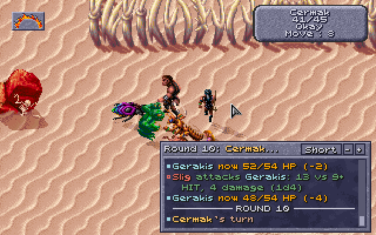

**The panel** sits over the map's lower right. A window the game opens over
the map (a character's menu, a question) hides it until it closes.

- **Scrolling:** it keeps the last 200 lines. Drag the scrollbar's handle,
  click the bar above or below it for a page, or turn the mouse wheel with
  the pointer over the panel (on Windows). Scrolled back, it stays where it
  is as new lines come, and a **Latest** chip at its foot says how many have;
  click it (or scroll to the end) to follow again. Clicks on the panel are
  its own: the party doesn't walk there.
- **Its buttons**, on the right of its top line: **L**, which hides it as the
  key does; the level (**Least**, **Short**, **Detail**; a click goes to the
  next, and the Options tab follows); and **-** and **+** for a smaller or
  bigger panel. Collapsed, it is one line, the newest; expanded, it is
  taller (11 lines) and has filters along its top: **All**, **Party** (the
  party's lines), **Damage** (hits, damage and deaths) and **Saves** (saving
  throws and magic resistance). Its size is remembered.

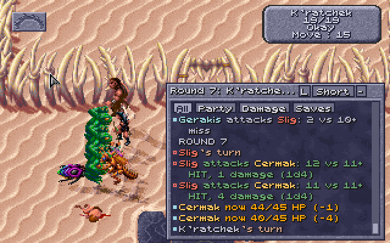

**Below the map instead.** With **... always shown, below the map instead of
over it** ticked (from the next start), the game's screen is 22 rows taller,
320 × 222, and the log is a strip under the map, the full width, in the
panel's darker shade, always there: L doesn't hide it. Nothing of the map is
covered, and the game runs at its own speed with the map its usual shape;
DOSBox's window is a little taller than 4:3.

- **What it shows:** in a fight, the round and the newest line; between
  fights, the two newest lines (the next fight starts again at its newest).
- **Scrolling:** the pointer doesn't go there, so the strip has no buttons.
  On Windows the mouse wheel scrolls it a line a notch wherever the pointer
  is (DOSBox doesn't pass the wheel to the game, so the Loader listens for it
  itself), with a **Latest** chip while scrolled back; under a talk window it
  moves once the pointer does. The level is set on the Options tab.
- **On other screens:** it stays under a talk or a screen over the map, and
  is kept up while the game plays a scene out (the arena's opening show). A
  screen in other colours has the panel's blue-grey there instead, the log
  back on the map; the title, the main menu and character creation have it
  black.

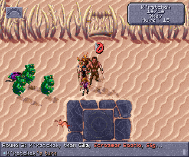

### THAC0, saves and thief skills

Started with the dice log, the game's own inventory screen (the one with the
character's figure and their equipment) shows five more things in its
right-hand panel, drawn by the game's text routine so they look like the rest:


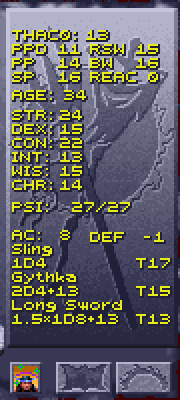

- above STR, **THAC0** and the five **saving throws**, with the usual AD&D
  short labels: `PPD` paralysis/poison/death, `RSW` rod/staff/wand, `PP`
  petrification/polymorph, `BW` breath weapon, `SP` spell;
- at the right of each weapon's damage line, the THAC0 with that weapon
  (`T14`);
- right of the abilities, level with STR to CHA, for a character with thief
  levels, six **thief skills**: `PICK` pockets, open `LOCK`s, find/remove
  `TRAP`s, `MOVE` silently, `HIDE` in shadows and `CLMB` walls. Move silently
  and hide in shadows are the ones the Loader rolls (for
  [picking pockets](#picking-pockets) and
  [hiding to backstab](#hiding-in-shadows-to-backstab)). A worn belt's 5 is in
  `PICK` and `LOCK`, and with hiding to backstab a worn cloak's 10 in `HIDE`
  and boots' 10 in `MOVE` (the Cloak and Boots of Elvenkind's 95). Hear noise
  (one script check) and read languages (none) are left out for want of room.
  A ranger, with hiding to backstab on, gets their `MOVE` and `HIDE` in the
  same places, the cloak and boots counted (the other four left out);
- right of SP in the saves (where RSW and BW sit on the rows above), the DEX
  **reaction adjustment** (`REAC +4`): −6 at DEX 1 to +5 at DEX 24-25, the
  number the [two-weapon rule](#two-weapons) adds to its penalties, and the
  one initiative uses. It is worked out from the character's DEX each time
  the panel is drawn, so it follows any change (Cat's Grace's, while it
  lasts);
- right of the AC line, the DEX **defensive adjustment** (`DEF -5`), as
  AD&D's table gives it, on AC: +5 at DEX 1 to −6 at DEX 24-25 (−4 at 18, −5
  at 21-23). The game counts it in AC already; on saving throws against what
  can be dodged it counts the other way round (DEF −5 is +5 on the save), with
  the [rule change](#rule-changes) for fire, cold and electricity. Worked out
  the same way as REAC, each time the panel is drawn.

The **View Character** screen gets them too: the five saves under the item
icons, each with its label as above (`PPD 11  RSW 9` / `PP 10  BW 13` /
`SP 10`), and in the lower panel, right of HP and PSI as DAM is right of AC,
the character's **MOVE** (its movement in a fight, before boots or a spell
change it) and **THAC0**.

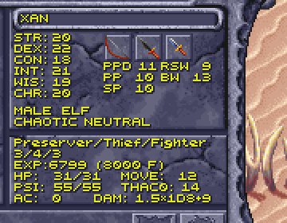

They're the numbers as they stand now, worked out by the Loader the way the
game's own attack and saving throw routines do. Each time the game draws one
of these screens, the helper has the Loader bring them up to date first (the
game waits a moment for it), so putting on a ring or readying another weapon
shows at once. Spells start and end as time passes in the game, which it
doesn't while these screens are open; open the screen again to see such a
change.

- **THAC0**: the character's THAC0 less STR's to-hit adjustment (DEX's for a
  missile weapon), the weapon's plus (or, for a plain wooden, bone, stone or
  obsidian weapon, its material's penalty), Bless and Prayer (+1), Curse
  (−1), Slow (−4) and Graft Weapon (+1). The THAC0 at the top is the main
  weapon's: the right hand's, else the left's, else the missile weapon's.
  What depends on the target (attacking from behind or backstabbing, a Blurred
  target) is left out; the dice log shows it on each attack.
- **Saves**: the d20 each needs, the character sheet's number less what the
  game adds to every save: the
  [Rings of Protection and the Cloak of Protection](#rings-and-cloaks-of-protection),
  Bless, Prayer, Barkskin, Spirit Armor (not on PPD), the Save penalty, and on
  PPD the CON adjustment (and a dwarf's or halfling's CON bonus). What depends
  on the spell or its caster (WIS against mind spells, Protection from Fire, a
  doubled d20 against fire...) is left out; the dice log shows it on each
  save. A 1 always fails and a 20 always saves, so they show between 2 and 20.
- **Thief skills**: as they stand (with no equipment penalty in games started
  with the dice log: see
  [How the game works out thief skills](HOW-THE-GAME-WORKS.md#how-the-game-works-out-thief-skills)),
  0 for a skill an effect rules out or when the thief isn't Okay (New counts
  as Okay), and 100 for one an effect makes certain (Detect Traps). Only the
  situation's bonus or penalty (a hard lock) is left out: the dice log shows
  it on each roll.

The Characters tab shows the same THAC0 with each weapon and saves. The
game's own numbers (the character sheet's) come back on these screens when
the Loader isn't running.

**The next level's class.** For a character of more than one class, the number
in brackets on View Character's experience line is the XP at which the first
of their classes goes up a level, and the Loader adds which class that is:
`EXP:87230 (90000 Pr)` means the preserver goes up next, at 90,000. Each class
is a letter, except preserver and psionicist, which both start with P:

| Class | Letters |
|---|---|
| Cleric | C |
| Druid | D |
| Fighter | F |
| Gladiator | G |
| Preserver | Pr |
| Psionicist | Ps |
| Ranger | R |
| Thief | T |

When two classes go up at the same XP, both are named: `(20000 Pr/T)`. A class
already at the highest level (9, or 10 with
[levels up to 10](#levels-up-to-10)) has no next level, so it is never named.
A character of one class shows the line as the game always has, and so does a
human, who can only dual-class: the game counts only one of their classes
there.

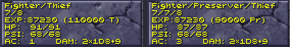

How it works: [DEVELOPMENT.md](DEVELOPMENT.md#thac0-saves-and-thief-skills).

### Spell slots on the USE screen

The game's USE (cast spells) screen shows, at the top of the panel under the
spells, how many spells of each level the selected character can still cast,
and the most they get after resting: `WIZ` for preservers' wizard spells, `PRI`
for clerics', druids' and rangers' priest spells, one `left/most` per spell
level from the 1st (six to a line), up to the highest level the character can
cast (more appear as they level up):

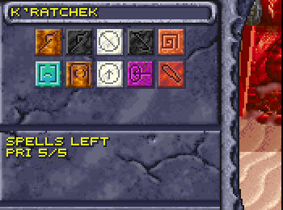

The numbers go down as spells are cast (the screen shows the new count when it
is next drawn) and back up after resting. That panel is where the game puts
the icons of the character's usable magic items (fruit, wands and the like),
along its bottom from the left, so the slots take only the three lines above
them: a character with both wizard and priest spells gets the two lines without
the `SPELLS LEFT BY LEVEL` heading.

The numbers are the Characters tab's (see [spell slots](#the-characters-tab)),
WIS bonus included, printed with the game's own text routine; they show while
the Loader (or its command-line dice log) is running.

### What hurts a monster (the Look box)

In a fight, Look at a monster (right-click until the cursor is the Look icon,
then click the monster) and the game's small box, under its name and level,
now also shows its hit points and AC (`HP 15/15 AC 2`), its THAC0 and
alignment (`THAC0 17 AL TN`), its magic resistance beside its level
(`LEVEL: 3 MR 30`), and its most important defence: `NEEDS +1 WEAPON`,
`IMM FIRE COLD`, `NO CRUSH`, `HALF FROM WPNS` or `UNDEAD`. The alignment is in
two letters: `LG`, `LN`, `LE`, `NG`, `TN`, `NE`, `CG`, `CN` or `CE`. (A line
that would run past the box's edge, such as a monster's with over 100 HP,
loses its spaces.) Its own status lines (casting, charmed, held...) follow in
any row left. When there's more to say, closing the box shows everything in
the game's dialogue window: the weapons it needs, the damage it's immune to or
takes half of, spells that don't work on it, and what its hits do besides
damage. The dice log gets the same lines (`Look: ...`). Untick **Describe
monsters when you Look at them in a fight** on the Options tab to turn this
off.

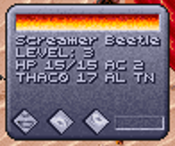

(The arena's first monsters, like the people in the early fights, have no
magic resistance or special defences, so the box shows just the numbers and
the alignment.)

How it works: [DEVELOPMENT.md](DEVELOPMENT.md#what-hurts-a-monster-the-look-box).

### Charges in item boxes

An item that casts a spell with charges (the wands, the Storm Ring, the
necklaces) shows how many it has left in its item box (right-click it on the
inventory screen), under its name, counting down as it's used:

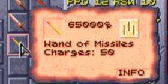

### No manual check

The game's copy protection is gone. Leaving the sewers (the Tari's warrens) the
first time, the game has a dragon appear and ask for a word from the manual
("The 3rd word on page 14, line 1, begins with the letter 'p'. What is that
word?"), and three wrong answers kill the party. Started from the Loader, the
dragon doesn't come: the game goes on as if it had been answered. Always on.

How it works: [DEVELOPMENT.md](DEVELOPMENT.md#no-manual-check).

## The Loader's window

The window has the party on one side and the logs and tools on the other, with
**Start the game**, the game window's size, the text size and **Reconnect**
(to find the game again) along the top. The party pane has two tabs:

- **Characters** (Alt+C): a card for each character, laid out like the game's
  View Character screen (scroll with the mouse wheel, or Tab to the cards and
  use the arrow and Page keys):
  - the figure for their race and sex (as on the character creation screen,
    read from your install), their name, and HP and PSP (PSP in blue);
  - their condition (New, for a character not yet played, Okay, Stunned, Out
    Cold, Dying, Dead, Animated, Petrified or Gone), then the spells and
    effects on them with the rounds or charges left: `Blur (22 rounds)`,
    `Stoneskin (5 charges)`;
  - the character sheet: scores, sex, race and alignment, classes and levels,
    experience, AC (the one the game last used in a fight, with the base AC
    beside it), THAC0 with each weapon ready (`THAC0: 15 with Wooden Club, 14
    with Wooden Bow (base 19)`), the saves as the d20 needed now (see
    [In the game](#thac0-saves-and-thief-skills)), movement (`Move: 12 (14 in
    a fight: Stalker)`) and attacks;
  - what they wear and hold, by the game's own slot names ("Right hand: Bone
    Long Sword"; "Carried" for the backpack), with each item's material and
    plus;
  - last, spell slots for spellcasters (see below), thief skills for thieves,
    and for rangers, with hiding to backstab on, their chances to hide and move
    silently (`Ranger skills now`).
- **All fields** (Alt+A): every field the layout maps, in a table, with rows
  of its own for the AC in a fight and what it's made of, THAC0 with each
  weapon and the saves now, and at the end the spell slots, thief skills and
  equipment.

The other side has the **Dice log**, **Dialogue** and **Spells** tabs (below),
**Memory tools** (for mapping the game's memory, with **Save layout** and
**Reload layout**: see [DEVELOPMENT.md](DEVELOPMENT.md#mapping-memory)), and
**Options** (Alt+O) with the Loader's switches, in sections that open and
close: click a section's heading (or Tab to it and press Space or Enter) to
open it, ▸ when closed and ▾ when open. Which sections are open is remembered.
Everything there applies in games started from the Loader; a switch that says
"from the next start" waits until the game is started again. The sections:

- **In the game**: the combat log, where it goes and how much it says,
  monster descriptions ([In the game](#in-the-game)).
- **Rule changes** ([Rule changes](#rule-changes)): the game's rules closer
  to AD&D.
- **More character customization**
  ([More character customization](#more-character-customization)): weapon
  specialization, kits, levels up to 10, STORE and RECALL on the creation
  screen, and fuller starting gear.
- **Expanded features** ([Expanded features](#expanded-features)): the
  leader's CHA at shops, buying back magical items, and **Improved thieving**
  (AD&D's thief skills, hiding to backstab, the cloak, boots and belt, and
  picking pockets).
- **New content** ([New content](#new-content)): the new spells, at once; the
  new people, the vulture, defilers' scrolls and the new items, from the next
  time the game is started (what a saved game already has stays in it).
- **Graphics** ([Graphics](#graphics)): the elves' and half-elves' looks,
  Cilla drawn as an elf, what the party wears, shadows and dust.
- **Controls** ([Controls](#controls)) and **Game speed**
  ([Game speed](#game-speed)).
- **Saves** ([Saves under their names](#saves-under-their-names)): the folder
  of saves kept under their names, and putting one back in a slot.

All are on by default except scrolling by holding the right button and the
combat log below the map, and are remembered for next time. **Restore
defaults**, at the bottom of the tab, sets them all back (after asking). In a
window too small to show the open sections, the tab scrolls (scrollbar, mouse
wheel, or arrow and page keys once it has the focus).

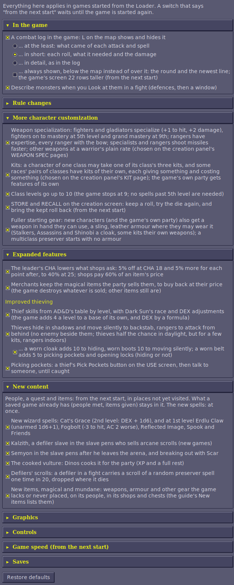

### The Characters tab

What some of a card's lines mean.

**Spell slots.** `Priest spells left: 1st 5/5, 2nd 3/3, 3rd 2/2` means five
first-level priest spells can still be cast out of five, and so on. Casting a
spell uses one slot of its level, and resting fills them again. Wizard slots
belong to preservers; priest slots belong to clerics, druids and rangers. A
multiclass character's classes add up, for example a druid/preserver has both.
The "most" is worked out the way the game does it when it refills them (its
tables are read from memory):
- Preservers: from their level only.
- Clerics and druids: from their level plus a WIS bonus.
- Rangers: from their level only, with their first slot at level 8.

With [AD&D's class tables](#adds-class-tables) on (the default), clerics',
druids' and preservers' come from AD&D's tables instead. Some [kits](#kits)
have more or fewer.

The game's WIS bonus doesn't depend on level, so it gives a 2nd-level druid
with WIS 19 slots at the 2nd to 4th levels too, though a druid that level
casts only 1st-level spells. Those aren't shown (here or in the game): only
the spell levels the character's class levels reach, as in AD&D, where the WIS
bonus counts only at levels the priest can cast. For a human dual-class
character, a later class counts only while its level is below the first
class's.

**AC.** The AC shown (**Current AC** on All fields) is the one the game last
used for each character in a fight (armour, DEX and spells included), and the
rows under it say what it was made of: armour and shield (and spells that take
their place, such as Spirit Armor and Magical Vestments), DEX (the game's
table: −1 at 15 down to −6 at 24; not counted when attacked from behind), and
spells, rings (the [rings of protection](#rings-and-cloaks-of-protection)) and
anything else. They show "-" until the game has worked out that character's AC
in a fight.

**Scores.** Ability scores such as `STR 24 (20 without spells)` show the score
now and, in brackets, the character's own score when a spell (Strength, for
one) has raised it. The character's own score already includes the racial
adjustment: a half-giant's 20 + 4 shows as 24.

### The Spells tab

What each wizard and priest spell and psionic power does, read from the
running game's records: its damage dice and kinds (and that damage stops
growing at caster level 10), its saving throw (which of the five, any
modifier, whether the d20 counts double, and whether saving halves or stops
the damage), the effect it gives and what that does, how long it lasts, and
each party member's caster level for it. **Show** picks wizard, priest or
psionic, and **Only spells the party has a caster level for** leaves out the
rest. **Save...** writes it to a text file. It's filled when you open the tab
(or press **Refresh**) while the game is running.

### The Dialogue tab

Everything the game shows in its dialogue window, one entry per window of
text, with the replies offered numbered underneath (and the list's title,
such as "Answer Yes or No", above them), and then the one you picked:
`You chose: No`.

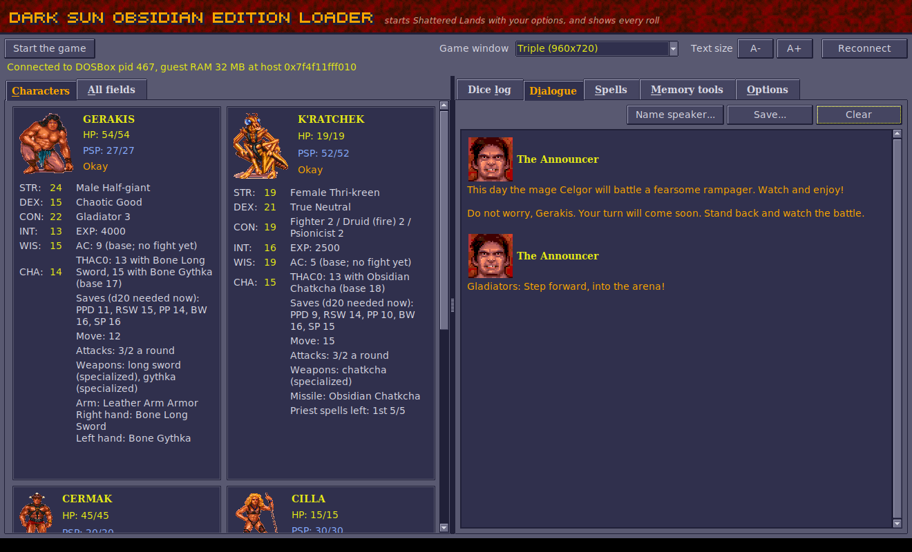

**Who's speaking.** The game's dialogue window gets only a portrait number,
never a name. But when the game runs a script on someone (you click them, or
they come up to you), it notes who; the log reads that when a conversation
opens. A conversation that shows one face, started on a named creature outside
the party, is that creature talking, and from then on the portrait carries its
name: in the pens, portrait 5 became `Kurzak` ("Legcrusher! Get gladiators!")
and portrait 100 `Legcrusher` ("Kurzak told me to bring you to the arena").
When several faces take turns in one conversation, nothing is learned from it,
as it can't be told who is who. Names learned are shown on the lines already
there too, and kept in `settings.json` (`speakers_learned`). A speaker not
named yet shows as `Portrait 57`. Portrait 119 is named `The Announcer`, as
the game itself calls him ("Yell something back at the Announcer?"). That name
isn't replaced by one learned (he calls out in the middle of fights, when the
game's last script ran on a fighter). To name a speaker yourself (your name
wins over a learned one), right-click the name line in the Dialogue tab, or
press **Name speaker...** (it names the latest speaker). The name replaces the
number on every line from that portrait, the ones already shown included, and
is remembered in `settings.json` for next time (the command-line log uses it
too). Leave the name empty to go back to the number. Text shown without a face
(the emblem instead) is `Narration`.

Each entry shows the speaker's portrait, as the game's own dialogue window
does. Portraits and the title's lettering are read from your installed game at
run time (GPLDATA.GFF and RESOURCE.GFF in the install folder the Loader
remembers); nothing from the game is copied into the Loader. Without the game
installed the window uses its own lettering and no portraits.

## The dice log


**Reading it at a glance.** Lines at the left edge are the events: a round
starting, whose turn it is, attack rolls, saves, spells, kills. Lines indented
two spaces are their results (damage, HP left); lines indented four spaces are
the details: the sums behind a THAC0, a save's modifiers, the initiative
scores. Untick **Show details**, above the log, to hide the details and keep
the rest; they come back when it's ticked again. In the window, each kind has
its colour (hits green, misses grey, damage amber, saves blue, turns sand,
rounds underlined with a gap above), but the words say the same thing, so
nothing depends on telling colours apart. Names stand out in bold: each party
member in a colour of their own (cyan, magenta, peach and white, by place in
the party) and every monster and other creature in red, so who acts and who is
hit can be followed down the log. Every colour has at least 4.5:1 contrast
with the log's background (WCAG 2.0 AA, as AODA asks).

**Fights**

| Line | Meaning |
|---|---|
| `Round 2: K'ratchek 32, Cermak 31, Cilla 30, Gerakis 26, Slig 26` | A new round of a fight, numbered from the fight's start, and the order everyone acts in (highest first). The order also stays in view above the log for the whole round, however far the log has scrolled: `Round 2. Now: Cilla (30). Still to act: Gerakis 26, Slig 26. Done: K'ratchek 32, Cermak 31. Down: ...`, and the [combat log in the game](#the-combat-log-in-the-game) begins with who acts and who is next. The lines under it (shown with **Show details**) give each score's make-up: `    Gerakis 26 = 20 + 6 (0-9 roll), tie broken by 38 (0-199 roll)` (see [Initiative](HOW-THE-GAME-WORKS.md#initiative)). If the log was started in the middle of a round, the list has only the rolls it saw. |
| `Gerakis's turn` | Whose turn it is now, each time the turn passes in a fight. |
| `X attacks Y with Long Sword +1 (1d8+1): d20 = 14, needs 12+ (45%), hits AC 1, target AC 3 -> HIT` | An attack roll, the weapon and its damage dice. `needs 12+ (45%)` is the d20 this attacker needed against this target (THAC0 − target AC) and the chance of rolling it; `hits on anything but a 1` or `only a 20 hits` when it's out of the ordinary range. `X attacks Y from behind ...` and `X attacks Y BACKSTAB ...` mark attacks from behind and backstabs (see [Attacks from behind and backstabs](HOW-THE-GAME-WORKS.md#attacks-from-behind-and-backstabs)). "Hits AC" is the lowest AC this roll hits (THAC0 − d20); the target AC is the one the game used, with armour, DEX and spells. A natural 20 always hits and a natural 1 always misses, but a 20 does no extra damage: the game has no critical hits (see [No critical hits](HOW-THE-GAME-WORKS.md#no-critical-hits)). |
| `    THAC0 16, +1 Blessed, +6 STR, +1 weapon = 8` | Where the attacker's THAC0 for this attack comes from: STR (melee) or DEX (missiles), spells (Bless, Prayer, Slow, Graft Weapon, the target's Blur), attacking from behind, the weapon's plus, the penalty for non-metal weapons (wooden −3, bone −1, stone and obsidian −2), the two-weapon adjustment (see [Two weapons](#two-weapons)), and the difficulty setting for monsters. |
| `  X hits Y for 14: 1d8 = [6] +8 STR 20` | The damage of that hit: the dice, the weapon's bonus, and the STR bonus the game adds for melee. Damage is at least 1. |
| `  X hits Y for 51: (1d8 = [5] +12 STR 24) x3 backstab` | A backstab (see [backstabs](HOW-THE-GAME-WORKS.md#attacks-from-behind-and-backstabs)) multiplies the whole damage, STR bonus included. |
| `Mistra dances: d20 = 3, needs 18 or less (DEX 22 -4) -> +1 to hit, damage and AC for 15 rounds` / `Halton fights wild: d20 = 9, needs 11 or less (CON 15 -4) -> 1 more attack a round and +3 damage for the fight` | A Battle Dancer's dance or a Wild Fury's Wild Fighting as a fight starts (see [Multiclass kits](#multiclass-kits)). |
| `Chosen with Tab: Guard (50 HP) - Enter attacks it` | An enemy chosen with Tab in a fight (see [Choosing an enemy](#choosing-an-enemy-tab-enter-and-the-rings)). |

**Spells, saves and effects**

| Line | Meaning |
|---|---|
| `Shocking Grasp damage: 1d8 = [5] +10 = 15 (1d8 + 1 for each caster level: 10 at caster level 20, which counts as 10)` | A spell's damage roll, rolled for each target before its saving throw, with the spell's formula from the game's data. Damage stops growing at caster level 10 (Fireball does at most 10d6). Magic Missile, Flame Arrow and Minute Meteors are rolled elsewhere in the game, without the caster's level, so their line says how many steps the dice stand for. |
| `  Slig takes 15 from Shocking Grasp, now 3/18 HP` | What the spell really did to each creature, after its save, resistances and protections (or the healing it gave). A creature that is Out Cold gets no save and takes the most the dice can do (the game's damage code does that), marked `(Out Cold: the most the dice can do)`. |
| `    Blur lasts 23 rounds (caster level 20: 1 for each caster level = 20 + 3 from the dice; dice 3d1)` | How long a spell's effect lasts, and how the game worked it out. A round is 60 game seconds. The game often "rolls" dice with one side, which are fixed numbers. |
| `    Stoneskin has 23 charges (caster level 20: 1 for each caster level = 20 + 3 from the dice; dice 1d4 = [3])` | Effects that last a number of uses rather than a time (Stoneskin's blows, Mirror Image's images, Invisibility's one attack, Poison's rounds): the game stores them as charges, worked out like a duration. |
| `    Acid on Slig: 2d4 = [3 + 1] = 4 acid damage` / `    Ironskin on Cilla: one charge used` | Acid Arrow's damage each round while the acid lasts; and an effect with charges using one up (Stoneskin or Ironskin stopping a blow, Mirror Image losing an image...). |
| `Strength: 1d6 = 5 -> Cilla's STR +5 while it lasts (at most 24)` | The amount Strength (or Adrenalin Control) adds. |
| `Y magic resistance 30% vs Fireball: d100 = 71 -> not resisted` | The magic resistance roll (only shown for targets that have some), counting Mind Bar and Lower Resistance. |
| `    Dispel Magic on Slig's Blessed: d100 = 60, needs 85 or less (50 + 5 x 7 - 5 x 0 (its caster's level)) -> dispelled` | Dispel Magic tries each effect on its target separately: 50 + 5 for each of the dispeller's levels, less 5 for each of the level the effect was cast at. It can't touch some (Biofeedback, Diseased, Feeblemind, Poisoned, Graft Weapon, No spell use, Stuck, Mind Bar and a few more). |
| `    Abjure on Y: d20 = 14, needs 12 or more (11 - caster level 5 + its level 6) -> sent away` | Abjure sends a summoned creature away (1000 damage) on a d20 at or over 11 - the caster's level + the creature's. |
| `    Summoning: 1d3 = 2 picks which of its 3 creatures comes` | Which creature a summoning spell brings. |
| `Y's saving throw vs Fireball from X (petrification/polymorph): d20 = 6, doubled against fire = 12 +1 Blessed = 13, needs 11 (80% to save) -> saved: half damage, 19 of 38` | A saving throw: which of the target's five saves it uses, the d20, each of the game's modifiers by name (see [The game's saving throws](HOW-THE-GAME-WORKS.md#the-games-saving-throws); anything the log can't account for shows as `other`), and the number it had to reach. With the [rule changes](#rule-changes) off, the game uses petrification/polymorph for almost every spell and doubles the d20 against fire, cold and electricity spells, as here (see [The game's saving throws](HOW-THE-GAME-WORKS.md#the-games-saving-throws)); with them on (the default), the line names the spell save and DEX's adjustment instead (`+5 DEX 21 dodging`). A natural 1 always fails and a natural 20 always saves. The chance of saving is worked out for you (`needs 14 (70% to save)`); with the game's doubled d20, Fireball's victims usually save. For a damaging spell the result says what the save left, from that target's damage roll just before it: `saved: half damage, 19 of 38`, `failed: full damage, 38`, or `saved: no damage` for spells such as Chill Touch. The HP line after it shows what the creature really lost, once resistances and protections have had their say. A failed save also lets the spell's effect take hold. Spells left on the ground (Grease, clouds) make creatures save again as they stay in them; those lines have no "from". |
| `X gives Blessed to Y, Z: +1 to hit, +1 on saves` / `Blessed ends on Y` | A spell or psionic effect starting or ending, with what it does in the game's code where that is known: to-hit, AC and saving throws, movement and attacks, whether the creature can attack or cast, who controls it (see [Spells and effects](HOW-THE-GAME-WORKS.md#spells-and-effects)). `Stuck on Y` (no "gives") is an effect a creature has from a spell on the ground or cast on itself. |

**Checks, thief skills and searches**

| Line | Meaning |
|---|---|
| `X DEX check: d20 = 9, needs 16 or less (DEX 16) -> success` | An ability check. A natural 20 always fails. |
| `Cilla tries to open locks: d100 = 35, needs 40 or less -> success` / `    open locks 40 = 18 + 16 thief level 4 + 10 elf...` | A thief skill roll (see [How the game works out thief skills](HOW-THE-GAME-WORKS.md#how-the-game-works-out-thief-skills)), and what its chance is made of. |
| `Tezral hides in shadows: d100 = 21, needs 27 or less (54, halved in daylight) -> hidden` / `  Tezral moves silently: ...` | A thief's or ranger's hiding and moving silently at the start of their turn (with [hiding to backstab](#hiding-in-shadows-to-backstab) on). |
| `    X's special effect on Y: d10 = 1, works on a 1 -> it works` | The 1-in-10 extra effect some creatures' hits have (the thri-kreen bite, for one). |
| `    X's Bone Long Sword nearly broke: 0 on 0-7, then 12 on 0-19 (needed 0)` / `... BREAKS` | The weapon check the game makes after an attack sequence whose last attack hit. Only non-magical wood, bone, stone and obsidian weapons can break (and not every kind: clubs and quarterstaffs can't): they break when a 0-7 roll and then a 0-19 roll both come up 0, 1 chance in 160. The line only appears when the first roll comes up 0. |
| `  Rampager's acid on Gerakis's Leather Chest Armor: d20 = 12, needs 10 (AD&D's, 10 for leather; the game's: destroyed without a roll) -> safe` | An item the Rampager's acid or the Babau's corroding touch could destroy: the d20, the number it needed and whose number that was (see [Items saving against acid](#items-saving-against-acid)). |
| `Haystack searched: 0-10 = 7, an old, soiled loincloth (the party's 2nd find of 6 in hay)` / `  The rat's bite: 0-4 = 3 damage` | Searching a junk pile, a haystack or a wardrobe: the game's roll, what it found, and how far its count has got (see [Searching junk, hay and wardrobes](HOW-THE-GAME-WORKS.md#searching-junk-hay-and-wardrobes)); a rat's bite or a falling pot rolls its damage the same way. |

**Hit points, kills and levels**

| Line | Meaning |
|---|---|
| `  Slig now 8/18 HP (-10)` / `  Gerakis now 51/54 HP (+1)` | Any combatant's hit points going down or up, with what's left out of their most. The game never shows a monster's HP; this does. The line comes just after the damage that caused it (sometimes after the next roll, when the game is quick). |
| `  Gerrard regenerates 1 HP (CON 22), now 16/35 HP` | A hit point back by itself: the game gives one now and then to anyone with CON 20 or more (in the game, CON 20 regenerates and 18 or 19 don't). |
| `  Rampager now 69/72 HP (-3: 3 of the 7 rolled, non-magical weapons do half)` / `  Mastyrial takes none of the 6 damage: crushing weapons can't hurt it` | A weapon hit that took less than its roll, or none at all (no HP lost three seconds on, or by the next round), with the reason when the monster's own defences give one (what weapons hurt it); otherwise "a protection or resistance took it" (Stoneskin, say). |
| `Slig is killed` | A creature dying. What it's worth comes on the XP line below, only if the party gains it (the opening fight in the arena gives none, whoever dies). |
| `XP: Gerakis +67, K'ratchek +22, ... (for Slig 270)` | Experience the party got, and for which kills, with each one's XP from its character sheet. The game gives it right after the kill: an equal share to each character, split again between a multiclass character's classes (the sheet counts XP per class, so a three-class thri-kreen shows a third of the share). |
| `Cilla is now a 3rd level Ranger` / `    max HP 15 -> 21 (+6)` | A level gained, and the new maximum HP. |
| `    max HP unchanged: the game divides the hit point total by the classes, ...` | A multiclass character gained a level and its most hit points stayed the same: every class level rolls its die, but the game divides the whole total by the number of classes, so a small roll can add only a fraction (it counts at a later level). A human who changed class gets none in the new class until its level passes the old class's. |
| `Cilla's 3rd Ranger level: hit points d10 = 2, raised to 3 for CON 21` | The hit point roll for a new level: the class's die (d8 clerics and druids, d10 fighters, gladiators and rangers, d4 preservers, d6 psionicists and thieves; three [kits](#kits) have their own), never less than 2, 3 or 4 with CON 20, 21-22 or 23+, and doubled for half-giants. After level 9 or 10 there's no roll, just a fixed gain (thieves roll at 10th too with [levels up to 10](#levels-up-to-10)). With [the better of two](#hit-dice-the-better-of-two) both rolls show (`d10 = 2 and 7, the better 7`), and with [multiclass hit points](#multiclass-hit-points) CON's bonus on the die (`, +4 CON 18, into the total shared by 3 classes`). |

**Character creation**

| Line | Meaning |
|---|---|
| `Character creation, STR 17: best of four 4d4 (7, 11, 9, 10) = 11, +4, +1 dwarf = 16, raised to 17 (the Fighter's prime requisite)` | An ability score rolled on the character creation screen (see [Character creation](HOW-THE-GAME-WORKS.md#character-creation)). The die rolls a whole character several times while it tumbles, faster than the log can read every roll, so the helper keeps each ability's last four 4d4 itself; the log gives only the character the die stops on, once it stops, each ability checked against the one the screen shows. A hit point roll that came too fast to record leaves a note: `some of its rolls came too fast to record`. |
| `Character creation: the six scores add up to 101` | After the scores, what they add up to: the most they may add up to with [Scores and hit points as rolled](#scores-and-hit-points-as-rolled). |
| `Character creation, hit points 15: Fighter d10 per level: 7 + 9; Thief d6 per level: 5 + 1 = 22, / 2 classes = 11, +4 CON 16 = 15` | The new character's hit points: a die for every level of every class, divided by the number of classes, plus CON's bonus (see [Character creation](HOW-THE-GAME-WORKS.md#character-creation)). With [the better of two](#hit-dice-the-better-of-two) each die shows both rolls (`10 (the better of 2 and 10)`); with [multiclass hit points](#multiclass-hit-points) CON's bonus goes on each die before the total is shared (`+2 CON 16 on each of 4 dice = 30, / 2 classes = 15`). |
| `Character creation: a name picked at random, 1d33 = 6` | The game picks a new name from its lists when the sex or race changes. |

**Everything else**

| Line | Meaning |
|---|---|
| `Message: Long Sword is broken !` | The game's own message boxes: broken or corroded weapons and armour, level-ups, "NO PATH FROM HERE" and so on. |
| `Dinos cooks the vulture and the party eats with him: ... restored as after a full rest (HP, PSP and spell slots); the game gives each 100 XP` | Dinos asked about the cooked vulture (see [The cooked vulture](#the-cooked-vulture)); the XP itself is on the `XP:` line after it. |
| `Dice: 1d8 = [3] = 3` | Dice the log couldn't tie to anything (for example a spell with no saving throw). |
| `(The Loader stopped one of its own writes over the game's memory: ...)` | A safety net: the Loader never writes over the start of memory (the interrupt vectors, the BIOS's and DOS's data) or the first bytes of the game's data, which its C runtime checks ("Null pointer assignment"). Such a write could only come from a pointer the game has left empty for a moment; the line says where in the Loader it came from. Please report it. |

The log keeps its newest line in view. Scroll up to read back and it stays
where you are; scroll to the bottom again and it follows the new lines once
more. The Dialogue tab does the same.

**Show unlabelled rolls**, beside it, also lists everything else the game
randomises (creatures wandering, animations and so on), as raw numbers with
where in the game's code they came from. It's noisy, but useful for finding
more rolls worth labelling.

## How the game works

What the game does that its manual doesn't say, from its code and checked in
play, has a page of its own, [How the game works](HOW-THE-GAME-WORKS.md):

- [Initiative](HOW-THE-GAME-WORKS.md#initiative)
- [Spells and effects](HOW-THE-GAME-WORKS.md#spells-and-effects)
- [Psionics](HOW-THE-GAME-WORKS.md#psionics)
- [Character creation](HOW-THE-GAME-WORKS.md#character-creation)
- [Monsters' defences](HOW-THE-GAME-WORKS.md#monsters-defences)
- [Searching junk, hay and wardrobes](HOW-THE-GAME-WORKS.md#searching-junk-hay-and-wardrobes)
- [No critical hits](HOW-THE-GAME-WORKS.md#no-critical-hits)
- [The game's two weapons](HOW-THE-GAME-WORKS.md#the-games-two-weapons)
- [How the game works out thief skills](HOW-THE-GAME-WORKS.md#how-the-game-works-out-thief-skills)
- [Where the game rolls thief skills](HOW-THE-GAME-WORKS.md#where-the-game-rolls-thief-skills)
- [Attacks from behind and backstabs](HOW-THE-GAME-WORKS.md#attacks-from-behind-and-backstabs)
- [The game's saving throws](HOW-THE-GAME-WORKS.md#the-games-saving-throws)

## Rule changes

Fourteen changes that bring the game's own rules closer to AD&D, each with its
own box in the Options tab's **Rule changes** section. All are on by default,
and they take effect in games started with the dice log: with the Loader
running, or with **Play Dark Sun (in-game rolls)**, which uses the Options as
last set. Untick one and the game's own rule is back at once.
[How the game works](HOW-THE-GAME-WORKS.md) has what the game does without them.

| Rule | What it changes |
|---|---|
| [Class restrictions](#class-restrictions) | each class's limits on armour, shields and weapons hold, the strictest winning; a multiclass preserver casts no spells in armour, and a thief with another class has no thief skills in armour that isn't light |
| [Multiclass hit points](#multiclass-hit-points) | CON's bonus on every hit die (a warrior's for a character with a warrior class), the total shared between the classes |
| [Hit dice: the better of two](#hit-dice-the-better-of-two) | each hit die rolled twice, the better kept, for every character |
| [Scores and hit points as rolled](#scores-and-hit-points-as-rolled) | on the creation screen, a click raises a score only while the six add up to no more than the die gave (lower one to raise another), and doesn't change the hit points |
| [Rangers' casting level](#rangers-casting-level) | a ranger's spells last and do damage as cast at its level less 7, as the spell levels it may cast already count it |
| [Preservers' INT](#preservers-int) | INT gives a preserver a chance to learn a spell from a scroll, and the most spells of each spell level it may know |
| [AD&D's class tables](#adds-class-tables) | the XP for each level, priests' THAC0, and clerics', druids' and preservers' spell slots from AD&D's tables |
| [Spells saved against with the spell save](#spells-saved-against-with-the-spell-save) | the spell save rather than petrification/polymorph |
| [Fire, cold and electricity: DEX instead of a doubled d20](#fire-cold-and-electricity-dex-instead-of-a-doubled-d20) | DEX's defensive adjustment on those saves rather than a doubled d20 |
| [Two weapons](#two-weapons) | −2 main hand, −4 off hand, DEX's reaction adjustment added; rangers none in light armour; the off hand attacks once a round |
| [Items saving against acid](#items-saving-against-acid) | an item the acid or corroding touch could destroy needs the easier of the game's number and AD&D's save by material, a plus helping |
| [Rings and cloaks of protection](#rings-and-cloaks-of-protection) | two rings don't add up, a ring gives no AC with magical armour, a cloak does nothing with magical or metal armour or a shield |
| [Half-giants' two-handed weapons](#half-giants-two-handed-weapons) | a half-giant wields a two-handed weapon in one hand |
| [Helms give AC 1](#helms) | the game's helms give AC 1 rather than 0 |

### Class restrictions

With **Class restrictions** ticked, a character's classes keep it from
armour, shields and weapons as in AD&D, the strictest class winning. The game
checks only that one of the character's classes may use an item; with the rule
the others must allow it too, and putting on what one forbids gets the game's
own "Cannot use this item":

| Class | Armour and helms | Shields | Weapons |
|---|---|---|---|
| **Psionicist**, whatever its other classes | light only (leather, hide, silk: Drake, Shimmer and Silk Armor) | leather only | daggers, short swords, maces, clubs, chatkchas, bows and slings |
| **Thief** | light only; a multiclass thief, or a human thief once a warrior or cleric, as its other class allows, but no thief skills in armour that isn't light | leather ones; a multiclass thief only if another of its classes allows shields | as its classes allow |
| **Preserver**, one class | none (a human preserver once a warrior: as the warrior could, but no spells in armour) | none | as the game has it |
| **Druid** | none | none | any |
| **Cleric** | any | any | its sphere's: air missile and thrown weapons and daggers; earth stone, obsidian, metal and wood; fire obsidian; water bone and wood |

A thief of any kind holds only leather shields, the rule or not: the game's own
lists leave thieves out of the wooden shield, and the Loader's metal one.

A **multiclass preserver** may wear what its other classes allow, but casts no
spells (wizard or priest) while wearing armour (a helm counts, a shield
doesn't), as the game's own "No spell use" stops them. The **USE** screen
heads its spell slots **NO SPELLS IN ARMOUR**, and the Characters tab adds
"(no spells in armour)" to them. So does a human who has been a preserver and a
fighter, gladiator or ranger, in either order: it may wear what the warrior
could, and casts no spells in armour.

A **multiclass thief** (a fighter/thief, a cleric/thief), or a human thief who
was a fighter, gladiator, ranger or cleric, may wear the armour its other class
allows; in armour that isn't light, every **thief skill is 0** (the inventory
screen's PICK to CLMB, the Characters tab's "none in armour that isn't light")
and it can't **backstab** (nor hide, for the stealth rule). A human warrior who
was a thief is the same. The Assassin, Shinobi, Shadowblade, Poisoner and
Spellarcher wear light armour only, even a human's kit asleep after changing
class ([Kits](#kits)).

A human who has changed class is held by the class it has now; another race by
all of its classes. A ranger turned cleric uses both spheres' weapons, and a
warrior who dual-classed uses the weapons it specialized in once the new
class's level passes the old (a fighter's, gladiator's or ranger's chosen
weapon specs, and a ranger's bow). A ranger's bow is always its own: a fire
ranger/cleric, whose fire sphere allows only obsidian weapons, may still use
bows. Cloaks, the Cloak of Protection among them, aren't armour: any class may
wear one.

A new character starts without the weapons, armour and shields its classes
can't use. The game gives a character of several classes one class's gear, the
first of fighter or ranger, cleric, thief, psionicist, preserver and druid,
and puts what it may not wear in the backpack: the Loader leaves that behind
and says so in the dice log
(`Yilballa's Chest Armor is left behind: their classes can't use it`, for a
fighter/druid's leather armour, given for its fighter class). A character left
without a weapon this way (a thief/psionicist loses its long sword) gets one
it can use with [Fuller starting gear](#fuller-starting-gear).

How it works: [DEVELOPMENT.md](DEVELOPMENT.md#class-restrictions).

### Multiclass hit points

With **Multiclass hit points** ticked, a character of more than one class
gets its hit points as *Demihuman Deities* (TSR, 1998) sets out AD&D's rule
for multiclassed characters: every hit die it rolls, at creation and at each
level, gets CON's bonus, goes into a running total, and the total divided by
the number of classes (dropping fractions) is its most hit points. CON's
bonus is a warrior's (+3 at CON 17, +4 at 18 and so on) on every die if one
of its classes is a fighter, gladiator or ranger, as a "warrior character";
otherwise at most +2. Dice stop as usual after 9th or 10th level, and so
does CON's bonus.

The game already keeps the total and divides it, but gives CON's bonus only
once a level of the character's highest class, whole: a preserver 5 / thief 6
with CON 18 gets 2 × 11 dice / 2 = 11 hit points from CON with the rule,
rather than the game's 2 × 6 = 12. A human who dual-classes isn't affected
(one class at a time). Ticked during a game, a character's most hit points
change at its next level, when the game works them out again. The log shows
the bonus on each die:

```
Gerrard's 4th Fighter level: hit points d10 = 8, +3 CON 17, into the total shared by 2 classes
```

How it works: [DEVELOPMENT.md](DEVELOPMENT.md#multiclass-hit-points).

### Hit dice: the better of two

With **Hit dice rolled twice** ticked, every character's hit die is rolled
twice and the better roll kept: at creation (one die for each starting level
of each class) and at every level gained. Everything after the roll is the
game's (or the other rules'): CON's least, a half-giant's double, and a
multiclass character's share. It isn't AD&D's, but it softens a bad roll; on
average a d10 gives 7.15 instead of 5.5, a d8 5.8 instead of 4.5, a d6 4.5
instead of 3.5 and a d4 3.1 instead of 2.5. Levels past the dice (a fixed
gain) don't change. The log shows both rolls:

```
Cilla's 3rd Ranger level: hit points d10 = 2 and 7, the better 7
Character creation, hit points 18: Fighter d10 per level: 10 (the better of 2 and 10) + 5 (the better of 5 and 1); ...
```

How it works: [DEVELOPMENT.md](DEVELOPMENT.md#hit-dice-the-better-of-two).

### Scores and hit points as rolled

The game's creation screen lets a click change what the die rolled: a left
click raises a score by 1 (from its most, round to its least), a right click
lowers it, and a click on the hit points sets them anywhere the classes could
roll. Every score can go to its most that way. With **Scores and hit points as
rolled** ticked:

* **The six add up to no more than the die gave.** A score may still be
  lowered, and the points it frees raise another. A raise past what's spare
  stops at it, or does nothing when none is spare. The game's least and most
  for each score still hold.
* **The totals show under CHR**, the six's and the die's: `SUM:99/101` has 2
  points to spare. A new roll of the die (or of a new race or sex) sets both.
  A new class can raise a score to its least, as the game does; the die's
  total grows to match if the six then add up to more.
* **The hit points are as rolled**: a click on them does nothing. **CON moves
  them:** raising or lowering CON adds or takes off its bonus for every level,
  as the game counts it (a warrior's full bonus, at most +2 for others), where
  the game only kept them within the new least and most.

The dice log gives each roll's total with its scores:
`Character creation: the six scores add up to 101`.

How it works: [DEVELOPMENT.md](DEVELOPMENT.md#scores-and-hit-points-as-rolled).

### Rangers' casting level

A ranger casts priest spells as a priest of its level less 7, as in AD&D: a
9th-level ranger counts as 2nd level, so it may cast 1st-level spells. The
game counts it so for the spell levels it may cast (and for Dispel Magic),
but a spell's duration and damage take the whole ranger level: that ranger's
spells lasted as a 9th-level priest's. With **Rangers' casting level**
ticked, they take the level less 7 too. A character with another class that
casts the spell (a cleric/ranger of the same element) casts it at the better
of the two, the ranger's counted 7 less. The Seeker's and Justifier's kits
take 5 and 9 off, ticked or not. A 9th-level ranger's Protection from Evil
(3 rounds a level) lasts 6 rounds with the rule, 27 without. The dice log's
duration and damage lines show the level wherever they roll dice.

How it works: [DEVELOPMENT.md](DEVELOPMENT.md#rangers-casting-level).

### Preservers' INT

In the game a preserver learns any spell from a scroll it reads, and may know
every spell. With **Preservers' INT** ticked, AD&D's table for INT holds:

| INT | Chance to learn a spell | Most spells of each spell level |
|---|---|---|
| 9 | 35% | 6 |
| 10 | 40% | 7 |
| 11 | 45% | 7 |
| 12 | 50% | 7 |
| 13 | 55% | 9 |
| 14 | 60% | 9 |
| 15 | 65% | 11 |
| 16 | 70% | 11 |
| 17 | 75% | 14 |
| 18 | 85% | 18 |
| 19 | 95% | all |
| 20 to 23 | 96% to 99% | all |
| 24 and 25 | 100% | all |

- **Reading a scroll:** the preserver rolls d100 against its chance. Under
  it, the spell is learnt and the scroll used up, as in the game; over it,
  the spell isn't learnt (YOU FAIL TO LEARN THE SPELL) and the scroll is used
  up all the same.
- **A full spell level:** a preserver that already knows the most spells of
  the scroll's spell level can't learn it (TOO MANY SPELLS OF THAT LEVEL),
  and keeps the scroll.
- **Level ups and new characters:** CHOOSE A SPELL leaves out the spells of a
  level the preserver already knows the most of, and doesn't open when
  nothing else is left to learn.

The dice log shows each try:
`Dreamwalker reads the scroll of Magic Missile: d100 = 37, needs 60 or less (INT 14) -> learnt`.
Priest spells and psionic powers are as the game has them.

How it works: [DEVELOPMENT.md](DEVELOPMENT.md#preservers-int).

### AD&D's class tables

The game has tables of its own where AD&D's differ. With **AD&D's class
tables** ticked, AD&D's hold (the [player's guide](PLAYER-GUIDE.md) has them in
full):

- **Experience:** a gladiator needs 2,250 XP for 2nd level (the game uses
  the fighter's table), a ranger 2,250 (2,200) and a thief 1,250 (1,200);
  the rest are as the game has them. View Character's next-level figure and
  the level ups both follow it.
- **Priests' THAC0:** clerics and druids improve by 2 every 3 levels from
  4th (20, 20, 20, 18...), as AD&D's priests do; the game has them improve
  from 3rd (19 at 3rd, 17 at 6th, 15 at 9th). The new THAC0 comes at the
  next level up. Warriors', wizards' and rogues' were AD&D's already.
- **Spell slots:** clerics and druids take AD&D's priest table (3 3 1 at 5th
  level, the game 3 2 1), preservers AD&D's wizard table (4 2 1 at 5th); WIS
  still adds a priest's bonus slots. Rangers' slots were AD&D's already.

Hit points were AD&D's already (with [Levels up to 10](#levels-up-to-10)).
Kits change these as before.

How it works: [DEVELOPMENT.md](DEVELOPMENT.md#adds-class-tables).

### Spells saved against with the spell save

Almost every spell is marked for the game's "kind 5" save, which it treats as
petrification/polymorph; with this rule it is the spell save. The spells
marked for paralysis/poison/death (the poison clouds, Poison, Slay Living, the
psionic attacks) keep it, as AD&D has them, and so do three monsters' powers
marked for petrification/polymorph. The dice log and the Spells tab name the
save used.

How it works:
[DEVELOPMENT.md](DEVELOPMENT.md#spells-saved-against-with-the-spell-save).

### Fire, cold and electricity: DEX instead of a doubled d20

The game doubles the save's d20 against those spells (and nine monsters'
attacks of those kinds). With this rule the d20 isn't doubled and AD&D's DEX
defensive adjustment is added instead, as AD&D does for attacks that can be
dodged: −5 at DEX 1, −4 at 3, −3 at 4, ... none for 7-14, +1 at 15, +2 at 16,
+3 at 17, +4 at 18-20, +5 at 21-23 and +6 at 24-25. Fireball stays dangerous
for slow targets (needing 14 at DEX 12: 35% to save, where the doubled d20
gave 70%) and much less so for quick ones (DEX 21: 60%). The log names it:
`+5 DEX 21 dodging`.

How it works:
[DEVELOPMENT.md](DEVELOPMENT.md#fire-cold-and-electricity-dex-instead-of-a-doubled-d20).

### Two weapons

With **Two weapons** ticked, a character with a melee weapon in each hand
attacks at −2 with the main (right) hand and −4 with the off (left) hand, plus
the DEX reaction adjustment (the table under [Initiative](HOW-THE-GAME-WORKS.md#initiative)). That
can bring the penalty to 0 but never make it a bonus, and low DEX makes it
worse: DEX 17 gives 0 and −2, DEX 21 0 and 0, DEX 3 −5 and −7. One weapon, a
two-handed weapon, a weapon and a shield, or a weapon and a bow or sling (the
missile slot) have no penalty. The game's own rule, a small bonus at DEX 5 or
less, is gone.

Rangers (their kits too) and [Twin-blades](#kits) have no penalty in light
armour: every armour piece worn, a helm too, of leather or of no material. In
other armour they take it as anyone does, DEX included. A Justifier has none
in any armour. The dice log names it (`-4 two weapons, off hand at DEX 15`),
as do the THAC0 lines on the Characters tab and the inventory screen.

The off hand attacks once a round, whoever holds it: extra attacks (a
fighter's, gladiator's or ranger's 3/2 from the game, a specialist's,
mastery's, the kits') are the main hand's alone. So a 7th-level Crusader
with a club in each hand attacks 3/2 + 1 a round: 1 + 1 in one round, 2 + 1
in the next. The game gives each hand the whole rate (1 + 1, then 2 + 2).
The off hand's DAM lines (the inventory screen and View Character) show its
one attack.

How it works: [DEVELOPMENT.md](DEVELOPMENT.md#two-weapons-adds-penalties).

### Items saving against acid

Two monsters' hits can destroy an item: the **Rampager's acid** a worn piece
of armour, and the **Babau's corroding touch** a worn piece of armour and the
melee weapon held (the first one in the character's list of held items; bows
and slings never). The game makes the check on every such hit, whether or not
the target's saving throw against the attack succeeds, and shows its own
message when the item goes ("Armor is corroded", "Weapon is corroded"). Only
pieces worn on the arms, legs or chest count, not helms or shields, and at
most one piece of armour is lost to a hit: the first that fails, in the order
of the character's list.

The game's own checks:

- **A weapon** is destroyed on a d20 under 8 less its plus: a plain one 7 in
  20 (35%), a +1 30%, +7 or better never.
- **Armour** with a magical power (Drake Armor, Shimmer Armor) is never
  destroyed. Any other piece is destroyed at once, without a roll, plus or
  no plus: Tanelyv's Armor +2 goes as surely as plain leather. (The game reads
  the byte that holds the item's power, not its plus.)

With **Items save against acid as in AD&D** ticked, each item needs the easier
of the game's number and AD&D's saving throw against acid for its material
(the DMG's table), so no item is worse off than in the game. AD&D's number is
less the item's plus, and 1 less again for a magical power:

| Material | AD&D's number (the DMG's row) |
|---|---|
| Wood | 8 (thick wood) |
| Bone (the game's ring, brigandine and scale armour too) | 11 |
| Stone, obsidian | 5 (glass, the nearest) |
| Metal | 13 |
| Leather | 10 |
| None (Silk Armor) | 12 (cloth) |

| Item | Saved in the game | Saved with the rule |
|---|---|---|
| Leather Chest Armor | 0% | 55% (needs 10) |
| Leather Chest Armor +1 | 0% | 60% (needs 9) |
| Bone scale chest | 0% | 50% (needs 11) |
| Chain chest | 0% | 40% (needs 13) |
| Tanelyv's Armor +2 (metal) | 0% | 50% (needs 11) |
| Drake Armor +1 (a power) | 100% | 100% (the game's) |
| Bone or metal Long Sword | 65% | 65% (the game's: needs 8) |
| Shadowseeker (metal, +1) | 70% | 70% (the game's: needs 7) |
| Obsidian Dagger | 65% | 80% (needs 5) |
| The Loader's plain bone weapons (Dagger, Short Sword, Axe, Great Axe) | 65% | 65% (the game's: needs 8) |
| The Loader's plain obsidian weapons (Short Sword, Axe, Mace, Great Axe) | 65% | 80% (needs 5) |
| The Loader's plain metal weapons (Short Sword, Dagger, Mace, Great Axe, Pick, Polearm) | 65% | 65% (the game's: needs 8) |
| Kreenfang, Drakejaw, Stillwater, Thornwall (bone, +1) | 70% | 70% (the game's: needs 7) |
| Mindshard (obsidian, +1) | 70% | 85% (needs 4) |
| Flame Blade (obsidian, +1, a power) | 70% | 90% (needs 3) |
| Glasshewer (obsidian, +2) | 75% | 90% (needs 3) |
| Deepbiter (stone, +1) | 70% | 85% (needs 4) |
| Gutterknot (wood, +1) | 70% | 70% (the game's: needs 7) |
| Greenbright, Galefang, Headsman, Linebreaker (metal, +2) | 75% | 75% (the game's: needs 6) |

The dice log shows every check, whichever rule is on:

```
Defiler's saving throw vs Acid from Rampager (paralysis/poison/death): d20 = 20 (natural 20) -> saved
  Rampager's acid on Defiler's Metal Chain Leg Armor: d20 = 16, needs 13 (AD&D's, 13 for metal; the game's: destroyed without a roll) -> safe
  Rampager's acid on Defiler's Leather Chest Armor: d20 = 12, needs 10 (AD&D's, 10 for leather; the game's: destroyed without a roll) -> safe
```

The Detonate psionic power, which can blow up an item a target carries, keeps
the game's own rule (a d20 under 15 less the item's plus).

How it works: [DEVELOPMENT.md](DEVELOPMENT.md#items-saving-against-acid).

### Rings and cloaks of protection

The game has no rings or cloaks of protection; the Loader adds three (the
arena's Ring +1, and Pehtucl's ring and cloak in the slave pens: see
[New items](#new-items)), each +1 to AC and +1 on every saving throw. With
**Rings and cloaks of protection as in AD&D** ticked, they follow the AD&D
rules for them:

- **Two rings don't add up:** only the better one counts (the left hand's,
  if they're equal). The arena's ring and Pehtucl's, both +1, give +1 together,
  not +2.
- **A ring gives no AC with magical armour** (any worn armour piece, helm
  included, with a plus), but still adds to saving throws.
- **A cloak does nothing,** neither AC nor saves, with magical armour, with
  metal armour (Chain, Grey's Scale, Tanelyv's Armor, the Helm of
  Contemplation) or with a shield in either hand. Natural armour is fine:
  leather and bone (Ring, Brigandine and Scale are bone in Dark Sun), and
  plain helms. The cloak still adds to a ring.

Armour here is what is worn on the arms, legs, head or chest; something only
carried in a backpack doesn't count. Untick it and every ring and cloak worn
counts in full, whatever else is worn.

### Half-giants' two-handed weapons

Half-giants stand up to twelve feet tall. With **Half-giants wield
two-handed weapons in one hand** ticked, a half-giant can hold a two-handed
weapon (a two-handed sword, a halberd, a bow) in one hand, with a shield or a
light weapon in the other. The game's own rule that the two hands can't both
hold heavy weapons (over 30 in weight each) still stands, so no half-giant
holds two two-handed weapons. With two weapons ready, the two-weapon penalties
apply as for anyone. The inventory screen still writes "2 handed" in the
weapon's line: that is its weapon type, not a limit.

How it works: [DEVELOPMENT.md](DEVELOPMENT.md#half-giants-two-handed-weapons).

### Helms

The game's helms count as armour but give AC 0. With **Helms give AC 1**
ticked they give 1: the plain leather Helm, Dapartea's Helm, the metal Helm of
Contemplation and the Helm of Might (item types 5, 89 and 109, all at AC 0 in
the game's tables). It shows on the View Character and inventory screens like
any armour, and as `AC BONUS:1` in a helm's box (right-click it), worn or not.
The helms keep the game's own names (earlier versions called the plain one
**Helm (AC 1)**; the Loader names it back).

How it works: [DEVELOPMENT.md](DEVELOPMENT.md#helms).

## More character customization

More choices for each character: a weapon to specialize in, a kit, a 10th
level to reach, a roll to keep while trying the die again, and fuller
starting gear. Each has a box in the Options tab's **More character
customization** section. All are on by default and, like the rule changes,
take effect at once in games started with the dice log (STORE and RECALL
from the next start); untick one and the game is as it was.

| Box on the Options tab | What it adds |
|---|---|
| [Weapon specialization](#weapon-specialization) | fighters and gladiators specialize in weapon types, fighters on to mastery and grand mastery, rangers take expertise (and every ranger the bow); specialists and rangers shoot missiles faster; other weapons at a warrior's plain rate (missiles faster from 7th level) |
| [Kits](#kits) | a character of one class takes one of three kits for its class, or none; a few races' pairs of classes have kits of their own |
| [Levels up to 10](#levels-up-to-10) | every class goes to 10th level (the game stops at 9) |
| [STORE and RECALL on the creation screen](#store-and-recall-on-the-creation-screen) | a roll kept on the creation screen, to bring back after trying the die again |
| [Fuller starting gear](#fuller-starting-gear) | new characters get more plain gear: a weapon in hand they can use, a sling, leather armour, and a Stalker, Assassin or Shinobi a cloak |

### Weapon specialization

With **Weapon specialization** ticked, fighters, gladiators and rangers train
in chosen weapon specs (weapon types), as in AD&D. **Every ranger starts
with expertise in the bow**, on top of the weapon spec it chooses.

| Who | Chooses | With a weapon of a chosen weapon spec |
|---|---|---|
| **Fighter** (one class or more) | 1 weapon spec | specialized: +1 to hit, +2 damage; **mastery** from 5th fighter level (+3 to hit, +3 damage); **grand mastery** from 9th (the same, the damage die a size larger, d8 to d10, and one more attack a round) |
| **Gladiator** | 2 weapon specs at creation, a 3rd at 6th level and a 4th at 9th | specialized in each: +1 to hit, +2 damage |
| **Ranger** (one class or more) | **the bow from the start**, and 1 weapon spec (any but the bow) | expertise: the game's attacks a round in melee, a specialist's rate of fire with a missile weapon, no other bonus |

The game already gives every fighter, gladiator and ranger the specialist's
attacks in melee (3/2 a round, 2 from 7th level). With the rule, a warrior
fighting with a weapon outside its chosen weapon specs gets AD&D's plain rate,
half an attack less; with a chosen weapon spec it keeps the game's rate (a
grand master one more).

Missile weapons have a rate of fire of their own in the game, the same for
everyone (a bow 2 a round, a sling, staff sling or chatkcha 1). With the rule,
fighters and gladiators shoot faster with a chosen weapon spec, and rangers
with theirs and every bow: AD&D's specialist's rate for the sling, a step above
it for the bow, staff sling and chatkcha. From 7th level every warrior shoots
its other missile weapons faster too, a step behind a specialist, as in melee
(AD&D keeps the weapon's own rate). Mastery's and grand mastery's bonuses to
hit and damage count for missiles too.

**Attacks a round,** by skill and level (a warrior's level: the highest of its
fighter, gladiator and ranger levels; characters stop at 10):

| Skill with the weapon | Who | Melee, levels 1–6 | Melee, levels 7–10 | Bow, levels 1–6 | Bow, levels 7–10 | Sling, staff sling or chatkcha, levels 1–6 | Sling, staff sling or chatkcha, levels 7–10 |
|---|---|---|---|---|---|---|---|
| none | non-warriors: clerics, druids, preservers, psionicists, thieves | 1 | 1 | 2 | 2 | 1 | 1 |
| not a chosen weapon spec | any warrior | 1 | 3/2 | 2 | 3 | 1 | 3/2 |
| expertise | a ranger: every bow, and its chosen weapon spec (a [Justifier](#kits)'s are specialized); a [Battle Mage](#kits): its chosen weapon spec (melee only) | 3/2 | 2 | 3 | 4 | 3/2 | 2 |
| specialized | a fighter's or gladiator's chosen weapon spec | 3/2 | 2 | 3 | 4 | 3/2 | 2 |
| mastery | a fighter's chosen weapon spec, from 5th level | 3/2 | 2 | 3 | 4 | 3/2 | 2 |
| grand mastery | a fighter's chosen weapon spec, from 9th level | | 3 | | 5 | | 3 |

The sixteen weapon specs take in the game's weapons of every material and its
named ones (Bloodwrath, Swiftbite and the like are long swords); spell-made
weapons and gloves are none.

| Weapon specs (four to a page) |
|---|
| long sword, club, dagger, short sword |
| mace, axe, great axe, pick |
| quarterstaff, polearm, gythka, cahulaks |
| chatkcha, bow, sling, staff sling |

**Choosing at creation.** On the character creation screen, the panel under
the classes (the psionic disciplines, or a cleric's or ranger's spheres) has
**WEAPON SPEC** for a warrior: four pages of weapon specs, **MORE SPECS** to
the next, and on the last **VIEW PSIONICS** back to the panel. It works as the
game's disciplines do: the long sword is marked to start with (a thri-kreen's
the chatkcha, if its classes allow it; a gladiator's two: the long sword and
the club), the others greyed; click a marked one to
take it back, then another. A multiclass warrior can choose only the weapon
specs its other class lets it use: those of which the game (or the Loader) has
a weapon the character may use, in any material. The rest stay greyed:

| A warrior (fighter, gladiator or ranger)… | Weapon specs it can choose | Starts with |
|---|---|---|
| …of one class, or with thief, preserver or druid | all sixteen (a ranger all but the bow) | the game's bone long sword |
| …with psionicist (small weapons) | club, dagger, short sword, mace, chatkcha, bow, sling | a wooden club |
| …with air cleric (missile and thrown weapons, daggers) | dagger, chatkcha, bow, sling, staff sling | an obsidian dagger |
| …with earth cleric (stone, obsidian, metal, wood) | long sword, club, dagger, short sword, mace, axe, great axe, pick, quarterstaff, polearm, chatkcha, bow (the polearm in the Loader's metal) | an obsidian long sword |
| …with fire cleric (obsidian) | long sword, dagger, short sword, mace, axe, great axe, chatkcha | an obsidian long sword |
| …with water cleric (bone, wood) | long sword, club, dagger, short sword, mace, axe, great axe, quarterstaff, polearm, gythka, cahulaks, bow | the game's bone long sword |

(The starting weapon is for the weapon spec marked first; the next table has the
rest. A ranger never has the bow to choose: its expertise with the bow comes
anyway.)


A new character starts the game with a plain weapon of its first weapon spec
in place of the bone long sword the game gives warriors, in a material it may
use, and the log says so
(`Grog starts with a plain obsidian long sword for the weapon specialization chosen, in place of the bone long sword`):

| Weapon spec | Starting weapon | For a cleric's sphere that can't use it |
|---|---|---|
| long sword | the game's bone long sword | obsidian (fire, earth) |
| club, quarterstaff, bow | wooden (a bow with 20 arrows) | |
| dagger, chatkcha | obsidian | a dagger: bone, the Loader's (water) |
| short sword | bone, the Loader's | obsidian (fire, earth) |
| mace, polearm, gythka, cahulaks | bone | a mace: obsidian, the game's plain Mace type with a picture of the Loader's; a polearm: metal, the Loader's (earth) |
| axe | bone, the Loader's | obsidian (fire, earth) |
| great axe | bone, the Loader's | obsidian (fire, earth) |
| pick | stone | |
| sling, staff sling | leather | |

A two-handed weapon held in the hands puts the game's starting shield in the
backpack (not a half-giant's, with
[its rule](#half-giants-two-handed-weapons)). A bow or staff sling goes in the
missile slot instead, and the shield stays, as the game asks nothing of the
hands for it. The weapon is made once: a long sword handed to the character
later stays one.

**At a level gained.** A warrior with fewer weapon specs than it is due (a
gladiator reaching 6th or 9th, or any warrior from a game begun before the
rule) picks the rest the way a psionicist picks a new power: in the game's own
pop-up, made bigger, a picture of each weapon spec on a slot, six to a row,
those its classes can't use (or it has) greyed. The pointer on a slot names it
under them (**SPECIALIZE IN** / **POLEARM**, or **EXPERT IN** where the pick
would be expertise: a ranger's, a Battle Mage's; as CHOOSE A SPELL names a
spell), and lights the slot if it can be picked; off the slots the title comes
back. The picks left are beside **EXIT** (which asks, as for powers, whether
to leave with picks unmade: they're offered again at the next level).


**Where it shows.** The **Effects** screen lists the selected character's
weapon specs under its effects ("SPECIALIZED IN", "MASTER OF", "GRAND MASTER
OF", "EXPERT IN"); View Character's DAM line and the inventory screen's weapon
lines count it (a staff sling specialist's `1.5x1D4+2`); the Characters tab
lists them (**Weapons: long sword (grand mastery)**) and gives the attacks a
round with each weapon ready, a missile weapon's its own (**Attacks: 3/2 a
round with Long Sword, 1 with Axe, 3 with Bow**); and the dice log names it on
each attack (`+1 specialized`, `+3 grand mastery`,
`(d10 for d8: grand mastery)`). Both lists end with a ranger's bow, which
every ranger is an expert with, chosen or not; and View Character, as the game
has it, gives a character's melee rate whatever weapon is ready.


A human who dual-classes keeps what it earned as a fighter, gladiator or
ranger: its weapon specs, and the weapons it chose, whatever the new class (or
a kit) allows, count again once the new class's level passes the old. Till
then they sleep, as the class does.

How it works: [DEVELOPMENT.md](DEVELOPMENT.md#weapon-specialization).

### Kits

With **Kits** ticked, a character of one class may take one of three kits for
its class when it is made, or none (the class as it is). A few pairs of
classes taken at once by one race have kits of their own
([Multiclass kits](#multiclass-kits)). Each gives something and costs
something. The game's own party gets features of its own
([The game's own party](#the-games-own-party)). A human who changes class may take a kit for the new class too
([Changing class](#changing-class)). Each class's three kits have a table of
their own below: what the kit gives (with the level each part comes at), what
it costs, what a new character with it starts with
([Starting gear](#starting-gear)), and what else to know, such as the classes
and kits it rules out
([Kits that rule out classes and each other](#kits-that-rule-out-classes-and-each-other)).
Levels are the kit's own class's.

#### Fighter kits

A fighter starts with a bone long sword, shield, leather chest, arm and leg
armour.

| Kit | Gives | Costs | Starts with | Also |
|---|---|---|---|---|
| **Myrmidon** | with weapon specialization, a second weapon spec at 1st level (+1 to hit, +2 damage, 3/2 attacks a round); both weapon specs go on to **mastery at 5th level** (+3 to hit, +3 damage) and **grand mastery at 9th** (+3, +3, the damage die a size larger and one more attack a round) | −4 on saves against charms (Charm Person, Charm Monster, Charm Person or Mammal, Domination, Mass Domination) | the fighter's gear, and a plain weapon of its second weapon spec in the left hand in place of the shield (a bow in the missile slot, with arrows; a two-handed weapon in the backpack) | the second weapon spec is picked on the weapon pages after the kit is taken, and lost if another kit is taken |
| **Sentinel** | AC 2 better with a shield in a hand; +2 initiative, from 1st level | −1 on saves against wizards' and priests' spells | the fighter's gear | can't dual to druid or preserver; can't go with the Shinobi |
| **Ravager** | +1 to hit and damage in melee; a base AC by level: **7 at 1st-2nd, 6 at 3rd-4th, 5 at 5th-6th, 4 at 7th-8th, 3 at 9th-10th**, armour bettering it as usual | no missile or thrown weapons; no shield; leather armour or none | the fighter's gear, with a second of its weapon in place of the shield (none if the weapon takes both hands) | the dice log shows its bonus as `+1 Ravager`; can't go with the Grove Warden |

#### Gladiator kits

A gladiator starts with a bone long sword, a club in the off hand, leather arm
armour.

| Kit | Gives | Costs | Starts with | Also |
|---|---|---|---|---|
| **Arena Champion** | with a shield in a hand: +1 to hit and damage in melee, and AC 1 better, from 1st level | −1 to hit in melee with no shield | a shield in place of the off-hand club | can't dual to druid or preserver; can't go with the Shinobi |
| **Twin-blade** | with the two-weapons rule, no penalty for two weapons in light armour, leather or none (others: −2 main hand, −4 off hand) | no shield; no two-handed weapon (a half-giant may hold one in one hand, with the half-giants' rule) | the gladiator's gear: its long sword and club are its two weapons | in heavier armour, the usual penalty; can't go with the Healer |
| **Brute** | +2 to hit and damage with a two-handed melee weapon | two-handed melee weapons only (a half-giant may add a shield); missile weapons, but not as a weapon spec | a two-handed weapon (a bone great axe without weapon specialization); the club is left behind | a bow or staff sling, two-handed as it is, doesn't get the +2; can't dual to psionicist or air cleric; can't go with the Shinobi or Lifebinder |

#### Ranger kits

A ranger starts with a bone long sword, bow and arrows, leather chest and arm
armour.

| Kit | Gives | Costs | Starts with | Also |
|---|---|---|---|---|
| **Stalker** | +2 movement in a fight; +15 hide in shadows and move silently, and hiding not halved indoors (with hiding to backstab) | leather armour or none | the ranger's gear; with fuller starting gear, a cloak | can't dual to thief, and a thief (any thief kit or none) who duals to ranger can't take it: its hiding would add to a thief's own |
| **Seeker** | priest spell slots in place of a ranger's: **one 1st-level slot at 6th level, two at 7th, and a 2nd-level slot at 8th, two at 9th, and a 3rd-level slot at 10th**; cast at the ranger level less 5 (1st at 6th, 5th at 10th; a ranger's: less 7), so 2nd-level spells from 8th and 3rd-level from 10th | its sphere's weapon limits, as a cleric of that sphere's (air: missile and thrown weapons, daggers; earth: stone, obsidian, metal, wood; fire: obsidian; water: bone, wood), but it keeps the bow | the ranger's gear, its long sword of a material its sphere allows | WIS gives it no bonus slots; can't dual to cleric or druid |
| **Justifier** | with weapon specialization, its expertise with the bow and its chosen weapon spec becomes specialization: +1 to hit, +2 damage (SPECIALIZED IN on the Effects screen); with the two-weapons rule, no penalty for two weapons in any armour (another ranger's is in light armour only) | **one 1st-level priest spell slot from 10th level**, in place of a ranger's slots, cast at the ranger level less 9 (1st at 10th) | the ranger's gear | WIS gives it no bonus slots; can't dual to cleric or druid |

#### Thief kits

A thief starts with a bone long sword, sling, leather chest armour.

| Kit | Gives | Costs | Starts with | Also |
|---|---|---|---|---|
| **Assassin** | hiding in shadows not halved in daylight | −15 pick pockets and open locks; light armour only, after changing class too | the thief's gear; with fuller starting gear, a cloak | |
| **Swashbuckler** | a warrior's THAC0: 21 less its level (20 at 1st, 11 at 10th) | −10 to every thief skill | the thief's gear | can't dual to fighter, gladiator or ranger; can't go with the Crusader, Battle Mage or Mind Warrior (a warrior's THAC0 twice over) |
| **Shinobi** | preserver spells: **one 1st-level slot at 6th level, two at 7th, and a 2nd-level slot at 8th, two at 9th, and a 3rd-level slot at 10th**; cast at the thief level less 5 (1st at 6th, 5th at 10th), in light armour too; one spell learnt at each level up from 6th, from its own 18 (Gaze Reflection, Charm Person, Shield, Color Spray, Wall of Fog, and [Fogbolt, Reflected Image, Spook and Friends](#new-wizard-spells) with the new spells on; Invisibility, Mirror Image, Blur, Detect Invisibility, Fog Cloud; Blink, Haste, Protection from Normal Missiles, Hold Person), 2nd-level ones from 8th, 3rd-level ones from 10th; one of its own learnt from a scroll too, if it first reads it (a d100 against its **read languages**) and then, with the rule for INT on, learns it (INT's chance): a failed roll uses the scroll up | no spell but its own from a scroll; dagger, short sword, quarterstaff, chatkcha, sling, staff sling and bow only; light armour only (after changing class too); no shield | a bone short sword in place of the long sword; with fuller starting gear, a cloak | can't dual to preserver; can't go with the Arena Champion, Sentinel or Brute |

#### Preserver kits

A preserver starts with a quarterstaff and sling, and picks two 1st-level spells.

| Kit | Gives | Costs | Starts with | Also |
|---|---|---|---|---|
| **Arcanist** | a spell slot more at each spell level it has slots at, from 1st level (2 at 1st where a preserver has 1); in a fight, casts two preserver spells each turn instead of one (its first doesn't end the turn; being hit still stops the second) | a d3 hit die (a preserver's is a d4) | the preserver's gear | its hit die is rolled again when the kit is chosen or taken back on the creation screen |
| **Scholar** | a spell more learnt at each level up (CHOOSE A SPELL comes up twice), and one more for each level when it is made | −1 to hit (THAC0 1 worse) | the preserver's gear | |
| **Battle Mage** | a warrior's THAC0 (21 less its level); a spell still cast after being hit earlier in the round; a d6 hit die; light armour (leather, or none) worn, and spells cast in it; with weapon specialization, expertise in one weapon spec of its choice (long sword, club, dagger, short sword, mace, axe or pick), whose weapons it may use as well as a preserver's own, at **3/2 attacks a round, 2 from 7th level** | one fewer spell slot at each spell level (none at 1st level); nothing in the off hand | with weapon specialization, a plain weapon of its chosen weapon spec in place of the quarterstaff | its weapon spec is chosen on the weapon pages (VIEW PSIONICS on the KIT page, then WEAPON SPEC), the long sword marked to start with; can't dual to fighter, gladiator or ranger; can't go with the Swashbuckler, Crusader or Mind Warrior |

#### Cleric kits

A cleric starts with a shield, leather chest and arm armour, a club in the
backpack.

| Kit | Gives | Costs | Starts with | Also |
|---|---|---|---|---|
| **Healer** | Cure Light, Serious and Critical Wounds heal 1 more a die (+1, +2, +3) | no weapon in the off hand (a shield is fine) | the cleric's gear (its club in hand, with fuller starting gear) | can't go with the Twin-blade |
| **Crusader** | a warrior's THAC0 (21 less its level); a warrior's extra attacks in melee: **3/2 a round from 7th level** | one fewer spell slot at each spell level (none at 1st level) | the cleric's gear | can't dual to fighter, gladiator or ranger; can't go with the Swashbuckler, Battle Mage or Mind Warrior |
| **Elementalist** | a second sphere: its spells (cast at its cleric level, known from the start) and its weapons as well as its own sphere's | spell slots a level behind (a 7th-level Elementalist has a 6th-level cleric's; none at 1st level) | the cleric's gear | the second sphere is chosen on the CLERICAL SPHERE list after the kit is taken (or on the kit menu after DUAL) |

#### Druid kits

A druid starts with a club and sling.

| Kit | Gives | Costs | Starts with | Also |
|---|---|---|---|---|
| **Grove Warden** | AC 1 better for every 3 druid levels: **1 at 3rd, 2 at 6th, 3 at 9th** | no metal weapons | the druid's gear | can't dual to gladiator, and a gladiator who duals to druid can't take it (its AC would add to a gladiator's own); can't go with the Ravager |
| **Wanderer** | resists fire and cold as the Resist Fire and Resist Cold spells do: +3 on saves against fire and cold spells | AC 1 worse | the druid's gear | the damage isn't halved, as with the spells |
| **Lifebinder** | Cure Light, Serious and Critical Wounds heal a d8 more, Blood Flow a d6 | blunt weapons only (club, mace, quarterstaff, sling, staff sling) | the druid's gear | the dice log notes the extra die; can't go with the Brute |

#### Psionicist kits

A psionicist starts with a club, bow and arrows, leather chest armour.

| Kit | Gives | Costs | Starts with | Also |
|---|---|---|---|---|
| **Mind Warrior** | a warrior's THAC0 (21 less its level); a warrior's extra attacks in melee: **3/2 a round from 7th level**; a d8 hit die | a tenth fewer PSP (rounded down) | the psionicist's gear | its PSP stay a tenth fewer even with the kit asleep after a change of class; can't dual to fighter, gladiator or ranger; can't go with the Swashbuckler, Crusader or Battle Mage |
| **Mind Bender** | telepathy powers (the defence modes too) cost 2 PSP less | psychokinesis powers cost 2 PSP more | the psionicist's gear | the 2 counts both to use a power and to keep it up each round, never below 1 (a power with no upkeep still has none) |
| **Kineticist** | psychokinesis powers cost 2 PSP less | telepathy powers (the defence modes too) cost 2 PSP more | the psionicist's gear | as the Mind Bender's, the other way round |

#### Multiclass kits

A character of two classes taken at once may take a kit if its race and pair
of classes have one, and only that race may: a dwarf fighter/thief has the
Ghetto Fighter and Wayfinder, a half-elf fighter/thief the Shadowblade and
Military Scout, a halfling fighter/thief the Poisoner. "Under the open sky"
means an outdoor map, or open ground outside the buildings on a city map; the
Loader works that out about once a second.

| Kit | Race and classes | Gives | Costs | Starts with | Also |
|---|---|---|---|---|---|
| **Battle Dancer** | elf cleric/fighter | a dance as each fight starts: a d20 against DEX − 4 (the Dancing proficiency's check at −4; a natural 20 always fails); at DEX − 4 or under, **+1 to hit, to damage and to AC** for that less the roll in rounds (at least 1); with the two-weapons rule, no penalty for two weapons in light armour (leather or none) | long swords and bows only (but any long sword or bow, whatever its cleric's sphere allows); over it, it stumbles: **−1 to hit, to damage and to AC for 1d8 rounds** | a second long sword in the left hand, in place of the shield; with fuller starting gear, a bow and arrows if it has no missile weapon | its weapon spec starts as the long sword; the dice log shows the dance's roll and its end |
| **Shadowblade** | half-elf fighter/thief | +10 hide in shadows, +5 move silently; with the stealth rule, tries to hide in shadows even with an enemy right beside it | −10 pick pockets; **no shield**; light armour only | its classes' gear, without the shield | |
| **Military Scout** | half-elf fighter/thief | under the open sky, +10 to find/remove traps, move silently, hide in shadows and climb walls, +2 initiative, and +1 to hit with a bow, sling or staff sling; hiding in shadows not halved in daylight | under a roof, −5 to the same four skills; **never backstabs** (attacking from behind still gives +2 to hit) | its classes' gear | the panel's and the dice log's numbers follow where it stands; with the stealth rule its hiding gives an attack from behind, not a backstab |
| **Wilderness Avenger** | half-elf druid/fighter | +1 to hit and damage against undead, melee or missile; hides in shadows and moves silently as a ranger does: 5 a level of its best class, with its race's and DEX's adjustments | **1 fewer druid spell slot at each spell level** (none below 0) | its classes' gear | its hiding counts for backstabs as a ranger's does |
| **Rescuer** | half-elf cleric/ranger | under the open sky, Cure Light, Serious and Critical Wounds heal 1 more a die (+1, +2, +3) | attacking from behind gives **+1 to hit, not +2** | its classes' gear | the dice log says ", under the open sky", and "from behind (Rescuer)" |
| **Ghetto Fighter** | dwarf fighter/thief | +1 to hit and damage with a dagger in melee; with the two-weapons rule, no penalty in the main hand and −2 in the off hand (others: −2 and −4); +5 pick pockets and hide in shadows | −5 find/remove traps; **−1 to hit with anything but a dagger** (melee, missile or unarmed); **no shield** | its classes' gear, without the shield, with a dagger in its hand (whatever its weapon spec) | its weapon spec starts as the dagger; DEX's adjustment still applies to the two-weapons penalty |
| **Wayfinder** | dwarf fighter/thief | +10 hide in shadows and move silently; **Path-finder**: while it's up (Okay), every party member has +1 initiative and +1 Move in a fight | −10 pick pockets; **while it's down** (stunned, out cold, dying, dead, animated or petrified) and no other Wayfinder is up, every party member has **−1 initiative and −1 Move** in a fight | its classes' gear | the dice log's initiative lines say "Wayfinder's Path-finder" or "Wayfinder down" |
| **Spellarcher** | half-elf fighter/preserver | arrows it shoots from a bow are **1 better and at least +1**: a plain arrow +1, an Arrows +1 +2, and so on, so they hurt what only magic weapons hurt, and do 1 more damage | its weapon spec is the bow, and only the bow (choosing the kit makes it so; the weapon pages offer nothing else); light armour only | a bow and arrows | sling stones and other missiles as they are |
| **Titan Mind** | half-giant fighter/psionicist | psychometabolism powers cost 2 PSP less | telepathy powers (the defence modes too) cost 2 PSP more | its classes' gear | as the Mind Bender's: to use a power and to keep it up, never below 1 |
| **Poisoner** | halfling fighter/thief | its **first hit in each fight poisons**: the monsters' own poison (as a giant spider's bite), a save against paralysis/poison/death or 10 damage | −1 to hit with everything, melee or missile; light armour only | its classes' gear, with a dagger in each hand (its long sword made one, its shield left behind) | its weapon spec starts as the dagger; the dice log shows the save as "vs Poison (10 damage)" |
| **Spirit Caller** | halfling cleric/psionicist | under the open sky, its cleric spells are cast **2 levels higher** (duration and damage) | under a roof, 1 level lower (no lower than 1) | its classes' gear | the spells it may cast and its slots are its own level's |
| **Wasteland Seer** | thri-kreen druid/fighter | under the open sky, its druid spells are cast **2 levels higher** (duration and damage) | under a roof, 1 level lower (no lower than 1) | its classes' gear | as the Spirit Caller's |
| **Wild Fury** | mul druid/fighter | **Wild Fighting** as each fight starts: a d20 against CON − 4 (the proficiency's check at −4; a natural 20 always fails); at CON − 4 or under, **1 more attack a round in melee and +3 damage** (melee or missile) for the fight | over it, **−3 to hit and AC 3 worse** (no worse than 10) for the fight | its classes' gear | the dice log shows the check |

A thief skill a kit lowers never goes below 0. The kits start with their
classes' gear, fitted as other kits' is ([Starting gear](#starting-gear)). A
multiclass character can't change class, so these kits rule nothing else out.

#### Choosing a kit

The kit is chosen on the creation panel's **KIT** page, opened with **KITS**,
the button at the end of the panel's pages: under the psionic disciplines for
a fighter, gladiator (without weapon specialization), preserver, psionicist or
thief; under the clerical spheres for a cleric, druid or ranger; on the last
weapon page for a fighter, gladiator or ranger choosing weapon specs. NO KIT,
the first row, is what a new character has. As with the clerical spheres, the
rows not chosen are greyed: click the marked row to take it back, then click
the kit you want. A few names are shortened to fit the panel (CHAMPION,
SWASHBUCK, ELEMENTAL, WARDEN, BATTLMAGE, M-BENDER, M-WARRIOR, B-DANCER,
SHADOWBLD, M-SCOUT, W-AVENGER, G-FIGHTER, SPELLARCH, S-CALLER, WASTE SEER). A
multiclass character with kits finds KITS where its classes put it: on the
last weapon page with weapon specialization (each of these pairs has a warrior
class), otherwise under the clerical spheres if one class has them, else under
the psionic disciplines. Choosing another class puts the kit back to none; a
new roll of the die keeps it. Choosing a kit sets the weapon spec for a few:
the Spellarcher's to the bow, always; the Ghetto Fighter's and Poisoner's to
the dagger and the Battle Dancer's to the long sword, unless a weapon spec was
picked on the weapon pages. The Effects screen names the kit
(`KIT: RAVAGER`), as does the Loader's Characters tab.

The Elementalist chooses its second sphere on the creation panel's
**CLERICAL SPHERE** list: once the kit is taken (KITS, then ELEMENTAL), its
own sphere marked, the other spheres stay in use, and a click on one marks it
as the second; a click on it again takes it back, and taking back its own
sphere takes back both. The Loader's Characters tab names it (**Kit:
Elementalist (and water)**). Its second sphere's spells are known from the
start, as its own sphere's are (a priest knows every spell of its spheres from
the start: the game marks them when the character is made, and again when a
human changes class, not at a level up).

The Battle Mage chooses its weapon spec on the weapon pages: once the kit is
taken, **VIEW PSIONICS** on the KIT page goes back to the panel, which then
has **WEAPON SPEC** in place of KITS. The long sword is marked to start with;
the pages grey the weapon specs it can't choose. With its chosen weapon spec it
attacks at expertise's rate by its preserver level; with any other weapon, as
a preserver does. Its light armour holds whatever the class restrictions say
of a preserver. Without weapon specialization it has no weapon spec, only a
preserver's weapons.

The game rolls a new character's hit points and works out its PSP when a
class is clicked, before a kit can be chosen, so choosing or taking back a
kit with a die of its own (Battle Mage, Mind Warrior, Arcanist) rolls the hit
points and works out the PSP again, and the screen shows the new numbers.

#### Starting gear

The game hands a new character its class's gear (named above each class's
table) when DONE is clicked. With **Kits** ticked, the Loader fits that gear
to the kit while the character is new, as each table's **Starts with** says: a
weapon or shield the kit forbids is swapped or taken away, and a kit with a
weapon spec of its own gets a plain weapon of it. The dice log says what it
changed
(`T'Jun starts with a plain bone axe for the Battle Mage's weapon spec, in place of the Quarterstaff`).
[Fuller starting gear](#fuller-starting-gear) adds more on top.

#### The kits in play

- **Shown everywhere.** The dice log and the Loader show each kit's part: a
  Ravager's to-hit and damage (`+1 Ravager`), a Sentinel's initiative and
  saves, a Stalker's hiding, the THAC0 for each weapon. A kit's hit die is
  named on the hit point lines (`Preserver d6 per level`).
- **Hit dice.** The Battle Mage's, Mind Warrior's and Arcanist's are rolled
  on the creation screen and at every level up.
- **A warrior's THAC0** is the game's own for a fighter, where it is better
  than the class's. It and the Scholar's −1 are in the THAC0 the game keeps
  for the character (View Character's, the attack's), worked out when the
  character is made and at each level up.
- **Spell slots** are the game's own wherever it counts them (resting, the
  spell lists, the Loader's Spells tab). WIS's bonus slots count for the
  Arcanist, Crusader and Elementalist as for their classes, not for the
  Seeker's and Justifier's own tables.
- **Casting level.** A kit's casting level is the one a spell's duration and
  damage take, and half of it (rounded up) is the highest spell level it may
  cast; the Seeker and Justifier take 5 and 9 off the ranger level (see
  [Rangers' casting level](#rangers-casting-level) for a plain ranger's).
- **Casting when hit.** A character hit in a fight can't cast until the next
  round: the game won't let it choose a spell, and drops one chosen before
  the hit. The Battle Mage isn't stopped.

#### Kits' spell slots

The kits that change spell slots, by the level of the kit's class (spells of
1st to 5th level), with [AD&D's class tables](#adds-class-tables) on:

| Level | Preserver | Arcanist | Battle Mage | Cleric | Crusader | Elementalist | Seeker (ranger) | Justifier (ranger) | Shinobi (thief) |
|---|---|---|---|---|---|---|---|---|---|
| 1 | 1 | 2 | — | 1 | — | — | | | |
| 2 | 2 | 3 | 1 | 2 | 1 | 1 | | | |
| 3 | 2 1 | 3 2 | 1 | 2 1 | 1 | 2 | | | |
| 4 | 3 2 | 4 3 | 2 1 | 3 2 | 2 1 | 2 1 | | | |
| 5 | 4 2 1 | 5 3 2 | 3 1 | 3 3 1 | 2 2 | 3 2 | | | |
| 6 | 4 2 2 | 5 3 3 | 3 1 1 | 3 3 2 | 2 2 1 | 3 3 1 | 1 | | 1 |
| 7 | 4 3 2 1 | 5 4 3 2 | 3 2 1 | 3 3 2 1 | 2 2 1 | 3 3 2 | 2 | | 2 |
| 8 | 4 3 3 2 | 5 4 4 3 | 3 2 2 1 | 3 3 3 2 | 2 2 2 1 | 3 3 2 1 | 2 1 | | 2 1 |
| 9 | 4 3 3 2 1 | 5 4 4 3 2 | 3 2 2 1 | 4 4 3 2 1 | 3 3 2 1 | 3 3 3 2 | 2 2 | | 2 2 |
| 10 | 4 4 3 2 2 | 5 5 4 3 3 | 3 3 2 1 1 | 4 4 3 3 2 | 3 3 2 2 1 | 4 4 3 2 1 | 2 2 1 | 1 | 2 2 1 |

- A **Crusader** and an **Elementalist** add WIS's bonus slots as a cleric
  does; the Crusader still has one fewer at each spell level with them.
- A **Wilderness Avenger** has a druid's slots by its druid level, WIS's
  bonus slots included, less one at each spell level (none below 0).
- A **Seeker** casts priest spells of its sphere at its ranger level less 5
  (1st-level spells from 6th, 2nd from 8th, 3rd at 10th); a **Justifier** at
  its level less 9. Neither gets bonus slots for WIS, and both have these in
  place of a ranger's own slots.
- A **Shinobi** casts preserver spells at its thief level less 5, from its own
  list, learning one at each level up from 6th: **1st level** Gaze Reflection,
  Charm Person, Shield, Color Spray, Wall of Fog, Fogbolt, Reflected Image,
  Spook, Friends (the last four with the new spells on); **2nd** Invisibility,
  Mirror Image, Blur, Detect Invisibility, Fog Cloud; **3rd** Blink, Haste,
  Protection from Normal Missiles, Hold Person.
- An **Arcanist** casts two preserver spells each turn in a fight instead of
  one: its first spell doesn't end its turn, so it can cast again (being hit
  before the second still stops it); a **Scholar** chooses two spells at each
  level up.

#### Changing class

A kit belongs to the class it was chosen with. A human who changes class
(**DUAL** on the menu a right-click on a portrait opens, for a human of 2nd
level or more) keeps it, but it sleeps as that class does: gifts and costs
alike count again once the new class's level passes the old one's. The Effects
screen shows `KIT: BATTLMAGE (ASLEEP)` until then; the Loader's Characters tab
says so too (`Battle Mage, dormant until the fighter level passes 3`). Once
awake, the kit goes by its own class's level (a Ravager's AC, a Seeker's
slots, a Battle Mage's expertise from 7th preserver level), its hit die only
ever counts for its own class (the new class rolls its own), and a Mind
Warrior's PSP stays a tenth fewer, asleep or not (they are its psionicist
levels'). A Battle Mage's chosen weapon spec is the kit's alone: a Battle Mage
turned fighter isn't specialized in it, and has expertise with it once the kit
wakes. A warrior's own weapon specs stay, as the game keeps them, and count
again once the new class's level passes the old.

A weapon spec is a weapon learnt for good, while the class or kit that gave it
is awake: no kit keeps a character from a weapon type it specialized in (but
for the off hand's rules: the Healer's, the Battle Mage's), and a human who
has changed class may use the weapon types it chose whatever the new class
allows. While that class or kit sleeps, the types go with it, and come back
when it wakes.

A human who changes class may take a kit for the new class too, so a human
can have up to three, one for each class it has had. Right after DUAL (and
the sphere a new cleric picks), the game's own three-choice menu asks for it:
**KIT: NONE** at the top, then the new class's kits; click one, or the top
row for none. A kit that can't go with the character's other classes or kits
(below) is left off the menu. A new **Elementalist** then picks its second
sphere on the same menu (**SPHERE 2: NONE**, then the three other spheres).
Each kit sleeps and wakes with its own class.

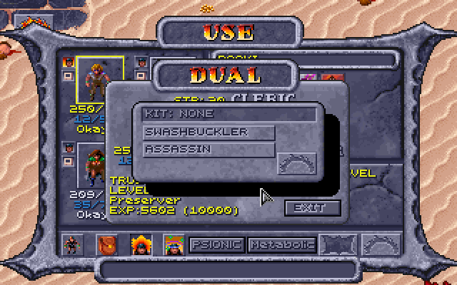

The Effects screen lists the kits, oldest first, a line each (the longer names
shortened as on the KIT page, `(ASLEEP)` after one that sleeps), then the
weapon specs. Its lower panel has room for five lines: when there are more,
it shows four and **MORE: CLICK HERE** under them, and a click on the panel
shows the next page (a weapon spec's heading again at the top of a page that
goes on with its weapons), the first again after the last:

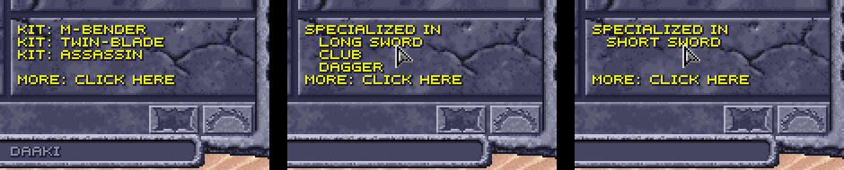

With **Weapon specialization** ticked, a human who becomes a fighter,
gladiator or ranger (or a Battle Mage) then picks the weapon types it is due
on the same window as at a level up (**PICK A WEAPON SPECIALTY**), less any it
has already.

#### Preservers' first spells

A human who becomes a preserver picks its first two spells on the game's
**CHOOSE A SPELL** window, twice over, from the 1st-level ones (the game gave
it Grease and Magic Missile), as a preserver picks one at each level up. If
it takes the **Scholar** kit for its new preserver class, it picks a third,
as a Scholar picks one more at each level up.

A new preserver picks its starting spells the same way when **DONE** is
clicked on the creation screen, in place of the ones the game handed out by
its starting level: two 1st-level spells at 1st level (the game's Grease and
Magic Missile), four at 2nd (and Shield and Wall of Fog), four and two of 2nd
level at 3rd (and Fog Cloud and Mirror Image). A Scholar picks one more for
each level. A multiclass preserver too. (The game's own party, used when no
party is made, keeps the game's spells.)

**EXIT** on CHOOSE A SPELL (then EXIT again at "YOU HAVEN'T CHOSEN") ends the
picking, at creation and on changing class: the spells still to pick are the
game's own, in its order (Grease, Magic Missile, Shield, Wall of Fog; then Fog
Cloud, Mirror Image), less any already picked. The character is already saved
when the window opens, so EXIT can't take you back to the creation screen.

#### Kits that rule out classes and each other

Some kits keep a human from some classes, both ways: greyed on the DUAL
window for a human who has the kit (as the game greys the classes it already
bars), and left off the KIT menu for a human who has had the class:

| Kit | Can't dual to | Why |
|---|---|---|
| Seeker, Justifier | cleric, druid | their own priest slot tables would take the new class's slots' place |
| Shinobi | preserver | its own wizard slot table would take the new class's slots' place |
| Swashbuckler, Crusader, Battle Mage, Mind Warrior | fighter, gladiator, ranger | a warrior's THAC0 is already their kit's |
| Arena Champion, Sentinel | druid, preserver | their gift needs a shield, which those classes can't hold |
| Brute | psionicist, air cleric | it needs a two-handed melee weapon, which those classes can't use |
| Stalker | thief | its +15 to hiding would add to a thief's own skills |
| Grove Warden | gladiator | its AC would add to a gladiator's own, which betters with level too |

And some kits can't go together, whichever came first (a human has one kit for
each of its classes, and the game never lets a human change from one warrior
class to another, so only these can meet):

| Kit | Can't go with | Why |
|---|---|---|
| Arena Champion, Sentinel | Shinobi | one needs a shield, the other forbids it |
| Twin-blade | Healer | two weapons, and an off hand free of them |
| Brute | Shinobi, Lifebinder | a two-handed weapon, and weapons that can't be one |
| Ravager | Grove Warden | each has an AC of its own that betters with level: one on top of the other would stack |
| Swashbuckler, Crusader, Battle Mage, Mind Warrior | each other | each gives a warrior's THAC0: two would be one wasted |

### Levels up to 10

The game stops every class at level 9 (its manual's tables end there too).
With **Class levels go up to 10** ticked, each class goes one level further,
at the XP AD&D gives for 10th level:

| Class | XP for 10th level |
|---|---|
| Cleric | 450,000 |
| Druid | 125,000 |
| Fighter | 500,000 |
| Gladiator | 600,000 (500,000 with AD&D's class tables off) |
| Preserver | 250,000 |
| Psionicist | 400,000 |
| Ranger | 600,000 |
| Thief | 160,000 |

Everything else at 10th level is the game's own: it had it all along, and
only the cap kept it out of reach. Its XP tables go on to level 20 (druids
with a table of their own, not the cleric's), and THAC0, saves, spell slots
and thief skills are worked out from the level. So at 10th level:

- **Hit points** follow AD&D past 9th: preservers and thieves still roll (d4
  and d6, CON's bonus counting too), while the others gain a fixed amount (+3
  for fighters, gladiators and rangers, +2 for clerics, druids and
  psionicists). The game's own table has the fixed gain for thieves too, as it
  keeps thieves and psionicists together and AD&D's psionicist stops rolling
  at 9th; with the rule thieves roll their 10th die.
- **Gladiators** optimise their armour, as the game already has them do: AC 1
  better for every 5 gladiator levels, so −2 at 10th where it was −1. (The
  Loader counts it in **AC: spells, rings, other**. The game gives it with or
  without armour.)
- **THAC0 and saves** improve as the game's formulas give: 11 for a
  gladiator, 14 for a druid, as for AD&D's warriors and priests.
- **Spell slots** grow at the levels casters already have, up to 5th; no class
  gets 6th-level slots (a cleric would at 11, a preserver at 12), so no spells
  past 5th level are needed. A 10th-level preserver or druid has 5 4 3 2 2
  before WIS by the game's table; with
  [AD&D's class tables](#adds-class-tables), 4 4 3 2 2 and 4 4 3 3 2.
- **A preserver picks a new spell** on the game's own CHOOSE A SPELL screen,
  as at every level, offered from spell level (class level + 1) / 2 down:
  5th at 10th as at 9th. **A psionicist picks a new power** (the game gives
  one at each level, two at odd levels and 4th).
- Spell damage that grows with the caster's level already counts up to level
  10 in the game, so a 10th-level caster gets the last step.

The level-up comes as the game's usual one ("Gerakis gains a level"), and
View Character stops showing the XP for the next level at 10, as it does at
9 without the rule. For a character of more than one class, a class already
at 10 isn't named in the brackets, since it has no next level. Untick it and
nobody goes past the level they have: a 10th-level character stays 10th.

How it works: [DEVELOPMENT.md](DEVELOPMENT.md#levels-up-to-10).

### STORE and RECALL on the creation screen

The creation screen has two more buttons under the hit points, as Baldur's
Gate has them: **STORE** keeps the roll on screen, and **RECALL** brings it
back, however many times the die has been rolled since. A roll is the six
scores and what the die's total allows (the `SUM:` line), the hit points and
the PSP. So a good roll can be stored and the die tried again; if nothing
better comes, RECALL puts the stored one back, AC and damage with it.


Changing the race, sex, classes or kit forgets the stored roll (its hit
points were rolled for those), even if they are changed back: RECALL then
does nothing until STORE keeps another. STORE again keeps the new roll in
place of the old. Unticked, the screen is as the game has it, from the next
time the game is started.

How it works: [DEVELOPMENT.md](DEVELOPMENT.md#store-and-recall).

### Fuller starting gear

With **Fuller starting gear** ticked, the Loader adds plain gear to a new
character's own while it is still New, after the class restrictions, weapon
specs and kits have changed theirs, and the dice log lists it
(`Swat starts with more gear: Short Sword (in hand), Arm Armor, Leg Armor`):

- **A weapon in hand.** A character with an empty right hand takes a weapon
  it can use from its backpack (a cleric's club), else gets a plain one: of
  its weapon spec, else a short sword, club, mace, dagger or quarterstaff (a
  cleric the club and mace first), in a material it can use. So a
  thief/psionicist, whose long sword the class restrictions take, gets a bone
  short sword, a fire cleric an obsidian mace, and an air cleric an obsidian
  dagger.
- **A missile weapon.** A sling in the missile slot for one with no bow or
  sling; an earth or fire cleric, who can't use one, an obsidian chatkcha in
  the backpack (a water cleric neither).
- **Leather armour** in its empty chest, arm and leg places, where it may wear
  it: a thief, gladiator, ranger, psionicist, cleric or Battle Mage goes out
  in a full suit.
- **A cloak** for a Stalker, an Assassin or a Shinobi (with [kits](#kits) on),
  to hide in ([Improved thieving](#improved-thieving)).
- **A thri-kreen gets nothing more** than the game's own starting gear: its
  claws serve it better than another weapon, and it wears no armour or
  cloak.
- **A multiclass preserver's armour** is left out, with the class
  restrictions on: it can't cast in armour.

Nothing is given that the character can't use or already has something of
the kind, so each item comes once. The [game's own party](#the-games-own-party)
gets it too, in the first moments of a new game. Unticked, a new character
starts with the game's gear, changed only by the rules above.

How it works: [DEVELOPMENT.md](DEVELOPMENT.md#fuller-starting-gear).

### The game's own party

START GAME with no party made plays the game's own four, who were made before
any of these choices existed. With weapon specialization, kits, class
restrictions and fuller starting gear on, the Loader fits them to those in the
first moments of a new game, and says so in the dice log (Cilla also gets the
elf's figure, with its own switch: see
[Elves and half-elves](#elves-and-half-elves)):

| Character | With weapon specialization | With class restrictions | With kits |
|---|---|---|---|
| **Gerakis**, half-giant gladiator | specializes in the long sword and the gythka; with [half-giants' two-handed weapons](#half-giants-two-handed-weapons), his club is a bone gythka, a two-handed weapon beside his long sword | | **Wild Fighting**, as the [Wild Fury](#multiclass-kits)'s: as each fight starts, a d20 against CON − 4; at that or under, 1 more attack a round in melee and +3 damage for the fight; over it, −3 to hit and AC 3 worse |
| **K'ratchek**, thri-kreen fighter, druid and psionicist | specializes in the chatkcha, her only weapon | | casts as a [Wasteland Seer](#multiclass-kits) (druid spells 2 levels higher under the open sky, 1 lower under a roof); her **chatkcha comes back as if she had several**: one more throw a round (2 instead of 1, or more with its weapon spec) |
| **Cermak**, human preserver, once a gladiator | specializes in the long sword and the axe, which count once his gladiator levels do again (when his preserver level passes them) | | an **Arcanist**, the kit of his preserver class: a spell slot more at each spell level and two preserver spells a turn in a fight |
| **Cilla**, elf preserver, druid and thief | | no leather armour (a druid wears none), and she knows the **Armor** spell in its place | an **Elven Wanderer**: with the [stealth rule](#hiding-in-shadows-to-backstab), her hiding in shadows is never halved in daylight |

Gerakis's, K'ratchek's and Cilla's features are their own: no character made
on the creation screen can have them. The Effects screen lists them (as it
does kits), and the Characters tab beside the kit. Cermak's gear stays as it
is (an Arcanist has none of its own), and so do the hit points the game gave
him: the Arcanist's d3 counts from his next level.

With [fuller starting gear](#fuller-starting-gear), they get what a new
character would, after the changes above: Gerakis a sling and leather chest
and leg armour; Cermak and Cilla nothing more. K'ratchek, a thri-kreen, fights
with her claws and the game's own chatkcha, and gets nothing more either.

Cermak and Cilla keep the game's own starting spells: only a character made
on the creation screen [picks its own](#preservers-first-spells).


How it works: [DEVELOPMENT.md](DEVELOPMENT.md#the-games-own-party).

## Expanded features

New things to do in play, each with a box in the Options tab's **Expanded
features** section. All are on by default and, like the rule changes, take
effect at once in games started with the dice log; untick one and the game is
as it was.

| Box on the Options tab | What it adds |
|---|---|
| [The leader's CHA at shops](#the-leaders-cha-at-shops) | the party leader's CHA 18 or more lowers what shops ask, 5% to 40% at 25; shops pay 60% |
| [Buying back magical items](#buying-back-magical-items) | a magical item sold stays in the merchant's stock, to buy back |
| [Thief skills from AD&D's table](#thief-skills-from-adds-table) | AD&D's table by level, with Dark Sun's race and DEX adjustments |
| [Hiding in shadows to backstab](#hiding-in-shadows-to-backstab) | thieves hide and move silently to backstab, rangers to attack from behind; a worn cloak, boots and belt help |
| [Picking pockets](#picking-pockets) | a thief's Pick Pockets button, then anyone in sight, until caught |

### The leader's CHA at shops

The game's shops ask an item's price whoever buys. With **The leader's CHA at
shops** ticked, the party leader's CHA lowers it, 5% from CHA 18 and 5% more
for each point after, to 40% at 25 (the highest a CHA can be):

| Leader's CHA | 17 or less | 18 | 19 | 20 | 21 | 22 | 23 | 24 | 25 |
|---|---|---|---|---|---|---|---|---|---|
| Discount | none | 5% | 10% | 15% | 20% | 25% | 30% | 35% | 40% |

The price shown under each item, the one charged, and whether the shop's list
greys an item as too dear all follow it (never below 1). Shops pay **60%** of
an item's price for what the party sells (rounded down, never below 1): the
most the CHA discount takes off is 40%, so nothing can be bought and sold back
at a profit, and at CHA 25 a round trip comes out even. The game pays all of
it, which with the discount would let anything be sold at a profit.

How it works: [DEVELOPMENT.md](DEVELOPMENT.md#the-leaders-cha-at-shops).

### Buying back magical items

The game destroys whatever the party sells. With **Merchants keep magical
items sold to them** ticked, a magical item sold (one with a plus, or a power:
a ring, a wand, a scroll...) goes into the merchant's pack instead, and the
shop offers it for sale at its price, less the leader's CHA discount, so it
can be bought back. Anything else sold is gone, as in the game. With the CHA
rule's selling at 60%, buying an item back costs more than it was sold for, or
the same at CHA 25.

How it works: [DEVELOPMENT.md](DEVELOPMENT.md#buying-back-magical-items).

### Improved thieving

More for thieves to do: skills that grow by the Player's Handbook's table,
hiding in shadows and moving silently to backstab (rangers too, to attack from
behind), a cloak, boots and belt that help, and pockets to pick. The switches
are together under **Improved thieving** in the Options tab's Expanded
features section.

#### Thief skills from AD&D's table

The game's thief skills come out high: a 3rd-level elf thief with DEX 22 has
move silently 66 and hide in shadows 61. AD&D gives 27 and 20 at 3rd level
before race and DEX. The game adds 4 a level to a base of its own, and its DEX
formula gives move silently and hide in shadows less than Dark Sun's table at
high DEX, and some other skills more. With **Thief skills from AD&D's table**
ticked, a skill is:

- AD&D's average for the thief level (the Player's Handbook's table, up to
  10th level),
- plus the race's adjustment, the game's own (already the Dark Sun rules'
  numbers),
- plus DEX's: AD&D's table up to 19, the Dark Sun rules' exceptional DEX
  past it, for the first five skills (hear noise, climb walls and read
  languages have none).

AD&D's averages, by thief level:

| Thief level | 1 | 2 | 3 | 4 | 5 | 6 | 7 | 8 | 9 | 10 |
|---|---|---|---|---|---|---|---|---|---|---|
| Pick pockets | 30 | 35 | 40 | 45 | 50 | 55 | 60 | 65 | 70 | 80 |
| Open locks | 25 | 29 | 33 | 37 | 42 | 47 | 52 | 57 | 62 | 67 |
| Find/remove traps | 20 | 25 | 30 | 35 | 40 | 45 | 50 | 55 | 60 | 65 |
| Move silently | 15 | 21 | 27 | 33 | 40 | 47 | 55 | 62 | 70 | 78 |
| Hide in shadows | 10 | 15 | 20 | 25 | 31 | 37 | 43 | 49 | 56 | 63 |
| Hear noise | 10 | 10 | 15 | 15 | 20 | 20 | 25 | 25 | 30 | 30 |
| Climb walls | 85 | 86 | 87 | 88 | 90 | 92 | 94 | 96 | 98 | 99 |
| Read languages | 0 | 0 | 0 | 20 | 25 | 30 | 35 | 40 | 45 | 50 |

The race adjustments, as the game has them (humans, half-giants and
thri-kreen have none):

| Race | Pick pockets | Open locks | Find/remove traps | Move silently | Hide in shadows | Hear noise | Climb walls | Read languages |
|---|---|---|---|---|---|---|---|---|
| Dwarf | 0 | +10 | +15 | 0 | 0 | 0 | −10 | −5 |
| Elf | +5 | −5 | 0 | +5 | +10 | +5 | 0 | 0 |
| Half-elf | +10 | 0 | 0 | 0 | +5 | 0 | 0 | 0 |
| Halfling | +5 | +5 | +5 | +10 | +15 | +5 | −15 | −5 |
| Mul | 0 | −5 | 0 | +5 | 0 | 0 | +5 | −5 |

The DEX adjustments:

| DEX | Pick pockets | Open locks | Find/remove traps | Move silently | Hide in shadows |
|---|---|---|---|---|---|
| 9 | −15 | −10 | −10 | −20 | −10 |
| 10 | −10 | −5 | −10 | −15 | −5 |
| 11 | −5 | 0 | −5 | −10 | 0 |
| 12 | 0 | 0 | 0 | −5 | 0 |
| 13-15 | 0 | 0 | 0 | 0 | 0 |
| 16 | 0 | +5 | 0 | 0 | 0 |
| 17 | +5 | +10 | 0 | +5 | +5 |
| 18 | +10 | +15 | +5 | +10 | +10 |
| 19 | +15 | +20 | +10 | +15 | +15 |
| 20 | +20 | +25 | +12 | +20 | +17 |
| 21 | +25 | +27 | +15 | +25 | +20 |
| 22 | +27 | +30 | +17 | +30 | +22 |

then the situation and effects as before. So Azil, a 3rd-level elf thief with
DEX 22: pick pockets 40 + 5 + 27 = 72, open locks 58, find traps 47, move
silently 62, hide in shadows 52, hear noise 20, climb walls 87. A ranger's
move silently and hide in shadows take the same race and DEX adjustments.
Untick it for the game's numbers.

How it works: [DEVELOPMENT.md](DEVELOPMENT.md#thief-skills-from-adds-table).

#### Hiding in shadows to backstab

The game never rolls hide in shadows, and a thief only backstabs a target that
has turned to face someone else. With **Thieves hide in shadows and move
silently to backstab, rangers to attack from behind** ticked, a thief whose
turn comes in a fight with no enemy in any of the eight squares around them
tries to hide in shadows; if they do, they try to move silently up to someone;
and if both succeed, their next attack that turn counts as one from behind: +2
to hit, the target's DEX and shield don't count, and with a weapon that can
backstab it is a backstab, the damage multiplied as usual. The attack gives
the thief away, and so does the turn ending without one. An enemy next to the
thief when the turn comes means no hiding at all: get clear first (a
[Shadowblade](#multiclass-kits) tries anyway). A
[Military Scout](#multiclass-kits) never backstabs: its hiding gives an attack
from behind.

```
Tezral's turn
Tezral hides in shadows: d100 = 21, needs 27 or less (54, halved in daylight) -> hidden
  Tezral moves silently: d100 = 30, needs 54 or less -> unheard: their next attack this turn is from behind (a backstab with a weapon that can)
Tezral attacks Slig BACKSTAB with Bone Long Sword (1d8): d20 = 11, needs 10+ (55%), hits AC 2, target AC 3 -> HIT
    THAC0 19, +2 from behind, +2 backstab, +3 STR, -1 bone = 13
  Tezral hits Slig for 16: (1d8 = [1] -1 weapon (raised to the minimum of 1) +7 STR 19) x2 backstab
```

The chance to hide is **halved in daylight** (with [kits](#kits) on, not for
an Assassin, a Military Scout or Cilla, the Elven Wanderer). Which maps are
under the open sky goes by the game's regions: open desert and rock, the villages' open
ground and the arena are; the slave pens, the sewers, the lava caverns and
the other underground or roofed places aren't. Three maps have both, buildings
with floors of their own standing on open ground: there it goes by the floor
under the thief (from the game's map of the region in memory), so a thief in
a building is out of the sun and one in a roofless ruin isn't. The chances
are the thief's own as they stand (level, race, DEX, and effects:
Invisibility makes hiding certain, Fire Shield and Mirror Image rule it out).

**Rangers** hide and move silently too, with the same box ticked. The game
gives rangers no thief skills, so the Loader uses AD&D's ranger table, by
ranger level, with the race's and DEX's adjustments as for a thief:

| Ranger level | 1 | 2 | 3 | 4 | 5 | 6 | 7 | 8 | 9 | 10 |
|---|---|---|---|---|---|---|---|---|---|---|
| Hide in shadows | 10 | 15 | 20 | 25 | 31 | 37 | 43 | 49 | 56 | 63 |
| Move silently | 15 | 21 | 27 | 33 | 40 | 47 | 55 | 62 | 70 | 78 |

The light works the other way round for these outdoorsmen: the **full chance
under the open sky, half indoors** (the same maps and floors as for thieves).
Their attack from behind gets +2 to hit, and the target's DEX and shield don't
count, but it is never a backstab. Armour doesn't matter, nor does what they
hold. The Characters tab shows a ranger's two chances (**Ranger skills now**),
and the game's inventory screen shows them where a thief's `MOVE` and `HIDE`
go. Someone with thief levels hides as a thief.

```
Semyon hides in shadows: d100 = 15, needs 63 or less (63, a ranger under the open sky) -> hidden
  Semyon moves silently: d100 = 42, needs 78 or less -> unheard: their next attack this turn is from behind
Semyon attacks Slig from behind with Wooden Club (1d6): d20 = 12, needs 10+ (55%), hits AC 1, target AC 3 -> HIT
```

**Cloaks, boots and belts.** With the box under this one ticked, a worn cloak
adds 10 to hiding in shadows (before daylight halves it) and worn boots add 10
to moving silently, for rangers too, up to 95:
`needs 18 or less (26 +10 cloak = 36, halved in daylight)`. A cloak's or
boots' item box (right-click it on the inventory screen) says so under its
name, `Hide +10` or `Move +10` (the skills' short names, as the
inventory screen's thief rows have them).


The [Cloak and Boots of Elvenkind](#new-items) do more (whatever the plain
gear's switch). Only thieves and rangers can wear them (multiclasses too; for
anyone else, the game's "Cannot use this item"). In the cloak, hiding in
shadows needs 95 or less under the open sky and 90 under a roof, not halved by
the light (AD&D's: all but invisible in the wild, 90% among buildings), unless
their own chance is better; in the boots, moving silently needs 95 or less.
Their boxes say `Hide 90-95%` and `Move 95%`.


The same switch has a worn **belt** add 5 to a thief's **picking pockets and
opening locks**, whether hiding is on or not: the game's own lock picking
counts it, and so do the Loader's pockets and its thief rows (`PICK 80`,
`LOCK 64`). A belt's box says `Pick +5, Lock +5`.

Plain cloaks, boots and belts cost 24 (the game's Leather Cloak is 20), anywhere
in the region, shops included; magic ones (with a plus, or dearer than 100)
keep their prices.

How it works: [DEVELOPMENT.md](DEVELOPMENT.md#hiding-in-shadows-to-backstab).

#### Picking pockets

The game has one pocket to pick, in the Trustee's conversation (his key). With
**Picking pockets** ticked, a thief can try anyone's. On the **USE** screen, a
character with thief levels has a **Pick Pockets** button (a purse) where a
priest's Turn Undead is, under the spell counts. A cleric/thief has both
outside fights, Turn Undead and the purse beside it; in a fight, Turn Undead
alone.

Press it: the screen closes and the pointer is the one for talking. Click
someone in sight, and the thief who pressed it (party leader or not) tries
their pocket instead of talking to them. On the map, a right click that
changes the pointer puts the try away. (Right-clicked on the USE screen, the
purse says what it does, as a spell does.) A thief whose backpack is full
can't try ("Daaki's backpack is full."): nothing is rolled, and it doesn't
count as a try. Not in a fight: there's no time for it then, and the button
isn't there.

(Earlier versions had a thief use **Thieves' Tools** for this, from Mirlon or
Kel. No one has them now; a set already in a game keeps its name and does
nothing.)

The Loader rolls the thief's pick pockets chance as it stands now (effects and
a worn belt's 5 counted, as in the thief rows):

- **Success:** one small thing goes into the thief's backpack (its first free
  cell): something weighing 10 or less (a bag or arrows are 10, a helm 15, a
  long sword 30) that isn't worn on the body (armour, a belt, boots, a helm, a
  cloak). A dagger, a ring, an amulet, a gem or food can be lifted, and so can
  three weapons whatever their weight: Kurzak's Shadowseeker, Churrr's
  Gutterknot and Maris's Mindshard (see [New items](#new-items)). Lifting one is
  worth 200 XP to the thief, given as the game gives a quest's ("Cilla
  receives 200 experience points!", with the quest's sound; split among a
  multiclass thief's classes). Keys stay, as scripts may look for them.
  People outside the party keep all they own in their pack, so this goes by
  what each thing is.
- **Failure:** a move silently roll. Made, the thief slips away unnoticed;
  missed, they're caught.

With nothing like that left on them, the thief takes what's in their purse
instead: ceramic pieces, 2 to 5 for each of the thief's levels (a 4th-level
thief takes 8 to 20), added to the party's money. That is the last try on that
person.

A thief can go on trying the same person until **caught** (both rolls failed)
or until they take the coins; after that, that person keeps a hand on their
pockets for good. The Loader remembers who in `settings.json`, for this party,
with the time on the game's clock: load a game saved before the try and the
clock goes back past it, so the try is forgotten and the person can be tried
again. The Trustee is left to his own conversation. What happens comes up in
the game's message window and in the dice log:

```
Daaki picks Kurzak's pocket: d100 = 71, needs 63 or less -> failed
  Daaki moves silently to get away: d100 = 12, needs 55 or less -> success
  Daaki fumbles Kurzak's pockets, but slips away unnoticed.
```

**The Trustee's own key.** Picked in his talk by a thief with no room for it,
the game drops it at his feet, and after each step of his rounds he went back
for it ("There it is!") without picking it up: his rounds stalled, and he
stayed busy ("I'd love to talk more... get back to work") for good. The
Loader's copy of his scripts leaves the key where it lies, for the party to
pick up, and has him say the busy line once and walk on (see
[The game's bugs, fixed](#the-games-bugs-fixed) for the other way his rounds
stalled).

How it works: [DEVELOPMENT.md](DEVELOPMENT.md#picking-pockets).

## New content

*Spoilers: this section says where the new items and people are, and what
they say. [The player's guide](PLAYER-GUIDE.md) has the rules without them.*

Spells, people, a quest and items the Loader adds to the game, each with a box
in the Options tab's **New content** section: the people, the quest and the
items from the next time the game is started, the spells and the defilers'
scrolls at once in games started with the dice log.

### New wizard spells

Six wizard spells from AD&D's *Spells & Magic*, the *Player's Handbook* and
the Dark Sun books, added to the game's own 69 (numbers 196-201). Preservers
learn them as they learn any spell: picked at a level up or as starting
spells, or from a scroll. They're listed on the USE screen by level with their
own icons and descriptions (right-click one), use the usual slots, and show on
the Effects screen while they last. Who knows them is kept in the character's
sheet, so it saves with the game and the character.

| Spell | Level | Cast on | Lasts | Does |
|---|---|---|---|---|
| **Cat's Grace** | 2 | a party member (its portrait on the USE screen) | 60 rounds a caster level | DEX + 1d6 (at most 24), as Strength does for STR |
| **Erdlu Claw** | 1 | a party member (its portrait on the USE screen) | 5 rounds a caster level | each natural (unarmed) attack does 1d6+1 where that's better than its own, is +1 to hit, counts as a +1 magical weapon, and cuts (edged, not crushing) |
| **Fogbolt** | 1 | one creature in sight | 2d4 rounds (a save negates) | −3 to its attacks, and +2 to attacks on it (its AC 2 worse) |
| **Reflected Image** | 1 | the caster | until the image is struck or dispelled | one image of the caster: a hit, or a foe's spell for one creature, has a 50% chance of striking the image instead, which vanishes |
| **Spook** | 1 | one creature in sight | 3 rounds (a save negates) | the creature panics and flees (Afraid); its save is 1 worse for every 2 caster levels (at most −6); undead aren't affected, and magic resistance applies |
| **Friends** | 1 | the caster | 1d4 rounds and 1 a caster level | CHA + 2d4 (at most 25): lower shop prices |

- **Cat's Grace** is made to work exactly as the game's Strength does, for
  DEX. Everything that reads DEX follows it while it lasts: AC, initiative,
  REAC and DEF, thief skills, the two-weapon penalties and the saves against
  fire, cold and electricity. The log says what it rolled:
  `Cat's Grace: 1d6 = 4 -> Gerakis's DEX +4 while it lasts (at most 24)`.
- **Erdlu Claw** grows talons like an erdlu's. A character with a weapon in
  hand is unchanged; one fighting unarmed hits for 1d6+1 instead. A
  thri-kreen's four claws and bite become 1d6+1 each (a natural attack already
  better on average, as 2d4 or 1d8+2, stays as it is). The +1 to hit shows in
  the log's THAC0 breakdown (`+1 Erdlu Claw`), and as a +1 weapon the talons
  hurt creatures that only magical weapons can. They cut: edged, where the
  game makes every unarmed attack crushing, so a creature crushing weapons
  can't hurt (a mastyrial) is hurt by them. A thri-kreen in the party fights
  with edged claws the same way, with or without the spell. With **Body Weaponry** or
  **Animal Affinity** up, the power's dice for the first attack get the claw's
  +1: 2d4+1 or 1d10+1.
- **Fogbolt** wraps one creature in clinging fog. It flies to its target as
  a dark grey bolt, Magic Missile's in smoky greys (Magic Missile keeps its
  own blue); like any bolt it needs a clear line to the target. Its THAC0
  breakdowns show `-3 Fogbolt` on its own attacks and `+2 target's Fogbolt` on
  attacks against it. Its icon is a grey cloud.
- **Reflected Image** is a smaller Mirror Image: one image, struck by a hit or
  a foe's spell instead of the caster half the time (Mirror Image's are three
  quarters of the time).
  The two don't add up: casting either one replaces the other, and casting
  Reflected Image again only gives the one image back. Dispel Magic ends it.
  Its icon is a hand mirror with one figure in it, on the Effects screen too,
  where it is named REFLECTED IMAGE (as in the Look box and under the
  portrait).
- **Spook** frightens one creature into running for 3 rounds. The log's save
  line shows the penalty:
  `d20 = 9 -1 Spook, the caster's levels = 8, needs 16 -> failed`.
- **Friends** makes the caster charming for a short while, as AD&D's spell
  does: CHA + 2d4, the dice log showing the roll
  (`Friends: 2d4 = [4 + 3] = 7 -> Xan's CHA +7 while it lasts (at most 25)`).
  Shop prices follow the party leader's CHA, so a leader who casts it before
  trading buys and sells better (see
  [the leader's CHA at shops](#the-leaders-cha-at-shops)). A second casting
  replaces the first rather than adding to it; a CHA of 25 or more already is
  left as it is.

A Shinobi can learn Reflected Image, Spook and Friends, as well as Fogbolt.

Each has sounds of its own: Cat's Grace lands with Haste's shimmer, Erdlu Claw
with Shocking Grasp's snap, and Fogbolt is cast and lands with Fog Cloud's.

With the **New wizard spells** box unticked the spells are gone from the lists
and the game is as it was.


How it works: [DEVELOPMENT.md](DEVELOPMENT.md#new-wizard-spells).

### New items

Items the game never had, or never placed. All but the arena's ring (which the
Loader hands over itself, while it runs) are written into the game's own data
each time the Loader starts the game, so the game makes them with their people
and chests and then keeps and saves them like its own. A changed switch takes
effect in regions the party hasn't visited yet; start a new game to have them
all. The log doesn't say where they are: they're there to be found.

**New items, magical and mundane** on the Options tab places them all, the
arena's ring too. A thief can
[lift](#picking-pockets) Pehtucl's ring, Shadowseeker, Gutterknot and
Mindshard (200 XP for each weapon).

**Where they are.** The Loader's items are in the [item tables](#item-tables) with the
game's own: in ***bold italics*** in [Every magic item](#every-magic-item), each with where it is and
what it does, and marked **new** in [Every mundane weapon](#every-mundane-weapon). The game
has no short sword at all, no bone or obsidian axe or great axe, no bone dagger, few plain
metal weapons and no magic club, pick or staff sling. Two more, armour:

| Icon | Item | Where | What it is |
|---|---|---|---|
|    | **Bone Scale Arm Armor**, **Leg Armor** and **Bone Helm** | in the slave pens' chest with the Bone Scale Chest Armor and Arrows +3 (the game has the set but places only the chest piece) | the set; the helm AC 1 with [Helms give AC 1](#helms), worn by those who can wear the armour (not thieves) |
|  | **Helm** | in **Kurzak**'s pack, in the slave pens | the game's leather helm |

The bone and obsidian weapons are also new characters' starting weapons with
[weapon specialization](#weapon-specialization), each in a material the
character can use.

**Prices** follow the game's own (a price can't go past 65,535; the game's
dearest, the Wand of Missiles, is 65,000):

| Items | Price |
|---|---|
| Magic melee weapons | 20,800 a plus (41,600 for a +2; a +1 with a spell 22,000) |
| Windlash | 2,800 (as the game's Sling +1) |
| Plain metal weapons | 50 to 300 |
| Bracers of defense | 5,000 a point of AC |
| Rings and Cloak of Protection | 15,000 |
| Inixhide; the Ashen Robe | 6,000 |
| Veiled Robe | 40,000 |
| Cloak and Boots of Elvenkind | 25,000 and 20,000 |
| Warden's Arms and Legs; Chest; Helm | 27,000 each; 36,000; 30,000 |
| Arrowbane; Sunking Crown | 30,000; 40,000 |
| Gutterward; Ironbulwark | 25,000; 65,000 (the game's Drake Shield +1 is 25,400, El's Shield +2 50,200) |
| Tome of Understanding | 43,500 (AD&D's) |


**The Warden's Plate** is plate mail +1 in four pieces: the chest 4 better
than no armour (its AC 3, +1), the arms and legs 3 each (AC 2, +1), the helm 2
(a helm's AC 1 with [helms giving AC 1](#helms), +1): 12 better as a set, so a
wearer with no other help goes from AC 10 to AC −2. (With that rule off the
helm gives only its +1: 11 better, AC −1.) The game adds up its pieces' AC
this way for all armour, so a full set does better than AD&D's plate mail +1
(one suit, AC 2: 8 better). It is metal armour, worn by the classes that can
wear the game's chain (no single-class thieves), and kept from more with
[class restrictions](#class-restrictions). **Grey's Scale**'s arm and leg
armour is AC 3 each (the game's is 2).


**Icons and names.** Each has an icon of its own (in the item tables), made
from the plain item's the way the game makes its magic items' (a few pixels in
the colours it cycles like fire); dropped on the map they look like the plain
item. The game's names are at most 15 letters, so the rings are
**RING/PROTECTION** and the cloak **Cloak/Protectn**; the Loader's screens and
the log give them in full. As with its own items, the game puts the material
first: **Leather Inixhide**, **Metal +1 Shadowseeker** in the item box.


**Alagorn**, the wizard of the Painted Badlands who identifies magic items,
tells the story of every magic item in the table but the plain Gythka +2 when
the party carries it, in the menu the game would put it in (swords, weapons,
rings, armor, shields, clothes or other items), before "Nothing". As with the
game's own, one story for each kind: the four pairs of bracers share one, and
so do both rings of protection. The Warden's Plate's pieces each tell a part
of Haldren's, the last of the Wardens.

How it works: [DEVELOPMENT.md](DEVELOPMENT.md#new-items).

#### Bracers of defense

A preserver can't cast in armour (with [class restrictions](#class-restrictions)),
so the Loader adds AD&D's bracers of defense ([where](#new-items)). They are
worn on the arms, in the arm armour's place, and give the AC their name says:
AC 6 is 4 better than no armour, AC 2 is 8 better. As in AD&D they give nothing
while armour is worn: on the arms, legs or chest, or a helm (bone, leather or
metal, magical or not). A shield, rings and cloaks of protection, and the
Loader's circlet and crown (worn on the head, but not armour) go with them.
They aren't armour to anything else: a preserver casts in them, a thief wears
them, and a ring or cloak of protection still counts. In the game they are
**BRACERS/DEFENSE** with their plus (Bracers/Defense +4 is AC 6), priced 5,000
a point of AC.

How it works: [DEVELOPMENT.md](DEVELOPMENT.md#bracers-of-defense).

#### Robes

Two magic robes for those who go without armour: preservers, psionicists and
druids alone may wear them. A robe is worn on the chest, in the chest armour's
place; like the bracers its plus betters AC only while no armour is worn on
the arms, legs or head, and it isn't armour to anything else: a preserver
casts in it, and a ring or cloak of protection still counts. Bracers go with
it.

| Icon | Robe | What it does | Where |
|---|---|---|---|
|  | **Ashen Robe** (+1) | AC 1 better; +1 on saves against wizards' and priests' spells | worn by [Kalzith](#kalzith), who sells it with his scrolls, and left with his body if he's killed (6,000) |
|  | **Veiled Robe** (+2), a robe of the Veiled Alliance | AC 2 better; +1 on every save; a wizard spell slot more at spell levels 1, 2 and 3 where the wearer has any | sold by **Kel** (40,000) |

The dice log and the Loader name a robe among a save's modifiers, and the
Spells tab counts the Veiled Robe's slots. Alagorn tells both their stories.

How it works: [DEVELOPMENT.md](DEVELOPMENT.md#robes).

### New people

Two people of the slave pens, in new games: those that reach the pens with the
Loader's copies of the game's files in use (a save keeps the pens as they were
when the party first went in).

#### Kalzith

A new person in the slave pens: **Kalzith**, a defiler slave the templars put
in the arena now and then (the crowd loves to watch a defiler burn), kept in a
pen of his own in the middle column the rest of the time. He has the arena
Defiler's figure and a face of his own: the game's portrait 61 with a slave's
brand on the brow, so the Dialogue tab never mistakes him for anyone else.


Talk to him as to anyone (click him with the look pointer, then the Look box's
Talk button). His conversation is the game's kind, just him speaking:

- **With respect** ("We mean no harm. We're slaves too."), he owns up to
  scribing spells on scraps of hide at night, to bribe a guard, and offers
  them: **Show us what you have** opens the game's shop screen, with his six
  scrolls, one of each, and what he wears (below):

  | Level | Scroll | Price |
  |---|---|---|
  | 1 | Shield, Burning Hands | 3,000 ceramic each |
  | 2 | Blur, Cat's Grace | 6,000 each |
  | 3 | Lightning Bolt, Haste | 9,000 each |

  None of them is a spell the game has a scroll of, so they're something you
  can't find elsewhere. The prices are the game's own for the spell's level
  (3,000 a level, as most of its scrolls are), less with
  [the leader's CHA](#the-leaders-cha-at-shops).

  Cat's Grace is there only with the new spells on (see
  [New wizard spells](#new-wizard-spells)). A preserver learns a scroll's
  spell as from any of the game's (right-click it in the inventory, click its
  spell), by the game's own rules (a spell of a level the preserver can cast),
  and with [Preservers' INT](#preservers-int) on it rolls to learn it. He
  remembers a friend ("Back again? Keep your voice down."). As with the game's
  own people, a question goes from his list once asked, until the next time
  you talk to him; the shop stays.
- **During the escape**, with the alarm sounding (the game's own alarm, which
  the pens' other slaves also answer to), he has only a line for the party,
  by how he stands with them, and no talk: to a friend, "That's the alarm. So
  it's you breaking out. Go, and go quickly: if they find you at my cell, I
  burn with you."
- **Calling him a defiler**, he answers back; take it back and he's friendly,
  or **threaten to tell the templars** and he won't speak to the party again
  until they make amends: **50 ceramic** (offered only to a party that has
  it), or a plea that he wins over with a **Charisma check** (the character
  talking rolls it).

He wears an Ashen Robe and a Cloak and carries a Quarterstaff (the game's
own), and sells them too: the game's shops sell everything a merchant carries,
worn or not. Once the party has bought it all, he has nothing more to sell.
Killed, he leaves whatever of these he still has and one of the scrolls he
still had, chosen at random, in his body, and the log says which scroll.
Attacked, he turns on the party as the pens' other slaves do, and only the
guards near him join the fight. If he dies, Dinos and the Trustee speak of him
as dead; after the party's escape he is gone from the pens with everyone else.


How it works: [DEVELOPMENT.md](DEVELOPMENT.md#kalzith).

#### Semyon

Untie the arena's prisoner and he is **Semyon**, a slave the templars tied up
in the sun for asking after the Veiled Alliance, "much more of a scout than a
warrior", as he says. He meets the party again in the arena's bone area, takes
them for the Alliance ("You must really be from the Veiled Alliance! I thought
they were a myth!") and asks to join. Made a member ("You, too, are now a
member of the Alliance.") and asked to help, he fights beside them in the next
fight and, if he survives it, leaves: "That's enough for me. I'm leaving. I'll
go find more members for the Alliance." (Some of his replies in the bone area
send him off before that: "That's enough for me. I'll see you in the holding
pens.", "Right, see you there!", or, still weak, "Why don't I meet you in the
holding pen?") Each way, he walks out through the arena's entrance to the
pens, where a script takes him off the map, and nothing in the pens brings him
back.

With the Loader, if he left after the fight he helped in, he is there, in a pen
of his own above Kalzith's, the first time the party is in the pens after it.
His other ways out stay as in the game, and so does a Semyon who was killed: he
isn't in the pens. Talk to him (Look, then Talk): he says why the templars tied
him up in the arena (he was asking about the Veiled Alliance), passes on what he
has heard (who carries keys), reminds the party where he hid his gem (the grain
pots), and talks about the Alliance's plans, in his own voice from the arena.
As with the game's own people, each question goes from the list once asked,
and comes back the next time you talk to him.

Attacked in his pen, he turns on the party as the pens' other slaves do.

**Breaking out with Scar.** A rare way through the arena: recruit Semyon just
before the fight with Scar, take up Scar's offer to break out together, and
head for the west exit. In the game, when the alarm goes up ("Gladiators
escaping! Guards! Sound the alarms!"), Scar and his henchmen come along to the
slave pens and Semyon is left behind. With the Loader, if he is still in the
arena, alive and on the party's side, he comes too: he stands beside Scar's
men in the pens and fights the guards with them, on the party's side. Talked
to then, he says: "Scar's gladiators and the Veiled Alliance, side by side!
Who would have believed it? Stay close to Scar: he knows the way out, and I'm
right behind you." He isn't made one of the pens' slaves while the escape
lasts, and once the party is out through the grate, he is gone with everyone
else.


How it works: [DEVELOPMENT.md](DEVELOPMENT.md#semyon).

#### What Dinos and the Trustee say about them

Dinos ("Who else is in here?") and the Trustee ("Who else is in the
slavepens?") each answer questions about the others in the pens. With the
Loader their menus also ask about Kalzith, and about Semyon once he is in his
pen ("What do you know about Kalzith?", "What can you tell me about
Semyon?"). Kalzith's question waits until the Loader has found him in the pens
(the game's test for whether someone is there only knows the game's own
people); Semyon's once he has been in his pen. As with the game's own
questions, each is shown only until it's answered in that talk.


If either has been killed, they speak of him as they do of the game's dead:
the Trustee asks "What was Kalzith like?" (or Semyon) instead, with an answer
of its own, and Dinos keeps the question and answers it differently.


After the party's escape, when the game empties the pens ("They killed
everybody except for myself", the Trustee says on the torture rack), Kalzith
and Semyon are taken off the map too, the way the game takes the others, and
Semyon is never put in his pen after it.

How it works:
[DEVELOPMENT.md](DEVELOPMENT.md#what-dinos-and-the-trustee-say-about-them).

### The cooked vulture

Hit the arena's vulture and its feathers come off (a plucked vulture); the
slave pens' campfire cooks it. In the game itself the cooked vulture is then
no use to anyone: no script asks for it. With the Loader running, **Dinos**,
the pens' fine cook, can be asked about it: talk to him while someone in the
party carries it, and among the first things the party can say to him, just
before "Goodbye.", is **"We cooked the vulture from the arena."** He takes it
("A vulture! Give it here. A pinch of salt, some agafari leaf, slow over the
coals... Sit down and eat with me. A meal like this puts the strength back in
you."), and the game's own window for a quest's reward follows, as for any of
its quests: "Each party member receives 100 experience points!", with the
sound the game plays when a quest is done (as for the Trustee's key or the
filled water jug). Each party member gets **100 XP** (split between a
multiclass character's classes, as the game splits all its XP) and is
**restored as after a full rest**: HP, PSP and spell slots full, and anyone
knocked out back on their feet. No time passes. The question is gone once the
vulture is. (Eaten by the party on their own, used on one of them from the
inventory, it's too tough to be worth the chewing.)


How it works: [DEVELOPMENT.md](DEVELOPMENT.md#the-cooked-vulture).

### Defilers' scrolls

A defiler may carry a spell scroll it was studying: with **Defilers' scrolls**
ticked, each defiler in a fight has a 5% chance (1 in 20) of carrying a scroll
of a random preserver spell, any of the game's 69 (1st to 5th level) or, with
the new spells on, the Loader's new ones. When it dies the scroll is on its
body, with the rest of what it carried.

The defilers are those the game makes defilers: Balkazar, Wyrmias, Tara, the
Troop Leader, the arena's Defiler (who dies in the opening fight), the Dark
Spiders and the Spider Mother, the Hermit, and the thri-kreen Click-tunk!,
Churr-te-tunk! and Cheee-smak-tunk!, on either side of the fight. No one else
carries one. Kalzith keeps his own scrolls.

The scroll is the game's own kind: a preserver learns from it as from any
scroll (right-click it, then click its spell's icon), and it sells for 3,000
ceramic pieces a spell level. The dice log doesn't show the roll, so whether a
defiler had a scroll is found out on its body.

Each defiler is rolled for once in each fight. A fight played again from a save
is a new chance; a game saved mid-fight keeps the scroll a defiler was given.

How it works: [DEVELOPMENT.md](DEVELOPMENT.md#defilers-scrolls).

## Item tables

Every magic item and every mundane weapon in a game with the
[new items](#new-items), the game's and the Loader's, with their icons.

### Every magic item

All the magic items in a game with the Loader's new content on: the game's own,
read from its data (each item type's slot and material, each item's plus and
power, and who carries it), and the Loader's, in ***bold italics***. In **Where**, "—"
means the item isn't placed with anyone in the data: the game's scripts hand it
out (a reward, a gift or a find).

**Weapons**, by material, then type:

| Icon | Material | Type | Item | Bonus / power | Where |
|---|---|---|---|---|---|
| 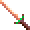 | Bone | long sword | Swiftbite | +2 | — |
| 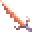 | Bone | long sword | Draketooth | +1, strength | — |
| 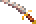 | Bone | long sword | Hornblade | +1 | Kalinin's reward |
| 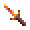 | Bone | short sword | ***Stillwater*** | a bone short sword +1: a **psionicist** can wield it, alone or with a water cleric | in the chest **Chaya** gives as her apology |
| 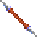 | Bone | gythka | Gythka +3 | +3 | — |
| 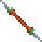 | Bone | gythka | ***Gythka +2*** | the game's Gythka +1, made +2 | the **Elven Leader**'s gift, after the fight with his men |
|  | Bone | gythka | ***Kreenfang*** | a gythka +1 (2d4+1) | the 2 handed Bone Gythka on the dead body by the arena's stone arch |
|  | Bone | axe | ***Drakejaw*** | a bone axe +1 (1d8+1): a water cleric can wield it | carried by one of the **Magera** guarding the wagon's prisoners |
| 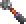 | Bone | mace | Mace +2 | +2 | a chest |
| 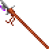 | Bone | polearm | Polearm +1 | +1 | — |
|  | Bone | polearm | ***Thornwall*** | a bone polearm +1 | on the slave pens' **weapon rack**, in place of one of its two plain bone polearms |
|  | Bone | cahulaks | Cahulaks +1 | +1, Cause Light Wounds | the caravan's buried chest |
| 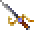 | Metal | long sword | Dragonsbane | +4 | — |
|  | Metal | long sword | El's Drinker | +2, Vampiric Touch | — |
|  | Metal | short sword | ***Greenbright*** | a metal short sword +2 | carried by **Arant**, who holds the captured gladiators |
| 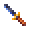 | Metal | short sword | ***Shadowseeker*** | a short sword +1 (1d6+1): whoever wields it, in either hand, sees the invisible | in the pack of **Kurzak**, the pens' guard leader |
|  | Metal | dagger | Dag's Dagger | +3, extra damage | Dagolar |
| 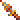 | Metal | dagger | ***Galefang*** | a metal dagger +2 an **air cleric** can wield | carried by the **Rogue Shaman**, with his Shaman Followers |
|  | Metal | axe | Soulcrusher | +1 | Kel |
|  | Metal | axe | Axe +1 | +1 | — |
|  | Metal | great axe | ***Headsman*** | a metal great axe +2 | in the arena **Announcer**'s stash, with his Stoneskin scroll, rings and gems |
| 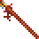 | Metal | polearm | ***Linebreaker*** | a metal polearm +2 | carried by the **Troop Leader** |
| 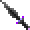 | Obsidian | long sword | Dark Flame | +2, Burning Hands | the Lower Castle's chest |
| 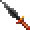 | Obsidian | long sword | Bloodwrath | +1 | Pehtucl, the pens' templar |
|  | Obsidian | long sword | ***Flame Blade*** | an obsidian long sword +1 (1d8+1) whose blade burns what it hits: the fire clerics' Focus Heat, 2d6 fire damage to the creature hit (a save for half), as the game's Dark Flame casts Burning Hands. Obsidian, so a fire (or earth) cleric can wield it | in the pack of the **Templar** of the Hot Springs (the one with the Drake Shield) |
| 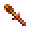 | Obsidian | short sword | ***Mindshard*** | an obsidian short sword +1: a **psionicist** can wield it, alone or with a fire or earth cleric | carried by **Maris**; a thief can lift it (200 XP) |
| 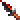 | Obsidian | dagger | Terror Blade | +2, poison | — |
| 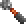 | Obsidian | mace | Blackmace | +1, Shocking Grasp | the Shadow King |
|  | Obsidian | axe | ***Glasshewer*** | an obsidian axe +2 (1d8+2): a fire or earth cleric can wield it | carried by the **Templar** of the elven slavers' camp (the one with the Chain Arm Armor) |
| 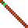 | Wooden | quarterstaff | Quarterstaff +2 | +2 | Maris |
| 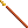 | Wooden | quarterstaff | Balk's Staff | +1, Slow | Balkazar |
|  | Wooden | quarterstaff | Parting Staff | +1 | — |
|  | Wooden | club | ***Gutterknot*** | a club +1 (the game has no magic club) | carried by **Churrr** in the warrens; a thief can lift it (200 XP) |
|  | Stone | pick | ***Deepbiter*** | a stone pick +1 (the game has no magic pick) | carried by one of the **Undermountain folk** (the miners) |
|  | none | great axe | Great Axe +3 | +3 | the Army Commander |

**Missile weapons and ammunition:**

| Icon | Material | Type | Item | Bonus / power | Where |
|---|---|---|---|---|---|
|  | Wooden | bow | Bow +2 | +2 | a chest |
| 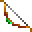 | Wooden | bow | Phrain's Bow | +1, Acid Arrow | — |
|  | Leather | sling | Sling +2 | +2 | Chaya and her apology chest; a chest |
|  | Leather | sling | Sling +1 | +1 | a chest |
|  | Leather | staff sling | ***Windlash*** | a staff sling +1 (the game has no magic staff sling) | sold by the **Bowyer** |
|  | Obsidian | chatkcha | Chatkcha +1 | +1, Produce Fire | the Guardian |
| 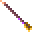 | Wooden | arrows | Arrows +3, +2, +1 | | chests; Kel and the Elven Leader (+1) |

**By weapon spec**, for [weapon specialization](#weapon-specialization):

| Weapon spec | Magic weapons |
|---|---|
| Long sword | Dragonsbane +4, Swiftbite +2, El's Drinker +2, Dark Flame +2, Draketooth +1, Hornblade +1, Bloodwrath +1, ***Flame Blade*** +1 |
| Short sword | ***Greenbright*** +2, ***Shadowseeker*** +1, ***Mindshard*** +1, ***Stillwater*** +1 |
| Dagger | Dag's Dagger +3, Terror Blade +2, ***Galefang*** +2 |
| Axe | ***Glasshewer*** +2, ***Drakejaw*** +1, Soulcrusher +1, Axe +1 |
| Great axe | Great Axe +3, ***Headsman*** +2 |
| Gythka | Gythka +3, ***Gythka +2***, ***Kreenfang*** +1 |
| Polearm | ***Linebreaker*** +2, Polearm +1, ***Thornwall*** +1 |
| Mace | Mace +2, Blackmace +1 |
| Quarterstaff | Quarterstaff +2, Balk's Staff +1, Parting Staff +1 |
| Sling | Sling +2, Sling +1 |
| Club, pick, cahulaks | ***Gutterknot*** +1, ***Deepbiter*** +1, Cahulaks +1 |
| Bow, staff sling, chatkcha | Bow +2, Phrain's Bow +1, ***Windlash*** +1, Chatkcha +1 |

**Body armour:**

| Icon | Material | Item | Bonus / power | Where |
|---|---|---|---|---|
|  | Leather | Shimmer Armor | +3, Free Action | Dakaren |
|  | Leather | Drake Armor | +1, Resist Cold | the Wyvern Master |
|  | Leather | ***Inixhide*** | Leather Chest Armor +1: the leather's AC, +1 | worn by **Legcrusher**, the pens' half-giant |
|  | Metal | ***Warden's Chest*** | plate chest armour +1 (AC 3, +1): Resist Fire on its wearer while worn | on **Balkazar**'s body |
|  | none | Silk Armor | +2 | — |

**Arm and leg armour:**

| Icon | Slot | Material | Item | Bonus | Where |
|---|---|---|---|---|---|
|  | Arms | Metal | Tanelyv's Armor | chain +2 | — |
|  | Arms | Metal | ***Warden's Arms*** | plate arm armour +1 (AC 2, +1) | the Lower Castle's treasure chest, with Dark Flame (behind the wall the Serpent Boots show, where the vrock perch) |
|  | Arms | Metal | Grey's Scale | no plus (AC 3 with the Loader) | Arant |
|  | Legs | Metal | Tanelyv's Armor | chain +2 | — |
|  | Legs | Metal | ***Warden's Legs*** | plate leg armour +1 (AC 2, +1) | the Gemfields' chest |
|  | Legs | Metal | Grey's Scale | no plus (AC 3 with the Loader) | Arant |

Tanelyv's Armor also has a chest piece, with no plus.

**Head:**

| Icon | Material | Item | Power | Where |
|---|---|---|---|---|
|  | Leather | Helm of Might | strength | — |
|  | Leather | Leather helm +1 | | a chest |
|  | Metal | Helm of Contemplation | a shield of thought against psionic attacks | the Warren Chief |
|  | Metal | ***Warden's Helm*** | the game's metal helm +1: Cloak of Bravery on its wearer while worn | on **Dagolar**'s body (the one carrying Dag's Dagger) |
|  | none (not armour) | ***Arrowbane*** | a silver circlet: Protection from Normal Missiles on its wearer while worn (normal arrows, sling stones and chatkchas can't hurt them); worn on the head, not armour | sold by **Kel** |
|  | none (not armour) | ***Sunking Crown*** | a gold crown: Protection from Evil on its wearer while worn; worn on the head, not armour | worn by **Keldar**, the templar of Dagolar's tunnels |

**Shields and gloves** (worn in a hand, in this game):

| Icon | Material | Item | Bonus / power | Where |
|---|---|---|---|---|
|  | Leather | El's Shield | +2 | — |
|  | Leather | Drake Shield | +1, Resist Fire | the Hot Springs' Templar |
|  | Wooden | ***Gutterward*** | the game's wooden shield +1: AC 2 better in a hand | on a **skeleton** in the Tari's warrens (the sewers): one of the three there |
|  | Metal | ***Ironbulwark*** | a metal shield +3, the game's first: AC 4 better in a hand | carried by the **Guardian** of Balkazar's fortress (the one with the Chatkcha +1) |
| 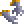 | Leather | Chameleon Gloves | blind whoever they touch | Mikquetzl |
|  | none | Quicksilver Gauntlets | graft a one-handed weapon to the hand | — |

**Other worn items:**

| Icon | Slot | Item | Power | Where |
|---|---|---|---|---|
| 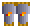 | Arms | ***Bracers of Defense*** | AC for those wearing no armour: [bracers of defense](#bracers-of-defense) | **Mikquetzl** (AC 6, in his pack), **Wyrmias** (AC 5), **Balkazar** (AC 4), **Dagolar** (AC 2, the one carrying Dag's Dagger) |
|  | Chest | ***Ashen Robe*** | +1 AC; +1 on saves against spells | Kalzith ([Robes](#robes)) |
|  | Chest | ***Veiled Robe*** | +2 AC; +1 on every save; a wizard slot more at spell levels 1-3 | sold by Kel ([Robes](#robes)) |
|  | Waist | Belt of Might | strength | — |
|  | Feet | Serpent Boots | Displacement | a chest |
|  | Feet | ***Boots of Elvenkind*** | soft boots: [silent](#hiding-in-shadows-to-backstab), with hiding to backstab on; thieves and rangers only | the buried chest of Kel's caravan, with the Cahulaks +1 |
| 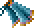 | Cloak | Living Cloak | Inertial Barrier | Dagolar |
| 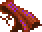 | Cloak | ***Cloak of Protection +1*** | +1 AC and +1 on every saving throw, from the cloak slot | worn by Pehtucl |
|  | Cloak | ***Cloak of Elvenkind*** | a grey cloak: [all but invisible](#hiding-in-shadows-to-backstab) in a fight, with hiding to backstab on; thieves and rangers only | the **Elven Leader**'s gift with his Gythka +2, after the fight with his men: "And take this cloak, woven by my own tribe for our best runners..." (left on the ground by him when it can't be carried, as the Gythka is) |
|  | Neck | Silver Necklace | Biofeedback | — |
|  | Neck | Obsidian Necklace | Disintegrate | the Troop Leader |
|  | Neck | Iron Necklace | Fireball | the Hermit |
|  | Neck | Golden Torque | takes on its maker's morals | — |
|  | Finger | Light of Dawn | Dismissal | on the ground, in Balkazar's region |
|  | Finger | Ring of Steadfastness | Constitution | — |
|  | Finger | Ring of Insight | Wisdom | — |
|  | Finger | El's Ring | Dexterity | on the ground |
|  | Finger | Storm Ring | Ice Storm | a chest |
|  | Finger | Wind Ring | Protection from Normal Missiles | the Wyvern Master |
|   | Finger | ***Ring of Protection +1*** (two) | +1 AC and +1 on every saving throw | one on the arena's Tied-up Prisoner: free him, then look at his body (the game's script says there's nothing; the Loader finds a ring sewn into his loincloth, 50 XP to whoever searched); the other worn by **Pehtucl**, the slave pens' head templar (in the south-west corner, with the Obsidian Bloodwrath) |

**Held, or used from the pack:**

| Icon | Item | Power | Where |
|---|---|---|---|
|  | Orb of Knowledge (held) | watch the one it's tuned to | — |
|  | Dagolar's Wand | Control Body | Dagolar |
|  | Wand of Missiles | Magic Missile | a chest |
|  | Derth's Wand | Lightning Bolt | — |
|  | Wildwynd Wand | Confusion | — |
| 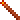 | Llod's Rod | travel between the obelisks | the Visionary |
|  | ***Tome of Understanding*** | read as a scroll is (right-click it in the inventory, click its icon): the one whose pack it is in gains a point of WIS for good (at most 25), and the tome is gone. Not in a fight, as no scroll can be read in one | **Father Garyn**'s gift, in Teaquetzl, when the party brings him the ranike pith from Notaku |
|  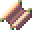  | Magic fruit (14 kinds), spell scrolls (18), psionic scrolls (11), ***Kalzith's six scrolls*** | used once | many places; Kalzith's in [his shop](#kalzith), spells the game has no scroll of |

### Every mundane weapon

Every plain weapon in a game with the new items, the game's and the Loader's,
by type and material: who sells it and who carries it (by the names the game
gives them; many are of a kind, such as every Renegade or Tari). The **Weapon
Merchant** and the **Bowyer** are in Teaquetzl, **Jark** and **Kel** in Kel's
caravan. The game's plain stone pick is only ever a
[starting weapon](#weapon-specialization); Deepbiter is its magic one.

| Icon | Type | Material | Sold by | Carried by, or found in | The Loader's |
|---|---|---|---|---|---|
| 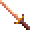 | long sword | bone | Jark, Weapon Merchant | Ranger, Templar, Chaero, Castle Guard, Arant's Guard, Warrior, Dagolar Guard, Caravan Guard, Guard, Lt. Kwerin, Slaver Guard, Messenger, Visitor, Renegade, Silt Runner |  |
| 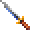 | long sword | metal | Weapon Merchant | Uskuye, Elven Leader, Elite Guard, Village Hero, a chest in the warrens |  |
| 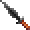 | long sword | obsidian | Jark, Weapon Merchant | Wyvern Master, Arant, Keldar, Kurzak, Guard, Chaya, Uskuye, Scar, Arena Guard, Caravan Master, Chahl, Mayor of Gedron, Merzol, Drajian Guard, Council Member, Templar |  |
|  | club | wood | Weapon Merchant | Warren Chief, Churrr, Tari, Skull Guardian, Worshipper, Low Warren Thug, Gladiator, Wild Mul, Guard, Legcrusher, a dead body in the arena, a chest, a weapon rack |  |
| 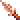 | dagger | bone | Jark, Weapon Merchant | Defiler | **new**: 1d4: the only dagger a water cleric can use; a water cleric's starting dagger |
| 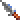 | dagger | metal | — | Tobrian | **new**: the game's dagger, in metal |
| 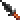 | dagger | obsidian | — | Defiler, Notaku |  |
|  | dagger | stone | Jark, Weapon Merchant | Balkazar, Dagolar, Wyrmias, Hermit, Tobrian, Villager, Linara, Maris, a chest in Dagolar's tunnels |  |
| 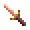 | short sword | bone | Jark, Weapon Merchant | Renegade | **new**: 1d6 |
| 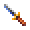 | short sword | metal | Weapon Merchant | — | **new**: 1d6: Shadowseeker without the plus |
| 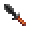 | short sword | obsidian | Jark, Weapon Merchant | Chaero | **new**: 1d6 |
| 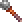 | mace | bone | Jark, Weapon Merchant | Wyvern Master, Krikor, Templar, a chest, a chest in Dagolar's tunnels |  |
|  | mace | metal | — | Templar | **new**: the game's mace, in metal |
|  | mace | obsidian | Jark, Weapon Merchant | Tari | **new**: the game's Mace (1d6+1), in obsidian (its only obsidian mace is Blackmace) |
|  | axe | bone | Jark, Weapon Merchant | Wild Mul | **new**: 1d8; weighs 30, so not HEAVY: it goes in either hand with another weapon, and [backstabs](HOW-THE-GAME-WORKS.md#attacks-from-behind-and-backstabs) |
|  | axe | metal | — | Slaver Guard, Uzoma, a weapon rack in the Lower Castle, a weapon rack, a weapon rack in the slave pens |  |
|  | axe | obsidian | Weapon Merchant | Merzol | **new**: 1d8; 30, as the bone axe |
|  | great axe | bone | Jark, Weapon Merchant | Wild Mul | **new**: 1d10, two-handed; lighter than metal (and breaks as bone does); a warrior's starting great axe |
|  | great axe | metal | Weapon Merchant | — | **new**: the game's great axe, in metal |
|  | great axe | obsidian | Jark, Weapon Merchant | — | **new**: 1d10, two-handed; a fire or earth cleric's starting great axe |
|  | pick | metal | Weapon Merchant | — | **new**: the game's pick, in metal |
|  | quarterstaff | wood | Jark, Weapon Merchant | Mikquetzl, Troop Leader, Dakaren, Dagolar, Wyrmias, Hermit, Father Garyn, Notaku, a weapon rack in the Lower Castle, a skeleton in the Undermountain, a chest, a weapon rack in the slave pens |  |
|  | polearm | bone | Weapon Merchant | a weapon rack in the Lower Castle, a weapon rack in the slave pens |  |
|  | polearm | metal | — | Castle Guard | **new**: the game's polearm, in metal; an earth cleric's starting polearm |
|  | gythka | bone | Jark, Weapon Merchant | Guardian |  |
|  | cahulaks | bone | Weapon Merchant | — |  |
|  | chatkcha | obsidian | Jark, Bowyer | — |  |
|  | bow | wood | Jark, Kel, Bowyer | Wyvern Master, Ranger, Arant, Castle Guard, Guard, Arant's Guard, Arena Guard, Caravan Guard, Slaver Guard, Elven Leader, Uzoma, Drajian Guard, Army Commander, Elite Guard, Village Hero, a chest in the Upper Castle, a chest, a chest in Dagolar's tunnels |  |
|  | sling | leather | Bowyer | Mehtar, Renegade, Silt Runner, a chest in the slave pens, a bag in the slave pens |  |
|  | staff sling | leather | Jark, Bowyer | — |  |

## Graphics

What the Loader draws on the game's map. The elves' and half-elves' looks,
the party's gear, shadows and dust each have a switch in the Options tab's
**Graphics** section.

### Elves and half-elves

Elves have pointed ears, walking and fighting, beside any helm. Half-elves have
their own look (the game draws them with the human pictures), made from the
game's pictures in colours the party's figures already use. A half-elf man is
built like the elf man, a little broader, with fair hair cut short at the nape,
a linen shirt under a leather jerkin, green trousers, brown boots and small
pointed ears. A half-elf woman is a little slimmer than the human woman, with
golden hair up in a bun, pointed ears, a purple cloak, purple wristbands and
red boots. Anything worn is drawn over these in its own colours, so a worn
cloak or boots replace the purple and the red.

With **Elves have pointed ears, and half-elves figures of their own**
unticked, elves are as the game draws them, and half-elves are the human
figures in their own colours. It counts from the next time the game is
started.

Cilla, in the game's own party, is an elf, but the game gives her the figure
it gives half-elf women. With **Cilla, an elf in the game's own party, drawn
as an elf** ticked, the Loader gives her the elf woman's, in a new game and in
one already begun (there from the next area or load on), whatever the switch
above. Unticked, she keeps the game's half-elf woman's figure, from the next
time the game is started (a game where she already has the elf's keeps it).


How it works: [DEVELOPMENT.md](DEVELOPMENT.md#elves-and-half-elves).

### What the party wears

The party's figures on the map and in fights show what each one wears, and
change as soon as their gear does (switch it off on the Options tab to see the
game's own). The game draws each race and sex the same whatever they carry;
the Loader keeps the artist's pictures and adds to them, frame by frame,
walking and fighting:

| Worn | Shown |
|---|---|
| **Weapons and shields** | each weapon type its shape (dagger, sword, club, mace, axe, polearm, gythka, staff, a round shield), in its material's colours (wood, bone in ivory, stone, obsidian, metal; Kreenfang's two blades in the fire colours and Shadowseeker's in night steel, as their icons); walking, a one-handed weapon is worn at the belt, hanging down and back like a scabbard, two-handed ones are carried upright, and a shield is on the arm (from the side, on the far arm held forward of the chest, so it shows past the body); in a fight they are in the hands and swung, and the shield is on the other forearm in every pose (placed by hand for each model where the arm is hidden or flung) |
| **Bows and slings** | the bow and quiver on the back (the game draws the bow when shooting), a sling or chatkcha at the hip |
| **Armour** | the character's own clothing recoloured toward its material, shade for shade (leather, bone, chain, plate, scale...): the chest piece above the waist, arm pieces at the wrists, leg pieces below the waist; on figures the artist drew mostly bare (the mul, the dwarf man) only their straps and loincloth change, so it shows little |
| **Helms** | a circlet at the brow blended into the hair: a feather on leather, a dark stone on iron, low spikes on bone |
| **Cloaks** | the cloak the game draws on the human woman (its folds and swing as she walks and fights), fitted to the wearer, under the hair, in the cloak's colours; a half-elf woman's own purple cloak takes the worn one's colours |
| **Boots and belts** | the feet and the waist recoloured |

The colours are muted ones no region's palette changes. A thri-kreen shows
only weapons and shields (all it can use). Two party members of the same race
and sex each show their own equipment: the game gives them one figure, so the
second is moved to pictures of their own.


How it works: [DEVELOPMENT.md](DEVELOPMENT.md#what-the-party-wears).

### Shadows

Every living figure on the map (the party, the people, the monsters; not the
dead, nor items) casts a soft see-through shadow on the floor, its outline laid
long toward the lower right, the way the walls' own shadows fall (the light on
the game's maps comes from the upper left). The shadows are drawn on the floor
before anything else, so every figure and wall stands on top of them: a shadow
never covers another figure. Switch them off on the Options tab.


How it works: [DEVELOPMENT.md](DEVELOPMENT.md#shadows).

### Dust

Anyone walking on sand or dirt raises little puffs of dust behind their feet,
which spread, rise a little and fade in about a second. The walls and figures
stand in front of them, as with the shadows. Switch it off on the Options tab.


How it works: [DEVELOPMENT.md](DEVELOPMENT.md#dust).

## Controls

Each is switched on the Options tab's **Controls** group.

### Choosing an enemy: Tab, Enter and the rings

In a fight, a red ring on the ground can mark the enemies, under their feet (the
figures stand in it, as on their shadows). On a party member's turn, **Tab**
chooses an enemy, the nearest first, then the next nearest (**Shift+Tab** goes
back): its ring is drawn thicker and redder, the view scrolls to it if it is
out of sight, and the log names it. **Enter** then attacks it, as clicking on
it does (walking up to it first when it is out of reach), even where another
figure stands in front of it. On the Options tab the rings are **none**, **only
under the enemy chosen with Tab** (the default: none until Tab is pressed) or
**under all the enemies** (the chosen one's thicker and redder); Tab and Enter
have a switch of their own.


Tab and Enter also make attacking possible without aiming the mouse at all.

How it works:
[DEVELOPMENT.md](DEVELOPMENT.md#choosing-an-enemy-tab-enter-and-the-rings).

### Scrolling the map

Press the mouse wheel on the map and move the mouse: the map moves with the
pointer, as if dragged, in fights too. On the Options tab it can be switched
off, or holding the right button made to drag the map as well (a right click,
let go before the pointer has moved, still changes the pointer between walking,
using and looking). The game still scrolls on its own when the pointer touches
the screen's edge, and still brings the view back to whoever's turn it is in a
fight.

The view can't be zoomed: the game draws a 320 by 200 screen at one scale,
with the view's size built into its drawing code and its video memory pages.

How it works: [DEVELOPMENT.md](DEVELOPMENT.md#scrolling-the-map).

### The view in fights

The game moved the view after a figure walking in a fight as soon as it came
near the screen's edge, a step at a time, so the view drifted after every
figure that walked, monsters' too. Now it moves only once the figure has
walked off the screen, to bring it back into view (on by default: **In a
fight, the view moves to a figure only when it walks off the screen** on the
Options tab, from the next start). Out of fights the view follows the party
as the game has it.

How it works: [DEVELOPMENT.md](DEVELOPMENT.md#scrolling-the-map) (its part
on the view in a fight).

### Spells on the Effects screen

On the Effects screen (a character's spells and powers in effect), a click on
an effect's icon ends it in the game, so a stray click loses a spell. With the
Loader a click leaves a spell on; a psionic power's effect still ends, as that
is how a power is stopped. It is a change to the game itself (**A click on a
spell's icon on the Effects screen leaves it on**, from the next start).

## The game's bugs, fixed

The patched game mends these whatever the Options tab says (the rules the game
got wrong, each with a switch, are [below](#rules-the-game-got-wrong)):

| | The game | With the Loader |
|---|---|---|
| **Mirror Image** (and Reflected Image) | The images stopped no weapon blow, and took a spell for one creature three times in four whoever cast it: Armor cast on oneself was lost, an image with it | Each hit, and each foe's spell for one creature, strikes an image three times in four (Reflected Image's half the time); your own side's spells always get through ([how long it lasts](HOW-THE-GAME-WORKS.md#spells-and-effects)) |
| **Armor** | A charge used each time any spell or blow landed on the wearer, as well as for the damage: two for each hit, and one for a friend's Bless | One charge for each damaging hit |
| **Share Strength** (any maintained power on someone else) | Ended, it stayed on the one who got it, and could end another of the psionicist's own effects instead | It ends on everyone it was on |
| **Dispel Magic** (the preserver's) | Also laid "No spell use" on everyone it caught, your own party too, which Dispel Magic can't remove | Only dispels, as the cleric's always did |
| **Hold Undead** | Held living creatures too | The undead only; anyone else is immune |
| **Cause Serious and Critical Wounds** | 2d9 and 3d9 (the Cure spells heal AD&D's 2d8+1 and 3d8+3) | 2d8+1 and 3d8+3 |
| **DELETE** in the roster | With the list scrolled, deleted another character | Deletes the one chosen ([more characters](#more-characters)) |
| A **New** character's thief skills | Shown as 0 | Shown as they are ([more characters](#more-characters)) |
| **The Trustee** in the slave pens | His rounds' two pauses took their corner from numbers other scripts in the pens change, so he could set off for a spot that doesn't exist and stay busy ("I'd love to talk more...") for good | The pauses keep a corner of their own, and his busy line starts his rounds again, so one already stuck walks on once talked to |
| The game's **Sling +1** | A blank icon (its picture is missing from the game's data) | The Sling's, with a glow |
| **Thief skills**' equipment penalty | Taken for anything in the hands, quiver or leg slot (a weapon held cost 5 to 10 points), never for the armour worn | None ([how the game works out thief skills](HOW-THE-GAME-WORKS.md#how-the-game-works-out-thief-skills)) |

Cilla's figure (the game gives the elf the half-elf woman's) has a switch:
see [Elves and half-elves](#elves-and-half-elves). How the fixes work:
[DEVELOPMENT.md](DEVELOPMENT.md#the-games-spells).

**Saved games.** There's no need to start a new game for these: they're in
the patched game, not in a save, so they work from the moment a game is
loaded, on effects already running too. What a bug already did stays in the
save: a character who kept Share Strength's strength still has it (load a save
from before the power was used to be rid of it), and one silenced by the
preserver's Dispel Magic casts again once that wears off. A new game is still
the way to see all of the mod: kits, STORE and RECALL and fuller starting gear
come with characters made with it, and much of the
[new content](#new-content) is in the game's first areas.

### Rules the game got wrong

Where the game's own rules contradict its manual or AD&D, or each other, a
[rule change](#rule-changes) puts them right. Each has a switch on the
Options tab, on by default:

| | The game | With the rule |
|---|---|---|
| **Saving throws against spells** | Almost every spell saved against with petrification/polymorph | The spell save ([spell save](#spells-saved-against-with-the-spell-save)) |
| **Fire, cold and electricity** | The save's d20 rolled twice and added up, so most creatures shrugged off a Fireball (70% to save where 35% was due) | One d20, with DEX's defensive adjustment for dodging ([DEX instead of a doubled d20](#fire-cold-and-electricity-dex-instead-of-a-doubled-d20)) |
| **Two weapons** | No penalty (a small bonus at DEX 5 or less), and each hand attacking at the whole rate | −2 main hand, −4 off hand, DEX helping; the off hand attacks once a round ([two weapons](#two-weapons)) |
| **Warriors' attacks** | Every fighter, gladiator and ranger attacking at a specialist's 3/2 a round with any weapon | AD&D's plain rate, the specialist's only with a chosen weapon spec ([weapon specialization](#weapon-specialization)) |
| **Multiclass characters' gear** | Any one class allowing an item was enough | Each class's limits hold ([class restrictions](#class-restrictions)) |
| **Multiclass hit points** | CON's bonus once a level of the highest class | On every hit die, shared between the classes ([multiclass hit points](#multiclass-hit-points)) |
| **Rangers' spells** | Cast at the ranger level less 7 for the spell levels allowed, but lasting and hurting as the whole level | The level less 7 for both ([rangers' casting level](#rangers-casting-level)) |
| **Acid on armour** | Any armour without a magical power destroyed outright, its plus ignored | A save by material, a plus helping ([items saving against acid](#items-saving-against-acid)) |
| **Class tables** | Priests' THAC0 improving a level early (19 at 3rd), fewer priest and preserver spell slots (3 2 1 at 5th), and gladiators, rangers and thieves needing AD&D's XP less a little | AD&D's tables ([AD&D's class tables](#adds-class-tables)) |
| **Thief skills** | A table of the game's own, high from the start (a 3rd-level elf: move silently 66, hide in shadows 61) | AD&D's table by level, with Dark Sun's race and DEX adjustments ([thief skills from AD&D's table](#thief-skills-from-adds-table)) |

## More saves and characters

### More saves

The game's save and load window holds 10 saves. With the Loader it holds 40,
on four pages of ten: the **PAGE 1** to **PAGE 4** buttons under EXIT show a
page, the page shown has its button greyed, and **PgDn** and **PgUp** go to
the next page and the one before. Save and load as always; the window opens
on the page last shown. In the load window, PgDn and PgUp pass by pages with
no saves; a page's button shows it even with none, with **LOAD** greyed (and
Enter doing nothing) until you go to a page with a save. (The game itself
never lets you choose an empty row to load; loading one would start a new
game.)


Page 1 is the game's own saves, `SAVE01.SAV` to `SAVE10.SAV` in the game
folder (or, with GOG's DOSBox, its `cloud_saves` folder); pages 2 to 4 are
`SAVB01.SAV` to `SAVB10.SAV`, `SAVC..` and `SAVD..`, next to them. The game
started without the Loader shows page 1 only, as always: it looks for
`SAVE??.SAV`, and the other pages' names don't match. (It had better not see
them: it puts each save it finds in the row its number names, with room for
ten, and a `SAVE11.SAV` would be written past the end.)

How it works: [DEVELOPMENT.md](DEVELOPMENT.md#more-saves).

#### Saves under their names

Only the game's list says which file is which save. While its window is open,
the Loader keeps a second copy of every save, under the name you typed for it
in the game, in its own **Named saves** folder:
`Page 2 slot 05 - Before Scar's battle.SAV`. Saving over a slot replaces that
slot's copy. The Options tab's **Saves** section has **Open the folder**, and
**Put a save in a slot...**, which copies a named save (or any save file) into
the page and slot you give, asking first if that slot holds one, to be loaded
from the game's list.

### More characters

The game keeps up to 19 characters made with CREATE CHARACTERS (and the party
members dropped back to the roster); a 20th is refused with "Maximum
characters". With the Loader it keeps 29. The roster in the ADD window
scrolls through them all, as it did through 19.

They are in the game's own `CHARSAVE.GFF`, each under a number, 1 to 29. The
game started without the Loader reads numbers 1 to 19 only: characters saved
under 20 to 29 aren't shown, and aren't lost; they come back with the Loader.
(The game saves a new character under the highest free number, so the first
ten made after the 19th go to 20 to 29.)

The patched game also fixes a bug of the game's own: **DELETE** in the
roster deleted the character in the row clicked counting from the top of the
list, not from the top of what was shown. With the list scrolled down,
another character was deleted. Now it deletes the one chosen.

A character made with CREATE CHARACTERS is **New** (with its starting gear,
given when DONE is clicked) until the game starts, when the game makes it
Okay. The game's tests for Okay left New out, so a New thief's skills all
showed 0 on the inventory screen, and the Loader did the same. The patched
game counts New as Okay wherever it tests for Okay, and so does the Loader.
Left as they were: the status under the portrait still reads New, and the game
still makes New characters Okay when the game starts.

How it works: [DEVELOPMENT.md](DEVELOPMENT.md#more-characters).

## Game speed

The game draws the view a frame at a time and shows each at the screen's next
refresh (70 a second), and a walking figure takes a step a frame. A frame that
takes a moment longer than a refresh waits for the next one, so it shows
twice as late, and walking goes at half speed. Everything drawn adds up: four
figures rather than the leader alone (the game's manual says collapsing the
party "speeds up the game"), the gear on them, the shadows, the dust.

The launcher gives DOSBox more of the computer's time: 20,000 cycles a
millisecond by default, where GOG's settings give 7,000. On the Options tab
**Game speed** is GOG's own, that, or 35,000: there, with everything on, the
whole party in view walks as fast as the leader alone, but it needs a faster
computer. It applies the next time the game is started. Both of the Loader's
run on DOSBox's dynamic core (GOG's settings run this game on the slower
normal core): the same cycles do more, and cost the computer about a third
less.

Measured in the slave pens, walking (the leader's speed in pixels a second of
the game's time; higher is smoother):

| | All four in view | The leader alone |
|---|---|---|
| 20,000 cycles, the Loader's shadows, dust, rings and gear off | 248 | 254 |
| 20,000, everything on | 139 | 263 |
| 30,000, everything on | 214 | 264 |
| 35,000, everything on | 258 | 254 |
| 40,000, everything on | 267 | 269 |

So at 20,000 the Loader's own drawing is what slows the whole party: without
it the four walk as fast as one. Of it, the dust costs the most (each puff is
worked out pixel by pixel, and four walkers raise four times as many), then
the shadows. What each setting asks of the computer:
[Suggested system requirements](#suggested-system-requirements).

How it works: [DEVELOPMENT.md](DEVELOPMENT.md#game-speed).

## Accessibility

The Loader aims at the AODA's standard for software people read, WCAG 2.0
level AA:

- **Contrast:** every colour used for text has at least 4.5:1 contrast with
  its background (the game's lighter stone is kept for bevels, not behind
  text). `tests/test_theme.py` checks each pair.
- **Colour is never the only signal:** log lines say `HIT`, `miss`, `saves`
  and so on in words, and changed bytes in the record view are underlined as
  well as highlighted.
- **Text size:** **A+** / **A-** at the top, or **Ctrl +**, **Ctrl -** and
  **Ctrl 0** (back to normal), enlarge or shrink all text up to 2.5 times.
  The Options tab's longer lines wrap to the window rather than run out of it.
- **Keyboard:** Tab and Shift+Tab move between controls, and the one with the
  keyboard focus is outlined in yellow. **Ctrl+Tab** switches tabs, as do
  **Alt+L** (Dice log), **Alt+I** (Dialogue), **Alt+S** (Spells), **Alt+M**
  (Memory tools) and **Alt+O** (Options), and on the party side **Alt+C**
  (Characters) and **Alt+A** (All fields).
- **In the game,** Tab and Enter choose and attack an enemy in a fight with no
  aiming of the mouse (see
  [Choosing an enemy](#choosing-an-enemy-tab-enter-and-the-rings)).
- **The game's font** is only used for the window's title: it's a 9-pixel
  bitmap font, fine enlarged as a heading but harder to read than ordinary
  text, so everything else is in the system's fonts. The combat log in the
  game is in that font, at the game's size; the same lines are in the Dice
  log tab at any text size.
- **Screen readers:** tkinter's windows are not read well by screen readers.
  **Save...** on the Dice log and Dialogue tabs writes the log to a text file,
  and `python -m dsloader dicelog` prints the same log (dialogue included) in
  a command prompt, which screen readers do read.

## Without the game

**Checking a save file:** drag a `SAVEnn.SAV` file from the game folder onto
**`Show Save.bat`**.

**Practising:** `tests/make_fake_party.py` writes `FAKEPTY.COM`, a tiny DOS
program holding two made-up characters in the same record shapes as the game.
The first character loses 1 HP every second. Run it in DOSBox and try the
Loader (search for `SADIRA`).

```
python tests/make_fake_party.py
dosbox FAKEPTY.COM
```


