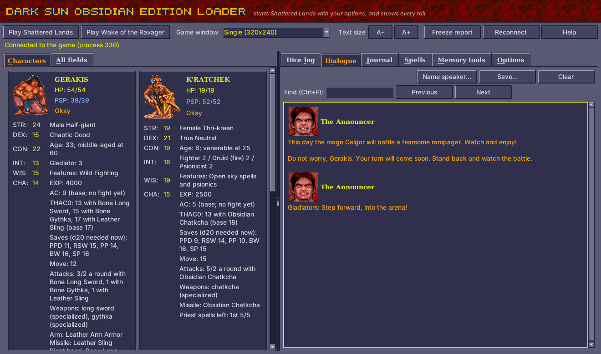
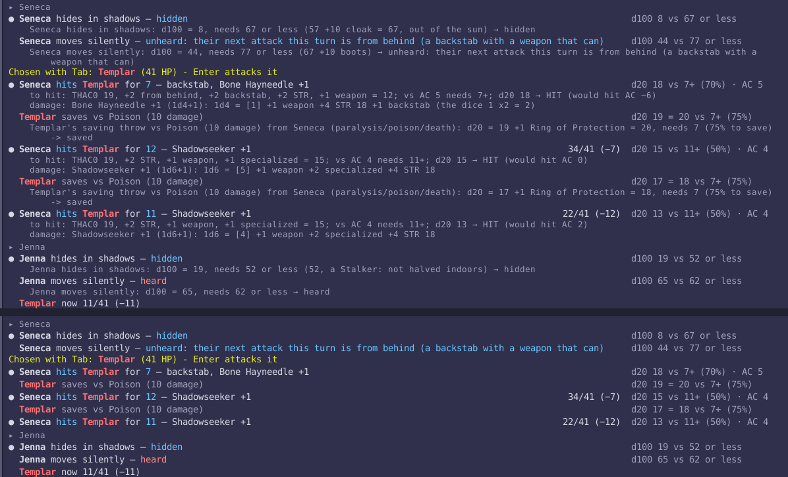

# Obsidian Edition

Obsidian Edition is a mod for **Dark Sun: Shattered Lands** (the GOG release)
in DOSBox. You start the game with the **Dark Sun Obsidian Edition Loader**,
which loads the mod with your options.

**Where to start**

- **To play:** [Running it](#running-it-windows): unzip, double-click
  `Start Obsidian Edition.bat`, press **Start the game**.
- **To learn the rules:** [the player's guide](PLAYER-GUIDE.md), without
  spoilers, with a [glossary](PLAYER-GUIDE.md#glossary) of THAC0, AC, PSP and
  the rest.
- **If something goes wrong:** [When something goes
  wrong](#when-something-goes-wrong).
- **Offline:** these pages are also web pages that link to each other, the
  manual, in the `manual` folder: open `manual/index.html`, or press the
  Loader's **Help** button.
- **Everything in detail:** the contents below, and
  - [features and rules](FEATURES.md): every switch of the Options tab and every change with none,
    one short entry each;
  - [kits](KITS.md): every kit's gains, costs and starting gear;
  - [weapon specs](WEAPON-SPECS.md): weapon specialization, who picks what, and the attacks a round;
  - [items](ITEMS.md) (spoilers): every item and where it is;
  - [creatures](CREATURES.md) (spoilers): every one, its size, and whether cahulaks can tangle it;
  - [people](PEOPLE.md) (spoilers): the mod's new people and scenes in the slave pens and the arena;
  - [the game's bugs, fixed](GAME-BUGS.md) (some spoilers): every bug of the original game the mod mends;
  - [the dice log, line by line](DICE-LOG.md): how to read it, and every kind of line;
  - [how the game works, and the manual's rules](HOW-THE-GAME-WORKS.md), from its code;
  - [the patch notes](https://github.com/daaki85/darksun-obsidian-edition/blob/main/PATCH-NOTES.md):
    what the mod adds and changes from the original game, and its main bug fixes; also in the
    release's folder as a page of the manual, `manual/changes.html`, and beside the zip on the
    Releases page as `patch-notes.html`, with a button that copies them for a forum;
  - for developers, [the development notes](https://github.com/daaki85/darksun-obsidian-edition/blob/main/obsidian-edition/DEVELOPMENT.md).

## Contents

- [What it does](#what-it-does)
- [Requirements](#requirements)
  - [Suggested system requirements](#suggested-system-requirements)
- [Running it (Windows)](#running-it-windows)
  - [One-time setup](#one-time-setup)
  - [Every time you play](#every-time-you-play)
  - [Other ways to start](#other-ways-to-start)
- [Dark Sun Recompiled](#dark-sun-recompiled)
- [The Loader's window](#the-loaders-window)
  - [The Characters tab](#the-characters-tab)
  - [The Spells tab](#the-spells-tab)
  - [The Dialogue tab](#the-dialogue-tab)
  - [The dice log](#the-dice-log)
- [Accessibility](#accessibility)
- [Updating](#updating)
- [Compatibility with older saves](#compatibility-with-older-saves)
- [Uninstalling](#uninstalling)
- [When something goes wrong](#when-something-goes-wrong)
  - [Troubleshooting](#troubleshooting)
  - [Known issues](#known-issues)
  - [Crash, freeze and item reports](#crash-freeze-and-item-reports)
  - [Reporting a problem](#reporting-a-problem)
- [Version, licence and credits](#version-licence-and-credits)

## What it does

Eight families of changes. Most are always on; the new content and a few others have a switch on the
Loader's **Options** tab ([each switch, its default and when it counts](PLAYER-GUIDE.md#the-options-tab-at-a-glance));
[Features and rules](FEATURES.md) has every one in full.

- **Shows what the game keeps hidden.** Every roll as it happens, with what it
  needed and where each bonus came from ([the dice log](#the-dice-log)); a
  combat log over the map, names over figures and the Look box ([In the
  game](FEATURES.md#in-the-game)); THAC0, saves, thief skills, spell slots and
  charges on the game's own screens ([Always on](FEATURES.md#always-on)).
- **Brings the rules closer to AD&D.** Over twenty rule changes for
  characters, weapons and armour, and magic, from class restrictions and levels
  past 9th to creature size and spell saves, all always on but three with a
  switch (hit dice, half-giants' weapons, helms) ([Rule changes](FEATURES.md#rule-changes);
  in play, [the player's guide](PLAYER-GUIDE.md)).
- **More ways to build a character.** Weapon specialization, kits for every
  class and for some multiclass characters, STORE and RECALL, fuller starting
  gear ([More character customization](FEATURES.md#more-character-customization);
  every kit in [Kits](KITS.md), and the weapon specs in [Weapon specs](WEAPON-SPECS.md)).
- **Expanded play.** Thieves with AD&D's skills who hide in shadows and pick
  pockets; the leader's CHA at shops and magical items to buy back ([Expanded
  features](FEATURES.md#expanded-features)).
- **More of Athas.** New wizard and 6th-level priest spells, new people, a
  quest, a last arena bout and new items ([New
  content](FEATURES.md#new-content), with spoilers; without them, the guide's
  [spell lists](PLAYER-GUIDE.md#spell-lists) and [new
  items](PLAYER-GUIDE.md#new-items); every item in [Items](ITEMS.md)).
- **Graphics.** The party's gear on its figures, shadows, dust, see-through
  figures, elves and half-elves of their own look, and magic items' icons
  that shine ([Graphics](FEATURES.md#graphics)).
- **Quality of life.** Better [controls](FEATURES.md#controls), [more saves and
  characters](FEATURES.md#saves), a [game
  speed](FEATURES.md#game-speed) setting, [crash, freeze and item
  reports](#crash-freeze-and-item-reports) and [no manual
  check](FEATURES.md#no-manual-check).
- **Fixes the game's bugs.** Dozens of them, always on, from spells that never did
  what they say to the scripts' broken checks, and the rules it got wrong
  ([The game's bugs, fixed](GAME-BUGS.md)).

**What it changes on your computer:** the game's own files never ([Uninstalling](#uninstalling)
says what the mod writes, and where).

## Requirements

- **Windows** and the **GOG release** of Dark Sun: Shattered Lands (its
  `DSUN.EXE` is 611,408 bytes; with another version the Loader starts the
  original game, without the mod, and says why). The Loader runs it in the DOSBox that
  comes with the GOG release.
- **64-bit Python 3.8+** (32-bit Python can't read 64-bit DOSBox's memory),
  with no extra packages. The `.bat` files offer to install it
  ([One-time setup](#one-time-setup)).
- **Linux**: the Loader's window can show the party of a DOSBox you start
  yourself, if you can read other processes' memory (root, or
  `kernel.yama.ptrace_scope=0`); the dice log can't follow it (it needs DSCLOG and
  the patched game, which only **Start the game** prepares). The `.bat` files,
  **Start the game** and the Python install are Windows only. The Loader's window is
  `python3 -m dsloader view`, run in this folder; it needs tkinter, which some
  distributions package apart from Python (on Debian and Ubuntu,
  `python3-tk`). macOS isn't supported.
- **Wake of the Ravager** (optional; GOG sells it with Shattered Lands): the
  [6th-level priest spells](FEATURES.md#6th-level-priest-spells) use its icons
  and pictures, read from your copy as the game starts; without it they have
  the Loader's own. The Loader looks beside Shattered Lands and in GOG's usual
  folders; the Options tab's **Wake of the Ravager** section says whether it
  found it, and **Choose its folder...** points it anywhere else.

### Suggested system requirements

DOSBox runs the whole game on one processor core, so what counts is the speed of
a single core, not how many there are. By [game speed](FEATURES.md#game-speed)
setting (suggestions, not tested limits):

| Game speed | Processor (one core's speed) | Memory |
|---|---|---|
| GOG's own (7,000 cycles) | anything that runs GOG's release | 2 GB |
| Faster (20,000 cycles) | a dual-core from about 2010 on, 2 GHz or more (Intel Core i3 or AMD Phenom II) | 4 GB |
| Fastest (35,000 cycles, the default) | a processor from about 2015 on, 3 GHz or more (Intel Core i5 or AMD Ryzen) | 4 GB |

The Loader itself (Python and its window) needs about 100 MB of memory and
little processor time. A screen of 1920×1080 or more shows the game's window
at **Triple** size beside the Loader's; on a smaller one choose **Double**.
Fastest, the default, draws nearly every frame in time and is the smoothest.
If the computer can't keep up, the sound crackles or stutters and the game
slows instead of speeding up: choose the next setting down.

## Running it (Windows)

### One-time setup

1. Download the latest release,
   `Dark-Sun-Shattered-Lands-Obsidian-Edition-<version>.zip`, from the [Releases
   page](https://github.com/daaki85/darksun-obsidian-edition/releases), and
   unzip it anywhere: the files you need are in its
   `Dark-Sun-Shattered-Lands-Obsidian-Edition-<version>` folder. (Or the project
   as it stands: on its GitHub page click **Code → Download ZIP**; the files are
   then in its `obsidian-edition` folder.)
2. Python: the first time you double-click one of the `.bat` files, it
   checks for a 64-bit Python 3.8 or later. If there is none, it asks
   whether to install it with Windows' own package manager (winget): that
   downloads the official, signed installer from python.org, for your user
   only, with no administrator rights. Answer **Y**: when it's done, the `.bat`
   file carries on by itself; only if it says "Python is installed, but this
   window doesn't know yet", close it and start the `.bat` file again. (If you'd rather do it yourself, or winget isn't
   there, install the 64-bit Python from <https://www.python.org/downloads/>
   and tick **"Add python.exe to PATH"** on the installer's first screen.)
3. **Back up your saves.** Before the first game with the mod, copy the save files (`SAVE*`, and
   `SAVB*`, `SAVC*` and `SAVD*` once you have them) and `CHARSAVE.GFF` somewhere safe: from the
   game folder's `cloud_saves` folder if it has one (the game reads its saves from there first),
   else from the game folder. The Loader never changes the game's own files, but your saves are
   written by the patched game: one with the new items ticked can hold item types the original game
   doesn't have, so load such a save with the Loader. To go back to the original game, start it the
   GOG way and load a save from before the mod.

**"Open File - Security Warning"** ("The publisher could not be verified") comes up for any `.bat`
unzipped from a download. Press **Run** the first time: the Loader then takes the download mark off
the files in its own folder, so it asks only once (or tick **Unblock** in the zip's Properties
before unzipping). The `.bat` files and the Python in `dsloader` are plain text, and so are the
sources of the three small DOS programs in `dos` ([DEVELOPMENT.md](https://github.com/daaki85/darksun-obsidian-edition/blob/main/obsidian-edition/DEVELOPMENT.md)).

### Every time you play

1. Double-click **`Start Obsidian Edition.bat`** in that folder. The Loader
   opens on its own.
2. On its **Options** tab, pick what you want: the new content, a few rules,
   the combat log's level, the Look box and so on (see [The Loader's
   window](#the-loaders-window) and [Rule changes](FEATURES.md#rule-changes);
   the rest is always on). They're remembered for next time.
3. Press **Start the game** (top left).

That starts Shattered Lands (through GOG's own DOSBox) with the dice log helper
loaded and your options in force, and the Loader picks it up once DOSBox is up.
Your saves are the same ones the game normally uses. The first time, it looks
for the game in the usual GOG folders; if it can't find it, it asks you where
the game is installed and remembers the answer.

DOSBox opens in a window three times the game's size (960x720). **Game
window** at the top of the Loader picks **Single**, **Double**, **Triple**,
**Quadruple** or **Full screen** from the next start, and Alt+Enter switches between window
and full screen while playing. Quadruple has DOSBox stretch its window with
OpenGL; if your graphics driver doesn't take to that, pick Triple.

Load your game. The party's stats fill in by themselves, and rolls appear in
the **Dice log** tab as they happen.

### Other ways to start

**Game and Loader in one double-click:** **`Start Game with Dice Log.bat`**
starts the game and opens the Loader next to it, with the options as you last
set them on the Options tab (every way of starting from this folder keeps the
dice log). With the game started the normal way instead (GOG's own shortcut),
the Loader still shows the party, but the dice log will say the game was
started without it.

**Just the game, with the in-game additions, no Loader window:** double-click
**`Play Dark Sun (in-game rolls).bat`**. The dice log runs unseen and stops
when you close DOSBox. It uses the switches on the Loader's Options tab as you
last set them (the combat log's level, the Look box, the few rules with a
switch); the new items, the new people and the cooked vulture are there too.
If anything goes wrong it says so in a message box and writes the details to
`play.log`. Only one Loader (a window, or the in-game rolls) can start or follow the
game at a time: a second one says which has it and leaves the game alone.

**Checking a save file:** drag a save file onto **`Show Save.bat`** to see the
party it holds: `SAVE01.SAV` to `SAVE10.SAV` (page 1), or pages 2 to 4's
`SAVB01.SAV`, `SAVC01.SAV`, `SAVD01.SAV` and so on, from the game folder, or
from its `cloud_saves` folder if it has one (GOG's DOSBox keeps the saves
there).

**Without DOSBox:** see [Dark Sun Recompiled](#dark-sun-recompiled).

## Dark Sun Recompiled

[Dark Sun Recompiled](https://github.com/daaki85/darksun-recompiled) is the game translated into a
program of its own, with the mod's patched game and helper built in. Unzip its
`darksun-recompiled-windows-x64.zip` into this folder (so that `recompiled\dsun.exe`, or `dsun.exe`
itself, is here) or into its own `darksun-recompiled...` folder next to this one, and the Loader
starts it instead of DOSBox from then on, with the dice log and the Loader's window as usual; the
dice log says which one runs as the game starts. The game's own `DSUN.EXE` is never taken for it.
A program elsewhere is named once, in a command prompt opened in this folder (the second line goes
back to DOSBox):

```
py -3-64 -m dsloader launch --recompiled "C:\path\to\dsun.exe"
py -3-64 -m dsloader launch --dosbox
```

(`py -3-64` runs the 64-bit Python, as the `.bat` files do; a plain `python` can be a 32-bit one
installed beside it and first on the path, which can't follow the game. These pages' other
commands are typed the same way.)

It reads the game's data from the GOG folder and the mod's `dos` folder, and keeps its memory images
(`build\ds1o`) next to itself; DOSBox's own settings (the window's size, full screen, the speed)
don't apply to it. Double-clicked on its own, in or beside this folder, it offers "Shattered Lands
with the Obsidian Edition" once the Loader has prepared the `dos` folder (the first start through
the Loader does that).

## The Loader's window

The window has the party on one side and the logs and tools on the other, with
**Start the game**, the game window's size, the text size, **Freeze report**
(see [reports](#crash-freeze-and-item-reports)), **Reconnect** (to find the
game again) and **Help** (this manual, in your browser) along the top. The party pane has the
**Characters** tab (Alt+C): a card for each character, laid out like the game's View Character
screen ([The Characters tab](#the-characters-tab)).

The other side has the **Dice log**, **Dialogue** and **Spells** tabs (below) and **Options**
(Alt+O) with the Loader's switches, in sections that open and close: click a section's heading (or
Tab to it and press Space or Enter) to open it, ▸ when closed and ▾ when open. Which sections are
open is remembered. Everything there applies in games started from the Loader or its `.bat` files;
a switch that says "from the next start" waits until the game is started again. [The Options tab
at a glance](PLAYER-GUIDE.md#the-options-tab-at-a-glance), in the player's guide, lists every
switch with its default and when it counts, and links each to its page in
[Features and rules](FEATURES.md); its **Wake of the Ravager (optional)** section is for the
6th-level priest spells' icons and pictures ([Requirements](#requirements)).

Every switch is on by default, and the three choices start at the red ring
under the chosen enemy, the game speed Fastest and the combat log in short;
all are remembered for next time. The rest of the mod is always on, with no
switch: most of the rule changes, the combat log, weapon specialization, the
thieving, the graphics and the controls. **Restore defaults**, at the bottom
of the tab, sets them all back (after asking). In a
window too small to show the open sections, the tab scrolls (scrollbar, mouse
wheel, or arrow and page keys once it has the focus).


The **All fields** and **Memory tools** tabs are for mapping the game's memory
([DEVELOPMENT-INTERNALS.md](https://github.com/daaki85/darksun-obsidian-edition/blob/main/obsidian-edition/DEVELOPMENT-INTERNALS.md#mapping-memory)).

### The Characters tab

A card holds, from the top (scroll with the mouse wheel, or Tab to the cards
and use the arrow and Page keys):

- the figure for their race and sex (as on the character creation screen,
  read from your install), their name, and HP and PSP (PSP in blue);
- their condition (New, for a character not yet played, Okay, Stunned, Out
  Cold, Dying, Dead, Animated, Petrified or Gone), then the spells and
  effects on them with the rounds or charges left: `Blur (22 rounds)`,
  `Stoneskin (5 charges)`;
- the character sheet: scores, sex, race and alignment, classes and levels,
  experience, AC (the one the game last used in a fight, with the base AC
  beside it), THAC0 with each weapon ready (`THAC0: 15 with Wooden Club, 14
  with Wooden Bow (base 19)`), the saves as the d20 needed now (see
  [In the game](FEATURES.md#thac0-saves-and-thief-skills)), movement (`Move: 12 (14 in
  a fight: Stalker)`) and attacks, with each weapon where specialization changes
  them (`Attacks: 5/2 a round with Obsidian Chatkcha`); the kits (`Kit: Wild
  Fury`; for the game's own party, its features: `Features: Wild Fighting`), and the weapon specs with
  their rank (`Weapons: long sword (specialized)`); their [age](FEATURES.md#ages-and-magical-aging), its category and the next to come (`Age: 45, middle-aged;
  old at 53`);
- what they wear and hold, by the game's own slot names ("Right hand: Bone
  Long Sword"; "Carried" for the backpack), with each item's material and
  plus;
- last, spell slots for spellcasters (see below), thief skills for thieves,
  and for rangers their chances to hide and move silently (`Ranger skills
  now`).

What some of its lines mean:

**Spell slots.** `Priest spells left: 1st 5/5, 2nd 3/3, 3rd 2/2` means five
first-level priest spells can still be cast out of five, and so on. Casting a
spell uses one slot of its level, and resting fills them again. The "most" is
worked out as the game does it when it refills them, with the mod's tables
(AD&D's, a cleric's or druid's WIS bonus, kits, the Veiled Robe), and only the
spell levels the character's class levels reach are shown: how many each class
has, [spell slots](PLAYER-GUIDE.md#spell-slots).

**AC.** The AC shown (**Current AC** on All fields) is the one the game last
used for each character in a fight (armour, DEX and spells included), and the
rows under it say what it was made of: armour and shield (and spells that take
their place, such as Spirit Armor and Magical Vestments), DEX (the game's table:
−1 at 15 down to −6 at 24; not counted when attacked from behind), and spells,
rings (the [rings of protection](FEATURES.md#rings-and-cloaks-of-protection))
and anything else. They show "-" until the game has worked out that character's
AC in a fight.

**Scores.** Ability scores such as `STR 24 (20 without spells)` show the score
now and, in brackets, the character's own score when a spell (Strength, for
one) has raised it. The character's own score already includes the racial
adjustment: a half-giant's 20 + 4 shows as 24.

### The Spells tab

What each wizard and priest spell and psionic power does, read from the running
game's records: its damage dice and kinds (and that damage stops growing at
caster level 10), its saving throw (which of the five, any modifier, whether the
d20 counts double, and whether saving halves or stops the damage), the effect it
gives and what that does, how long it lasts, and each party member's caster
level for it. With the [new spells](FEATURES.md#new-content) on, the mod's
spells are listed too; a 6th-level priest spell built on another spell's record
(Harm on Cause Critical Wounds', say) has its lines written out, as the record
would mislead. **Show** picks wizard, priest, psionic or all, and **Only spells the
party has a caster level for** leaves out the rest. **Save...** writes it to a
text file. It's filled when you open the tab (or press **Refresh**) while the
game is running.

### The Dialogue tab

Everything the game shows in its dialogue window, one entry per window of
text, with the replies offered numbered underneath (and the list's title,
such as "Answer Yes or No", above them), and then the one you picked:
`You chose: No`.



**Who's speaking.** The game's dialogue window has only a portrait, never a
name, so a speaker shows as `Portrait 57` until the log learns its name from
a conversation started on it (in the pens, portrait 5 becomes `Kurzak`) or
you name it: right-click the name line in the Dialogue tab, or press **Name
speaker...** (it names the latest speaker). Your name wins over a learned one
and replaces the number on every line, the ones already shown included; leave
it empty to go back to the number. Names are kept in `settings.json`, and the
command-line log uses them too. Portrait 119 is `The Announcer`, as the game
calls him. Text shown without a face (the emblem instead) is `Narration`.
([How names are learned](https://github.com/daaki85/darksun-obsidian-edition/blob/main/obsidian-edition/DEVELOPMENT-SCREENS.md#the-dialogue-tab).)

Each entry shows the speaker's portrait, as the game's own dialogue window
does. Portraits and the title's lettering are read from your installed game at
run time (GPLDATA.GFF and RESOURCE.GFF in the install folder the Loader
remembers); nothing from the game is copied into the Loader. Without the game
installed the window uses its own lettering and no portraits.

### The dice log

![The Loader during the arena's opening show, in the readable layout: the Characters tab with the game's own party (Gerakis's Features: Wild Fighting and his age; K'ratchek's chatkcha 5/2 attacks a round and her open sky spells and psionics), and the dice log's last rounds: the Defiler's Cone of Cold on the Rampager (its magic resistance and its save for half), round 11's initiative, each attack with its outcome first, the d20 and the AC in columns and the working under it, the Defiler's death, the party's PSP back, and the fight's summary](docs/dicelog.png)

Every roll the game makes appears here as it happens, with what it needed and where each bonus
came from. **Readable layout** (above the log; on unless unticked, and remembered) puts what came
of each event first, with the HP it left and the roll in columns at the right and the working dim
under it:

```
● Seneca hits Arena Guard for 11 — backstab, Bone Hayneedle +1      19/30 (−11)   d20 15 vs 4+ (85%) · AC 8
```

**Show details** hides the working; **Show unlabelled rolls** adds everything else the game
randomises, as raw numbers, for finding rolls worth labelling. As a fight ends, the log sums it up:
`Fight over: 3 rounds, 4 kills; the party dealt 61 damage and took 19`, then a line for each
member, `Seneca: 2 of 2 attacks hit, 30 dealt, 1 kill`.



How to read it (the colours, the lines as written, the summary's rules) and every kind of line,
with an example: [The dice log, line by line](DICE-LOG.md).

**Finding something.** Type a word in **Find** above the log (Ctrl+F puts
you there) and press Enter: every match lights up, the log jumps to the first,
and the count beside it says which one of how many you're on. Enter or **Next**
goes on to the next, Shift+Enter or **Previous** back, round the end either
way; Escape clears it. Case doesn't matter, and hidden details aren't searched
(tick **Show details** to include them). While you're looking at a match the
log stays put as new lines come in. The Dialogue tab has the same box.

The log keeps its newest line in view. Scroll up to read back and it stays
where you are; scroll to the bottom again and it follows the new lines once
more. The Dialogue tab does the same.

## Accessibility

The Loader aims at Ontario's accessibility standard (the AODA's) for software people read, WCAG 2.0
level AA:

- **Contrast:** every colour used for text has at least 4.5:1 contrast with
  its background (the game's lighter stone is kept for bevels, not behind
  text).
- **Colour is never the only signal:** log lines say `HIT`, `miss`, `saves`
  and so on in words, and changed bytes in the record view are underlined as
  well as highlighted.
- **Text size:** **A+** / **A-** at the top, or **Ctrl +**, **Ctrl -** and
  **Ctrl 0** (back to normal), enlarge or shrink all text up to 2.5 times.
  The Options tab's longer lines wrap to the window rather than run out of it.
- **Keyboard:** Tab and Shift+Tab move between controls, and the one with the
  keyboard focus is outlined in yellow. **Ctrl+Tab** switches tabs, as do
  **Alt+L** (Dice log), **Alt+I** (Dialogue), **Alt+S** (Spells), **Alt+M**
  (Memory tools) and **Alt+O** (Options), and on the party side **Alt+C**
  (Characters) and **Alt+A** (All fields).
- **In the game,** Tab and Enter choose and attack an enemy in a fight with no
  aiming of the mouse (see
  [Choosing an enemy](FEATURES.md#choosing-an-enemy-tab-enter-and-the-rings)).
- **The game's font** is only used for the window's title: it's a 9-pixel
  bitmap font, fine enlarged as a heading but harder to read than ordinary
  text, so everything else is in the system's fonts. The combat log in the
  game uses a small font of the Loader's (8 pixels a line; its header, buttons and filters in the game's); the
  same lines are in the Dice log tab at any text size.
- **Screen readers:** tkinter's windows are not read well by screen readers.
  **Save...** on the Dice log and Dialogue tabs writes the log to a text file,
  and `py -3-64 -m dsloader dicelog` prints the same log (dialogue included) in
  a command prompt, which screen readers do read.

## Updating

Unzip the new release into a folder of its own and copy two
things from the old folder into it: `settings.json` (your options) and the
**Named saves** folder (each save's copy under its name, and the `Replaced -`
copies a restore keeps, which may be the only copy left of a save). The named
copies are made only while the Loader's window is open, one a slot: they are not
a backup history, as the game saving over a slot replaces that slot's copy (keep
a save you want to go back to in a slot of its own, or copy it elsewhere). Your saves
and characters are in the game folder (or its `cloud_saves` folder, where GOG
keeps them when it has one), so nothing else needs moving. If you unzipped
[Dark Sun Recompiled](#dark-sun-recompiled) into the old folder, move it into the
new one too (or into its own `darksun-recompiled...` folder beside it), or the
Loader goes back to DOSBox. Then delete the old folder.

## Compatibility with older saves

A save from the original game or an earlier version of the mod loads in this one and plays with
every fix and rule change from the moment it is loaded (what an old bug already did stays in it),
but kits, fuller starting gear and much of the new content come only with a new game, and new gear
only in areas the save hasn't been to. A save made with a newer version may not load in an older
one: one made with 2.18.0 or later doesn't load in 2.17 or earlier (each release that changed what
a save holds says so in [its release
notes](https://github.com/daaki85/darksun-obsidian-edition/releases), with what follows an older save).

## Uninstalling

Delete the Loader's folder. **What the mod changes on your computer:** the game's own files never;
the Loader runs a patched copy of the game from its own folder, and writes only there, but for your
saves and characters:

| File or folder | What it holds |
|---|---|
| `settings.json` | your options, and what the Loader remembers (who has had their pockets picked, speakers' names); if it is ever damaged, it is kept as `settings.json.bad` and the defaults used |
| `crash-logs` | crash, freeze and item reports |
| `Named saves` | a copy of each save under the name you gave it, made while the Loader's window is open: one a slot, replaced when the game saves over that slot (not a backup history), and the `Replaced -` copies a restore keeps |
| `dosbox_dicelog.conf` | DOSBox's settings for the game the Loader starts, written at each start |
| `play.log` | what went wrong, when the game was started with `Play Dark Sun (in-game rolls).bat` |
| `dos` | the Loader's helpers, and the patched copy of the game (`DSUNLOG.EXE`) with copies of its data |
| `layouts`, `.dsloader-search.json` | only from the Memory tools ([DEVELOPMENT-INTERNALS.md](https://github.com/daaki85/darksun-obsidian-edition/blob/main/obsidian-edition/DEVELOPMENT-INTERNALS.md#mapping-memory)) |
| the game folder | your saves (page 1 in the game's own `SAVE` files, pages 2 to 4 as `SAVB`, `SAVC` and `SAVD`) and characters in `CHARSAVE.GFF` |

Page 1's saves (`SAVE*`) and `CHARSAVE.GFF` load in the original game as long as they hold none of
the new items ([back up your saves](#one-time-setup)); the extra pages (`SAVB*`, `SAVC*`, `SAVD*`)
are read only by the mod's patched game.

## When something goes wrong

### Troubleshooting

- **Windows warns about the `.bat` file** ("Open File - Security Warning"):
  see [One-time setup](#one-time-setup).
- **An antivirus program blocks or quarantines the Loader.** The Loader reads
  and writes DOSBox's memory while you play, as debuggers and game trainers do,
  which some antivirus programs distrust. Allow the Loader's folder, or start
  just the game with **`Play Dark Sun (in-game rolls).bat`** to see whether
  the trouble is the Loader's window.
- **The game runs slowly, or the sound stutters:** choose a lower
  [game speed](FEATURES.md#game-speed).
- **Walking looks jerky with the whole party in view:** steady pace is
  skipping pictures so no one slows down. **Fastest** game speed on a quick
  computer skips almost none; untick steady pace to see every picture at the
  game's slower walk ([game speed](FEATURES.md#game-speed)).
- **The mouse is stuck in the game's window.** DOSBox, as GOG sets it up,
  takes the mouse at the first click in its window (that click does nothing
  in the game). **Ctrl+F10** lets it go; a click in the window takes it again.
- **"DOSBox can't be given a folder whose path has ... in it"** as the game
  starts: DOSBox reads its configuration in Windows' code page, and the game's
  folder or the Obsidian Edition folder has a letter that code page hasn't
  (from another alphabet, say). Move the game, or the Obsidian Edition folder,
  to a folder whose path has only ordinary letters for your Windows.
- **The Loader shows no party or rolls:** check that Python is the 64-bit one
  ([Requirements](#requirements)) and that the game was started from the
  Loader or one of its `.bat` files.
- **Python is installed, but the `.bat` file says it isn't.** The `.bat` files
  take only a 64-bit Python 3.8 or later with tkinter (the window toolkit:
  python.org's installer's "tcl/tk and IDLE", on by default). A 32-bit
  Python, an older one, or one installed without tkinter counts as none: install
  the 64-bit one from python.org beside it, keeping the installer's defaults.
- **The Loader starts the wrong copy of the game** (you moved it, or have
  two): it remembers the game folder from the first time. Name another once, in
  a command prompt opened in this folder:
  `py -3-64 -m dsloader launch --game-dir "D:\Games\Dark Sun Shattered Lands"`
  (the folder that holds `DSUN.EXE`; it is remembered from then on). Or delete
  the `"game_dir"` entry from `settings.json` in this folder, and the Loader
  looks in GOG's usual folders again and asks if it can't find the game.
- **"Started without ..."** as the game starts: the Loader couldn't make one of
  its copies of the game's files (the new items, Kalzith, the script repairs), and
  says which and why. The game runs on its own file there, and a save made
  meanwhile may not load once the copy is back: put the cause right (often a
  file of the game's missing or held by another program) and start the game
  again.
- **"settings.json can't be read just now ...: it may be held by a backup or a
  virus scan for a moment"**: the Loader couldn't read your options just then, and changed
  nothing in them. Start the game again in a little while.

### Known issues

Being looked into; a crash report, a save from just before and what you were
doing help (see [Reporting a problem](#reporting-a-problem)):

- **The game can stop with an error after a fight in the arena.** The Loader
  writes a crash report; load the last save to go on. (Listed since 2.5.0;
  its cause isn't known yet.)
- **In a long session, figures can vanish from the screen and the game then
  freeze** (much rarer now: three causes are fixed, [the game's
  bugs](GAME-BUGS.md#screens-and-memory)). If it happens, press **Freeze report** on the Loader
  before closing DOSBox.
- **Out of memory.** The game has little memory to spare, and the mod needs
  some of it, so in a long session it can run out ("Out of memory in
  OEOpenGraph": the map needs 60,000 bytes in one piece each time it comes
  back). Part of the game's code and its music buffer are kept in upper memory
  to leave more room (about 97 KB with the map up; the original game had 57 KB,
  and with the mod's first additions only 53 KB were left). The Loader watches
  it, and if it gets low with the map up, the dice log says so: save and
  restart the game soon, as a fresh start has all of it back.

### Crash, freeze and item reports

When something goes wrong, the Loader saves a report in the `crash-logs`
folder (beside `Start Obsidian Edition.bat`), named for the time, and says so
in the dice log (or, with `Play Dark Sun (in-game rolls).bat`, in a message
box). Send it along with what you were doing just before (see
[Reporting a problem](#reporting-a-problem)). Reports need the game started
from the Loader or one of its `.bat` files: from GOG's own shortcut the Loader
can't see how the game closed. Every report holds the Loader's switches, the
last 300 lines of the dice log and the last 80 of the dialogue (which name your
characters), and the table says what else. DOSBox's own messages in a crash
report can name the folders the game is in, so read a report before you post
it anywhere public.

| Report | When | What else it holds |
|---|---|---|
| **Crash** (`crash-2026-10-04-213012.txt`) | the game stops with an error, or DOSBox closes while the game still runs | how DOSBox closed (its exit code), what the game left on the screen and the message it last wrote, with the calls that led to it; how long the game ran and the game speed; DOSBox's own `stdout.txt` and `stderr.txt`, if it wrote them; any writes into the game the Loader refused as unsafe; the game's memory at the last reading and at its lowest |
| **Freeze** (`freeze-2026-10-16-213012.zip`) | you press **Freeze report** | where the game was running for the last few seconds (the helper notes it about 4 times a second), whether the game's timer and the map still move, the helper's own state, and a copy of the game's memory (about 1 MB: the party, the map and the fight, nothing outside DOSBox) |
| **Item** (`item-2026-10-18-213012.txt`) | an item vanishes from the party | the item, who had it and where, what its record in the game's item table says now (freed, or reused for another item), the game's time, the region, whether a fight was on and whose turn, the item's record when last seen and now, and its type's record, and the owner's and the party's items |

**A crash.** When the game stops with an error (such as "Null pointer
assignment"), DOSBox waits with the game's message on screen ("The game
stopped with an error", then press a key) rather than closing over it. Some of
the game's own errors (its memory manager's `ABEND: ...`, its script engine's
`Mel Fatal Error`) are printed while the screen is still in graphics and wiped
as the game quits; the helper keeps what the game last wrote, so the report
has them anyway. The dice log also says how DOSBox closed:
`DOSBox closed: it crashed (an access violation, code C0000005h)` means DOSBox
itself failed, not the game. If DOSBox closes while the game is still running
(after a freeze, DOSBox stopping with an error of its own, or its window's
button), the report says the game didn't end on its own. A game ended from
its own menu (Exit to DOS) writes none.

**A freeze.** If the game stops responding but DOSBox stays open, leave DOSBox
as it is, switch to the Loader and press **Freeze report**. The Loader watches
the game for a second, then saves the zip and says where.

**An item gone.** The Loader watches the party's items (every member's, worn
or carried). When one is gone from the whole party for two seconds with
nothing ordinary to explain it, it saves the report (loading a game starts
the watch afresh):

```
Leather Inixhide +1 is gone from Gerakis's chest: its record is empty: the game freed it (destroyed, used up or discarded). An item report is saved in ...
```

The ordinary ways for an item to go pass in silence: dropped, put in a chest,
given, sold or stolen; used up or taken for a quest; a spell's weapon
(Shillelagh, Flame Blade) ending; a weapon that broke; an item handed to
another member or moved between areas. An item the game destroys (acid,
Detonate's blast) is reported too, so the loss is on record.

### Reporting a problem

Open an issue on [the project's Issues
page](https://github.com/daaki85/darksun-obsidian-edition/issues), saying what
you were doing, the version (the Loader's title bar), and attaching the crash,
freeze or item report if there is one (all three are in `crash-logs`). A save
from just before it happened helps most of all.

## Version, licence and credits

**Version:** the Loader's title bar shows it, and the release's folder is named for it
(`Dark-Sun-Shattered-Lands-Obsidian-Edition-<version>`). What each version changed is in its
release notes, on [the Releases page](https://github.com/daaki85/darksun-obsidian-edition/releases).

**Licence:** Obsidian Edition's own code and documentation are free software under the GNU General
Public License v3.0 (`LICENSE`, in this folder). That doesn't extend to the game's own art shown in
these pages, which isn't the project's to license. Obsidian Edition is a fan project, not affiliated
with or endorsed by the owners of Dark Sun or Dungeons & Dragons, whose names and trademarks are
theirs, and it includes none of the game's files: you need your own copy of the GOG release.

**Credits:** the code and documentation were written by Claude, Anthropic's AI model, in Claude
Code, under the direction and testing of daaki85. The game is Dark Sun: Shattered Lands (1993), by
Strategic Simulations, Inc., under licence from TSR, Inc.; the Dark Sun setting was created by Troy
Denning and Timothy B. Brown. The research, rules and tools the mod draws on are credited in full on
[the project's page](https://github.com/daaki85/darksun-obsidian-edition#credits).
