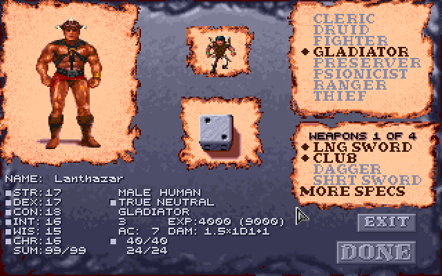
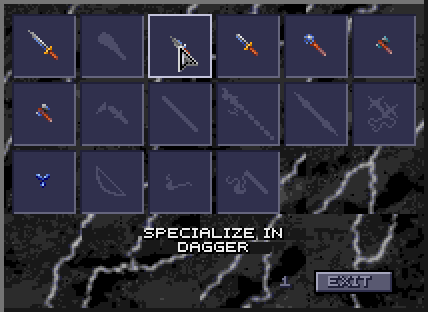
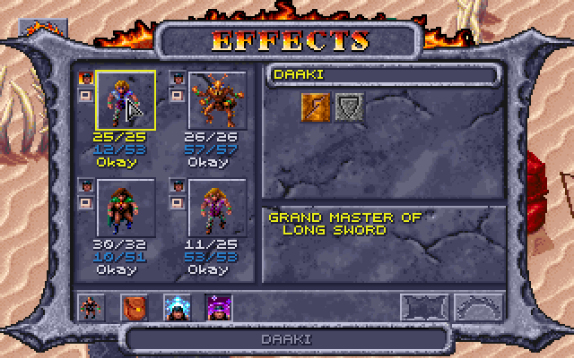

# Weapon specs

*Part of Obsidian Edition's documentation, from the [README](README.md) and
[Features and rules](FEATURES.md#weapon-specialization): weapon specialization in full, who picks
which weapon spec and when, the attacks a round, and grand mastery's dice. The
[kits](KITS.md) that pick a weapon spec of their own have their other rules on their page.*

With the mod (always on), fighters, gladiators and rangers train in chosen **weapon
specs** (weapon types, whatever their material), as in AD&D, and a few kits pick one too. *Without
the mod:* every warrior has 3/2 attacks a round in melee (2 from 7th level) with any weapon, and
no other bonus; missile weapons shoot at the weapon's own rate for everyone.

How it works: [DEVELOPMENT-RULES.md](https://github.com/daaki85/darksun-obsidian-edition/blob/main/obsidian-edition/DEVELOPMENT-RULES.md#weapon-specialization).

## Contents

- [The twenty-two weapon specs](#the-twenty-two-weapon-specs)
- [Who picks what](#who-picks-what)
- [Attacks a round](#attacks-a-round)
- [Grand mastery's damage](#grand-masterys-damage)
- [Choosing at creation](#choosing-at-creation)
- [Starting weapons](#starting-weapons)
- [At a level gained](#at-a-level-gained)
- [Changing class](#changing-class)
- [Where it shows](#where-it-shows)
- [In Wake of the Ravager](#in-wake-of-the-ravager)

## The twenty-two weapon specs

The weapon window's rows, six to a row, from the top: long sword, club, dagger, short sword, mace,
axe; great axe, pick, quarterstaff, polearm, gythka, cahulaks; chatkcha, bow, sling, staff sling,
two-handed sword, lotulis; double spear, trikal, javelin, darts. The last six are Wake of the
Ravager's kinds, which the mod brings into Shattered Lands ([new items](FEATURES.md#new-items)):
the double spear and the trikal are for gladiators only, as in the sequel (greyed for a fighter or
ranger). The sequel's net is left out. The lotulis, double spear and
trikal have [traits](FEATURES.md#lotulis-and-double-spear) of their own for a specialist. They take in
the game's weapons of every material and its named ones (Bloodwrath, Swiftbite and the like are
long swords; [the items by weapon spec](ITEMS.md#by-weapon-spec)); gloves are none. The weapons
spells make count for specialization as their AD&D weapon: the Flame Blade a long sword (AD&D's
scimitar, which Athas hasn't), Shillelagh a club, Spiritual Hammer a mace (the war hammer's
nearest). Class and kit restrictions leave them as the game has them: anyone who can cast the
spell can hold its weapon.

## Who picks what

| Who | Picks | With a weapon of its chosen weapon spec |
|---|---|---|
| **Fighter** (one class or more) | 1 weapon spec | specialized: +1 to hit, +2 damage; **mastery** from 5th fighter level: +3 to hit, +3 damage; **grand mastery** from 9th: the same, the damage die the next greater die size ([below](#grand-masterys-damage)), and one more attack a round |
| **Gladiator** | 2 weapon specs at creation, a 3rd at 6th level and a 4th at 9th | specialized in each: +1 to hit, +2 damage |
| **Ranger** (one class or more) | **the bow from the start**, and 1 weapon spec (any but the bow) | expertise: the game's attacks a round in melee, a specialist's rate of fire with a missile weapon, no other bonus |
| [Seeker](KITS.md#seeker) (ranger) | 1 of its sphere's weapon specs, the bow among them where the sphere allows one; no bow otherwise | expertise, as a ranger's |
| [Justifier](KITS.md#justifier) (ranger) | the bow and 1, as a ranger | its chosen weapon spec **specialized**: +1 to hit, +2 damage (SPECIALIZED IN on the Effects screen); the bow at a ranger's expertise unless it is the chosen one |
| [Myrmidon](KITS.md#myrmidon) (fighter) | 1 as any fighter (not the polearm), and **the polearm** as its second, given | both specialized, on to mastery at 5th and grand mastery at 9th |
| [Battle Mage](KITS.md#battle-mage) (preserver) | 1 of long sword, club, dagger, short sword, mace, axe, pick | expertise, by its preserver level, and a warrior's THAC0 ([the kits' warrior's THAC0](KITS.md#a-warriors-thac0)); it may use that spec's weapons as well as a preserver's own |
| [Crusader](KITS.md#crusader) (cleric), [Mind Warrior](KITS.md#mind-warrior) (psionicist) | 1 melee weapon spec its class can use (a thri-kreen Mind Warrior the chatkcha too) | expertise, by its cleric or psionicist level, and a warrior's THAC0 |
| [Swashbuckler](KITS.md#swashbuckler) (thief) | its **weapon of choice**: long sword, dagger or short sword | a warrior's THAC0 alone (the window says SPECIALIZE IN, but it gives no specialization's bonus or extra attacks) |
| [Spellarcher](KITS.md#spellarcher) (fighter/preserver) | the bow, and only the bow | specialized, as a fighter's |
| [Poisoner](KITS.md#poisoner) (fighter/thief) | the dagger or the short sword only | specialized, as a fighter's |
| [Brute](KITS.md#brute) (gladiator) | as a gladiator, but no missile weapon | specialized, as a gladiator's |

**Every ranger but a Seeker starts with expertise in the bow**, on top of the weapon spec it
chooses. A warrior with another class chooses only the weapon specs that class lets it use
([Choosing at creation](#choosing-at-creation)). A Seeker's sphere limits are
[on the Kits page](KITS.md#sphere-weapon-limits).

## Attacks a round

The game already gives every fighter, gladiator and ranger the specialist's attacks in melee (3/2 a
round, 2 from 7th level). With the rule, a warrior fighting with a weapon outside its chosen weapon
specs gets AD&D's plain rate, half an attack less; with a chosen weapon spec it keeps the game's
rate (a grand master one more).

Missile weapons have a rate of fire of their own in the game, the same for everyone (a bow 2 a
round, a sling, staff sling or chatkcha 1). With the rule, fighters and gladiators shoot faster
with a chosen weapon spec, and rangers with theirs and every bow: AD&D's specialist's rate for the
sling and javelin, a step above it for the bow, staff sling and chatkcha, and one more a round than the
weapon's own for darts. From 7th level every warrior shoots
its other missile weapons faster too, a step behind a specialist, as in melee (AD&D keeps the
weapon's own rate). Mastery's and grand mastery's bonuses to hit and damage count for missiles too.

By skill and level: a warrior's level is the highest of its fighter, gladiator and ranger levels
(no higher than 10th under the [XP cap](FEATURES.md#level-cap-by-xp)); the Battle Mage, Crusader
and Mind Warrior go by their own class's level. 3/2 means one attack one round and two the next;
— means none at that level, or not that kind of weapon.

| With the weapon | Melee, 1–6 | Melee, 7–10 | Bow, darts, 1–6 | Bow, darts, 7–10 | Sling, staff sling, chatkcha, javelin, 1–6 | Sling, staff sling, chatkcha, javelin, 7–10 |
|---|---|---|---|---|---|---|
| anyone who isn't a warrior (clerics, druids, preservers, psionicists, thieves) | 1 | 1 | 2 | 2 | 1 | 1 |
| a warrior, a weapon spec it hasn't chosen | 1 | 3/2 | 2 | 3 | 1 | 3/2 |
| a chosen weapon spec: specialized (a fighter's, a gladiator's, a Justifier's), mastery, or a ranger's expertise (every bow, a Seeker's only by choosing it) | 3/2 | 2 | 3 | 4 | 3/2 | 2 |
| grand mastery (a fighter's, from 9th level) | — | 3 | — | 5 | — | 3 |
| a Battle Mage, Crusader or Mind Warrior, its chosen weapon spec (expertise, by its own class's level) | 3/2 | 2 | — | — | — | — |
| a thri-kreen Mind Warrior, the chatkcha as its chosen weapon spec (by its fighter, gladiator or ranger level, if any) | — | — | — | — | 3/2 | 2 |
| a Battle Mage, Crusader or Mind Warrior, any other weapon | 1 | 1 | 2 | 2 | 1 | 1 |

- The **javelin** and **darts** (Wake of the Ravager's) are in the table with the weapons that
  share their rate: the javelin, 1 a round, with the sling (AD&D's specialist's rate for it, as
  for its other thrown weapons), and darts, 2 a round, with the bow (AD&D's darts specialist throws
  one more a round than the weapon's own).
- A **thri-kreen** throws a chatkcha once more a round than the table says, whatever the rule (2
  instead of 1: AD&D's 2/1 for the thri-kreen's own weapon).
- With [two weapons](PLAYER-GUIDE.md#two-weapons), the off hand attacks once a round whatever the
  rate.
- In a fight **Haste** doubles all of these and **Slow** halves them, rounded down (and a slowed
  character loses every other turn); the game's DAM lines and the Characters tab show them so.

## Grand mastery's damage

A fighter's grand mastery (9th level, its chosen weapon spec) makes the weapon's damage dice the
next greater die size, against every target, as Player's Option: Combat & Tactics has it: d2,
d3, d4, d6, d8, d10, d12, d20, each die of the weapon (a gythka's 2d4 2d6). Against a large
target the step is made on the weapon's large dice ([creature size](FEATURES.md#creature-size)). The table gives each weapon spec's plain weapon's
dice (the game's own, or the Loader's for the kinds the game has none of); a weapon's plus, a
weak material's penalty, STR and mastery's +3 damage add as ever.

| Weapon spec | Man-sized or smaller | Large | Grand mastery, man-sized or smaller | Grand mastery, large |
|---|---|---|---|---|
| long sword | 1d8 | 1d12 | 1d10 | 1d20 |
| club | 1d6 | 1d3 | 1d8 | 1d4 |
| dagger | 1d4 | 1d3 | 1d6 | 1d4 |
| short sword | 1d6 | 1d8 | 1d8 | 1d10 |
| mace | 1d6+1 | 1d6 | 1d8+1 | 1d8 |
| axe | 1d8 | 1d10 | 1d10 | 1d12 |
| great axe | 1d10 | 2d8 | 1d12 | 2d10 |
| pick | 1d6+1 | 2d4 | 1d8+1 | 2d6 |
| quarterstaff | 1d6 | 1d6 | 1d8 | 1d8 |
| polearm | 1d10 | 2d6 | 1d12 | 2d8 |
| gythka | 2d4 | 1d10 | 2d6 | 1d12 |
| cahulaks | 1d6 | 1d6 | 1d8 | 1d8 |
| chatkcha | 1d6+2 | 1d4+2 | 1d8+2 | 1d6+2 |
| bow | 1d8 | 1d8 | 1d10 | 1d10 |
| sling | 1d4 | 1d4 | 1d6 | 1d6 |
| staff sling | 1d3 | 1d3 | 1d4 | 1d4 |
| two-handed sword | 1d10 | 3d6 | 1d12 | 3d8 |
| lotulis | 1d10 | 1d12 | 1d12 | 1d20 |
| double spear | 1d8 | 1d8 | 1d10 | 1d10 |
| trikal | 1d10 | 1d10 | 1d12 | 1d12 |
| javelin | 1d6 | 1d6 | 1d8 | 1d8 |
| darts | 1d3 | 1d2 | 1d4 | 1d3 |

A bow's, sling's or staff sling's dice are the weapon's own, as the game rolls them for a shot (a
bow 1d8 with the game's arrows); missile weapons have no large dice of their own. The staff sling's
are its stinkpot's, 1d3 ([weapon traits](FEATURES.md#weapon-traits)), 1d4 under grand mastery. The dice log shows
the step on each hit: `(d10 for d8: grand mastery)`, and against a large target `(1d20 for 1d8: a
large target, grand mastery)`.

## Choosing at creation

Press **DONE** on the character creation screen and a warrior (and a Battle Mage, Crusader, Mind
Warrior or Swashbuckler) picks its weapon specs on the weapon window, the one a level gained
brings up ([below](#at-a-level-gained)), as a preserver picks its spells on CHOOSE A SPELL:
[who picks what](#who-picks-what) says how many. A preserver warrior picks its spells first. A
multiclass warrior can choose only the weapon specs its other class lets it use: those of which
the game (or the Loader) has a weapon the character may use, in any material. The rest are greyed:

| A warrior (fighter, gladiator or ranger)… | Weapon specs it can choose | Starts with |
|---|---|---|
| …of one class, or with thief, preserver or druid | a gladiator all twenty-two; a fighter or ranger all but the double spear and trikal (a ranger not the bow either; a Seeker its sphere's, the bow among them where the sphere allows) | the game's bone long sword |
| …with psionicist (small weapons) | club, dagger, short sword, mace, chatkcha, bow, sling, darts | a wooden club |
| …with air cleric (missile and thrown weapons, daggers, cahulaks) | dagger, cahulaks, chatkcha, bow, sling, staff sling, javelin, darts | an obsidian dagger |
| …with earth cleric (stone, obsidian, metal, wood) | long sword, club, dagger, short sword, mace, axe, great axe, pick, quarterstaff, polearm, cahulaks, chatkcha, bow, two-handed sword, lotulis, javelin, darts (a gladiator the double spear and trikal too; the polearm in the mod's metal, the cahulaks in its obsidian or metal) | an obsidian long sword |
| …with fire cleric (obsidian) | long sword, dagger, short sword, mace, axe, great axe, cahulaks (the mod's obsidian), chatkcha, two-handed sword, lotulis (the mod's obsidian), javelin | an obsidian long sword |
| …with water cleric (bone, wood) | long sword, club, dagger, short sword, mace, axe, great axe, quarterstaff, polearm, gythka, cahulaks, bow, two-handed sword (the mod's bone), darts (a gladiator the double spear and trikal too) | the game's bone long sword |

(The starting weapon is for the weapon spec picked first; [Starting weapons](#starting-weapons) has
the rest. A ranger but a Seeker never has the bow to choose: its expertise with the bow comes
anyway.)

**EXIT** leaves picks unmade, and the Loader picks them (a Myrmidon's second is the polearm
whatever is picked): the kit's weapon (a Ghetto Fighter's or Poisoner's dagger, a Battle Dancer's
long sword), a thri-kreen's chatkcha, else the long sword (a gladiator's second the club), each
only if it may be chosen, else the first that may (a Mind Warrior's the club). EXIT can't go
back to the creation screen: DONE has made the character by then. Then every new character picks
its psionic powers ([Psionic powers at creation](FEATURES.md#psionic-powers-at-creation)).

**EDIT** on a party member keeps its weapon specs while its classes and kit stay the same; another
class or kit asks for them again after DONE ([Choosing a kit](KITS.md#choosing-a-kit)).

## Starting weapons

A new character starts the game with a plain weapon of its first weapon spec in place of the bone
long sword the game gives warriors, in a material it may use, and the log says so (`Grog starts
with a plain obsidian long sword for the weapon specialization chosen, in place of the bone long
sword`). A kit with a weapon spec of its own starts with a plain weapon of it too
([Starting gear](KITS.md#starting-gear)).

| Weapon spec | Starting weapon | For a cleric's sphere that can't use it |
|---|---|---|
| long sword | the game's bone long sword | obsidian (fire, earth) |
| club, quarterstaff, bow | wooden (a bow with 20 arrows) | — |
| dagger, chatkcha | obsidian | a dagger: bone, the mod's (water) |
| short sword | bone, the mod's | obsidian (fire, earth) |
| mace, polearm, gythka, cahulaks | bone | a mace: obsidian, the game's plain Mace type with a picture of the mod's; a polearm: metal, the mod's (earth); cahulaks: obsidian, the mod's (earth, fire) |
| axe | bone, the mod's | obsidian (fire, earth) |
| great axe | bone, the mod's | obsidian (fire, earth) |
| pick | stone | — |
| sling, staff sling | leather | — |
| two-handed sword | obsidian | bone, the mod's (water) |
| javelin | obsidian | — |
| lotulis | stone | obsidian, the mod's (fire) |
| double spear, trikal, darts | wooden | — |

A two-handed weapon held in the hands puts the game's starting shield in the backpack (not a
half-giant's, with [its rule](FEATURES.md#half-giants-two-handed-weapons)). A bow or staff sling
goes in the missile slot instead, and the shield stays, as the game asks nothing of the hands for
it. The weapon is made once: a long sword handed to the character later stays one.

## At a level gained

A warrior with fewer weapon specs than it is due (a gladiator reaching 6th or 9th, or any warrior
from a game begun before the rule) picks the rest the way a psionicist picks a new power: in the
game's own pop-up, made bigger, a picture of each weapon spec on a slot, six to a row, those its
classes can't use (or it has) greyed. The pointer on a slot names it under them (**SPECIALIZE IN**
/ **POLEARM**, or **EXPERT IN** where the pick would be expertise: a ranger's, a Battle Mage's, a
Crusader's or Mind Warrior's; as CHOOSE A SPELL names a spell), and lights the slot if it can be
picked; off the slots the title comes back. The picks left are beside **EXIT** (which asks, as for
powers, whether to leave with picks unmade: they're offered again at the next level).

## Changing class

A human who becomes a fighter, gladiator or ranger (or a Battle Mage, Crusader, Mind Warrior or
Swashbuckler) with **DUAL** then picks the weapon specs it is due on the same window as at a level
up (**PICK A WEAPON SPECIALTY**, or **PICK A WEAPON OF EXPERTISE** for a ranger, Battle Mage,
Crusader or Mind Warrior), less any it has already.

A human who dual-classes keeps what it earned as a fighter, gladiator or ranger: its weapon specs,
and the weapons it chose, whatever the new class (or a kit) allows, count again once the new
class's level passes the old. Till then they are asleep, as the class is. A Battle Mage's chosen
weapon spec is the kit's alone: a Battle Mage turned fighter isn't specialized in it, and has
expertise with it once the kit wakes ([Changing class](KITS.md#changing-class)).

## Where it shows

The **Effects** screen lists the selected character's weapon specs under its effects
("SPECIALIZED IN", "MASTER OF", "GRAND MASTER OF", "EXPERT IN"); View Character's DAM line and the
inventory screen's weapon lines count it (a staff sling specialist's `1.5x1D3+2`, its stinkpots'
1d3); the Characters tab lists them (**Weapons: long sword (grand mastery)**) and gives the attacks
a round with each weapon ready, a missile weapon's its own (**Attacks: 3/2 a round with Long Sword,
1 with Axe, 3 with Bow**); and the dice log names it on each attack (`+1 specialized`, `+3 grand
mastery`, `(d10 for d8: grand mastery)`; against a large target `(1d20 for 1d8: a large target,
grand mastery)`). Both lists end with a ranger's bow, which every ranger but a Seeker is an expert
with, chosen or not; and View Character, as the game has it, gives a character's melee rate
whatever weapon is ready.

## In Wake of the Ravager

A party taken to the sequel ([Taking the party to Wake of the Ravager](FEATURES.md#taking-the-party-to-wake-of-the-ravager))
keeps its weapon specs, and they work in its fights as here: the to-hit and damage, mastery and grand
mastery, the attacks a round and the rates of fire, and the kits' parts (a Battle Mage's or
Crusader's expertise, a Justifier's, a Myrmidon's second kind). A new character made in the sequel
picks its weapon specs as here: after DONE (and its first spells and psionic powers) a fighter,
gladiator or ranger (or a Battle Mage, Crusader, Mind Warrior or Swashbuckler) gets the weapon window,
in the sequel's own colours and with its own weapons' pictures, and picks what it is due. The sequel's
new characters start at 7th level, so a gladiator picks three. EXIT leaves the rest to the defaults (the
long sword, then the club; a thri-kreen's chatkcha first), and EDIT asks only for picks still due. No
picks come after DUAL there yet, and a kit's own weapons aren't offered first. A new fighter starts with
its +1 long sword in the right hand and its shield in the left (the sequel's own gear had them the other
way round, so a long sword specialist swung once a round until the player swapped them), but with the
sequel's long sword whatever its first pick: the starting weapon isn't yet made the first pick's kind as
in Shattered Lands. The sequel knows all twenty-two: a lotulis specialist from Shattered
Lands is a lotulis specialist there, with the sequel's own Lotulis. Its weapons take these weapon
specs (the six that came from the sequel by its own weapons of them; the rest by name and dice):

| Weapon spec | The sequel's weapons |
|---|---|
| two-handed sword | Twohand Sword, Crystal sword (both two-handed 1d10) |
| lotulis | Lotulis |
| double spear | Double Spear |
| trikal | Trikal |
| javelin | Javelin (a specialist's rate of fire: 3/2 a round, 2 from 7th level) |
| darts | both Darts (3 a round, 4 from 7th level) |
| long sword | the Longswords, Flameblade, Magma blade |
| the other fourteen | the sequel's weapons of that name (its Chatchka the chatkcha; it has no short sword of its own) |

The mod's own weapons that go across with the party (its short swords, metal axes and the like) keep
the weapon spec they have in Shattered Lands.

A few of the sequel's weapons have no weapon spec of their own and count as the nearest one for
specialization alone:

| The sequel's weapon | Counts as |
|---|---|
| Bloodletter | long sword |
| Promere hammer, Jasmine, Spirit hammer | mace |
| Shillelagh | club |
| Rainbow (the spell's bow) | bow |

The Net and the Rock count as none. The lotulis's, double spear's and trikal's own traits (the second
foe, the trip, the trikal's reach) are Shattered Lands' only, so far. The sequel's own characters have
no specs, so they fight as the sequel has them.
