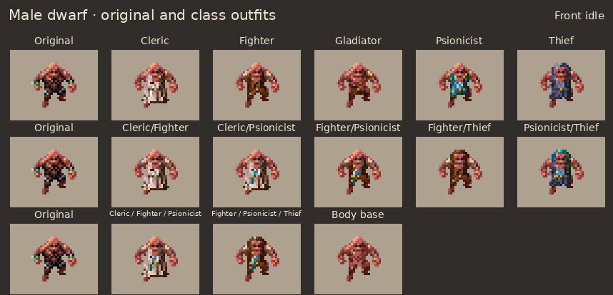
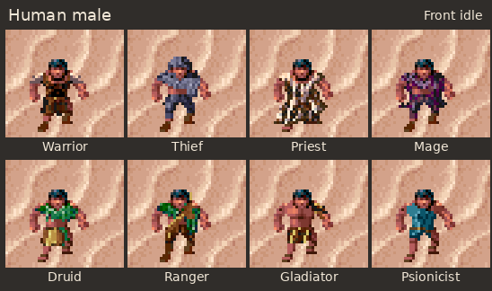

# Class outfits on the map

Enable **What the party wears** to see class outfits on human, dwarf, and elf party members. Humans wear the outfit for their active class. The loader selects from twelve dwarf builds and thirty-seven elf builds using all of the character’s class slots. The galleries show the base colors with equipment slots empty.

[Female human](#female-human) · [Male human](#male-human) · [Female dwarf](#female-dwarf) · [Male dwarf](#male-dwarf) · [Elf outfits](#elf-outfits) · [Equipment](#equipment)

[Compare the revised cloth with the retail Priest, Thief, Mage and Warrior](cloth-detail.md) · [Watch the before-and-after walk on arena sand](cloth-detail.gif)

All six single-class Psionicists use the same teal cloth palette. [Compare the updated figures at game size](psionicist-teal-roster.png) · [Watch all 29 poses beside the colors at `aa2c782`](psionicist-teal-poses.gif)

Both elf Preservers and the male human Mage wear plum mantles. In the comparison, the top row shows the colors at `9c4ef3c`. The middle and bottom rows show the approved colors enlarged and at game size. The green Ranger is the reference. [Watch all four profile steps](teal-plum-walk.gif)

## Dwarf outfits

The five single classes are Cleric, Fighter, Gladiator, Psionicist, and Thief. The five two-class and two three-class outfits combine their identifying details. The Cleric/Fighter wears pale bone caps over cream, and the Fighter/Psionicist wears a narrow teal sash over leather. Each tile below pairs the female front view with the male rear view. [See all twelve class combinations](dwarves.md)

The earlier contrast study lifts the lit leather on the Fighter and Gladiator and the slate ridge on the Thief. The Cleric’s cream folds have a cooler recess, and the Psionicist’s teal tunic has a darker edge. In the still comparison, each game-size figure sits beside an enlargement of its clothing. In the animation, each trio shows the original dwarf, the previous outfit, and the current outfit in the same pose. [Compare the shading at game size](dwarf-material-contrast.png) · [Watch the shading comparison](dwarf-material-contrast.gif) · [Compare dwarves with humans and other Shattered Lands figures](contrast.md)

### Female dwarf

Each row starts with the original female dwarf. The outfits beside her move through all 29 poses in sync. Read the rows from top to bottom for single-, two-, and three-class builds. The last row also includes the redrawn body base.

### Male dwarf

The male gallery uses the same layout. Watch the first front strike in each gallery to see the different wind-ups inherited from the original figures. [Inspect the wrists, belts, and recoil hems beside the originals](original-dwarves.md)

## Female human

Each human gallery shows all eight outfits in sync on game terrain. The caption identifies each of the 29 poses as the figures turn, walk, strike, draw a bow, take a hit, and fall. The walk and melee cycles repeat.

The Thief's slate hood has a raised crown and an open rim. From behind, the nape panel folds onto the cloak through the walk and strike. Loose hair shows at the sides in front views, and the crown stays closed through the hit. [Compare her original hair, previous hood, revised hood, and equipped cloak in all 29 poses](human-thief-hood.gif) · [Compare all six figures beside their uncovered heads](thief-hood-comparison.gif)

## Male human

The Psionicist’s short teal collar follows his shoulder as he turns in profile. [Compare the previous and fitted collar through all four steps, alongside an equipped cloak](human-psionicist-fit.gif)

In profile, the Priest’s cream robe hangs behind his swinging arm and lifts over the striding knee. The earlier profile repair loop starts at side idle, then repeats all four steps beside the original human and the previous robe. [Watch the Priest’s side walk](human-priest-profile.gif)

## Elf outfits

Each tile shows the female elf on the left and the male on the right, enlarged above and at game size below. Original and Body base show where the jaw, feet, and ears sit before the seven single classes are dressed. The elf gallery also has all 14 pairs and 16 triples, still sheets, and equipment comparisons. [Inspect the faces](elf-faces.gif) · [All elf outfits](elves.md)

## Equipment

[Compare the corrected cloak hems and boots on all six figures](cloak-hem-fixes.gif) · [Compare chest plate through all three walks](plate-stride.gif)

[Compare all six equipped figures beside retail artwork](worn-equipment.md) · [See plate, mail, robes, footwear and weapon materials in the same pose](worn-materials.png)

Equipped armor recolors the parts of the outfit it covers. Magical chest plate adds shine to the chest armor. Equipped cloaks use their own colors, and boots recolor each visible foot. The equipment comparison shows the same pose with different gear and the base outfit after removal. [Watch the equipment comparison](checklist-equipment.gif) · [Read the loader and in-game checks](checklist-review.md)

## Artwork references

- [Class outfit workflow for future races](workflow.md)
- [Earlier Fighter revision](dwarf-fighter-review.gif) · [Hood profile revision](dwarf-hood-profile.gif) · [Four playable Thief hoods](dwarf-thief-hoods.gif)
- [Earlier female dwarf study](dwarf-female.gif) · [Earlier male dwarf study](dwarf-male.gif). These silhouette studies include exploratory Mage, Druid, and Ranger outfits. The early labels “Priest” and “Warrior” correspond to Cleric and Fighter.
