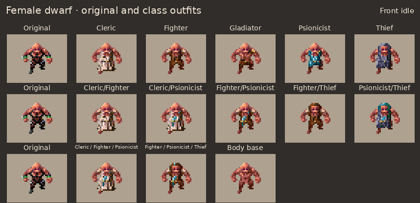

# Class outfits on the map

Enable **What the party wears** to see class outfits on human and dwarf party members. Humans wear the outfit for their active class. Dwarves wear one of twelve outfits selected from their class slots. The galleries show the base colors with equipment slots empty.

[Female human](#female-human) · [Male human](#male-human) · [Female dwarf](#female-dwarf) · [Male dwarf](#male-dwarf) · [Equipment](#equipment)

## Dwarf outfits

The five single classes are Cleric, Fighter, Gladiator, Psionicist, and Thief. The five two-class and two three-class outfits combine their identifying details. The Cleric/Fighter wears pale bone caps over cream, and the Fighter/Psionicist wears a narrow teal sash over leather. Each tile below pairs the female front view with the male rear view. [See all twelve class combinations](dwarves.md)

The latest shading pass lifts the lit leather on the Fighter and Gladiator and the slate ridge on the Thief. The Cleric’s cream folds have a cooler recess, and the Psionicist’s teal tunic has a darker edge. In the still comparison, each game-size figure sits beside an enlargement of its clothing. In the animation, each trio shows the original dwarf, the previous outfit, and the current outfit in the same pose. [Compare the shading at game size](dwarf-material-contrast.png) · [Watch the shading comparison](dwarf-material-contrast.gif) · [Compare dwarves with humans and other Shattered Lands figures](contrast.md)

### Female dwarf

Each row starts with the original female dwarf. The outfits beside her move through all 29 poses in sync. Read the rows from top to bottom for single-, two-, and three-class builds. The last row also includes the redrawn body base.

### Male dwarf

The male gallery uses the same layout. Watch the first front strike in each gallery to see the different wind-ups inherited from the original figures. [Inspect the wrists, belts, and recoil hems beside the originals](original-dwarves.md)

## Female human

Each human gallery shows all eight outfits in sync on game terrain. The caption identifies each of the 29 poses as the figures turn, walk, strike, draw a bow, take a hit, and fall. The walk and melee cycles repeat.

## Male human

## Equipment

Equipped armor recolors the parts of the outfit it covers. Magical chest plate adds shine to the chest armor. Equipped cloaks use their own colors, and boots recolor each visible foot. The equipment comparison shows the same pose with different gear and the base outfit after removal. [Watch the equipment comparison](checklist-equipment.gif) · [Read the loader and in-game checks](checklist-review.md)

## Artwork references

- [Class outfit workflow for future races](workflow.md)
- [Earlier Fighter revision](dwarf-fighter-review.gif) · [Hood profile revision](dwarf-hood-profile.gif) · [Four playable Thief hoods](dwarf-thief-hoods.gif)
- [Earlier female dwarf study](dwarf-female.gif) · [Earlier male dwarf study](dwarf-male.gif). These silhouette studies include exploratory Mage, Druid, and Ranger outfits. The early labels “Priest” and “Warrior” correspond to Cleric and Fighter.
