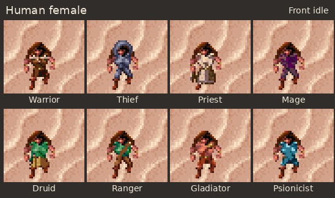
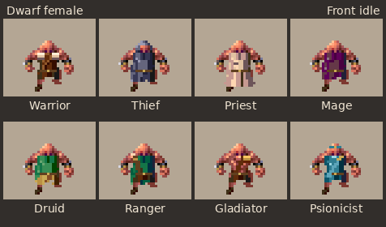

# Class outfits on the map

On the class-outfits branch, human party members wear the outfit for their active class when **What the party wears** is enabled. The galleries show the base class colors. In play, equipped armor recolors the parts it covers, while equipped cloaks and boots use their own colors.

Both galleries show all eight human outfits in sync. The caption identifies each of the 29 poses as the figures turn, walk, strike, draw a bow, take a hit, and fall. The walking and melee cycles repeat so their movement is easier to follow. These previews use the sprite loader’s output on game terrain.

## Female human

## Male human

## Dwarf outfit study

Dwarves can start as **Clerics, Fighters, Gladiators, Psionicists, or Thieves**. The original eight-outfit study below labels the Cleric “Priest” and the Fighter “Warrior.” Its Mage, Druid, and Ranger are exploratory drawings. The next art pass focuses on the five playable outfits. [Classes by race](../../PLAYER-GUIDE.md#races)

After cleaning both body bases, review the Gladiator for exposed anatomy, the Fighter for shoulder and head clearance, and the Cleric for robe folds and coverage. The galleries show all 29 poses. In the opening strike, the female dwarf holds her stance while the male dwarf raises his arm.

Dwarves have five two-class choices (Cleric/Fighter, Cleric/Psionicist, Fighter/Psionicist, Fighter/Thief, Psionicist/Thief) and two three-class choices (Cleric/Fighter/Psionicist and Fighter/Psionicist/Thief). The first proposed multiclass art test is a Fighter/Thief with the Fighter’s shoulder pieces and the Thief’s hood. Compare it with both single classes at game size before choosing a rule for the other combinations. [Multiclass combinations by race](../../PLAYER-GUIDE.md#more-than-one-class)

The dwarf designs are available for art review. In-game equipment integration is still pending.

### Female dwarf

### Male dwarf

