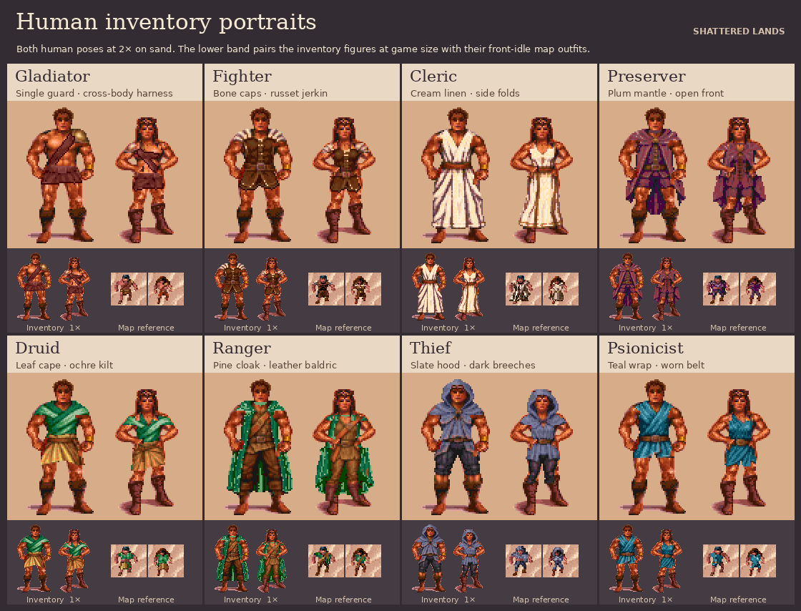
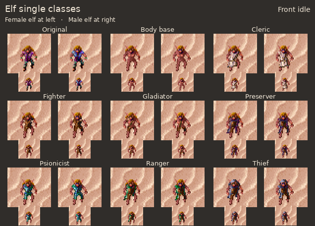

# Class outfits on the map

The Loader draws class outfits ([What the party wears](../../FEATURES.md#what-the-party-wears), always on) on humans, dwarves, elves, half-elves, half-giants, halflings and the Mul. Humans wear the outfit for their active class. The loader selects from twelve dwarf builds, thirty-seven elf builds and forty-eight half-elf builds using all of the character’s class slots. Both half-giants have ten outfits each, both halflings have 21 each, and the male Mul has 18. The galleries below show the base colors with equipment slots empty.

[Female human](#female-human) · [Male human](#male-human) · [Female dwarf](#female-dwarf) · [Male dwarf](#male-dwarf) · [Elf outfits](#elf-outfits) · [Half-elf outfit galleries](half-elves.md) · [Half-giant art study](half-giants.md) · [Halfling art study](halflings.md) · [Mul art study](muls.md) · [Thri-kreen · original figure](thri-kreen.md) · [Equipment](#equipment)

Inspect the revised cloth folds, bare bodies, and Gladiator outfits on sand and paving. [Current comparison for all 13 clothed figures](material-folds.md) · [Earlier eight-body comparison with the Fighter](body-texture.md)

[Compare the revised cloth with the retail Priest, Thief, Mage and Warrior](cloth-detail.md) · [Watch the before-and-after walk on arena sand](cloth-detail.gif)

All six single-class Psionicists use the same teal cloth palette. [Compare the updated figures at game size](psionicist-teal-roster.png) · [Watch all 29 poses beside the colors at `aa2c782`](psionicist-teal-poses.gif)

Both elf Preservers and the male human Mage wear plum mantles. In the comparison, the top row shows the colors at `9c4ef3c`. The middle and bottom rows show the approved colors enlarged and at game size. The green Ranger is the reference. [Watch all four profile steps](teal-plum-walk.gif)

Compare the borrowed Thief hoods and Fighter shoulder guards across five races at game size and 2×. The lower row shows the retail material references. [Current and previous colors](multiclass-materials.png) · [All 29 poses](multiclass-materials.gif) · [Compare Fighter/Psionicist and Fighter/Preserver across races](fighter-shoulder-colors.gif)

**Approved shoulder fit (art revision `ccd86dd`).** The Fighter/Psionicist guard follows the lit upper arm on both half-giants, both halflings and the Mul. Each direction in the walk comparison repeats the same four steps with the floor and camera fixed. Each pair shows the previous guard on the left and the revised guard on the right. [Watch the walk from all three sides](shoulder-walk.gif) · [Inspect profile step two](shoulder-fit-by-race.png) · [Compare the bare arm and both fittings through all 29 poses](shoulder-fit-by-race.gif)

## Inventory portraits

In Shattered Lands, both human inventory figures wear the selected character’s active class outfit. The twelve other figures use their retail full-length pictures. Individual equipped items appear in the surrounding slots. Character creation has a separate class preview built from the walking sprite. The small figures in the party column beside the portrait are each member's own map figure, standing, so they show the class outfit and what is worn on every race that has one. The full-length redraws here belong to the inventory screen.

### Human inventory fittings

The male and female portraits use separately fitted artwork for all eight classes. The Gladiator’s strap crosses the chest from a single shoulder guard, while the Fighter wears a closed jerkin with paired bone caps. The Cleric’s cream panel falls to the ankles. The Preserver’s plum mantle opens over the waist and falls behind the arms. The foreground fists on the man and the woman’s hands at her waist come from their original inventory poses.

The man shows his hair above the collar and wears an open hood as a Thief. The Druid wears a green folded wrap above the ochre kilt. Dark leather distinguishes the Fighter’s overlapping hip flaps and the Gladiator’s harness against exposed skin.

The sheet shows Loader-rendered portraits at 2× on sand and at native size on a dark ground. Each map inset shows the corresponding human in front idle. [Compare the original poses and the previous and revised fittings](human-inventory-fittings.png).

### Importing a repainted figure

A class can also be painted as one whole figure at native size (48×95 for the man, 44×88 for the woman). `python -m dsloader.inventoryart import GAME_DIR FIGURE CLASS PICTURE` turns it into the class's layer in `dsloader/inventory-garments.zip`. FIGURE is 0 for the man or 1 for the woman. CLASS is 1–8, in this order: Cleric, Druid, Fighter, Gladiator, Preserver, Psionicist, Ranger, Thief. The command does four things:

- It keeps the stock face. On the woman that includes her hair and tiara. Add `--repaint-head` for a class whose hood covers the head.
- It keeps every pixel that matches the stock.
- It cuts back to the parchment wherever the picture leaves stock bare.
- It moves every colour into the palette entries that no area changes (16–79 and 128–222, without 19 and 21).

The inventory is drawn in the current area's palette. Entries 80–127 and 223–248 change from area to area, so a kilt painted tan in them shows grey-green in the slave pens. `python -m dsloader.inventoryart steady GAME_DIR` moves every layer that is already in the zip into the fixed colours.

## Dwarf outfits

The five single classes are Cleric, Fighter, Gladiator, Psionicist, and Thief. The five two-class and two three-class outfits combine their identifying details. The Cleric/Fighter wears pale bone caps over cream, and the Fighter/Psionicist wears a narrow teal sash over leather. Each tile below pairs the female front view with the male rear view. [See all twelve class combinations](dwarves.md)

The earlier contrast study lifts the lit leather on the Fighter and Gladiator and the slate ridge on the Thief. The Cleric’s cream folds have a cooler recess, and the Psionicist’s teal tunic has a darker edge. In the still comparison, each game-size figure sits beside an enlargement of its clothing. In the animation, each trio shows the original dwarf, the previous outfit, and the current outfit in the same pose. [Compare the shading at game size](dwarf-material-contrast.png) · [Watch the shading comparison](dwarf-material-contrast.gif) · [Compare dwarves with humans and other Shattered Lands figures](contrast.md)

### Female dwarf

Each row starts with the original female dwarf. The outfits beside her move through all 29 poses in sync. Read the rows from top to bottom for single-, two-, and three-class builds. The last row also includes the redrawn body base.

### Male dwarf

The male gallery uses the same layout. Watch the first front strike in each gallery to see the different wind-ups inherited from the original figures. [Inspect the wrists, belts, and recoil hems beside the originals](original-dwarves.md)

## Female human

Each human gallery shows all eight outfits in sync on game terrain. The caption identifies each of the 29 poses as the figures turn, walk, strike, draw a bow, take a hit, and fall. The walk and melee cycles repeat.

The Thief's slate hood has a raised crown and an open rim. From behind, the nape panel folds onto the cloak through the walk and strike. Loose hair shows at the sides in front views, and the crown stays closed through the hit. [Compare her original hair, previous hood, revised hood, and equipped cloak in all 29 poses](human-thief-hood.gif) · [Compare all six figures beside their uncovered heads](thief-hood-comparison.gif)

## Male human

The Gladiator’s bronze shoulder guard sits on the upper arm. A diagonal leather strap crosses the ribs and meets the waistband at the opposite hip. In rear walk and side strike, follow the overlapping kilt flap against the advancing thigh. The loop shows the cleaned body, the outfit at `638663e`, and the revised fit in all 29 poses at 4× and game size. [Watch the male Gladiator comparison](human-gladiator-fit.gif)

The male Psionicist wears a sleeveless teal wrap. The diagonal fold turns with his ribs and tucks under the leather belt. [Compare the six reported poses before and after the redraw](human-psionicist-wrap.png) · [See the wrap through all four profile steps alongside an equipped cloak](human-psionicist-fit.gif) · [Inspect all 29 Psionicist frames](human-psionicist-all-frames.png) · [Watch the full comparison](human-psionicist-all-frames.gif)

In profile, the Priest’s cream robe hangs behind his swinging arm and lifts over the striding knee. The earlier profile repair loop starts at side idle, then repeats all four steps beside the original human and the previous robe. [Watch the Priest’s side walk](human-priest-profile.gif)

## Elf outfits

Each tile shows the female elf on the left and the male on the right, enlarged above and at game size below. Original and Body base show where the jaw, feet, and ears sit before the seven single classes are dressed. The elf gallery also has all 14 pairs and 16 triples, still sheets, and equipment comparisons. [Inspect the faces](elf-faces.gif) · [All elf outfits](elves.md)

## Equipment

[Watch the weapon grips, shield and bow on all 14 party figures](weapon-motion.md) · [Compare the hip fit through front, rear and profile walks](hip-walk.md)

[Compare rear cloak fittings on the half-giant and Mul](fitted-cloak-rear.gif) · [Watch Warden’s Plate on the chest, arms and legs separately](fitted-armor-slots.gif) · [Inspect plate on the clerical robes and the half-giant’s hem](plate-fit.md)

[Watch magical leather, bone armor, cloaks, bracers, boots and belts on every party figure](magical-equipment.md). The six pieces are equipped individually beside the empty figure through all 29 poses. The half-elf Fighter now has two separate bone shoulder guards. [Her shoulder fitting before and after](half-elf-fighter-shoulders.png)

Body armor dyes the exposed panels of the equipped figure’s class outfit. The dwarf Cleric/Fighter keeps the cream linen hem and belt, the elf Cleric/Psionicist keeps the teal sash, and the half-elf Preserver keeps the plum mantle. Compare each row from empty slots through leather, plate and both named robes. [Armor colors and fold detail on all figures](armor-dyes.md) · [Earlier and revised armor in all 29 poses](subtle-armor.md) · [Ashen and Veiled robes on class outfits](named-robes.md)

On both half-elves, follow the cream and plum of the Cleric/Preserver, the ochre kilt and green cape of the Druid, and the Thief’s slate hood through all 29 poses with armor, a cloak and weapons. [Half-elf equipment in motion](half-elves.md#equipped-clericpreserver-druid-and-thief)

The original equipment audit covered all 14 map figures and 176 newer outfits before their equipment fittings. It records the missing armor colors, missed grips and clipped tips that led to the fitted comparisons above. [Weapon and armor test results](equipment-tests.md) · [Empty and equipped poses on the seven newer figures](equipment-study-comparison.png)

[Compare the corrected cloak hems and boots on all six figures](cloak-hem-fixes.gif) · [Compare chest plate through all three walks](plate-stride.gif)

[Compare all six equipped figures beside retail artwork](worn-equipment.md) · [See plate, mail, robes, footwear and weapon materials in the same pose](worn-materials.png)

Equipped armor recolors the parts of the outfit it covers. Magical chest plate adds shine to the chest armor. Equipped cloaks use their own colors, and boots recolor each visible foot. The equipment comparison shows the same pose with different gear and the base outfit after removal. [Watch the equipment comparison](checklist-equipment.gif) · [Read the loader and in-game checks](checklist-review.md)

## Artwork references

- [Class outfit workflow for future races](workflow.md)
- [Earlier Fighter revision](dwarf-fighter-review.gif) · [Hood profile revision](dwarf-hood-profile.gif) · [Four playable Thief hoods](dwarf-thief-hoods.gif)
- [Earlier female dwarf study](dwarf-female.gif) · [Earlier male dwarf study](dwarf-male.gif). These silhouette studies include exploratory Mage, Druid, and Ranger outfits. The early labels “Priest” and “Warrior” correspond to Cleric and Fighter.
