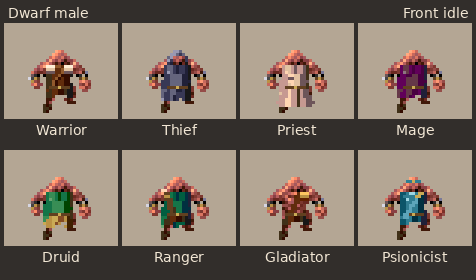

# Class outfits on the map

On the class-outfits branch, human party members wear the outfit for their active class and dwarves wear the outfit for their legal class combination when **What the party wears** is enabled. The galleries show the base class colors. In play, equipped armor recolors the parts it covers, while equipped cloaks and boots use their own colors.

Both galleries show all eight human outfits in sync. The caption identifies each of the 29 poses as the figures turn, walk, strike, draw a bow, take a hit, and fall. The walking and melee cycles repeat so their movement is easier to follow. These previews use the sprite loader’s output on game terrain.

The [dwarf and human checklist results](checklist-review.md) include the repaired frames and equipped comparisons. For future races, follow the [class outfit workflow](workflow.md).

## Female human

## Male human

## Dwarf outfit study

[Compare dwarf outfit contrast with both humans and the original game figures](contrast.md) · [Compare the revised Fighter builds](dwarf-fighter-review.gif) · [Compare the dwarf hoods in profile](dwarf-hood-profile.gif) · [Compare the four current dwarf Thief hoods](dwarf-thief-hoods.gif) · [Watch the earlier Thief hood and Cleric profile revision](checklist-review.md#thief-hood-and-cleric-profile) · [Compare the revised faces and shoulder guards against the original game poses](checklist-review.md#faces-and-shoulder-guards).

The current proposal covers five single classes, five two-class combinations, and two three-class combinations. Each animation shows the female and male figures together through all 29 poses. [See the dwarf outfit proposals](dwarves.md)

The earlier silhouette studies below include exploratory Mage, Druid, and Ranger drawings. Their “Priest” and “Warrior” labels correspond to the playable Cleric and Fighter.

### Female dwarf

### Male dwarf

