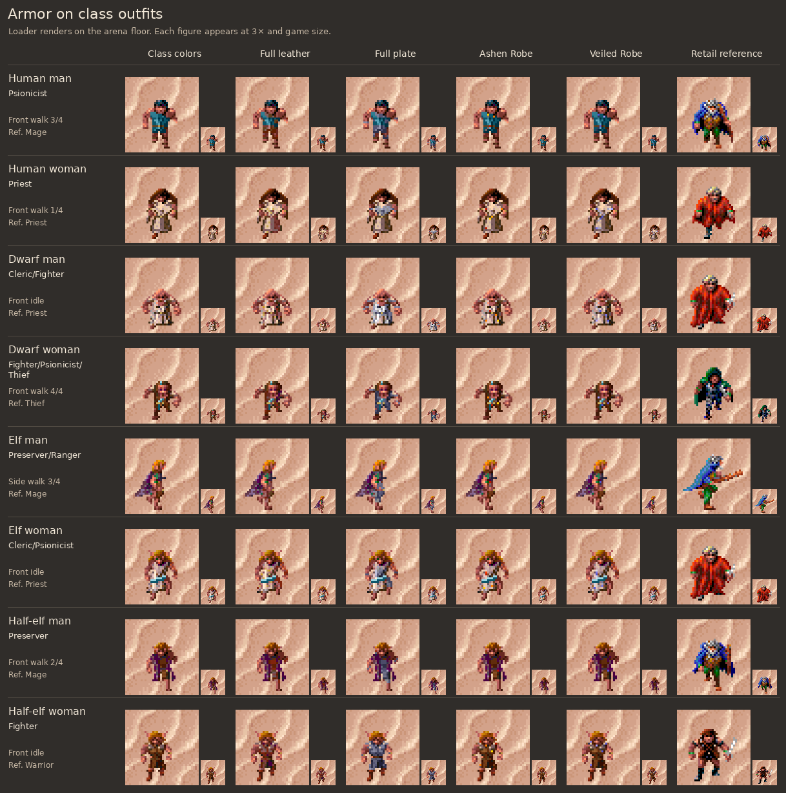
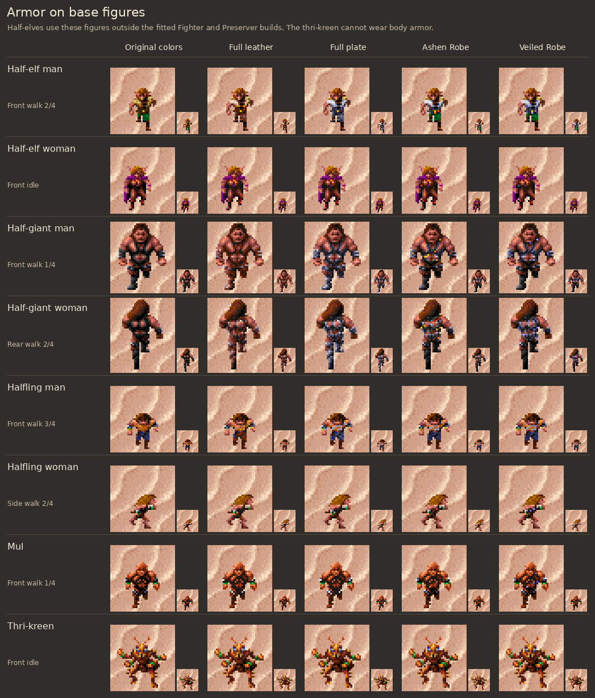
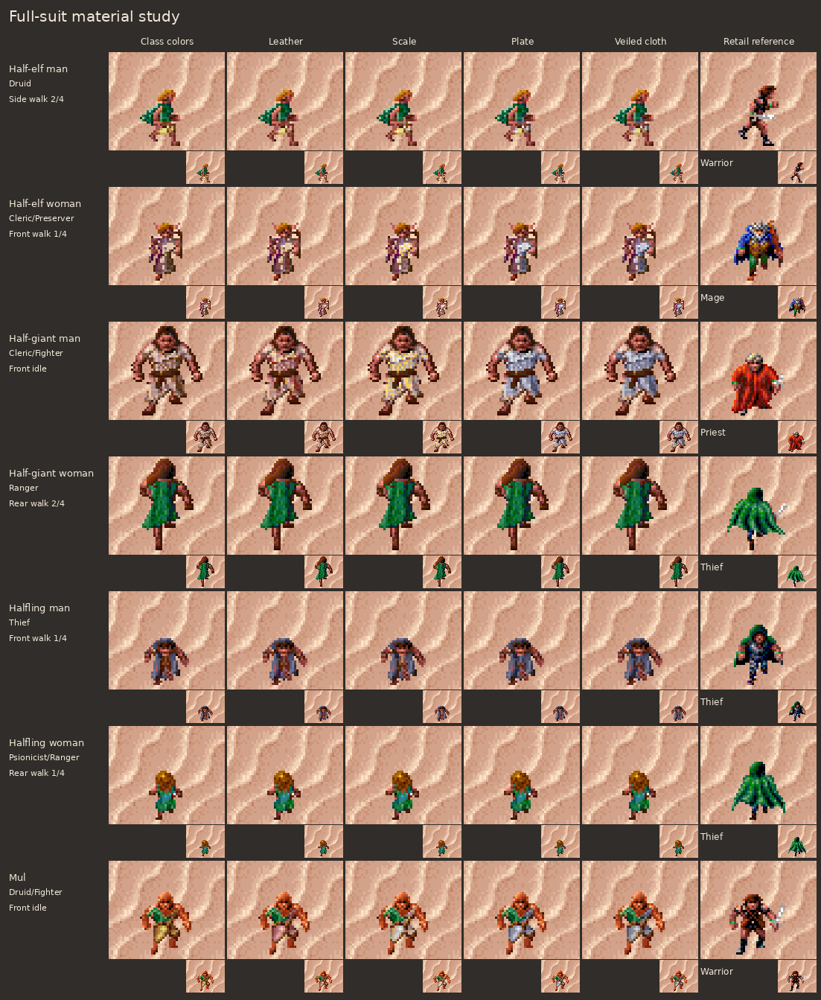

# Armor colors on class outfits

Read across each row to see one pose with empty slots, leather, plate and the two named robes. The human Psionicist’s teal bands, the elf Cleric/Psionicist’s sash and the half-elf Fighter’s bone fittings show where the garment keeps its class colors. The dye follows the original fold pixels as the figure turns. Magical gear adds cycling highlights to the exposed material. The three Warden’s Plate pieces can be inspected separately. [Current armor-slot comparison](fitted-armor-slots.gif) [Compare the named robes on the half-giants, Mul and human Priest](named-robes.md) · [Compare the women’s clerical plate fittings](plate-fit.md)

## What changed on the half-elf

The previous leather dye reduced 18 garment colors to four on the female Fighter’s front idle. The old and revised columns use the same pose, lighting and floor. Look at the crease below the belt and the fastenings where the shoulder meets the jerkin. On the Preserver, the purple mantle can conceal most of the armor from behind. [Compare four poses before and after](half-elf-armor-detail.png) · [Watch the equipped Fighter and Preserver through all 29 poses](half-elves.md#equipped-fighter-and-preserver)

## Checks on the Loader pictures

The measurements at `cca2c63` cover 118 class appearances on eight figures. Each appearance has 29 poses. The table counts horizontal and vertical neighbors on the garment that have different RGB colors with empty slots and still differ after equipping the item. Two palette entries with the same visible color count as one.

| Equipment | Previous dye | Revised dye |
|---|---:|---:|
| Full leather | 57.0% | 98.9% |
| Full plate | 80.2% | 99.1% |
| Ashen Robe | — | 99.3% |
| Veiled Robe | — | 99.3% |

All 17,110 equipped frames kept sampled original class colors wherever those colors appeared on the uncovered garment. All 26,680 comparisons between a multiclass and an immediate parent retained an original-colored distinguishing detail. The armor checks also compared silhouettes, foreground bow pixels, gear boundaries and magical shine. On the dwarf Psionicists, the third forward strike retains five original teal pixels in the raised wrap. A few neighboring shades still merge. A visible distinction can be small where an arm, hair or mantle covers the garment.

[Download the pose-by-pose results for the Loader pictures, parent comparisons and art study previews](armor-dye-measurements.zip)

The original-figure sheet shows what the Loader draws when a fitted class outfit is unavailable. Both half-elves also have this fallback appearance. Seven loadouts on each of the 14 default figures gave 2,842 additional pose comparisons. Removing the equipment restored the original pictures. The thri-kreen kept its shell in all 203 armor comparisons.

## Earlier art-study measurements

Both half-elves’ remaining outfits, the half-giants, the halflings and the Mul account for another 172 appearances. Six material previews through 29 poses gave 29,928 comparisons. The preview uses the approved artwork and estimates the exposed garment from its layers. The half-giant Ranger’s rear cloak and the halfling Thief’s hood can hide the underlying suit almost completely. In 259 of 4,988 study poses, full plate gives an identical picture. In 240 the estimated suit surface is hidden, and in 19 its visible pixels already match the plate shades. The half-giant, halfling and Mul outfits have since been fitted and checked in the game. The additional half-elf combinations still use study previews. [Current equipment galleries](magical-equipment.md)

