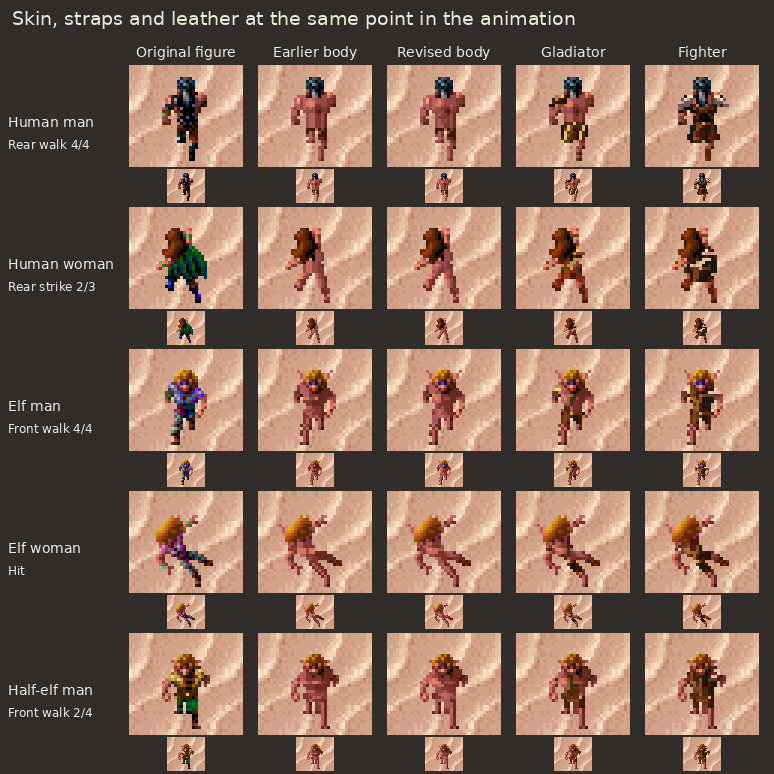

# Skin beneath the stock outfits

[Watch all eight figures through all 29 poses](body-texture.gif). Each group shows the original, the cleaned body, the Gladiator and the Fighter on the same arena tile. The small copy is game size. Use the original to locate the light on surviving skin, the Gladiator to see whether it continues under a strap, and the Fighter to judge how much shape survives beside a fully clothed figure. The two humans, dwarves and elves use empty-slot Loader outfit renders. The half-elf outfits are art-study renders.

| Figures | Where to look |
|---|---|
| Human | In rear idle and the four rear steps the man's shoulder blade catches a short diagonal light. It tapers beside the spine and returns at the hip. Rear walk 4 (10) shows the shading above the Gladiator's kilt. The woman's near hip now turns into shadow above the thigh through rear idle, the four rear steps and all three rear strikes. Compare the back of the leg below her hair in rear strike 2 (19). |
| Dwarf | The near shoulder, bent elbow and lit knee already read beside the Gladiator's straps. The rebuilt areas are small. The man's entire 29-pose sequence has only 196 eligible 2×2 squares wholly inside newly exposed skin. Both dwarves retain their existing paint. Compare the man's rear idle (01) and the woman's front walk 1 (03). |
| Elf | The light on the near ribs now turns down toward the waist, leaving a separate, shorter light on the far side. The highlights on the thigh, knee and calf follow each foot's height. Check the man's front walk 2 and 4 (04, 06). On the woman's hit (27), a short light follows the upper edge of the raised thigh as it swings sideways. |
| Half-elf | The male figure inherits the elf's rib and thigh shading. Where his wider torso duplicates a column, an intermediate skin shade carries the light across it. The woman inherits the human woman's revised hip and thigh beneath her shorter hair. Compare the male front walk with the female rear walk. |

## Locating flat areas

These percentages count uniform 2×2 squares among squares entirely inside the body's skin-color mask, pooled across all 29 poses within the original picture bounds. The last two columns restrict the mask to body skin where the aligned original had another color or transparency. The baseline is the previous body review at `aad133b`. The skin range (palette indices 128–153) overlaps some hair and leather. Judge flagged patches against the pictures before deciding what to repaint.

| Figure | Whole base before | Whole base now | Reconstructed area before | Reconstructed area now |
|---|---:|---:|---:|---:|
| Human man | 9.4% | 7.9% | 17.0% | 12.8% |
| Human woman | 5.1% | 4.2% | 4.8% | 2.2% |
| Dwarf man | 2.2% | 2.2% | 13.8% | 13.8% |
| Dwarf woman | 2.7% | 2.7% | 11.8% | 11.8% |
| Elf man | 12.7% | 8.3% | 21.8% | 14.8% |
| Elf woman | 7.9% | 5.4% | 14.5% | 12.8% |
| Half-elf man | 8.7% | 7.7% | 15.4% | 14.0% |
| Half-elf woman | 4.7% | 4.3% | 7.2% | 6.1% |

To regenerate the current comparison from an installation, run `python prototypes/bodyreview.py GAME_DIR OUTPUT_DIR` at the repository root. The human man's indexed body edits are in the human outfit archive under `Study/walk-body` and `Study/combat-body`.
