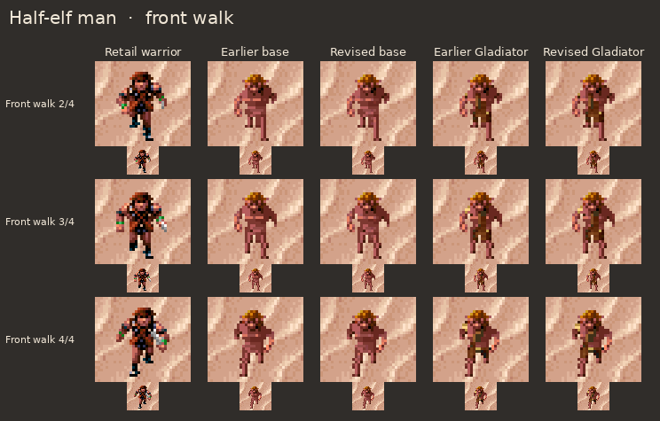

# Skin beneath the stock outfits

[Watch both figures of all four races through all 29 poses](body-texture.gif). Read each group from left to right. The original shows which anatomy the game artist painted, the body base shows what was reconstructed, and the Gladiator shows which marks survive beside the strap and kilt. The small copy is game size. All figures share the arena floor and ground line. The first six Gladiators use the empty-slot Loader picture builder. The half-elves use their Loader-made original figures and the proposed outfit art. The human man’s cleaned body comes from the indexed body study.

| Figures | Where to look |
|---|---|
| Human | On the man, compare the broad area below the shoulder blades in rear idle (01) with rear walk 4 (10). The Gladiator’s strap breaks up the middle of the back, but a smooth patch beside it stays visible. On the woman, rear strike 2 (19) exposes more of the back on the base than the finished Gladiator shows. |
| Dwarf | The original shoulders and arms give a reference close to the rebuilt torso. The man’s exposed patches are particularly small. On the woman, compare the near shoulder in front walk 1 (03) and the hip in rear walk 4 (10) before deciding whether another shade would read at game size. |
| Elf | The man’s front walk 2 and 4 (04, 06) are the clearest remaining candidates for a skin revision. A bright band crosses the ribs and the long thigh highlight changes little towards the knee. The Gladiator still exposes parts of both. On the woman, the hit (27) shows a broad smooth plane between the waist and the lifted leg. |
| Half-elf | The man’s wider torso inherited the elf’s horizontal band. In front idle and all four forward steps, ten indexed pixels per pose now taper the chest and thigh highlights and turn the waist into shadow. Follow the exposed edge beside the Gladiator’s strap to judge the change. On the woman, compare the shorter nape and the shoulder under it through the rear walk. |

## Locating flat areas

The table counts same-color 2×2 squares as a percentage of eligible squares, pooled across the 29 indexed frames. Each square must lie entirely inside the mask. The original and base columns use the game's skin palette indices (128–153). The last column uses only base skin where the aligned original had another index or transparency. Some leather and hair share those colors, so the mask is a way to find a pose for visual inspection. The small retail skin samples, especially on a covered elf, also make a poor target for a whole reconstructed back.

| Figure | Original skin colors | Base skin colors | Newly exposed skin colors |
|---|---:|---:|---:|
| Human man | 2.3% | 9.4% | 17.0% |
| Human woman | 2.5% | 5.1% | 4.8% |
| Dwarf man | 2.0% | 2.2% | 13.8% |
| Dwarf woman | 0.0% | 2.7% | 11.8% |
| Elf man | 0.0% | 12.7% | 21.7% |
| Elf woman | 1.0% | 7.8% | 14.4% |
| Half-elf man | 0.0% | 8.7% | 15.4% |
| Half-elf woman | 0.1% | 4.7% | 7.2% |

Before the front-walk revision, the half-elf man’s newly exposed skin measured 17.0% on this mask. Follow the shading in motion before changing another pose. The retail warrior’s own upper arm has a short lit ridge and a plain shadow beside it, both of which stay readable at 1×.
