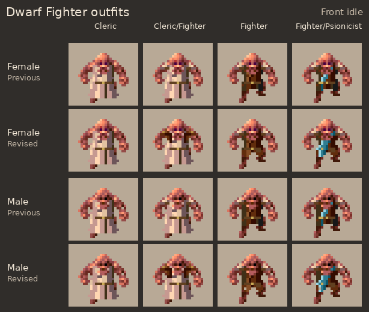
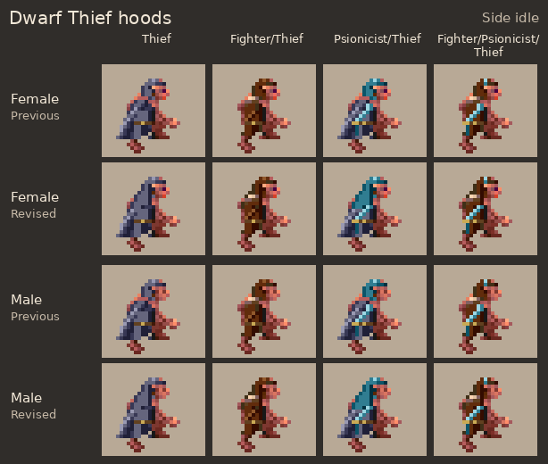
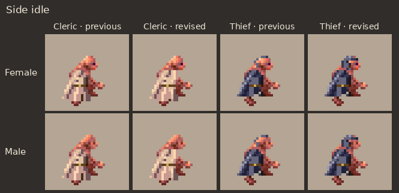
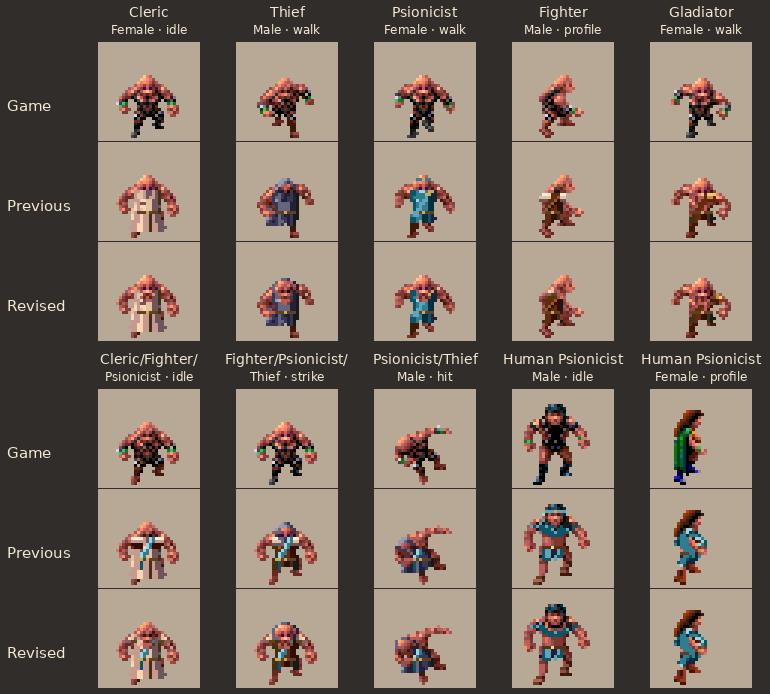
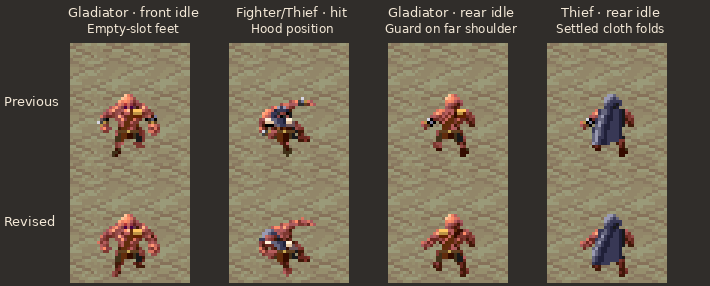
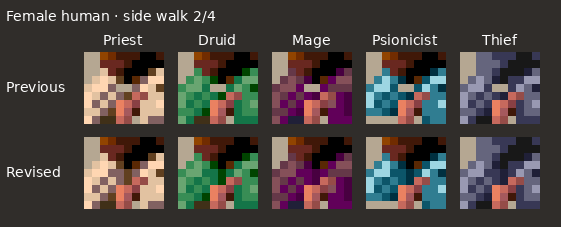
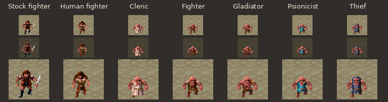
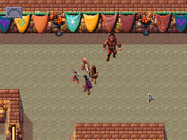

# Dwarf and human outfit review

Both dwarf figures were checked across 12 legal builds and both humans across eight class outfits. Each figure has 15 idle and walking poses and 14 combat poses. The review covered 696 dwarf and 464 human outfit poses. The still sheets below use the decoded loader output. [Review checklist](workflow.md#human-figure-review-checklist)

## Fighter shoulders, hips and sash

The comparison opens on front idle. Look across the first two columns to compare the plain Cleric’s cream shoulders with the Cleric/Fighter’s fitted dark leather. In the Fighter column, the two flaps below the belt follow the thighs through the stride. The old right flap used the same near-black shade across several rows and could extend into the space beside the leg.

In side idle and all four side steps, the Fighter’s jerkin has overlapping leather panels with small pale stitches. The crossing wrist still passes in front on step three. The Fighter/Psionicist wears a broader teal sash with a shaded edge, visible across the chest and the back. Both triples that combine Fighter and Psionicist use this sash.

## Thief hood in profile

In side idle and several walking frames, a strip of skin separated the back of the hood from the garment. The revised fold follows the dwarf’s lean from behind the ear onto the shoulder. In the first side strike and the side bow, follow the fold on the far side while the hand crosses the head. The comparison opens on side idle, then shows the walk, strike and bow poses for both figures in all four Thief outfits.

## Thief hood and Cleric profile

The comparison below records the earlier profile pass. The following hood revision opened the front below the chin and matched each multiclass hood to its leather or teal clothing. [Watch all four current Thief hoods](dwarf-thief-hoods.gif)

The comparison opens on side idle. Follow the Cleric’s cream fold from beneath the jaw to the belt as the wrist moves across it. The previous robe showed mainly behind the arm. On side-walk step 3 the raised arm crosses the chest. A six-pixel correction to the shared wrist mask keeps the cloth above the knuckles visible on the Cleric and the other dressed torsos. On the Thief, the slate crown extends down behind the ear while leaving the eyes and cheek visible. The loop covers all 29 poses on both dwarves.

The profile review covered idle, all four walking steps, all three strikes, the side bow and both oblique bow poses. The Cleric/Fighter, Cleric/Psionicist and Cleric/Fighter/Psionicist share the front fold. The three Thief multiclasses share the crown. [All twelve builds in motion](dwarves.md)

## Faces and shoulder guards

The first row of each comparison shows the original game pose. Read down each column to see the previous outfit and the revised one. In the Thief’s front walk, follow the dark line of the eyes and the lighter cheek below it. In the Fighter’s profile, watch where the bone highlight turns down the upper arm.

The dwarf Cleric’s collar now opens below the chin. The Thief’s front hood leaves the face visible down to the jaw. Both human Psionicists and the dwarf Psionicist carry their identifying color on the garment. The Fighter’s bone caps and the Gladiator’s single bronze guard follow the visible arms in each source pose, including the female dwarf’s distinct first strike. The multiclasses use the same face openings and shoulder placements as their parent outfits.

[Single classes in motion](dwarf-single.gif) · [Two classes](dwarf-double.gif) · [Three classes](dwarf-triple.gif)

## Dwarves

| Finding | Correction and retest |
|---|---|
| A horizontal strip of leather appeared at the bottom of the bare feet. It followed the lowest rows of the picture as the feet traded places. | Restored skin shading along the original leg and foot outlines. Registered the toes separately, including the raised foot. Compared both dwarves’ original, cleaned body, and Gladiator through idle, walk, strike, bow, hit, and fallen. |
| A second foot marker on side-walk step 1 reached toward the hanging hand. Step 3 exposed a small raised heel that lacked its own marker. | Moved the second boot treatment to the visible heel on step 3. Checked the two steps independently and the complete four-step profile walk in both directions. The Cleric’s robe can hide a foot that is visible on the Gladiator. |
| In recoil, the hood sat on the shoulder beside the face. With a helm and bow equipped, the side shot could leave a piece of helm above the figure. | Repositioned the hood on the lowered head. The loader now fits the circlet to the registered crown and brow while protecting the foreground hand and bow. Reran the combined kit through all 29 poses and all 12 builds. |
| The Gladiator’s single shoulder guard changed anatomical sides on the turn away. The Thief’s rear cloak had a straight, evenly spaced fold. | Reversed the guard position in rear views and bent the fold from shoulder to hem. Compared rear idle with steps 1–4 and checked the Fighter/Thief and three-class outfits for loss of their shoulder, hood, or sash detail. |

[Original, cleaned base, and Gladiator in motion](checklist-dwarf-bodies.gif) · [Female dwarf, every frame](checklist-dwarf-female.png) · [Male dwarf, every frame](checklist-dwarf-male.png) · [All dwarf builds in motion](dwarves.md)

## Humans

The woman had a two-pixel opening where the shoulder cloth passes below the hair on **side-walk step 2**. It appeared on the Cleric, Druid, Mage, Psionicist, and Thief. The repair continues the neighboring fold into both pixels and assigns them the matching equipped-cloak shades. The Ranger’s strap already covered that spot. Open spaces beside the arms, between the legs, and under the lifted foot were compared with the uncloaked figure and retained.

The earlier male pass focused on the following details. The Psionicist brow correction is shown above. The Fighter and Cleric necklines clear the head, the plum mantle keeps its front and rear contrast, and the Thief’s shorts remain visible through the stride. Both human reviews included the female rear walk and Druid hem, the first side strike, bow, hit, fallen, and the stop after the walk. [Female human, every frame](checklist-human-female.png) · [Male human, every frame](checklist-human-male.png) · [Human animations](README.md#female-human)

## Game-size comparison

The stock Shattered Lands fighter and finished human Fighter share a ground line with the five dwarf single classes. The upper rows show native pixels on map terrain and on a darkened copy of that terrain. The lower row doubles each pixel.

## Equipment

For every outfit and pose, the loader rendered nine states: empty, Boots of Speed, cloak, shield, sword, bow with ammunition, mundane chest plate, magical chest plate, and a combined kit. Across **10,440 renders**, the wider reference canvas detected no clipped pixels. The finished frames contained no detached islands, the bow retained its protected pixels, and the plate changed only its assigned chest pixels. Each visible foot region responded to boots. Rebuilding the empty state recovered the original outfit. A four-member party fixture also exercised the dresser update: equipping boots changed all four figures, removing them restored both picture chunks per member, and switching the feature off restored the stock chunks.

To rerun the full pose and equipment sweep with a local game installation, run `python prototypes/check_class_frames.py GAME_DIR` from the repository root.

The comparison loop shows four representative outfits in the same pose. The shield and sword appear together here so their grips can be followed through a swing. The last column shows the empty-slot appearance after removal. The magical plate column shows the loader’s shine pixels; the DOSBox crop below shows palette cycling over time.

[Compare equipment across all 29 poses](checklist-equipment.gif)

## DOSBox check

Before the face and shoulder revision, a disposable copy of the slave-pens save displayed four staged loader outputs: a male dwarf Fighter/Psionicist/Thief with Boots of Speed, a female dwarf Cleric with a cloak, a male human Mage in magical plate, and a female human Fighter with a shield. The party was observed standing and moving at 320 × 240. A stationary capture sequence showed the Mage’s plate pixels cycling.

[Enlarged DOSBox palette cycle](checklist-dosbox-cycle.gif)

**Pending in play:** changing inventory or toggling the display option with the loader attached. The test environment denied the loader write access to the disposable DOSBox process. The captures demonstrate the fixed equipment states in the game. The equip, remove, and option-off transitions above were exercised through the loader against a test party.
