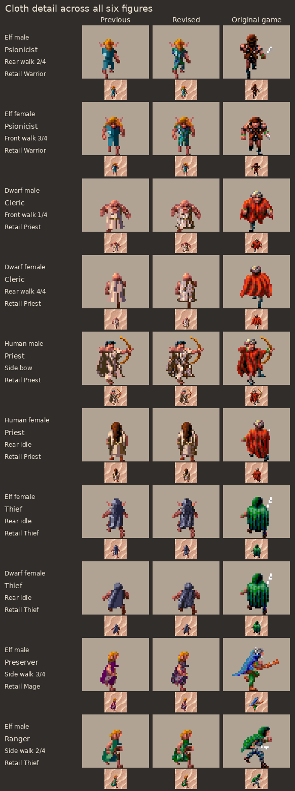
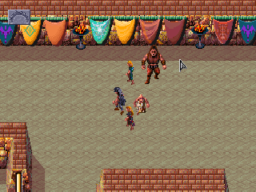

# Cloth detail beside Shattered Lands figures

The largest changes are on the elf Psionicists, the cream robes and the slate hoods. On the Psionicist, follow the teal from shoulder to waist through the rear walk. On the dwarf Cleric, look below the swinging wrist and along the cream hem against bright sand. On the Thief, the hood catches light across the crown and darkens as the cloth turns into the neck. The human woman already had more variation in her garments and received a lighter pass.



[Watch four representative outfits through the side, rear, and front walks](cloth-detail.gif) · [All human and dwarf animations](README.md) · [All elf animations](elves.md)

The middle two steps of the male elf Preserver and Ranger still have the broadest outline. Both now have a dark recess and a lit fold inside that panel. The squared-off trailing corner remains visible in profile. [Watch those four steps beside the retail Mage and cloaked human](elf-stock-side-walk.gif)

## In the arena



This 320×240 DOSBox capture uses four staged party pictures with empty equipment slots. The party shows a male elf Psionicist in teal, a male human Thief in slate, a female dwarf Cleric in cream, and a female elf Preserver in plum. The large figure is an original arena character. The walking comparisons above are synchronized loader renders. The equipment checks below were run against the renderer. Live Loader attachment was unavailable in this run.

## How to read the measurements

The comparison uses the loader’s assembled pictures at `c250808` and after the detail pass, with equipment slots empty. Each pair uses identical pixel coordinates. The sample includes visible chest, leg and cloak pixels and any garment pixels the pass changed, including hood pixels. It excludes the registered bow, foreground arm and foot regions and the base’s skin ramp (indices 128–154). This mask can give different results from a hand-traced cloth sample.

* **Flat** is the percentage of fully sampled 2×2 squares with one palette index.
* **Isolated** is the percentage of sampled pixels that differ from each of their four orthogonal neighbors. Neighbors outside the sample count as different.
* **Colors** counts distinct palette indices in a pose’s sample.
* **Dark edge** is the percentage of sampled pixels touching transparent ground on at least one side with RGB luminance below 70 on a 0–255 scale (0.299 R + 0.587 G + 0.114 B). A pose with no eligible edge contributes zero.

For a retail check, an 8×8 patch inside the rear-idle Priest robe (1563) measured 2% flat squares and 61% isolated pixels. The retail Thief cloak (630) measured 0% and 52%, and the Mage cloak (724) measured 0% and 58%. These are interior swatches. The per-outfit figures below include borders and smaller pieces, where isolated pixels are more common. The retail Warrior (1252) is also shown for leather and bare-arm contrast.

## Single-class results

All 40 single-class outfits average below 5% flat squares. Thirty-nine average at least 50% isolated pixels. The human woman’s Thief averages 49.8%. Each entry below gives the average of the 29 pose measurements before → after. The last column identifies the three revised poses with the highest share of flat squares. Some narrow straps and small panels have fewer than 18 colors. The elf Psionicists average about 18, below the suggested 25 for an elf. At game size their tunics keep a continuous field of teal across the folds.

[Per-pose measurements for all 3,306 single- and multiclass pictures (CSV)](cloth-detail-measurements.csv)

## Human male

| Outfit | Flat % | Isolated % | Colors | Dark edge % | Flattest revised poses |
|---|---:|---:|---:|---:|---|
| Priest | 15.9 → 0.5 | 19.2 → 75.7 | 5.5 → 24.5 | 40.6 → 73.5 | Front strike 3/3, Side bow, Fallen |
| Druid | 17.5 → 0.7 | 23.3 → 65.2 | 10.2 → 24.1 | 53.4 → 73.0 | Side walk 1/4, Rear walk 1/4, Front idle |
| Warrior | 11.2 → 3.2 | 28.9 → 56.5 | 11.4 → 16.9 | 78.8 → 80.5 | Front bow, Side walk 1/4, Rear strike 2/3 |
| Gladiator | 3.9 → 0.9 | 22.9 → 51.2 | 9.1 → 14.9 | 76.6 → 82.2 | Fallen, Rear strike 3/3, Side strike 2/3 |
| Mage | 15.5 → 0.6 | 29.9 → 69.6 | 7.6 → 21.3 | 81.6 → 90.4 | Rear strike 2/3, Rear bow, Side strike 1/3 |
| Psionicist | 9.8 → 0.1 | 29.9 → 85.9 | 6.5 → 20.9 | 80.1 → 87.1 | Rear walk 3/4, Front idle, Rear idle |
| Ranger | 13.8 → 0.2 | 31.1 → 68.0 | 9.8 → 20.5 | 71.7 → 79.0 | Side bow, Front walk 3/4, Side strike 2/3 |
| Thief | 17.0 → 1.5 | 24.0 → 63.6 | 6.6 → 16.4 | 65.8 → 77.7 | Side walk 3/4, Side strike 2/3, Rear idle |

## Human female

| Outfit | Flat % | Isolated % | Colors | Dark edge % | Flattest revised poses |
|---|---:|---:|---:|---:|---|
| Priest | 17.9 → 2.6 | 23.7 → 52.1 | 6.1 → 12.3 | 31.5 → 61.6 | Rear bow, Side bow, Rear strike 2/3 |
| Druid | 12.0 → 3.5 | 26.7 → 56.1 | 9.4 → 19.4 | 27.0 → 53.1 | Front idle, Front walk 1/4, Front walk 2/4 |
| Warrior | 10.4 → 3.6 | 34.1 → 53.9 | 12.0 → 17.2 | 74.2 → 89.4 | Rear strike 2/3, Side walk 3/4, Front walk 3/4 |
| Gladiator | 3.0 → 3.0 | 35.0 → 65.5 | 4.7 → 6.9 | 1.8 → 53.9 | Rear walk 3/4, Rear walk 4/4, Rear strike 3/3 |
| Mage | 11.3 → 2.4 | 29.3 → 57.8 | 5.0 → 10.6 | 45.1 → 77.0 | Front strike 3/3, Front strike 2/3, Side bow |
| Psionicist | 12.5 → 4.6 | 32.7 → 55.4 | 6.2 → 11.5 | 56.9 → 75.3 | Rear walk 3/4, Rear walk 4/4, Front walk 3/4 |
| Ranger | 8.5 → 2.3 | 31.9 → 56.1 | 11.0 → 19.7 | 52.0 → 71.4 | Side strike 2/3, Side strike 3/3, Front strike 3/3 |
| Thief | 8.0 → 2.8 | 27.9 → 49.8 | 5.0 → 12.1 | 53.8 → 67.9 | Rear strike 2/3, Front walk 4/4, Side strike 2/3 |

## Dwarf male

| Outfit | Flat % | Isolated % | Colors | Dark edge % | Flattest revised poses |
|---|---:|---:|---:|---:|---|
| Cleric | 22.2 → 0.1 | 11.3 → 83.7 | 6.0 → 24.0 | 12.3 → 66.3 | Front walk 4/4, Rear walk 4/4, Front idle |
| Fighter | 21.4 → 0.3 | 17.0 → 68.4 | 6.9 → 12.6 | 69.5 → 90.7 | Side bow, Rear strike 1/3, Rear walk 1/4 |
| Gladiator | 26.3 → 1.6 | 9.8 → 58.9 | 6.0 → 10.3 | 66.5 → 93.1 | Front strike 1/3, Front idle, Rear idle |
| Psionicist | 20.4 → 0.0 | 12.3 → 79.5 | 7.2 → 19.2 | 70.0 → 80.0 | Front idle, Rear idle, Side idle |
| Thief | 20.8 → 0.7 | 16.8 → 63.2 | 7.0 → 15.9 | 66.1 → 72.5 | Side strike 3/3, Rear strike 1/3, Side idle |

## Dwarf female

| Outfit | Flat % | Isolated % | Colors | Dark edge % | Flattest revised poses |
|---|---:|---:|---:|---:|---|
| Cleric | 21.7 → 0.1 | 11.4 → 83.8 | 6.0 → 24.1 | 12.2 → 65.7 | Front walk 4/4, Rear walk 4/4, Front idle |
| Fighter | 21.0 → 0.3 | 16.8 → 67.1 | 7.1 → 12.8 | 69.9 → 91.4 | Side bow, Rear strike 1/3, Rear walk 1/4 |
| Gladiator | 27.1 → 0.9 | 9.5 → 58.6 | 6.0 → 10.5 | 65.2 → 93.3 | Front strike 1/3, Rear idle, Rear strike 1/3 |
| Psionicist | 20.4 → 0.0 | 12.6 → 79.1 | 7.4 → 19.4 | 70.1 → 79.4 | Front idle, Rear idle, Side idle |
| Thief | 21.2 → 0.7 | 17.7 → 63.8 | 7.0 → 15.9 | 66.3 → 71.9 | Side strike 3/3, Rear strike 1/3, Side idle |

## Elf male

| Outfit | Flat % | Isolated % | Colors | Dark edge % | Flattest revised poses |
|---|---:|---:|---:|---:|---|
| Cleric | 22.9 → 0.1 | 9.1 → 80.7 | 6.9 → 24.1 | 13.6 → 63.3 | Side strike 2/3, Rear idle, Front idle |
| Fighter | 16.9 → 1.2 | 12.6 → 60.4 | 9.1 → 16.8 | 56.3 → 75.9 | Side strike 1/3, Side walk 1/4, Front strike 1/3 |
| Gladiator | 26.4 → 1.2 | 16.4 → 64.4 | 8.9 → 13.4 | 65.1 → 81.7 | Side walk 1/4, Side idle, Rear idle |
| Preserver | 21.2 → 0.6 | 9.7 → 71.2 | 9.0 → 25.2 | 74.6 → 87.4 | Front strike 3/3, Side strike 1/3, Rear walk 4/4 |
| Psionicist | 38.3 → 0.6 | 5.8 → 73.7 | 4.8 → 18.1 | 73.7 → 80.8 | Front walk 4/4, Rear walk 1/4, Rear walk 3/4 |
| Ranger | 17.6 → 0.6 | 16.2 → 65.3 | 9.8 → 21.5 | 73.9 → 86.6 | Side strike 1/3, Front walk 1/4, Hit |
| Thief | 24.0 → 1.6 | 8.7 → 60.9 | 8.8 → 22.2 | 72.0 → 76.7 | Side strike 1/3, Side idle, Front strike 3/3 |

## Elf female

| Outfit | Flat % | Isolated % | Colors | Dark edge % | Flattest revised poses |
|---|---:|---:|---:|---:|---|
| Cleric | 21.1 → 0.0 | 9.4 → 81.6 | 6.9 → 24.1 | 10.4 → 60.3 | Front idle, Rear idle, Side idle |
| Fighter | 17.1 → 0.9 | 15.7 → 65.8 | 8.7 → 15.3 | 54.7 → 78.4 | Side walk 1/4, Front walk 1/4, Rear strike 2/3 |
| Gladiator | 26.7 → 0.8 | 19.9 → 70.3 | 8.4 → 13.0 | 61.8 → 86.3 | Side bow, Side idle, Rear strike 2/3 |
| Preserver | 18.0 → 0.5 | 11.2 → 73.1 | 8.8 → 24.3 | 73.2 → 88.3 | Front walk 2/4, Rear strike 2/3, Front strike 1/3 |
| Psionicist | 37.3 → 0.6 | 7.0 → 74.0 | 4.6 → 17.9 | 72.0 → 80.3 | Rear walk 1/4, Rear walk 2/4, Fallen |
| Ranger | 14.4 → 0.5 | 18.9 → 68.0 | 9.6 → 21.3 | 72.6 → 86.1 | Side walk 3/4, Side strike 1/3, Rear walk 1/4 |
| Thief | 24.1 → 1.8 | 9.9 → 62.6 | 9.1 → 22.4 | 71.6 → 76.5 | Rear strike 3/3, Side walk 1/4, Rear strike 2/3 |

## Registration and equipped renders

Across all 114 figure/outfit combinations and 29 poses, the occupied pixels, transparent gaps, registered head, cloak coverage, forearm, bow and foot masks match the preceding build. Native skin-ramp pixels and the visible pixels within the forearm, bow and foot regions were compared separately.

The loader rendered each pose with empty slots, boots, cloak, shield, sword, bow with ammunition, ordinary plate, magical plate, and a combined loadout. Checks cover the bitmap bounds, detached pixels, both exposed boot regions, the native bow and cloak coverage, restoration after removal, and plate recoloring outside the chest. The equipped patterns inherit the existing equipment colors and masks.

## Rebuilding the detail

The authoring command below reads the palette and fold samples from a local Shattered Lands installation. Each archive retains the paint from before the shading pass. The loader consumes the finished pictures directly.

```sh
python prototypes/outfitdetail.py GAME_DIR SOURCE_ARCHIVE.zip OUTPUT_ARCHIVE.zip
```

The dwarf and elf layer exporters also apply this step when invoked with `--layers`.
