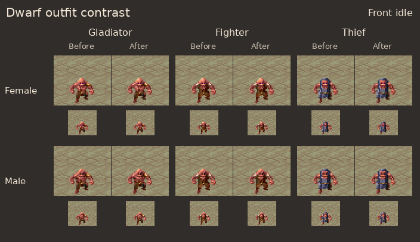
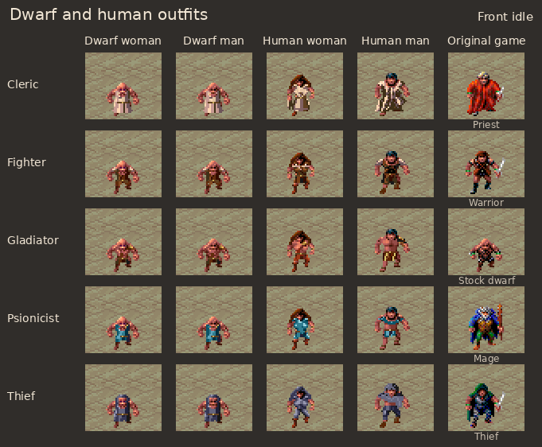
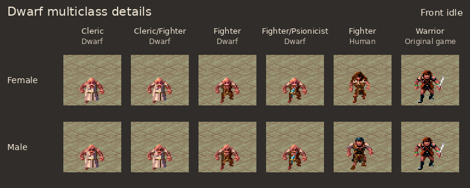
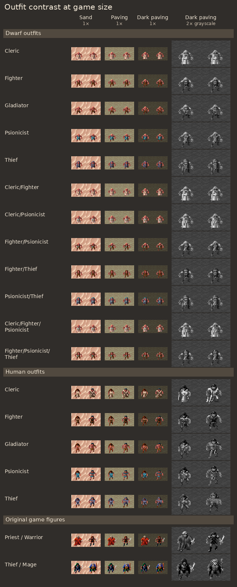

# Dwarf outfit contrast at game size

The dwarf Cleric’s cream folds and the Psionicist’s teal tunic read clearly beside the humans. The contrast pass focused on three smaller details that were harder to see in motion.

[See the original dwarf comparison, including the recoil close-ups](original-dwarves.md)

## Gladiator, Fighter, and Thief before and after

Each pair shows the previous outfit on the left and the current outfit on the right. The small figures are at game size and the figures above them are enlarged 2×. Look at the Gladiator’s upper shoulder rim in front idle, the Fighter’s light stitch just above the crossing wrist in side-walk step 3, and the Thief’s slate ridge as the hood turns into profile. Shared garments receive the same shading where visible on multiclasses. The Cleric/Fighter keeps its pale shoulder caps and the Fighter/Psionicist keeps its narrow teal sash.

## Dwarves, humans, and original game figures in motion

Each row follows one outfit through the 27 poses shared by all the comparison figures. The side walk repeats. The four party figures use the branch sprite loader with empty equipment slots. The last column uses original game art, including the stock male dwarf beside the Gladiators and the blue Mage beside the Psionicists as palette references. The original figures retain their depicted gear. All tiles use the same paving and 2× nearest-neighbor enlargement.

- **Cleric.** The dwarf’s cream hem splits into a light panel and a dark fold, much like the human woman’s robe. The split is easy to follow on paving. On bright sand the shaded fold does more to define the hem than the highlight. The original red Priest shows how a saturated color can stand out even with a narrower brightness range.
- **Fighter and Gladiator.** In front view the Fighter’s light stitching and dark jerkin separate the armor from the arms. In side-walk step 3 both dwarves turn far enough that skin, leather, and bronze form a narrow brown strip. The human woman’s light shoulder and the original Warrior’s dark boots and bright weapon remain visible in the same pose. This is the view where the two dwarf classes are easiest to confuse.
- **Psionicist.** The teal tunic stays distinct from the skin on both dwarves, as it does on the humans. The original blue Mage makes a larger patch of color across the back. The teal is clearest from the front, where it runs across the chest and down to the waist.
- **Thief.** The dwarf’s slate hood frames the face on sand and ordinary paving. The raised fold now has a lighter slate edge in front and profile. Its outer shadow still blends into dark paving. The human man’s muted hood is close in overall contrast. The human woman has a lighter fold, and the original green Thief has a stronger light-to-dark edge.

## The two restored multiclasses

The upper row uses female party figures and the lower row uses male party figures. The same original Warrior appears in both as a reference.

The **Cleric/Fighter** reads as a Cleric first. Look at the outside edge of each shoulder in front idle, where the dark underside separates the pale cap from the arm. In the side walk the cap and cream sleeve nearly merge. Only 8–9 overlapping figure pixels change between Cleric and Cleric/Fighter in each side-walk step.

The **Fighter/Psionicist** is easier to distinguish from the Fighter in motion. The teal line crosses brown leather, and the rear idle exposes more of it than the front idle. In the third front strike the forearm passes over the line, leaving only five overlapping pixels different from the plain Fighter. That brief occlusion gives little reason to widen the sash for the rest of the cycle.

## Terrain at native resolution

Each party pair shows the woman on the left and the man on the right in front idle. The first three columns are at 1× in the full-resolution image. Sand and ordinary paving are sampled from game captures. The dark-paving column uses the same paving with its RGB values multiplied by 0.48 as a visibility test. Sprite colors stay at their game values. The final column enlarges that composite in grayscale to show which details depend on hue.

## Brightness range across the shared poses

| Outfit | Dwarf woman | Dwarf man | Human woman | Human man | Original figure |
|---|---:|---:|---:|---:|---:|
| Cleric | 149 | 141 | 166 | 146 | 97 · Priest |
| Fighter | 123 | 118 | 120 | 110 | 157 · Warrior |
| Gladiator | 122 | 111 | 108 | 121 | 145 · stock dwarf |
| Psionicist | 122 | 112 | 106 | 112 | 120 · Mage |
| Thief | 97 | 97 | 122 | 100 | 142 · Thief |

For each pose, the range is the difference between the 90th and 10th percentile brightness of opaque figure pixels, using grayscale weights of 0.299 red, 0.587 green, and 0.114 blue on a 0–255 scale. The table gives the median over 27 poses. It includes skin, hair, clothing, and any gear drawn into the original figure. The terrain sheet shows the separate question of how well a particular edge stands out against the ground.
