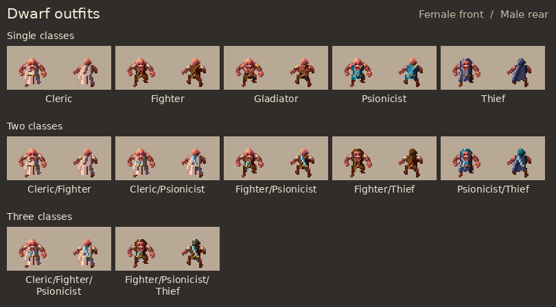
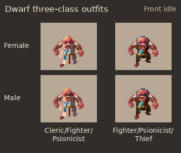

# Dwarf class proposals

Each tile in the overview pairs the female dwarf facing forward with the male dwarf facing away. The animations below show both in the same pose. The branch loader now selects these registered outfits from the dwarf’s class slots. The [dwarf and human checklist results](checklist-review.md) include equipment comparisons, screenshots, and the remaining live inventory check. [Outfit workflow](workflow.md) · [Playable combinations](../../PLAYER-GUIDE.md#more-than-one-class)

[Compare dwarf outfit contrast with both humans and the original game figures](contrast.md) · [Compare the revised Fighter builds](dwarf-fighter-review.gif) · [Watch the previous and revised Thief hood and Cleric robe side by side](checklist-review.md#thief-hood-and-cleric-profile) · [Compare the original faces and shoulders with the previous and revised outfits](face-shoulder-review.png)

## Single classes

| Class | Proposed outfit |
|---|---|
| Cleric | The cream robe opens below the chin and falls below the knee. A narrow highlight and brown recess break up the front folds. |
| Fighter | Small bone caps curve over the visible upper arms, with a leather edge under each. In profile, light stitching picks out the overlapping leather panels. Two tapered flaps hang below the belt. |
| Gladiator | A bronze guard on one shoulder and a narrow harness leave most of the torso and both arms visible. |
| Psionicist | A bright binding crosses the teal tunic below the jaw. The original brow and cheeks remain visible. |
| Thief | The slate hood frames the temples and leaves the chin open. The rear wrap falls past the belt, with dark shorts visible in front. |

## Two classes

| Combination | Proposed outfit |
|---|---|
| Cleric/Fighter | Keep the long cream robe. Small pale bone caps sit on the upper arms. |
| Cleric/Psionicist | Carry a teal sash diagonally across the robe. Its short end crosses the waist and leaves the robe folds visible below. |
| Fighter/Psionicist | Keep the leather tunic and bone caps. A narrow teal sash crosses the chest and back and ends just below the belt. |
| Fighter/Thief | The warm brown hood and short cowl match the Fighter’s leather tunic. The cowl fits between the bone caps. |
| Psionicist/Thief | The teal hood matches the sash across the Thief’s dark cloak. The longer rear hem distinguishes this figure from the hooded Fighter. |

## Three classes

| Combination | Proposed outfit |
|---|---|
| Cleric/Fighter/Psionicist | Add the teal sash to the Cleric/Fighter. The long cream hem, pale bone shoulders, and narrow teal diagonal occupy different parts of the figure. |
| Fighter/Psionicist/Thief | Add the teal sash to the Fighter/Thief. A narrow teal seam on the brown hood picks up the sash. The bone shoulder caps remain visible. |

The profile fold runs from behind the ear into the cloak or leather tunic. The front of the hood stays open below the chin. [Watch the profile before and after](dwarf-hood-profile.gif) · [Compare all four Thief hoods through 29 poses](dwarf-thief-hoods.gif)

To review the third class cue, compare Fighter/Thief with Fighter/Psionicist/Thief in the rear walk. Compare Cleric/Fighter with Cleric/Fighter/Psionicist in the bow and hit poses, where the forearm crosses the sash. The two dwarf figures also have different opening strikes.

To regenerate the overview and the animations from a local game installation, run `python prototypes/dwarfoutfits.py --proposals GAME_DIR OUTPUT_DIR` from the repository root.
