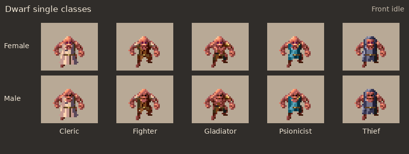
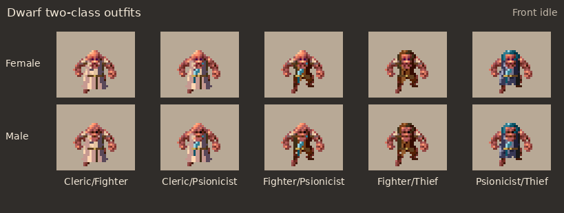

# Dwarf class proposals

Each tile in the overview pairs the female dwarf facing forward with the male dwarf facing away. The animations below show both in the same pose. The branch loader now selects these registered outfits from the dwarf’s class slots. The [dwarf and human checklist results](checklist-review.md) include equipment comparisons, screenshots, and the remaining live inventory check. [Outfit workflow](workflow.md) · [Playable combinations](../../PLAYER-GUIDE.md#more-than-one-class)

[Compare the original faces and shoulders with the previous and revised outfits](face-shoulder-review.png)

## Single classes

| Class | Proposed outfit |
|---|---|
| Cleric | The cream robe opens below the chin and falls below the knee. A narrow highlight and brown recess break up the front folds. |
| Fighter | Small bone caps curve over the visible upper arms, with a leather edge under each. A diagonal strap crosses the broad torso. |
| Gladiator | A bronze guard on one shoulder and a narrow harness leave most of the torso and both arms visible. |
| Psionicist | A bright binding crosses the teal tunic below the jaw. The original brow and cheeks remain visible. |
| Thief | A slate rim follows the crown and temples and opens around the face. The rear wrap falls past the belt, with dark shorts visible in front. |

## Two classes

| Combination | Proposed outfit |
|---|---|
| Cleric/Fighter | Keep the long cream robe. Set the Fighter’s paired bone caps on dark leather so they stand out against the cloth. |
| Cleric/Psionicist | Carry a teal sash diagonally across the robe. Its short end crosses the waist and leaves the robe folds visible below. |
| Fighter/Psionicist | Keep the leather tunic and bone caps. The teal sash crosses the chest and back, leaving the head bare. |
| Fighter/Thief | Use the Thief’s slate hood and a short cowl on the Fighter’s leather body. The cowl fits between the bone caps. |
| Psionicist/Thief | Wrap the teal sash over the Thief’s dark cloak. The longer rear hem distinguishes this figure from the hooded Fighter. |

## Three classes

| Combination | Proposed outfit |
|---|---|
| Cleric/Fighter/Psionicist | Add the teal sash to the Cleric/Fighter. The long cream hem, bone shoulders, and teal diagonal occupy different parts of the figure. |
| Fighter/Psionicist/Thief | Add the teal sash to the Fighter/Thief. The slate hood leaves the bone shoulder caps exposed, with the sash visible between them. |

To review the third class cue, compare Fighter/Thief with Fighter/Psionicist/Thief in the rear walk. Compare Cleric/Fighter with Cleric/Fighter/Psionicist in the bow and hit poses, where the forearm crosses the sash. The two dwarf figures also have different opening strikes.

To regenerate the overview and the three animations from a local game installation, run `python prototypes/dwarfoutfits.py --proposals GAME_DIR OUTPUT_DIR` from the repository root.
