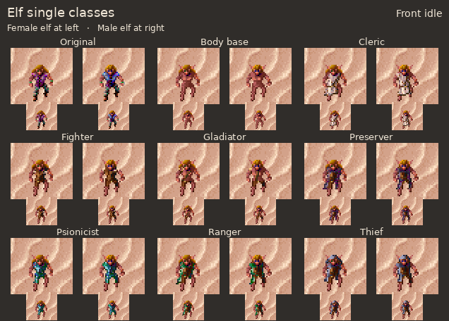
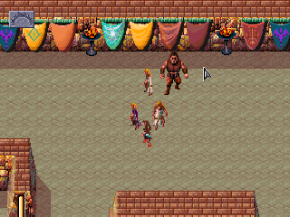

# Elf class outfits

Enable **What the party wears** for both elf figures. The loader reads the character’s class slots and selects one of 37 outfits. Each animation names the current pose and follows the elf through the game’s 15 walking and 14 combat frames.

## Face and body

The original head is the first column. Compare the mouth highlight and the dark pixel under the jaw with the cleaned body, cream Cleric collar, open Thief hood, and Psionicist tunic. The first cleanup painted over the lower face on both elves. The corrected body follows each figure’s jaw through the swing, including front strike 2 where the female elf bends low. Each enlarged crop has the full figure at game size underneath. The dressed figures include the loader’s pointed ears.

[Original, earlier base, and corrected base in three poses](elf-face-cleanup.png) · [Front idle close-up](elf-faces.png) · [Compare the first-pass art](elf-first-pass.gif)

## Single classes

Within each tile the female elf is on the left and the male on the right. The upper pair is enlarged 2×. The lower pair is game size. The figures wear their base class colors with empty equipment slots. The first two tiles show the original figure and the shared body.

| Class | Detail to follow |
|---|---|
| Cleric | The cream robe opens below the jaw and hangs behind the wrist in the side walk. |
| Fighter | The ochre stitching crosses the leather jerkin. Small bone caps turn with the upper arm. |
| Gladiator | The bronze guard and diagonal harness leave the chest and arms exposed. |
| Preserver | The deep plum mantle opens over leather in front and flares below the hair from behind. |
| Psionicist | The teal tunic carries its identifying color below the face. |
| Ranger | A leather strap crosses the green cape. The pinned corner sits higher over one hip. |
| Thief | The slate hood surrounds the face. Below it, a short cloak parts over leather shorts. |

[All 29 poses as stills](elf-singles-frames.png) · [Compare both elves with humans and original game figures on light and dark ground](elf-contrast.png)

## Multiclasses

Elves can combine Cleric, Fighter, Preserver, Psionicist, Ranger, and Thief in pairs or triples. Fighter and Ranger exclude each other. Gladiator is a single-class choice. The gallery uses creation-screen names. [Character creation rules](../../PLAYER-GUIDE.md#more-than-one-class)

| Builds in each gallery | Synchronized animation | Individual frames |
|---|---|---|
| Seven pairs, from Cleric/Fighter through Fighter/Psionicist | [Pair gallery A](elf-2-a.gif) | [Frame sheet](elf-2-a-frames.png) |
| Seven pairs, from Fighter/Thief through Ranger/Thief | [Pair gallery B](elf-2-b.gif) | [Frame sheet](elf-2-b-frames.png) |
| Eight triples, starting with Cleric/Fighter/Preserver | [Triple gallery A](elf-3-a.gif) | [Frame sheet](elf-3-a-frames.png) |
| Eight triples, ending with Psionicist/Ranger/Thief | [Triple gallery B](elf-3-b.gif) | [Frame sheet](elf-3-b-frames.png) |

Follow the hood to spot a Thief, the teal sash for a Psionicist, and the bone shoulder or leather tab for a Fighter. A Cleric keeps the cream robe. Adding a Preserver brings a plum mantle, and a Ranger paired with a Preserver adds green edging to that mantle.

## Frame-by-frame review

The review followed all 29 poses on both figures, starting with the seven single classes (406 dressed frames), then the 14 pairs (812), then the 16 triples (928). Each single was compared with its original figure and clean body. Each multiclass frame was compared with the same pose in every outfit obtained by removing one class.

| Where to look | What changed |
|---|---|
| Thief, side walk and rear view | The hood joins the collar in profile. Dark strands inside a lock now take the hood color with the surrounding hair. The front opening follows the original face. |
| Female Preserver, rear walk 2/4 | The mantle follows the shoulder under her hair. Its corner previously jumped outward with her swinging arm. |
| Side bow, side strikes and profile walk | The lining closes narrow gaps under the forearm. The Cleric skirt opens over the stepping knee. The lowered fingertips stay visible in the hit pose. |
| Fighter/Preserver, rear strikes | A small bone fastening on the mantle remains visible when the hair or raised arm hides the shoulder. Previously the female version matched the plain Preserver throughout this strike. |
| Fighter/Psionicist, side walk 3/4 | The teal sash remains visible beside the crossing wrist. This also carries through to the Thief variant. |
| Equipped weapons, forward strikes and hit | The female elf's sword previously ended at the bottom edge during recoil. Adjusted grip angles also keep long weapon points and staff butts inside the picture on both figures. |

The updated loader pictures retain every occupied pixel of the original silhouette, including the registered bow. The review checked enclosed patches of terrain against the original limb placement and kept openings between separated limbs. Each triple still differs from each of its parent pairs in every pose.

## Equipment and in-game review

[Watch both Preservers with boots, cloak, shield, mundane plate, and magical plate](elf-equipment.gif) · [Equipment frame sheet](elf-equipment-frames.png)

The loops above use the loader’s rendered pictures. The capture below is from the patched game running the PENS save with four looks staged in the party’s picture slots. The two Clerics wear cream, the male Preserver wears magical plate, and the female Fighter/Psionicist/Thief wears boots. The large figure is an arena character.

The renderer check covered 2,146 dressed poses in nine equipment states. It caught a floating helmet pixel where the final bow frame had used the bow tip to locate the crown. The loader fixture also exercised class selection, equipping boots, removing them, and switching the display off on both figures. Live inventory changes in DOSBox remain unverified because the loader could not attach to process memory. [Playtest notes](https://github.com/daaki85/darksun-obsidian-edition/blob/claude/class-outfits/playtest/logs/2026-11-22-elf-outfits.md)

The female elf uses walk picture 2059 and combat picture 2060. The male elf uses 2061 and 2062. From the repository root, rebuild the archive with `python prototypes/elfoutfits.py GAME_DIR obsidian-edition/dsloader --layers`. Regenerate the current galleries with `python prototypes/elfreview.py GAME_DIR obsidian-edition/docs/class-outfits`. [Class outfit workflow](workflow.md)
