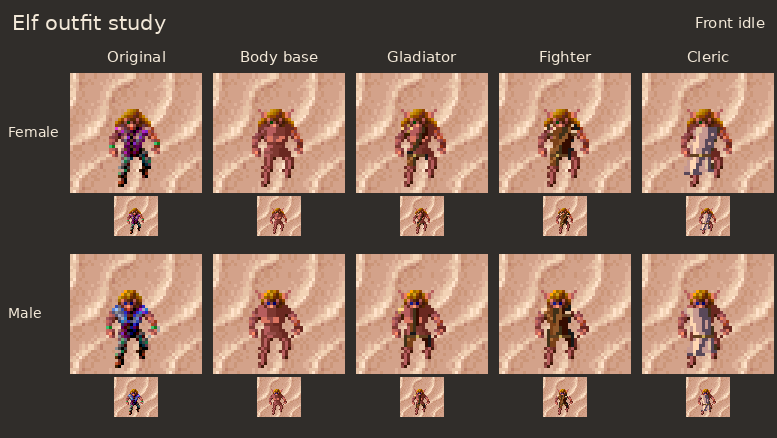

# Elf class outfits

**First art pass.** The two rows follow the female and male elf through their own walk, strike, bow, hit, and fallen poses. Each row starts with the original Shattered Lands figure, then shows the cleaned body and three proposed outfits. The large figures are at 3× and the small ones at game size. The study previews the loader’s pointed ears on the redrawn figures. Playable outfit selection and equipped renders come later.

## What to look for

| Outfit | Detail to follow |
|---|---|
| Gladiator | A bronze shoulder guard and a narrow leather harness leave the rib cage and arms visible. Follow the guard as the near shoulder turns away in a strike. |
| Fighter | The leather jerkin crosses the waist and the bone pieces follow the upper arms. Compare it with the Gladiator in the third side-walk step, when the crossing arm leaves little torso visible. |
| Cleric | A cream panel hangs below the belt. The profile hem follows the knees through all four steps, with the gold hair and crossing wrist in front. |

The feet and body outline were checked against each figure’s retail source in all 29 poses. The registered bow pixels keep their source colors. The side-walk checks found and corrected a one-pixel gap in the female Cleric’s fourth step. The next art decision is whether the Fighter and Gladiator are distinct enough in profile before those details carry into other outfits.

[Front idle at game size](elf-first-pass.png) · [Compare elves with the finished human outfits](elf-human-reference.png) · [Female elf frame sheet](elf-female-poses.png) · [Male elf frame sheet](elf-male-poses.png)

## Playable roster

| Build | Elf creation choices |
|---|---|
| Single class · 7 | Cleric, Fighter, Gladiator, Preserver, Psionicist, Ranger, Thief |
| Two classes · 14 | Any two of Cleric, Fighter, Preserver, Psionicist, Ranger, and Thief, except Fighter/Ranger |
| Three classes · 16 | Any three from the same six, excluding combinations that contain both Fighter and Ranger |

Gladiator is single-class only. Preserver, Psionicist, Ranger, Thief, and the multiclass combinations are pending art review after the three initial silhouettes. [Character creation and multiclass rules](../../PLAYER-GUIDE.md#more-than-one-class)

The female elf uses walk picture 2059 and combat picture 2060. The male elf uses 2061 and 2062. Regenerate the study from a local game installation with `python prototypes/elfoutfits.py GAME_DIR OUTPUT_DIR`. [Class outfit workflow](workflow.md)
