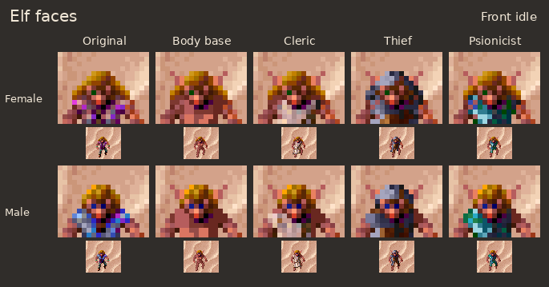
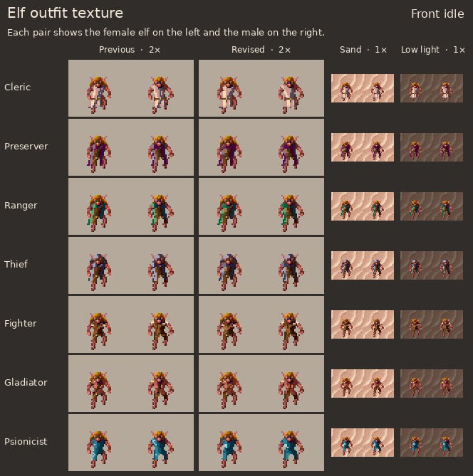
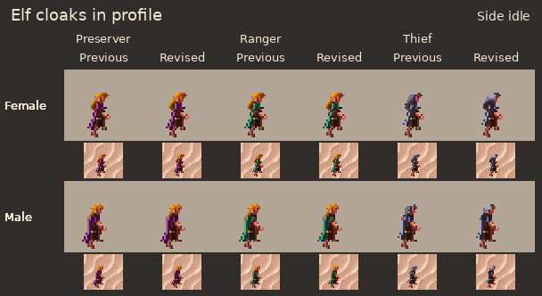
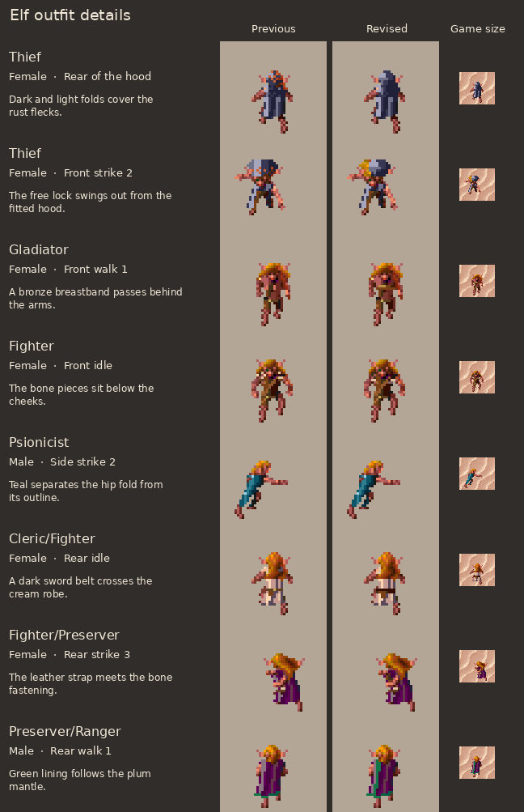
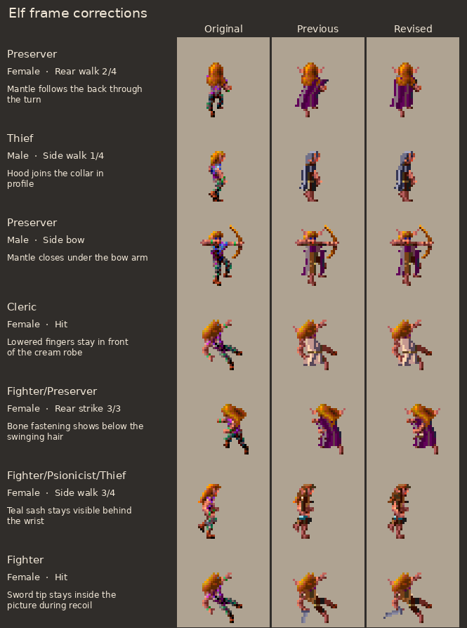

# Elf class outfits

Enable **What the party wears** for both elf figures. The loader reads the character’s class slots and selects one of 37 outfits. Each animation names the current pose and follows the elf through the game’s 15 walking and 14 combat frames.

[Revised cloth beside retail figures and before-and-after measurements](cloth-detail.md) · [Watch the male Preserver and Ranger in profile](elf-stock-side-walk.gif)

## Face and body

The original head is the first column. Compare the mouth highlight and the dark pixel under the jaw with the cleaned body, cream Cleric collar, open Thief hood, and Psionicist tunic. The first cleanup painted over the lower face on both elves. The corrected body follows each figure’s jaw through the swing, including front strike 2 where the female elf bends low. Each enlarged crop has the full figure at game size underneath. The dressed figures include the loader’s pointed ears.

[Original, earlier base, and corrected base in three poses](elf-face-cleanup.png) · [Front idle close-up](elf-faces.png) · [Compare the first-pass art](elf-first-pass.gif)

## Single classes

Within each tile the female elf is on the left and the male on the right. The upper pair is enlarged 2×. The lower pair is game size. The figures wear their base class colors with empty equipment slots. The first two tiles show the original figure and the shared body.

| Class | Detail to follow |
|---|---|
| Cleric | The cream robe opens below the jaw and hangs behind the wrist in the side walk. |
| Fighter | The ochre stitching crosses the leather jerkin. Small bone caps turn with the upper arm. |
| Gladiator | Both figures wear a diagonal leather harness and a bronze shoulder guard. |
| Preserver | The deep plum mantle opens over leather in front and flares below the hair from behind. |
| Psionicist | The teal tunic carries its identifying color below the face. |
| Ranger | A leather strap crosses the green cape. The pinned corner sits higher over one hip. |
| Thief | The slate hood surrounds the face. Below it, a short cloak parts over leather shorts. |

[All 29 poses as stills](elf-singles-frames.png) · [Compare both elves with humans and original game figures on light and dark ground](elf-contrast.png)

## Texture and checklist

The cream Cleric robe gathers at the belt and opens over the knee. On the Preserver, Ranger and Thief, follow the lit fold from the shoulder into the trailing panel. The brightest part ends before the hem. The Fighter’s jerkin catches a short highlight over the ribs, the Gladiator’s narrow harness has a worn edge, and a diagonal crease breaks up the Psionicist’s teal tunic.

This historical comparison shows the first texture pass after `c9000fc`. Sand and low light show the revised pair at native size. [Human outfits and retail figures on the same terrain](elf-contrast.png)

The male Preserver and Ranger reach their widest point above the hem in side walk steps 2 and 3. The last three rows taper back toward the knee like the original Mage’s trailing cloak. The equipped cloak follows the new outline. [Previous and revised walk](worn-elf-profile.gif) · [Equipment on all six figures](worn-equipment.md)

The female Thief’s hood keeps an angular silhouette in front strike 2, with a lit crown and darker neck folds. The Psionicist’s straight tunic edge in profile now encloses several teal shades. The Cleric, Fighter and Gladiator follow the underlying limbs closely. The reference characters have their own proportions and attack choreography. [Seven outfits beside original Shattered Lands map figures](elf-stock-comparison.png) · [Watch the four side steps against the retail cloaks](elf-stock-side-walk.gif)

| Checklist item | Result |
|---|---|
| Single classes | Reviewed 406 poses, including the three idles, all walk steps, strikes, bows, hit and fall. The bronze guard and bone caps remain small. The Gladiator keeps the diagonal harness. |
| Pairs, then triples | Reviewed 812 pair poses and 928 triple poses against every immediate parent. The belt, bone fastening and green lining still distinguish their combinations. On the female Fighter/Psionicist’s third side step the crossing wrist leaves just two pixels of difference from the Fighter. |
| Body, silhouette and clipping | Compared every revised picture with the preceding build at identical coordinates. Occupied pixels and transparent gaps matched exactly. The head, foreground arm, bow and both foot regions retained their pixels. |
| Equipment | Checked empty slots, boots, cloak, shield, sword, bow and quiver, mundane plate, magical plate, and a combined loadout. Boots recolor each exposed foot region and plate shine stays inside the chest region. Equipping and removing boots refreshed both picture sets for all 74 figure/outfit combinations. |

## Multiclasses

Elves can combine Cleric, Fighter, Preserver, Psionicist, Ranger, and Thief in pairs or triples. Fighter and Ranger exclude each other. Gladiator is a single-class choice. The gallery uses creation-screen names. [Character creation rules](../../PLAYER-GUIDE.md#more-than-one-class)

| Builds in each gallery | Synchronized animation | Individual frames |
|---|---|---|
| Seven pairs, from Cleric/Fighter through Fighter/Psionicist | [Pair gallery A](elf-2-a.gif) | [Frame sheet](elf-2-a-frames.png) |
| Seven pairs, from Fighter/Thief through Ranger/Thief | [Pair gallery B](elf-2-b.gif) | [Frame sheet](elf-2-b-frames.png) |
| Eight triples, starting with Cleric/Fighter/Preserver | [Triple gallery A](elf-3-a.gif) | [Frame sheet](elf-3-a-frames.png) |
| Eight triples, ending with Psionicist/Ranger/Thief | [Triple gallery B](elf-3-b.gif) | [Frame sheet](elf-3-b-frames.png) |

Follow the hood to spot a Thief and the teal sash for a Psionicist. A Fighter wears a dark sword belt over the cream Cleric robe or a leather strap fastened with bone on the Preserver mantle. A Ranger paired with a Preserver shows green lining along the open edge and hem.

## Profile walk and outfit details

Watch the arm swing through side steps 2 and 3. The old male cape almost disappears as the elbow crosses the torso. The revised cape keeps a trailing panel behind that elbow. On the female figure it also stays visible through step 3. Each pair shows the previous outfit on the left and the revision on the right. The smaller figures underneath show how much cloth is visible at game size.

In the rear idle, the Thief hood covers the rust highlights on the crown. In the female elf’s second front strike, hit and fall, the free lock extends past the hood. The Fighter’s shoulder pieces sit below her hairline. Warm brown breaks up the shadow on leather shorts and deep teal turns the shadow on the Psionicist’s tunic.

The table gives the median number of pixels that differ from the same pose in the parent outfit, across all 29 poses. The before column uses the art in commit `a6f5bfc`. The gallery above shows the same details at game size.

| Comparison | Female before → revised | Male before → revised |
|---|---:|---:|
| Cleric/Fighter beside Cleric | 7 → 20 | 12 → 25 |
| Fighter/Preserver beside Preserver | 9 → 19 | 14 → 26 |
| Preserver/Ranger beside Preserver | 6 → 24 | 6 → 24 |

## Frame-by-frame review

The review followed all 29 poses on both figures, starting with the seven single classes (406 dressed frames), then the 14 pairs (812), then the 16 triples (928). Each single was compared with its original figure and clean body. Each multiclass frame was compared with the same pose in every outfit obtained by removing one class.

| Where to look | What changed |
|---|---|
| Thief, side walk and rear view | The hood joins the collar in profile. Dark strands inside a lock now take the hood color with the surrounding hair. The front opening follows the original face. |
| Female Preserver, rear walk 2/4 | The mantle follows the shoulder under her hair. Its corner previously jumped outward with her swinging arm. |
| Side bow, side strikes and profile walk | The lining closes narrow gaps under the forearm. The Cleric skirt opens over the stepping knee. The lowered fingertips stay visible in the hit pose. |
| Fighter/Preserver, rear strikes | A small bone fastening on the mantle remains visible when the hair or raised arm hides the shoulder. Previously the female version matched the plain Preserver throughout this strike. |
| Fighter/Psionicist, side walk 3/4 | The teal sash remains visible beside the crossing wrist. This also carries through to the Thief variant. |
| Equipped weapons, forward strikes and hit | The female elf's sword previously ended at the bottom edge during recoil. Adjusted grip angles also keep long weapon points and staff butts inside the picture on both figures. |

The comparison below records the preceding seam and weapon pass at `a6f5bfc`. The animations above use the current art.

The updated loader pictures retain every occupied pixel of the original silhouette, including the registered bow. The review checked enclosed patches of terrain against the original limb placement and kept openings between separated limbs. Each triple still differs from each of its parent pairs in every pose.

## Equipment and in-game review

[Watch both Preservers with boots, cloak, shield, mundane plate, and magical plate](elf-equipment.gif) · [Equipment frame sheet](elf-equipment-frames.png)

The loops above use the loader’s rendered pictures. The earlier capture below shows the first texture pass in the patched game running the PENS save with four looks staged in the party’s picture slots. The two Clerics wear cream, the male Preserver wears magical plate, and the female Fighter/Psionicist/Thief wears boots. The large figure is an arena character. The staged run could display these pictures, but the read-only process-memory file prevented a fresh live inventory test.

The renderer check covered 2,146 dressed poses in nine equipment states. It caught a floating helmet pixel where the final bow frame had used the bow tip to locate the crown. The loader fixture also exercised class selection, equipping boots, removing them, and switching the display off on both figures. [Renderer and staged-game checks](https://github.com/daaki85/darksun-obsidian-edition/blob/claude/class-outfits/playtest/logs/2026-11-22-elf-outfits.md)

Claude’s live DOSBox test used the female elf Cilla in the `pens-after-arena` save. With the Loader attached, changing her classes in memory to Preserver/Ranger/Thief and then Cleric/Preserver/Thief refreshed both walking and fighting pictures within a second. Both matched the Loader’s expected pictures byte for byte. Her long sword disappeared and returned on the map through six unequip/equip cycles. After allocating one additional picture slot, the game reused it. The male elf, live cloak and boot changes, and the appearance of the fighting pictures during combat remain unverified in play. [Live test log and sword comparison](https://github.com/daaki85/darksun-obsidian-edition/blob/1a0f0d59d510ffa4204814fa663508dc5f1b3166/playtest/logs/2026-11-23-elf-outfits-live.md)

The ready-made Cilla is a Preserver/Druid/Thief. Druid is unavailable to elves at creation. Restoring her original classes brought back her stock clothes with equipped gear still visible.

The female elf uses walk picture 2059 and combat picture 2060. The male elf uses 2061 and 2062. From the repository root, rebuild the archive with `python prototypes/elfoutfits.py GAME_DIR obsidian-edition/dsloader --layers`. Regenerate the current galleries with `python prototypes/elfreview.py GAME_DIR obsidian-edition/docs/class-outfits`. [Class outfit workflow](workflow.md)
