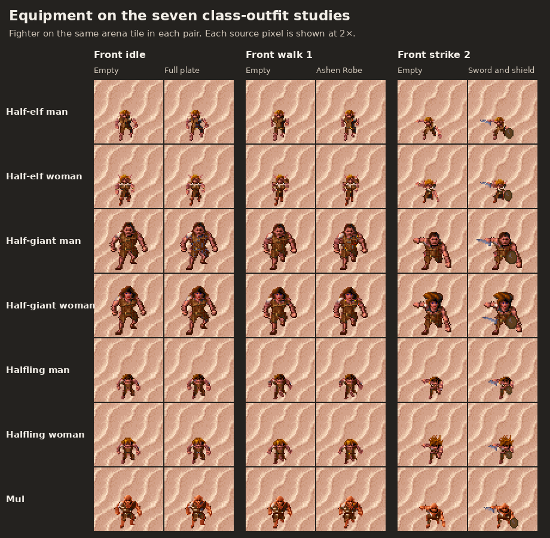
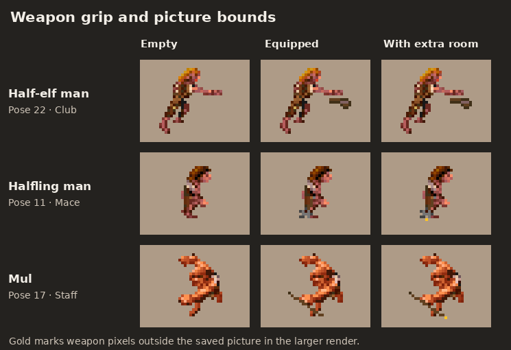

# Weapon and armor tests on all party figures

On the six figures with class outfits in the Loader, removing equipment restored the original picture in every case. Armor stayed within its assigned garment regions, the native bow kept its pixels, and the weapon tests found no detached pieces. The seven newer class-outfit studies need equipment fitting before import. The clearest failure is the half-elf woman. Full plate and both named robes left her unchanged in every pose of all 48 builds.



## Where armor shows

Each row covers singles, pairs and triples through all 29 poses. The third column counts changed pixels on the same front-idle Fighter. The last column counts cases where putting on chest, arm and leg plate together produced an image identical to empty slots.

| Study figure | Outfits | Full plate on idle Fighter | Unchanged full-plate frames / outfit poses |
|---|---:|---:|---:|
| Half-elf man | 48 | 12 px | 159 / 1,392 |
| Half-elf woman | 48 | 0 px | 1,392 / 1,392 |
| Half-giant man | 10 | 49 px | 10 / 290 |
| Half-giant woman | 10 | 7 px | 16 / 290 |
| Halfling man | 21 | 1 px | 47 / 609 |
| Halfling woman | 21 | 2 px | 61 / 609 |
| Mul | 18 | 6 px | 61 / 522 |

The Loader's existing half-elf woman, built from the retail human woman, showed full plate in 28 of 29 poses on the same Loader. The problem appears when the new garment replaces her retail clothes. The current renderer looks for the original clothing colors and, on a half-elf, the original clothing coordinates. That misses her new outfit. Both magic gloves were also invisible throughout the seven studies. Boots of Speed changed pixels in 28 poses on each outfit. That count alone cannot establish that both visible feet are properly covered.

## Weapon grips, clipping and the bow

The half-elf man's club is visibly below his outstretched hand in side strike 2 (pose 22). The halfling man's mace reaches below the saved picture on profile walk 1 (11). The Mul's staff loses its lower tip on front strike 3 (17). The right column shows the same pose rendered with extra room below and around the figure.



| Study figure | Weapon cases extending outside picture | Weapon cases with a disconnected piece | Equipped cases changing native bow mask |
|---|---:|---:|---:|
| Half-elf man | 144 | 144 | 384 |
| Half-elf woman | 144 | 120 | 336 |
| Half-giant man | 90 | 20 | 54 |
| Half-giant woman | 70 | 30 | 54 |
| Halfling man | 399 | 63 | 756 |
| Halfling woman | 399 | 159 | 84 |
| Mul | 198 | 109 | 108 |

A repeated grip error counts once per affected outfit, pose and loadout. The bounds test gives weapons 32 pixels around the source and 16 below its baseline, then measures drawing outside the space the game keeps. A disconnected piece has no eight-way connection to any occupied empty-slot pixel. A weapon can still touch the wrong body part and pass that test. The halflings use hand-traced bow arcs. On the other studies the mask uses the source bow colors and shape, so its hits are candidates for visual review. The male halfling's chest plate crosses the traced bow on pose 24.

The seven existing default bodies also show bounds problems. Together they have 71 weapon/loadout poses with drawing beyond the picture, and 24 cases with a disconnected piece. The unchanged Thri-kreen has nine bounds flags. Eight occur in side strike 3 (23), including the gythka, and one occurs with cahulaks in front strike 3 (17). Its sword, shield and gythka each show in 24 poses. Its shell retained its original colors under humanoid armor.

## Coverage and reproduction

- **Normal Loader path.** The matrix ran 32 equipped loadout cases through the encoded walk and combat picture builder on all 14 figure objects. The six integrated figures covered 114 class builds and 105,792 equipped frames. The remaining eight figures contributed another 7,424 equipped frames on their current default appearances. Each removal returned byte-for-byte to the empty picture. The six integrated figures had zero bow-mask changes, disconnected pieces, armor-only changes outside the assigned garment regions, or weapon cases extending beyond picture bounds. Extra drawing room can change the placement of a weapon inside the frame. The archive records those differences separately.
- **New art.** The study render supplied the starting pixels for the seven newer figures. The Loader supplied the native anatomy, grips, gear order, item materials and drawing rules. This exercised 176 outfit builds × 29 poses × 32 equipped cases, or **163,328 equipped frames**. The class selector still uses default appearances for these seven figures on this branch.
- **Items.** Cases cover leather, mail, scale, chest/arm/leg plate, full plate, magic chest plate, Warden’s Plate, Ashen and Veiled robes, cloak, Boots of Speed, bracers, Chameleon and Quicksilver gloves, shield, sword and shield together, and the weapon families listed in the CSVs. “Bow” and “Bow and quiver” exercise the same gear record under the two existing catalog labels.
- **In the game.** Two disposable DOSBox sessions loaded the slave pens with the dressed pictures staged in the party slots. Both the walk and combat chunks matched the staged bytes on disk. These captures show fixed equipment states. In a separate session the attached Loader processed sword and chest-plate equip/remove cycles on all 14 figure IDs. Both picture chunks returned to empty after all 28 cycles. The Thri-kreen ignored chest plate as intended. [DOSBox log and captures](../../../playtest/logs/2026-11-25-class-equipment.md)

Run the following from the repository root with Pillow, NumPy, SciPy and a Shattered Lands data directory containing the retail GFFs. Append figure IDs to test a subset, for example `307 310 312`. The archive contains per-pose results and column definitions. [Test runner](../../../prototypes/studygeartest.py) · [Download all measurements](equipment-test-results.zip) · [Earlier six-figure equipment and retail art comparison](worn-equipment.md)

```sh
python prototypes/studygeartest.py /path/to/shattered-lands /tmp/outfit-equipment
```

Give the newer outfits explicit armor, glove, boot, and protected bow pixels in each pose. Start with the half-elf woman's chest and robe regions, then register the melee grips and check long tips against the saved picture. Use the same empty/equipped pairs again after import so an improvement is visible at game size.
