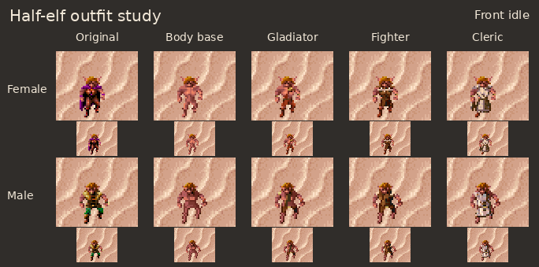
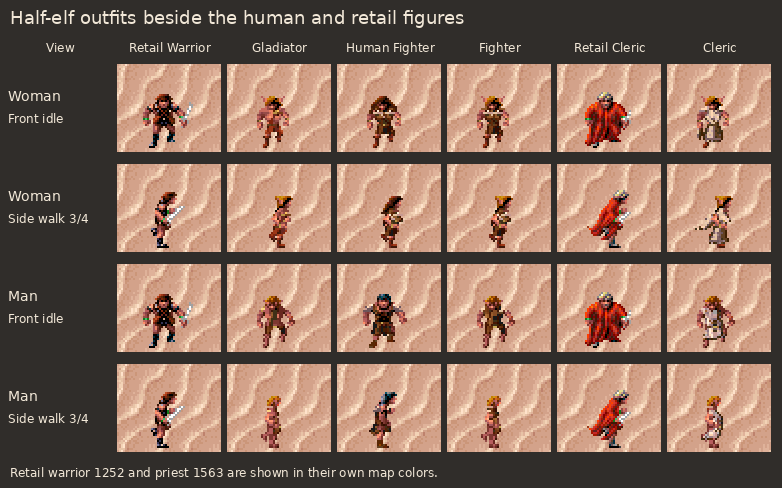

# Half-elf outfit study

The first art pass covers both figures in all 29 poses. Read each row from left to right to compare the Loader’s half-elf, the cleaned body, and the Gladiator, Fighter and Cleric proposals. The enlarged figure and its game-size copy share the same terrain and foot position. The outfit columns are art previews with empty equipment slots. Gameplay integration and equipped checks are pending.

[Female half-elf frame sheet](half-elf-female-poses.png) · [Male half-elf frame sheet](half-elf-male-poses.png)

## What to look for

- **Gladiator.** The short leather kilt leaves the shoulders, spine and legs visible. Compare the two rear strikes with the cleaned body to follow the near arm as it crosses the ribs.
- **Fighter.** The fitted leather jerkin puts the pale bone guard on the turning shoulder. Follow the guard from the rear idle into the first step, then check the space between the guard and cheek in profile.
- **Cleric.** The cream robe uses a dark fold along the hem. Compare the profile stride with the retail priest and follow the wrist across the robe during the bow draw.

## Figures and registration

| Figure | Party object | Source walk / combat | Details retained in the study |
|---|---|---|---|
| Male | 306 | Elf man 2061 / 2062 | Wider torso, short golden hair, small ears and dark eyes |
| Female | 307 | Human woman 2099 / 2100 | Slimmer torso, golden bun, exposed nape and pointed ears |

The artist’s reference is the figure produced by the Loader. The retail party objects point to human pictures. The study uses the Loader’s own per-frame column shifts to register the approved elf-man and human-woman garments to the wider and narrower bodies. It fills the shoulders exposed by the shorter hair and keeps the bow in front.

## Playable roster

| Builds | Count | Choices |
|---|---:|---|
| Single | 8 | Cleric, Druid, Fighter, Gladiator, Preserver, Psionicist, Ranger, Thief |
| Two classes | 18 | The elf’s 14 pairs, plus Druid with Fighter, Preserver, Psionicist or Thief |
| Three classes | 22 | The elf’s 16 triples, plus Druid with any two of Fighter, Preserver, Psionicist and Thief |

The Gladiator is single-class only. Fighter and Ranger are mutually exclusive. For the next five singles the proposed cues are a short leaf-green Druid cape, a plum Preserver mantle, a fitted teal Psionicist wrap, a long green Ranger cloak and a slate Thief hood. The pairs and triples follow the single-class silhouette review. [Player’s Guide multiclass table](../../PLAYER-GUIDE.md#more-than-one-class) · [Elf roster](elves.md) · [Art workflow](workflow.md)
