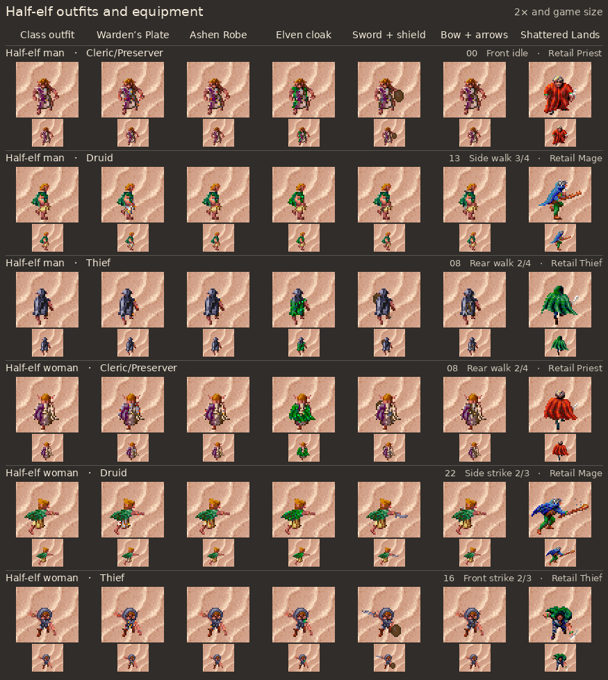
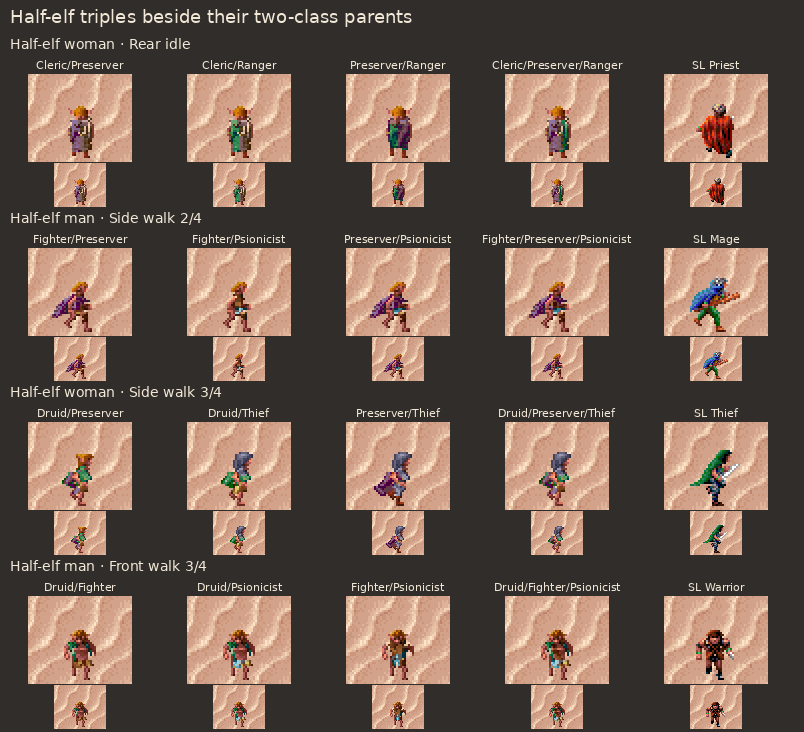

# Half-elf class outfits

The Loader draws all 48 legal outfits on each half-elf in all 29 map poses. Each figure has eight single classes, 18 pairs and 22 triples. The single-class animation below shows the approved art with empty equipment slots, with the woman above the man and a game-size copy beneath each enlargement.

[Female single-class frame sheet](half-elf-singles-female-poses.png) · [Male single-class frame sheet](half-elf-singles-male-poses.png)

The Druid’s short leaf cape lifts above a woven ochre kilt. On the man, a lit reed edge and its brown shadow mark the overlapping pleat as he steps toward the viewer. The Ranger’s longer green cloak follows the stride past the hip. Rear idle and the second profile step show the difference most clearly. A plum highlight follows the trailing fold of each Preserver’s mantle through the profile walk. The Psionicist wears a fitted teal wrap, and the Thief’s slate hood opens around the cheek. On the woman, front strike 2 and the hit show how the crown follows the bun as the arm swings past. [Compare the cloaks beside the retail mage and thief at game size](half-elf-cloak-references.png)

## Equipped Cleric/Preserver, Druid and Thief

The woman’s Cleric/Preserver row reproduces the class combination tested on Lex. The robe has cream folds and a plum lining. Compare her rear walk with the man’s front idle in the still below. The Druid wears a short green cape above an ochre kilt. On the Thief, follow the edge of the slate hood where it meets the separately equipped cloak.

The equipped cloak now covers the middle of the back through rear idle and all four walking steps. The folds move with the shoulders, and the split at the hem still opens as the legs move. [Compare the five rear poses before and after](half-elf-elven-cloak-rear.png)

[Watch the woman through all 29 poses](https://github.com/daaki85/darksun-obsidian-edition/blob/d7f2076f5fa3bc4458c55bf5a81dd9237b0c3129/obsidian-edition/docs/class-outfits/half-elf-loader-woman.gif) · [Watch the man through all 29 poses](https://github.com/daaki85/darksun-obsidian-edition/blob/d7f2076f5fa3bc4458c55bf5a81dd9237b0c3129/obsidian-edition/docs/class-outfits/half-elf-loader-man.gif)

Each row compares one frame of the Loader’s actual equipment picture on the arena floor, enlarged and at game size. The Warden’s Plate column equips the chest, arms and legs. The Ashen Robe and Cloak of Elvenkind are shown separately so their edges and glints can be seen against the same class colors. During the three bow shots, follow the foreground bow across the sleeve. The retail Priest, Mage and Thief each have matching walk, strike and bow frames through pose 26.

The import was checked against the approved study for both figures, across all 2,784 outfit poses. The equipment audit used 21 loadouts, including ordinary plate, Warden’s Plate, both named robes, and bows with and without arrows. On hooded outfits the equipped cloak picks up the fold at the nape, even on the woman’s second front strike. An outer cloak can conceal a multiclass lining in individual poses.

In DOSBox, the attached Loader selected all 48 outfits for Lex on the fountain map. With her original Fighter/Preserver classes restored, removing and re-equipping her right-hand item reproduced both starting pictures. [Live comparison and playtest log](https://github.com/daaki85/darksun-obsidian-edition/blob/claude/import-class-outfits/playtest/logs/2026-11-26-half-elf-import.md)

## Equipped Fighter and Preserver

[Watch the magical equipment on both half-elves](https://github.com/daaki85/darksun-obsidian-edition/blob/d7f2076f5fa3bc4458c55bf5a81dd9237b0c3129/obsidian-edition/docs/class-outfits/magic-gear-half-elf.gif) · [Compare the earlier Druid and Cleric/Preserver study](https://github.com/daaki85/darksun-obsidian-edition/blob/d7f2076f5fa3bc4458c55bf5a81dd9237b0c3129/obsidian-edition/docs/class-outfits/magic-study-half-elves.gif)

Both figures use the approved study art for all 29 poses. Read the columns across for a single pose. The upper row is Fighter, the lower row is Preserver. Each enlarged picture has a game-size copy beneath it. The retail Warrior and Mage provide the reference at the right and have no matching hit or fall cel.

On the woman, compare front idle with empty slots and full plate. The Fighter has 108 garment pixels assigned to armor. The steel follows the creases of her jerkin and skirt, with the bone fittings and belt edge still visible. On the Preserver, the visible plum tunic takes the armor color while the outer mantle retains its folds. In the rear walk the mantle hides most of the armor. The magic chest column shows the game’s shine palette on the exposed chest material.

The two bone guards turn down from her shoulders into separate leather mounts. The earlier drawing joined the two mounts with one pale row across the chest. [Compare the shoulder guards with empty slots, leather and plate](half-elf-fighter-shoulders.png)

[Earlier armor dye comparison, before the shoulder refit](half-elf-armor-detail.png) · [Compare armor across races](armor-dyes.md)

[Archived animation: Female half-elf Fighter and Preserver through all poses with armor and robes beside retail reference figures](https://github.com/daaki85/darksun-obsidian-edition/blob/d7f2076f5fa3bc4458c55bf5a81dd9237b0c3129/obsidian-edition/docs/class-outfits/half-elf-equipped-armor.gif)

On the man, follow the club into the outstretched hand on side strike 2 (22). The supporting forearm carries the shield. In profile the far arm can disappear behind the torso. The bow and quiver attach at the shoulder as the body turns. Equipping just the bow leaves the leather quiver empty. Adding arrows reveals their fletchings at the mouth. The ammo-only column shows the filled quiver without the stave. The game's foreground bow takes over in poses 24–26. The hand sling and chatkcha sit at the hip. The staff sling has a visible shaft and cradle. [Compare the carried weapons](weapon-motion.md#weapon-outlines-and-materials)

[Archived animation: Male half-elf Fighter and Preserver through all poses with weapons, shield and carried ammunition](https://github.com/daaki85/darksun-obsidian-edition/blob/d7f2076f5fa3bc4458c55bf5a81dd9237b0c3129/obsidian-edition/docs/class-outfits/half-elf-equipped-weapons.gif)

The original Fighter and Preserver equipment check compared 3,712 encoded frames across the four builds. It found zero isolated equipment pieces, changes to protected bow pixels or armor-only changes outside the assigned garment regions. The larger-canvas weapon check found zero pixels beyond the saved picture and reproduced every weapon pixel inside it, including the woman’s paired cahulaks on pose 16. All four empty-slot builds matched their approved art, pose for pose. The attached Loader also completed 36 equip/remove cycles in DOSBox. [Playtest log](https://github.com/daaki85/darksun-obsidian-edition/blob/claude/class-outfits/playtest/logs/2026-11-25-class-equipment.md#half-elf-fighter-and-preserver) · [Equipment audit before fitting](equipment-tests.md)

## Male body fitting

In front idle (00) and the hit (27), the previous abdomen ended in a straight shelf above the thighs. In rear walk step two (08), the light on the back ran into the hip and obscured the shift onto the planted leg. The revised skin carries a short light over the shoulder blade, turns to shadow at the waist and picks up the light again on the loaded hip. In profile step two (12) the hip sits behind the passing forearm. On the Gladiator the turn is visible beside the strap. On the Druid the vest covers the ribs, and the moving knee is the easier comparison.

[Before and after in four poses](half-elf-man-body.png) · [Watch all 29 poses beside the retail elf and the finished human body](https://github.com/daaki85/darksun-obsidian-edition/blob/d7f2076f5fa3bc4458c55bf5a81dd9237b0c3129/obsidian-edition/docs/class-outfits/half-elf-man-body.gif) · [Inspect each pose as a still](half-elf-man-body-poses.png)

## Male Druid and Preserver waist fitting

Front idle (00) shows two ways the outfits made the same body look broad. On the Druid, bright green extended past the ribs and reappeared below the waist tie. The vest now tapers into the ochre binding. In front walk step two (04), follow the near forearm across the tucked side and compare the exposed flank with the clean body.

On the Preserver, two nearly parallel plum edges framed a dark rectangle across the ribs. The front panels now turn inward at the waist and part again over the moving thighs. The far panel on step 04 curls out over the lifted knee. This adjustment covers front idle, the four front steps, front strike two (16) and hit (27). Profile step two (12) shows the longer loose mantle swinging behind him. The comparisons include the previous fittings at `1ec61d3`, the clean body, the corresponding half-elf woman or elf man, and a retail figure.

[Compare front idle, front step two and profile step two](half-elf-man-garment-fit.png) · [Watch both fittings through all 29 poses](https://github.com/daaki85/darksun-obsidian-edition/blob/d7f2076f5fa3bc4458c55bf5a81dd9237b0c3129/obsidian-edition/docs/class-outfits/half-elf-man-garment-fit.gif)

## Male Druid fitting

Front idle showed a rectangular patch of bare torso between two green cloak edges. The short cape had inherited the Ranger’s outer folds while the fitted garment between them was missing. The man now wears a leaf-green vest underneath. Follow its diagonal overlap down to the ochre waist tie in the front walk, then watch the near forearm pass across it in profile and on the strike. The same fitting carries into his four Druid pairs and six Druid triples.

[Compare front idle, front and profile steps, and the front strike](half-elf-druid-fitting.png) · [Watch all 29 poses beside the previous fitting, the half-elf woman and the human man](https://github.com/daaki85/darksun-obsidian-edition/blob/d7f2076f5fa3bc4458c55bf5a81dd9237b0c3129/obsidian-edition/docs/class-outfits/half-elf-druid-fitting.gif)

## Two-class outfits

All 18 legal pairs are shown on the arena floor with empty equipment slots. Each loop shows the woman above the man at 2× and game size. The still sheets identify each of the 29 poses. Select a group to watch it in motion.

| Outfit family | Pairs in the loop | Front idle | All frames |
|---|---|---|---|
| [Cleric robes](half-elf-pairs-robes.gif) | Cleric with Fighter, Preserver, Psionicist or Ranger | [Both figures](half-elf-pairs-robes.png) | [Woman](half-elf-pairs-robes-female-poses.png) · [Man](half-elf-pairs-robes-male-poses.png) |
| [Druid capes](half-elf-pairs-leaf.gif) | Druid with Fighter, Preserver or Psionicist | [Both figures](half-elf-pairs-leaf.png) | [Woman](half-elf-pairs-leaf-female-poses.png) · [Man](half-elf-pairs-leaf-male-poses.png) |
| [Mantles, cloaks and jerkins](half-elf-pairs-mantles.gif) | Fighter/Preserver, Fighter/Psionicist, Preserver/Psionicist, Preserver/Ranger and Psionicist/Ranger | [Both figures](half-elf-pairs-mantles.png) | [Woman](half-elf-pairs-mantles-female-poses.png) · [Man](half-elf-pairs-mantles-male-poses.png) |
| [Thief hoods](half-elf-pairs-hoods.gif) | Thief with Cleric, Fighter, Preserver, Psionicist, Ranger or Druid | [Both figures](half-elf-pairs-hoods.png) | [Woman](half-elf-pairs-hoods-female-poses.png) · [Man](half-elf-pairs-hoods-male-poses.png) |

In the male Druid/Fighter’s second profile step, the leather belt follows the ochre kilt while the cape swings clear behind it. Both Fighter/Psionicists pick up the sash’s teal on the fitted shoulder caps. The Fighter/Preserver wears the dark sword belt on the plum mantle. In the male Fighter/Psionicist’s third profile step, the wrist obscures the sash and its teal end shows below the arm. The male Cleric’s front bow leaves the smallest opening for the belt or sash. The Druid/Thief wears the Druid’s short leaf cape over the tied ochre kilt. The green hood overlaps the cape at the nape. In rear idle and all four rear steps the raised corner exposes the kilt, while the Ranger/Thief’s green panel hangs past the hip. The comparison follows both figures through rear, profile and front walks alongside Shattered Lands’ thief (630) and mage (724), at 2× and game size. [Watch the cape comparison](https://github.com/daaki85/darksun-obsidian-edition/blob/d7f2076f5fa3bc4458c55bf5a81dd9237b0c3129/obsidian-edition/docs/class-outfits/half-elf-hooded-cape-walk.gif)

A second frame review caught the belt and sash taking the color all the way to the free corner of a swinging cloak. In profile step 3 (13), compare the male Preserver/Psionicist and female Fighter/Preserver with their earlier versions. The corner now carries the mantle’s folds as it moves away from the waist. The male Cleric/Thief’s front walk 2 (04) shows the cream lining above his leather shorts. On the woman, side strike 1 (21) and side bow (26) show the repaired inner rim of the hood. On the male Druid, the tied edge of the kilt closes gaps in strikes 16, 21 and 22, and the leaf panel joins behind the bent arm in side bow (26). [Compare nine individual frames at 3× and game size](half-elf-pair-details.png)

All 1,044 pair poses were checked against their parent garments. The Druid/Thief uses the Thief’s hood above the Druid’s lower silhouette. All 58 frames of this combination were rechecked for detached pixels, new enclosed gaps and bow coverage after the hem revision. These comparisons preserve the art-study renders used to approve the empty outfits. [Equipped Loader comparisons](#equipped-clericpreserver-druid-and-thief)

### Sash, belt and torso detail

From behind, the Psionicist sash runs two pixels deep on the diagonal, leaving the cloak folds visible on both figures. The woman’s Preserver/Psionicist shows 17–22 sash pixels in rear idle, the four rear steps and rear strike 2, down from 30–44. These counts measure pixels changed by the sash on its parent garment. The woman’s Cleric/Fighter has a dark leather belt with a small pale bone toggle, and her single Psionicist has a lit fold through the back of the teal wrap.

On the male Thief and Ranger, warm brown folds break up the black chest stripe in front idle (00), side idle (02) and the first profile step (11). Sparse skin halftones follow the exposed torso, most clearly on the Druid. All 48 builds on both figures retain their silhouettes, native bow pixels and registered foreground limbs through these shading changes.

[Compare seven poses before and after with the elf Loader render and original Shattered Lands figures](half-elf-material-revisions.png)

## Three-class outfits

These original study animations show all 22 approved combinations with empty equipment slots. The woman is on the top row of each animation and the man is below. Each loop shows all 29 poses, including the bow, recoil and fall. The smaller copy is game size.

| Outfits | Animation | Front idle | Frame sheets |
|---|---|---|---|
| Five Cleric combinations with an open collar | [Watch the robes](half-elf-triples-robes.gif) | [Both figures](half-elf-triples-robes.png) | [Woman](half-elf-triples-robes-female-poses.png) · [Man](half-elf-triples-robes-male-poses.png) |
| Four Cleric/Thief combinations | [Watch the hooded robes](half-elf-triples-hooded-robes.gif) | [Both figures](half-elf-triples-hooded-robes.png) | [Woman](half-elf-triples-hooded-robes-female-poses.png) · [Man](half-elf-triples-hooded-robes-male-poses.png) |
| Six Druid combinations | [Watch the leaf capes](half-elf-triples-druids.gif) | [Both figures](half-elf-triples-druids.png) | [Woman](half-elf-triples-druids-female-poses.png) · [Man](half-elf-triples-druids-male-poses.png) |
| Seven remaining Fighter, Preserver, Psionicist, Ranger and Thief combinations | [Watch the mantles and jerkins](half-elf-triples-mantles.gif) | [Both figures](half-elf-triples-mantles.png) | [Woman](half-elf-triples-mantles-female-poses.png) · [Man](half-elf-triples-mantles-male-poses.png) |

The Fighter/Psionicist/Thief wears the Fighter/Thief’s full slate cloak on both figures. The teal sash crosses above the leather sword belt. Look at the man’s second profile step for the trailing hem and the woman’s second rear step for the sash across the folds. On the male Cleric/Preserver and its triples, a deep plum lining follows the turned edge of the cream robe. [Compare the previous and revised garments at 2× and game size](half-elf-cloak-and-lining.png)

**What to follow in motion.** On Cleric/Preserver/Ranger, plum and green turn along opposite edges of the cream robe. On Druid/Preserver/Thief, the green hood overlaps the short leaf cape and the plum lining lifts above the ochre kilt. On Fighter/Preserver/Psionicist, the teal sash crosses the leather sword strap on the torso. During the woman’s front strike 3 (17) the bent arm hides most of the strap. On the male Druid/Fighter/Psionicist’s front bow (24), the upper part of the strap remains visible at the shoulder while the arm crosses the waist.

The four rows below show all three two-class parents followed by the triple and an original Shattered Lands figure in the same pose. The review checked all 1,276 triple frames against their immediate parents for a visible costume change, detached pixels, new enclosed terrain gaps and bow coverage.

## Body and first three silhouettes

The initial review puts the original figure and cleaned body beside the Gladiator, Fighter and Cleric. [Watch the body comparison](https://github.com/daaki85/darksun-obsidian-edition/blob/d7f2076f5fa3bc4458c55bf5a81dd9237b0c3129/obsidian-edition/docs/class-outfits/half-elf-study.gif) · [Female comparison sheet](half-elf-female-poses.png) · [Male comparison sheet](half-elf-male-poses.png)

In front idle and the four front steps, the man’s chest highlight turns into shadow below the ribs and the thigh highlight tapers toward the knee. The smaller figures in the comparison show what remains visible around the Gladiator’s strap and kilt at game size. [First front-walk revision beside the retail warrior](half-elf-skin.png) · [Current rib and hip shading through the side walk](https://github.com/daaki85/darksun-obsidian-edition/blob/d7f2076f5fa3bc4458c55bf5a81dd9237b0c3129/obsidian-edition/docs/class-outfits/body-profile-detail.gif) · [Watch all eight body bases](https://github.com/daaki85/darksun-obsidian-edition/blob/d7f2076f5fa3bc4458c55bf5a81dd9237b0c3129/obsidian-edition/docs/class-outfits/body-texture.gif)

The Loader now draws the woman’s eye, cheek, and nape separately from the deep gold shadow under her bun. The outfit study also narrows her rear Gladiator strap, adds two folds to her front Cleric collar, and breaks up the male Fighter’s jerkin shadow during the second rear strike and hit. Each pair in the comparison shows the first pass on the left and the revision on the right. [Compare the eight views](half-elf-detail-revisions.png)

## What to look for

- **Gladiator.** The short leather kilt leaves the shoulders, spine and legs visible. Compare the two rear strikes with the cleaned body to follow the near arm as it crosses the ribs.
- **Fighter.** The fitted leather jerkin puts the pale bone guard on the turning shoulder. Follow the guard from the rear idle into the first step, then check the space between the guard and cheek in profile.
- **Cleric.** The cream robe uses a dark fold along the hem. Compare the profile stride with the retail priest and follow the wrist across the robe during the bow draw.

## Figures and registration

| Figure | Party object | Source walk / combat | Details retained in the study |
|---|---|---|---|
| Male | 306 | Elf man 2061 / 2062 | Wider torso, short golden hair, small ears and dark eyes |
| Female | 307 | Human woman 2099 / 2100 | Slimmer torso, golden bun, exposed nape and pointed ears |

The artist’s reference is the figure produced by the Loader. The retail party objects point to human pictures. The study uses the Loader’s own per-frame column shifts to register the approved elf-man and human-woman garments to the wider and narrower bodies. It fills the shoulders exposed by the shorter hair and keeps the bow in front.

## Playable roster

| Builds | Count | Choices |
|---|---:|---|
| Single | 8 | Cleric, Druid, Fighter, Gladiator, Preserver, Psionicist, Ranger, Thief |
| Two classes | 18 | The elf’s 14 pairs, plus Druid with Fighter, Preserver, Psionicist or Thief |
| Three classes | 22 | The elf’s 16 triples, plus Druid with any two of Fighter, Preserver, Psionicist and Thief |

The Gladiator is single-class only. Fighter and Ranger are mutually exclusive. The Loader covers all 48 builds on both figures. [Player’s Guide multiclass table](../../PLAYER-GUIDE.md#more-than-one-class) · [Elf roster](elves.md) · [Art workflow](workflow.md)
