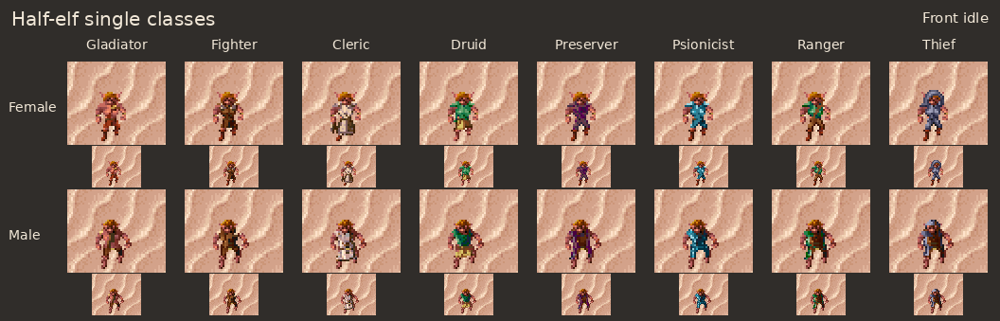

# Half-elf outfit study

Both half-elves now have art proposals for all eight single classes in all 29 map poses. The woman is on the top row and the man is below. Each enlarged figure has a game-size copy beneath it, with equipment slots empty. The live Loader draws the corrected half-elf faces. Class selection and equipped gameplay checks for these outfits are pending.

[Female single-class frame sheet](half-elf-singles-female-poses.png) · [Male single-class frame sheet](half-elf-singles-male-poses.png)

The Druid’s short leaf cape lifts above a woven ochre kilt. On the man, a lit reed edge and its brown shadow mark the overlapping pleat as he steps toward the viewer. The Ranger’s longer green cloak follows the stride past the hip. Rear idle and the second profile step show the difference most clearly. A plum highlight follows the trailing fold of each Preserver’s mantle through the profile walk. The Psionicist wears a fitted teal wrap, and the Thief’s slate hood opens around the cheek. On the woman, front strike 2 and the hit show how the crown follows the bun as the arm swings past. [Compare the cloaks beside the retail mage and thief at game size](half-elf-cloak-references.png)

## Two-class outfits

All 18 legal pairs are shown on the arena floor with empty equipment slots. Each loop shows the woman above the man at 2× and game size. The still sheets identify each of the 29 poses. Select a group to watch it in motion.

| Outfit family | Pairs in the loop | Front idle | All frames |
|---|---|---|---|
| [Cleric robes](half-elf-pairs-robes.gif) | Cleric with Fighter, Preserver, Psionicist or Ranger | [Both figures](half-elf-pairs-robes.png) | [Woman](half-elf-pairs-robes-female-poses.png) · [Man](half-elf-pairs-robes-male-poses.png) |
| [Druid capes](half-elf-pairs-leaf.gif) | Druid with Fighter, Preserver or Psionicist | [Both figures](half-elf-pairs-leaf.png) | [Woman](half-elf-pairs-leaf-female-poses.png) · [Man](half-elf-pairs-leaf-male-poses.png) |
| [Mantles, cloaks and jerkins](half-elf-pairs-mantles.gif) | Fighter/Preserver, Fighter/Psionicist, Preserver/Psionicist, Preserver/Ranger and Psionicist/Ranger | [Both figures](half-elf-pairs-mantles.png) | [Woman](half-elf-pairs-mantles-female-poses.png) · [Man](half-elf-pairs-mantles-male-poses.png) |
| [Thief hoods](half-elf-pairs-hoods.gif) | Thief with Cleric, Fighter, Preserver, Psionicist, Ranger or Druid | [Both figures](half-elf-pairs-hoods.png) | [Woman](half-elf-pairs-hoods-female-poses.png) · [Man](half-elf-pairs-hoods-male-poses.png) |

In the male Druid/Fighter’s second profile step, the leather belt follows the ochre kilt while the cape swings clear behind it. In the male Fighter/Psionicist’s third profile step, the wrist obscures the sash and its teal end shows below the arm. The male Cleric’s front bow leaves the smallest opening for the belt or sash. The Druid/Thief wears the Druid’s short leaf cape over the tied ochre kilt. The slate hood overlaps the cape at the nape. In rear idle and all four rear steps the raised corner exposes the kilt, while the Ranger/Thief’s green panel hangs past the hip. The comparison follows both figures through rear, profile and front walks alongside Shattered Lands’ thief (630) and mage (724), at 2× and game size. [Watch the cape comparison](half-elf-hooded-cape-walk.gif)

A second frame review caught the belt and sash taking the color all the way to the free corner of a swinging cloak. In profile step 3 (13), compare the male Preserver/Psionicist and female Fighter/Preserver with their earlier versions. The corner now carries the mantle’s folds as it moves away from the waist. The male Cleric/Thief’s front walk 2 (04) shows the cream lining above his leather shorts. On the woman, side strike 1 (21) and side bow (26) show the repaired inner rim of the hood. On the male Druid, the tied edge of the kilt closes gaps in strikes 16, 21 and 22, and the leaf panel joins behind the bent arm in side bow (26). [Compare nine individual frames at 3× and game size](half-elf-pair-details.png)

All 1,044 pair poses were checked against their parent garments. The Druid/Thief uses the Thief’s hood above the Druid’s lower silhouette. All 58 frames of this combination were rechecked for detached pixels, new enclosed gaps and bow coverage after the hem revision. These are art-study renders. The three-class outfits and equipped gameplay checks are pending.

## Body and first three silhouettes

The initial review puts the original figure and cleaned body beside the Gladiator, Fighter and Cleric. [Watch the body comparison](half-elf-study.gif) · [Female comparison sheet](half-elf-female-poses.png) · [Male comparison sheet](half-elf-male-poses.png)

The Loader now draws the woman’s eye, cheek, and nape separately from the deep gold shadow under her bun. The outfit study also narrows her rear Gladiator strap, adds two folds to her front Cleric collar, and breaks up the male Fighter’s jerkin shadow during the second rear strike and hit. Each pair in the comparison shows the first pass on the left and the revision on the right. [Compare the eight views](half-elf-detail-revisions.png)

## What to look for

- **Gladiator.** The short leather kilt leaves the shoulders, spine and legs visible. Compare the two rear strikes with the cleaned body to follow the near arm as it crosses the ribs.
- **Fighter.** The fitted leather jerkin puts the pale bone guard on the turning shoulder. Follow the guard from the rear idle into the first step, then check the space between the guard and cheek in profile.
- **Cleric.** The cream robe uses a dark fold along the hem. Compare the profile stride with the retail priest and follow the wrist across the robe during the bow draw.

## Figures and registration

| Figure | Party object | Source walk / combat | Details retained in the study |
|---|---|---|---|
| Male | 306 | Elf man 2061 / 2062 | Wider torso, short golden hair, small ears and dark eyes |
| Female | 307 | Human woman 2099 / 2100 | Slimmer torso, golden bun, exposed nape and pointed ears |

The artist’s reference is the figure produced by the Loader. The retail party objects point to human pictures. The study uses the Loader’s own per-frame column shifts to register the approved elf-man and human-woman garments to the wider and narrower bodies. It fills the shoulders exposed by the shorter hair and keeps the bow in front.

## Playable roster

| Builds | Count | Choices |
|---|---:|---|
| Single | 8 | Cleric, Druid, Fighter, Gladiator, Preserver, Psionicist, Ranger, Thief |
| Two classes | 18 | The elf’s 14 pairs, plus Druid with Fighter, Preserver, Psionicist or Thief |
| Three classes | 22 | The elf’s 16 triples, plus Druid with any two of Fighter, Preserver, Psionicist and Thief |

The Gladiator is single-class only. Fighter and Ranger are mutually exclusive. The next art stage is the 22 three-class outfits. [Player’s Guide multiclass table](../../PLAYER-GUIDE.md#more-than-one-class) · [Elf roster](elves.md) · [Art workflow](workflow.md)
