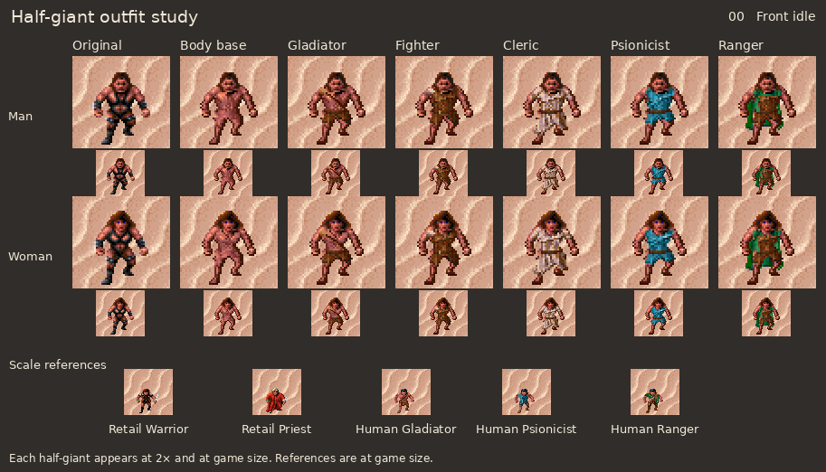
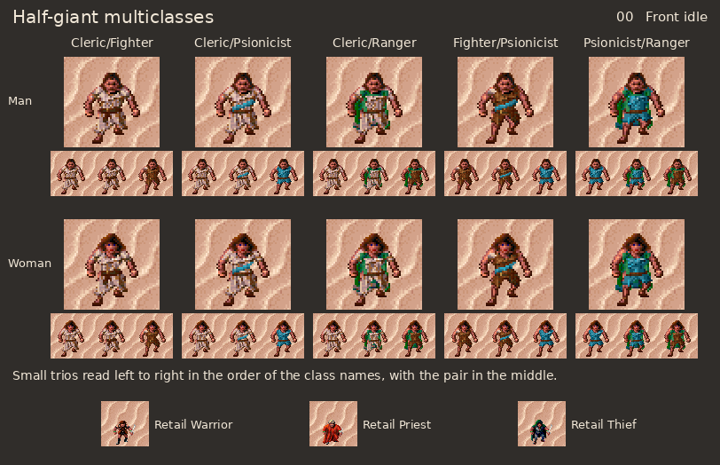

# Half-giant outfit study

Follow either row across the animation to see the original half-giant, the cleaned body, and all five single-class outfits. The man is above the woman. Each figure appears at 2× with its game-size copy below. The retail Warrior and Priest and the approved human Gladiator, Psionicist and Ranger share the same ground line in the reference row. The two retail NPCs return to idle for hit and fallen, which their picture sets omit.

[All 29 male poses](half-giant-man-poses.png) · [All 29 female poses](half-giant-woman-poses.png)

## Psionicist and Ranger

- **Psionicist.** The sleeveless teal wrap crosses the ribs and tucks into a leather belt. In rear walk steps 1–4 (07–10), the diagonal overlap turns with the shoulders. In profile the near arm passes across it.
- **Ranger.** The leaf-green cloak fastens over a hide jerkin. In profile walk steps 1–4 (11–14), follow the hem behind the hips as the stride opens and closes. From behind, the cloth gathers at the shoulders, skims the waist, and lifts over the advancing leg. On the woman the green collar shows between the ends of her hair. Side bow (24) shows the leading arm and bow in front. [Compare the earlier and revised rear cloaks beside the retail figures](half-giant-ranger-rear.gif)

## Gladiator, Fighter and Cleric fit

Compare each prior outfit at `34220d3` with its revised fit in the same pose. The upper copy is 2× on arena sand, the lower copy is game size on stone. The reference row shows the human Gladiator, Warrior and Priest alongside the retail Warrior and Priest. [Inspect profile step 2](half-giant-fitting.png) · [Watch the fitting comparison through all 29 poses](half-giant-fitting.gif)

- **Gladiator.** In front idle (00) and rear walk step 2 (08), follow the bronze guard into the strap. It curves across the ribs and ends on the waistband at the opposite hip. The wrap overlaps the leading thigh.
- **Fighter.** The armhole turns under the shoulder and the jerkin narrows to the belt. Its two leather flaps separate over the thighs. Front walk step 4 (06) shows the open space between the swinging hand and the right edge of the garment.
- **Cleric.** In profile steps 2 and 3 (12–13), a short linen sleeve turns with the upper arm. The exposed forearm passes in front of the cloth at the ribs. The cream panel continues to the belt and lifts at the knee. The woman’s neckline and armholes follow her own chest.

The fitting review covered both cleaned bodies and 174 dressed poses, including the bow, recoil and fall. The study preserves the native bow and the corrected lower hair in the woman’s profile walk. These are study renders with empty equipment slots.

The cleaned bodies have bare feet. Each outfit adds an open leather sandal with a dark sole and ankle tie. Follow the lifted heel and the planted toes across the profile walk. [Compare the earlier materials pass beside the retail Warrior, retail Priest, and approved human outfits](half-giant-materials.png)

In the woman’s third profile step, two charcoal pixels join the lower lock to the hair above her shoulder. The base and each garment retain the retail hair through profile idle and all four steps. [Inspect the shoulder and hair at 4×](half-giant-profile-hair.png)

The study uses retail pictures 2072/2073 for the man and 2074/2075 for the woman. The body preserves each original pose’s silhouette and foot placement. The exposed limbs retain the figure’s skin tones, with a deep brown edge under the foot and on the shadow side of the calf. The robe draws its fold shading from the retail Priest.

In rear walk step 2 (08), look just below the woman’s hair and above the Gladiator strap. The cleaned nape follows the neck shadow into the shoulder. The same harness edge showed in the man’s rear views. The correction is shared by the singles and pairs. [Compare the nape and the Cleric/Fighter at game size](halfling-half-giant-fit-review.png)

The woman’s Fighter and Gladiator guards follow the slope of her upper arm in each pose. In profile walk steps 2 and 3, the pin moves back with the shoulder as the elbow swings forward. In rear strike 2 her hair and raised arm cover the plate. The Fighter/Psionicist follows the same fitting in teal. On the man in bow pose 26, the pin moves up onto the drawing shoulder as the elbow rises. [Inspect the bow against the retail figure and body base](half-giant-bow-shoulder.png). [Compare the body, previous guard and revised guard through all 29 poses](half-giant-shoulder-fit.gif)

## Two-class outfits

Watch the large figure in each column for the proposed pair. The three game-size figures below it show the first single class, the pair, and the second single class in the same pose. The man is in the upper row and the woman is below. The bottom row shows retail figures on the same sand.

[All male pair frames](half-giant-man-pairs.png) · [All female pair frames](half-giant-woman-pairs.png)

| Pair | What to follow in motion |
|---|---|
| Cleric/Fighter | Pale bone caps cup the visible upper arms over the linen sleeves. A shaded rim separates bone from cloth. The bronze-buckled belt has a short leather tab at one hip. In profile walk step 2 (12) and front strike 3 (17), follow the near cap above the moving arm. [Compare front idle, profile and strike](half-giant-bone-caps.png) · [Watch the plain Cleric, tab alone and tab with caps in all poses](half-giant-cleric-comparison.gif) |
| Cleric/Psionicist | A narrow teal sash turns across the lower ribs and passes behind the near arm. |
| Cleric/Ranger | The green cloak opens onto linen in profile. A turned cream edge shows the robe's color from behind. |
| Fighter/Psionicist | The shoulder cap takes the sash’s teal dye. A short pale ridge catches the light as the upper arm turns. Its tied end shows below the arm in front strike 3 (17). |
| Psionicist/Ranger | The teal wrap shows through the open green cloak. A teal facing follows the lifted hem during the rear walk. |

The study covers both figures, all five legal pairs, and all 29 poses with empty equipment slots. Half-giants have no three-class combinations. Equipped gameplay awaits Loader integration. [Class roster](../../PLAYER-GUIDE.md#races) · [Multiclass table](../../PLAYER-GUIDE.md#more-than-one-class)
