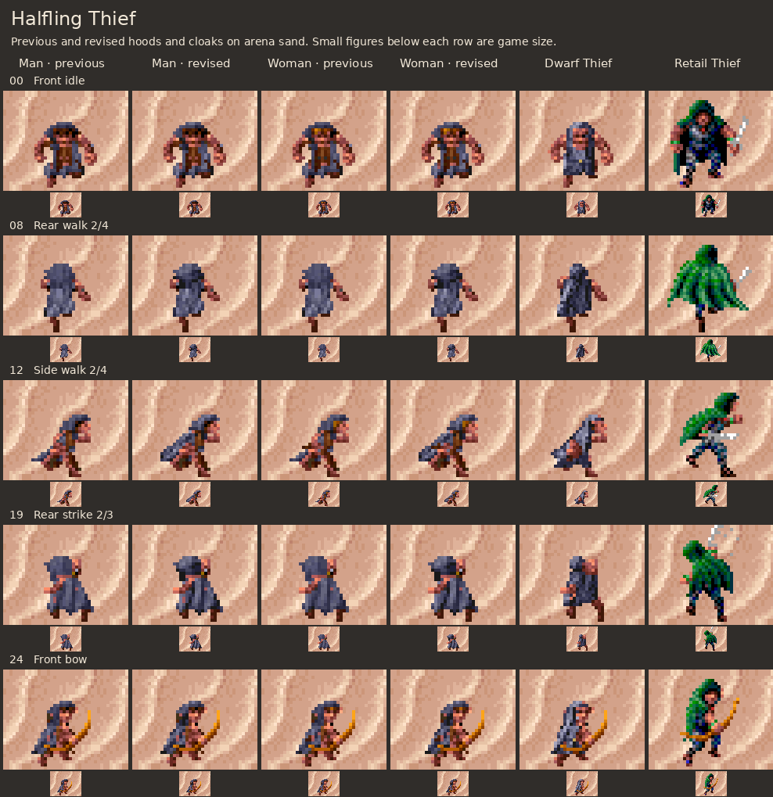
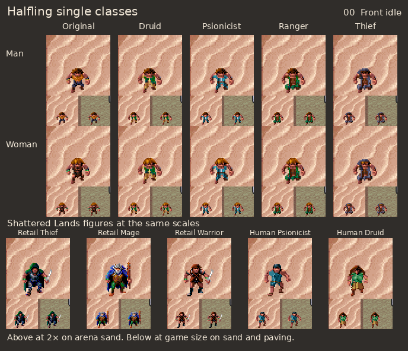
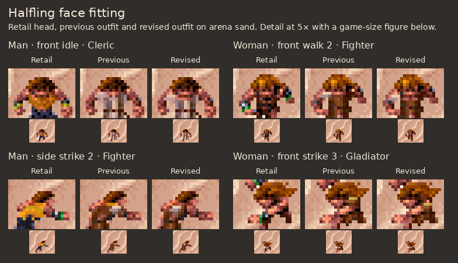

# Halfling outfit study

All seven single classes, twelve pairs and two triples are fitted on both retail halflings in all 29 poses. These are empty-slot art studies.

## Thief detail at game size

The sheet pairs each halfling with the same pose from `aa9f774`. The dwarf Thief and retail Thief (picture 630) share the floor and scale. In rear walk step two (08), look for the shadow under the hood and the lighter lip of the fold bending over the hip. In side walk step two (12), a narrow second fold trails from the shoulder behind the passing elbow. The front opening still shows the cheek and leather jerkin.

All seven halfling singles were compared across the 29 poses on both figures. The detail edits are confined to the Thief and the seven combinations that include Thief. Cleric/Thief, Druid/Thief and Ranger/Thief use linen or green for the hood over their own cloth. Fighter/Thief, Psionicist/Thief and Fighter/Psionicist/Thief also carry the revised slate cloak. Psionicist/Ranger/Thief retains its green cloak and teal sash. [Compare all the races’ Thieves in motion](mul-race-thief.gif)

## Multiclass animations

Each large figure wears the combination named above it. For a pair, read the three small figures beneath it from left to right for the first class, the pair and the second class. Both small rows are game size, on sand and paving. The triple gallery labels the three parent pairs individually. Retail figures and the approved human Psionicist appear along the bottom.

| Gallery | Where to look |
|---|---|
| [Four Cleric pairs](halfling-multiclass-cleric.gif) | In front walk step 1 (03), the Fighter’s dark sword belt and bone guard break up the cream robe. The Ranger’s cloak opens onto the same continuous linen hem. |
| [Three Druid pairs](halfling-multiclass-druid.gif) | Rear walk step 2 (08) shows the short leaf cape above the ochre kilt. The Druid/Thief has a green hood tucked into that cape. |
| [Five Fighter, Psionicist, Ranger and Thief pairs](halfling-multiclass-leather.gif) | Follow the Ranger/Thief beside the plain Thief through side steps 1–4. The green trailing fold carries the Ranger color and the hood turns into shadow around the cheek. |
| [Both triples and their parent pairs](halfling-multiclass-triples.gif) | In rear idle (01), compare the leather belt and slate cloak on Fighter/Psionicist/Thief with the green cloak on Psionicist/Ranger/Thief. Both carry a teal wrap. In front strike 2 (16), the raised arm leaves only six teal pixels visible on the Fighter triple. |

[Man, every multiclass pose](halfling-man-multiclass.png) · [Woman, every multiclass pose](halfling-woman-multiclass.png)

The frame review covered 696 pair frames and 116 triple frames. Each pair differs from both singles and each triple differs from all three parent pairs in every pose. The exposed face, visible bow and shared bare-hand pixels were checked against the underlying figures. The galleries are study renders.

## Druid, Psionicist, Ranger and Thief

The animation pairs each new outfit with its retail halfling. Below them, the retail Thief, Mage and Warrior and the approved human Psionicist and Druid use the same scale and floor. The small copies show native size on sand and paving.

[Man, all seven singles in all 29 poses](halfling-man-singles.png) · [Woman, all seven singles in all 29 poses](halfling-woman-singles.png)

In side walk 2 (12), compare the back corner of the Ranger’s cloak with the retail Thief’s. The cloth swings behind the leading knee. The Druid’s leaf cape ends near the belt, leaving the ochre kilt visible. The difference is easiest to see in rear walk 2 (08) and hardest to see in the woman’s side idle (02), where her hair overlaps the short cape.

[Watch the previous and revised rear walk on both halflings](halfling-rear-fit.gif). The first column shows the cleaned body in the same pose. In rear step 2 (08), follow the swinging elbow past the Psionicist’s armhole and the bent leg below the Druid’s ochre kilt. The Ranger and Thief hems shift over the supporting hip as the other foot lifts. The game-size pairs below show the man on the left and the woman on the right.

The Psionicist’s teal vest follows the turning ribs into a leather belt. Front walk 3 (05) shows the separation between the vest, the bare forearms and the shaded hip flap. The Thief’s slate hood has its own crown and a dark rim. Follow the visible cheek from side idle through the four steps, then look at front strike 3 (17) as the head dips under the arm. The gallery checks exposed face pixels against each original pose.

## Gladiator, Fighter and Cleric

The first fitting covers the Gladiator, Fighter and Cleric on both halflings. Each row starts with the retail figure and the cleaned body. The large figures appear at 2× on arena sand, with game-size copies on darker paving. The retail Warrior (1252), Priest (1563), Thief (630) and the approved human Gladiator share those scales and floors. Retail references switch to a labeled idle where their picture sets omit a combat pose.

[Compare leather and linen beside retail art in idle and profile walk](halfling-materials.png) · [Male pose sheet](halfling-man-poses.png) · [Female pose sheet](halfling-woman-poses.png)

In front walk step 1 (03) and rear walk step 2 (08), the Cleric’s linen spans the knees in one curved hem. Its deepest crease falls to the side of the advancing thigh. The man’s bare wrist also keeps its skin shading in rear and side idle. [Compare the previous and revised robe and hand](halfling-half-giant-fit-review.png)

## Face and neckline

In front idle, look at the strip of skin between the man’s jaw and the cream collar. In the second side strike, the Fighter’s bone guard sits farther back on his shoulder, leaving the profile clear. The woman’s front strike shows why the jaw needs its own outline as she ducks under her raised arm. Both figures keep the fringe and eye shadow drawn into their retail heads.

The gallery checks the palette index of each pixel in the traced head against the retail picture for the body, Gladiator, Fighter and Cleric in all 29 poses on both figures.

## Fit and material

At game size the Cleric is the easiest to identify on both floors. The long hem and the shadow running into it carry through the profile walk, even though the retail Priest has room for more folds. The two leather outfits read closest in profile step 2 (12), especially under the woman’s hair. Look below the raised forearm for the Fighter’s longer hip flaps, and above the Gladiator’s wrap for exposed skin.

| Outfit | Where to look |
|---|---|
| Gladiator | In front idle (00), trace the diagonal strap from the bronze guard to the short hide wrap. Compare the light on its turned edge with the leather on the retail Warrior. In rear walk step 1 (07), the woman’s hair hides much of the strap. The wrap below it carries the design. |
| Fighter | A bone guard sits on the upper arm above a fitted leather jerkin. In profile step 2 (12), the raised arm passes across the ribs and exposes the short back edge. Compare with the Gladiator in the adjacent column at game size. The narrow torso in profile leaves little space between the guard and the belt. |
| Cleric | Cream linen falls below the two leather hems. In profile step 2 (12), the shadow under the fold lifts with the bent knee. Compare the progression from lit cloth to dark recess with the retail Priest. Side strike 2 (22) shows the lower edge over the extended leg. |

The cleaned man and woman use their own retail walk and combat pictures (2068/2069 and 2070/2071). The outfit patterns follow the turning shoulders, hip, and hem in each native pose. The study keeps their bare feet. These are empty-slot art proposals.

## Roster

Halflings can be Clerics, Druids, Fighters, Gladiators, Psionicists, Rangers and Thieves. All seven singles are available in the pose sheets above.

The twelve pairs are Cleric/Fighter, Cleric/Psionicist, Cleric/Ranger, Cleric/Thief, Druid/Fighter, Druid/Psionicist, Druid/Thief, Fighter/Psionicist, Fighter/Thief, Psionicist/Ranger, Psionicist/Thief and Ranger/Thief. The two triples are Fighter/Psionicist/Thief and Psionicist/Ranger/Thief. [Class roster](../../PLAYER-GUIDE.md#races) · [Multiclass table](../../PLAYER-GUIDE.md#more-than-one-class)
