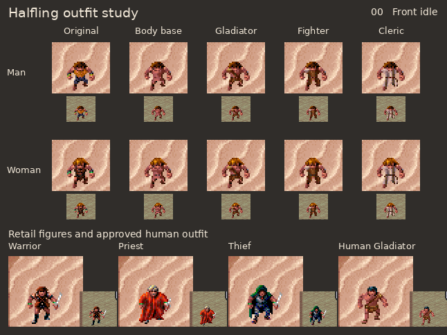

# Halfling outfit study

The first fitting covers the Gladiator, Fighter and Cleric on both halflings. Each row starts with the retail figure and the cleaned body. The large figures appear at 2× on arena sand, with game-size copies on darker paving. The retail Warrior (1252), Priest (1563), Thief (630) and the approved human Gladiator share those scales and floors. Retail references switch to a labeled idle where their picture sets omit a combat pose.

[Compare leather and linen beside retail art in idle and profile walk](halfling-materials.png) · [Male pose sheet](halfling-man-poses.png) · [Female pose sheet](halfling-woman-poses.png)

## Fit and material

At game size the Cleric is the easiest to identify on both floors. The long hem and the shadow running into it carry through the profile walk, even though the retail Priest has room for more folds. The two leather outfits read closest in profile step 2 (12), especially under the woman’s hair. Look below the raised forearm for the Fighter’s longer hip flaps, and above the Gladiator’s wrap for exposed skin.

| Outfit | Where to look |
|---|---|
| Gladiator | In front idle (00), trace the diagonal strap from the bronze guard to the short hide wrap. Compare the light on its turned edge with the leather on the retail Warrior. In rear walk step 1 (07), the woman’s hair hides much of the strap. The wrap below it carries the design. |
| Fighter | A bone guard sits on the upper arm above a fitted leather jerkin. In profile step 2 (12), the raised arm passes across the ribs and exposes the short back edge. Compare with the Gladiator in the adjacent column at game size. The narrow torso in profile leaves little space between the guard and the belt. |
| Cleric | Cream linen falls below the two leather hems. In profile step 2 (12), the shadow under the fold lifts with the bent knee. Compare the progression from lit cloth to dark recess with the retail Priest. Side strike 2 (22) shows the lower edge over the extended leg. |

The cleaned man and woman use their own retail walk and combat pictures (2068/2069 and 2070/2071). The outfit patterns follow the turning shoulders, hip, and hem in each native pose. The study keeps their bare feet. These are empty-slot art proposals.

## Roster

Halflings can be Clerics, Druids, Fighters, Gladiators, Psionicists, Rangers and Thieves. Druid, Psionicist, Ranger and Thief are the remaining singles.

The twelve pairs are Cleric/Fighter, Cleric/Psionicist, Cleric/Ranger, Cleric/Thief, Druid/Fighter, Druid/Psionicist, Druid/Thief, Fighter/Psionicist, Fighter/Thief, Psionicist/Ranger, Psionicist/Thief and Ranger/Thief. The two triples are Fighter/Psionicist/Thief and Psionicist/Ranger/Thief. [Class roster](../../PLAYER-GUIDE.md#races) · [Multiclass table](../../PLAYER-GUIDE.md#more-than-one-class)
