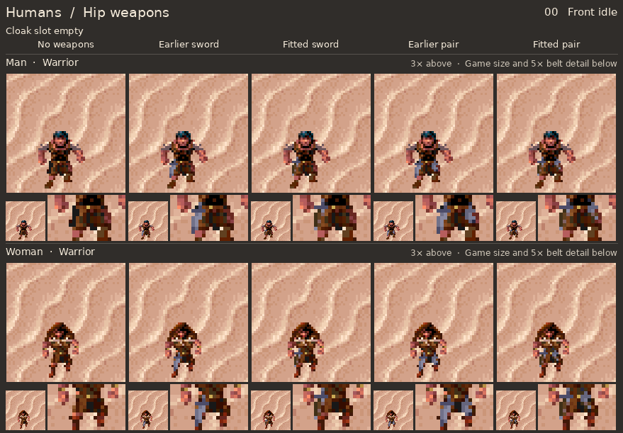

# Weapons at the hip

Read across each row from the figure with empty hands to the metal long sword, then the same sword paired with an obsidian dagger in the other hand. The earlier and fitted columns use the same pose, loadout and floor. Follow the dark leather from the opening at the belt to the fitting at the tip, then watch the rear and profile views to see where the arm or cloak passes in front.

| Figure | Front, rear and profile walks |
|---|---|
| Human man and woman | [Warriors](hip-walk-human.gif) |
| Dwarf man and woman | [Fighters](hip-walk-dwarf.gif) |
| Elf man and woman | [Fighters](hip-walk-elf.gif) |
| Half-elf man and woman | [Fighters](hip-walk-half-elf.gif) |
| Half-giant man and woman | [Fighters](hip-walk-half-giant.gif) |
| Halfling man and woman | [Fighters](hip-walk-halfling.gif) |
| Male Mul | [Fighter](hip-walk-mul.gif) |
| Thri-kreen | [Original party figure](hip-walk-thri-kreen.gif) |
| Class cloaks | [Human woman Thief and half-giant man Ranger](hip-walk-class-cloaks.gif) |

Each humanoid fighter first turns and walks with an empty cloak slot, then repeats all three directions wearing a cloak. The Thief and Ranger show the cloak already built into their class outfit. The thri-kreen retains its original shell. Under each 3× figure, the left image is game size and the right is a 5× crop of the same belt area across all five columns.

The elf woman’s equipped girdle also sits two pixels higher in front idle and three higher on the first front step, where the jerkin extends below her waist. For a check inside the game, the human Warrior, half-giant Fighter and halfling Fighter wore the long sword and dagger separately, together and under a cloak. [Compare 25 DOSBox views](../../../playtest/logs/img/2026-11-26-hip-weapons-dosbox.png)

The comparison renders the earlier columns with the Loader and outfit layers from `b833c37`. To reproduce it, run `python prototypes/hipwalkreview.py GAME_DIR OUTPUT_DIR --previous-checkout CHECKOUT` with that revision in a separate checkout. [All weapon poses and the quiver comparison](weapon-motion.md)
