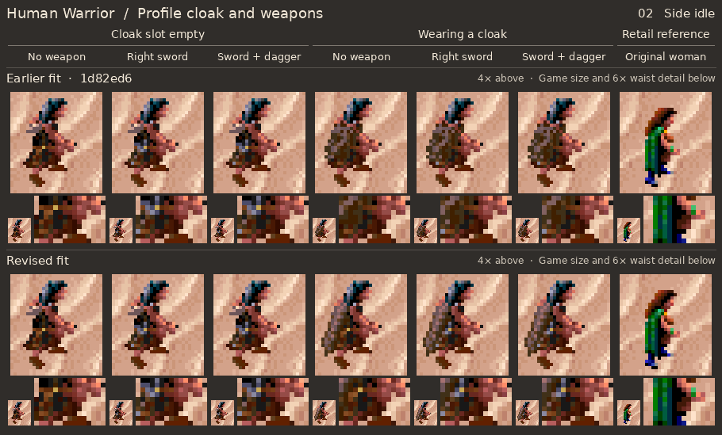

# Weapons at the hip

## Human Warrior in profile

The equipped cloak on the human man had a short, rounded hem that blended into the Warrior’s leather kilt. Its two long folds now hang below the hip in side idle, sweep back as the leg advances and settle toward the calf on the last step. The Priest and Gladiator wear the same cut over their own clothes.

The first three columns show the Warrior with empty slots, a right-hand sword, then the sword and left-hand dagger. The next three repeat those loadouts with a cloak. The far-side dagger is hidden in this profile, so the sword and paired columns match through all four steps. Look at the cloak-only column first, then follow its trailing edge and the exposed sword fittings. The original Shattered Lands woman walks alongside him so the swing of the retail cloak is visible at the same scale.

The upper row uses `1d82ed6`. Each figure includes the original game size and a 6× detail of its waist and upper legs. [Inspect the second profile step](hip-profile-human.png) · [Compare the Warrior in DOSBox](https://github.com/daaki85/darksun-obsidian-edition/blob/claude/class-outfits/playtest/logs/img/2026-11-26-human-profile-cloak-dosbox.png)

## All figures

Read across each row from the figure with empty hands to the metal long sword, then the same sword paired with an obsidian dagger in the other hand. The earlier and fitted columns use the same pose, loadout and floor. Follow the dark leather from the opening at the belt to the fitting at the tip, then watch the rear and profile views to see where the arm or cloak passes in front.

| Figure | Front, rear and profile walks |
|---|---|
| Human man and woman | [Warriors](hip-walk-human.gif) |
| Dwarf man and woman | [Fighters](hip-walk-dwarf.gif) |
| Elf man and woman | [Fighters](hip-walk-elf.gif) |
| Half-elf man and woman | [Fighters](hip-walk-half-elf.gif) |
| Half-giant man and woman | [Fighters](hip-walk-half-giant.gif) |
| Halfling man and woman | [Fighters](hip-walk-halfling.gif) |
| Male Mul | [Fighter](hip-walk-mul.gif) |
| Thri-kreen | [Original party figure](hip-walk-thri-kreen.gif) |
| Class cloaks | [Human woman Thief and half-giant man Ranger](hip-walk-class-cloaks.gif) |

Each humanoid fighter first turns and walks with an empty cloak slot, then repeats all three directions wearing a cloak. The Thief and Ranger show the cloak already built into their class outfit. The thri-kreen retains its original shell. Under each 3× figure, the left image is game size and the right is a 5× crop of the same belt area across all five columns.

The elf woman’s equipped girdle also sits two pixels higher in front idle and three higher on the first front step, where the jerkin extends below her waist. For a check inside the game, the human Warrior, half-giant Fighter and halfling Fighter wore the long sword and dagger separately, together and under a cloak. [Compare 25 DOSBox views](https://github.com/daaki85/darksun-obsidian-edition/blob/1d82ed695172781aebe2460449cda1030b8bbeac/playtest/logs/img/2026-11-26-hip-weapons-dosbox.png)

The all-figure comparison renders the earlier columns with the Loader and outfit layers from `b833c37`. To reproduce it, run `python prototypes/hipwalkreview.py GAME_DIR OUTPUT_DIR --previous-checkout CHECKOUT` with that revision in a separate checkout. For the focused human comparison, run `python prototypes/hipprofilereview.py GAME_DIR OUTPUT_DIR --previous-checkout CHECKOUT` with a checkout of `1d82ed6`. [All weapon poses and the quiver comparison](weapon-motion.md)
