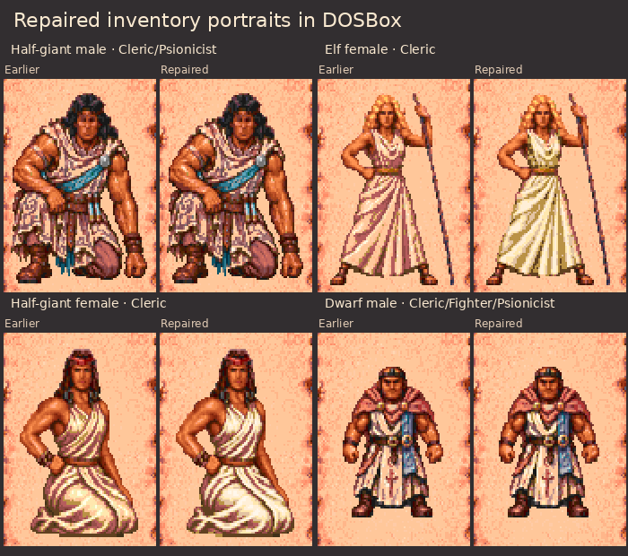

# Shattered Lands inventory roster in DOSBox

The gallery covers **292 distinct portraits**. Select a race, then a class combination, to open the full 320 × 240 inventory screenshot. Each race page also groups the portraits at game scale. The thri-kreen uses one design for all 16 of its legal class combinations.

[Download all 292 transparent native-size PNGs](native-inventory-portraits.zip)

| Race | Distinct portraits | Builds pictured |
| --- | ---: | --- |
| [Human](human/README.md) | 16 | Eight active classes for each figure |
| [Dwarf](dwarf/README.md) | 24 | Five singles and seven multiclasses for each figure |
| [Elf](elf/README.md) | 75 | Seven singles and 30 multiclasses for each figure, plus Cilla |
| [Half-elf](half-elf/README.md) | 96 | Eight singles and 40 multiclasses for each figure |
| [Half-giant](half-giant/README.md) | 20 | Five singles and five pairs for each figure |
| [Halfling](halfling/README.md) | 42 | Seven singles and 14 multiclasses for each figure |
| [Mul](mul/README.md) | 18 | Six singles, nine pairs and three triples |
| [Thri-kreen](thri-kreen/README.md) | 1 | Six singles, seven pairs and three triples |

## Cloth and palette repairs

The repair pass changed 231 portraits, filling 7,580 transparent pixels inside garments and recoloring 11,288 opaque pixels. Cleric linen uses steady cream, ochre and brown from the game palette. The original paintings guided the placement of highlights and shadows. Small transparent openings around accessories, limbs and hems were reviewed separately from solid fabric. The elf Cleric and half-giant Cleric/Psionicist match the approved preview pixel for pixel.

## Inventory checks

Every revised portrait has a fresh full inventory capture from DOSBox using a disposable GOG Shattered Lands slave-pens save. Party members were selected by race, figure and class at the normal inventory screen. Earlier captures were retained for portraits with identical PNGs. All 307 selections were checked against the final archive, including all 16 builds that share the thri-kreen portrait.

The check covered the full 91 × 142 portrait region. Opaque pixels matched within four RGB levels per channel, allowing for VGA palette expansion. Transparent pixels matched an empty parchment capture exactly. Five original head pixels across four male half-giant portraits use the current area's palette entry 19. Their blue channel reads 77 in the pens and 72 in the source palette. The checks use the measured game color for those pixels. [Per-build pixel checks](dosbox-checks.csv)

The branch contains the artwork and its in-game captures. The complete roster was enabled in the test installation. [Approved preview](https://github.com/daaki85/darksun-obsidian-edition/blob/771e371773001f11a1badd31d0f6ef159fff9b10/obsidian-edition/docs/class-outfits/previews/inventory-portrait-proof.png) · [Previous DOSBox gallery](https://github.com/daaki85/darksun-obsidian-edition/blob/4a2d51c4be9aff036bc8fbe9d4e3a249a8b13b73/obsidian-edition/docs/class-outfits/inventory-roster/README.md)
