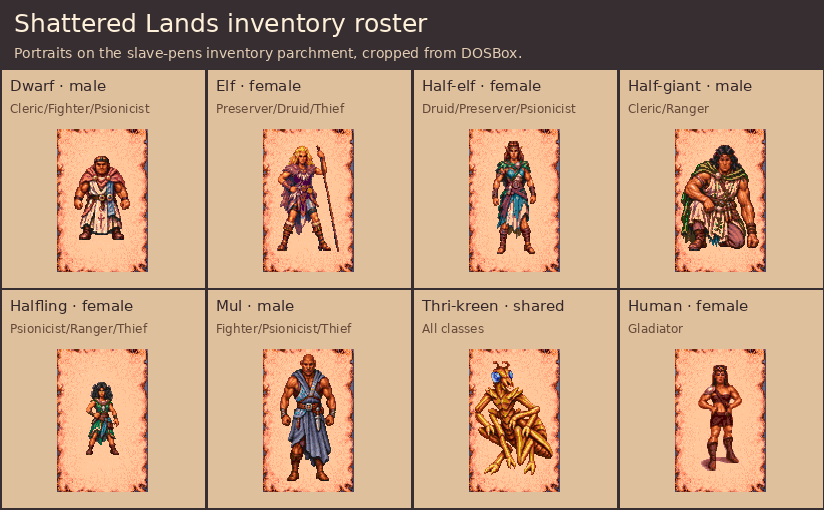

# Shattered Lands inventory roster in DOSBox

The gallery covers **292 distinct portraits**. Select a race, then a class combination, to open the full 320 × 240 inventory screenshot. Each race page also groups the portraits at game scale. The thri-kreen uses one design for all 16 of its legal class combinations.

[Download all 292 transparent native-size PNGs](native-inventory-portraits.zip)

| Race | Distinct portraits | Builds pictured |
| --- | ---: | --- |
| [Human](human/README.md) | 16 | Eight active classes for each figure |
| [Dwarf](dwarf/README.md) | 24 | Five singles and seven multiclasses for each figure |
| [Elf](elf/README.md) | 75 | Seven singles and 30 multiclasses for each figure, plus Cilla |
| [Half-elf](half-elf/README.md) | 96 | Eight singles and 40 multiclasses for each figure |
| [Half-giant](half-giant/README.md) | 20 | Five singles and five pairs for each figure |
| [Halfling](halfling/README.md) | 42 | Seven singles and 14 multiclasses for each figure |
| [Mul](mul/README.md) | 18 | Six singles, nine pairs and three triples |
| [Thri-kreen](thri-kreen/README.md) | 1 | Six singles, seven pairs and three triples |

## What was checked

The new pass covers 271 portraits in 286 race, figure and class selections. Each native source was read from the published single-class or multiclass art archive, passed through the game's steady-color conversion, and encoded at its retail figure dimensions. The test added the pictures to a disposable copy of the GOG game's prepared RESOURCE.GFF at the normal inventory picture IDs. The original stock entries stayed available for fallback.

The test loaded disposable copies of the slave-pens save with the figure, race, and actual class slots set for each party member. Selecting a member in the inventory let the existing DOS helper pick the picture from the class bits. Several staged party members share a figure and have different builds. Cilla's preset was tested on Cilla with Preserver, Druid and Thief in her three class slots. The portraits and names in the left party strip identify the saved adventurers. The gallery labels identify their staged builds.

Every newly painted pixel matched its source within four RGB levels per channel, allowing for VGA expansion. Four male half-giant portraits retained a total of five stock head pixels at palette index 19. Their blue channel read 77 in the pens and 72 in the source palette. A separate DOSBox capture of index 19 confirmed this area color. After accounting for that stock color, every opaque pixel passed. Every transparent pixel in the central 91 × 142 screen region matched the bare inventory parchment. [Per-build verification results](dosbox-checks.csv)

The 16 human portraits and five other women Gladiators retain their previously verified art and captures. The ZIP includes the exact PNGs used for those earlier checks. This branch publishes art and test evidence. The full nonhuman selection was enabled in the test installation. [Earlier DOSBox captures](https://github.com/daaki85/darksun-obsidian-edition/tree/8dba2152/obsidian-edition/docs/class-outfits/portrait-touchups/comparisons) · [Offline map-outfit comparisons](https://github.com/daaki85/darksun-obsidian-edition/blob/88c6837b/obsidian-edition/docs/class-outfits/whole-figure-studies/map-comparisons/README.md)
