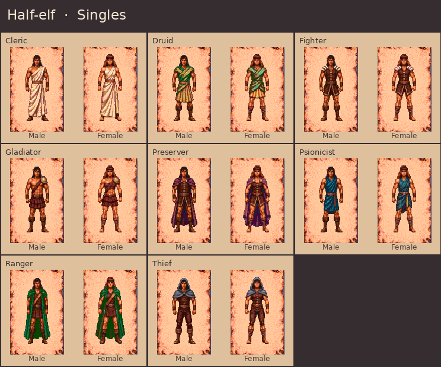
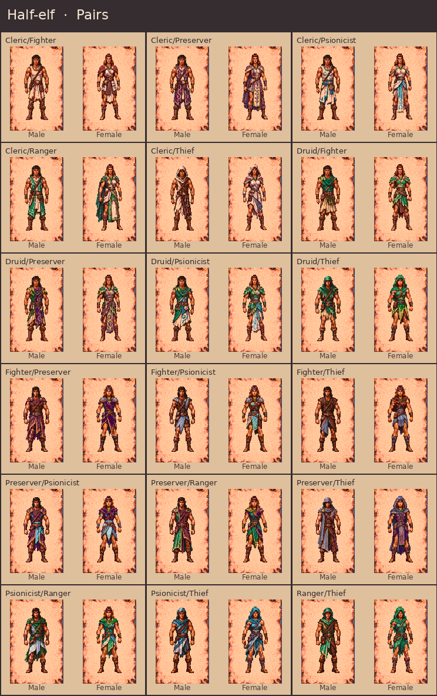
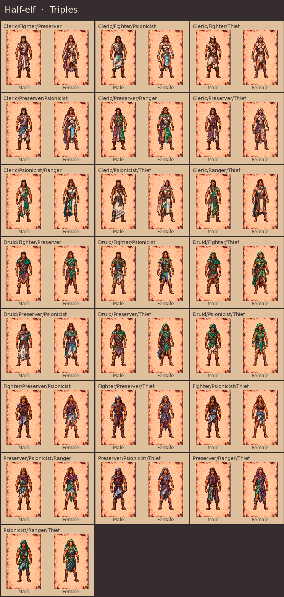

# Half-elf inventory portraits

Each character link opens the full 320 × 240 DOSBox inventory capture. The overview images show the parchment at game scale.

## Single classes

| Build | DOSBox inventory |
| --- | --- |
| Cleric | [Male](male-cleric.png) · [Female](female-cleric.png) |
| Druid | [Male](male-druid.png) · [Female](female-druid.png) |
| Fighter | [Male](male-fighter.png) · [Female](female-fighter.png) |
| Gladiator | [Male](male-gladiator.png) · [Female](female-gladiator.png) |
| Preserver | [Male](male-preserver.png) · [Female](female-preserver.png) |
| Psionicist | [Male](male-psionicist.png) · [Female](female-psionicist.png) |
| Ranger | [Male](male-ranger.png) · [Female](female-ranger.png) |
| Thief | [Male](male-thief.png) · [Female](female-thief.png) |

## Two classes

| Build | DOSBox inventory |
| --- | --- |
| Cleric/Fighter | [Male](male-cleric-fighter.png) · [Female](female-cleric-fighter.png) |
| Cleric/Preserver | [Male](male-cleric-preserver.png) · [Female](female-cleric-preserver.png) |
| Cleric/Psionicist | [Male](male-cleric-psionicist.png) · [Female](female-cleric-psionicist.png) |
| Cleric/Ranger | [Male](male-cleric-ranger.png) · [Female](female-cleric-ranger.png) |
| Cleric/Thief | [Male](male-cleric-thief.png) · [Female](female-cleric-thief.png) |
| Druid/Fighter | [Male](male-druid-fighter.png) · [Female](female-druid-fighter.png) |
| Druid/Preserver | [Male](male-druid-preserver.png) · [Female](female-druid-preserver.png) |
| Druid/Psionicist | [Male](male-druid-psionicist.png) · [Female](female-druid-psionicist.png) |
| Druid/Thief | [Male](male-druid-thief.png) · [Female](female-druid-thief.png) |
| Fighter/Preserver | [Male](male-fighter-preserver.png) · [Female](female-fighter-preserver.png) |
| Fighter/Psionicist | [Male](male-fighter-psionicist.png) · [Female](female-fighter-psionicist.png) |
| Fighter/Thief | [Male](male-fighter-thief.png) · [Female](female-fighter-thief.png) |
| Preserver/Psionicist | [Male](male-preserver-psionicist.png) · [Female](female-preserver-psionicist.png) |
| Preserver/Ranger | [Male](male-preserver-ranger.png) · [Female](female-preserver-ranger.png) |
| Preserver/Thief | [Male](male-preserver-thief.png) · [Female](female-preserver-thief.png) |
| Psionicist/Ranger | [Male](male-psionicist-ranger.png) · [Female](female-psionicist-ranger.png) |
| Psionicist/Thief | [Male](male-psionicist-thief.png) · [Female](female-psionicist-thief.png) |
| Ranger/Thief | [Male](male-ranger-thief.png) · [Female](female-ranger-thief.png) |

## Three classes

| Build | DOSBox inventory |
| --- | --- |
| Cleric/Fighter/Preserver | [Male](male-cleric-fighter-preserver.png) · [Female](female-cleric-fighter-preserver.png) |
| Cleric/Fighter/Psionicist | [Male](male-cleric-fighter-psionicist.png) · [Female](female-cleric-fighter-psionicist.png) |
| Cleric/Fighter/Thief | [Male](male-cleric-fighter-thief.png) · [Female](female-cleric-fighter-thief.png) |
| Cleric/Preserver/Psionicist | [Male](male-cleric-preserver-psionicist.png) · [Female](female-cleric-preserver-psionicist.png) |
| Cleric/Preserver/Ranger | [Male](male-cleric-preserver-ranger.png) · [Female](female-cleric-preserver-ranger.png) |
| Cleric/Preserver/Thief | [Male](male-cleric-preserver-thief.png) · [Female](female-cleric-preserver-thief.png) |
| Cleric/Psionicist/Ranger | [Male](male-cleric-psionicist-ranger.png) · [Female](female-cleric-psionicist-ranger.png) |
| Cleric/Psionicist/Thief | [Male](male-cleric-psionicist-thief.png) · [Female](female-cleric-psionicist-thief.png) |
| Cleric/Ranger/Thief | [Male](male-cleric-ranger-thief.png) · [Female](female-cleric-ranger-thief.png) |
| Druid/Fighter/Preserver | [Male](male-druid-fighter-preserver.png) · [Female](female-druid-fighter-preserver.png) |
| Druid/Fighter/Psionicist | [Male](male-druid-fighter-psionicist.png) · [Female](female-druid-fighter-psionicist.png) |
| Druid/Fighter/Thief | [Male](male-druid-fighter-thief.png) · [Female](female-druid-fighter-thief.png) |
| Druid/Preserver/Psionicist | [Male](male-druid-preserver-psionicist.png) · [Female](female-druid-preserver-psionicist.png) |
| Druid/Preserver/Thief | [Male](male-druid-preserver-thief.png) · [Female](female-druid-preserver-thief.png) |
| Druid/Psionicist/Thief | [Male](male-druid-psionicist-thief.png) · [Female](female-druid-psionicist-thief.png) |
| Fighter/Preserver/Psionicist | [Male](male-fighter-preserver-psionicist.png) · [Female](female-fighter-preserver-psionicist.png) |
| Fighter/Preserver/Thief | [Male](male-fighter-preserver-thief.png) · [Female](female-fighter-preserver-thief.png) |
| Fighter/Psionicist/Thief | [Male](male-fighter-psionicist-thief.png) · [Female](female-fighter-psionicist-thief.png) |
| Preserver/Psionicist/Ranger | [Male](male-preserver-psionicist-ranger.png) · [Female](female-preserver-psionicist-ranger.png) |
| Preserver/Psionicist/Thief | [Male](male-preserver-psionicist-thief.png) · [Female](female-preserver-psionicist-thief.png) |
| Preserver/Ranger/Thief | [Male](male-preserver-ranger-thief.png) · [Female](female-preserver-ranger-thief.png) |
| Psionicist/Ranger/Thief | [Male](male-psionicist-ranger-thief.png) · [Female](female-psionicist-ranger-thief.png) |
