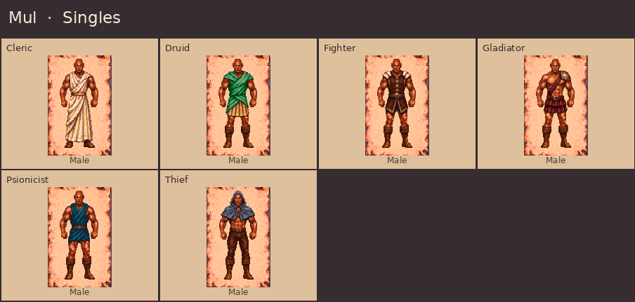
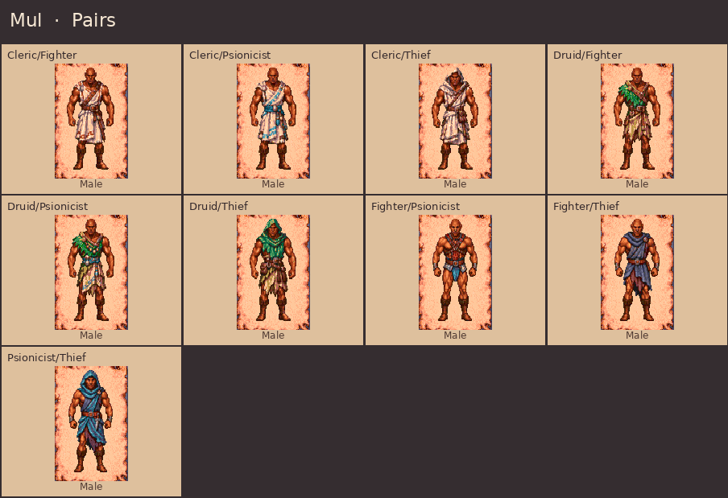
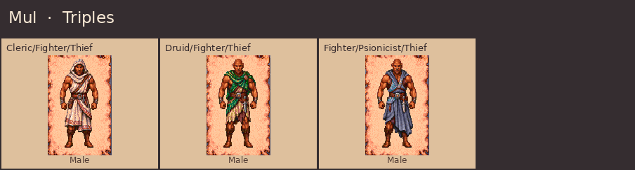

# Mul inventory portraits

Each character link opens the full 320 × 240 DOSBox inventory capture. The overview images show the parchment at game scale.

## Single classes

| Build | DOSBox inventory |
| --- | --- |
| Cleric | [Male](male-cleric.png) |
| Druid | [Male](male-druid.png) |
| Fighter | [Male](male-fighter.png) |
| Gladiator | [Male](male-gladiator.png) |
| Psionicist | [Male](male-psionicist.png) |
| Thief | [Male](male-thief.png) |

## Two classes

| Build | DOSBox inventory |
| --- | --- |
| Cleric/Fighter | [Male](male-cleric-fighter.png) |
| Cleric/Psionicist | [Male](male-cleric-psionicist.png) |
| Cleric/Thief | [Male](male-cleric-thief.png) |
| Druid/Fighter | [Male](male-druid-fighter.png) |
| Druid/Psionicist | [Male](male-druid-psionicist.png) |
| Druid/Thief | [Male](male-druid-thief.png) |
| Fighter/Psionicist | [Male](male-fighter-psionicist.png) |
| Fighter/Thief | [Male](male-fighter-thief.png) |
| Psionicist/Thief | [Male](male-psionicist-thief.png) |

## Three classes

| Build | DOSBox inventory |
| --- | --- |
| Cleric/Fighter/Thief | [Male](male-cleric-fighter-thief.png) |
| Druid/Fighter/Thief | [Male](male-druid-fighter-thief.png) |
| Fighter/Psionicist/Thief | [Male](male-fighter-psionicist-thief.png) |
