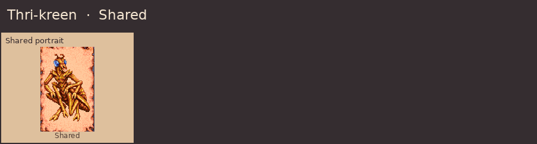

# Thri-kreen inventory portraits

Each character link opens the full 320 × 240 DOSBox inventory capture. The overview images show the parchment at game scale.

## Single classes

| Build | DOSBox inventory |
| --- | --- |
| Cleric | [View](shared-cleric.png) |
| Druid | [View](shared-druid.png) |
| Fighter | [View](shared-fighter.png) |
| Gladiator | [View](shared-gladiator.png) |
| Psionicist | [View](shared-psionicist.png) |
| Ranger | [View](shared-ranger.png) |

## Two classes

| Build | DOSBox inventory |
| --- | --- |
| Cleric/Fighter | [View](shared-cleric-fighter.png) |
| Cleric/Psionicist | [View](shared-cleric-psionicist.png) |
| Cleric/Ranger | [View](shared-cleric-ranger.png) |
| Druid/Fighter | [View](shared-druid-fighter.png) |
| Druid/Psionicist | [View](shared-druid-psionicist.png) |
| Fighter/Psionicist | [View](shared-fighter-psionicist.png) |
| Psionicist/Ranger | [View](shared-psionicist-ranger.png) |

## Three classes

| Build | DOSBox inventory |
| --- | --- |
| Cleric/Fighter/Psionicist | [View](shared-cleric-fighter-psionicist.png) |
| Cleric/Psionicist/Ranger | [View](shared-cleric-psionicist-ranger.png) |
| Druid/Fighter/Psionicist | [View](shared-druid-fighter-psionicist.png) |
