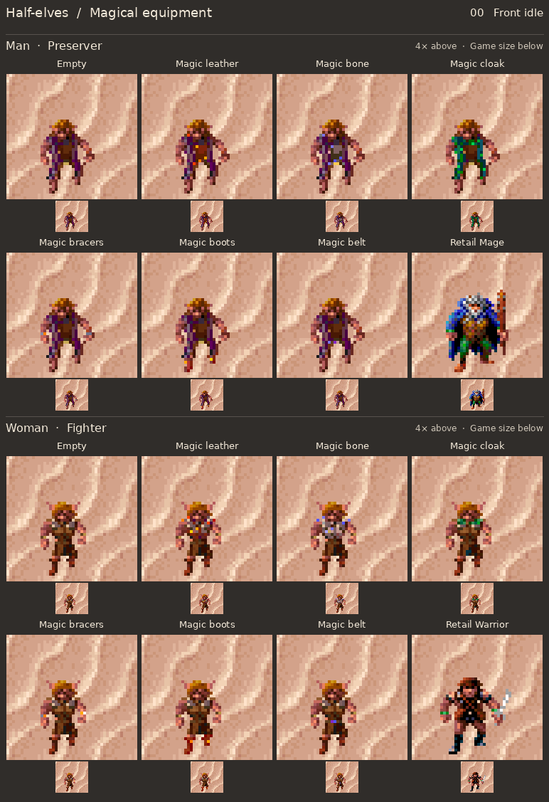

# Magical equipment in motion

Read across a row to watch the same figure and pose with empty slots and five separately equipped items. The large sprite is 3×. Below it is the same sprite at game size. During the idle hold, watch the glints move while the folds, shoulder guards and feet remain still. Each loop includes the full front, rear and profile walks, every strike, all three bow poses, the hit and the fall.

**Half-elf Fighter.** In the older front idle, ten ivory pixels connected the guards across the woman’s chest. The guards now rise separately with the shoulders, exposing the shaded leather between them. Look at the woman in the lower row, first empty and then wearing leather or bone. [Compare the guards before and after](half-elf-fighter-shoulders.png)

## All 14 party figures

| Race | What appears in the Loader animation |
|---|---|
| [Human](magic-gear-human.gif) | Male Psionicist and female Priest |
| [Dwarf](magic-gear-dwarf.gif) | Male Cleric/Fighter and female Fighter/Psionicist/Thief |
| [Elf](magic-gear-elf.gif) | Male Preserver/Ranger and female Cleric/Psionicist |
| [Half-elf](magic-gear-half-elf.gif) | Male Preserver and female Fighter |
| [Half-giant](magic-gear-half-giant.gif) | Both original figures |
| [Halfling](magic-gear-halfling.gif) | Both original figures |
| [Mul](magic-gear-mul.gif) | The original male figure |
| [Thri-kreen](magic-gear-thri-kreen.gif) | All six columns show the original shell. The game excludes these five items for this race. |

## What to follow

| Item in the gallery | Visible material and shine |
|---|---|
| Legcrusher’s Inixhide +1 | The visible chest fabric takes the leather dye. Fire-colored glints follow the material. |
| Bone Scale Chest Armor +1 | A test copy of the retail bone chest piece has a +1 bonus. It uses the bone shades and a blue shimmer. |
| Cloak of Elvenkind | Green shine follows the visible folds as the cloak trails, settles behind the arm or covers the lower garment. |
| Bracers of Defense AC 5 | The shine sits on visible wrist cuffs. Watch the wrist pass the shoulder in a strike. A sleeve, shield or robe can hide a cuff. |
| Boots of Speed | Look for the red leather and fire-colored glint on each exposed foot as it lifts. Robes can hide both feet. |

On the original half-giants, follow the cloak at the shoulder through the front strike, then watch the two upturned boots in the fall. On the dwarf, compare the bracer’s position with the bone cap above it.

The gallery uses the Loader’s encoded walk and combat pictures. Pose holds are extended for inspection. The color runs use RGB samples and approximate timing measured on the Slave Pens map in DOSBox. Blue advanced about every 84 ms, fire and violet about every 167 ms, and green about every 209 ms.

This short DOSBox capture shows four stationary figures with the equipped sprites staged in a disposable copy of the game. The female half-elf Fighter in leather is at the top of the group. The elf in the green cloak is at left, the dwarf wearing bracers and boots is at right, and the human Priest in bone armor is closest to the viewer. The attached Loader was also checked separately through equip and removal. [Original-size map capture](magic-gear-dosbox.gif) · [Live equip/remove checks](https://github.com/daaki85/darksun-obsidian-edition/blob/claude/class-outfits/playtest/logs/2026-11-25-class-equipment.md#magical-worn-equipment)

## Class outfits awaiting equipment fitting

These three loops compare the empty outfit, plain leather, enchanted leather, plain bone and enchanted bone. The preview estimates the exposed chest fabric from the approved study art. The playable base-figure loops above show how the cloak, bracers and boots currently fit in the Loader.

[Half-elf Druid and Cleric/Preserver](magic-study-half-elves.gif) · [Half-giant Cleric/Fighter and Psionicist](magic-study-half-giants.gif) · [Halfling Cleric/Thief, halfling Fighter/Psionicist and Mul Druid/Fighter](magic-study-halflings-mul.gif)
