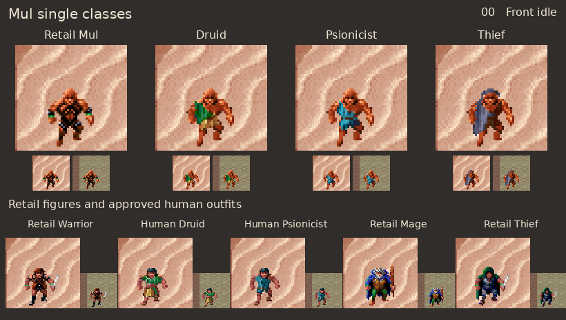
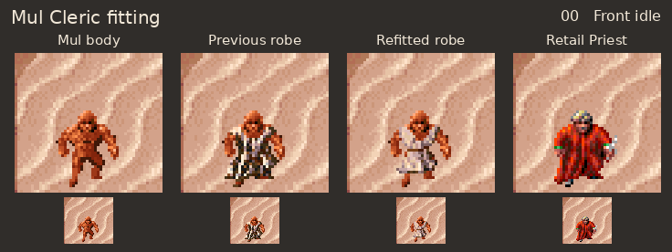

# Mul outfit study

Shattered Lands uses one map figure for male and female Muls. All six single classes are fitted to that figure through the 29 native poses. These galleries show art-study renders with equipment slots empty. [Inspect the shared body and all six outfits in every pose](mul-singles-poses.png)

## Druid, Psionicist and Thief

The top row shows the retail Mul followed by the three new outfits. The small copies beneath each figure show game size on sand and paving. The bottom row follows the retail Warrior, Mage and Thief alongside the approved human Druid and Psionicist. A retail reference returns to idle when its picture set lacks the corresponding action.

| Outfit | Where to look |
|---|---|
| Druid | In profile step two (12) the short green cape swings back from the shoulder and the ochre wrap follows the forward thigh. In rear step two (08) the curved folds part above the wrap. |
| Psionicist | The sleeveless teal tunic follows the open neckline. In side bow (26), follow the copper draw hand across the folded chest and the leather tie at the waist. |
| Thief | Compare side idle (02) with the four profile steps (11–14). The hood rim follows the brow, its back seam falls toward the shoulder, and the longer slate cloak swings behind the stride. Front strike two (16) shows the cheek and jaw inside the opening. |

The frame review covered all 87 new dressed poses. It checked the visible hand and bow pixels against the underlying figure and examined the Thief’s face opening separately from its covered crown. The silhouettes were checked for new enclosed gaps and detached pixels. The approved body, Gladiator, Fighter and Cleric match the earlier pose sheet in all 29 poses.

## Face and neckline

In the previous fitting the cream collar reached the cheek in the side walk and cut across the lower jaw in the front strike. The close-ups compare that collar at `cab055c` with the open neckline. In front strike 2 (16), follow the shadow beneath the mouth from the retail Mul to the cleaned body and dressed figure. In side walk step 2 (12), the cheek ends above exposed throat as the near shoulder comes forward. The small figure beside each crop shows the same pose at game size.

The Fighter’s neckline and the Gladiator’s strap use the same exposed skin where they approach the jaw. All three outfits were reviewed in all 29 poses.

## Cleric fitting comparison

The first robe borrowed the human Priest’s sleeve and hem positions. In rear steps 07–10 the sleeves hung beyond the elbows. In side steps 11–14 the folds followed the human stride. The revised wrap has short sleeves, a belt at the Mul’s waist and a continuous linen skirt. Watch step 12 for the bare forearm crossing the belt and the hem lifting away from the trailing foot. Rear step 08 shows the shallow seam across the shoulder blades.

## Gladiator, Fighter and Cleric

The Gladiator and Fighter also received small corrections where leather crossed a foreground forearm. Side idle (02), the four profile steps (11–14) and the follow-through (17) show the change on both. The frame review covered all 87 dressed poses with empty equipment slots. Face and bow pixels matched the retail source, visible hand landmarks matched the body base, and the silhouettes had no new enclosed gaps or detached pixels.

[Inspect all 29 poses at your own pace](mul-poses.png)

| Outfit | Where to look |
|---|---|
| Gladiator | In front idle (00) and the rear walk (07–10), follow the diagonal strap to the hip. Copper skin shows on either side of the strap. A dark lower edge separates the leather kilt from the advancing thigh. |
| Fighter | Compare the shoulders and upper back with the Gladiator in rear idle (01). The bone guard sits at the shoulder and the dark jerkin covers the back between the arms. |
| Cleric | Watch the linen swing behind the calf in the profile walk (11–14). In side step two (12) the hand passes in front of the folds. The side bow (26) shows the draw hand and bow against the cream robe. |

The fittings use the retail Mul’s walking and combat pictures (2093 and 2094). The cleaned body keeps the original stance, scalp, jaw and copper highlights. The skin under the harness and shorts follows the muscle shading of the corresponding human pose. The human garments supplied the leather and bone references. The revised linen follows cross-sections traced on each Mul pose, with texture sampled from the back of the retail Priest’s robe.

The remaining Mul art studies are the nine legal pairs and three triples. [Playable classes and combinations](../../PLAYER-GUIDE.md)
